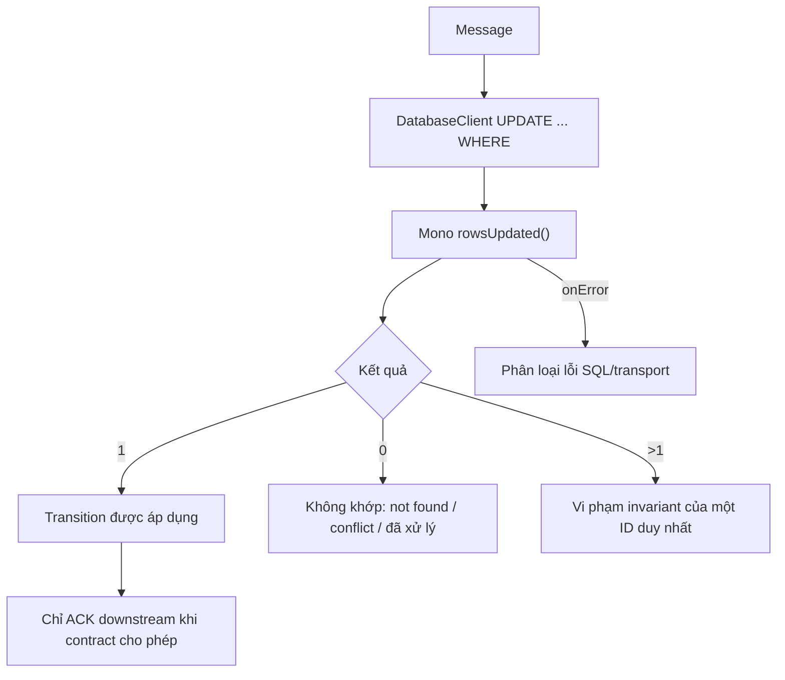
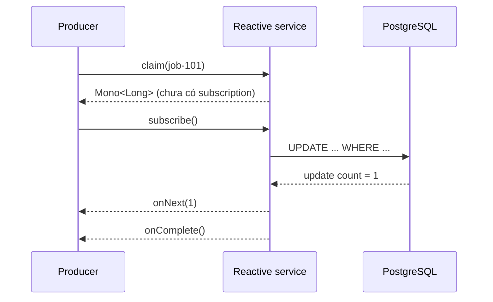
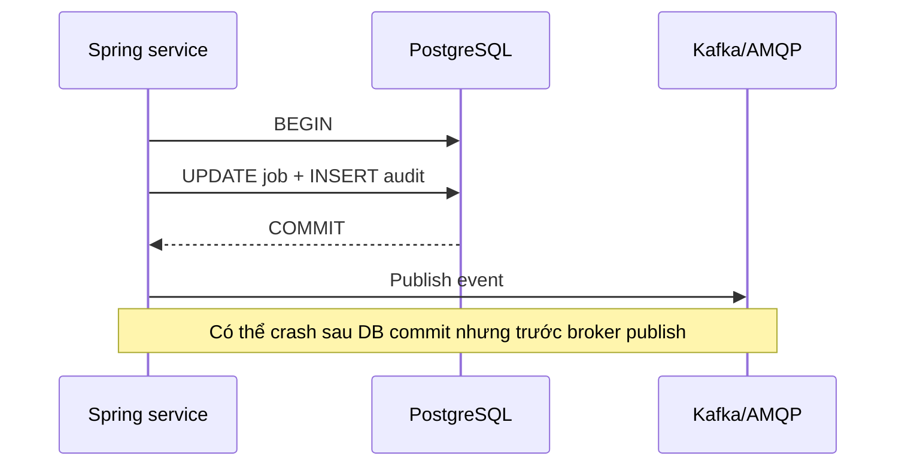
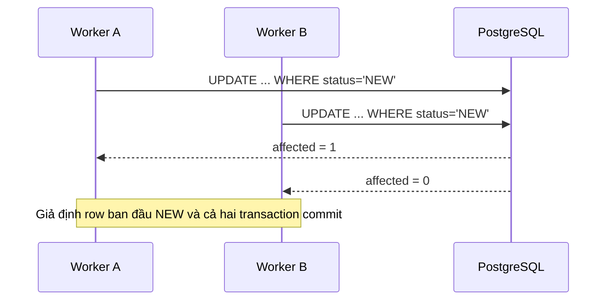

# Reactive update và affected rows

> **Chương:** Adapter R2DBC  
> **Module:** SPRING_INTEGRATION_ADAPTERS  
> **Bối cảnh module:** Kết nối các hệ thống ngoài vào Spring Integration bằng inbound/outbound adapter, gateway, poller và MessageChannel. Thực hành luồng trao đổi qua file, SFTP, HTTP, JMS, AMQP, Kafka và cơ sở dữ liệu; chú trọng hợp đồng message, xử lý lỗi và vòng đời kết nối.

## 1. Mục tiêu học tập

Sau bài này, bạn có thể:

- Giải thích **reactive UPDATE** là một thao tác SQL chỉ chạy khi reactive Publisher được subscribe, và **affected rows** là số hàng database báo đã bị tác động.
- Phân biệt kết quả `0`, `1`, `>1` và **onError**; không đồng nhất row count với trạng thái nghiệp vụ.
- Viết câu `UPDATE ... WHERE ...` có điều kiện bằng `DatabaseClient`, dùng `fetch().rowsUpdated()` nhận `Mono<Long>`.
- Cấu hình `R2dbcEntityTemplate.update(...).matching(...).apply(...)` với Spring Data `Criteria` và `Update`, cũng nhận `Mono<Long>`.
- Dùng optimistic locking (`@Version` hoặc điều kiện `version=:expected`), compare-and-set và affected-row check để chống lost update.
- Hiểu khác biệt giữa **R2DBC outbound channel adapter** `R2dbcMessageHandler` (thường hoàn tất `Mono<Void>`) và custom service cần **trả row count**.
- Thiết kế state transition `NEW → PROCESSING → DONE` với owner/token, idempotency và xử lý timeout không biết kết quả.
- Cấu hình reactive transaction với `TransactionalOperator` để cập nhật dữ liệu và ghi audit atomically.
- Thực hiện `UPDATE ... RETURNING` của PostgreSQL khi cần **hàng mới**, không chỉ số hàng.
- Kiểm thử bằng `StepVerifier`/PostgreSQL, xử lý lỗi pool/lock/transaction/retry và giám sát hoạt động trong Spring Integration flow.

## 2. Tình huống: một Spring Message yêu cầu cập nhật database

Một inbound adapter nhận thông báo xử lý đơn hàng từ HTTP, JMS, AMQP hoặc Kafka. Spring Integration chuyển thông báo đến một service ghi trạng thái công việc trong PostgreSQL:

```text
Command: CLAIM(job-101, worker-A)
SQL:     UPDATE delivery_jobs
         SET status='PROCESSING', claim_owner='worker-A'
         WHERE job_id='job-101' AND status='NEW'

Kết quả có thể là:
  affected rows = 1 -> SQL cập nhật đúng một hàng
  affected rows = 0 -> không có hàng nào khớp điều kiện
  error             -> không có kết quả DML hợp lệ để diễn giải
```

Đây là lý do **affected rows** quan trọng. Một câu UPDATE không phát lỗi SQL **không chứng minh** đã thay đổi hàng mà nghiệp vụ mong đợi.



**Nguyên tắc:** affected-row count là một tín hiệu **từ SQL statement**, còn ACK nghiệp vụ, giao hàng đến hệ thống ngoài và tính nhất quán giữa nhiều hệ thống cần được quyết định riêng.

### 2.1. Ba lớp của một update

| Lớp | Đơn vị | Câu hỏi |
| --- | --- | --- |
| **Spring Integration** | `Message<ClaimCommand>` và `MessageChannel` | Command có được đưa đến handler hay chưa? |
| **R2DBC / SQL** | `Mono<Long>` của `rowsUpdated()` | Câu UPDATE hoàn tất? Có bao nhiêu row bị tác động? |
| **Nghiệp vụ** | `ClaimOutcome`/ACK | Đúng công việc được claim, đúng owner, có thể phát task tiếp không? |

Một message được đưa vào `MessageChannel` không phải bằng chứng database đã commit. Một lệnh UPDATE hoàn tất không phải bằng chứng HTTP/Kafka/AMQP downstream đã xử lý.

## 3. Affected rows chính xác là gì?

Khi database xử lý `UPDATE`, driver có thể báo **update count**, tức số hàng được báo là đã tác động bởi câu SQL. Với `DatabaseClient` của Spring Framework 6.x:

```java
Mono<Long> updated = databaseClient
        .sql("UPDATE delivery_jobs SET status = 'DONE' " +
             "WHERE job_id = :jobId AND status = 'PROCESSING'")
        .bind("jobId", "job-101")
        .fetch()
        .rowsUpdated();
```

Đây là một **Publisher**. Chỉ định `Mono<Long>` không đồng nghĩa query đã chạy; subscription mới kích hoạt thao tác.

### 3.1. Đọc bốn kiểu kết quả

| Kết quả | Có thể kết luận | Không thể kết luận |
| --- | --- | --- |
| **`1`** | Database báo đúng một row khớp và bị UPDATE tác động. | Không chứng minh các hệ thống ngoài đã ACK hay business command chưa từng chạy trước đó. |
| **`0`** | Không có row phù hợp với toàn bộ điều kiện của UPDATE tại thời điểm statement có hiệu lực. | Không suy ra chắc chắn `job_id` không tồn tại; có thể đã đổi status/version/owner. |
| **`>1`** | Nhiều row thỏa điều kiện (nếu query cho phép). | Không tự coi là thành công khi nghiệp vụ chỉ cho phép một đối tượng. |
| **`onError`** | Câu lệnh/phần truy cập DB gặp lỗi theo pipeline. | Không tự kết luận transaction chắc chắn chưa commit nếu lỗi/timeout xảy ra gần thời điểm commit. |

**Điểm tinh tế:** trên PostgreSQL, `UPDATE` có thể báo một row được update ngay cả khi giá trị SET giống giá trị cũ. Vì thế **affected rows không nhất thiết là số hàng có giá trị thực sự thay đổi**. Hãy định nghĩa trạng thái đúng bằng `WHERE` và business invariant.

### 3.2. Phân biệt 0 row và SQL error

Ví dụ:

```sql
UPDATE delivery_jobs
SET status = 'PROCESSING'
WHERE job_id = 'not-exists' AND status = 'NEW';
```

Nếu không có row khớp, kết quả thông thường là **0 affected rows** và statement hoàn tất. Ngược lại, thiếu cột, constraint violation, DB down hoặc permission denied là **error**, không phải `0`.

Trong Reactor:

- `Mono.just(0L)`: tín hiệu dữ liệu có giá trị `0`.
- `Mono.just(1L)`: tín hiệu dữ liệu có giá trị `1`.
- `Mono.error(exception)`: lỗi.
- `Mono.empty()`: không phát phần tử; **không đồng nghĩa `0`**.

Không dùng `defaultIfEmpty(0L)` để che mọi lỗi; `onError` không phải `onComplete` rỗng.

### 3.3. Ảnh hưởng của dialect và driver

Số hàng trả về phụ thuộc hợp đồng R2DBC driver, SQL dialect và cách tiêu thụ `Result`. Với bài này, ví dụ lấy PostgreSQL/Spring Framework 6.x làm chuẩn. Các statement đặc biệt, stored procedures, batch hoặc SQL trả nhiều result sets cần **test driver thật** trước khi dùng count làm quyết định nghiệp vụ.

## 4. R2DBC reactive: SQL chạy khi được subscribe



`DatabaseClient`, `R2dbcEntityTemplate` và nhiều Spring Data R2DBC methods trả **cold Publisher**. Khi subscribe lại, SQL **có thể chạy lại**.

```java
Mono<Long> claim = repository.claim("job-101", "worker-A");

// Tại đây mới tạo Publisher.
// Chưa chứng minh SQL đã chạy.

Mono<String> result = claim.map(count ->
        count == 1L ? "CLAIMED" : "NOT_CLAIMED");
```

Nếu cùng `claim` được subscribe hai lần, hai lệnh UPDATE có thể chạy tại hai thời điểm khác nhau; ví dụ lần đầu trả `1`, lần sau trả `0` vì trạng thái đã chuyển từ `NEW` sang `PROCESSING`.

**Không gọi `subscribe()` vô tội vạ** trong repository/service. Trả Publisher tới Spring WebFlux, reactive message handler hoặc caller có trách nhiệm subscribe và điều phối completion/error.

### 4.1. Vì sao retry có thể phát lại UPDATE?

`retryWhen(...)` về cơ bản có thể subscribe lại nguồn khi gặp lỗi. Nếu UPDATE trước đó đã commit nhưng client gặp timeout/connection reset trước khi nhận update count, lần retry chạy lại SQL.

Với chuyển trạng thái **`NEW → PROCESSING`**, WHERE có điều kiện khiến retry thường trả `0` sau lần đầu thành công. Nhưng `0` phải được **đối soát owner/token** để biết "tôi đã claim" hay "người khác claim".

Với `SET balance = balance + 100`, retry có thể **cộng hai lần**. Không gọi một UPDATE là idempotent chỉ vì nó nằm trong `Mono`.

## 5. Chuẩn bị ứng dụng Spring Boot và PostgreSQL

Ví dụ dùng **Java 17+, Spring Boot 3.x, Spring Framework 6.x, Spring Data R2DBC 3.x và Spring Integration 6.1+**. Giữ dependency versions tương thích bằng Spring Boot BOM; API cụ thể ở phiên bản khác phải được đối chiếu khi triển khai.

### 5.1. Maven dependencies

```xml
<dependencies>
    <dependency>
        <groupId>org.springframework.boot</groupId>
        <artifactId>spring-boot-starter-integration</artifactId>
    </dependency>
    <dependency>
        <groupId>org.springframework.boot</groupId>
        <artifactId>spring-boot-starter-data-r2dbc</artifactId>
    </dependency>
    <dependency>
        <groupId>org.springframework.integration</groupId>
        <artifactId>spring-integration-r2dbc</artifactId>
    </dependency>
    <dependency>
        <groupId>org.postgresql</groupId>
        <artifactId>r2dbc-postgresql</artifactId>
        <scope>runtime</scope>
    </dependency>
    <dependency>
        <groupId>io.projectreactor</groupId>
        <artifactId>reactor-test</artifactId>
        <scope>test</scope>
    </dependency>
</dependencies>
```

Để dùng pool R2DBC có thể cần thêm `io.r2dbc:r2dbc-pool` theo cấu hình/BOM của dự án. Không nhầm R2DBC PostgreSQL driver với JDBC driver.

### 5.2. Cấu hình R2DBC

Ví dụ `application.yml`:

```yaml
spring:
  r2dbc:
    url: r2dbc:postgresql://127.0.0.1:5432/integration_demo
    username: ${DB_USER}
    password: ${DB_PASSWORD}
```

Đây là các placeholder Spring Boot lấy từ **biến môi trường**, không phải mật khẩu thật trong repository. Trong môi trường production, cần TLS, authentication, database user có quyền tối thiểu và quản lý secret đúng chuẩn.

### 5.3. Bảng delivery_jobs

Tạo schema sau trong database **test**:

```sql
CREATE TABLE delivery_jobs (
    job_id          VARCHAR(64) PRIMARY KEY,
    status          VARCHAR(24) NOT NULL DEFAULT 'NEW',
    payload_json    TEXT NOT NULL,
    claim_owner     VARCHAR(64),
    claim_token     VARCHAR(64),
    attempt_count   INTEGER NOT NULL DEFAULT 0,
    version         BIGINT NOT NULL DEFAULT 0,
    updated_at      TIMESTAMPTZ NOT NULL DEFAULT NOW(),
    processed_at    TIMESTAMPTZ
);

CREATE INDEX idx_jobs_status_updated
    ON delivery_jobs(status, updated_at, job_id);

INSERT INTO delivery_jobs(job_id, status, payload_json)
VALUES
    ('job-101', 'NEW', '{"deviceId":"sensor-01"}'),
    ('job-102', 'NEW', '{"deviceId":"sensor-02"}'),
    ('job-103', 'DONE', '{"deviceId":"sensor-03"}');
```

Quy ước:

| Trường | Vai trò |
| --- | --- |
| `job_id` | Khóa duy nhất theo nghiệp vụ; `PRIMARY KEY` giúp UPDATE một ID tối đa một row. |
| `status` | Trạng thái `NEW`, `PROCESSING`, `DONE`, `RETRY` hoặc `DEAD`. |
| `claim_owner` | Worker được giao xử lý. |
| `claim_token` | Token ổn định của **một yêu cầu claim** để đối soát retry. |
| `attempt_count` | Số lượt claim được ghi nhận. |
| `version` | Phiên bản cho optimistic concurrency. |
| `updated_at` | Theo dõi thời điểm thay đổi. |
| `processed_at` | Thời điểm hoàn tất nghiệp vụ. |

Schema trên phục vụ học tập. Muốn recovery khi worker chết cần bổ sung **lease_until**, claim timeout, attempt policy và cơ chế quét task kẹt; `PROCESSING` đơn thuần không đủ cho hệ thống production.

### 5.4. Các DTO và trạng thái

Tạo `ClaimCommand.java`:

```java
public record ClaimCommand(
        String jobId,
        String workerId,
        String claimToken
) {
}
```

Tạo hai tệp `ClaimStatus.java` và `ClaimOutcome.java` (mỗi kiểu `public` trong một tệp riêng):

```java
public enum ClaimStatus {
    CLAIMED,
    NOT_CLAIMED,
    ALREADY_APPLIED,
    CONFLICT
}
```

```java
public record ClaimOutcome(
        String jobId,
        ClaimStatus status,
        long affectedRows
) {
}
```

Trong Java, mỗi kiểu `public` cần tệp riêng theo tên kiểu; các đoạn trên được trình bày riêng để học. `affectedRows` là chỉ số từ SQL, còn `ClaimStatus` là cách ứng dụng **diễn giải** chỉ số đó theo contract.

## 6. DatabaseClient UPDATE và Mono<Long>

### 6.1. Repository thực hiện claim

Tạo `DeliveryJobRepository.java`:

```java
import org.springframework.r2dbc.core.DatabaseClient;
import org.springframework.stereotype.Repository;
import reactor.core.publisher.Mono;

@Repository
public class DeliveryJobRepository {

    private final DatabaseClient db;

    public DeliveryJobRepository(DatabaseClient db) {
        this.db = db;
    }

    public Mono<Long> tryClaim(ClaimCommand cmd) {
        requireValid(cmd);

        return db.sql(
                        "UPDATE delivery_jobs " +
                        "SET status = 'PROCESSING', " +
                        "    claim_owner = :owner, " +
                        "    claim_token = :token, " +
                        "    attempt_count = attempt_count + 1, " +
                        "    version = version + 1, " +
                        "    updated_at = CURRENT_TIMESTAMP " +
                        "WHERE job_id = :id AND status = 'NEW'")
                .bind("id", cmd.jobId())
                .bind("owner", cmd.workerId())
                .bind("token", cmd.claimToken())
                .fetch()
                .rowsUpdated();
    }

    private static void requireValid(ClaimCommand cmd) {
        if (cmd == null
                || !valid(cmd.jobId())
                || !valid(cmd.workerId())
                || !valid(cmd.claimToken())) {
            throw new IllegalArgumentException(
                    "Invalid job/worker/token");
        }
    }

    private static boolean valid(String value) {
        return value != null
                && value.matches("[A-Za-z0-9_-]{1,64}");
    }
}
```

**Giải thích từng bước:**

1. `sql(...)` mô tả UPDATE với named parameters.
2. `WHERE job_id=:id AND status='NEW'` là **điều kiện compare-and-set**.
3. `bind(...)` truyền giá trị an toàn; không nối ID từ input thô vào câu SQL.
4. `attempt_count = attempt_count + 1` chỉ chạy khi WHERE khớp.
5. `version = version + 1` tăng phiên bản mỗi khi claim thành công.
6. `fetch().rowsUpdated()` trả `Mono<Long>`; dòng SQL thực hiện khi có subscription.
7. `1` nghĩa là một hàng được UPDATE; `0` cần đối soát, không tự coi command chắc chắn thất bại.

**Cảnh báo:** Java `requireValid(...)` ở đây ném exception **trước khi trả Mono** nếu input sai. Đây là lỗi validation đồng bộ có chủ đích; lỗi DB sau subscription vẫn đến qua `onError` trong Publisher.

### 6.2. Bản UPDATE có điều kiện nhưng đơn giản hơn

Để học sự khác biệt giữa row count và business outcome:

```java
Mono<Long> affected = db.sql(
                "UPDATE delivery_jobs " +
                "SET status = 'DONE', processed_at = CURRENT_TIMESTAMP " +
                "WHERE job_id = :id AND status = 'PROCESSING'")
        .bind("id", "job-101")
        .fetch()
        .rowsUpdated();
```

Nếu `job-101` còn `NEW`, query này **không** cập nhật; count = `0`. Không có lỗi SQL nào xảy ra. Đừng viết `affected.then()` ngay nếu caller cần phân biệt 0/1, bởi `then()` **bỏ giá trị count** và chỉ giữ tín hiệu complete/error.

### 6.3. Diễn giải affected rows

```java
public Mono<ClaimOutcome> claimOnce(ClaimCommand cmd) {
    return tryClaim(cmd)
            .map(count -> {
                if (count == 1L) {
                    return new ClaimOutcome(
                            cmd.jobId(), ClaimStatus.CLAIMED, count);
                }
                if (count == 0L) {
                    return new ClaimOutcome(
                            cmd.jobId(), ClaimStatus.NOT_CLAIMED, count);
                }
                throw new IllegalStateException(
                        "Expected at most one affected row: " + count);
            });
}
```

Đây là một method **bổ sung trong `DeliveryJobRepository`**, gọi `tryClaim(...)` phía trên. Với `PRIMARY KEY(job_id)`, `count>1` là vi phạm invariant đáng cảnh báo; không nên âm thầm coi nó là success.

`NOT_CLAIMED` là kết quả kỹ thuật ban đầu; mục 7 sẽ phân biệt **đã claim bởi chính mình**, **bị người khác claim** và **không tồn tại**.

## 7. Tại sao 0 affected rows không có nghĩa NOT_FOUND?

Giả sử `tryClaim("job-101")` trả 0. Có ít nhất bốn khả năng:

1. `job-101` không tồn tại.
2. `job-101` đã `DONE`.
3. Worker khác đã claim và chuyển sang `PROCESSING`.
4. **Chính request này đã claim thành công lần trước**, nhưng kết quả từ DB bị mất, caller retry cùng `claimToken`.

Vì vậy không được trả `404 Not Found` chỉ từ `count=0`. Một bước đọc trạng thái sau đó có thể giúp diễn giải:

```java
public record ClaimSnapshot(
        String status,
        String owner,
        String token
) {
}
```

Bổ sung vào `DeliveryJobRepository`:

```java
public Mono<ClaimSnapshot> findClaimSnapshot(String jobId) {
    return db.sql(
                    "SELECT status, claim_owner, claim_token " +
                    "FROM delivery_jobs WHERE job_id = :id")
            .bind("id", jobId)
            .map((row, metadata) -> new ClaimSnapshot(
                    row.get("status", String.class),
                    row.get("claim_owner", String.class),
                    row.get("claim_token", String.class)
            ))
            .one();
}
```

`Mono.empty()` lúc này đại diện row không tồn tại. Đây khác với `Mono.just(0L)` của UPDATE.

### 7.1. Đối soát theo token

```java
public Mono<ClaimOutcome> claimAndReconcile(ClaimCommand cmd) {
    return tryClaim(cmd).flatMap(count -> {
        if (count == 1L) {
            return Mono.just(new ClaimOutcome(
                    cmd.jobId(), ClaimStatus.CLAIMED, count));
        }
        if (count != 0L) {
            return Mono.error(new IllegalStateException(
                    "Unexpected update count=" + count));
        }

        return findClaimSnapshot(cmd.jobId())
                .map(row -> {
                    boolean sameClaim =
                            "PROCESSING".equals(row.status())
                            && cmd.workerId().equals(row.owner())
                            && cmd.claimToken().equals(row.token());

                    return new ClaimOutcome(
                            cmd.jobId(),
                            sameClaim
                                    ? ClaimStatus.ALREADY_APPLIED
                                    : ClaimStatus.CONFLICT,
                            0L);
                })
                .defaultIfEmpty(new ClaimOutcome(
                        cmd.jobId(), ClaimStatus.NOT_CLAIMED, 0L));
    });
}
```

**Đây là mẫu đối soát minh họa.** Nó xác minh trạng thái tại một thời điểm, **không** làm câu UPDATE + SELECT trở thành một transaction bảo vệ khỏi mọi race. Trong hệ thống nhiều worker, sau lần SELECT trạng thái vẫn có thể thay đổi. Mẫu còn chủ động phân loại trạng thái `DONE` là `CONFLICT` dù cùng token; production phải định nghĩa cách nhận biết yêu cầu đã hoàn tất, có thể qua idempotency record/kết quả bền vững. Muốn một kết quả có tính nhất quán mạnh, thiết kế transaction/isolation hoặc một SQL `UPDATE ... RETURNING` với contract phù hợp.

`claimToken` phải ổn định qua retry của **cùng yêu cầu**. Nếu mỗi attempt tạo token mới, không thể phân biệt một lần claim đã thành công nhưng mất reply với một claim hoàn toàn khác.

### 7.2. Quy tắc ACK theo ClaimOutcome

| ClaimStatus | Ý nghĩa | Điều tiếp theo nên làm |
| --- | --- | --- |
| `CLAIMED` | Lệnh UPDATE hiện tại tác động đúng một row. | Worker có thể bắt đầu xử lý theo contract. |
| `ALREADY_APPLIED` | Không UPDATE trên lần này, DB cho thấy cùng token/owner đang sở hữu. | Có thể tiếp tục/đối soát theo policy idempotency. |
| `CONFLICT` | Row tồn tại nhưng không còn ở trạng thái/owner phù hợp. | Không xử lý thay người khác; trả conflict hoặc ghi nhận để điều tra. |
| `NOT_CLAIMED` | Sau count 0, không thấy row. | Có thể trả not found theo contract, xét race/consistency. |
| **onError/timeout** | Không có kết quả SQL tin cậy. | Không gán success/failure mù; giữ trạng thái chưa rõ và đối soát. |

Số row là **dữ liệu đầu vào** để quyết định, không phải toàn bộ quyết định.

## 8. R2dbcEntityTemplate: update bằng Criteria và Update

Spring Data R2DBC có API fluent thao tác entity:

```java
import org.springframework.data.r2dbc.core.R2dbcEntityTemplate;
import org.springframework.data.relational.core.query.Criteria;
import org.springframework.data.relational.core.query.Query;
import org.springframework.data.relational.core.query.Update;
import reactor.core.publisher.Mono;

public Mono<Long> markDone(
        R2dbcEntityTemplate template,
        String jobId) {

    Query filter = Query.query(
            Criteria.where("job_id").is(jobId)
                    .and("status").is("PROCESSING"));

    Update changes = Update.update("status", "DONE");

    return template.update(DeliveryJob.class)
            .matching(filter)
            .apply(changes);
}
```

Ví dụ trên giả định `DeliveryJob.class` được mapping bằng `@Table("delivery_jobs")` và các cột tương ứng. `.apply(changes)` trả **`Mono<Long>` số hàng UPDATE**, không phải entity đã sửa.

### 8.1. Entity để Spring Data ánh xạ

```java
import org.springframework.data.annotation.Id;
import org.springframework.data.relational.core.mapping.Column;
import org.springframework.data.relational.core.mapping.Table;

@Table("delivery_jobs")
public record DeliveryJob(
        @Id @Column("job_id") String jobId,
        String status,
        @Column("claim_owner") String claimOwner,
        @Column("version") Long version
) {
}
```

`R2dbcEntityTemplate` dùng converter/metadata để quyết định tên bảng/cột. `DatabaseClient` với SQL raw dùng tên cột do bạn tự viết. **Không trộn tên property Java với tên cột SQL** mà không có mapping/naming strategy rõ ràng.

### 8.2. Query + Update không cần entity đang load

Trong bản `markDone(...)`, bạn không cần SELECT entity trước khi UPDATE. Câu `UPDATE WHERE status='PROCESSING'` được thực hiện trực tiếp, giảm một round trip so với kiểu:

```text
SELECT row;
if status == PROCESSING:
    UPDATE row;
```

Mẫu SELECT rồi UPDATE không có điều kiện ở câu UPDATE dễ mắc **time-of-check/time-of-use race** nếu worker khác đổi status giữa hai thao tác. Đẩy precondition vào SQL `WHERE` giúp database đánh giá điều kiện tại lúc update.

### 8.3. Template update(entity) khác update().matching().apply()

Hai API phục vụ hai nhu cầu:

| API | Kiểu kết quả | Khi dùng |
| --- | --- | --- |
| `template.update(entity)` | `Mono<Entity>` đã được lưu theo API Spring Data. | Khi có entity với metadata ID/version và muốn nhận entity. |
| `template.update(Entity.class).matching(query).apply(update)` | `Mono<Long>`. | Khi muốn cập nhật theo điều kiện và kiểm tra **affected rows**. |
| `DatabaseClient.sql(...).fetch().rowsUpdated()` | `Mono<Long>`. | Khi cần SQL cụ thể, atomic increment, CTE, dialect-specific clause. |
| `DatabaseClient.sql("UPDATE ... RETURNING ...").map(...).one()` | `Mono<ResultRow>`. | Khi cần trả dữ liệu mới từ PostgreSQL. |

Chọn API dựa trên **hợp đồng kết quả**, không chọn chỉ vì cú pháp ngắn hơn.

## 9. Optimistic locking và version

### 9.1. Vấn đề lost update

Hai worker đọc cùng row có `version=3`:

```text
Worker A đọc status=NEW, version=3
Worker B đọc status=NEW, version=3
Worker A ghi PROCESSING, version=4
Worker B cũng ghi giá trị khác nếu không kiểm tra version
```

Nếu UPDATE chỉ dựa vào `job_id`, worker đến sau có thể ghi đè kết quả của worker trước. **Optimistic locking** đưa version vào `WHERE`:

```sql
UPDATE delivery_jobs
SET status = 'PROCESSING',
    version = version + 1,
    updated_at = CURRENT_TIMESTAMP
WHERE job_id = :id
  AND version = :expectedVersion
  AND status = 'NEW';
```

- `count=1`: claim qua compare-and-set thành công.
- `count=0`: row thiếu hoặc version/status đã thay đổi.
- `onError`: sự cố DB/SQL khác, không được gộp với conflict.

### 9.2. DatabaseClient kiểm tra expected version

```java
public Mono<Long> claimWithVersion(
        String jobId,
        long expectedVersion,
        String owner) {

    return db.sql(
                    "UPDATE delivery_jobs " +
                    "SET status='PROCESSING', " +
                    "    claim_owner=:owner, " +
                    "    version=version+1, " +
                    "    updated_at=CURRENT_TIMESTAMP " +
                    "WHERE job_id=:id AND version=:version " +
                    "AND status='NEW'")
            .bind("id", jobId)
            .bind("owner", owner)
            .bind("version", expectedVersion)
            .fetch()
            .rowsUpdated();
}
```

Đoạn này là method bổ sung trong `DeliveryJobRepository`. Nếu cần token idempotency, bổ sung `claim_token=:token` trong SET và đường đối soát khi count 0.

### 9.3. @Version của Spring Data R2DBC

Spring Data hỗ trợ `@Version` khi cập nhật một aggregate/entity. Ví dụ một class entity có version:

```java
import org.springframework.data.annotation.Id;
import org.springframework.data.annotation.Version;
import org.springframework.data.relational.core.mapping.Column;
import org.springframework.data.relational.core.mapping.Table;

@Table("delivery_jobs")
public class VersionedJob {

    @Id
    @Column("job_id")
    private String jobId;

    private String status;

    @Version
    private Long version;

    public String getJobId() { return jobId; }
    public void setJobId(String value) { this.jobId = value; }

    public String getStatus() { return status; }
    public void setStatus(String value) { this.status = value; }

    public Long getVersion() { return version; }
    public void setVersion(Long value) { this.version = value; }
}
```

Khi dùng entity đã được đọc và cập nhật:

```java
Mono<VersionedJob> saved = template.update(existingVersionedJob);
```

Spring Data tự áp dụng version constraint khi update entity theo mapping, và có thể phát `OptimisticLockingFailureException` khi version không còn khớp.

**Phân biệt:**

- `template.update(entity)` với `@Version`: nhận entity hoặc **onError do optimistic locking** theo API.
- `DatabaseClient` tự viết UPDATE + WHERE version: nhận `0` row nếu không khớp, ứng dụng phải tự chuyển thành conflict.
- Fluent `template.update(Entity.class).matching(...).apply(...)`: nhận affected-row count; không đồng nhất với hành vi exception tự động khi cập nhật một `@Version` entity.

Không tạo `VersionedJob` mới bằng ID/version tùy ý rồi kỳ vọng Spring Data tự biết entity có sẵn; quy tắc new-entity detection và metadata cần được hiểu khi dùng `save`/`insert`/`update`.

## 10. PostgreSQL UPDATE RETURNING: cần hàng mới thay vì count

PostgreSQL hỗ trợ câu SQL:

```sql
UPDATE delivery_jobs
SET status = 'PROCESSING',
    claim_owner = :owner,
    claim_token = :token,
    version = version + 1,
    attempt_count = attempt_count + 1,
    updated_at = CURRENT_TIMESTAMP
WHERE job_id = :id AND status = 'NEW'
RETURNING job_id, status, claim_owner, version;
```

`RETURNING` hữu ích khi muốn biết **dữ liệu sau UPDATE** mà không phải chạy SELECT riêng. Dùng `DatabaseClient.map(...).one()` để lấy row trả về:

```java
public record ClaimReceipt(
        String jobId,
        String status,
        String owner,
        Long version
) {
}
```

```java
public Mono<ClaimReceipt> claimReturning(ClaimCommand cmd) {
    return db.sql(
                    "UPDATE delivery_jobs " +
                    "SET status='PROCESSING', " +
                    "    claim_owner=:owner, claim_token=:token, " +
                    "    attempt_count=attempt_count+1, " +
                    "    version=version+1, " +
                    "    updated_at=CURRENT_TIMESTAMP " +
                    "WHERE job_id=:id AND status='NEW' " +
                    "RETURNING job_id, status, claim_owner, version")
            .bind("id", cmd.jobId())
            .bind("owner", cmd.workerId())
            .bind("token", cmd.claimToken())
            .map((row, metadata) -> new ClaimReceipt(
                    row.get("job_id", String.class),
                    row.get("status", String.class),
                    row.get("claim_owner", String.class),
                    row.get("version", Long.class)
            ))
            .one();
}
```

Đây là method trong `DeliveryJobRepository`. Do `WHERE job_id=:id` và PK, query tối đa trả một row. Nếu không có row khớp, `Mono.empty()`; client có thể dùng `switchIfEmpty(...)` để tạo kết quả `NOT_CLAIMED` hoặc đối soát.

### 10.1. RETURNING khác rowsUpdated()

| Mong muốn | Phương thức |
| --- | --- |
| Chỉ cần count của UPDATE | `.fetch().rowsUpdated()`. |
| Cần trạng thái/version mới của PostgreSQL | `UPDATE ... RETURNING` + `.map(...).one()`. |
| Cần nhiều row đã được bulk-update | `UPDATE ... RETURNING` + `.map(...).all()`. |

Đừng dùng `rowsUpdated()` rồi mong nó trả dữ liệu từ `RETURNING`. Hai cách tiêu thụ `Result` có **hợp đồng giá trị khác nhau**. Với SQL không phải PostgreSQL, khả năng `RETURNING` và cú pháp cụ thể khác nhau theo dialect.

### 10.2. RETURNING không thay thế transaction ngoài DB

Một `ClaimReceipt` mô tả kết quả của SQL update. Nó không chứng minh việc publish thông tin sang Kafka/AMQP đã thành công. Nếu cần phát event về claim, ghi một row **outbox** trong cùng transaction SQL rồi đưa sang broker bởi một thành phần riêng.

## 11. R2DBC outbound channel adapter: vì sao không có affected rows reply?

Spring Integration `R2dbcMessageHandler` là một **`ReactiveMessageHandler`** để thực hiện `INSERT`, `UPDATE` hoặc `DELETE` từ Spring Message. Java DSL có thể tạo endpoint:

```java
import java.util.Map;

import org.springframework.context.annotation.Bean;
import org.springframework.context.annotation.Configuration;
import org.springframework.data.r2dbc.core.R2dbcEntityTemplate;
import org.springframework.data.relational.core.query.Criteria;
import org.springframework.integration.config.EnableIntegration;
import org.springframework.integration.dsl.IntegrationFlow;
import org.springframework.integration.r2dbc.dsl.R2dbc;
import org.springframework.integration.r2dbc.outbound.R2dbcMessageHandler;
import org.springframework.messaging.Message;

@Configuration
@EnableIntegration
public class JobR2dbcOutboundConfiguration {

    @Bean
    IntegrationFlow claimWriteFlow(R2dbcEntityTemplate template) {
        return IntegrationFlow
                .from("claimWriteChannel")
                .handleReactive(
                        R2dbc.outboundChannelAdapter(template)
                                .queryType(R2dbcMessageHandler.Type.UPDATE)
                                .tableName("delivery_jobs")
                                .criteria((Message<ClaimCommand> msg) ->
                                        Criteria.where("job_id")
                                                .is(msg.getPayload().jobId())
                                                .and("status").is("NEW"))
                                .values((Message<ClaimCommand> msg) ->
                                        Map.of(
                                                "status", "PROCESSING",
                                                "claim_owner",
                                                    msg.getPayload().workerId(),
                                                "claim_token",
                                                    msg.getPayload().claimToken()
                                        ))
                )
                .get();
    }
}
```

### 11.1. Điều adapter làm

- Nhận một `Message<ClaimCommand>` từ channel.
- Tạo UPDATE bằng `tableName`, `criteria` và `values`.
- Sử dụng Spring Data R2DBC theo **Publisher** reactive.
- `handleReactive(...)` (Spring Integration 6.1+) giúp xử lý subscription theo contract của `ReactiveMessageHandler`.
- Endpoint thường hoàn tất bằng tín hiệu **`Mono<Void>`**, **không tự phát Spring reply mang `rowsUpdated`**.

### 11.2. Điều adapter không tự làm

- Không phát `ClaimOutcome` phân biệt count 0, 1, >1.
- Không bảo đảm `void publish(...)` ở một `@MessagingGateway` đã đợi database commit.
- Không tự có transaction nhiều bảng hoặc broker-wide exactly-once.
- Không tự deduplicate retry của một command ghi.
- Không thay thế custom reactive service khi caller cần strict affected-row check.

Trong ví dụ ở mục 11, một UPDATE tác động **0 row** vẫn có thể hoàn tất SQL mà không có lỗi. Nếu nghiệp vụ yêu cầu xử lý **count=0** như conflict, không nên dùng một outbound adapter mà bỏ qua row count.

### 11.3. Khi cần affected rows trong Spring Integration

Có hai lựa chọn thiết kế:

**Lựa chọn A — xử lý nghiệp vụ ở reactive service** và đưa kết quả ra API/flow có response:

```text
Input ClaimCommand
  -> ClaimService.claim() trả Mono<ClaimOutcome>
  -> caller subscribe / kiểm tra outcome
  -> tiếp tục workflow khi CLAIMED hoặc ALREADY_APPLIED
```

**Lựa chọn B — một chiều nhưng vẫn đánh giá row count trước khi complete**: viết custom `ReactiveMessageHandler` gọi repository rồi ghi metrics, gửi error nếu cần và trả `Mono<Void>`. Nhưng endpoint này **vẫn không phải request-reply gateway**.

### 11.4. Custom ReactiveMessageHandler kiểm tra count

```java
import org.springframework.context.annotation.Bean;
import org.springframework.context.annotation.Configuration;
import org.springframework.integration.config.EnableIntegration;
import org.springframework.integration.dsl.IntegrationFlow;
import org.springframework.messaging.ReactiveMessageHandler;
import reactor.core.publisher.Mono;

@Configuration
@EnableIntegration
public class CheckedClaimFlowConfiguration {

    @Bean
    IntegrationFlow checkedClaimFlow(DeliveryJobRepository repository) {

        ReactiveMessageHandler handler = message -> {
            ClaimCommand cmd = (ClaimCommand) message.getPayload();

            return repository.tryClaim(cmd)
                    .flatMap(count -> {
                        if (count == 1L) {
                            // Side effect ngoài DB chỉ bắt đầu sau khi
                            // UPDATE hoàn tất theo Publisher này.
                            return Mono.<Void>empty();
                        }

                        if (count == 0L) {
                            return Mono.error(new IllegalStateException(
                                    "Claim was not applied: " + cmd.jobId()));
                        }

                        return Mono.error(new IllegalStateException(
                                "Unexpected affected rows: " + count));
                    });
        };

        return IntegrationFlow.from("checkedClaimChannel")
                .handleReactive(handler)
                .get();
    }
}
```

**Quan trọng:** Handler trên chỉ biểu diễn **policy count 1 mới được coi là thành công**; một count 0 có thể thực ra là retry của request đã claim thành công. Production cần `claimAndReconcile(...)` hoặc transaction/idempotency logic phù hợp, không chỉ ném exception. Handler này là **terminal one-way endpoint**; `Mono<Void>` chỉ complete/error, không trả `ClaimOutcome` như một Spring reply.

Nếu muốn caller nhận một `ClaimOutcome`, hãy xây request-reply service/gateway phù hợp và bảo đảm không trả `Mono` như một **payload chưa được subscribe**. Ranh giới giữa reactive publisher và Spring Message reply phải được thiết kế, không tự hình thành từ `handleReactive`.

## 12. Reactive transaction: UPDATE và audit cùng commit

### 12.1. Tại sao một statement count=1 chưa đủ?

Giả sử khi claim thành công, hệ thống cần ghi **audit row**. Nếu UPDATE thành công rồi INSERT audit lỗi, ta không muốn trạng thái job đã đổi nhưng không có dấu vết audit.

Dùng transaction DB để bảo vệ **hai câu SQL cùng tài nguyên R2DBC**.

Tạo bảng:

```sql
CREATE TABLE delivery_job_audit (
    audit_id    BIGSERIAL PRIMARY KEY,
    job_id      VARCHAR(64) NOT NULL,
    claim_token VARCHAR(64) NOT NULL,
    action      VARCHAR(32) NOT NULL,
    created_at  TIMESTAMPTZ NOT NULL DEFAULT NOW(),
    CONSTRAINT uq_job_claim_audit UNIQUE (job_id, claim_token, action)
);
```

### 12.2. Tạo TransactionalOperator

Nếu ứng dụng có `ReactiveTransactionManager` cho cùng R2DBC ConnectionFactory:

```java
import org.springframework.context.annotation.Bean;
import org.springframework.context.annotation.Configuration;
import org.springframework.transaction.ReactiveTransactionManager;
import org.springframework.transaction.reactive.TransactionalOperator;

@Configuration
public class R2dbcTransactionConfiguration {

    @Bean
    TransactionalOperator transactionalOperator(
            ReactiveTransactionManager manager) {
        return TransactionalOperator.create(manager);
    }
}
```

`TransactionalOperator` gắn reactive transaction với **Reactor Context/subscription**; không tương đương một JDBC transaction thread-local có thể tự bao cả HTTP/Kafka.

### 12.3. Service update + audit

```java
import org.springframework.r2dbc.core.DatabaseClient;
import org.springframework.transaction.reactive.TransactionalOperator;
import reactor.core.publisher.Mono;

public class JobClaimTransactionService {

    private final DeliveryJobRepository jobs;
    private final DatabaseClient db;
    private final TransactionalOperator tx;

    public JobClaimTransactionService(
            DeliveryJobRepository jobs,
            DatabaseClient db,
            TransactionalOperator tx) {
        this.jobs = jobs;
        this.db = db;
        this.tx = tx;
    }

    public Mono<ClaimOutcome> claimWithAudit(ClaimCommand cmd) {

        Mono<ClaimOutcome> work = jobs.tryClaim(cmd)
                .flatMap(count -> {
                    if (count == 0L) {
                        return Mono.just(new ClaimOutcome(
                                cmd.jobId(), ClaimStatus.NOT_CLAIMED, 0L));
                    }

                    if (count != 1L) {
                        return Mono.error(new IllegalStateException(
                                "Unexpected affected rows: " + count));
                    }

                    return db.sql(
                                    "INSERT INTO delivery_job_audit " +
                                    "(job_id, claim_token, action) " +
                                    "VALUES (:id, :token, :action)")
                            .bind("id", cmd.jobId())
                            .bind("token", cmd.claimToken())
                            .bind("action", "CLAIMED")
                            .fetch()
                            .rowsUpdated()
                            .flatMap(auditCount -> {
                                if (auditCount != 1L) {
                                    return Mono.error(
                                            new IllegalStateException(
                                                    "Audit insert did not affect 1 row"));
                                }

                                return Mono.just(new ClaimOutcome(
                                        cmd.jobId(),
                                        ClaimStatus.CLAIMED, count));
                            });
                });

        return work.as(tx::transactional);
    }
}
```

**Điều kiện của ví dụ:**

- `DeliveryJobRepository` và `DatabaseClient` phải dùng cùng R2DBC transaction manager/connection factory.
- UPDATE và audit INSERT nằm trong **cùng reactive chain**; không tự `subscribe()` vào từng bước.
- Nếu audit INSERT lỗi, transaction sẽ rollback UPDATE theo cơ chế DB, không để job bị claim nửa chừng.
- `NOT_CLAIMED` ở ví dụ không ghi audit và chỉ phản ánh count 0; nếu cần phân biệt retry đã thành công, dùng đối soát bên ngoài hoặc contract bổ sung.
- Một `Mono` hoàn tất nghĩa là reactive transaction đã kết thúc theo contract; vẫn cần xử lý ngoại lệ mạng khiến caller **không biết chắc kết quả** nếu tín hiệu completion bị mất.

### 12.4. Transaction chỉ bảo vệ database, không bảo vệ Kafka/HTTP



Khi cần phát event đáng tin cậy, dùng **transactional outbox** (ghi outbox cùng transaction với UPDATE), một publisher riêng và consumer idempotent. Không mô tả một DB transaction là "exactly once Kafka delivery".

## 13. Bulk UPDATE và nhiều affected rows

### 13.1. Khi count > 1 là hợp lệ

Không phải mọi UPDATE đều chỉ được chạm một row. Ví dụ bảo trì cần chuyển nhiều job `RETRY` về `NEW`:

```sql
UPDATE delivery_jobs
SET status = 'NEW', updated_at = CURRENT_TIMESTAMP
WHERE status = 'RETRY';
```

Với thao tác này, count `10` có thể hoàn toàn hợp lệ. Business contract phải ghi rõ:

- Count mong đợi có giới hạn/threshold hay không?
- Cần lưu ID các hàng đã cập nhật để audit không?
- Có policy permission cho bulk UPDATE không?
- Có cần batch size để tránh lock/cập nhật quá lớn?
- Transaction/lock có làm chậm worker khác không?

### 13.2. Bulk UPDATE giới hạn phạm vi

Để tránh UPDATE không kiểm soát trên bảng lớn, có thể chọn IDs qua CTE PostgreSQL:

```sql
WITH candidates AS (
    SELECT job_id
    FROM delivery_jobs
    WHERE status = 'RETRY'
    ORDER BY updated_at, job_id
    LIMIT :limit
    FOR UPDATE SKIP LOCKED
)
UPDATE delivery_jobs AS j
SET status = 'NEW', updated_at = CURRENT_TIMESTAMP
FROM candidates
WHERE j.job_id = candidates.job_id
RETURNING j.job_id;
```

Với câu này, `RETURNING` đưa ra các ID thực sự được cập nhật. Có thể map thành `Flux<String>` rồi `collectList()` **khi batch đã bị giới hạn**; độ dài list là số hàng được trả. Đây là SQL riêng của PostgreSQL, cần test với database thật.

### 13.3. Affected count không phải số message trong flow

Nếu `Flux<Message<ClaimCommand>>` có 20 messages, mỗi message thực hiện một UPDATE riêng, thì:

- Có **20 SQL statements** và 20 row counts, mỗi count có thể 0 hoặc 1.
- Tổng `sum(counts)` là tổng số hàng bị UPDATE tác động, không mặc định bằng số messages.
- Một message có thể gây UPDATE nhiều rows nếu WHERE quá rộng.
- Một exception ở giữa batch có thể khiến downstream đã xử lý một phần trước khi thất bại.

Không dùng `maxMessagesPerPoll(1)` để mặc định một UPDATE = một row. Poller giới hạn lượt nhận message, không quyết định số hàng SQL tác động.

## 14. Retry, lỗi giữa chừng và idempotency

### 14.1. Mỗi loại lỗi dẫn tới chính sách khác

| Sự kiện | Có nên retry? | Lưu ý |
| --- | --- | --- |
| Connection refused **trước khi SQL thực thi** | Có thể, với backoff và deadline. | Nếu đã có lượt trước, vẫn cần đối soát trạng thái. |
| DB restart giữa UPDATE | Tùy trạng thái, cần phân loại. | Caller có thể không biết statement/transaction đã commit chưa. |
| Lock timeout/deadlock | Có thể retry transaction **nguyên khối** khi an toàn. | Giới hạn attempts, backoff/jitter, bảo vệ idempotency. |
| Unique constraint audit | Không retry mù. | Có thể là token đã dùng hoặc lỗi invariant. |
| SQL sai cột/bảng | Không retry tự động. | Sửa migration/schema. |
| Count 0 | **Không phải exception**. | Đối soát NOT_FOUND/CONFLICT/ALREADY_APPLIED. |
| Count > 1 khi theo PK | Không retry như transient. | Báo invariant/data integrity bug. |
| Downstream HTTP đã chạy nhưng DB ACK chưa | Cần idempotency/reconcile. | Không thể chỉ dùng update count để suy ra side effect. |

### 14.2. Retry có giới hạn

Ví dụ tư duy về policy:

```java
import java.time.Duration;

import org.springframework.dao.TransientDataAccessException;
import reactor.util.retry.Retry;

Mono<ClaimOutcome> operation = repository.claimAndReconcile(cmd)
        .retryWhen(
                Retry.backoff(2, Duration.ofMillis(200))
                        .maxBackoff(Duration.ofSeconds(2))
                        .filter(error ->
                                error instanceof TransientDataAccessException));
```

**Đoạn code mô tả việc gọi method `claimAndReconcile(cmd)` trong repository ở mục 7**, không phải một class hoàn chỉnh. Trong Spring Data Access, chỉ một số exception thuộc `TransientDataAccessException`; thực tế phải kiểm tra cause/SQLState và policy của driver. Quan trọng nhất là `claimAndReconcile` phải chấp nhận retry an toàn theo **token ổn định**, và nếu kết quả vẫn chưa rõ sau lỗi, cần đối soát trước khi hành động tiếp.

Không retry vô hạn, không retry tất cả `RuntimeException` và không sinh token mới cho cùng một yêu cầu.

### 14.3. Không retry phép tăng số dư một cách mù

```sql
UPDATE wallet_accounts
SET balance = balance + :amount
WHERE account_id = :id;
```

Nếu commit lần đầu thành công nhưng response mất, retry có thể **cộng lại** lần nữa. Mẫu an toàn cần **operation ID** duy nhất được lưu bền, đảm bảo UPDATE và ghi idempotency record cùng transaction; khi nhận lại operation ID, trả kết quả cũ thay vì lặp phép tăng.

Không thể lấy `affectedRows=1` làm bằng chứng "chỉ cộng một lần trong toàn bộ vòng đời yêu cầu".

### 14.4. Retry timeout là trạng thái chưa xác định

Một số thời điểm lỗi:

```text
Client gửi UPDATE
      |
      v
Database UPDATE và COMMIT
      |
      v
Network ngắt trước khi client nhận count
      |
      v
Client thấy timeout / error
```

Trong tình huống này, client không được kết luận "UPDATE chưa xảy ra". Nếu không có `claimToken`, `version` hoặc record trạng thái phục vụ đối soát, retry có thể tạo tác dụng phụ trùng.

**Business state `UNKNOWN` là lựa chọn hợp lệ** khi chưa thể xác minh, thay vì trả thành công/thất bại sai.

## 15. Concurrency, row lock và database isolation

### 15.1. Compare-and-set trong một UPDATE

Với hai worker cố claim cùng `job-101`:



Trong PostgreSQL với row-level locking/isolation phù hợp, một UPDATE có điều kiện cho phép database xử lý cạnh tranh trên row. Đây là nền tảng của compare-and-set.

**Tuy vậy:** không được dùng một phép SELECT trước đó để tuyên bố mình đã sở hữu row. Kết quả quyết định là **UPDATE có điều kiện/claim statement** và affected-row count đã hoàn tất.

### 15.2. Khi cần xử lý nhiều job: SKIP LOCKED

Nhiều worker có thể claim các hàng khác nhau qua mẫu PostgreSQL:

```sql
WITH picked AS (
    SELECT job_id
    FROM delivery_jobs
    WHERE status = 'NEW'
    ORDER BY updated_at, job_id
    LIMIT :batchSize
    FOR UPDATE SKIP LOCKED
)
UPDATE delivery_jobs AS j
SET status = 'PROCESSING',
    attempt_count = attempt_count + 1,
    updated_at = CURRENT_TIMESTAMP
FROM picked
WHERE j.job_id = picked.job_id
RETURNING j.job_id;
```

Đây là claim **một batch** trong một statement. Nhưng để truy vết owner/expiry, cần bổ sung worker ID/token/lease. `SKIP LOCKED` không thay thế deadline/ACK sau downstream và không cho quyền xử lý task mãi mãi.

### 15.3. Đặc tính transaction cần thiết

| Khái niệm | Điểm cần nhớ |
| --- | --- |
| **Atomic statement** | UPDATE + WHERE được database đánh giá như một statement. |
| **Row lock** | Nhiều UPDATE cùng row có thể phải chờ nhau. |
| **Transaction** | Gom nhiều statements để commit/rollback cùng nhau. |
| **Isolation** | Kiểm soát dữ liệu nhìn thấy giữa các transaction theo DB policy. |
| **Optimistic lock** | `WHERE version=:expected` và 0 affected rows báo conflict. |
| **Lease** | Cho phép phục hồi task do worker mất kết nối/chết. |
| **Outbox** | Đưa event cho hệ thống ngoài bằng một cơ chế bền vững. |

Tránh giữ transaction DB mở trong khi gọi HTTP/AMQP/Kafka chậm, vì nó có thể giữ connection và locks lâu. Thay vào đó, thiết kế tách **claim/commit**, **external processing**, **ACK/update**.

## 16. Completion và ACK trong Spring Integration

### 16.1. Nhiều tầng hoàn tất

```text
MessageChannel.send(...) returned
          |
          v
Reactive handler subscribed
          |
          v
UPDATE statement completed with row count
          |
          v
Reactive transaction completed / committed
          |
          v
Business command validated (CLAIMED / CONFLICT / ALREADY)
          |
          v
Downstream HTTP/Kafka/AMQP acknowledged, nếu cần
```

**Không gộp các dấu mốc trên thành một trạng thái "success".** Với outbound channel adapter, một method `void publish(...)` có thể chỉ chứng minh message đã được đưa đến flow.

### 16.2. Ứng dụng phải định nghĩa ACK nào

| Hợp đồng | Khi nào ACK? |
| --- | --- |
| "Đã nhận command vào queue bền vững" | Sau khi enqueue vào broker/storage đủ bền. |
| "Đã UPDATE job trong database" | Sau tín hiệu transaction hoàn tất + outcome đúng. |
| "Đã publish event sang broker" | Sau ACK tương ứng từ broker, hoặc theo outbox contract. |
| "Đã xử lý nhiệm vụ cuối cùng" | Sau side effect nghiệp vụ và cập nhật trạng thái đủ bền. |

Với event từ JMS/AMQP/Kafka, việc tự động ACK nguồn **trước** SQL completion có thể gây mất sự kiện nếu DB ghi thất bại. Hãy xét cách connector upstream áp dụng ack/retry, channel topology đồng bộ/bất đồng bộ và tín hiệu reactive completion.

### 16.3. Cách kiểm chứng cập nhật có hiệu lực

Nếu hệ thống cần báo **CLAIMED** cho caller, thiết kế request-reply API/service trả một kết quả có kiểu rõ:

```java
public interface ClaimService {
    Mono<ClaimOutcome> claim(ClaimCommand command);
}
```

Implement có thể gọi `claimAndReconcile(...)` hoặc transaction service. Khi dùng Spring Integration gateway, phải xác định cách **Publisher được subscribe** và **outcome được đưa về reply**; đừng trả một `Mono` làm payload rồi tự coi một caller chỉ nhận `ClaimOutcome`.

## 17. Backpressure, pool và timeout

### 17.1. Reactive không làm database vô hạn

R2DBC driver có thể thực hiện async I/O, nhưng PostgreSQL vẫn có giới hạn:

- Số DB connections trong pool.
- Transaction/row locks.
- Disk I/O, CPU và network.
- Số concurrent UPDATE statements.
- Thời gian chờ kết nối/pool acquire.
- Bộ đệm ở message channel hoặc broker.

Nếu producer gửi 5.000 commands/s còn database chỉ xử lý được 500/s, pending requests sẽ tăng nếu không giới hạn queue/concurrency.

### 17.2. Ví dụ giới hạn concurrency

Nếu ứng dụng xử lý batch `Flux<ClaimCommand>`:

```java
Flux<ClaimOutcome> outcomes = Flux.fromIterable(commands)
        .flatMap(
                command -> repository.claimAndReconcile(command),
                8
        );
```

Đoạn này giả định `commands` là collection các command đã được validate. `flatMap(..., 8)` giới hạn khoảng **8 inner publishers** đồng thời trong pipeline này. Nó **không** tự giới hạn mọi producer khác của ứng dụng và có thể làm thứ tự kết quả khác thứ tự input.

Nếu bắt buộc tuần tự:

```java
Flux<ClaimOutcome> ordered = Flux.fromIterable(commands)
        .concatMap(repository::claimAndReconcile);
```

Phải đo throughput, lock contention, latency và memory. Đừng mở pool/kết nối vô hạn chỉ để giảm thời gian chờ ngắn hạn.

### 17.3. Các loại timeout

| Timeout | Phạm vi |
| --- | --- |
| Connection timeout | Mở kết nối đến DB. |
| Pool acquire timeout | Chờ connection rảnh. |
| Statement timeout | SQL chạy hoặc đợi lock quá lâu. |
| Transaction timeout | Transaction dài hơn giới hạn. |
| Reactor `timeout(...)` | Giới hạn thời gian theo subscription/operator. |
| Business deadline | Tổng thời gian request và các attempts. |
| Broker ACK deadline | Thời hạn phản hồi nguồn event. |

Một `Mono.timeout(...)` có thể hủy subscription phía client nhưng **không** là bằng chứng server DB chắc chắn đã rollback. Với thao tác ghi có tác dụng phụ, vẫn cần idempotency và đối soát.

## 18. Observability: đo cả count và outcome

### 18.1. Metrics hữu ích

| Metric gợi ý | Ý nghĩa |
| --- | --- |
| `r2dbc_update_attempt_total` | Tổng số lần SQL UPDATE được khởi tạo/subscribed. |
| `r2dbc_update_affected_total` | Tổng affected rows từ UPDATE hoàn tất. |
| `r2dbc_update_zero_total` | Số lần count = 0. |
| `r2dbc_update_multi_total` | Số câu cập nhật nhiều rows khi cần phân tích. |
| `r2dbc_update_error_total` | Lỗi SQL/connection/constraint theo loại. |
| `r2dbc_update_latency_p95` | Độ trễ UPDATE. |
| `claim_conflict_total` | Có bao nhiêu command không giành được quyền claim. |
| `claim_already_applied_total` | Bao nhiêu retry khớp token trước đó. |
| `r2dbc_pool_active` / `r2dbc_pool_pending` | Pool capacity/wait. |
| `transaction_rollback_total` | Số transaction rollback. |
| `job_processing_expired_total` | Số job bị kẹt quá lease/deadline. |
| `downstream_ack_lag` | Thời gian từ claim đến hoàn tất external action. |

Tên trên là **gợi ý**, không khẳng định Micrometer tự xuất tất cả. Nên gắn labels **operation**, **status**, **error class** (không dùng raw job ID làm metric label có cardinality lớn).

### 18.2. Logging cần phân biệt kết quả

```text
jobId=job-101 command=CLAIM attempt=1 affectedRows=1 outcome=CLAIMED
jobId=job-101 command=CLAIM attempt=2 affectedRows=0 outcome=ALREADY_APPLIED
jobId=job-102 command=CLAIM attempt=1 affectedRows=0 outcome=CONFLICT
jobId=job-103 command=CLAIM attempt=1 error=R2dbcTimeout outcome=UNKNOWN
```

Đây là **mẫu log minh họa**, không phải output mặc định Spring Integration. Không log credential, PII, token bí mật hoặc toàn bộ JSON payload. Claim token trong bài là định danh kiểm tra idempotency, vẫn nên hạn chế ghi nếu dùng như capability token ở hệ thống thật.

### 18.3. Instrument reactive completion đúng lúc

```java
Mono<Long> observed = repository.tryClaim(cmd)
        .doOnSubscribe(s -> metrics.started())
        .doOnNext(count -> metrics.recordAffected(count))
        .doOnError(error -> metrics.failed(error))
        .doFinally(signal -> metrics.finished(signal));
```

Đoạn này giả định có `metrics` service để ghi số liệu. `doFinally` quan sát `ON_COMPLETE`, `ON_ERROR` hoặc `CANCEL`; phải phân biệt terminal signals. **Không increment "SQL succeeded" khi mới gọi method trả `Mono`**.

## 19. Kiểm thử bằng StepVerifier và PostgreSQL

### 19.1. Mục tiêu của test

Bộ test cần phân biệt:

- SQL UPDATE phát ra đúng count `0/1`.
- Query/transaction lỗi phát `onError` thay vì count 0.
- Retry cùng token sau claim thành công có thể trả `ALREADY_APPLIED`.
- Concurrent workers không cùng nhận `CLAIMED` cho một job `NEW`.
- Audit INSERT lỗi làm rollback UPDATE.
- Caller không tự ACK khi publisher chưa complete hoặc bị cancel.

Dùng PostgreSQL Testcontainers hoặc môi trường test tương đương để kiểm chứng dialect, locking và transaction. H2 R2DBC không thay thế hoàn toàn PostgreSQL khi dùng `SKIP LOCKED` hoặc `UPDATE RETURNING`.

### 19.2. Test count = 1

Ví dụ JUnit với repository đã được inject và database test đã seed `job-101` ở trạng thái `NEW`:

```java
import org.junit.jupiter.api.Test;
import reactor.test.StepVerifier;

@Test
void firstClaimAffectsOneRow() {
    ClaimCommand command =
            new ClaimCommand("job-101", "worker-A", "token-101");

    StepVerifier.create(repository.tryClaim(command))
            .expectNext(1L)
            .verifyComplete();
}
```

Snippet nằm trong một test class có field `repository`. Test phải có fixture database riêng hoặc rollback/cleanup giữa các lần chạy.

### 19.3. Test count = 0 do conditional update

Sau khi `job-101` được claim, thử claim lại:

```java
@Test
void secondClaimAffectsZeroRows() {
    ClaimCommand command =
            new ClaimCommand("job-101", "worker-A", "token-101");

    StepVerifier.create(repository.tryClaim(command))
            .expectNext(0L)
            .verifyComplete();
}
```

Đoạn này **giả định** database test đã có `job-101` ở `PROCESSING` từ fixture hoặc bước setup. Không phụ thuộc vào thứ tự chạy của hai method `@Test`.

Count 0 là một kết quả SQL hợp lệ; nếu business yêu cầu phân biệt cùng token, thử `claimAndReconcile(command)` và kỳ vọng `ALREADY_APPLIED`.

### 19.4. Test 0 row khác onError

```java
@Test
void missingJobIsNotSqlError() {
    ClaimCommand command =
            new ClaimCommand("job-unknown", "worker-A", "token-x");

    StepVerifier.create(repository.tryClaim(command))
            .expectNext(0L)
            .verifyComplete();
}
```

Để kiểm tra onError, có thể tạm cấu hình một database test không có bảng hoặc cấp quyền từ chối UPDATE. **Không** viết test `expectNext(0L)` cho lỗi connection; phải `expectError(...)` đúng exception class/policy.

### 19.5. Kiểm thử transaction rollback

Thí nghiệm:

1. Seed job `NEW`.
2. Cố ý tạo audit constraint conflict với một row có cùng `job_id`, `claim_token`, `action`.
3. Gọi `claimWithAudit(...)` và subscribe bằng `StepVerifier`, kỳ vọng error.
4. Query database **sau transaction rollback**.
5. Xác minh job vẫn `NEW` và `attempt_count` không tăng.

Không chỉ kiểm tra exception class mà bỏ qua dữ liệu: mục tiêu là chứng minh **UPDATE và INSERT audit cùng rollback**.

### 19.6. Test UPDATE RETURNING

```java
@Test
void returningProducesReceipt() {
    ClaimCommand command =
            new ClaimCommand("job-102", "worker-B", "token-102");

    StepVerifier.create(repository.claimReturning(command))
            .assertNext(receipt -> {
                org.junit.jupiter.api.Assertions.assertEquals(
                        "job-102", receipt.jobId());
                org.junit.jupiter.api.Assertions.assertEquals(
                        "PROCESSING", receipt.status());
            })
            .verifyComplete();
}
```

Khi không khớp `WHERE`, `claimReturning(...)` có thể trả `Mono.empty()`. Nó **không** phát một `ClaimReceipt` với `affectedRows=0`; đó là một hợp đồng khác.

### 19.7. Test optimistic locking dưới cạnh tranh

- Hai worker đọc cùng `version=0`.
- Cùng gọi UPDATE với `WHERE job_id=:id AND version=0`.
- Với DB và transaction setup phù hợp, chỉ một worker được count 1.
- Worker còn lại nhận 0, được diễn giải là conflict/version mismatch.
- Kiểm tra trạng thái/version trong DB sau cả hai requests.

Để test concurrency, đừng chỉ dùng `Thread.sleep()` như bằng chứng thứ tự; dùng subscriptions đồng thời và các primitive đồng bộ/test scheduler phù hợp.

## 20. Ma trận kiểm thử end-to-end

| Tình huống | Kết quả cần xác minh |
| --- | --- |
| `job_id` tồn tại, status `NEW` | `UPDATE WHERE` trả `1`, state chuyển thành `PROCESSING`. |
| ID không tồn tại | Count `0`, không phải SQL error. |
| Job đã `DONE` | Count `0`, không ghi đè. |
| Same token retry sau claim | Count `0` nhưng outcome có thể `ALREADY_APPLIED` sau đối soát. |
| Token khác cạnh tranh claim | Một count `1`, các lượt còn lại count `0` với contract phù hợp. |
| UPDATE thiếu WHERE theo ID | Có nguy cơ count `>1` và sửa nhiều jobs. |
| UPDATE SET cùng giá trị cũ | PostgreSQL có thể báo count `1` theo matched row. |
| SQL sai cột | Error signal, không tự chuyển thành count `0`. |
| Connection refused/DB restart | Error hoặc outcome chưa rõ, xử lý retry/đối soát. |
| Publisher chưa subscribe | Không có bảo đảm SQL đã chạy. |
| Hai subscriptions cùng cold Mono | Có thể thực thi UPDATE hai lần. |
| Repeated increment command | Không retry mù vì có thể cộng nhiều lần. |
| Optimistic version mismatch | Count `0` hoặc exception theo API entity mapping. |
| `template.update(entity)` với `@Version` | Version check và optimistic-lock error phù hợp. |
| `template.update(...).apply(...)` | Trả `Mono<Long>` affected rows. |
| Outbound R2DBC adapter UPDATE count=0 | Không tự có Spring reply `CONFLICT`. |
| Custom ReactiveMessageHandler | Có thể kiểm tra count trước khi complete/error. |
| `UPDATE ... RETURNING` | Trả row mới hoặc Mono.empty; không nhầm với count. |
| Audit INSERT lỗi | Transaction rollback cả claim UPDATE. |
| Batch update nhiều rows | Count >1 có thể hợp lệ theo nghiệp vụ. |
| Pool cạn | Có timeout/concurrency limit, không tăng memory vô hạn. |
| Downstream publish thất bại sau DB commit | Có outbox/idempotency, không coi DB rollback được broker. |
| Worker crash sau claim | Có lease expiry và recovery. |
| Cancellation sau khi SQL gửi | Không tuyên bố chắc chắn SQL chưa commit. |
| Source broker ACK sớm | Không mất event khi DB write thất bại. |

## 21. Troubleshooting

| Triệu chứng | Nguyên nhân có thể | Hướng điều tra |
| --- | --- | --- |
| Không thấy row thay đổi nhưng không có exception | `WHERE` không khớp; count=0 bị bỏ qua. | Kiểm tra `rowsUpdated()`, ID, trạng thái, version. |
| UPDATE count=1 nhưng caller vẫn báo lỗi | Reply/ACK bị mất hoặc lỗi downstream. | Kiểm tra transaction/trace và trạng thái DB theo ID. |
| Nhiều row bị thay đổi | Thiếu/nhầm `WHERE`, không có PK/unique constraint. | Rà SQL, audit, transaction và quyền cập nhật. |
| Flow outbound báo complete dù job chưa chuyển status | Adapter không trả row count, UPDATE 0 row. | Dùng custom service kiểm tra count. |
| Count luôn 0 sau retry | Lần đầu đã đổi status hoặc worker khác claim. | Kiểm tra claim token/owner và đối soát. |
| Unique violation audit | Token/action bị trùng hoặc dữ liệu seed cũ. | Xác minh idempotency và transaction rollback. |
| Lỗi `OptimisticLockingFailureException` | Version không còn khớp hoặc entity không còn tồn tại. | Reload/compare state; không retry vô hạn. |
| Transaction không rollback như mong đợi | Hai SQL được subscribe riêng hoặc khác ConnectionFactory. | Đặt chung một reactive chain/transaction manager. |
| SQL chưa được chạy | Chưa subscribe Publisher. | Kiểm tra boundary của WebFlux/Integration reactive handler. |
| Pool pending quá nhiều | SQL/locks chậm, concurrency cao. | Giảm tải, giới hạn pool/queue, tối ưu index. |
| Retry tạo side effect trùng | Không có stable operation ID và dedup. | Dùng token/unique constraint và trạng thái authoritative. |
| `UPDATE RETURNING` không trả row | WHERE không khớp hoặc dùng API count thay API row. | Dùng `map(...).one()`; kiểm tra dialect và SQL. |

## 22. Bài tập thực hành

**Bài 1 — Affected rows cơ bản.** Tạo bảng `delivery_jobs`, seed `job-101` ở `NEW`. Chạy `tryClaim(...)`, xác nhận count `1`. Chạy lần nữa, giải thích vì sao count `0` nhưng không có SQL exception.

**Bài 2 — Phân biệt NOT_FOUND và CONFLICT.** Thực hiện count `0` trên một ID không có và một ID đã `DONE`. Bổ sung SELECT trạng thái hoặc `UPDATE RETURNING` để định nghĩa response nghiệp vụ chính xác.

**Bài 3 — Stable token.** Gửi lại cùng `ClaimCommand` sau khi đã claim. So sánh kết quả với một command có `claimToken` khác và thiết kế policy `ALREADY_APPLIED`.

**Bài 4 — Optimistic locking.** Hai worker đọc version bằng nhau. Thêm `WHERE version=:expected` và kiểm tra chỉ một update count=1.

**Bài 5 — Entity Template.** Viết `template.update(DeliveryJob.class).matching(...).apply(...)` và so sánh `Mono<Long>` với `template.update(entity)` nhận entity.

**Bài 6 — Spring Integration adapter.** Dùng `R2dbc.outboundChannelAdapter(...).queryType(UPDATE)` để cập nhật trạng thái. Tạo trường hợp count 0 và giải thích vì sao flow không mặc định trả `CONFLICT`.

**Bài 7 — Custom reactive handler.** Dùng `handleReactive(ReactiveMessageHandler)` kiểm tra count rồi quyết định complete/error. Bổ sung bước đối soát token để không đánh nhầm retry đã thành công là failure.

**Bài 8 — Transaction rollback.** Claim job rồi insert audit trong `TransactionalOperator`. Cố ý để audit unique constraint thất bại, xác minh job vẫn `NEW`.

**Bài 9 — PostgreSQL RETURNING.** Viết `UPDATE ... RETURNING job_id, version`, dùng `map(...).one()` lấy receipt; khi WHERE không khớp, xác nhận `Mono.empty()`.

**Bài 10 — Bulk update.** Tạo 100 jobs `RETRY` và dùng CTE batch giới hạn 10; đo count và các ID đã đổi. Kiểm tra không cập nhật ngoài phạm vi.

**Bài 11 — DB outage và timeout.** Ngắt DB giữa UPDATE, quan sát error/unknown outcome; thiết kế retry có backoff/jitter và đối soát theo token.

**Bài 12 — Broker ACK.** Nguồn Kafka/AMQP đưa vào flow UPDATE. Thiết kế khi nào ACK nguồn, khi nào ghi outbox và lúc nào phát event để tránh mất/trùng.

**Bài 13 — Metrics.** Ghi count=0/1/error riêng, p95 latency, pool pending và claim conflict. Giải thích vì sao không dùng raw job IDs làm labels.

**Bài 14 — Security.** Kiểm tra DB role có quyền UPDATE đúng bảng, dynamic SQL, parameter binding, validation status/owner/token và retention/audit policy.

## 23. Câu hỏi tự kiểm tra

1. `DatabaseClient.fetch().rowsUpdated()` trả kiểu gì trong Spring Framework 6.x?
2. Vì sao chỉ tạo `Mono<Long>` chưa chắc đã UPDATE database?
3. Count `0` có luôn nghĩa là row không tồn tại không?
4. Count `1` có chứng minh downstream Kafka/AMQP đã xử lý không?
5. Khi nào count `>1` là hợp lệ?
6. Vì sao PostgreSQL có thể báo count `1` dù SET cùng giá trị cũ?
7. Vì sao `Mono.empty()` khác `Mono.just(0L)`?
8. Nên đặt kiểm tra `status='NEW'` ở SELECT trước đó hay trực tiếp trong UPDATE WHERE?
9. Cấu trúc `version=:expected` ngăn lỗi lost update thế nào?
10. `template.update(entity)` với `@Version` khác update có `rowsUpdated()` ở cách báo conflict ra sao?
11. Khi `tryClaim(...)` trả 0 do retry sau commit thành công, làm sao xác minh?
12. Vì sao `claimToken` phải giữ nguyên qua các attempts?
13. `R2dbcMessageHandler` outbound adapter tự trả `ClaimOutcome`/affected-row count cho caller không?
14. `handleReactive(...)` trong Spring Integration 6.1+ có nhiệm vụ gì?
15. Vì sao `.then()` có thể làm mất thông tin count?
16. `UPDATE ... RETURNING` khác `rowsUpdated()` ở dữ liệu phát ra ra sao?
17. Vì sao các lời gọi UPDATE và audit cần cùng một reactive transaction?
18. Transaction PostgreSQL có tự rollback Kafka publish không?
19. Vì sao retry một lệnh `balance=balance+100` có thể nguy hiểm?
20. Count `0` có nên được retry như một exception mạng không?
21. `flatMap(...,8)` giới hạn điều gì, có giới hạn tổng tải toàn ứng dụng không?
22. Một câu UPDATE lỗi SQL có thể trả count `0` thay vì onError không?
23. Khi worker chết sau claim nhưng trước ACK, cần cơ chế gì để phục hồi?
24. Để test affected-row semantics tin cậy, vì sao nên dùng PostgreSQL thật/Testcontainers?
25. Nên theo dõi những metric nào để phân biệt không khớp WHERE, lỗi database và downstream timeout?

**Gợi ý trả lời:** (1) `Mono<Long>`. (2) Publisher cần subscribe. (3) Không, có thể status/version/owner khác. (4) Không. (5) Khi bulk update theo contract. (6) PostgreSQL đếm matched rows đã update, không chỉ sự thay đổi giá trị. (7) Empty không phát giá trị, 0 là giá trị. (8) Trong UPDATE WHERE để tránh race. (9) Chỉ một writer có expected version được count=1. (10) `@Version` có thể phát optimistic lock exception; conditional SQL thường trả 0. (11) Đọc claim owner/token/trạng thái authoritative. (12) Để nhận diện cùng yêu cầu. (13) Không. (14) Kết nối reactive handler với lifecycle/subscription. (15) `then()` bỏ item count. (16) RETURNING trả row, rowsUpdated trả count. (17) Rollback nhất quán khi audit lỗi. (18) Không. (19) Có thể cộng hai lần. (20) Không; phải diễn giải nghiệp vụ. (21) Số inner publishers trong pipeline đó; không giới hạn toàn app. (22) Lỗi thông thường phát onError. (23) Lease/expiry, retry, idempotency. (24) Dialect/locking/transaction/count phải đo trên driver thật. (25) Zero-count, conflict, latency, errors, pool pending, commit, ACK lag.

## 24. Tài liệu tham khảo

- [Spring Framework — Data Access with R2DBC: Updating và rowsUpdated](https://docs.spring.io/spring-framework/reference/data-access/r2dbc.html).
- [Spring Framework API — UpdatedRowsFetchSpec](https://docs.spring.io/spring-framework/docs/6.2.14/javadoc-api/org/springframework/r2dbc/core/UpdatedRowsFetchSpec.html).
- [Spring Data R2DBC — Persisting Entities, Updating Data và Optimistic Locking](https://docs.spring.io/spring-data/relational/reference/r2dbc/entity-persistence.html).
- [Spring Data R2DBC API — ReactiveUpdateOperation.TerminatingUpdate](https://docs.spring.io/spring-data/relational/docs/3.5.13/api/org/springframework/data/r2dbc/core/ReactiveUpdateOperation.TerminatingUpdate.html).
- [Spring Integration Reference — R2DBC Support](https://docs.spring.io/spring-integration/reference/r2dbc.html).
- [Spring Integration Reference — Reactive Streams Support](https://docs.spring.io/spring-integration/reference/reactive-streams.html).
- [Project Reactor — Reference Guide](https://projectreactor.io/docs/core/release/reference/).
- [PostgreSQL — UPDATE](https://www.postgresql.org/docs/current/sql-update.html).

**Điểm cần nhớ:** **Reactive UPDATE** tạo một Publisher chỉ thực thi khi được subscribe; `DatabaseClient.fetch().rowsUpdated()` và `R2dbcEntityTemplate.update(...).apply(...)` có thể trả **`Mono<Long>` affected rows**. `0` không tự nghĩa là "không tồn tại", `1` không tự nghĩa là "đã ACK downstream", và `onError` không thể thay bằng count 0. Với command quan trọng, hãy đặt điều kiện trong UPDATE WHERE, kiểm tra row count, dùng version/token/idempotency để đối soát retry, dùng transaction cho nhiều SQL statements và tách ACK DB khỏi ACK của Kafka/HTTP/JMS/AMQP.
