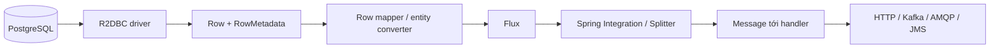
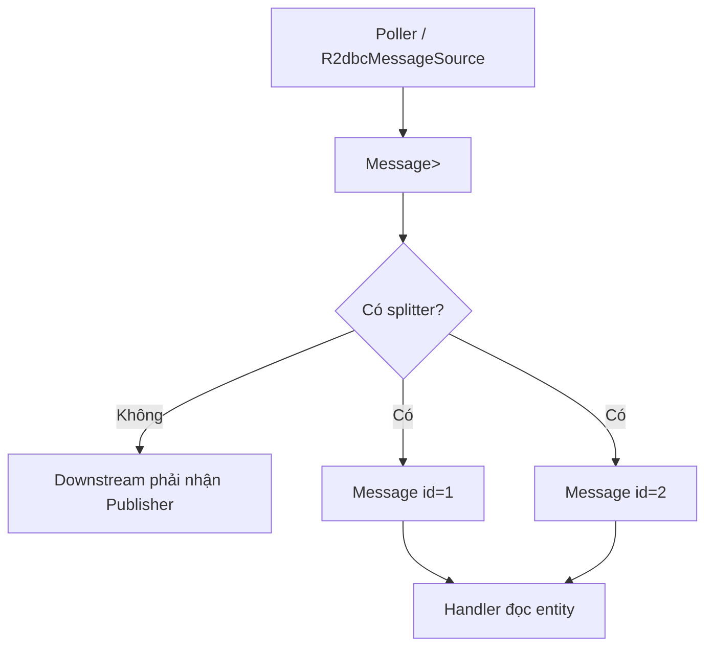
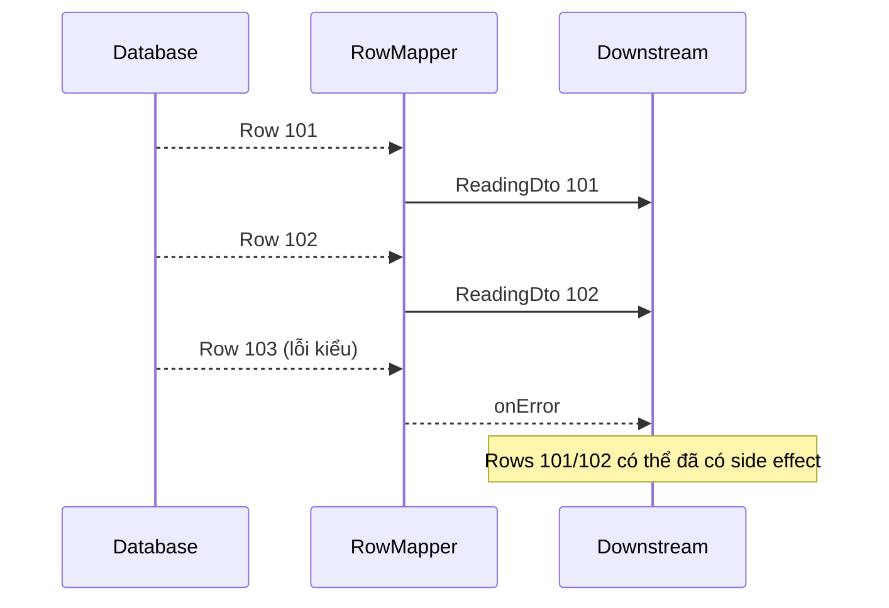
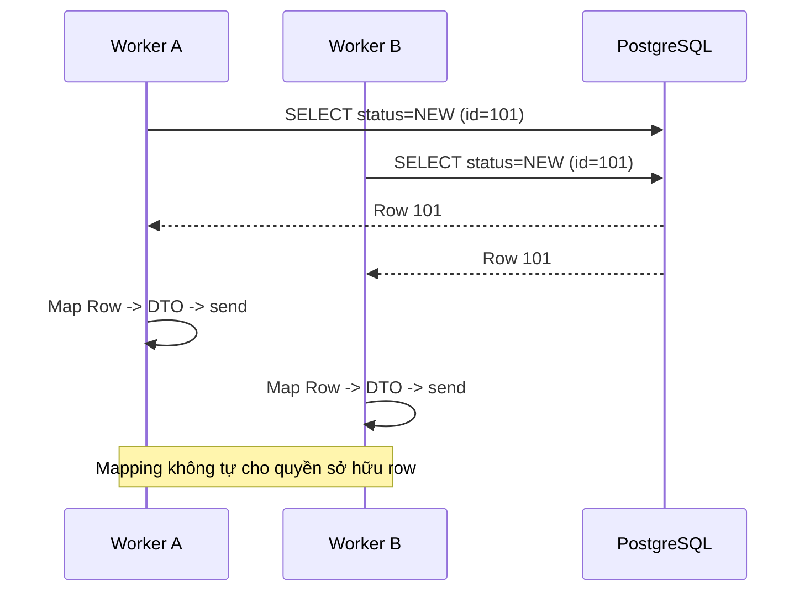

# Row mapping trong R2DBC

> **Chương:** Adapter R2DBC  
> **Module:** SPRING_INTEGRATION_ADAPTERS  
> **Bối cảnh:** Kết nối các hệ thống ngoài vào Spring Integration bằng inbound/outbound adapter, gateway, poller và MessageChannel. Thực hành với file, SFTP, HTTP, JMS, AMQP, Kafka và cơ sở dữ liệu; chú trọng hợp đồng message, lỗi, bảo toàn dữ liệu và vòng đời kết nối.

## 1. Mục tiêu học tập

Sau bài này, bạn có thể:

- Giải thích **row mapping** là bước biến một hàng SQL (`Row`) thành đối tượng/Map Java trong quá trình đọc dữ liệu reactive.
- Phân biệt `io.r2dbc.spi.Row`, `RowMetadata`, `DatabaseClient`, `R2dbcEntityTemplate`, `R2dbcEntityOperations` và `R2dbcMessageSource`.
- Viết `DatabaseClient.sql(...).map((row, metadata) -> ...).all()` trả `Flux<DTO>` và `.one()` trả `Mono<DTO>`.
- Đọc các cột theo **tên hoặc vị trí**, quản lý alias, kiểu dữ liệu, SQL NULL và lỗi chuyển đổi.
- Ánh xạ POJO/entity thông qua `@Table`, `@Id`, `@Column` và converter của Spring Data R2DBC.
- Hiểu `DatabaseClient.fetch().all()` trả các Map và vì sao chúng khác DTO được kiểm tra kiểu.
- Cấu hình `R2dbc.inboundChannelAdapter(...).payloadType(...)`: một lần poll có thể tạo **`Message<Flux<Entity>>`**, không tự tạo mỗi row thành một Spring Message.
- Sử dụng `FluxMessageChannel`, splitter, transformer và handler phù hợp để đưa từng bản ghi từ database sang hệ thống ngoài.
- Xử lý dữ liệu sai schema, mapping exception, partial emission, retry, backpressure, claim/ACK và idempotency.
- Kiểm thử row mapping bằng `StepVerifier` và PostgreSQL R2DBC, lập danh sách kiểm tra cho production.

## 2. Row mapping đứng ở đâu trong hệ thống tích hợp?

Giả sử PostgreSQL lưu các bản ghi đo nhiệt độ. Hệ thống Spring Integration phải đọc dữ liệu mới, chuyển các cột SQL thành event Java, rồi chuyển tới HTTP, JMS, AMQP hoặc Kafka.

Một `SELECT` trả **rows**, còn message handler Java thường muốn làm việc với **DTO có kiểu rõ ràng** như `ReadingDto` hoặc `SensorReadingEntity`.



**Row mapping** là chỗ quyết định "cột nào đi vào field nào, dưới kiểu Java nào", không phải chỗ quyết định **bản ghi đã được giao thành công**. Các vấn đề retry, ACK, ownership và idempotency nằm ở các lớp khác.

### 2.1. Phân biệt bốn lớp

| Lớp | Thành phần tiêu biểu | Trách nhiệm |
| --- | --- | --- |
| Truy cập DB | `io.r2dbc.spi.ConnectionFactory`, driver | Cấp connection, thực thi SQL và stream kết quả. |
| Ánh xạ hàng | `Row`, `RowMetadata`, `DatabaseClient.map`, Spring Data converter | Chuyển cột thành Map, DTO hoặc entity. |
| Reactive stream | `Flux<T>`, `Mono<T>`, subscriber | Phát items, complete/error, demand/cancellation. |
| Spring Integration | `R2dbcMessageSource`, `MessageChannel`, splitter | Đưa kết quả vào Spring Message và các endpoint. |

Không đồng nhất `ConnectionFactory` R2DBC với các connection factories của TCP adapter. Cả hai có tên chung nhưng thuộc **hai hệ sinh thái và giao thức khác nhau**.

### 2.2. Một row, một item, một message là ba khái niệm

```text
Một SELECT có 3 rows
        |
        v
DatabaseClient.map(...).all()
        |
        v
Flux<ReadingDto>  -- 3 onNext() khi subscribe

Spring Integration R2DBC inbound mặc định:
một lần receive() -> Message<Flux<ReadingDto>>
                           |
                           v
                       Splitter
                           |
                           +--> Message<ReadingDto> (#1)
                           +--> Message<ReadingDto> (#2)
                           +--> Message<ReadingDto> (#3)
```

**Một message có payload là Flux không phải ba Spring Messages.** Muốn handler thấy từng DTO, cần splitter hoặc một consumer xử lý Publisher tường minh.

## 3. Row và RowMetadata trong R2DBC SPI

### 3.1. Row là gì?

`io.r2dbc.spi.Row` đại diện dữ liệu **một hàng** kết quả SQL khi driver cung cấp cho mapping callback. Bạn có thể đọc cột bằng tên hoặc index:

```java
import io.r2dbc.spi.Row;

Long id = row.get("id", Long.class);
String sensorId = row.get("sensor_id", String.class);
Long firstColumn = row.get(0, Long.class);
```

Đây là các **đoạn trích bên trong callback có biến `row`**, không phải class Java hoàn chỉnh. Index trong R2DBC SPI bắt đầu từ **0**; thứ tự phụ thuộc danh sách cột của query.

Không dùng `row.get(0, String.class)` nếu cột thứ nhất là `BIGINT`; driver có thể không hỗ trợ conversion hoặc kết quả có ngữ nghĩa không đúng. Luôn biết **SQL projection** trước khi đọc bằng index.

### 3.2. RowMetadata dùng để làm gì?

`io.r2dbc.spi.RowMetadata` mô tả metadata của kết quả, như tên các cột trả về và thông tin kiểu dữ liệu do driver cung cấp. Callback `DatabaseClient.map(...)` nhận cả `Row` và `RowMetadata`:

```java
.map((row, metadata) -> {
    // Lấy giá trị từ row.
    // Có thể tham khảo metadata khi xử lý projection động.
    return /* object đã map */ null;
})
```

Đoạn trên chỉ mô tả chữ ký callback, **không dùng nguyên văn** (mapping callback thực tế phải trả đối tượng khác null).

`RowMetadata` hữu ích với query có projection động, logging tên cột an toàn hoặc generic mapper. Với DTO ổn định, **đọc cột theo tên đã công bố trong contract SQL** thường dễ bảo trì hơn việc dựa vào index.

### 3.3. Thời gian sống của Row

`Row` là dữ liệu do driver cung cấp trong quá trình tiêu thụ kết quả. Không nên lưu đối tượng `Row` hoặc `RowMetadata` để dùng sau khi callback hoàn tất.

**Đúng:** đọc và copy các scalar values cần thiết trong mapping callback, tạo DTO và phát DTO.

**Không nên:** phát chính đối tượng `Row` cho handler khác rồi truy cập nó sau khi result cursor/connection đã đóng; điều này gắn business flow với trạng thái driver và resource lifecycle.

### 3.4. Các nguồn lỗi sớm

| Triệu chứng | Nguyên nhân có thể |
| --- | --- |
| Đọc cột bằng tên nhưng không tồn tại | SELECT thiếu cột hoặc alias khác. |
| Đọc cột bằng index sai | Projection đổi thứ tự. |
| `row.get(..., BigDecimal.class)` lỗi | Kiểu SQL hoặc driver conversion không tương thích. |
| Mapper trả `null` | Reactor không cho phát null item. |
| Dữ liệu trống không đáp ứng business contract | Mapping không có validation hoặc SQL NULL bất ngờ. |
| Cùng tên cột từ JOIN | Alias trùng hoặc dữ liệu bị che/không xác định. |

## 4. Thiết kế bảng PostgreSQL cho ví dụ

### 4.1. Schema và dữ liệu mẫu

Bài dùng PostgreSQL test với bảng `sensor_readings`:

```sql
CREATE TABLE sensor_readings (
    id             BIGSERIAL PRIMARY KEY,
    sensor_id      VARCHAR(64) NOT NULL,
    temperature_c  NUMERIC(10, 2) NOT NULL,
    note           TEXT,
    measured_at    TIMESTAMPTZ NOT NULL DEFAULT NOW(),
    status         VARCHAR(16) NOT NULL DEFAULT 'NEW'
);

CREATE INDEX idx_sensor_readings_status_id
    ON sensor_readings (status, id);

CREATE INDEX idx_sensor_readings_sensor_id
    ON sensor_readings (sensor_id, measured_at DESC);

INSERT INTO sensor_readings
    (sensor_id, temperature_c, note, status)
VALUES
    ('sensor-01', 21.50, 'Bình thường', 'NEW'),
    ('sensor-02', 39.25, NULL, 'NEW'),
    ('sensor-03', 18.75, 'Đã kiểm tra', 'DONE');
```

Ý nghĩa dữ liệu:

| Cột SQL | Loại | Kiểu Java gợi ý | Lưu ý mapping |
| --- | --- | --- | --- |
| `id` | `BIGSERIAL/BIGINT` | `Long` | Khóa duy nhất, không dùng `Integer` khi ID có thể lớn. |
| `sensor_id` | `VARCHAR` | `String` | Tên Java `sensorId` cần mapping hoặc chuyển thủ công. |
| `temperature_c` | `NUMERIC(10,2)` | `BigDecimal` | Tránh làm tròn không kiểm soát bằng `double`. |
| `note` | `TEXT NULL` | `String` nullable | Có thể là `null` trong DTO; không phát null làm item. |
| `measured_at` | `TIMESTAMPTZ` | `OffsetDateTime` | Kiểm tra timezone/driver conversion. |
| `status` | `VARCHAR` | `String` hoặc enum có converter | Cần validate các trạng thái cho phép. |

Đây là bảng học tập; production thường cần thêm `claim_owner`, `lease_until`, `attempt_count` hoặc outbox tùy delivery contract.

### 4.2. Tại sao NUMERIC nên dùng BigDecimal?

`BigDecimal` giữ độ chính xác thập phân của giá trị SQL `NUMERIC` tốt hơn phép đổi tự động sang `double` nhị phân, đặc biệt với dữ liệu đo đạc có quy tắc làm tròn nghiêm ngặt.

```java
import java.math.BigDecimal;

BigDecimal value = new BigDecimal("21.50");
System.out.println(value.toPlainString());  // 21.50
```

Khi so sánh:

- `compareTo(...)` phù hợp so sánh giá trị số.
- `equals(...)` còn xét `scale`: `21.5` và `21.50` có thể không `equals` dù so sánh số học bằng nhau.
- SQL `NUMERIC(10,2)` giới hạn precision/scale; cần test với dữ liệu ngoài khoảng hoặc số thập phân nhiều chữ số.

## 5. Chuẩn bị Spring Boot, driver và dependency

Ví dụ hướng đến **Java 17+, Spring Boot 3.x, Spring Framework 6.x, Spring Data R2DBC 3.x và Spring Integration 6.x**; trong dự án thật chọn phiên bản tương thích qua Spring Boot BOM. Với phiên bản mới hơn, đối chiếu API tương ứng.

### 5.1. Maven dependencies

```xml
<dependencies>
    <dependency>
        <groupId>org.springframework.boot</groupId>
        <artifactId>spring-boot-starter-integration</artifactId>
    </dependency>
    <dependency>
        <groupId>org.springframework.boot</groupId>
        <artifactId>spring-boot-starter-data-r2dbc</artifactId>
    </dependency>
    <dependency>
        <groupId>org.springframework.integration</groupId>
        <artifactId>spring-integration-r2dbc</artifactId>
    </dependency>
    <dependency>
        <groupId>org.postgresql</groupId>
        <artifactId>r2dbc-postgresql</artifactId>
        <scope>runtime</scope>
    </dependency>
    <dependency>
        <groupId>io.projectreactor</groupId>
        <artifactId>reactor-test</artifactId>
        <scope>test</scope>
    </dependency>
</dependencies>
```

R2DBC driver khác JDBC driver. Chỉ có `org.postgresql:postgresql` (JDBC) không đủ cho `ConnectionFactory` R2DBC.

### 5.2. Cấu hình database

`application.yml`:

```yaml
spring:
  r2dbc:
    url: r2dbc:postgresql://127.0.0.1:5432/integration_demo
    username: ${DB_USER}
    password: ${DB_PASSWORD}
```

`${DB_USER}` và `${DB_PASSWORD}` trong bản ví dụ đại diện cho placeholder lấy từ biến môi trường tương ứng; không đưa mật khẩu thật vào Git. Đảm bảo database tồn tại, schema đã tạo và user có quyền `SELECT`/`UPDATE` cần thiết.

Với Boot auto-configuration phù hợp, có thể inject:

- `io.r2dbc.spi.ConnectionFactory`.
- `org.springframework.r2dbc.core.DatabaseClient`.
- `org.springframework.data.r2dbc.core.R2dbcEntityTemplate`.
- Reactive transaction manager khi đáp ứng điều kiện cấu hình.

Không tự thêm `@Bean` trùng tên/chức năng nếu Boot đã quản lý các thành phần này.

### 5.3. Chạy minh họa như thế nào?

1. Khởi động PostgreSQL test.
2. Tạo bảng và seed rows mục 4.
3. Cấu hình `spring.r2dbc.url` và credentials.
4. Thêm các class repository và DTO ở mục 6.
5. Chạy `StepVerifier` integration test ở mục 17.
6. Khi học inbound adapter, kích hoạt flow mục 11 **thay cho flow khác đọc cùng bảng**, quan sát handler log và hiểu các lần poll có thể đọc trùng.

Các đoạn ví dụ SQL/Java mô tả **kết quả kỳ vọng**, không phải khẳng định đã chạy thực tế.

## 6. Mapping thủ công: DatabaseClient Row → DTO

### 6.1. DTO bất biến cho hợp đồng tích hợp

Tạo `ReadingDto.java`:

```java
import java.math.BigDecimal;
import java.time.OffsetDateTime;

public record ReadingDto(
        Long id,
        String sensorId,
        BigDecimal temperatureC,
        String note,
        OffsetDateTime measuredAt,
        String status
) {
}
```

Với Java record:

- Các trường được khởi tạo qua constructor, dễ chuyển qua các bước xử lý mà không bị sửa ngoài ý muốn.
- `note` có thể nhận `null` để phản ánh SQL NULL.
- Các field `id`, `sensorId`, `temperatureC`, `measuredAt`, `status` được schema khai báo NOT NULL nhưng vẫn nên validate ở boundary nếu query có JOIN/biến đổi dữ liệu.
- Một record không tự cung cấp JSON validation, idempotency hay quyền truy cập.

### 6.2. Repository dùng DatabaseClient

Tạo `ReadingRowRepository.java`:

```java
import java.math.BigDecimal;
import java.time.OffsetDateTime;

import org.springframework.r2dbc.core.DatabaseClient;
import org.springframework.stereotype.Repository;
import reactor.core.publisher.Flux;
import reactor.core.publisher.Mono;

@Repository
public class ReadingRowRepository {

    private final DatabaseClient db;

    public ReadingRowRepository(DatabaseClient db) {
        this.db = db;
    }

    public Flux<ReadingDto> findNewReadings(int limit) {
        if (limit < 1 || limit > 100) {
            return Flux.error(new IllegalArgumentException(
                    "limit must be between 1 and 100"));
        }

        return db.sql(
                        "SELECT id, sensor_id, temperature_c, " +
                        "note, measured_at, status " +
                        "FROM sensor_readings " +
                        "WHERE status = :status " +
                        "ORDER BY id LIMIT :maxRows")
                .bind("status", "NEW")
                .bind("maxRows", limit)
                .map((row, metadata) -> new ReadingDto(
                        row.get("id", Long.class),
                        row.get("sensor_id", String.class),
                        row.get("temperature_c", BigDecimal.class),
                        row.get("note", String.class),
                        row.get("measured_at", OffsetDateTime.class),
                        row.get("status", String.class)
                ))
                .all();
    }

    public Mono<ReadingDto> findById(long id) {
        return db.sql(
                        "SELECT id, sensor_id, temperature_c, " +
                        "note, measured_at, status " +
                        "FROM sensor_readings WHERE id = :id")
                .bind("id", id)
                .map((row, metadata) -> new ReadingDto(
                        row.get("id", Long.class),
                        row.get("sensor_id", String.class),
                        row.get("temperature_c", BigDecimal.class),
                        row.get("note", String.class),
                        row.get("measured_at", OffsetDateTime.class),
                        row.get("status", String.class)
                ))
                .one();
    }
}
```

**Phân tích:**

1. `DatabaseClient.sql(...)` tạo query spec theo R2DBC.
2. `bind(...)` liên kết **giá trị** với named parameter, tránh ghép raw input vào SQL.
3. `map((row, metadata) -> ...)` chuyển **mỗi row** thành một `ReadingDto`, ở đây chỉ dùng `row`; tham số `metadata` vẫn sẵn nếu cần.
4. `all()` trả `Flux<ReadingDto>`, tức 0..N items.
5. `one()` trả `Mono<ReadingDto>`, tức 0..1 item; query theo PK phù hợp.
6. Vì `Flux`/`Mono` là Publisher, việc gọi method chưa chắc đã truy vấn SQL cho tới khi có subscription.

**Chú ý:** SQL `LIMIT 100` tối đa bảo vệ một lượt SELECT; `maxMessagesPerPoll(1)` ở một adapter upstream là khái niệm khác, không giới hạn số rows.

### 6.3. Tránh trùng code với mapper dùng chung

Có thể tách mapper thành hàm thuần:

```java
import io.r2dbc.spi.Row;
import io.r2dbc.spi.RowMetadata;

import java.math.BigDecimal;
import java.time.OffsetDateTime;

public final class ReadingMappers {

    private ReadingMappers() {
    }

    public static ReadingDto toDto(
            Row row, RowMetadata metadata) {

        return new ReadingDto(
                row.get("id", Long.class),
                row.get("sensor_id", String.class),
                row.get("temperature_c", BigDecimal.class),
                row.get("note", String.class),
                row.get("measured_at", OffsetDateTime.class),
                row.get("status", String.class)
        );
    }
}
```

Trong repository:

```java
return db.sql(
                "SELECT id, sensor_id, temperature_c, " +
                "note, measured_at, status " +
                "FROM sensor_readings WHERE status='NEW' " +
                "ORDER BY id LIMIT :maxRows")
        .bind("maxRows", limit)
        .map(ReadingMappers::toDto)
        .all();
```

Đoạn repository trên chỉ là **một biến thể thay thế** cho method ở mục 6.2. `ReadingMappers::toDto` nhận đúng hai tham số của mapping callback, giúp thống nhất contract cột và unit test dễ hơn.

## 7. Mapping theo tên hay theo index?

### 7.1. Theo tên/alias: dễ đọc và bảo trì

```java
String sensorId = row.get("sensor_id", String.class);
BigDecimal temperature = row.get(
        "temperature_c", BigDecimal.class);
```

Ưu điểm: việc thêm cột vào đầu SELECT thường không phá code mapping theo tên. Nhược điểm: nếu schema/alias đổi mà mapper không đổi, lỗi sẽ xuất hiện khi query thực thi.

### 7.2. Theo index: phụ thuộc thứ tự projection

```java
// SELECT id, sensor_id, temperature_c ...
Long id = row.get(0, Long.class);
String sensorId = row.get(1, String.class);
BigDecimal temperature = row.get(2, BigDecimal.class);
```

Index tính từ **0**. Khi đổi SELECT thành `SELECT sensor_id, id, ...`, cùng index sẽ trả dữ liệu khác hoặc lỗi kiểu. Do đó index phù hợp trong mapper nhỏ có projection cố định, đã được test, nhưng **alias theo tên thường an toàn hơn** cho module tích hợp lâu dài.

### 7.3. JOIN và cột trùng tên

Ví dụ bảng `sensor_registry` cùng có cột `id`. Query:

```sql
SELECT r.id, s.id, r.sensor_id
FROM sensor_readings AS r
JOIN sensor_registry AS s
  ON s.sensor_id = r.sensor_id;
```

có hai cột cùng tên `id`, khiến `row.get("id")` không rõ hợp đồng ánh xạ (tùy driver và cách projection). **Sửa bằng alias duy nhất**:

```sql
SELECT
    r.id AS reading_id,
    s.id AS registry_id,
    r.sensor_id AS sensor_id
FROM sensor_readings AS r
JOIN sensor_registry AS s
  ON s.sensor_id = r.sensor_id;
```

Sau đó:

```java
Long readingId = row.get("reading_id", Long.class);
Long registryId = row.get("registry_id", Long.class);
```

Tên bảng `sensor_registry` chỉ là **ví dụ mở rộng**; chưa được tạo ở mục 4, nên phải thêm schema tương ứng nếu thực chạy JOIN.

### 7.4. Alias viết hoa và dấu ngoặc kép PostgreSQL

PostgreSQL thường chuyển **identifier không được quote** thành chữ thường:

```sql
SELECT sensor_id AS sensorId
FROM sensor_readings;
```

Alias có thể được lưu dưới dạng `sensorid`. Nếu muốn giữ nguyên kiểu camelCase cho consumer dựa trên exact column label:

```sql
SELECT sensor_id AS "sensorId"
FROM sensor_readings;
```

Rồi `row.get("sensorId", String.class)` theo contract projection. Nhiều mapper/map mặc định hỗ trợ truy cập không phân biệt hoa-thường, nhưng **không dựa vào điều đó để thay thế một alias rõ ràng** khi có nhiều dialect và driver.

## 8. SQL NULL, missing columns và invalid types

### 8.1. SQL NULL không phải một item null trong Flux

Dòng `sensor-02` có `note = NULL`:

```java
String note = row.get("note", String.class);
// note có thể là null, nhưng ReadingDto vẫn là một object không null.
```

Hợp lệ:

```java
new ReadingDto(
        2L,
        "sensor-02",
        new BigDecimal("39.25"),
        null,
        OffsetDateTime.now(),
        "NEW");
```

Không hợp lệ khi dùng Reactor:

```java
// KHÔNG LÀM: mapper trả null item.
.map((row, metadata) -> row.get("note", String.class))
```

Trong một số row `note` null, mapping callback trả `null` và reactive stream phát lỗi vì Reactive Streams không cho phép `onNext(null)`.

Nếu mục tiêu chỉ phát những `note` có nội dung, có thể filter trước hoặc biểu diễn null bằng `Optional`/DTO:

```java
Flux<String> notes = repository.findNewReadings(20)
        .map(ReadingDto::note)
        .filter(java.util.Objects::nonNull);
```

**Đoạn trên cũng sai khi gặp null:** `map(ReadingDto::note)` không được trả null, filter phía sau không chạy được. Cách đúng là:

```java
Flux<String> notes = repository.findNewReadings(20)
        .filter(reading -> reading.note() != null)
        .map(ReadingDto::note);
```

Hoặc dùng `handle(...)`/`flatMap(...)` có contract không phát null. Điều quan trọng là **bỏ giá trị null trước khi biến nó thành Reactor item**.

### 8.2. Missing column khác SQL NULL

| Trường hợp | Ý nghĩa |
| --- | --- |
| Cột `note` tồn tại, giá trị SQL NULL | `row.get("note", String.class)` có thể trả Java null. |
| SELECT không bao gồm `note` | `row.get("note", String.class)` có thể ném exception vì column label không có. |
| Cột là `NUMERIC` nhưng mapper yêu cầu `OffsetDateTime` | Lỗi conversion/type mismatch. |
| Query trả 0 row | `Flux.empty()` / `Mono.empty()` theo API, không phải một DTO chứa null. |
| Mapper trả null item | Reactive operator error, không phải một item hợp lệ. |

**Không catch mọi exception rồi trả `null` để "bỏ qua bản ghi lỗi"**: có thể che lỗi migration nghiêm trọng và khiến batch/ACK sai. Tách lỗi dữ liệu có thể đưa vào DLQ khỏi lỗi schema/driver cần alert hoặc dừng xử lý.

### 8.3. Validate NOT NULL theo nghiệp vụ

DDL có `NOT NULL` nhưng câu SELECT sau này có thể có `LEFT JOIN` hoặc expression trả null. Có thể validate trong mapping:

```java
Long id = java.util.Objects.requireNonNull(
        row.get("id", Long.class), "Missing id");

String sensorId = java.util.Objects.requireNonNull(
        row.get("sensor_id", String.class), "Missing sensor_id");
```

Việc mapper throw exception sẽ phát `onError` trong reactive query. Nếu trước đó một số items đã được downstream xử lý, không được kết luận cả batch "chưa xử lý gì"; phần **partial emission** cần được tính tới khi retry.

### 8.4. Null khi bind SQL khác null khi đọc Row

Đọc một cột SQL NULL: dùng `row.get(..., Type.class)` và nhận Java null. Khi **ghi** SQL NULL bằng `DatabaseClient`, nên dùng `bindNull(...)`:

```java
Mono<Long> clearNote(DatabaseClient db, long id) {
    return db.sql(
                    "UPDATE sensor_readings " +
                    "SET note = :note WHERE id = :id")
            .bindNull("note", String.class)
            .bind("id", id)
            .fetch()
            .rowsUpdated();
}
```

Đây là một method trong Java class. Không dùng `.bind("note", null)`: API binding cần type khi giá trị null, và phương thức có thể từ chối null.

## 9. DatabaseClient.fetch(): khi muốn Map thay vì DTO

`DatabaseClient` cũng có kiểu mapping mặc định thông qua `fetch()`:

```java
import java.util.Map;
import reactor.core.publisher.Flux;

Flux<Map<String, Object>> rows = db.sql(
                "SELECT id, sensor_id, temperature_c " +
                "FROM sensor_readings ORDER BY id LIMIT 10")
        .fetch()
        .all();
```

Dạng `Map` hữu ích cho:

- Truy vấn ad hoc hoặc prototype.
- Projection động chưa định nghĩa DTO.
- Hệ thống generic connector cần biết tên cột runtime.
- Quan sát cấu trúc dữ liệu trước khi chọn schema ổn định.

Nhược điểm:

- Compile time không kiểm tra `"sensor_id"` hoặc kiểu `BigDecimal`.
- Consumer có thể `ClassCastException` nếu ép kiểu sai.
- Sự thay đổi tên cột có thể không được phát hiện cho đến runtime.
- Map có thể có giá trị null, hoặc cách lưu/tên keys phụ thuộc mapper/driver; cần test contract thực tế.

### 9.1. So sánh Map và DTO

| Đặc điểm | `Flux<Map<String,Object>>` | `Flux<ReadingDto>` |
| --- | --- | --- |
| Schema Java | Linh hoạt | Rõ ràng, type-safe hơn |
| IDE/compiler hỗ trợ | Hạn chế | Tốt |
| Dễ dùng cho dynamic projection | Có | Ít phù hợp hơn |
| Kiểm tra null/validation | Consumer tự làm | Có thể tập trung trong mapper/constructor |
| Ảnh hưởng khi đổi tên cột | Runtime | Cũng có thể runtime, nhưng mapper tập trung |
| Serialization sang message | Cần contract Map | DTO có schema Java rõ |

`Map` có thể là lựa chọn hợp lý cho kết nối động, nhưng không tự thay thế **data contract versioning** khi gửi dữ liệu giữa các service.

### 9.2. Đừng ép BigDecimal từ Map thành Double

Sai:

```java
Double temperature = (Double) rowMap.get("temperature_c");
```

Nếu driver trả `BigDecimal` cho PostgreSQL `NUMERIC`, phép cast này không hợp lệ.

Đúng khi schema đã xác nhận:

```java
BigDecimal temperature =
        (BigDecimal) rowMap.get("temperature_c");
```

Với dữ liệu thay đổi nhiều dialect, có thể kiểm tra kiểu `Number` hoặc dùng conversion service rõ ràng; **không chỉ gọi `toString()` rồi parse mọi thứ** nếu locale/precision/nullability chưa được kiểm soát.

## 10. Spring Data R2DBC entity mapping với @Table và @Column

Không phải lúc nào cũng cần tự viết mapper ở `DatabaseClient`. Spring Data R2DBC hỗ trợ mapping entity bằng metadata, constructor/property binding và converter phù hợp.

### 10.1. Entity class

Tạo `SensorReadingEntity.java`:

```java
import java.math.BigDecimal;
import java.time.OffsetDateTime;

import org.springframework.data.annotation.Id;
import org.springframework.data.relational.core.mapping.Column;
import org.springframework.data.relational.core.mapping.Table;

@Table("sensor_readings")
public class SensorReadingEntity {

    @Id
    private Long id;

    @Column("sensor_id")
    private String sensorId;

    @Column("temperature_c")
    private BigDecimal temperatureC;

    private String note;

    @Column("measured_at")
    private OffsetDateTime measuredAt;

    private String status;

    public SensorReadingEntity() {
    }

    public Long getId() { return id; }
    public void setId(Long id) { this.id = id; }

    public String getSensorId() { return sensorId; }
    public void setSensorId(String sensorId) {
        this.sensorId = sensorId;
    }

    public BigDecimal getTemperatureC() { return temperatureC; }
    public void setTemperatureC(BigDecimal value) {
        this.temperatureC = value;
    }

    public String getNote() { return note; }
    public void setNote(String note) { this.note = note; }

    public OffsetDateTime getMeasuredAt() { return measuredAt; }
    public void setMeasuredAt(OffsetDateTime measuredAt) {
        this.measuredAt = measuredAt;
    }

    public String getStatus() { return status; }
    public void setStatus(String status) { this.status = status; }
}
```

**Giải thích:**

- `@Table("sensor_readings")` chỉ bảng.
- `@Id` chỉ thuộc tính định danh, cần thiết cho các thao tác entity update và nhận diện record.
- `@Column("sensor_id")` ánh xạ Java camelCase sang tên cột SQL snake_case.
- `@Column("temperature_c")` giúp không phụ thuộc vào naming strategy ngầm định.
- `@Column("measured_at")` ánh xạ timestamp.
- `note` và `status` có tên trùng cột nên không bắt buộc annotation trong ví dụ.
- Constructor không tham số và getters/setters phục vụ materialization theo cấu hình mapping đang dùng.

`@Table` **không tạo bảng** tự động một cách mặc định. Vẫn phải dùng migration hoặc bước chuẩn bị schema để table tồn tại.

### 10.2. Query bằng R2dbcEntityTemplate

Tạo `ReadingEntityRepository.java`:

```java
import org.springframework.data.domain.Sort;
import org.springframework.data.r2dbc.core.R2dbcEntityTemplate;
import org.springframework.data.relational.core.query.Criteria;
import org.springframework.data.relational.core.query.Query;
import org.springframework.stereotype.Repository;
import reactor.core.publisher.Flux;
import reactor.core.publisher.Mono;

@Repository
public class ReadingEntityRepository {

    private final R2dbcEntityTemplate template;

    public ReadingEntityRepository(
            R2dbcEntityTemplate template) {
        this.template = template;
    }

    public Flux<SensorReadingEntity> findNew(int limit) {
        if (limit < 1 || limit > 100) {
            return Flux.error(new IllegalArgumentException(
                    "Invalid limit"));
        }

        Query query = Query.query(
                        Criteria.where("status").is("NEW"))
                .sort(Sort.by(Sort.Direction.ASC, "id"))
                .limit(limit);

        return template.select(SensorReadingEntity.class)
                .matching(query)
                .all();
    }

    public Mono<SensorReadingEntity> findById(long id) {
        return template.selectOne(
                Query.query(Criteria.where("id").is(id)),
                SensorReadingEntity.class
        );
    }
}
```

Các API:

- `template.select(Entity.class).matching(query).all()` trả `Flux<Entity>`.
- `template.selectOne(query, Entity.class)` trả `Mono<Entity>`.
- Spring Data mapper dựa vào metadata/annotation để ánh xạ hàng.
- SQL được tạo bằng dialect và `Criteria`, thay vì phải tự viết mọi projection/WHERE.

**Không nhầm `R2dbcEntityTemplate` với JPA/Hibernate EntityManager.** Spring Data R2DBC không tự có toàn bộ cơ chế lazy loading, unit-of-work và quan hệ ORM giống JPA.

### 10.3. Khi nào chọn DatabaseClient hoặc template?

| Nhu cầu | Nên cân nhắc |
| --- | --- |
| SQL chuẩn với mapping entity rõ | `R2dbcEntityTemplate`. |
| Query với nhiều JOIN, CTE, projection riêng | `DatabaseClient` và manual mapper. |
| PostgreSQL `UPDATE ... RETURNING` | `DatabaseClient`. |
| Tạo DTO từ 3–5 cột và alias tùy ý | `DatabaseClient.map(...)`. |
| CRUD theo @Table/@Id/@Column | `R2dbcEntityTemplate`. |
| Query/Update theo Criteria | `R2dbcEntityTemplate`. |
| Spring Integration `R2dbcMessageSource` | Truyền một `R2dbcEntityOperations`, thường là `R2dbcEntityTemplate`. |

Hai kiểu API **cùng dùng cơ sở dữ liệu R2DBC**, nhưng mang hợp đồng mapping khác nhau.

## 11. Row mapping trong R2DBC inbound channel adapter

Đây là phần quan trọng nhất khi đưa row mapping vào module **SPRING_INTEGRATION_ADAPTERS**.

`R2dbcMessageSource` của Spring Integration là nguồn inbound được kích hoạt bằng **poller**. Nó chạy truy vấn SELECT theo cấu hình rồi đặt kết quả vào một Spring Message có payload là Publisher.

### 11.1. Mặc định: Map cho từng row

Nếu không đặt `payloadType`, một row thường được biểu diễn dưới dạng **Map theo tên cột** (Spring Data row mapper có kiểu Map không phân biệt hoa/thường thích hợp):

```text
Poller -> R2dbcMessageSource
               |
               v
    Message<Flux<Map<String,Object>>>
               |
               v
       Splitter / consumer
               |
               +--> Message<Map<String,Object>>
```

Không tự cho rằng `Message<Map>` xuất hiện ngay khi poller `receive()`; mặc định payload là `Flux` chứa các Map khi query có nhiều kết quả.

### 11.2. Đặt payloadType để ánh xạ Entity

Nếu source được cấu hình:

```java
R2dbc.inboundChannelAdapter(
        template,
        "SELECT id, sensor_id, temperature_c, note, " +
        "measured_at, status " +
        "FROM sensor_readings " +
        "WHERE status='NEW' ORDER BY id LIMIT 25")
        .payloadType(SensorReadingEntity.class)
        .expectSingleResult(false)
```

thì các hàng SELECT được mapping thành `SensorReadingEntity`, và **một lần receive** tạo một message có **`Flux<SensorReadingEntity>`**.

**`payloadType(Entity.class)` chọn kiểu của từng row trong Publisher, không biến message source thành một message cho mỗi row.**

### 11.3. Java DSL đầy đủ với splitter

Tạo `ReadingInboundConfiguration.java`:

```java
import org.springframework.context.annotation.Bean;
import org.springframework.context.annotation.Configuration;
import org.springframework.data.r2dbc.core.R2dbcEntityTemplate;
import org.springframework.integration.config.EnableIntegration;
import org.springframework.integration.dsl.IntegrationFlow;
import org.springframework.integration.dsl.MessageChannels;
import org.springframework.integration.r2dbc.dsl.R2dbc;

@Configuration
@EnableIntegration
public class ReadingInboundConfiguration {

    @Bean
    IntegrationFlow readingInboundFlow(
            R2dbcEntityTemplate template) {

        return IntegrationFlow
                .from(
                        R2dbc.inboundChannelAdapter(
                                template,
                                "SELECT id, sensor_id, temperature_c, " +
                                "note, measured_at, status " +
                                "FROM sensor_readings " +
                                "WHERE status='NEW' " +
                                "ORDER BY id LIMIT 25")
                                .payloadType(SensorReadingEntity.class)
                                .expectSingleResult(false),
                        endpoint -> endpoint.poller(p ->
                                p.fixedDelay(2_000)
                                 .maxMessagesPerPoll(1))
                )
                .channel(MessageChannels.flux())
                .split()
                .channel(MessageChannels.flux())
                .handle(SensorReadingEntity.class, (reading, headers) -> {
                    System.out.printf(
                            "Reading id=%s sensor=%s temp=%s note=%s%n",
                            reading.getId(),
                            reading.getSensorId(),
                            reading.getTemperatureC(),
                            reading.getNote()
                    );
                    return null;
                })
                .get();
    }
}
```

Giải thích:

1. `R2dbc.inboundChannelAdapter(template, sql)` tạo spec cho `R2dbcMessageSource`.
2. `payloadType(...)` dùng Spring Data mapping tạo entity.
3. `expectSingleResult(false)` để nhiều rows được biểu diễn bằng `Flux`.
4. Poller gọi `receive()` theo lịch, ở đây cách nhau khoảng 2 giây theo `fixedDelay`.
5. `maxMessagesPerPoll(1)` giới hạn **số lần receive trong mỗi chu kỳ**, không giới hạn một row.
6. `MessageChannels.flux()` dùng reactive channel trong flow.
7. `split()` chuyển từng phần tử Publisher thành message riêng.
8. Handler chỉ log để học. Một lần log không đồng nghĩa đã ACK event ra hệ thống ngoài.

**Cảnh báo quan trọng:** Ví dụ trên **chỉ SELECT** `status='NEW'`. Nếu trạng thái không đổi, các lần poll sẽ đọc **lại cùng rows**. Không đưa flow log này thành workflow có side effect không idempotent mà không bổ sung claim/ACK.

### 11.4. So sánh không splitter và có splitter



Nếu bỏ `split()` rồi viết:

```java
.handle(SensorReadingEntity.class, (reading, headers) -> {
    System.out.println(reading.getSensorId());
    return null;
})
```

thì handler có thể gặp **payload type mismatch**, vì payload vẫn là `Flux`. Không cho rằng `FluxMessageChannel` tự unwrap Publisher thành từng entity.

### 11.5. expectSingleResult(true) có tác dụng gì?

Theo API `R2dbcMessageSource`:

- `expectSingleResult(false)`: payload là `Flux<?>` chứa nhiều rows (mặc định).
- `expectSingleResult(true)`: payload là `Mono<?>` ở chế độ một kết quả.
- Dù là `Mono` hay `Flux`, đó vẫn là **Publisher**, không phải POJO được materialize tại `receive()`.
- Với `true`, câu SQL nên diễn đạt ý định "một row" bằng khóa duy nhất hoặc `LIMIT 1`.

Không dùng `expectSingleResult(true)` để sửa logic query có thể trả nhiều rows mà không định nghĩa phải chọn row nào.

### 11.6. Splitter có thể thêm metadata nhưng không tạo khóa nghiệp vụ

Khi tách message, Spring Integration có thể bổ sung sequence/correlation headers. Chúng hữu ích để điều phối message trong một flow nhưng **không thay thế khóa `sensor_readings.id` được lưu bền**.

Nếu gửi reading sang Kafka/AMQP rồi cần deduplicate, hãy đưa **reading ID hoặc event ID nghiệp vụ** vào contract payload/header để consumer nhận diện sự kiện qua retry và reconnect.

## 12. Mapping sang outbound message contract

SQL entity thường có field nội bộ không nên công bố ra bên ngoài. Ví dụ, Kafka consumer chỉ cần:

```java
import java.math.BigDecimal;
import java.time.OffsetDateTime;

public record ReadingEvent(
        String eventId,
        String sensorId,
        BigDecimal temperatureC,
        OffsetDateTime measuredAt
) {
}
```

Transform entity đã map sang event:

```java
ReadingEvent event = new ReadingEvent(
        "reading-" + entity.getId(),
        entity.getSensorId(),
        entity.getTemperatureC(),
        entity.getMeasuredAt()
);
```

Việc tạo DTO outbound ở **transformer/service boundary** tốt hơn việc gửi nguyên entity database nếu:

- Bảng có trường nội bộ `status`/`claim_owner` không được phép rò rỉ.
- JSON/event contract khác tên cột SQL.
- Muốn versioning độc lập với migration database.
- Cần chuyển đổi đơn vị đo hoặc chuẩn hóa timestamp.
- Các consumers phải chịu được thêm cột trong database mà không thay đổi event.

### 12.1. Pure transformer trước khi publish

```java
import org.springframework.integration.dsl.IntegrationFlow;

IntegrationFlow transformFlow = IntegrationFlow
        .from("mappedReadingMessages")
        .transform(SensorReadingEntity.class, entity ->
                new ReadingEvent(
                        "reading-" + entity.getId(),
                        entity.getSensorId(),
                        entity.getTemperatureC(),
                        entity.getMeasuredAt()
                ))
        .handle(message -> {
            // Thay bằng outbound adapter Kafka/AMQP/HTTP có contract ACK riêng.
            System.out.println(message.getPayload());
        })
        .get();
```

Đây là đoạn cấu hình minh họa trong `@Configuration` hoặc bean method; chưa định nghĩa nguồn gửi `mappedReadingMessages`. **Không** gọi HTTP/DB blocking trong mapper thuần để "tiện xử lý", vì mapper nên nhanh, thuần dữ liệu và dễ retry/test.

### 12.2. Event ID ổn định

Nếu row ID là `101`, event ID như `reading-101` nên **giữ nguyên qua các lần gửi lại**. Nếu cứ tạo UUID mới mỗi lần retry, downstream không thể phân biệt event bị gửi trùng.

Spring `MessageHeaders.ID` là ID của một **Spring Message** cụ thể; nó có thể thay đổi khi đọc lại cùng row. Không dùng nó thay khóa business row khi mục tiêu là idempotency xuyên poll/instance.

### 12.3. Không để data conversion phá dữ liệu

| Input DB | Event outbound | Kiểm tra |
| --- | --- | --- |
| `NUMERIC(10,2)` | `BigDecimal` hoặc decimal string | Độ chính xác, scale, JSON serialization. |
| `TIMESTAMPTZ` | ISO-8601 với offset/UTC | Timezone và precision. |
| `TEXT NULL` | Field optional/omitted | Consumer schema quy định null/absent. |
| `BIGINT` | `long`/string ID | Consumer JS có thể gặp giới hạn số nguyên an toàn. |
| `status` nội bộ | Không phát mặc định | Bảo mật và hợp đồng API. |

Một mapping "compile được" vẫn có thể **làm mất precision hoặc sai thời gian** khi serialize sang HTTP/Kafka; phải test cả outbound wire contract.

## 13. Kiểu SQL đặc biệt và custom conversions

### 13.1. UUID, JSON, ARRAY, ENUM

Một số kiểu DB cần xem xét riêng:

- `UUID`: driver có thể hỗ trợ `java.util.UUID` trực tiếp.
- `NUMERIC`: ưu tiên `BigDecimal`.
- `TIMESTAMP` và `TIMESTAMPTZ`: chọn `LocalDateTime` hoặc `OffsetDateTime` phù hợp kiểu DB/driver.
- `JSONB` của PostgreSQL: driver có thể cung cấp kiểu codec riêng hoặc cách lấy chuỗi khác nhau; test mapping thay vì giả định luôn là `String`.
- SQL `ARRAY`: mapping sang Java array/collection tùy driver và converter.
- Enum SQL hoặc giá trị VARCHAR: có thể map sang `String` rồi chuyển sang enum Java theo whitelist.
- Binary data: tránh giữ `ByteBuffer` driver lâu sau callback; copy bytes nếu cần và giới hạn payload.

**Không khẳng định mọi driver R2DBC có cùng converters.** Cần test với dialect được triển khai và dependency versions đã chốt.

### 13.2. Converter tùy chỉnh

Spring Data R2DBC có cơ chế **custom conversions** qua `R2dbcCustomConversions` và các converter được đánh dấu `@ReadingConverter`/`@WritingConverter` theo cách cấu hình tương ứng.

Khi thiết kế:

1. Xác định SQL type thực tế driver đưa về.
2. Xác định type Java domain muốn dùng.
3. Viết converter **thuần và deterministic**.
4. Đăng ký converter qua cấu hình Spring Data R2DBC phù hợp với phiên bản.
5. Test đọc + ghi chiều ngược lại nếu hỗ trợ cả hai.
6. Không thực hiện network I/O/blocking trong converter.

**Không đăng ký converter "sửa kiểu" một cách rộng** nếu nó làm thay đổi mapping của nhiều entity ngoài dự kiến.

### 13.3. Enum nên được validate rõ

Ví dụ:

```java
public enum ReadingStatus {
    NEW, PROCESSING, DONE
}

static ReadingStatus parseStatus(String raw) {
    try {
        return ReadingStatus.valueOf(raw);
    }
    catch (IllegalArgumentException e) {
        throw new IllegalArgumentException(
                "Unsupported reading status", e);
    }
}
```

Đoạn này là các thành phần Java trong class/enum phù hợp. Khi database xuất hiện status mới chưa được ứng dụng hỗ trợ, policy phải rõ: reject/alert, route riêng, hoặc triển khai schema version; không tự biến trạng thái không biết thành `NEW`.

## 14. Nullability, constructor binding và entity evolution

### 14.1. Mapping vào record bất biến

Spring Data R2DBC hỗ trợ cách materialize entity qua constructor binding với các kiểu Java phù hợp, bao gồm Java record trên phiên bản hỗ trợ. Tuy nhiên:

- Tên property và cột vẫn cần mapping đúng.
- Constructor parameters phải được xác định theo metadata và conversion policy.
- SQL NULL có thể đi vào reference-type property nullable nhưng không hợp lệ với primitive không nhận null.
- Đừng lạm dụng constructor chạy business logic/side effect.

Khi cần kiểm soát mapping hết sức rõ, `DatabaseClient.map(...)` vào record là lựa chọn minh bạch; còn nếu entity mapping đã ổn định, `R2dbcEntityTemplate` giảm code lặp.

### 14.2. Java primitive và SQL NULL

Sai về hợp đồng:

```java
public record BadReading(long id, double temperatureC) {
}
```

Nếu SQL trả NULL hoặc `NUMERIC` có precision cần giữ, primitive có thể gây lỗi hoặc buộc chuyển đổi mất dữ liệu.

Tùy domain, nên dùng:

```java
public record SafeReading(Long id, BigDecimal temperatureC) {
}
```

Sau đó validate non-null theo schema; **reference type không tự bảo đảm null bị từ chối**, nó chỉ cho phép bạn biểu diễn và kiểm tra dữ liệu.

### 14.3. Migration thêm/xóa cột

| Thay đổi schema | Tác động mapping |
| --- | --- |
| Thêm cột không dùng | Explicit SELECT/mapper thường ít ảnh hưởng. |
| Đổi tên `sensor_id` | Manual mapper theo tên/`@Column` có thể lỗi. |
| Đổi `NUMERIC` thành `VARCHAR` | Conversion/validation phải cập nhật. |
| Đổi nullable thành NOT NULL | Dữ liệu cũ và producer cần migration đồng bộ. |
| JOIN thêm một cột `id` khác | Phải alias tránh trùng. |
| Thêm trạng thái mới | Consumer enum/validation cần compatibility policy. |

Ưu tiên **SELECT projection tường minh** và migration được version hóa. Không dùng `SELECT *` như public contract cố định giữa service và database.

## 15. Reactive mapping, errors và partial emission

### 15.1. Mapper có thể lỗi sau khi đã phát vài rows

Một query trả ba rows:

```text
Row #1 -> mapped ReadingDto(101) -> onNext
Row #2 -> mapped ReadingDto(102) -> onNext
Row #3 -> conversion error      -> onError
```

Nếu downstream đã gửi rows #1–2 sang Kafka, retry toàn `Flux` có thể phát lại cả #1–2. Lỗi row mapping **không bảo đảm mọi side effects trước đó đã rollback**.



**Tránh gọi onErrorContinue như chiến lược chung** để bỏ mọi row lỗi. Một lỗi schema/driver cần được cảnh báo, không tự chuyển thành "row bẩn có thể bỏ qua".

### 15.2. Retry phải phân loại nguồn lỗi

| Lỗi | Retry? | Giải thích |
| --- | --- | --- |
| Database tạm ngắt kết nối | Có thể retry có giới hạn. | Cần tổng deadline/backoff và đối soát trạng thái. |
| SQL schema thiếu cột | Không retry tự động. | Đây là lỗi migration hoặc query. |
| Mapper yêu cầu sai Java type | Không retry mù. | Cần sửa contract conversion. |
| Dữ liệu row vi phạm domain invariant | Có policy reject/quarantine rõ. | Không để retry vô hạn một row làm tắc cả batch. |
| Downstream tạm chậm | Retry phù hợp idempotency. | Các row trước có thể đã được xử lý. |
| Pool acquire timeout | Có thể retry có điều tiết. | Giảm concurrency và giám sát pool. |

Khi lỗi xảy ra, **không giả lập success** bằng `onErrorResume(error -> Flux.empty())` cho mọi trường hợp. Điều đó có thể âm thầm làm mất dữ liệu cần xử lý.

### 15.3. Chuyển row không hợp lệ sang luồng riêng

Một chiến lược production có thể:

1. Map cơ bản vào DTO cho phép biểu diễn null và dữ liệu raw phù hợp.
2. Validate DTO bằng domain validator riêng.
3. Khi không hợp lệ, ghi event ID + lý do vào **quarantine/dead-letter store** một cách bền vững.
4. Không ACK row gốc trước khi quyết định thành công/quarantine đã hoàn tất.
5. Tiếp tục xử lý row tiếp theo chỉ khi contract cho phép.
6. Có công cụ replay sau khi sửa lỗi dữ liệu/schema.

Nếu lỗi conversion xảy ra **trước khi tạo được DTO**, cần xử lý ở boundary của mapper/query, có thể dùng query projection an toàn hơn hoặc lộ trình trích xuất raw values có kiểm soát.

### 15.4. Cancellation và Row lifecycle

Một subscriber có thể cancel `Flux` giữa SELECT. Khi đó:

- Query/result/connection cần được cleanup theo driver/Spring contract.
- Không giữ `Row` để dùng sau thời điểm mapping.
- Không coi `cancel` là `onComplete`.
- Không tự ACK toàn batch nếu chưa có bằng chứng các rows còn lại đã xử lý.
- Theo dõi pool active/pending connections và cancel count.

Trong Spring Data/Spring Framework, để `DatabaseClient`/`R2dbcEntityTemplate` chịu trách nhiệm lifecycle resource thay vì tự mở `Connection` rồi quên close.

## 16. Batch, pagination, backpressure và poller

### 16.1. SQL LIMIT giới hạn rows được mapping

```sql
SELECT id, sensor_id, temperature_c, note, measured_at, status
FROM sensor_readings
WHERE status = 'NEW'
ORDER BY id
LIMIT 25;
```

Một query không vượt 25 rows theo SQL contract. Còn:

- `maxMessagesPerPoll(1)` chỉ giới hạn số lần `receive()` ở mỗi poll cycle.
- `Flux.request(n)` là demand từ subscriber, không bằng SQL `LIMIT n`.
- `flatMap(..., 4)` giới hạn số inner Publishers đồng thời trong pipeline Reactor đó.
- R2DBC pool max size giới hạn database connections, không tự giới hạn queue upstream.

**Không dùng đúng một thông số để thay thế cả bốn loại giới hạn.**

### 16.2. Keyset pagination khi dữ liệu lớn

Nếu bảng có nhiều triệu rows:

```sql
SELECT id, sensor_id, temperature_c, note, measured_at, status
FROM sensor_readings
WHERE id > :lastId
ORDER BY id
LIMIT :pageSize;
```

Dùng `lastId` làm cursor quét, mỗi page một query. Keyset pagination thường tránh nhược điểm `OFFSET` lớn nhưng **cursor không phải ACK đã xử lý**.

Nếu commit cursor trước khi outbound publish thành công, crash có thể khiến những rows chưa hoàn thành bị bỏ qua ở lần chạy sau. Muốn delivery đúng cần claim/ACK/lease thay vì chỉ giữ `lastId`.

### 16.3. Backpressure không sửa lỗi mapping

Một `FluxMessageChannel` có thể duy trì reactive demand trong flow khi các đoạn tương thích. Nhưng:

- Một handler blocking trên Reactor event-loop vẫn chiếm thread.
- `collectList()` không giới hạn vẫn gom mọi row vào RAM.
- Poller có thể kích hoạt một Publisher mới khi Publisher trước còn đang xử lý.
- Mapping nhiều cột JSON lớn vẫn tốn CPU/bộ nhớ.
- Quá nhiều subscribers có thể gây pool exhausted.

Ưu tiên query projection hẹp, SQL LIMIT, index phù hợp, concurrency bounded và đo processing latency.

### 16.4. Flux operators sau mapping

```java
Flux<ReadingEvent> events = repository.findNewReadings(25)
        .filter(row -> "NEW".equals(row.status()))
        .map(row -> new ReadingEvent(
                "reading-" + row.id(),
                row.sensorId(),
                row.temperatureC(),
                row.measuredAt()
        ));
```

`map` chỉ chuyển đổi dữ liệu. Nếu cần gọi external service trả `Mono<Void>`:

```java
Mono<Void> sent = repository.findNewReadings(25)
        .concatMap(reading -> externalSender.send(reading))
        .then();
```

Đây là các đoạn minh họa dùng `repository` và `externalSender` đã tồn tại trong scope. `concatMap` xử lý inner publishers theo thứ tự, còn `flatMap(sender::send, 4)` cho phép concurrency. **Không** gọi I/O bất đồng bộ rồi bỏ qua Publisher bên trong `map`.

## 17. Kiểm thử Row mapping bằng StepVerifier

### 17.1. Chuẩn bị test

Nên dùng **PostgreSQL thật** qua Testcontainers hoặc môi trường integration test tương đương. H2 R2DBC có thể khác PostgreSQL về `NUMERIC`, timezone, SQL dialect và converters.

Seed dữ liệu độc lập cho mỗi test, tránh dựa vào các row tồn tại từ lần chạy trước. Các `@Test` dưới đây là **method trong một test class**, giả định có `ReadingRowRepository repository`, `ReadingEntityRepository entityRepository` được inject.

### 17.2. Test hai rows NEW

```java
import org.junit.jupiter.api.Test;
import reactor.test.StepVerifier;

import static org.junit.jupiter.api.Assertions.*;

@Test
void mapsNewRowsToDto() {
    StepVerifier.create(repository.findNewReadings(10))
            .assertNext(reading -> {
                assertEquals("sensor-01", reading.sensorId());
                assertEquals(
                        0,
                        new java.math.BigDecimal("21.50")
                                .compareTo(reading.temperatureC()));
                assertNotNull(reading.measuredAt());
            })
            .assertNext(reading -> {
                assertEquals("sensor-02", reading.sensorId());
                assertNull(reading.note());
            })
            .verifyComplete();
}
```

Test này giả định bảng test chứa **đúng hai rows NEW** theo thứ tự `ORDER BY id` từ mục 4. Nếu có seed khác, hãy reset schema/fixture trước khi kiểm tra.

### 17.3. Test không có row

```java
@Test
void missingIdProducesEmptyMono() {
    StepVerifier.create(repository.findById(999_999L))
            .verifyComplete();
}
```

`Mono.empty()` là kết quả hợp lệ khi WHERE không khớp. Không tự đồng nhất nó với connection error.

### 17.4. Test mapping entity

```java
@Test
void springDataMapsEntityColumns() {
    StepVerifier.create(entityRepository.findNew(10))
            .assertNext(entity -> {
                assertEquals("sensor-01", entity.getSensorId());
                assertNotNull(entity.getTemperatureC());
                assertNotNull(entity.getMeasuredAt());
            })
            .expectNextCount(1)
            .verifyComplete();
}
```

Bài test xác minh `@Table`/`@Column` và converter của Spring Data R2DBC. Với bảng có thêm/đổi cột, nên có test migration compatibility.

### 17.5. Test null payload của Reactor

```java
import reactor.core.publisher.Flux;
import reactor.test.StepVerifier;

@Test
void mappingToNullItemIsAnError() {
    Flux<String> invalid = Flux.just("sensor-01", "sensor-02")
            .map(sensor -> "sensor-02".equals(sensor)
                    ? null
                    : sensor);

    StepVerifier.create(invalid)
            .expectNext("sensor-01")
            .expectError(NullPointerException.class)
            .verify();
}
```

Đây là test Reactor thuần, không cần DB. Nó chứng minh mapper **không được phát null item**; còn một DTO chứa field null thì vẫn là item hợp lệ.

### 17.6. Test alias và kiểu dữ liệu

Trong test PostgreSQL, chạy query:

```sql
SELECT
    sensor_id AS "sensorId",
    temperature_c AS "temperatureC"
FROM sensor_readings
ORDER BY id
LIMIT 1;
```

Sau đó map:

```java
Mono<String> description = db.sql(
                "SELECT sensor_id AS \"sensorId\", " +
                "temperature_c AS \"temperatureC\" " +
                "FROM sensor_readings ORDER BY id LIMIT 1")
        .map((row, metadata) ->
                row.get("sensorId", String.class) + ":" +
                row.get("temperatureC", BigDecimal.class))
        .one();
```

**Lưu ý:** đây là đoạn minh họa Java string có escape dấu ngoặc kép; phải dùng chuỗi Java `\"` để biểu diễn ký tự `"` trong SQL. Test xác minh alias chính xác khi dùng mixed-case identifiers.

### 17.7. Test partial emission và retry

Tạo một Flux giả lập hai rows hợp lệ rồi lỗi mapping ở row thứ ba, kiểm tra onError và tính lặp lại khi resubscribe:

```java
import reactor.core.publisher.Flux;
import reactor.test.StepVerifier;

@Test
void partialEmissionThenError() {
    Flux<Integer> values = Flux.concat(
            Flux.just(101, 102),
            Flux.error(new IllegalStateException("Bad row 103")));

    StepVerifier.create(values)
            .expectNext(101, 102)
            .expectError(IllegalStateException.class)
            .verify();
}
```

Bài học: khi onError xảy ra, hai rows trước **đã được phát ra**. Một retry có thể phát lại chúng; handler downstream cần idempotency nếu có side effects.

## 18. Ma trận kiểm thử R2DBC row mapping

| Kịch bản | Kết quả mong đợi |
| --- | --- |
| SELECT 0 row | Flux/Mono complete rỗng, không có object null. |
| SELECT 1 row | Một DTO/entity được phát với đúng field. |
| SELECT nhiều rows | Một `onNext` cho mỗi mapped row theo contract truy vấn. |
| Cột `TEXT NULL` | Field DTO có thể null, không phát item null. |
| Mapper trực tiếp trả null | Reactive mapping error. |
| Thiếu column label | Lỗi mapping/query rõ, không che thành empty. |
| Sai Java type | Conversion error hoặc dữ liệu không hợp lệ theo driver. |
| `NUMERIC(10,2)` | `BigDecimal` giữ giá trị/scale phù hợp. |
| `TIMESTAMPTZ` | Timestamp + offset được đọc/serialize theo policy. |
| Alias camelCase có quote | Mapper đọc đúng tên khi projection được kiểm soát. |
| JOIN có hai cột `id` | Alias duy nhất tránh nhầm cột. |
| DatabaseClient fetch Map | Consumer hiểu types/keys và null. |
| DTO từ manual mapper | Mapping được kiểm tra compile time ở field Java. |
| Entity @Table/@Column | Spring Data ánh xạ đúng snake_case ↔ camelCase. |
| Entity không có cột yêu cầu | Lỗi/giá trị null phù hợp validation policy. |
| Schema thêm cột | Explicit projection không bị thay đổi vô tình. |
| Schema rename cột | Test bắt lỗi mapper/migration. |
| R2DBC inbound không payloadType | Items thường là Map, không phải entity tùy ý. |
| R2DBC inbound payloadType=Entity | Flux của Entity, vẫn cần subscribe. |
| Bỏ splitter ở inbound flow | Handler nhận Publisher, không tự có từng entity. |
| Dùng splitter đúng channel | Tạo Message<Entity> theo từng item. |
| Poller maxMessagesPerPoll(1) | Một lượt receive có thể chứa nhiều rows. |
| Query không update status | Các lần poll có thể đọc lại cùng row. |
| Mapping lỗi sau 2 rows | onError, hai rows trước có thể đã được xử lý. |
| Hai instance cùng SELECT NEW | Cần atomic claim/lease/idempotency. |
| Subscriber cancel | Cleanup resources, không ACK toàn batch. |
| Driver PostgreSQL/JSONB khác giả định | Integration test để chốt converter thực tế. |

## 19. Delivery semantics: mapping đúng vẫn chưa đủ

### 19.1. SELECT trước, ACK sau

Dù row mapping hoàn hảo, hai worker vẫn có thể SELECT cùng hàng `NEW`:



### 19.2. Atomic claim và lease

Một thiết kế production có thể:

1. **Claim atomically** một batch, ví dụ PostgreSQL `UPDATE ... RETURNING`/`FOR UPDATE SKIP LOCKED` trong statement/transaction phù hợp.
2. Map **chính các rows đã claim** thành DTO.
3. Lưu owner, lease deadline và attempt count.
4. Gửi tới downstream với event ID ổn định.
5. Chỉ chuyển `DONE` sau ACK theo contract.
6. Nếu worker chết, lease hết hạn và recovery cho phép retry.
7. Consumer downstream có idempotency để chịu được redelivery.

**Không coi `R2dbcMessageSource.updateSql` là một ACK sau khi handler chạy thành công.** Nó có thể đánh dấu row đã đọc/claim trước khi downstream hoàn tất.

### 19.3. Ranh giới database và broker

Nếu PostgreSQL commit việc claim rồi Kafka publish thất bại, một transaction R2DBC không rollback Kafka. Nếu Kafka nhận event nhưng ACK về database thất bại, row có thể được gửi lại.

Với yêu cầu tin cậy cao, cân nhắc **transactional outbox + replay + consumer idempotent**. Mapping DTO phải giữ event ID và schema version ổn định để retry/đối soát.

## 20. Troubleshooting và metrics

### 20.1. Bảng chẩn đoán

| Triệu chứng | Nguyên nhân thường gặp | Cách xác minh |
| --- | --- | --- |
| `ClassCastException` từ Map → Double | SQL NUMERIC trả BigDecimal. | Log class có kiểm soát, test với PostgreSQL thật. |
| `BadSqlGrammarException` | SQL sai bảng/cột/alias. | Kiểm tra migration, SQL và dialect. |
| Mapping error "column not found" | SELECT thiếu cột hoặc alias sai. | So sánh projection với mapper. |
| `NullPointerException` trong Reactor `map` | Mapper tạo null item hoặc field null không được kiểm tra. | Test SQL NULL và logic mapping. |
| Entity field `sensorId` null | `@Column`/naming hoặc projection thiếu. | Kiểm tra metadata, SQL và converter. |
| Timestamp lệch múi giờ | Sai type/timezone/serialization. | So UTC/offset trên DB, driver và JSON. |
| Event bị gửi nhiều lần | Poller đọc lại status NEW hoặc retry Flux. | Tìm business row ID, claim/ACK, subscriptions. |
| Handler nhận Flux thay vì entity | Thiếu splitter hoặc chưa consume Publisher. | Kiểm tra type payload và channel. |
| Đọc một row nhưng query chưa chạy | Publisher chưa được subscribe. | Đo subscription và DB query metrics. |
| Pool connections tăng/không trả | Cursor dài, cancel/cleanup không đúng, tải quá cao. | Theo dõi R2DBC pool active/pending/idle. |
| Mỗi row có dữ liệu JSON lớn | Projection rộng/payload lớn. | Giới hạn cột, batch, record size. |
| Mapper lỗi sau khi đã phát item | Partial emission rồi onError. | Tracing event ID và retry policy. |

### 20.2. Metrics gợi ý

| Metric | Mục đích |
| --- | --- |
| `r2dbc_query_subscribe_total` | Đếm query thật sự được subscribe. |
| `r2dbc_rows_mapped_total` | Số rows mapping thành công. |
| `r2dbc_mapping_error_total` | Lỗi theo cột/loại lỗi đã lọc. |
| `r2dbc_query_latency_p95` | SQL + mapping có chậm không? |
| `r2dbc_pool_active/pending` | Pool có nghẽn không? |
| `r2dbc_inbound_poll_total` | Poller có đang chạy không? |
| `r2dbc_batch_rows_p95` | Một poll SELECT bao nhiêu rows? |
| `r2dbc_publisher_cancel_total` | Cancellation bất thường. |
| `duplicate_reading_ids_total` | Row bị phát lại/consumer xử lý trùng. |
| `oldest_new_row_age` | Backlog có tồn đọng không? |
| `claimed_vs_acked_gap` | Nhiều row được claim mà chưa hoàn tất không? |
| `downstream_ack_latency` | Độ trễ từ mapping tới hệ thống ngoài. |

Các tên trên chỉ là **gợi ý instrumentation**, không khẳng định Spring Integration/Micrometer tự tạo tất cả. Tránh dùng raw sensor ID/job ID làm labels vì cardinality có thể tăng rất lớn.

### 20.3. Debug mapping mà không lộ dữ liệu nhạy cảm

Có thể log:

```java
repository.findNewReadings(20)
        .doOnNext(reading ->
                System.out.printf(
                        "mapped id=%s status=%s%n",
                        reading.id(), reading.status()))
        .doOnError(error ->
                System.err.println(
                        "R2DBC mapping failure: " +
                        error.getClass().getSimpleName()));
```

Đây là **Publisher được tạo để minh họa**, vẫn cần subscriber. Không log toàn bộ payload JSON, database passwords, PII hoặc secret trong lỗi; ghi ID, batch size, timing và error class là đủ cho nhiều tình huống.

## 21. Bài tập thực hành

**Bài 1 — SQL → DTO.** Tạo bảng `sensor_readings`, viết `DatabaseClient.sql(...).map(...).all()` và xác minh ánh xạ `Long`/`String`/`BigDecimal`/`OffsetDateTime`.

**Bài 2 — Nullability.** Seed một row `note=NULL`. Kiểm tra DTO giữ được null field, còn `Flux.map(ReadingDto::note)` phát lỗi nếu không filter null trước.

**Bài 3 — Mapper tái sử dụng.** Tách `ReadingMappers.toDto(Row,RowMetadata)` rồi dùng ở hai SELECT queries khác nhau có cùng projection. Thêm unit tests phát hiện thiếu cột.

**Bài 4 — Index vs name.** Đổi thứ tự SELECT columns và so sánh mapper theo index với mapper theo tên. Giải thích lý do chọn alias.

**Bài 5 — JOIN alias.** Tạo bảng `sensor_registry` với cột `id`, JOIN và dùng `reading_id`/`registry_id`. Kiểm tra không nhầm hai ID.

**Bài 6 — Map vs DTO.** Dùng `DatabaseClient.fetch().all()` rồi chuyển Map sang DTO; so sánh type safety, SQL NULL và độ dễ bảo trì.

**Bài 7 — R2dbcEntityTemplate.** Thêm `SensorReadingEntity` với `@Table/@Column`. Đọc bằng `template.select(...).matching(query).all()` và so với manual mapper.

**Bài 8 — Projection thu hẹp.** Chỉ chọn `id`, `sensor_id`, `temperature_c` cho một màn hình tổng hợp. Dùng DTO riêng thay vì ép vào entity cần nhiều field bắt buộc.

**Bài 9 — R2DBC inbound.** Tạo `R2dbcMessageSource` với `payloadType(SensorReadingEntity.class)` và splitter; quan sát mỗi poll có một Publisher nhưng nhiều messages downstream.

**Bài 10 — Không có splitter.** Bỏ splitter, log type payload ngay sau source (trên channel phù hợp) và giải thích vì sao handler entity không nhận đúng đối tượng.

**Bài 11 — Cấu hình expectSingleResult.** So sánh `false` và `true` với SQL có `LIMIT 1`; mô tả Flux vs Mono và subscription.

**Bài 12 — Partial emission.** Cho row thứ ba có kiểu dữ liệu không map được; kiểm tra các rows trước vẫn có thể đã được phát và phải idempotent khi retry.

**Bài 13 — Backpressure.** Tăng số rows, giới hạn SQL batch và downstream concurrency; đo pool connections, mapping latency và memory.

**Bài 14 — Custom converter.** Đọc cột JSONB/enum PostgreSQL và viết converter hoặc DTO mapping rõ, đo behavior của driver thực thay vì suy đoán.

**Bài 15 — Claim/ACK.** Thiết kế atomic claim + lease/ACK cho các reading `NEW`, bảo đảm chỉ publish ID đã claim và retry cùng ID sau timeout.

**Bài 16 — Schema evolution.** Đổi tên một cột trong database test, chạy test mapper và xây migration tương thích giữa các phiên bản service.

## 22. Câu hỏi tự kiểm tra

1. Row mapping trong R2DBC biến một đối tượng nào thành kiểu gì?
2. `Row` và `RowMetadata` thuộc package nào?
3. Trong R2DBC SPI, index đầu tiên của row là 0 hay 1?
4. Vì sao mapper theo tên cột thường dễ bảo trì hơn mapper theo index?
5. SQL JOIN có hai cột `id` gây rủi ro gì?
6. PostgreSQL xử lý alias camelCase không quote như thế nào?
7. `DatabaseClient.map(...).all()` trả kiểu Publisher gì?
8. `.one()` trả gì nếu SELECT không có row?
9. Tạo một `Flux` có chứng minh SQL đã chạy chưa?
10. Reactor có cho phép mapper phát `null` như một item không?
11. SQL NULL trong cột `note` nên được biểu diễn thế nào?
12. Vì sao phải filter null **trước** `map(ReadingDto::note)`?
13. Vì sao SQL `NUMERIC` nên map sang `BigDecimal`?
14. `@Table` và `@Column` giúp Spring Data R2DBC những việc gì?
15. `R2dbcEntityTemplate` khác `DatabaseClient` ở mức trừu tượng nào?
16. Khi nào nên dùng DTO riêng thay vì gửi thẳng entity DB ra Kafka?
17. Mặc định `R2dbcMessageSource` map mỗi row thành loại dữ liệu gì khi không đặt `payloadType`?
18. `payloadType(Entity.class)` có biến một poll thành N Spring Messages không?
19. Tại sao cần splitter khi handler muốn nhận `SensorReadingEntity`?
20. `expectSingleResult(true)` trả POJO trực tiếp hay một Publisher?
21. `maxMessagesPerPoll(1)` có nghĩa SELECT chỉ trả một row không?
22. Vì sao polling `status='NEW'` không update có thể phát lại dữ liệu?
23. Lỗi mapping ở row #3 có rollback side effects của rows #1–2 không?
24. Vì sao retry một cold Flux có thể khiến consumer nhận event trùng?
25. R2DBC entity mapping có tự bảo đảm exactly-once delivery không?
26. Khi schema thêm cột JSONB, cần kiểm tra điều gì về driver và converter?
27. Keyset pagination có đồng nghĩa với ACK xử lý không?
28. Để hai worker không cùng claim một row, cần cơ chế nào?
29. Khi subscriber cancel, những tài nguyên nào phải được cleanup?
30. Những metric nào giúp phát hiện lỗi mapping, backlog và overload?

**Gợi ý trả lời:** (1) `Row` SQL thành DTO/Map/entity. (2) `io.r2dbc.spi`. (3) 0. (4) Ít phụ thuộc thứ tự projection. (5) Ambiguous column names, cần alias. (6) Thường fold về chữ thường nếu không quote. (7) `Flux<T>`. (8) `Mono.empty()`. (9) Không, cần subscription. (10) Không. (11) Field nullable trong DTO. (12) Vì `map` phát null sẽ lỗi trước `filter`. (13) Giữ precision/scale. (14) Ánh xạ table/property/column. (15) Template mapping entity, DatabaseClient SQL-first. (16) Khi contract và dữ liệu nội bộ khác nhau. (17) Map theo cột. (18) Không, một Message chứa Publisher. (19) Tách từng item thành Message. (20) `Mono<?>`. (21) Không. (22) Chưa ACK/claim trạng thái. (23) Không. (24) Resubscribe thực hiện lại query. (25) Không. (26) SQL type, codec/converter, nullability, serializer. (27) Không. (28) Atomic claim/lease/owner. (29) Cursor/result/connection/transaction. (30) Query errors, mapped rows, pool, oldest NEW age, duplicate IDs, downstream ACK latency.

## 23. Tài liệu tham khảo

- [Spring Framework Reference — Data Access with R2DBC](https://docs.spring.io/spring-framework/reference/data-access/r2dbc.html).
- [Spring Framework API — DatabaseClient](https://docs.spring.io/spring-framework/docs/6.2.14/javadoc-api/org/springframework/r2dbc/core/DatabaseClient.html).
- [R2DBC SPI Specification — Rows và Row Metadata](https://r2dbc.io/spec/1.0.0.RELEASE/spec/html/).
- [Spring Data R2DBC Reference — Mapping](https://docs.spring.io/spring-data/relational/reference/r2dbc/mapping.html).
- [Spring Data R2DBC Reference — Entity Persistence](https://docs.spring.io/spring-data/relational/reference/r2dbc/entity-persistence.html).
- [Spring Integration Reference — R2DBC Support](https://docs.spring.io/spring-integration/reference/r2dbc.html).
- [Spring Integration Reference — Splitter](https://docs.spring.io/spring-integration/reference/splitter.html).
- [Spring Integration Reference — Reactive Streams Support](https://docs.spring.io/spring-integration/reference/reactive-streams.html).
- [Project Reactor — Reference Guide](https://projectreactor.io/docs/core/release/reference/).

**Điểm cần nhớ:** **Row mapping trong R2DBC** biến mỗi SQL `Row` thành `Map`, DTO hoặc entity Java. `DatabaseClient.map((row, metadata) -> ...).all()` trao quyền mapping trực tiếp; `R2dbcEntityTemplate` dùng `@Table`/`@Column` và converter để mapping entity. Cần kiểm soát alias, SQL NULL, type conversion, precision và timestamp. Với Spring Integration R2DBC inbound, `payloadType` chọn kiểu của row **bên trong `Flux`**, không tự tách thành từng Spring Message: cần splitter hoặc consumer Publisher phù hợp. Mapping chính xác là điều kiện cần; để chuyển dữ liệu tin cậy còn phải có subscription, batch/concurrency limits, claim/ACK, retry và idempotency.
