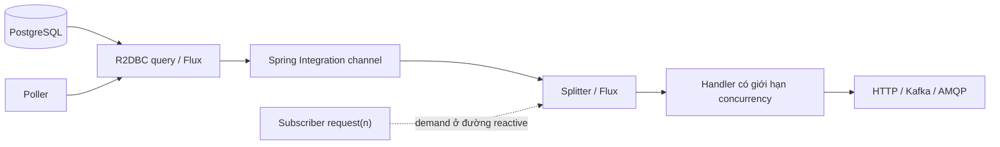
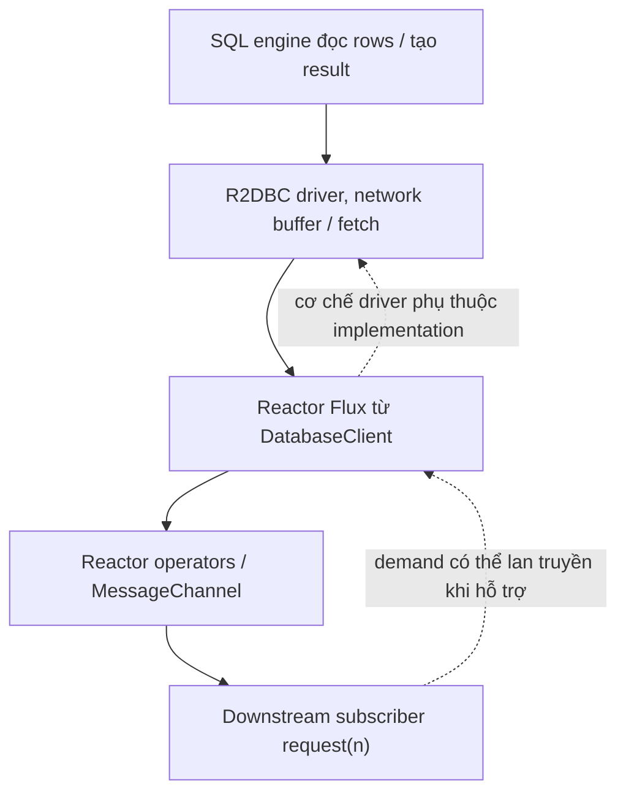
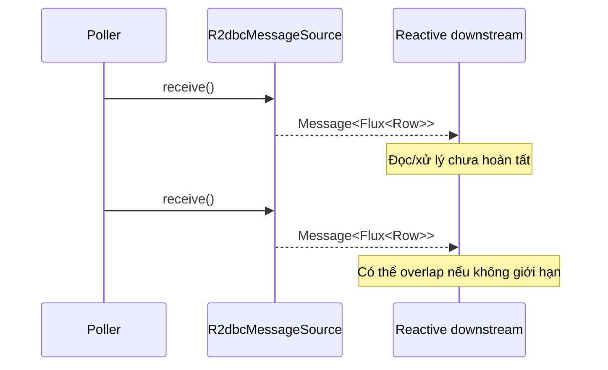
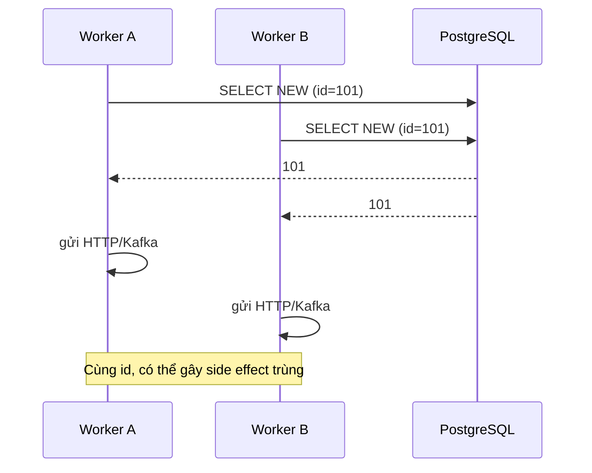

# Backpressure khi đọc nhiều bản ghi

> **Chương:** Adapter R2DBC  
> **Module:** SPRING_INTEGRATION_ADAPTERS  
> **Bối cảnh:** Kết nối hệ thống ngoài vào Spring Integration qua inbound/outbound adapter, gateway, poller và MessageChannel. Thực hành với file, SFTP, HTTP, JMS, AMQP, Kafka và cơ sở dữ liệu; chú trọng hợp đồng message, lỗi, vòng đời kết nối và khả năng vận hành.

## 1. Mục tiêu học tập

Sau bài này, bạn có thể:

- Giải thích **backpressure** theo hợp đồng Reactive Streams: subscriber dùng `request(n)` để thông báo nhu cầu nhận dữ liệu; publisher không được phát `onNext` vượt demand còn hiệu lực.
- Phân biệt **subscriber demand**, **SQL `LIMIT`**, **fetch size/prefetch**, **số lần poll**, **buffer size**, **concurrency** và **connection pool size**.
- Viết truy vấn `DatabaseClient` trả `Flux<T>`, điều phối xử lý hàng loạt bằng `concatMap`, `flatMap(..., concurrency)` và các toán tử Reactor phù hợp.
- Hiểu vì sao R2DBC là reactive API nhưng database/driver vẫn có thể prefetch hoặc buffer; `request(n)` không chắc tương ứng với một network fetch đúng `n` hàng.
- Cấu hình `R2dbcMessageSource` của Spring Integration: poller phát **`Message<Flux<T>>`**, splitter biến từng row thành message, các channel/reactive endpoint quyết định ranh giới demand.
- Xác định vì sao `fixedDelay`/`maxMessagesPerPoll` không tự giới hạn tổng số rows hay số tác vụ reactive đang chạy.
- Xây dựng **bounded pipeline** với batch SQL, giới hạn số tác vụ đồng thời, deadline, retry và giám sát pool.
- Xử lý `cancel`, `timeout` và `onError` mà không nhầm với ACK/commit; tránh mất/trùng sự kiện khi lỗi xảy ra giữa batch.
- Thiết kế **atomic claim, lease, ACK sau downstream và idempotency** khi nhiều instance cùng đọc một bảng.
- Kiểm thử demand bằng `StepVerifier` và kiểm thử tài nguyên bằng PostgreSQL/Testcontainers.

## 2. Bài toán: producer đọc nhanh hơn consumer xử lý

Một hệ thống lưu sự kiện vào bảng `integration_events`. Ứng dụng Spring Integration định kỳ đọc các hàng `NEW` rồi gửi tới API bên ngoài.

Ví dụ:

- Database có thể trả nhanh hàng nghìn hàng trong một SELECT.
- API bên ngoài chỉ xử lý được một số request đồng thời.
- Nếu ứng dụng chủ động đọc toàn bộ bảng, tạo request cho mỗi hàng và đưa tất cả vào một queue không giới hạn, bộ nhớ/pool có thể quá tải.
- Nếu cố "giải quyết" bằng cách bỏ các message cũ, hệ thống sẽ **mất sự kiện** khi nhiệm vụ yêu cầu delivery đáng tin cậy.

**Backpressure** giúp một downstream reactive subscriber kiểm soát lượng item được phát từ upstream Publisher. Tuy nhiên, trong Spring Integration còn có **poller**, **MessageChannel**, **R2DBC driver**, **database connection** và **external adapter**. Không phải mọi tầng đều tự động chia sẻ cùng một tín hiệu demand.



### 2.1. Backpressure KHÔNG phải điều gì?

| Khái niệm | Bảo đảm gì? | Không bảo đảm gì? |
| --- | --- | --- |
| Reactor `request(n)` | Giới hạn số `onNext` được upstream phát theo outstanding demand của subscription tương ứng. | Database chỉ gửi đúng `n` row trên network hoặc lưu tối đa `n` row trong bộ nhớ. |
| SQL `LIMIT 50` | Một query SELECT không trả quá 50 hàng theo SQL semantics. | Chỉ có một query đang chạy hoặc mỗi row được ACK. |
| `maxMessagesPerPoll(1)` | Poller gọi `MessageSource.receive()` tối đa một lần trong poll task đó. | Chỉ một SQL row được đọc. |
| `fixedDelay(2000)` | Điều tiết nhịp kích hoạt poll task theo lịch. | Đảm bảo mọi reactive subscriber của poll trước đã hoàn tất. |
| `flatMap(..., 4)` | Giới hạn số inner publisher đang được xử lý đồng thời trong pipeline đó. | Toàn bộ ứng dụng/broker chỉ có bốn request đang chờ. |
| Connection pool `max-size=10` | Tối đa khoảng mười connection hoạt động trong pool cấu hình. | Chỉ có mười request đang chờ hoặc query không bị lock lâu. |
| Queue dung lượng 100 | Hạn chế số message được chứa trong queue đó. | Producer tự giảm tốc; queue có thể từ chối message hoặc block tùy API. |

**Đây là nhiều cơ chế bổ sung nhau**, không phải các tên gọi khác nhau của cùng một giới hạn.

## 3. Reactive Streams: subscription, request(n), cancel

### 3.1. Bốn thành phần của hợp đồng

Reactive Streams có các vai trò:

- `Publisher<T>`: nguồn có thể phát dữ liệu.
- `Subscriber<T>`: bên nhận dữ liệu.
- `Subscription`: liên kết giữa một publisher và một subscriber, cung cấp `request(long n)` và `cancel()`.
- `Processor`: vừa subscribe phía trên vừa publish phía dưới khi một thành phần có hai vai trò.

Tín hiệu cơ bản:

```text
Publisher.subscribe(Subscriber)
            |
            v
Subscriber.onSubscribe(Subscription)
            |
            +-- request(2) ---------------------+
            |                                   |
            |                           onNext(row 1)
            |                           onNext(row 2)
            |
            +-- request(1) ---------------------+
                                                |
                                        onNext(row 3)
                                        onComplete()
```

Publisher **không** được vượt tổng demand còn hiệu lực, nhưng các toán tử Reactor có thể tạo các subscriptions nội bộ, thay đổi lượng yêu cầu phía upstream và dùng prefetch/buffer ở giữa.

### 3.2. request(n) là số tín hiệu, không phải SQL command

`request(10)` có nghĩa subscriber sẵn sàng nhận thêm tối đa mười item của subscription tương ứng.

Nó **không** có nghĩa:

- Câu SQL tự động thêm `LIMIT 10`.
- Một PostgreSQL cursor chỉ fetch mười row mỗi lần.
- Mười row đã commit hay được downstream ACK.
- Một database connection được trả lại ngay khi nhận item thứ mười.
- Những rows còn lại bị xóa hoặc đánh dấu đã xử lý.

Một driver có thể prefetch nhiều row, một server có thể thực thi query rộng rồi gửi kết quả từng phần; các hành vi cụ thể tùy driver, statement settings, transaction và SQL dialect.

### 3.3. Ví dụ demand bằng StepVerifier

```java
import org.junit.jupiter.api.Test;
import reactor.core.publisher.Flux;
import reactor.test.StepVerifier;

class DemandTest {

    @Test
    void downstreamControlsRequests() {
        Flux<Integer> source = Flux.range(1, 4);

        StepVerifier.create(source, 0)
                .thenRequest(1)
                .expectNext(1)
                .thenRequest(2)
                .expectNext(2, 3)
                .thenRequest(1)
                .expectNext(4)
                .verifyComplete();
    }
}
```

Bài test chứng minh **contract Reactor** với nguồn trong bộ nhớ; nó **không** kiểm chứng cơ chế row fetching trên PostgreSQL. Để kiểm tra driver và tài nguyên thật phải có integration test.

### 3.4. Cancel là gì?

`Subscription.cancel()` dừng việc nhận thêm item từ publisher theo contract; với R2DBC, nó có thể kích hoạt cleanup/cancel query/result và trả connection theo implementation.

`cancel` **không đồng nghĩa**:

- Các statement đã commit bị rollback.
- Mọi side effect HTTP/Kafka trước đó bị hủy.
- Những hàng đã phát đã được ACK.
- Database chắc chắn dừng ngay mọi I/O tại thời điểm ứng dụng gọi cancel.

Mọi pipeline có side effect cần phân biệt **COMPLETE**, **ERROR**, **CANCEL**, **TIMEOUT** khi ghi log, metric và quyết định retry.

## 4. Flux và R2DBC driver: backpressure tới đâu?

### 4.1. Một SELECT trả Flux<T>

Spring Framework `DatabaseClient` có thể tạo `Flux`:

```java
import org.springframework.r2dbc.core.DatabaseClient;
import reactor.core.publisher.Flux;

Flux<EventRow> events = db.sql(
                "SELECT id, event_key, payload_json, " +
                "status, created_at " +
                "FROM integration_events WHERE status = 'NEW' " +
                "ORDER BY id LIMIT 50")
        .map((row, metadata) -> new EventRow(
                row.get("id", Long.class),
                row.get("event_key", String.class),
                row.get("payload_json", String.class),
                row.get("status", String.class),
                row.get("created_at", java.time.OffsetDateTime.class)
        ))
        .all();
```

Đây là đoạn minh họa có biến `db`, kiểu `EventRow` sẽ định nghĩa ở mục 7. Gọi `sql(...).map(...).all()` **tạo Publisher**, chưa nhất thiết chạy SELECT. Khi có subscription, driver lấy connection, thực thi SQL, phát các row đã map và hoàn tất/đưa lỗi.

### 4.2. Phân biệt bốn chặng



- **Database:** chọn execution plan, index, sort, transaction snapshot, có thể xử lý nhiều row trước khi client nhận.
- **Driver:** chuyển protocol data thành `Row`, có thể có fetch policy, buffering và điều kiện transaction.
- **Reactor:** tuân theo số item được yêu cầu theo Reactive Streams.
- **Spring Integration:** channel, splitter và handler quyết định liệu demand có truyền tiếp được hay chuyển sang cơ chế dispatch khác.

**Không khẳng định một lời gọi `request(1)` khiến PostgreSQL chỉ giữ một row trong RAM.** Đây là giả định rất dễ dẫn tới thiết kế kém dưới tải lớn.

### 4.3. Fetch size/prefetch không đồng nghĩa SQL LIMIT

Một số R2DBC drivers cung cấp tùy chọn **fetch size** hoặc chính sách fetch cho statement/connection. Hành vi của nó phụ thuộc driver, transaction, auto-commit và cách driver vận dụng cursor.

- **SQL `LIMIT`** giới hạn số rows mà một truy vấn có thể trả.
- **Fetch size** (nếu driver hỗ trợ) là gợi ý/chính sách về kích thước các đợt lấy dữ liệu từ server.
- **Reactor `limitRate(n)`** điều chỉnh demand ở một đoạn Publisher.
- **Operator prefetch** quy định lượng yêu cầu/buffer giữa các operator.

Không nên sao chép `fetchSize(...)` vào một API Spring `DatabaseClient` nếu API đang dùng không cung cấp phương thức đó. Khi cần tối ưu ở tầng driver, tham khảo đúng **driver Javadoc + phiên bản** và đo trên môi trường thực.

### 4.4. Vì sao connection có thể bị giữ lâu?

Một `Flux` query có thể giữ tài nguyên result/connection đến khi hoàn tất, lỗi hoặc cancel, nhất là khi dùng server-side cursor hay transaction.

Nếu nguồn đọc một triệu row và mỗi row chờ API bên ngoài 500 ms, bạn có thể giữ connection rất lâu nếu kết hợp việc đọc với xử lý downstream theo cách nối trực tiếp.

Giải pháp thường tốt hơn:

1. SELECT/claim **batch nhỏ**.
2. Tách giai đoạn claim/commit DB khỏi giai đoạn gọi API chậm.
3. Xử lý batch với concurrency đã chặn.
4. ACK từng event theo policy khi downstream hoàn tất.
5. Lấy batch mới khi có capacity.
6. Đo active connections, transaction duration và lag.

## 5. SQL LIMIT, WHERE, ORDER BY: tuyến phòng thủ đầu tiên

### 5.1. Chỉ đọc những hàng cần thiết

Không nên viết:

```sql
SELECT *
FROM integration_events
WHERE status = 'NEW';
```

Nếu backlog rất lớn, query có thể truyền nhiều dữ liệu, giữ connection và khiến downstream quá tải.

Nên chọn projection và giới hạn batch:

```sql
SELECT id, event_key, payload_json, status, created_at
FROM integration_events
WHERE status = 'NEW'
ORDER BY id
LIMIT 50;
```

Thêm index hỗ trợ điều kiện và thứ tự:

```sql
CREATE INDEX idx_integration_events_status_id
    ON integration_events (status, id);
```

`LIMIT 50` đảm bảo query không trả quá 50 row theo SQL semantics. Nó **không** ngăn hai query chạy đồng thời cùng chọn hàng `NEW`; đó là việc của atomic claim/lease hoặc cơ chế điều phối.

### 5.2. Tránh SELECT * trên bảng rộng

`payload_json` có thể là chuỗi lớn. Nếu chỉ cần tìm ID để claim, đọc trước các cột nhỏ qua query phù hợp; khi cần payload, đọc sau theo ID đã claim hoặc trả payload ngay trong `UPDATE ... RETURNING` nếu thiết kế cho phép.

Giảm projection giúp:

- Bớt byte truyền qua network.
- Bớt CPU map dữ liệu.
- Bớt allocation/GC của ứng dụng.
- Giảm nguy cơ log/rò rỉ dữ liệu ngoài hợp đồng.

**Không** bỏ payload nếu downstream thực sự cần nó rồi chuyển thành N query per row không kiểm soát; đo tổng round trips của phương án lựa chọn.

### 5.3. Keyset pagination

Khi cần đọc báo cáo/quét lịch sử có thứ tự ID ổn định:

```sql
SELECT id, event_key, payload_json, status, created_at
FROM integration_events
WHERE id > :lastId
ORDER BY id
LIMIT :pageSize;
```

Keyset pagination thường tránh chi phí `OFFSET` lớn. Nhưng:

- Cursor chỉ là **vị trí quét**, không phải ACK downstream.
- Một ID tự tăng không luôn tương đương thứ tự commit giữa các transactions đồng thời.
- Nếu ghi cursor trước khi xử lý/ACK xong, crash có thể bỏ sót rows.
- Nếu query đang lọc `status='NEW'`, trạng thái thay đổi giữa các pages có thể ảnh hưởng tập dữ liệu.

Với công việc phải giao đủ, ưu tiên **claim/ACK/retry** hoặc outbox thay vì coi `lastId` là delivery offset hoàn chỉnh.

## 6. Thiết lập Spring Boot + PostgreSQL R2DBC

Ví dụ hướng đến **Java 17+, Spring Boot 3.x, Spring Integration 6.x, Spring Data R2DBC 3.x**. Phải để Spring Boot BOM quản lý dependency versions tương thích; kiểm tra Javadoc của chính bộ phiên bản đang chạy nếu nâng cấp.

### 6.1. Maven dependencies

```xml
<dependencies>
    <dependency>
        <groupId>org.springframework.boot</groupId>
        <artifactId>spring-boot-starter-integration</artifactId>
    </dependency>
    <dependency>
        <groupId>org.springframework.boot</groupId>
        <artifactId>spring-boot-starter-data-r2dbc</artifactId>
    </dependency>
    <dependency>
        <groupId>org.springframework.integration</groupId>
        <artifactId>spring-integration-r2dbc</artifactId>
    </dependency>
    <dependency>
        <groupId>org.postgresql</groupId>
        <artifactId>r2dbc-postgresql</artifactId>
        <scope>runtime</scope>
    </dependency>
    <dependency>
        <groupId>io.r2dbc</groupId>
        <artifactId>r2dbc-pool</artifactId>
    </dependency>
    <dependency>
        <groupId>io.projectreactor</groupId>
        <artifactId>reactor-test</artifactId>
        <scope>test</scope>
    </dependency>
</dependencies>
```

R2DBC PostgreSQL driver khác JDBC driver. Cần `io.r2dbc.spi.ConnectionFactory` được Boot hoặc cấu hình application tạo ra. `r2dbc-pool` phải tương thích với versions do BOM chọn.

### 6.2. application.yml

```yaml
spring:
  r2dbc:
    url: r2dbc:postgresql://127.0.0.1:5432/integration_demo
    username: ${DB_USER}
    password: ${DB_PASSWORD}
    pool:
      enabled: true
      initial-size: 2
      max-size: 10
      max-acquire-time: 3s
      max-idle-time: 10m
```

`${DB_USER}` và `${DB_PASSWORD}` là các Spring environment placeholders; không lưu mật khẩu thật trong Git. DB cần được tạo trước và user chỉ được cấp các quyền cần thiết.

Đây là **giá trị khởi điểm cho demo**, không phải cấu hình production mặc định. Nếu có nhiều app instances, tổng connection budget phải xét cả các service khác dùng chung PostgreSQL.

### 6.3. Bảng tích hợp

```sql
CREATE TABLE integration_events (
    id            BIGSERIAL PRIMARY KEY,
    event_key     VARCHAR(80) NOT NULL UNIQUE,
    payload_json  TEXT NOT NULL,
    status        VARCHAR(20) NOT NULL DEFAULT 'NEW',
    claim_owner   VARCHAR(80),
    claim_token   VARCHAR(80),
    lease_until   TIMESTAMPTZ,
    attempt_count INTEGER NOT NULL DEFAULT 0,
    created_at    TIMESTAMPTZ NOT NULL DEFAULT NOW(),
    processed_at  TIMESTAMPTZ
);

CREATE INDEX idx_integration_events_status_id
    ON integration_events (status, id);

INSERT INTO integration_events(event_key, payload_json)
VALUES
  ('event-101', '{"deviceId":"sensor-01"}'),
  ('event-102', '{"deviceId":"sensor-02"}'),
  ('event-103', '{"deviceId":"sensor-03"}');
```

`event_key` là **business idempotency key** và phải ổn định qua retry. `status`/`claim_owner`/`claim_token`/`lease_until` chỉ có ý nghĩa khi application thật sự triển khai protocol claim/ACK; chỉ có các cột không tự tạo delivery guarantee.

### 6.4. Entity dùng trong adapter

Tạo `IntegrationEventRow.java`:

```java
import java.time.OffsetDateTime;
import org.springframework.data.annotation.Id;
import org.springframework.data.relational.core.mapping.Column;
import org.springframework.data.relational.core.mapping.Table;

@Table("integration_events")
public record IntegrationEventRow(
        @Id Long id,
        @Column("event_key") String eventKey,
        @Column("payload_json") String payloadJson,
        String status,
        @Column("created_at") OffsetDateTime createdAt
) {
}
```

Java record phù hợp làm dữ liệu bất biến. Khi dùng `DatabaseClient` để map thủ công, annotation không bắt buộc; nhưng `@Table`/`@Column` hữu ích cho `R2dbcEntityTemplate` và `R2dbcMessageSource.payloadType(...)`.

## 7. Đọc batch có giới hạn bằng DatabaseClient

### 7.1. Repository hoàn chỉnh

Tạo `EventBatchReader.java`:

```java
import java.time.OffsetDateTime;
import org.springframework.r2dbc.core.DatabaseClient;
import org.springframework.stereotype.Repository;
import reactor.core.publisher.Flux;

@Repository
public class EventBatchReader {

    private final DatabaseClient db;

    public EventBatchReader(DatabaseClient db) {
        this.db = db;
    }

    public Flux<IntegrationEventRow> readNewBatch(int batchSize) {
        if (batchSize < 1 || batchSize > 100) {
            return Flux.error(new IllegalArgumentException(
                    "batchSize must be in [1,100]"));
        }

        return db.sql(
                        "SELECT id, event_key, payload_json, " +
                        "status, created_at " +
                        "FROM integration_events " +
                        "WHERE status = 'NEW' " +
                        "ORDER BY id LIMIT :maxRows")
                .bind("maxRows", batchSize)
                .map((row, metadata) ->
                        new IntegrationEventRow(
                                row.get("id", Long.class),
                                row.get("event_key", String.class),
                                row.get("payload_json", String.class),
                                row.get("status", String.class),
                                row.get("created_at",
                                        OffsetDateTime.class)
                        ))
                .all();
    }

    public Flux<IntegrationEventRow> readAfter(
            long lastId, int batchSize) {
        if (lastId < 0 || batchSize < 1 || batchSize > 100) {
            return Flux.error(new IllegalArgumentException(
                    "Invalid cursor or batchSize"));
        }

        return db.sql(
                        "SELECT id, event_key, payload_json, " +
                        "status, created_at " +
                        "FROM integration_events " +
                        "WHERE id > :lastId " +
                        "ORDER BY id LIMIT :maxRows")
                .bind("lastId", lastId)
                .bind("maxRows", batchSize)
                .map((row, metadata) ->
                        new IntegrationEventRow(
                                row.get("id", Long.class),
                                row.get("event_key", String.class),
                                row.get("payload_json", String.class),
                                row.get("status", String.class),
                                row.get("created_at",
                                        OffsetDateTime.class)
                        ))
                .all();
    }
}
```

**Ý nghĩa của thiết kế:**

1. Repository trả `Flux<IntegrationEventRow>`, không subscribe thay caller.
2. SQL `LIMIT` bảo vệ số hàng ở một query trước khi Reactor operator chạy.
3. `ORDER BY id` tạo thứ tự đọc ổn định trong mỗi query.
4. `map((row, metadata) -> ...)` chuyển `Row` thành DTO/record, không giữ raw `Row` ngoài mapping callback.
5. `readNewBatch` **không claim** bản ghi. Dùng nó để quan sát/backpressure lab, **không** làm worker production có side effect không idempotent.
6. `readAfter` phù hợp scan theo cursor, nhưng cursor **không phải** ACK.

### 7.2. Khi không có row

`readNewBatch(25)` có thể trả `Flux.empty()` sau khi truy vấn thấy 0 rows. Đây là **complete rỗng**, không phải onError hay bằng chứng database hỏng.

Nếu SQL sai schema hoặc driver không kết nối được, Publisher phát **onError**; đừng bắt lỗi rồi thay bằng `Flux.empty()` cho mọi trường hợp, vì sẽ che tình trạng hệ thống mất dữ liệu.

## 8. Điều tiết bằng Reactor operators

### 8.1. map và filter là biến đổi dữ liệu

```java
Flux<String> ids = reader.readNewBatch(25)
        .filter(row -> "NEW".equals(row.status()))
        .map(IntegrationEventRow::eventKey);
```

`filter` sau khi DB trả row **không** làm query SQL đọc ít row hơn. Nếu có thể, đẩy predicate xuống `WHERE` để tiết kiệm I/O.

`map` biến đổi từng item đồng bộ; **không** tự biến một callback I/O thành publisher có completion. Nếu cần gọi HTTP non-blocking, dùng `concatMap`/`flatMap` với `Mono`.

### 8.2. concatMap: xử lý tuần tự

Giả định một interface:

```java
import reactor.core.publisher.Mono;

public interface DownstreamSender {
    Mono<Void> send(IntegrationEventRow event);
}
```

Mẫu xử lý tuần tự:

```java
import reactor.core.publisher.Mono;

public Mono<Void> sendSequentially(
        EventBatchReader reader,
        DownstreamSender sender) {

    return reader.readNewBatch(25)
            .concatMap(sender::send)
            .then();
}
```

`concatMap` chờ inner publisher trước hoàn tất rồi mới xử lý item kế tiếp theo thứ tự. Nó phù hợp khi downstream cần bảo toàn thứ tự hoặc không chịu được concurrency cao, nhưng có throughput thấp hơn khi remote API chậm.

**Đây chỉ là ví dụ flow control**, chưa có claim/ACK; nếu chạy nhiều lần trên các rows `NEW` thì có thể gửi lặp.

### 8.3. flatMap với concurrency cố định

```java
public Mono<Void> sendWithBoundedConcurrency(
        EventBatchReader reader,
        DownstreamSender sender) {

    return reader.readNewBatch(25)
            .flatMap(sender::send, 4)
            .then();
}
```

Trong pipeline này, `flatMap(..., 4)` giới hạn số inner publishers chạy đồng thời. Side effects có thể hoàn tất **khác thứ tự** SELECT. Nếu ordering theo aggregate/business key là bắt buộc, cần `concatMap`, group/partition theo key hoặc một strategy tương đương.

**Quan trọng:** giới hạn 4 không tự áp dụng cho 10 instances khác, những producer khác hoặc mọi subscription của cùng repository.

### 8.4. flatMapSequential: giữ thứ tự output, không giữ thứ tự side effects

```java
Flux<String> results = reader.readNewBatch(25)
        .flatMapSequential(
                row -> sender.send(row).thenReturn(row.eventKey()),
                4
        );
```

Toán tử có thể chạy nhiều inner publishers đồng thời nhưng phát **kết quả** theo thứ tự input. Các lời gọi tới hệ thống ngoài vẫn có thể xảy ra/hoàn thành theo thứ tự khác.

Đừng sử dụng `flatMapSequential` để hứa rằng Kafka/HTTP sẽ quan sát **side effects** theo thứ tự tuyệt đối.

### 8.5. buffer: nhóm item, không tự tạo SQL batch

```java
Flux<java.util.List<IntegrationEventRow>> groups =
        reader.readNewBatch(50).buffer(10);
```

`buffer(10)` tạo các list tối đa 10 row trong ứng dụng. Nó **không** biến năm lệnh INSERT thành một SQL batch, cũng không thay đổi số row SELECT.

Khi downstream hỗ trợ bulk endpoint, buffer có thể giảm network round trips. Nhưng cần giới hạn cả **số nhóm đang gửi**; một `flatMap` không giới hạn các list vẫn có thể làm quá tải service.

### 8.6. collectList: dùng bộ nhớ theo toàn bộ batch

```java
Mono<java.util.List<IntegrationEventRow>> snapshot =
        reader.readNewBatch(50).collectList();
```

Vì query đã giới hạn 50 row, cách này hợp lý khi cần xử lý batch như một đơn vị. Với SELECT hàng triệu row không có LIMIT, `collectList()` có thể sử dụng rất nhiều RAM.

### 8.7. limitRate và take khác SQL LIMIT

```java
Flux<IntegrationEventRow> limitedDemand =
        reader.readNewBatch(50).limitRate(16);

Flux<IntegrationEventRow> earlyCancel =
        reader.readNewBatch(50).take(5);
```

- `limitRate(16)` điều chỉnh demand upstream trong Reactor, không tự sửa SELECT thành `LIMIT 16`.
- `take(5)` chỉ nhận tối đa năm item rồi cancel subscription; database có thể đã thực hiện query nhiều hơn.
- `take(5)` không phải ACK của năm row và không "trả lại queue" 45 row còn lại.
- Operator `onBackpressureBuffer` cũng không nên mặc định dùng nếu có nguồn đọc vô hạn; phải giới hạn capacity và policy khi đầy.

## 9. onBackpressureBuffer, drop, latest: lựa chọn có hậu quả

### 9.1. Buffer có giới hạn

```java
Flux<IntegrationEventRow> boundedQueue =
        reader.readNewBatch(50)
                .onBackpressureBuffer(20);
```

Điểm cần chú ý:

- Operator này có thể **yêu cầu upstream nhanh hơn downstream** và đệm một số item.
- Nếu producer tiếp tục vượt sức chứa, behavior overflow/error phụ thuộc overload/config được chọn.
- Nó không giảm số rows database phải SELECT.
- Nên giới hạn capacity **và** xác định hành động khi tràn, đo metric overflow.

Một buffer trong bộ nhớ không phải queue bền vững. Khi process crash, dữ liệu đang nằm trong memory có thể mất, dù nó từng được publisher phát ra.

### 9.2. Drop và latest là lựa chọn tổn thất dữ liệu

`onBackpressureDrop()` và `onBackpressureLatest()` phù hợp với **tín hiệu có thể bỏ mẫu** (ví dụ UI biểu đồ real-time), nhưng thường **không phù hợp với event nghiệp vụ cần giao đủ**.

| Use case | Được bỏ item? | Cách tiếp cận |
| --- | --- | --- |
| Nhiệt độ cập nhật liên tục cho UI, chỉ cần điểm mới nhất | Có thể, khi contract cho phép. | Latest/sample/throttle, ghi rõ loss policy. |
| Thanh toán, đặt hàng, xác nhận giao vận | Không. | Queue bền vững, claim/ACK, retry/idempotency. |
| Log/tracing không quan trọng | Có thể theo mức ưu tiên. | Bounded buffer và drop metrics. |
| Outbox event tới Kafka | Không nên tự bỏ. | Giữ row ở DB/broker cho đến ACK. |

**Không dùng drop để “sửa backpressure”** nếu dữ liệu bị bỏ có giá trị nghiệp vụ bắt buộc.

### 9.3. Không chặn event loop bằng blocking operations

Nếu trong reactive handler thực hiện JDBC blocking, HTTP client blocking hoặc `Thread.sleep` trên event-loop, throughput suy giảm và có thể làm nghẽn subscription.

Ưu tiên API reactive end-to-end. Nếu bắt buộc tương tác API blocking, cô lập sang scheduler phù hợp như `Schedulers.boundedElastic()`, có giới hạn concurrency, đo latency và kế hoạch thay thế; không biến toàn pipeline thành số lượng threads không kiểm soát.

## 10. Spring Integration: R2dbcMessageSource và Message<Flux<T>>

`R2dbcMessageSource` là **MessageSource** của inbound R2DBC adapter. Poller gọi `receive()` theo lịch. Theo thiết kế mặc định `expectSingleResult=false`, mỗi lần receive có thể trả một **Spring Message chứa một `Flux` các rows**.

```text
Poller gọi receive()
         |
         v
R2dbcMessageSource
         |
         v
Message<Flux<IntegrationEventRow>>
         |
         v
FluxMessageChannel / Splitter
         |
         +--> Message<IntegrationEventRow> #1
         +--> Message<IntegrationEventRow> #2
         +--> ...
         +--> Message<IntegrationEventRow> #N
```

### 10.1. Một lần poll không phải một row

Nếu SQL có `LIMIT 50` và poller dùng `maxMessagesPerPoll(1)`:

- Poll task gọi `receive()` tối đa một lần.
- Source có thể phát một `Message<Flux<T>>`.
- `Flux` có thể chứa tới 50 row khi được subscribe.
- Splitter có thể tạo tới 50 messages downstream.

**`maxMessagesPerPoll(1)` giới hạn số message từ source, không phải số row trong Publisher.**

### 10.2. Java DSL minh họa

Tạo `R2dbcPollingConfiguration.java`:

```java
import org.springframework.context.annotation.Bean;
import org.springframework.context.annotation.Configuration;
import org.springframework.data.r2dbc.core.R2dbcEntityTemplate;
import org.springframework.integration.config.EnableIntegration;
import org.springframework.integration.dsl.IntegrationFlow;
import org.springframework.integration.dsl.MessageChannels;
import org.springframework.integration.r2dbc.dsl.R2dbc;

@Configuration
@EnableIntegration
public class R2dbcPollingConfiguration {

    @Bean
    IntegrationFlow pollNewEvents(
            R2dbcEntityTemplate template) {

        return IntegrationFlow
                .from(
                        R2dbc.inboundChannelAdapter(
                                template,
                                "SELECT id, event_key, payload_json, " +
                                "status, created_at " +
                                "FROM integration_events " +
                                "WHERE status = 'NEW' " +
                                "ORDER BY id LIMIT 25")
                                .payloadType(IntegrationEventRow.class)
                                .expectSingleResult(false),
                        endpoint -> endpoint.poller(p ->
                                p.fixedDelay(2_000)
                                 .maxMessagesPerPoll(1))
                )
                .channel(MessageChannels.flux())
                .split()
                .channel(MessageChannels.flux())
                .handle(IntegrationEventRow.class, (row, headers) -> {
                    System.out.printf(
                            "Received from DB: id=%d eventKey=%s%n",
                            row.id(), row.eventKey()
                    );
                    return null;
                })
                .get();
    }
}
```

**Đây là demo chỉ SELECT và log**, không phải queue consumer production. `status='NEW'` không thay đổi, vì thế **mỗi lần poll có thể đọc lại các rows cũ**. Không nối trực tiếp handler log này với side effect không idempotent trong môi trường thật.

### 10.3. Tại sao cần Splitter?

Mặc định payload của source là **`Flux<IntegrationEventRow>`**. Nếu handler mong đợi một `IntegrationEventRow`, nó không tự nhận được row nếu chỉ nối qua channel.

`split()` có thể chuyển các phần tử publisher thành những Spring Messages riêng để handler làm việc với từng row. Kiểu channel và subscription của flow ảnh hưởng đến cách splitter vận hành; **dùng reactive channel phù hợp và kiểm tra bằng integration test**.

### 10.4. FluxMessageChannel không tự biến toàn flow thành reactive

`MessageChannels.flux()` tạo `FluxMessageChannel`, một kiểu `ReactiveStreamsSubscribableChannel`. Nó cho phép downstream subscriber/processor tham gia demand.

Nhưng hãy kiểm tra:

- Có **subscriber** phù hợp được khởi tạo cho kênh không?
- Có cầu nối nào sang `DirectChannel`/`QueueChannel`/blocking handler làm thay đổi semantics?
- Có `split()` đúng nơi để tiêu thụ Publisher từ R2DBC không?
- Có giới hạn số handlers/inner publishers đang chạy không?
- Khi lỗi phát từ `Flux` sau khi poll task kết thúc, error được xử lý ở đâu?
- Nguồn broker/HTTP upstream có phản ứng với backpressure hay vẫn đẩy vào queue riêng?

**Tên “FluxMessageChannel” không phải lời cam kết mọi tác vụ sẽ tự giới hạn concurrency, có ACK hay lưu bền.**

### 10.5. expectSingleResult(true)

Nếu `expectSingleResult(true)`, source chuyển sang chế độ một kết quả, payload thường là `Mono<T>` theo API, **không** phải entity Java đã materialize tại thời điểm `receive()`.

```text
expectSingleResult(false):
  Message<Flux<Row>>    (mặc định)

expectSingleResult(true):
  Message<Mono<Row>>
```

Muốn một row, SQL nên có khóa duy nhất hoặc `LIMIT 1`. Cả hai kiểu Publisher vẫn cần subscriber/consumer thích hợp.

## 11. Poller và tốc độ đọc tổng thể

### 11.1. Hai loại đồng hồ

- **Poller scheduling**: cứ bao lâu tạo/lấy một message từ `MessageSource`.
- **Reactive completion**: `Flux`/handler mất bao lâu mới đọc, xử lý và ACK tất cả items.

Một poll task có thể hoàn tất ngay sau khi gửi `Message<Flux<T>>` tới channel, **trước khi** toàn bộ asynchronous downstream hoàn thành. Điều này phụ thuộc topology, không nên đoán chỉ từ `fixedDelay`.



### 11.2. Vì sao polling với fixedDelay không đủ?

Giả sử batch có 25 rows, mỗi request downstream chậm. Poller vẫn có thể tiếp tục kích hoạt source theo lịch và tạo thêm Publisher mới. Khi đó nhiều query, subscriptions và downstream requests có thể chồng lên nhau.

Cách xử lý:

1. **Giới hạn SQL batch size**.
2. **Giới hạn tổng số batch/subscription active** bằng orchestrator/semaphore hoặc một nguồn poll chỉ kích hoạt lần mới khi batch trước complete theo contract.
3. Dùng **atomic claim** để hai batch không sở hữu cùng event.
4. Dùng **bounded concurrency** ở downstream.
5. Điều chỉnh poll rate theo observed backlog và end-to-end latency.
6. Thiết kế recovery với lease khi process crash.

**Không dùng `Thread.sleep()` trong poller để chờ handler**, vì nó chặn thread và không thể hiện rõ completion semantics.

### 11.3. R2DBC inbound không phải CDC

R2DBC inbound adapter hỏi database theo chu kỳ; nó **không** tự lắng nghe transaction log và không bảo đảm phát ngay khi một row commit.

Nếu yêu cầu latency rất thấp hoặc phải phát mọi thay đổi của nhiều bảng, cân nhắc CDC hoặc transactional outbox. Dù dùng gì, downstream vẫn cần backpressure/rate limits và idempotency.

## 12. Bảo vệ database connection pool

### 12.1. Pool là tài nguyên hữu hạn

R2DBC `ConnectionFactory` có thể được bọc bởi pool, ví dụ tối đa 10 connections. Khi query subscriptions đồng thời nhiều hơn capacity, các yêu cầu có thể phải chờ lấy connection.

```text
100 producers
     |
     v
Reactive pipelines / bounded concurrency
     |
     v
R2DBC pool (max-size=10)
     |
     +--> active connections
     +--> idle connections
     +--> pending acquisition requests
     |
     v
PostgreSQL
```

**Pool max-size** là giới hạn connection, không phải giới hạn số tasks đang chờ. Nếu pending acquisitions không được kiểm soát, ứng dụng vẫn có thể tích tụ quá nhiều Publisher và gây timeout/memory pressure.

### 12.2. Nguyên nhân giữ connection quá lâu

- SELECT nhiều row với slow subscriber.
- Transaction kéo dài qua HTTP call hoặc sleep.
- SQL bị lock contention.
- Driver fetch/cursor chưa giải phóng.
- Query không có statement timeout.
- Subscriber không consume/cancel đúng lifecycle.
- Retry tạo nhiều subscriptions song song khi DB đã chậm.

### 12.3. Không gắn transaction DB vào suốt HTTP call

Mẫu không nên dùng:

```text
BEGIN transaction
SELECT/claim rows
giữ row lock + connection
đợi HTTP API nhiều giây
COMMIT
```

Mẫu thường an toàn hơn:

```text
Transaction ngắn #1: claim rows + COMMIT
          |
          v
Gọi HTTP/Kafka/AMQP ngoài transaction DB
          |
          v
Transaction ngắn #2: ACK DONE với owner/token
```

Cách này đòi **lease và idempotency** vì worker có thể crash ở giữa. Đổi lại không giữ DB connection/lock khi phụ thuộc remote service.

## 13. Đọc tin cậy: atomic claim trước khi gửi

### 13.1. Vì sao SELECT thuần có thể đọc trùng?

Hai instances đều chạy:

```sql
SELECT id, event_key, payload_json
FROM integration_events
WHERE status = 'NEW'
ORDER BY id LIMIT 25;
```

Cả hai có thể nhận cùng row. Backpressure không sửa được bài toán **ownership**: nó chỉ điều tiết nhịp phát item.



### 13.2. PostgreSQL UPDATE RETURNING và SKIP LOCKED

Để claim một batch, có thể dùng một **statement PostgreSQL**:

```sql
WITH picked AS (
    SELECT id
    FROM integration_events
    WHERE status = 'NEW'
    ORDER BY id
    LIMIT :batchSize
    FOR UPDATE SKIP LOCKED
)
UPDATE integration_events AS e
SET status = 'PROCESSING',
    claim_owner = :owner,
    claim_token = :token,
    lease_until = NOW() + INTERVAL '60 seconds',
    attempt_count = attempt_count + 1
FROM picked
WHERE e.id = picked.id
RETURNING e.id, e.event_key, e.payload_json,
          e.status, e.created_at;
```

- `FOR UPDATE SKIP LOCKED` giúp nhiều workers bỏ qua rows đang bị transaction khác lock khi chọn batch.
- `UPDATE ... RETURNING` trả **chính các rows được UPDATE**.
- `:batchSize` giới hạn số row claim.
- `claim_owner` và `claim_token` xác định chủ sở hữu yêu cầu claim.
- `lease_until` phục vụ recovery nếu worker chết trước ACK.
- `attempt_count` phục vụ retry policy.

Đây là SQL **riêng PostgreSQL**, cần test isolation/lock behavior thật. Để nhận lại rows hết lease, phải thêm một đường recovery/predicate tương ứng; ví dụ trên chỉ chọn `NEW` và **không tự động tái claim `PROCESSING` đã quá hạn**.

### 13.3. Repository claim batch

```java
import java.time.OffsetDateTime;

import org.springframework.r2dbc.core.DatabaseClient;
import org.springframework.stereotype.Repository;
import reactor.core.publisher.Flux;
import reactor.core.publisher.Mono;

@Repository
public class EventClaimRepository {

    private final DatabaseClient db;

    public EventClaimRepository(DatabaseClient db) {
        this.db = db;
    }

    public Flux<IntegrationEventRow> claimBatch(
            String owner, String token, int batchSize) {

        if (owner == null || token == null
                || !owner.matches("[A-Za-z0-9_-]{1,80}")
                || !token.matches("[A-Za-z0-9_-]{1,80}")
                || batchSize < 1 || batchSize > 100) {
            return Flux.error(new IllegalArgumentException(
                    "Invalid claim options"));
        }

        return db.sql(
                        "WITH picked AS (" +
                        " SELECT id FROM integration_events " +
                        " WHERE status = 'NEW' ORDER BY id " +
                        " LIMIT :size FOR UPDATE SKIP LOCKED" +
                        ") UPDATE integration_events AS e " +
                        "SET status='PROCESSING', " +
                        "claim_owner=:owner, claim_token=:token, " +
                        "lease_until=NOW()+INTERVAL '60 seconds', " +
                        "attempt_count=attempt_count+1 " +
                        "FROM picked WHERE e.id = picked.id " +
                        "RETURNING e.id, e.event_key, e.payload_json, " +
                        "e.status, e.created_at")
                .bind("size", batchSize)
                .bind("owner", owner)
                .bind("token", token)
                .map((row, metadata) -> new IntegrationEventRow(
                        row.get("id", Long.class),
                        row.get("event_key", String.class),
                        row.get("payload_json", String.class),
                        row.get("status", String.class),
                        row.get("created_at", OffsetDateTime.class)
                ))
                .all();
    }

    public Mono<Long> acknowledge(
            long id, String owner, String token) {

        return db.sql(
                        "UPDATE integration_events " +
                        "SET status='DONE', " +
                        "processed_at=NOW(), lease_until=NULL " +
                        "WHERE id=:id AND status='PROCESSING' " +
                        "AND claim_owner=:owner AND claim_token=:token")
                .bind("id", id)
                .bind("owner", owner)
                .bind("token", token)
                .fetch().rowsUpdated();
    }
}
```

Kết quả của `claimBatch` là `Flux<IntegrationEventRow>` chứa các rows được claim thành công **khi publisher được subscribe**. Hãy nhớ đây là query **có side effect**: subscribe lại có thể claim batch khác.

**Không chạy retryWhen mù trên Flux claim có UPDATE**: một lỗi sau partial emission hoặc kết quả commit không rõ có thể khiến một subscription mới claim thêm hoặc trùng tác vụ. Cần ghi nhận batch/token và đưa recovery về trạng thái authoritative của DB.

### 13.4. ACK cần kiểm tra số row

`acknowledge(...)` trả `Mono<Long>`:

- `1`: một row phù hợp owner/token đã chuyển sang `DONE`.
- `0`: row không tồn tại, status/owner/token đã đổi hoặc lease/recovery đã chuyển quyền.
- `onError`: có lỗi DB; không mặc định biết ACK đã commit hay chưa.

Không dùng `.then()` bỏ count trước khi áp dụng business policy cần đúng một ACK. Nếu count 0, cần đối soát; không đánh dấu sự kiện đã hoàn tất tùy tiện.

### 13.5. Backpressure và claim phải phối hợp

Một pipeline claim đáng tin cậy thường làm việc theo nhịp:

```text
Capacity available?
        |
        v
Claim tối đa N rows + commit
        |
        v
Xử lý <= K events đồng thời
        |
        v
ACK row thành công / ghi failed + retry metadata
        |
        v
Giải phóng capacity rồi claim batch mới
```

Trong trường hợp crash sau claim, dữ liệu vẫn ở `PROCESSING` nên cần **lease expiry recovery**. Trong trường hợp crash sau side effect nhưng trước ACK, downstream có thể nhận event lại nên cần **idempotency key**.

Bài học về backpressure **không** thay thế thiết kế giao hàng: giới hạn tải + bảo đảm trạng thái là hai mục tiêu phải làm cùng lúc.

## 14. Ranh giới với Kafka, AMQP, JMS, HTTP và file

Một luồng tích hợp hiếm khi chỉ có R2DBC. Sau khi mapping rows, dữ liệu có thể đi qua outbound Kafka/AMQP/JMS/HTTP adapters.

| Điểm nối | Vấn đề backpressure | Cần thêm gì? |
| --- | --- | --- |
| HTTP reactive client | API đích có latency, rate limit, timeout. | Bounded concurrency, timeout, retry budget và circuit breaker phù hợp. |
| Kafka producer | Broker ack và producer buffer có semantics riêng. | In-flight limit, error handling, key/partition ordering, idempotent consumer. |
| AMQP/JMS | Consumer prefetch/ACK và broker queue capacity là cơ chế riêng. | Manual ACK theo contract, redelivery/DLQ và backpressure bridge. |
| File/SFTP adapter | Poller đọc nhiều files, nội dung có thể lớn. | Polling batch cap, file ownership, retry và xử lý stream/chunk. |
| Database inbound | Poller trả `Message<Flux>`, query có thể đọc nhiều rows. | SQL LIMIT, reactive subscription, claim/ACK. |
| DirectChannel | Dispatch có tính đồng bộ theo handler. | Không tự có Reactive Streams demand xuyên toàn flow. |
| FluxMessageChannel | Hỗ trợ reactive subscription/demand. | Kiểm tra subscriber, publisher lifecycle, concurrency và error path. |

**Không giả định HTTP API hay Kafka broker nhận và tuân thủ trực tiếp `request(n)` từ một Reactor Flux của R2DBC.** Thường phải có **điểm chuyển đổi tốc độ** với bounded buffer, bộ đếm in-flight hoặc persistent queue.

### 14.1. Khi nào ACK upstream?

Không ACK một Kafka/JMS/AMQP input chỉ vì đã gọi `MessageChannel.send(...)` hay chỉ vì đã bắt đầu một reactive Publisher.

Chọn rõ contract:

- **Received**: command đã được lưu bền vào nơi chịu trách nhiệm xử lý.
- **DB committed**: transaction dữ liệu đã commit.
- **Published**: broker đã xác nhận việc nhận event theo policy.
- **Business processed**: side effect cuối hoàn tất và trạng thái đã được ghi bền.

Các tầng có thể khác nhau. Mẫu outbox có thể ACK input sau khi thay đổi dữ liệu + outbox được commit cùng transaction, sau đó publisher riêng đưa dữ liệu ra Kafka/AMQP.

## 15. Lỗi, timeout và retry khi đang stream nhiều rows

### 15.1. Partial emission

Ví dụ:

```text
Flux query phát row 101 -> handler đã gửi thành công
Flux query phát row 102 -> handler đã gửi thành công
Flux query row 103 -> lỗi mapping/driver
                    -> onError
```

Nếu retry lại cả `Flux` SELECT, rows 101/102 có thể được đọc lại. **Backpressure không làm các side effects trước onError tự rollback**.

Cần:

- Event ID ổn định qua retry.
- ACK sau khi downstream hoàn tất.
- Recovery/lease cho những rows chưa ACK.
- Consumer idempotent.
- Theo dõi partial progress theo event ID chứ không chỉ theo batch count.

### 15.2. Retry lạnh có thể tạo query mới

```java
import java.time.Duration;
import reactor.util.retry.Retry;

Flux<IntegrationEventRow> retried =
        reader.readNewBatch(25)
                .retryWhen(
                        Retry.backoff(
                                2, Duration.ofMillis(200))
                             .maxBackoff(Duration.ofSeconds(2)));
```

Đây chỉ là **demo retry query đọc thuần**. Trong production phải filter transient exceptions và có total deadline. Mỗi retry có thể **resubscribe và chạy lại SQL**, không tiếp tục từ row cuối một cách tự động.

**Không** áp dụng công thức này trực tiếp cho `claimBatch` có `UPDATE RETURNING` khi chưa có idempotent claim/recovery protocol.

### 15.3. Timeout từng khoảng so với total deadline

```java
import java.time.Duration;

Flux<IntegrationEventRow> gapTimed =
        reader.readNewBatch(25)
                .timeout(Duration.ofSeconds(3));
```

Với `Flux.timeout(Duration)`, timeout thường là **khoảng chờ item kế tiếp**; nếu các item tới đều nhưng chậm, toàn batch có thể kéo dài lâu.

Đối với batch nhỏ đã có SQL LIMIT:

```java
Mono<java.util.List<IntegrationEventRow>> batch =
        reader.readNewBatch(25)
                .collectList()
                .timeout(Duration.ofSeconds(8));
```

`collectList()` được dùng ở đây vì có `LIMIT 25`; deadline là của toàn việc materialize batch này. Timeout phía client không chứng minh transaction/statement đã rollback; với operations có side effect phải đối soát.

### 15.4. ErrorChannel và reactive error

Trong Spring Integration, lỗi có thể xuất hiện **sau khi poller gửi `Message<Flux>`**, lúc publisher được subscribe. Đừng giả định `errorChannel` của poller chắc chắn bắt mọi lỗi từ subscription phía sau.

- Lỗi **đồng bộ** trong việc tạo/gửi message có đường error handling của endpoint.
- Lỗi **bất đồng bộ** của Publisher cần được xử lý trong reactive chain hoặc cơ chế tương ứng của channel/handler.
- Khi một handler ném exception sau khi vài rows đã được xử lý, phải biết trạng thái từng row.

Không dùng `onErrorResume(error -> Flux.empty())` như một cách "cho flow chạy tiếp" với lỗi DB nghiêm trọng; nó có thể biến failure thành kết quả giả không có hàng.

## 16. Cancellation, cleanup và graceful shutdown

### 16.1. Cancel có thể xảy ra giữa batch

Khi client đóng kết nối, breaker ngắt request, timeout hoặc ứng dụng shutdown, downstream có thể cancel subscription.

Hệ quả:

- Một số rows đã được map/gửi.
- Một số rows chưa phát.
- Query/connection phải được cleanup theo driver/Spring contract.
- Nếu dùng claim/lease, các rows đã claim nhưng chưa ACK vẫn cần recovery.
- Không được tự suy ra hoàn tất toàn batch chỉ vì method tạo Publisher trả về bình thường.

### 16.2. Shutdown đúng

Một shutdown policy nên:

1. Ngừng nhận input mới và dừng poller/claim batch mới.
2. Không khởi tạo thêm reactive subscriptions không cần thiết.
3. Chờ các tasks đang xử lý hoàn tất **tới một deadline có giới hạn**.
4. Ghi ACK cho các rows thực sự đã xử lý thành công.
5. Để rows chưa ACK được phục hồi qua lease/retry.
6. Đóng connection pool và resources theo vòng đời ứng dụng.
7. Ghi metrics trạng thái cuối, số in-flight, số claim hết hạn.

Không giữ transaction mở xuyên toàn bộ thời gian shutdown để "bảo vệ" requests HTTP chậm.

### 16.3. Không tự mở raw connection mà quên trả

Trong hầu hết use cases, để `DatabaseClient`/`R2dbcEntityTemplate` quản lý ConnectionFactory. Nếu buộc làm việc trực tiếp với R2DBC SPI, phải cleanup ở các đường complete/error/cancel, ví dụ bằng `usingWhen` theo Reactor.

Không giữ một raw `Connection` singleton dùng cho nhiều subscriptions song song; điều đó có thể hỏng transaction isolation và lifetime.

## 17. Quan sát backpressure qua metrics

### 17.1. Metrics cần phân biệt nguồn đọc và downstream

| Metric gợi ý | Giải thích |
| --- | --- |
| `r2dbc_query_subscribed_total` | Bao nhiêu SQL Publishers thực sự bắt đầu. |
| `r2dbc_query_completed_total` | Bao nhiêu subscriptions complete bình thường. |
| `r2dbc_query_error_total` | SQL/driver/mapping errors. |
| `r2dbc_query_cancel_total` | Subscriptions bị cancel. |
| `r2dbc_rows_read_total` | Rows được mapper phát thành công. |
| `r2dbc_rows_per_batch_p95` | Batch size thực tế. |
| `r2dbc_pool_active` / `pending` | Connection pool bận/chờ. |
| `r2dbc_query_latency_p95` | Thời gian truy vấn và tiêu thụ kết quả. |
| `downstream_inflight` | Số external requests/handlers đồng thời. |
| `downstream_latency_p95` | Thời gian remote API/broker ACK. |
| `backlog_new_oldest_age` | Tuổi của event NEW cũ nhất. |
| `claim_lease_expired_total` | Claim không được ACK đúng hạn. |
| `events_acknowledged_total` | Số events đã ghi DONE. |
| `duplicate_event_key_total` | Mức redelivery/retry quan sát được. |
| `buffer_overflow_total` | Bounded buffer bị tràn. |

Các tên trên là **gợi ý instrumentation**, không khẳng định Spring/Micrometer tự cung cấp toàn bộ. Không đưa `event_key`/`claim_token` làm metric labels có cardinality cao.

### 17.2. Trace subscription và terminal signal

```java
import reactor.core.publisher.Flux;

Flux<IntegrationEventRow> observed =
        reader.readNewBatch(25)
                .doOnSubscribe(subscription ->
                        System.out.println("Query subscribed"))
                .doOnNext(row ->
                        System.out.println(
                                "Mapped id=" + row.id()))
                .doOnError(error ->
                        System.err.println(
                                "SQL/mapping error: " +
                                error.getClass().getSimpleName()))
                .doFinally(signal ->
                        System.out.println("Final signal=" + signal));
```

Đây là Publisher chưa tự thực thi nếu không có subscriber. `doFinally` giúp phân biệt `ON_COMPLETE`, `ON_ERROR` và `CANCEL`.

Trong production, dùng structured logging/tracing và giới hạn log; không in nguyên payload JSON chứa dữ liệu nhạy cảm hoặc credentials.

### 17.3. Phân biệt “DB nhanh” với “pipeline nhanh”

Một truy vấn đọc 25 rows trong vài ms chưa có nghĩa end-to-end đã xử lý 25 events thành công. Cần hai nhóm latency:

- **DB query/mapping latency**: từ subscribe tới query/result complete.
- **Business processing/ACK latency**: từ claim/read tới remote side effect và DB ACK.

Nếu query nhanh nhưng processing chậm, hãy giảm tốc claim/poll và giới hạn concurrency. Nếu query chậm, kiểm tra index, locks, pool và SQL execution plan.

## 18. Kiểm thử bằng StepVerifier

### 18.1. Test demand theo số item

```java
import org.junit.jupiter.api.Test;
import reactor.core.publisher.Flux;
import reactor.test.StepVerifier;

@Test
void requestsDataIncrementally() {
    StepVerifier.create(Flux.range(1, 5), 0)
            .thenRequest(2)
            .expectNext(1, 2)
            .thenRequest(2)
            .expectNext(3, 4)
            .thenRequest(1)
            .expectNext(5)
            .verifyComplete();
}
```

Đây là một test method đặt trong class JUnit; không chứng minh driver PostgreSQL fetch đúng `request(n)` ở wire level.

### 18.2. Test cancel có chủ đích

```java
@Test
void cancellationStopsFurtherDemand() {
    StepVerifier.create(Flux.range(1, 100), 0)
            .thenRequest(3)
            .expectNext(1, 2, 3)
            .thenCancel()
            .verify();
}
```

Test này xác nhận subscription cancellation ở mức Reactor. Integration test với R2DBC cần thêm quan sát pool active/pending và đảm bảo connection được trả khi query bị hủy.

### 18.3. Test SQL LIMIT trên PostgreSQL

Giả sử `EventBatchReader reader` được inject vào test class có PostgreSQL test database đã seed hơn mười rows `NEW`:

```java
import reactor.test.StepVerifier;

@Test
void queryNeverExceedsBatchLimit() {
    StepVerifier.create(reader.readNewBatch(3).collectList())
            .assertNext(rows ->
                    org.junit.jupiter.api.Assertions.assertTrue(
                            rows.size() <= 3))
            .verifyComplete();
}
```

Để test có ý nghĩa hơn, xác nhận fixture ban đầu chứa **nhiều hơn ba rows**; nếu chỉ có hai, test vẫn pass nhưng không chứng minh LIMIT có tác dụng.

### 18.4. Test concurrency của flatMap

```java
import java.time.Duration;
import java.util.concurrent.atomic.AtomicInteger;
import reactor.core.publisher.Flux;
import reactor.core.publisher.Mono;
import reactor.test.StepVerifier;

@Test
void flatMapHasBoundedInnerConcurrency() {
    AtomicInteger active = new AtomicInteger();
    AtomicInteger maxSeen = new AtomicInteger();

    Mono<java.util.List<Integer>> result =
            Flux.range(1, 12)
                    .flatMap(i -> Mono.defer(() -> {
                        int now = active.incrementAndGet();
                        maxSeen.accumulateAndGet(now, Math::max);

                        return Mono.delay(Duration.ofMillis(20))
                                .map(tick -> i)
                                .doOnSuccess(value ->
                                        active.decrementAndGet());
                    }), 3)
                    .collectList();

    StepVerifier.create(result)
            .expectNextCount(1)
            .verifyComplete();

    org.junit.jupiter.api.Assertions.assertTrue(maxSeen.get() <= 3);
}
```

Đây là test Reactor minh họa, không đo pool DB. Khi viết benchmark thực cần xem scheduler/test timing và đo kết quả dưới tải ổn định; mục tiêu là hiểu **giới hạn inner subscriptions** của `flatMap`.

### 18.5. Test empty, error và partial emission

```java
@Test
void partialDataCanPrecedeAnError() {
    Flux<Integer> broken = Flux.concat(
            Flux.just(101, 102),
            Flux.error(new IllegalStateException("row 103 invalid")));

    StepVerifier.create(broken)
            .expectNext(101, 102)
            .expectError(IllegalStateException.class)
            .verify();
}
```

Nếu rows 101/102 đã được gửi sang hệ thống ngoài, retry toàn stream có thể gửi lại; phải test idempotency của consumer và recovery status.

### 18.6. Integration test database thật

Dùng PostgreSQL qua Testcontainers hoặc môi trường test tương đương để kiểm tra:

1. Query/projection/SQL LIMIT và index.
2. R2DBC connection pool active/idle/pending khi nhiều subscriptions.
3. Tải với 1, 5, 20, 100 rows mỗi batch.
4. Driver behavior khi subscriber demand nhỏ.
5. Cancellation giữa một query dài và resource cleanup.
6. DB bị restart, connection timeout, lock wait.
7. Claim concurrent `SKIP LOCKED` với hai instances.
8. Worker chết sau claim nhưng trước ACK, lease recovery.
9. ACK count `0/1` khi token/owner thay đổi.
10. External API chậm và tác động lên in-flight/backlog.
11. Restart khi còn buffered messages chưa xử lý.
12. Retry partial batch và idempotent downstream.

Không dùng H2 R2DBC để kết luận chắc chắn về hành vi PostgreSQL `UPDATE ... RETURNING`, locking, isolation và fetch implementation.

## 19. Ma trận kiểm thử end-to-end

| Tình huống | Kết quả phải xác minh |
| --- | --- |
| Query trả 0 row | Publisher complete rỗng, không phát event giả. |
| SQL LIMIT 25 trên bảng lớn | Một query không trả quá 25 row. |
| request(1) với source Reactor | Không nhận quá một item trước khi request thêm. |
| request(1) với PostgreSQL | Đo driver buffering/network; không giả định một row/trip. |
| `limitRate(16)` | Demand được điều tiết; SQL không tự đổi LIMIT. |
| `take(5)` | Subscriber nhận 5 rồi cancel; cleanup resources. |
| `flatMap(...,4)` | Đường xử lý đó không chạy quá concurrency thiết kế. |
| `concatMap` | Inner operations chạy tuần tự trong pipeline. |
| `collectList` trên batch 25 | Memory bounded theo batch; batch lớn cần xem xét. |
| Bounded buffer tràn | Có policy/error/metric rõ, không silent data loss. |
| SQL query không index | Đo query plan/latency, không đổ lỗi cho Reactor. |
| Một poll trả Flux nhiều rows | Một `Message<Flux<T>>` có nhiều items khi subscribe. |
| Bỏ splitter | Handler nhận Publisher, không tự nhận POJO row. |
| `maxMessagesPerPoll(1)` | Giới hạn số receive, không phải row count. |
| Poll #2 trước batch #1 xong | Phát hiện overlap và kiểm soát in-flight. |
| Không update status | Cùng event được đọc lại ở poll tiếp. |
| Hai instances SELECT NEW | Có thể cùng đọc một row nếu không claim. |
| Hai instances atomic claim | Chỉ những rows đã được update claim được phát cho owner. |
| Worker chết sau claim | Lease expiry/recovery, không mất event vĩnh viễn. |
| Subscriber cancel | Không coi batch hoàn tất và không ACK nhầm. |
| Flux phát 2 row rồi lỗi | Error signal, retry có thể phát lại 2 row. |
| DB mất kết nối | Không biến lỗi thành empty batch giả. |
| Pool acquire timeout | Giới hạn pending, không tăng memory vô hạn. |
| Downstream Kafka/HTTP chậm | In-flight bounded, backlog có thể tăng nhưng data được giữ bền. |
| DB commit rồi publish broker lỗi | Outbox/replay và idempotency xử lý. |
| Shutdown với in-flight | Ngừng poll mới, xử lý deadline và recovery chưa ACK. |

## 20. Sai lầm phổ biến và cách sửa

| Sai lầm | Hậu quả | Cách sửa |
| --- | --- | --- |
| Coi `Flux` là List đã được đọc | Nhầm subscription và resource lifecycle. | Xác định subscriber và terminal signals. |
| Coi `request(n)` là SQL `LIMIT n` | DB vẫn có thể đọc/đệm lượng dữ liệu lớn. | LIMIT và query plan ở DB, demand ở Reactor. |
| Coi `limitRate` là driver fetchSize | Đo sai network/memory. | Kiểm tra driver-specific API và benchmark. |
| Coi pool max-size là giới hạn request backlog | Pending queue/memory vẫn tăng. | Bounded concurrency, queue và timeout. |
| Dùng `collectList` trên SELECT không giới hạn | OOM hoặc GC lớn. | SQL LIMIT/keyset paging. |
| `flatMap` không giới hạn | Nhiều HTTP/DB tasks cùng lúc. | Đặt concurrency và capacity budget. |
| Dùng `onBackpressureDrop` cho payment event | Mất dữ liệu nghiệp vụ. | Durable queue/claim/ACK/retry. |
| Bỏ qua `onError` từ publisher | Giấu lỗi DB hoặc mất partial progress. | Error handling theo subscription và event ID. |
| Subscribe cùng cold query nhiều lần | Query chạy lại, row có thể bị phát trùng. | Single ownership, compose pipeline, idempotency. |
| Giữ transaction khi gọi remote API | DB locks/connections bị giữ lâu. | Claim commit ngắn rồi xử lý ngoài transaction. |
| Poller fixedDelay đủ để không overlap | Nhiều Publisher in-flight. | Active-batch limit và claim atomic. |
| Nghĩ `Message<Flux<T>>` đã là nhiều messages | Handler type mismatch/thiếu subscription. | Splitter hoặc reactive consumer phù hợp. |
| Dùng SELECT rồi UPDATE rời nhau để claim | Hai workers đọc cùng row. | UPDATE RETURNING/SKIP LOCKED và token. |
| ACK trước khi downstream complete | Có thể mất event sau crash. | ACK theo business delivery contract. |
| Tăng pool size liên tục khi nghẽn | Quá tải PostgreSQL. | Tìm bottleneck DB/remote, tune throughput. |
| Thấy CANCEL coi là SUCCESS | Bỏ sót rows chưa xử lý. | Tách complete/error/cancel, recovery. |

## 21. Bài tập thực hành

**Bài 1 — Demand.** Dùng `StepVerifier.create(source, 0)` và `thenRequest(...)` trên `Flux.range(1,20)`; giải thích cơ chế outstanding demand.

**Bài 2 — SQL giới hạn.** Tạo 10.000 rows test, SELECT `LIMIT 25` và đo row count/latency so với SELECT không LIMIT. Ghi rõ query plan và network volume.

**Bài 3 — limitRate.** Dùng `limitRate(8)` trên một Flux có `doOnRequest`, quan sát upstream requests. Giải thích vì sao nó không thay đổi SQL.

**Bài 4 — concatMap/flatMap.** Mô phỏng API chậm 100 ms/item. So sánh thời gian, concurrency và thứ tự output của `concatMap`, `flatMap(...,4)` và `flatMapSequential`.

**Bài 5 — Buffer.** Thử `buffer(10)` và `collectList()` trên query đã LIMIT. Giải thích memory footprint và overflow khi có nhiều subscriptions.

**Bài 6 — R2DBC inbound.** Chạy flow `R2dbcMessageSource`, quan sát `maxMessagesPerPoll(1)` nhưng một poll tạo nhiều messages qua splitter.

**Bài 7 — Không có splitter.** Ghi nhận class của payload trong handler trước splitter; xác nhận đó là Publisher thay vì `IntegrationEventRow`.

**Bài 8 — Poll overlap.** Cho downstream xử lý lâu hơn polling interval. Đo số batch active, pool pending và trùng event IDs. Đề xuất cách giới hạn active batch.

**Bài 9 — Cancellation.** Cho subscriber `take(5)` trên batch 50, kiểm tra completion/cancel, connection cleanup và vì sao không ACK toàn batch.

**Bài 10 — Atomic claim.** Implement `UPDATE ... RETURNING` + `FOR UPDATE SKIP LOCKED` với hai app instances. Xác nhận không phát cùng row dưới hai owner cho cùng đợt claim.

**Bài 11 — Recovery.** Claim 25 rows, kill worker trước ACK rồi giả lập lease expiry. Thiết kế recovery query, attempt limit và stable event keys.

**Bài 12 — Retry partial emission.** Cho query phát hai rows rồi error. Gắn side effect có idempotency key; kiểm chứng retry không làm tăng hiệu ứng nghiệp vụ lần hai.

**Bài 13 — Tài nguyên.** Dùng R2DBC pool max-size nhỏ, tạo nhiều truy vấn chậm; đo pending acquire, query latency, timeout và memory.

**Bài 14 — Broker boundary.** Gửi events sang Kafka/AMQP/JMS. Mô tả rõ khi nào ACK DB, khi nào ACK broker và vai trò transactional outbox.

**Bài 15 — Capacity design.** Từ throughput thực đo của DB và API đích, đề xuất batch size, số worker, concurrency, pool size và polling interval; định nghĩa SLO/backlog alerts.

## 22. Câu hỏi tự kiểm tra

1. `request(n)` trong Reactive Streams điều tiết điều gì?
2. Nó có tự thêm `LIMIT n` vào SQL không?
3. Vì sao driver có thể prefetch rows dù subscriber chỉ request một item?
4. `Flux` từ `DatabaseClient` thường được thực thi khi nào?
5. Một cold Flux bị subscribe hai lần có thể gây ra điều gì?
6. `limitRate(16)` khác SQL `LIMIT 16` như thế nào?
7. `take(5)` có ACK năm rows hay rollback 45 rows còn lại không?
8. `collectList()` nguy hiểm ra sao nếu SQL không có giới hạn?
9. `concatMap` và `flatMap` khác nhau ở concurrency và thứ tự?
10. `flatMapSequential` có bảo đảm side effects theo thứ tự không?
11. Vì sao `onBackpressureDrop` nguy hiểm với event thanh toán?
12. `ConnectionPool` max-size có ngăn pending queue tăng không?
13. `R2dbcMessageSource` mặc định đặt loại payload nào trong Spring Message?
14. Tại sao một lần `receive()` có thể sinh nhiều row messages sau splitter?
15. `maxMessagesPerPoll(1)` có chặn SQL trả nhiều rows không?
16. Poller `fixedDelay` có bảo đảm batch reactive trước đã xong chưa?
17. Một handler chỉ nhận `IntegrationEventRow` có tự nhận được item từ `Message<Flux<IntegrationEventRow>>` không?
18. Vì sao SELECT status NEW không UPDATE có thể phát lặp?
19. Backpressure có tự tạo ownership/lock trên database rows không?
20. Atomic claim PostgreSQL `SKIP LOCKED` giải quyết phần nào của việc đọc trùng?
21. Nếu worker chết sau claim nhưng trước ACK, cần những cơ chế nào?
22. Vì sao ACK sau remote side effect vẫn có thể tạo duplicate khi ACK bị mất?
23. Error sau khi đã phát vài rows có rollback HTTP calls trước đó không?
24. Vì sao retry một `Flux` cold có thể phát lại các rows cũ?
25. `timeout`/`cancel` có chứng minh SQL statement đã rollback không?
26. Khi nào nên tách DB claim transaction và remote API call?
27. Làm sao đánh giá pipeline bị nghẽn ở database hay ở downstream?
28. Tên metric nào phản ánh backlog chưa xử lý?
29. Vì sao cần test PostgreSQL/driver thật thay vì chỉ `Flux.range`?
30. Backpressure có thay thế transactional outbox/idempotency không?

**Gợi ý trả lời:** (1) Outstanding demand của subscriber. (2) Không. (3) Network/driver/server có buffer và fetch policy riêng. (4) Khi có subscription phù hợp. (5) Query có thể chạy lại. (6) Reactor demand vs SQL row cap. (7) Không. (8) Gom tất cả item vào RAM. (9) `concatMap` tuần tự; `flatMap` cho concurrency và có thể đổi thứ tự. (10) Không, chỉ điều phối thứ tự phát output. (11) Có thể làm mất sự kiện không được phép bỏ. (12) Không. (13) Một Publisher, thường `Flux`. (14) Publisher gồm nhiều item và splitter tách. (15) Không, giới hạn lượt receive. (16) Không chắc với async processing. (17) Không nếu chưa split/unwrap. (18) Không có claim/ACK. (19) Không. (20) Tránh nhiều workers claim cùng row trong statement phù hợp. (21) Lease expiry/recovery, retry attempts và idempotency. (22) Retry có thể gửi lại sau side effect đã thành công. (23) Không. (24) Resubscribe thực hiện lại query. (25) Không. (26) Để không giữ connection/lock qua API chậm. (27) Đo query latency/pool và in-flight/ACK latency. (28) Oldest NEW age hoặc pending count. (29) Driver fetch/cancel/locking khác nguồn trong bộ nhớ. (30) Không.

## 23. Tài liệu tham khảo

- [Spring Integration Reference — R2DBC Support](https://docs.spring.io/spring-integration/reference/r2dbc.html).
- [Spring Integration Reference — Reactive Streams Support](https://docs.spring.io/spring-integration/reference/reactive-streams.html).
- [Spring Integration Reference — Splitter](https://docs.spring.io/spring-integration/reference/splitter.html).
- [Spring Framework — Data Access with R2DBC](https://docs.spring.io/spring-framework/reference/data-access/r2dbc.html).
- [Spring Data R2DBC Reference](https://docs.spring.io/spring-data/relational/reference/r2dbc.html).
- [Project Reactor Reference Guide — Backpressure và Batching](https://projectreactor.io/docs/core/release/reference/).
- [Reactive Streams Specification](https://www.reactive-streams.org/).
- [R2DBC Specification](https://r2dbc.io/spec/1.0.0.RELEASE/spec/html/).
- [PostgreSQL Documentation — SELECT, UPDATE, locking](https://www.postgresql.org/docs/current/sql-select.html).

**Điểm cần nhớ:** **Backpressure** giới hạn item upstream phát ra theo demand của subscriber; nó **không tự giảm SQL row count, chặn mọi poll overlap hay bảo đảm ACK**. Với R2DBC đọc nhiều bản ghi, phải phối hợp **SQL `LIMIT`/index, bounded concurrency/buffer, R2DBC connection pool, poller và `FluxMessageChannel`/splitter**. Để giao sự kiện bền vững qua HTTP/Kafka/AMQP/JMS, cần thêm **atomic claim, lease, ACK sau completion, retry có giới hạn, idempotency và outbox khi phù hợp**.
