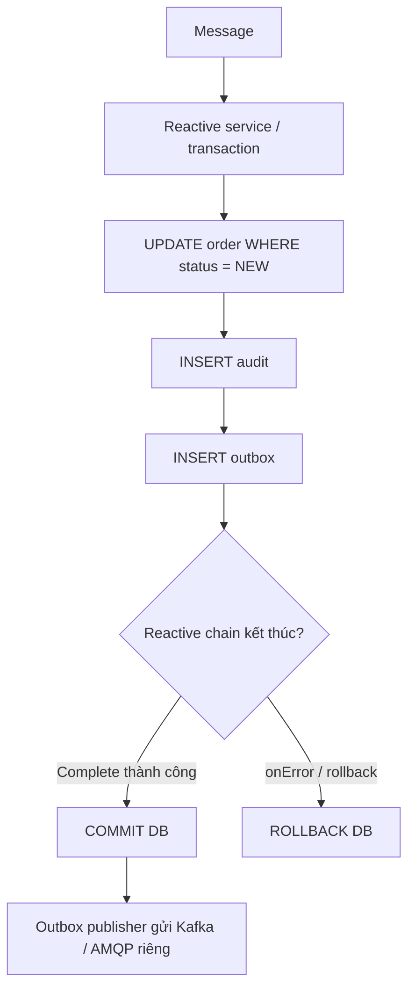
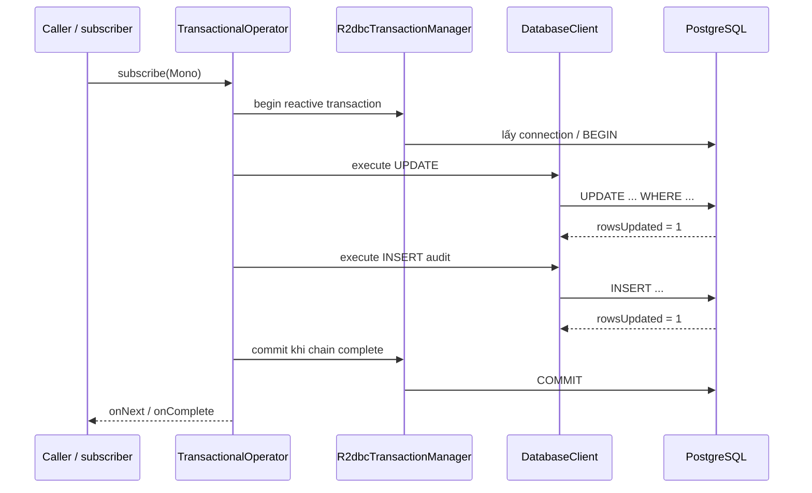
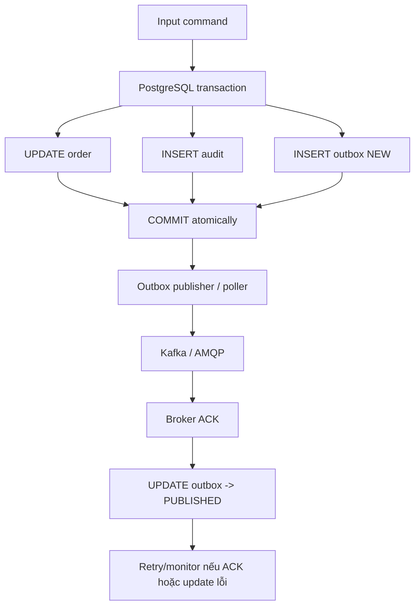
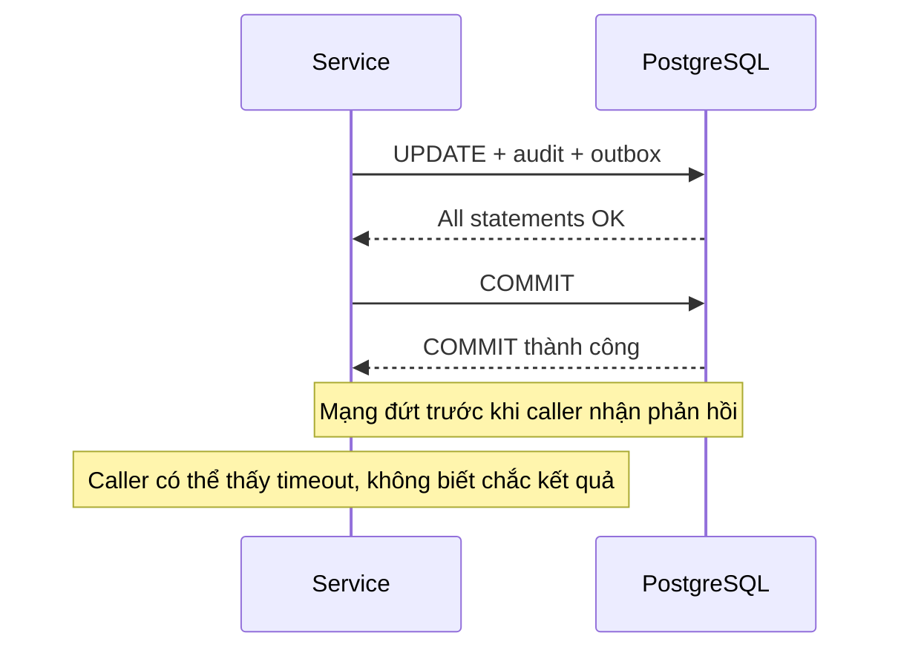

# Transaction reactive

> **Chương:** Adapter R2DBC  
> **Module:** SPRING_INTEGRATION_ADAPTERS  
> **Bối cảnh:** Kết nối các hệ thống ngoài vào Spring Integration bằng inbound/outbound adapter, gateway, poller và MessageChannel. Thực hành luồng trao đổi qua file, SFTP, HTTP, JMS, AMQP, Kafka và cơ sở dữ liệu; chú trọng hợp đồng message, lỗi, nhất quán dữ liệu và vòng đời kết nối.

## 1. Mục tiêu học tập

Kết thúc bài học, bạn có thể:

- Giải thích **reactive transaction** và sự khác nhau giữa giao dịch R2DBC với giao dịch JDBC dựa trên thread-local.
- Hiểu vai trò của `io.r2dbc.spi.ConnectionFactory`, `R2dbcTransactionManager`, `ReactiveTransactionManager`, `TransactionalOperator`, `DatabaseClient` và `R2dbcEntityTemplate`.
- Diễn giải **subscription**, **Reactor Context**, `onComplete`, `onError` và `cancel` ảnh hưởng thế nào tới commit/rollback.
- Sử dụng `TransactionalOperator` để thực hiện nhiều câu SQL R2DBC trong **cùng một transaction**.
- Sử dụng `@Transactional` trên phương thức trả `Mono`/`Flux`, nhận ra vấn đề self-invocation, subscribe tách luồng và lỗi bị nuốt.
- Viết luồng cập nhật trạng thái đơn hàng, ghi audit và outbox atomically trên PostgreSQL.
- Phân biệt UPDATE trả `0` affected rows, exception SQL và transaction rollback theo **quy tắc nghiệp vụ**.
- Kết nối custom `ReactiveMessageHandler` vào Spring Integration `IntegrationFlow`, đảm bảo thao tác DB là một phần của reactive chain được subscribe.
- Hiểu tại sao R2DBC transaction không tự bao gồm Kafka, AMQP, JMS, HTTP, file/SFTP hoặc commit offset của broker.
- Thiết kế retry/idempotency, isolation/locking, timeout, backpressure, connection pooling, recovery và kiểm thử transaction bằng `StepVerifier`/PostgreSQL.

## 2. Reactive transaction giải quyết vấn đề gì?

Giả sử ứng dụng nhận một Spring Message thông báo đơn hàng đã được thanh toán. Trước khi coi message được xử lý, cần làm ba việc trong PostgreSQL:

1. Chuyển đơn hàng từ `NEW` sang `PAID`.
2. Thêm một bản ghi audit để đối soát.
3. Thêm một bản ghi **outbox** để một publisher khác gửi event sang Kafka/AMQP.

Nếu ba thao tác SQL được thực hiện riêng lẻ:

```text
UPDATE order -> thành công
INSERT audit -> lỗi
INSERT outbox -> chưa chạy
```

thì dữ liệu bị lệch: order đã `PAID` nhưng không có audit và không có sự kiện cần phát.

**Transaction** đặt các thao tác trong một đơn vị **all-or-nothing** của database: hoặc tất cả được commit, hoặc các thay đổi được rollback theo cơ chế giao dịch của DB.



**Phạm vi của transaction trong bài:** các thao tác SQL dùng **cùng R2DBC transaction manager và ConnectionFactory**. Transaction này **không** bao trùm HTTP call, Kafka publish, JMS/AMQP ACK hay việc copy một file/SFTP.

### 2.1. Những điều transaction không tự bảo đảm

| Kỳ vọng | Thực tế |
| --- | --- |
| Ba câu SQL dùng chung một transaction DB | Có thể đạt được bằng `TransactionalOperator` hoặc `@Transactional` reactive được sử dụng đúng. |
| Gửi message vào `MessageChannel` là DB commit | **Không đúng**; còn tùy subscription và completion. |
| `onComplete` từ query luôn nghĩa là broker đã ACK | **Không đúng**; query DB và broker có hợp đồng riêng. |
| Transaction DB rollback được một HTTP request đã thành công | **Không thể**. |
| Kafka/JMS và PostgreSQL dùng chung một transaction chỉ vì dùng Spring Integration | **Không mặc định**; cần thiết kế nhất quán xuyên hệ thống. |
| `@Transactional` trên method `void` tự bao toàn bộ công việc reactive chạy sau đó | **Không đúng**. |
| Transaction đảm bảo exactly-once delivery xuyên hệ thống | **Không**; cần idempotency/outbox/ACK phù hợp. |

### 2.2. Vì sao cần quan tâm trong module adapters?

Spring Integration tách luồng thành **MessageChannel**, inbound/outbound adapters, gateways, pollers và handlers. Cấu trúc đó làm rõ trách nhiệm nhưng cũng tạo nhiều ranh giới xử lý bất đồng bộ:

```text
HTTP inbound / Kafka inbound / JMS inbound
                |
                v
         MessageChannel
                |
                v
      ReactiveMessageHandler
                |
                v
      R2DBC transaction chain
                |
                v
     commit/rollback PostgreSQL
                |
                v
     broker ACK hoặc response
```

Nếu ACK input quá sớm hoặc công việc DB không được subscribe đúng cách, hệ thống có thể **mất dữ liệu**. Nếu retry sau DB commit nhưng reply bị mất, hệ thống có thể **xử lý trùng**. Hai vấn đề này cần giải quyết bên cạnh ACID.

## 3. Các thành phần của transaction R2DBC

| Thành phần | Package/framework | Vai trò |
| --- | --- | --- |
| `ConnectionFactory` | `io.r2dbc.spi` | Cấp database connection theo Reactive Streams. |
| `Connection` | R2DBC SPI | Kết nối dùng cho statements và giao dịch DB. |
| `R2dbcTransactionManager` | Spring Framework R2DBC | Quản lý begin/commit/rollback qua một `ConnectionFactory`. |
| `ReactiveTransactionManager` | Spring transaction API | Interface trừu tượng cho reactive transaction. |
| `TransactionalOperator` | Spring transaction reactive | Gói một Publisher trong transaction. |
| `@Transactional` | Spring transaction annotation | Khai báo transaction trên method được intercept, với reactive return type/manager phù hợp. |
| `DatabaseClient` | Spring Framework R2DBC | Thực hiện SQL, bind parameters, map rows, trả reactive Publisher. |
| `R2dbcEntityOperations` / `R2dbcEntityTemplate` | Spring Data R2DBC | CRUD và query dựa trên entity/Criteria/converter. |
| `R2dbcMessageHandler` | Spring Integration R2DBC | Outbound adapter nhận Message và ghi SQL reactive. |
| `ReactiveMessageHandler` | Spring Messaging/Spring Integration | Contract handler trả `Mono<Void>` completion/error. |

**Phân biệt tên:** `ConnectionFactory` trong bài là **R2DBC database factory**, không phải `TcpNetClientConnectionFactory` hay `TcpNetServerConnectionFactory` của Spring Integration IP.

### 3.1. Một transaction cần một connection nhất quán

Khi transaction được khởi tạo, Spring giao dịch R2DBC cần gắn đúng connection cho các thao tác tham gia transaction. Spring dùng **reactive transaction context** để truy xuất connection trong cùng chain.

- Những thao tác dùng cùng `ConnectionFactory` và cơ chế Spring connection management có thể tham gia cùng transaction.
- Một raw `ConnectionFactory.create()` được gọi tùy tiện và quản lý riêng có thể mở connection **ngoài** transaction đang có.
- Hai `ConnectionFactory` trỏ tới hai database khác nhau **không tự thành** một distributed transaction.
- Pool có nhiều connections; transaction thường giữ một connection phù hợp trong suốt thời gian nó còn hoạt động.

Không giữ một raw `Connection` làm singleton dùng chung mọi subscriptions; connection có state, transaction context và resource lifecycle.

## 4. Reactor Context: nền tảng khác biệt với JDBC

### 4.1. Giao dịch JDBC quen thuộc

Trong code JDBC blocking, Spring thường gắn transaction context vào **thread** đang thực hiện công việc. Code chạy đồng bộ trên thread đó có thể dùng connection tương ứng.

### 4.2. Reactive chain không gắn cố định vào một thread

Reactor có thể chuyển công việc giữa event-loop, scheduler và asynchronous boundaries. Vì vậy reactive transaction được gắn với **Reactor Context của subscription**, không chỉ đơn thuần là một ThreadLocal Java.



Sơ đồ giản lược; chi tiết lấy connection, BEGIN và phát data/terminal signals tùy implementation. Điểm quan trọng là **subscription điều khiển vòng đời transaction**.

### 4.3. Tạo Mono chưa có transaction chạy

```java
Mono<Long> update = db.sql(
                "UPDATE integration_orders " +
                "SET status='PAID' WHERE order_id=:id")
        .bind("id", "order-101")
        .fetch()
        .rowsUpdated();

// Đến đây mới tạo Publisher; chưa mặc định có SQL hay transaction.
```

Khi một subscriber subscribe vào chain được bọc `TransactionalOperator`, transaction mới được mở và publisher thực thi.

### 4.4. Subscription mới có thể là transaction mới

```java
Mono<Void> work = orderService.markPaid(command);

// Hai subscriptions độc lập có thể thực thi lại cả workflow.
// Không coi một biến Mono là cache kết quả commit.
```

Reactive query thường là **cold Publisher**. Nếu subscribe hai lần, SQL/side effect có thể chạy hai lần, mỗi lần theo transaction riêng.

Nếu cần một kết quả chỉ thực hiện một lần với nhiều consumer trong cùng tiến trình, phải thiết kế semantics cache/chia sẻ rõ ràng; nhưng **in-memory cache không thay thế business idempotency** qua restart/redelivery.

## 5. Chuẩn bị Spring Boot và PostgreSQL

Ví dụ hướng tới **Java 17+, Spring Boot 3.x, Spring Framework 6.x, Spring Data R2DBC 3.x, Spring Integration 6.1+**. Dùng Spring Boot BOM quản lý phiên bản tương thích. Với Spring Boot/Spring Integration phiên bản mới hơn, kiểm tra API và autoconfiguration tương ứng thay vì trộn các ví dụ nhiều thế hệ.

### 5.1. Maven dependencies

```xml
<dependencies>
    <dependency>
        <groupId>org.springframework.boot</groupId>
        <artifactId>spring-boot-starter-integration</artifactId>
    </dependency>
    <dependency>
        <groupId>org.springframework.boot</groupId>
        <artifactId>spring-boot-starter-data-r2dbc</artifactId>
    </dependency>
    <dependency>
        <groupId>org.springframework.integration</groupId>
        <artifactId>spring-integration-r2dbc</artifactId>
    </dependency>
    <dependency>
        <groupId>org.postgresql</groupId>
        <artifactId>r2dbc-postgresql</artifactId>
        <scope>runtime</scope>
    </dependency>
    <dependency>
        <groupId>io.r2dbc</groupId>
        <artifactId>r2dbc-pool</artifactId>
    </dependency>
    <dependency>
        <groupId>io.projectreactor</groupId>
        <artifactId>reactor-test</artifactId>
        <scope>test</scope>
    </dependency>
</dependencies>
```

`r2dbc-postgresql` khác JDBC driver `org.postgresql:postgresql`. R2DBC adapter cần **R2DBC ConnectionFactory**, không thể nhận một JDBC `DataSource` thay thế.

### 5.2. application.yml

```yaml
spring:
  r2dbc:
    url: r2dbc:postgresql://127.0.0.1:5432/integration_demo
    username: ${DB_USER}
    password: ${DB_PASSWORD}
    pool:
      enabled: true
      initial-size: 2
      max-size: 10
      max-acquire-time: 3s
      max-idle-time: 10m
```

`${DB_USER}` và `${DB_PASSWORD}` là **Spring environment placeholders** lấy giá trị khi khởi động; không lưu mật khẩu thật trong source control. Production nên có TLS, secrets management, quyền DB tối thiểu và connection budget.

Spring Boot có thể tự cấu hình `ConnectionFactory`, `DatabaseClient`, `R2dbcEntityTemplate` và `ReactiveTransactionManager` khi dependencies/bean conditions phù hợp.

**Không khai báo thêm một ConnectionFactory/transaction manager khác không có chủ đích.** Nếu hai repository dùng các factory khác nhau, code trông như cùng transaction nhưng thực tế có thể cập nhật hai nguồn không tham gia chung một transaction.

## 6. Thiết kế database cho bài thực hành

### 6.1. Bảng đơn hàng

```sql
CREATE TABLE integration_orders (
    order_id         VARCHAR(64) PRIMARY KEY,
    status           VARCHAR(24) NOT NULL DEFAULT 'NEW',
    version          BIGINT NOT NULL DEFAULT 0,
    last_operation   VARCHAR(80),
    updated_at       TIMESTAMPTZ NOT NULL DEFAULT NOW()
);
```

### 6.2. Bảng audit

```sql
CREATE TABLE integration_order_audit (
    audit_id       BIGSERIAL PRIMARY KEY,
    order_id       VARCHAR(64) NOT NULL,
    operation_id   VARCHAR(80) NOT NULL,
    action         VARCHAR(40) NOT NULL,
    created_at     TIMESTAMPTZ NOT NULL DEFAULT NOW(),
    CONSTRAINT uq_order_audit_operation
        UNIQUE (order_id, operation_id, action)
);
```

### 6.3. Bảng outbox

```sql
CREATE TABLE integration_outbox (
    event_id        VARCHAR(80) PRIMARY KEY,
    aggregate_id    VARCHAR(64) NOT NULL,
    event_type      VARCHAR(64) NOT NULL,
    payload_json    TEXT NOT NULL,
    status          VARCHAR(24) NOT NULL DEFAULT 'NEW',
    created_at      TIMESTAMPTZ NOT NULL DEFAULT NOW(),
    published_at    TIMESTAMPTZ
);

CREATE INDEX idx_integration_outbox_status_created
    ON integration_outbox(status, created_at, event_id);
```

Mẫu này lưu **event cần publish**, không trực tiếp gửi Kafka/AMQP trong transaction DB.

### 6.4. Seed data

```sql
INSERT INTO integration_orders(order_id, status)
VALUES
    ('order-101', 'NEW'),
    ('order-102', 'NEW'),
    ('order-103', 'PAID');
```

Các ví dụ bên dưới giả định database test và bảng đã được khởi tạo. **Kết quả kiểm thử được trình bày là kỳ vọng**, không khẳng định tác giả đã chạy SQL trong môi trường người học.

### 6.5. Ý nghĩa business keys

| Cột | Ý nghĩa |
| --- | --- |
| `order_id` | Khóa đơn hàng, giúp UPDATE đúng một hàng. |
| `version` | Dùng optimistic locking nếu cần nhiều writer. |
| `last_operation` | Định danh thao tác cuối để đối soát retry. |
| `operation_id` | Stable ID của **một yêu cầu nghiệp vụ**, giữ nguyên qua các lần thử. |
| `event_id` | Khóa outbox duy nhất; trong demo sử dụng cùng `operation_id`. |
| `status=NEW/PAID` | Trạng thái đơn hàng, không đồng nghĩa trạng thái publish. |
| `outbox.status=NEW` | Event đang chờ publisher gửi. |
| `published_at` | Thời điểm đánh dấu publish theo hợp đồng. |

**Đặt unique constraints là một phần của idempotency**, nhưng constraint tự nó chưa định nghĩa cách trả kết quả khi nhận lại cùng operation ID.

## 7. Tạo TransactionalOperator

### 7.1. Cấu hình bean

Khi Spring Boot đã cung cấp `ReactiveTransactionManager` phù hợp, chỉ cần một `TransactionalOperator`:

```java
import org.springframework.context.annotation.Bean;
import org.springframework.context.annotation.Configuration;
import org.springframework.transaction.ReactiveTransactionManager;
import org.springframework.transaction.reactive.TransactionalOperator;

@Configuration
public class ReactiveTransactionConfiguration {

    @Bean
    TransactionalOperator transactionOperator(
            ReactiveTransactionManager manager) {
        return TransactionalOperator.create(manager);
    }
}
```

Khi tự cấu hình, `R2dbcTransactionManager` nhận đúng `ConnectionFactory`:

```java
import io.r2dbc.spi.ConnectionFactory;
import org.springframework.r2dbc.connection.R2dbcTransactionManager;
import org.springframework.transaction.ReactiveTransactionManager;

// Ví dụ thay thế khi không có manager do Boot tự tạo:
ReactiveTransactionManager manager =
        new R2dbcTransactionManager(connectionFactory);
```

Đoạn thứ hai là **snippet trong ngữ cảnh đã có `connectionFactory`**, không phải một cấu hình bean khác cần bật song song với bean auto-configured.

### 7.2. Gói một reactive chain vào transaction

```java
import org.springframework.transaction.reactive.TransactionalOperator;
import reactor.core.publisher.Mono;

Mono<Void> write = firstSql()
        .then(secondSql())
        .then()
        .as(tx::transactional);
```

Đoạn trên minh họa pattern: `firstSql()`/`secondSql()` là các method thực tế phải trả Publisher và `tx` là operator. **Không** gọi `firstSql().subscribe()` trước `secondSql()`: mỗi subscription mới có thể đứng ngoài transaction.

### 7.3. Cấu trúc đúng

```text
compose SQL Publishers
          |
          v
TransactionalOperator.transactional(publisher)
          |
          v
caller/framework subscribe
          |
          +--> BEGIN
          +--> execute SQL #1
          +--> execute SQL #2
          +--> COMMIT hoặc ROLLBACK
```

### 7.4. Cấu trúc sai

```java
// KHÔNG LÀM:
public void unsafeWrite() {
    firstSql().subscribe();
    secondSql().subscribe();
}
```

Nếu method `unsafeWrite()` được đánh dấu `@Transactional` ở một class bình thường, nó vẫn **không chứng minh** hai subscriptions độc lập cùng tham gia một transaction reactive. Cần **trả một Publisher** hợp nhất và để một boundary thích hợp subscribe.

## 8. Ví dụ hoàn chỉnh: UPDATE, audit, outbox atomically

### 8.1. Command và outcome

Tạo `MarkPaidCommand.java`:

```java
public record MarkPaidCommand(
        String orderId,
        String operationId,
        String eventJson
) {
}
```

Tạo `PaymentRecorded.java`:

```java
public record PaymentRecorded(
        String orderId,
        String operationId,
        long affectedRows
) {
}
```

Một `operationId` xác định **một thao tác thanh toán**. Khi retry cùng command, ID phải giữ nguyên. Không cấp một UUID mới cho mỗi attempt.

### 8.2. Service transaction dùng DatabaseClient

Tạo `OrderPaymentService.java`:

```java
import org.springframework.r2dbc.core.DatabaseClient;
import org.springframework.stereotype.Service;
import org.springframework.transaction.reactive.TransactionalOperator;
import reactor.core.publisher.Mono;

@Service
public class OrderPaymentService {

    private final DatabaseClient db;
    private final TransactionalOperator tx;

    public OrderPaymentService(
            DatabaseClient db,
            TransactionalOperator tx) {
        this.db = db;
        this.tx = tx;
    }

    public Mono<PaymentRecorded> markPaid(
            MarkPaidCommand command) {

        validate(command);

        Mono<PaymentRecorded> work = db.sql(
                        "UPDATE integration_orders " +
                        "SET status = 'PAID', " +
                        "    last_operation = :operation, " +
                        "    version = version + 1, " +
                        "    updated_at = CURRENT_TIMESTAMP " +
                        "WHERE order_id = :id AND status = 'NEW'")
                .bind("id", command.orderId())
                .bind("operation", command.operationId())
                .fetch()
                .rowsUpdated()
                .flatMap(affected -> {
                    if (affected != 1L) {
                        return Mono.error(
                                new IllegalStateException(
                                        "Order was not transitioned: " +
                                        command.orderId() +
                                        ", affected=" + affected));
                    }

                    return db.sql(
                                    "INSERT INTO integration_order_audit " +
                                    "(order_id, operation_id, action) " +
                                    "VALUES (:id, :operation, :action)")
                            .bind("id", command.orderId())
                            .bind("operation", command.operationId())
                            .bind("action", "MARK_PAID")
                            .fetch()
                            .rowsUpdated()
                            .flatMap(auditCount -> {
                                if (auditCount != 1L) {
                                    return Mono.error(
                                            new IllegalStateException(
                                                    "Audit insert count != 1"));
                                }

                                return db.sql(
                                                "INSERT INTO integration_outbox " +
                                                "(event_id, aggregate_id, " +
                                                "event_type, payload_json) " +
                                                "VALUES (:event, :aggregate, " +
                                                ":type, :body)")
                                        .bind("event", command.operationId())
                                        .bind("aggregate", command.orderId())
                                        .bind("type", "ORDER_PAID")
                                        .bind("body", command.eventJson())
                                        .fetch()
                                        .rowsUpdated();
                            })
                            .flatMap(outboxCount -> {
                                if (outboxCount != 1L) {
                                    return Mono.error(
                                            new IllegalStateException(
                                                    "Outbox insert count != 1"));
                                }

                                return Mono.just(new PaymentRecorded(
                                        command.orderId(),
                                        command.operationId(),
                                        affected));
                            });
                });

        return work.as(tx::transactional);
    }

    private static void validate(MarkPaidCommand command) {
        if (command == null
                || !valid(command.orderId(), 64)
                || !valid(command.operationId(), 80)
                || command.eventJson() == null
                || command.eventJson().isBlank()
                || command.eventJson().length() > 100_000) {
            throw new IllegalArgumentException(
                    "Invalid payment command");
        }
    }

    private static boolean valid(String s, int max) {
        return s != null
                && s.length() <= max
                && s.matches("[A-Za-z0-9_-]+");
    }
}
```

**Đọc chậm từng bước:**

1. `validate(...)` kiểm tra đầu vào **trước khi tạo transaction**. Code demo dùng giới hạn số ký tự, production nên kiểm tra byte size, JSON schema và authorization.
2. `UPDATE ... WHERE status='NEW'` thực hiện **state transition có điều kiện** trong database.
3. `rowsUpdated()` trả `Mono<Long>`; nếu `0` hoặc bất ngờ `>1`, code trả `Mono.error(...)` để rollback.
4. Chỉ khi UPDATE count `1`, mới INSERT audit.
5. Chỉ khi audit count `1`, mới INSERT outbox.
6. Chỉ khi cả ba đạt điều kiện, chain phát `PaymentRecorded`.
7. `.as(tx::transactional)` gói **toàn bộ reactive chain** vào transaction.
8. Caller/framework subscribe: transaction bắt đầu; SQL được thực thi trên tài nguyên transaction phù hợp.
9. Khi chain hoàn tất bình thường, manager commit; nếu một bước phát lỗi, manager rollback theo policy.
10. Không gọi Kafka/HTTP trong transaction, không tự `subscribe()` ở giữa.

### 8.3. Vì sao dùng flatMap thay vì map?

```java
// Sai tư duy: map chỉ đổi dữ liệu; Publisher con chưa chắc được subscribe.
Mono<Mono<Long>> nested = updateCount.map(count ->
        insertAudit(count));
```

`map` sẽ tạo `Mono<Mono<Long>>` nếu callback trả Mono. Với side effect reactive cần completion trong cùng chain, dùng `flatMap` hoặc `then` để **flatten/sequence** Publisher.

### 8.4. Khi một bước lỗi

Giả sử audit INSERT gặp lỗi unique constraint:

```text
BEGIN
UPDATE integration_orders ...      -> 1 row
INSERT integration_order_audit ...  -> unique violation
INSERT integration_outbox ...       -> không chạy
ROLLBACK
```

Kỳ vọng sau rollback:

- `integration_orders` vẫn `NEW` nếu ban đầu là NEW.
- Không phát sinh audit/outbox mới từ transaction lỗi.
- Subscriber nhận error theo contract, không nhận `PaymentRecorded` thành công.

**Cần kiểm tra bằng database integration test**, không chỉ xem stack trace; điều quan trọng là dữ liệu đã rollback nhất quán.

### 8.5. Nguồn dữ liệu và transaction manager phải đồng nhất

Ví dụ trên giả định `DatabaseClient` được Boot tạo từ **cùng ConnectionFactory** mà `R2dbcTransactionManager` quản lý.

Nếu một SQL dùng JDBC repository hoặc một `ConnectionFactory` khác, đừng coi nó đương nhiên nằm trong transaction này.

## 9. Affected rows và điều kiện rollback nghiệp vụ

### 9.1. UPDATE 0 row không phải SQL exception

```sql
UPDATE integration_orders
SET status='PAID'
WHERE order_id='order-999' AND status='NEW';
```

Nếu không có hàng nào khớp, SQL có thể hoàn tất thành công với **0 affected rows**. Database không tự rollback vì "không có hàng": theo DB, statement hợp lệ.

Do đó service phải diễn giải count:

| Kết quả | Diễn giải |
| --- | --- |
| `1` | State transition áp dụng đúng một row. |
| `0` | Row thiếu, status khác, version conflict, hoặc retry command đã commit trước đó. |
| `>1` | Có thể hợp lệ với bulk UPDATE; với PK order_id thì vi phạm invariant. |
| `onError` | Lỗi SQL/driver/pool/transaction, không phải count 0. |

### 9.2. Muốn rollback do count 0, phải phát lỗi hoặc quyết định explicit

Trong service `markPaid(...)`, `count != 1` trở thành `Mono.error` nên transaction rollback.

Nếu nghiệp vụ cho phép "chưa có gì để update" như một kết quả bình thường, có thể trả một domain outcome và commit transaction không thay đổi. Quy tắc phải được ghi rõ:

```text
0 rows:
  NOT_FOUND?
  ALREADY_PAID?
  CONFLICT?
  ALREADY_APPLIED_BY_THIS_OPERATION?
```

**Không suy ra NOT_FOUND chỉ từ 0 row.** Cần query trạng thái authoritative hoặc hợp đồng idempotency để phân biệt.

### 9.3. Tránh nuốt exception bên trong transaction

```java
// CẨN THẬN: thay onError bằng một giá trị hợp lệ có thể khiến
// TransactionalOperator nhìn thấy chain complete và COMMIT.
Mono<PaymentRecorded> fallback = work
        .onErrorResume(error -> Mono.just(
                new PaymentRecorded("unknown", "unknown", 0)));
```

Nếu `onErrorResume(...)` được đặt **bên trong Publisher đã bọc transaction**, lỗi SQL có thể bị chuyển thành normal completion trước khi transaction manager thấy nó. Khi nghiệp vụ muốn rollback, hãy để error lan truyền ra transaction boundary hoặc đánh dấu rollback theo cơ chế được hỗ trợ.

Xử lý fallback **sau transaction boundary** khi muốn phản hồi lỗi mà không đổi quyết định rollback.

## 10. Dùng @Transactional cho method reactive

### 10.1. Ví dụ khai báo

Thay vì tự gọi `TransactionalOperator`, Spring hỗ trợ declarative transaction với `@Transactional` trên một method trả Publisher:

```java
import org.springframework.r2dbc.core.DatabaseClient;
import org.springframework.stereotype.Service;
import org.springframework.transaction.annotation.Transactional;
import reactor.core.publisher.Mono;

@Service
public class DeclarativePaymentService {

    private final DatabaseClient db;

    public DeclarativePaymentService(DatabaseClient db) {
        this.db = db;
    }

    @Transactional
    public Mono<Void> updateAndAudit(
            String orderId, String operationId) {

        Mono<Long> update = db.sql(
                        "UPDATE integration_orders " +
                        "SET status='PAID', last_operation=:operation " +
                        "WHERE order_id=:id AND status='NEW'")
                .bind("id", orderId)
                .bind("operation", operationId)
                .fetch()
                .rowsUpdated();

        return update.flatMap(count -> {
            if (count != 1L) {
                return Mono.error(
                        new IllegalStateException("No matching order"));
            }

            return db.sql(
                            "INSERT INTO integration_order_audit " +
                            "(order_id, operation_id, action) " +
                            "VALUES (:id, :op, :action)")
                    .bind("id", orderId)
                    .bind("op", operationId)
                    .bind("action", "MARK_PAID")
                    .fetch()
                    .rowsUpdated()
                    .flatMap(auditCount -> auditCount == 1L
                            ? Mono.<Void>empty()
                            : Mono.error(new IllegalStateException(
                                    "Unexpected audit count")));
        });
    }
}
```

**Điều kiện cần:**

- Cấu hình transaction management và `ReactiveTransactionManager` phù hợp.
- Method được gọi **qua Spring proxy/interception** (không gọi trực tiếp nội bộ same class).
- Return type reactive (`Mono`/`Flux`) và thao tác DB nằm trong Publisher được trả về.
- Caller phải subscribe Publisher; không tự phát các subscriptions mới trong method.
- Không dùng một JDBC `PlatformTransactionManager` làm thay thế reactive manager.

### 10.2. Self-invocation

```java
@Service
class IncorrectService {

    public Mono<Void> entry() {
        return this.doWork();
    }

    @Transactional
    public Mono<Void> doWork() {
        return /* reactive DB work */ Mono.empty();
    }
}
```

Trong **proxy-based transaction interception**, lời gọi `this.doWork()` đi **bên trong cùng bean** và có thể bỏ qua proxy, khiến annotation không được áp dụng. Giải pháp: gọi method qua bean khác/proxy theo thiết kế hoặc dùng `TransactionalOperator` tường minh.

### 10.3. @Transactional trên void method gọi subscribe()

```java
// KHÔNG LÀM:
@Transactional
public void unsafe() {
    databaseClient.sql("DELETE FROM ...")
            .fetch().rowsUpdated()
            .subscribe();
}
```

Đây không phải mẫu bảo đảm reactive transaction. `void` kết thúc trước khi Publisher hoàn tất; transaction không thể suy ra sự gắn kết qua Reactor Context từ annotation thông thường như mong muốn.

### 10.4. Chọn @Transactional hay TransactionalOperator?

| Nhu cầu | Gợi ý |
| --- | --- |
| Tất cả hoạt động của method trả Publisher nằm trong cùng transaction | `@Transactional` khi proxy/manager đúng. |
| Chỉ một **đoạn** chain phải ở trong transaction, còn HTTP/Kafka ở ngoài | `TransactionalOperator` bao đúng đoạn DB. |
| Cần logic transaction composition được viết rõ trong flow | `TransactionalOperator`. |
| Cần áp dụng transaction ở service theo interface/class pattern có sẵn | `@Transactional`. |
| Gọi từ Spring Integration reactive handler | Một service trả Mono được bọc transaction; handler trả Publisher completion của service. |

Cả hai cách đều phải được kiểm thử trên **DB thật**; không chọn annotation chỉ vì cú pháp ngắn.

## 11. Phạm vi transaction chính xác: operator đặt ở đâu?

### 11.1. Gói hai SQL vào một transaction

```java
Mono<Void> dbWork = updateOrder()
        .then(insertAudit())
        .as(tx::transactional);
```

Khi hai methods trả cold Publisher, chúng được thực hiện tuần tự trong transaction khi subscribe.

### 11.2. Chỉ gói câu đầu là sai khi cần atomic

```java
Mono<Void> incorrect = updateOrder()
        .as(tx::transactional)
        .then(insertAudit());
```

Ở đây `insertAudit()` nằm **ngoài** phần publisher được bọc transaction. Nó có thể thực thi trong một transaction khác/auto-commit. Nếu INSERT lỗi, UPDATE trước đó có thể đã commit.

### 11.3. Chỉ gói cả HTTP call vào DB transaction là không nên

```java
// Không khuyến nghị giữ DB transaction mở qua remote call chậm.
Mono<Void> overlyBroad = updateOrder()
        .then(remoteHttpClient.send())
        .then(insertAudit())
        .as(tx::transactional);
```

Một transaction PostgreSQL không rollback được HTTP request đã thành công. Trong khi đợi HTTP, connection/locks có thể bị giữ rất lâu và làm nghẽn pool.

Thay bằng transaction DB ngắn + outbox/publisher riêng, hoặc tách claim/commit → external work → ACK/commit với lease/idempotency.

### 11.4. Tránh subscribe ở giữa

```java
// KHÔNG LÀM:
Mono<Void> dbWork = updateOrder()
        .doOnSuccess(ignored -> insertAudit().subscribe())
        .then()
        .as(tx::transactional);
```

`insertAudit().subscribe()` là subscription độc lập, có thể không tham gia cùng transaction và error có thể không lan truyền vào `dbWork`. Dùng `then(insertAudit())` hoặc `flatMap(...)` để compose.

## 12. Transactional outbox: nhất quán DB và event broker

### 12.1. Vì sao không publish trong transaction?

Tình huống:

```text
BEGIN PostgreSQL
UPDATE order -> PAID
Kafka publish -> thành công
INSERT audit -> lỗi
ROLLBACK PostgreSQL
```

Kafka đã nhận event nhưng database rollback: subscriber ngoài DB thấy thông tin không còn đúng.

Tình huống ngược lại:

```text
BEGIN PostgreSQL
UPDATE order + audit -> thành công
COMMIT PostgreSQL
Ứng dụng crash trước Kafka publish
```

Database có dữ liệu nhưng event chưa được gửi, gây **missing notification**.

### 12.2. Outbox pattern



Outbox **không loại bỏ hoàn toàn duplicate**: nếu broker nhận event nhưng publisher crash trước khi đánh dấu `PUBLISHED`, event sẽ được gửi lại. Consumer phải **idempotent**, thường dùng `event_id` làm dedup key.

### 12.3. Transaction boundary của outbox publisher

Publisher xử lý theo lô:

1. Claim một số outbox rows và **commit claim** ngắn.
2. Gửi qua Kafka/AMQP ngoài transaction DB.
3. Chờ broker ACK theo contract.
4. Đánh dấu `PUBLISHED` có điều kiện owner/token.
5. Nếu publisher chết trước ACK, lease hết hạn và recovery retry.
6. Dedup downstream theo `event_id`.

Không giữ row lock/transaction DB mở cho tới khi broker nhận xong một batch chậm.

### 12.4. Không đồng nhất outbox với R2DBC inbound adapter mặc định

`R2dbcMessageSource` + poller có thể SELECT các outbox rows; nhưng nếu chỉ SELECT `status='NEW'` mà không claim, hai instances có thể đọc trùng.

Dùng atomic claim và bảng trạng thái phù hợp, hoặc CDC/outbox relay chuyên dụng, khi yêu cầu delivery chắc chắn. Spring Integration và R2DBC hỗ trợ kết nối/flow, **không tự sinh đầy đủ protocol giao hàng**.

## 13. Tích hợp transaction vào Spring Integration Java DSL

### 13.1. ReactiveMessageHandler gọi service có transaction

Tạo `OrderPaymentIntegrationConfiguration.java`:

```java
import org.springframework.context.annotation.Bean;
import org.springframework.context.annotation.Configuration;
import org.springframework.integration.config.EnableIntegration;
import org.springframework.integration.dsl.IntegrationFlow;
import org.springframework.messaging.ReactiveMessageHandler;

@Configuration
@EnableIntegration
public class OrderPaymentIntegrationConfiguration {

    @Bean
    IntegrationFlow paymentCommandFlow(
            OrderPaymentService service) {

        ReactiveMessageHandler handler = message -> {
            MarkPaidCommand command =
                    (MarkPaidCommand) message.getPayload();

            // Service bao UPDATE + audit + outbox trong transaction.
            // .then() chỉ giữ completion/error cho terminal handler.
            return service.markPaid(command).then();
        };

        return IntegrationFlow
                .from("paymentCommands")
                .handleReactive(handler)
                .get();
    }
}
```

**Giải thích:**

1. `MessageChannel` `paymentCommands` nhận command từ inbound adapter/gateway/service nội bộ.
2. `ReactiveMessageHandler` trả một `Mono<Void>` nối tiếp công việc của service.
3. `service.markPaid(command)` trả Publisher đã được bọc `TransactionalOperator`.
4. `handleReactive(...)` của Spring Integration 6.1+ được dùng để xử lý `ReactiveMessageHandler` và subscription theo lifecycle endpoint.
5. `.then()` giữ tín hiệu complete/error, **bỏ dữ liệu `PaymentRecorded`**.
6. Không có Spring reply message chứa business outcome từ terminal outbound handler này.
7. Nếu cần response có `PaymentRecorded`, thiết kế request-reply **gateway** hoặc service API trả reactive result cho caller.

**Lưu ý:** `message.getPayload()` được cast theo contract của channel. Production nên validate type/payload/authorization, correlation ID, error channel và retry policy.

### 13.2. MessageChannel.send() không phải DB commit ACK

Một producer:

```java
import org.springframework.integration.annotation.MessagingGateway;

@MessagingGateway(defaultRequestChannel = "paymentCommands")
public interface PaymentPort {
    void submit(MarkPaidCommand command);
}
```

có thể dùng `void submit(...)` để gửi vào flow. Nhưng `void` **không** cung cấp business response rằng PostgreSQL đã commit và outbox đã được ghi.

Nếu caller HTTP cần trả "Thanh toán đã ghi bền vững", hãy subscribe/await kết quả từ một API service/gateway có contract rõ, không dùng `send()` như bằng chứng DB success.

### 13.3. R2DBC outbound adapter mặc định khác custom handler

Spring Integration hỗ trợ `R2dbcMessageHandler` qua DSL:

```java
import java.util.Map;

import org.springframework.context.annotation.Bean;
import org.springframework.data.r2dbc.core.R2dbcEntityTemplate;
import org.springframework.data.relational.core.query.Criteria;
import org.springframework.integration.dsl.IntegrationFlow;
import org.springframework.integration.r2dbc.dsl.R2dbc;
import org.springframework.integration.r2dbc.outbound.R2dbcMessageHandler;
import org.springframework.messaging.Message;

@Bean
IntegrationFlow markOrderPaidAdapter(
        R2dbcEntityTemplate template) {

    return IntegrationFlow.from("simpleOrderUpdates")
            .handleReactive(
                    R2dbc.outboundChannelAdapter(template)
                            .queryType(R2dbcMessageHandler.Type.UPDATE)
                            .tableName("integration_orders")
                            .criteria((Message<MarkPaidCommand> m) ->
                                    Criteria.where("order_id")
                                            .is(m.getPayload().orderId())
                                            .and("status").is("NEW"))
                            .values((Message<MarkPaidCommand> m) ->
                                    Map.of("status", "PAID",
                                           "last_operation",
                                           m.getPayload().operationId()))
            )
            .get();
}
```

Đây là **đoạn bean đặt trong `@Configuration`**, cấu hình **một UPDATE** một chiều; nó **không** tự biến UPDATE + audit + outbox thành một transaction ba bảng.

Một UPDATE đơn lẻ được database xử lý atomically theo SQL statement, nhưng:

- Adapter thường trả completion/error dạng `Mono<Void>`.
- Nó không tự phát reply chứa `rowsUpdated()`.
- UPDATE tác động `0` row có thể vẫn complete bình thường.
- Không tự có outbox/idempotency/strict count check.

Khi nghiệp vụ cần chính xác **count=1** và thêm các câu SQL trong cùng transaction, custom service/hybrid gateway ở mục 8–13 là phù hợp hơn.

### 13.4. Inbound R2DBC và transaction lifecycle

Với `R2dbcMessageSource`, một lần poll có thể trả:

```text
Message<Flux<RowEntity>>
      |
      v
FluxMessageChannel
      |
      v
Splitter / reactive downstream
      |
      v
Message<RowEntity>
```

Một `Message<Flux<T>>` **không** mặc định có toàn bộ rows đã được xử lý tại thời điểm poller gửi message. Gắn `@Transactional` vào polling callback không đồng nghĩa transaction sẽ kéo dài qua các subscriptions phía sau.

Để xử lý tin cậy:

- Không giữ transaction DB mở qua HTTP/Kafka call chậm.
- Atomic claim DB trong transaction ngắn, commit.
- Sau đó splitter/processor xử lý items có ownership rõ.
- ACK DB mỗi row sau downstream completion theo contract.
- Lease/recovery và idempotent consumer cho redelivery.

## 14. Một transaction có bao gồm Kafka/JMS/AMQP không?

### 14.1. R2DBC local transaction không phải distributed transaction

`R2dbcTransactionManager` quản lý transaction của một R2DBC ConnectionFactory. Nó không tự bao trùm:

- Kafka producer transactions hoặc consumer offsets.
- JMS/AMQP broker ACK/transactions.
- HTTP requests/responses.
- File và SFTP write/rename.
- JDBC transaction của DataSource khác.
- Một database khác qua ConnectionFactory độc lập.

**Có thể có cơ chế chuyên biệt** của từng broker/framework, nhưng không được suy ra một transaction xuyên hệ thống chỉ vì tất cả endpoint nằm trong cùng `IntegrationFlow`.

### 14.2. Cần chọn contract giữa DB và nguồn

Giả sử nhận Kafka event rồi UPDATE PostgreSQL:

```text
Kafka receive
       |
       v
R2DBC transaction UPDATE + outbox
       |
       v
COMMIT database
       |
       v
Kafka input offset ACK/commit
```

Nếu crash **sau DB commit nhưng trước offset commit**, event có thể được nhận lại. Với `operationId` và unique constraint, service cần nhận ra **ALREADY_APPLIED** để không lặp side effects.

Nếu ACK nguồn **trước DB commit**, crash có thể làm **mất sự kiện**. Vì vậy nguồn/broker ACK phải phụ thuộc vào **kết quả đủ bền** theo contract, không chỉ vào việc message đã vào channel.

### 14.3. Delivery semantics

| Mục tiêu | Công cụ cần xem xét |
| --- | --- |
| At-most-once (có thể mất message) | ACK sớm/chính sách drop có chủ đích, chỉ khi nghiệp vụ cho phép. |
| At-least-once | ACK sau xử lý đủ bền + retry/redelivery. |
| Exactly-once effect ở database | Unique operation ID, transactional dedup + state changes. |
| DB-to-broker reliable event publication | Transactional outbox + relay/retry. |
| Broker-to-DB reliable consumption | Durable broker offsets/ACK + idempotent DB processing. |

Không tuyên bố "exactly once toàn hệ thống" chỉ dựa trên `@Transactional`.

## 15. Isolation level và cạnh tranh ghi

### 15.1. Atomicity khác isolation

**Atomicity:** N câu SQL trong cùng transaction cùng commit/rollback.

**Isolation:** Các transactions đồng thời nhìn thấy và thay đổi dữ liệu như thế nào.

**Durability:** Sau khi commit thành công theo DB contract, dữ liệu phải bền theo cấu hình DB.

Transaction không tự bảo đảm mọi race được loại bỏ. Cần chọn isolation level và SQL WHERE/version/locks phù hợp.

### 15.2. Lost update

Hai worker cùng đọc order ở `status=NEW, version=0`:

```text
Worker A: SELECT version 0
Worker B: SELECT version 0
Worker A: UPDATE status=PAID, version=1
Worker B: UPDATE status=CANCELLED nếu không kiểm tra version
```

Giải pháp optimistic concurrency:

```sql
UPDATE integration_orders
SET status = 'PAID',
    version = version + 1
WHERE order_id = :id
  AND version = :expectedVersion
  AND status = 'NEW';
```

- `rowsUpdated=1`: compare-and-set thành công.
- `rowsUpdated=0`: row thiếu, status/version đã đổi, cần phân loại conflict.
- `onError`: lỗi SQL/connection, khác với count 0.

### 15.3. Pessimistic locking

PostgreSQL hỗ trợ `SELECT ... FOR UPDATE` để khóa rows trong transaction khi cần giữ exclusivity giữa SELECT và UPDATE.

```sql
BEGIN;
SELECT order_id, status, version
FROM integration_orders
WHERE order_id = 'order-101'
FOR UPDATE;

-- Kiểm tra business rules, sau đó UPDATE trong cùng transaction.
UPDATE integration_orders
SET status='PAID', version=version+1
WHERE order_id='order-101';
COMMIT;
```

Đây là **SQL script minh họa**; trong code R2DBC dùng transaction operator/manager thay vì tự phát BEGIN/COMMIT một cách hỗn tạp.

Không giữ `FOR UPDATE` lock xuyên remote HTTP/Kafka call; thời gian lock dài gây contention và pool exhaustion.

### 15.4. SKIP LOCKED cho worker claim batch

Khi nhiều workers đọc một queue table:

```sql
WITH picked AS (
    SELECT event_id
    FROM integration_outbox
    WHERE status = 'NEW'
    ORDER BY created_at, event_id
    LIMIT :batchSize
    FOR UPDATE SKIP LOCKED
)
UPDATE integration_outbox AS o
SET status='PROCESSING'
FROM picked
WHERE o.event_id = picked.event_id
RETURNING o.event_id, o.payload_json;
```

PostgreSQL có thể claim batch atomically bằng statement này, nhưng production cần **owner/lease_until/attempt_count** và đường recovery khi worker chết. `SKIP LOCKED` không phải ACK của Kafka và không tự xử lý row `PROCESSING` bị kẹt.

## 16. Transaction propagation và giới hạn thực tế

### 16.1. REQUIRED

Trong nhiều hệ thống, `PROPAGATION_REQUIRED` là lựa chọn mặc định: tham gia transaction đang tồn tại nếu có, nếu chưa có thì tạo transaction mới.

Với reactive code, việc "đang tồn tại" được xác định qua **reactive transaction context**, không dựa vào một ThreadLocal bền xuyên mọi scheduler.

### 16.2. REQUIRES_NEW và connection pool

Nếu tạo transaction mới độc lập khi outer transaction vẫn giữ connection, bạn có thể cần **connection khác**. Một hệ thống nhiều requests + pool nhỏ có thể bị cạn connection hoặc deadlock tài nguyên khi mọi task giữ connection ngoài và chờ transaction trong.

Dùng transaction mới tách biệt chỉ khi nghiệp vụ thật sự yêu cầu; kiểm tra hỗ trợ của transaction manager và driver.

### 16.3. Nested/savepoint phụ thuộc môi trường

Không nên tự giả định mọi cấu hình R2DBC hỗ trợ nested transactions/savepoints như nhau. Nếu nghiệp vụ cần rollback một phần, kiểm tra Spring Framework/driver/database version và test thực tế.

Thông thường, cấu trúc service **một transaction ngắn** có thể đơn giản, an toàn và dễ quan sát hơn các tầng transaction lồng nhau.

### 16.4. Reactive Context qua publishOn/subscribeOn

Reactor Context gắn với subscription và được truyền qua các Reactor operators phù hợp. Việc chuyển scheduler bằng `publishOn`/`subscribeOn` **không mặc định làm mất toàn bộ Reactor Context** như đổi ThreadLocal.

Tuy nhiên:

- `subscribe()` mới, tách rời chain, có context riêng.
- `CompletableFuture`/`@Async` và callback không được compose có thể đứng ngoài reactive transaction.
- Blocking code chạy trong transaction reactive có thể không dùng được context theo cách mong đợi.
- Trộn JDBC và R2DBC cần transaction policy riêng.

**Đừng sửa vấn đề bằng cách cố dùng một ThreadLocal transaction thủ công.**

## 17. Retry, timeout và kết quả commit chưa rõ

### 17.1. Lỗi trước commit, sau commit và lost reply



Trong trường hợp này **không được khẳng định transaction chưa commit chỉ vì client timeout**.

### 17.2. Stable operation ID và idempotency

Ví dụ `operation_id = op-202`:

- Lần đầu UPDATE order + INSERT audit + INSERT outbox, commit.
- Caller timeout trước khi nhận success.
- Lần hai gửi lại **cùng operation ID**.
- `UPDATE ... WHERE status='NEW'` có thể trả `0`, nhưng đây có thể là **đã áp dụng thành công từ lượt trước**.
- Service cần đối soát `last_operation`/audit/outbox có cùng operation ID và payload tương đương.

Nếu mỗi retry sinh operation ID mới, không còn căn cứ phân biệt duplicate hợp lệ và command khác.

### 17.3. Đối soát kết quả khi retry

Có thể truy vấn:

```sql
SELECT status, last_operation
FROM integration_orders
WHERE order_id = :id;
```

và:

```sql
SELECT event_id, aggregate_id, event_type, payload_json
FROM integration_outbox
WHERE event_id = :operationId;
```

Nếu order `PAID` với `last_operation=:operationId` và outbox tương ứng đã tồn tại, command có thể được diễn giải là **ALREADY_APPLIED**. Nếu order có operation khác hoặc payload khác, phải trả **CONFLICT** hoặc đi theo nghiệp vụ đối soát.

**Tránh SELECT rồi INSERT/UPDATE không có unique constraint/conditional SQL**: kết quả snapshot có thể thay đổi giữa hai operations do concurrency.

### 17.4. Retry có giới hạn

```java
import java.time.Duration;
import org.springframework.dao.TransientDataAccessException;
import reactor.util.retry.Retry;

Mono<PaymentRecorded> result =
        paymentService.markPaid(command)
                .retryWhen(
                        Retry.backoff(2, Duration.ofMillis(200))
                                .maxBackoff(Duration.ofSeconds(2))
                                .filter(error ->
                                        error instanceof TransientDataAccessException));
```

Đây là **mẫu minh họa**, không phải policy production hoàn chỉnh. Retry trên `Mono` có thể **subscribe lại toàn transaction**. Nếu lượt trước đã commit nhưng mất response, lần sau có thể trả count 0/conflict.

Production phải:

- Chỉ retry lỗi transient thật sự theo driver/error class/SQLState.
- Giữ cùng operation ID.
- Đối soát trước khi tuyên bố retry thất bại.
- Giới hạn attempts, elapsed time, backoff và jitter.
- Không retry vô hạn unique violation, validation error hoặc SQL schema mismatch.
- Không retry mù các operations có side effect cộng dồn (`balance = balance + amount`).

### 17.5. Timeout và cancellation

```java
Mono<PaymentRecorded> timed =
        paymentService.markPaid(command)
                .timeout(Duration.ofSeconds(5));
```

`timeout` bảo vệ thời gian caller chờ Publisher. Nhưng khi câu UPDATE/COMMIT đã gửi đến database, việc cancel subscription vì timeout **không chứng minh DB chắc chắn rollback**.

Phải có:

- SQL/statement timeout theo server/driver.
- Pool acquire timeout.
- Tổng business deadline qua retries.
- Cancellation cleanup.
- Recovery/đối soát bằng operation ID.

## 18. Xử lý lỗi và rollback chính xác

### 18.1. Lỗi SQL

| Loại lỗi | Điều có thể xảy ra | Hướng xử lý |
| --- | --- | --- |
| Primary/unique constraint violation | Audit/outbox insert bị trùng. | Kiểm tra idempotency/payload, không retry mù. |
| Foreign key/CHECK constraint | Dữ liệu command không hợp lệ. | Reject/validation/schema fix. |
| SQL syntax/schema mismatch | Migration/query sai. | Alert và sửa, không retry vô hạn. |
| Deadlock/serialization failure | Transaction cạnh tranh. | Retry **toàn transaction** có giới hạn khi an toàn. |
| Connection reset/DB restart | Transaction có thể thất bại hoặc caller không biết commit outcome. | Retry có đối soát, stable ID. |
| Pool acquire timeout | Tài nguyên DB khan hiếm. | Bounded concurrency, capacity planning. |
| UPDATE affected 0 | Không khớp điều kiện, không tự là exception. | Phân loại NOT_FOUND/CONFLICT/ALREADY_APPLIED. |
| Reactive Publisher bị cancel | Chain chưa báo complete bình thường. | Resource cleanup, kiểm tra trạng thái DB. |

### 18.2. Những hành vi làm rollback không diễn ra

- Catch exception rồi trả normal result bên trong transaction.
- `onErrorResume(...)` biến error thành empty/valid value trước transaction boundary.
- Gọi `subscribe()` riêng cho một SQL, khiến nó đứng ngoài transaction.
- Dùng một ConnectionFactory khác ở một repository.
- Dùng transaction manager JDBC cho reactive chain R2DBC.
- Kết thúc method `void` khi Publisher chưa được subscribe.
- Đặt transaction operator chỉ quanh câu SQL đầu.
- Không kiểm tra affected rows khi đó là điều kiện nghiệp vụ để commit.

### 18.3. Error channel trong Spring Integration

Lỗi của reactive handler có thể phát sinh **sau khi** poller/gateway đã đưa message vào channel. Vì vậy:

- Error path đồng bộ khi gửi Spring Message không đủ để kết luận mọi DB error sẽ được bắt.
- Error signal trong `Mono`/`Flux` cần được xử lý/quan sát theo reactive endpoint contract.
- Không dùng `try/catch` quanh `MessageChannel.send(...)` làm cơ chế duy nhất giám sát DB transaction.
- Cần correlation ID, retry attempts, status authoritative và DLQ/quarantine khi không thể xử lý.

Một custom handler trả `Mono.error` đúng cách giúp transaction rollback và lỗi lan lên subscriber phù hợp; cách nguồn broker nhận NACK/requeue còn tùy **adapter và ACK policy**.

## 19. Backpressure, pool và độ dài transaction

### 19.1. Vì sao reactive vẫn có thể quá tải?

Reactive không làm PostgreSQL có vô hạn connections/locks/disk I/O.

```text
Upstream events
      |
      v
MessageChannel / pending publishers
      |
      v
Bounded concurrency
      |
      v
R2DBC ConnectionPool (max-size)
      |
      v
PostgreSQL (locks, CPU, I/O)
```

Nếu có 1.000 commands đang chờ nhưng pool tối đa 10 connections, các subscriptions còn lại có thể pending và timeout. Tăng pool vô hạn có thể làm DB quá tải.

### 19.2. Giới hạn concurrency

```java
import reactor.core.publisher.Flux;

Flux<PaymentRecorded> results =
        Flux.fromIterable(commands)
                .flatMap(paymentService::markPaid, 4);
```

`flatMap(...,4)` giới hạn **inner publishers** đồng thời trong pipeline này; không giới hạn các pipeline khác của ứng dụng.

Khi thứ tự nghiệp vụ là bắt buộc, dùng `concatMap`/partition theo aggregate key hoặc cơ chế serialization phù hợp. `flatMapSequential` giữ thứ tự output nhưng không bảo đảm side effects trong DB xảy ra theo thứ tự tuyệt đối.

### 19.3. Transaction càng ngắn càng tốt

Giữ transaction mở lâu có thể:

- Giữ một connection khiến pool pending.
- Giữ row locks gây lock contention.
- Tăng nguy cơ deadlock/serialization conflict.
- Làm transaction timeouts.
- Chặn maintenance/vacuum hoặc gây áp lực lên DB tùy workload.

**Không gọi HTTP/Kafka bên trong transaction chỉ để “chờ luôn ACK”.** Dùng outbox, hoặc hai giao dịch DB ngắn khi có workflow nhiều bước.

### 19.4. SQL LIMIT và batch size

Nếu một transaction claim/update nhiều hàng, giới hạn batch:

```sql
WITH picked AS (
    SELECT event_id
    FROM integration_outbox
    WHERE status = 'NEW'
    ORDER BY created_at, event_id
    LIMIT :batchSize
    FOR UPDATE SKIP LOCKED
)
UPDATE integration_outbox AS o
SET status='PROCESSING'
FROM picked
WHERE o.event_id = picked.event_id
RETURNING o.event_id;
```

`LIMIT` giới hạn số rows tham gia claim trong một statement. Nó **khác** `maxMessagesPerPoll`, Reactor demand và R2DBC pool size.

## 20. Quan sát transaction bằng log và metrics

### 20.1. Các mốc đáng đo

| Metric gợi ý | Mục đích |
| --- | --- |
| `r2dbc_tx_started_total` | Số reactive transactions được bắt đầu. |
| `r2dbc_tx_committed_total` | Số transactions commit thành công. |
| `r2dbc_tx_rolled_back_total` | Số transactions rollback. |
| `r2dbc_tx_latency_p95` | Thời gian transaction tồn tại. |
| `r2dbc_tx_error_total` | Lỗi theo loại SQL/driver. |
| `r2dbc_pool_active` / `r2dbc_pool_pending` | Áp lực lên connection pool. |
| `orders_updated_total` | Số order state transitions được áp dụng. |
| `orders_conflict_total` | UPDATE count=0/version mismatch. |
| `outbox_new_count` | Event chờ publish. |
| `outbox_oldest_new_age` | Backlog outbox lớn nhất theo tuổi. |
| `outbox_publish_retry_total` | Số lần publish lại. |
| `duplicate_operation_id_total` | Số lần command trùng được đối soát. |
| `broker_ack_latency_p95` | Độ trễ hoàn tất publish tới broker. |

Tên metric ở trên là **gợi ý instrumentation**, không phải tất cả đều được Spring Boot/Micrometer tự phát sinh. Không dùng `orderId`/`operationId` làm labels high-cardinality trong metrics.

### 20.2. Log theo business ID, không log secrets

```text
operation=op-101 order=order-101 stage=tx_begin
operation=op-101 order=order-101 stage=order_updated affected=1
operation=op-101 order=order-101 stage=audit_written affected=1
operation=op-101 order=order-101 stage=outbox_written affected=1
operation=op-101 order=order-101 stage=tx_committed
```

Đây là **mẫu log đề xuất**, không phải output mặc định. Trạng thái `tx_committed` chỉ được ghi khi thực sự quan sát được successful commit signal theo contract, không ghi ngay sau khi tạo `Mono`.

Không log database credentials, tokens nhạy cảm hoặc raw JSON payload chứa dữ liệu cá nhân.

### 20.3. Đừng đặt side effect không idempotent trong doOnNext

```java
Mono<PaymentRecorded> observed =
        paymentService.markPaid(command)
                .doOnNext(record ->
                        metrics.paymentRecorded(record.orderId()))
                .doOnError(error ->
                        metrics.paymentError(error))
                .doFinally(signal ->
                        metrics.paymentSignal(signal));
```

Snippet dùng một `metrics` service đã có, và chỉ thể hiện instrumentation. `doFinally` có thể thấy complete/error/cancel. Tuy nhiên, bản thân các hook cũng có thể chạy **mỗi subscription/retry**; đừng dùng chúng để phát một event quan trọng không có idempotency.

## 21. Kiểm thử transaction bằng StepVerifier

### 21.1. Bộ khung test

Nên dùng PostgreSQL thật qua Testcontainers hoặc test database tương đương để kiểm tra:

- R2DBC driver/transaction manager thực tế.
- Unique constraints và rollback.
- `UPDATE ... WHERE`/affected rows.
- Concurrency, isolation, locks.
- Connection pool/cancellation.
- Transactional outbox khi crash/retry.

H2 R2DBC có thể khác PostgreSQL về transaction isolation, locking, `SKIP LOCKED` và `RETURNING`.

### 21.2. Test commit thành công

Giả định test class có `OrderPaymentService paymentService` và `DatabaseClient db` được inject, bảng đã seed `order-101` là `NEW`:

```java
import org.junit.jupiter.api.Test;
import reactor.test.StepVerifier;

import static org.junit.jupiter.api.Assertions.*;

@Test
void writesOrderAuditAndOutboxAtomically() {
    MarkPaidCommand cmd = new MarkPaidCommand(
            "order-101",
            "op-test-101",
            "{\"orderId\":\"order-101\",\"status\":\"PAID\"}");

    StepVerifier.create(paymentService.markPaid(cmd))
            .assertNext(result -> {
                assertEquals("order-101", result.orderId());
                assertEquals(1L, result.affectedRows());
            })
            .verifyComplete();

    // Query bảng sau khi Publisher đã complete và transaction commit.
    StepVerifier.create(
            db.sql("SELECT status FROM integration_orders " +
                   "WHERE order_id = :id")
              .bind("id", "order-101")
              .map((row, meta) -> row.get("status", String.class))
              .one())
            .expectNext("PAID")
            .verifyComplete();

    StepVerifier.create(
            db.sql("SELECT COUNT(*) AS cnt FROM integration_outbox " +
                   "WHERE event_id = :id")
              .bind("id", "op-test-101")
              .map((row, meta) -> row.get("cnt", Long.class))
              .one())
            .expectNext(1L)
            .verifyComplete();
}
```

Đây là **method trong test class**, không phải tệp chạy độc lập. Test fixture phải được reset giữa các test; đừng dựa vào thứ tự chạy.

### 21.3. Test rollback khi audit INSERT lỗi

Có thể tạo trước một audit row có cùng `(order_id, operation_id, action)` để gây unique violation khi chạy service:

```sql
INSERT INTO integration_order_audit(
    order_id, operation_id, action
)
VALUES ('order-102', 'op-conflict-102', 'MARK_PAID');
```

Sau đó:

```java
@Test
void auditConflictRollsBackOrderUpdate() {
    MarkPaidCommand cmd = new MarkPaidCommand(
            "order-102",
            "op-conflict-102",
            "{\"orderId\":\"order-102\",\"status\":\"PAID\"}");

    StepVerifier.create(paymentService.markPaid(cmd))
            .expectError()
            .verify();

    StepVerifier.create(
            db.sql("SELECT status FROM integration_orders " +
                   "WHERE order_id = :id")
              .bind("id", "order-102")
              .map((row, meta) -> row.get("status", String.class))
              .one())
            .expectNext("NEW")
            .verifyComplete();

    StepVerifier.create(
            db.sql("SELECT COUNT(*) AS cnt FROM integration_outbox " +
                   "WHERE event_id = :id")
              .bind("id", "op-conflict-102")
              .map((row, meta) -> row.get("cnt", Long.class))
              .one())
            .expectNext(0L)
            .verifyComplete();
}
```

**Điểm cần chứng minh:** UPDATE đã chạy trong transaction nhưng được rollback khi audit insert lỗi. Không chỉ dựa vào exception class; phải query lại bảng.

### 21.4. Test affected rows = 0

```java
@Test
void missingOrderDoesNotProduceSuccess() {
    MarkPaidCommand cmd = new MarkPaidCommand(
            "missing-999",
            "op-missing-999",
            "{\"orderId\":\"missing-999\"}");

    StepVerifier.create(paymentService.markPaid(cmd))
            .expectError(IllegalStateException.class)
            .verify();
}
```

Trong ví dụ `markPaid`, count 0 được chuyển thành `Mono.error` theo **policy nghiệp vụ**, chứ DB không tự coi 0 affected rows là SQL error.

### 21.5. Test hai subscriptions độc lập

```java
@Test
void secondSubscriptionMustNotReapplyPayment() {
    MarkPaidCommand cmd = new MarkPaidCommand(
            "order-101", "op-once-101", "{\"orderId\":\"order-101\"}");

    Mono<PaymentRecorded> work = paymentService.markPaid(cmd);

    StepVerifier.create(work)
            .expectNextCount(1)
            .verifyComplete();

    // Subscription thứ hai thực hiện lại transaction:
    // status không còn NEW nên policy hiện tại phát error.
    StepVerifier.create(work)
            .expectError(IllegalStateException.class)
            .verify();
}
```

Ví dụ cần fixture riêng bắt đầu bằng `order-101 = NEW`. Bài học: **một Mono không mặc định mang kết quả đã được cache**. Production nên cung cấp đường xử lý duplicate như `ALREADY_APPLIED` thay vì luôn xem retry là failure.

### 21.6. Test cancellation và transaction cleanup

Trong integration test:

1. Tạo query/transaction cố ý lâu nhưng có timeout an toàn.
2. Subscribe rồi cancel một cách có điều khiển.
3. Quan sát transaction manager và pool active/pending.
4. Đọc lại trạng thái DB để biết đã rollback/commit hay vẫn unknown.
5. Không giả định cancellation luôn đồng nghĩa rollback chắc chắn nếu network/commit outcome mất.

### 21.7. Test concurrency

Hai transactions cùng UPDATE `order_id` và `status='NEW'`:

- Kỳ vọng chỉ một update có affected rows = 1 theo state transition.
- Transaction còn lại count 0 hoặc gặp conflict/serialization error tùy isolation/SQL.
- Không có hai outbox events cho hai operations khác nhau nếu nghiệp vụ chỉ cho một state transition.
- Các retries dùng stable IDs, tránh duplicate khi reply thất lạc.

Kiểm thử phải dùng **concurrent subscriptions** và database thật; chỉ dùng `Thread.sleep` không đủ để kết luận về race.

## 22. Ma trận kiểm thử end-to-end

| Kịch bản | Điều cần xác minh |
| --- | --- |
| Một order NEW | UPDATE+audit+outbox cùng commit. |
| Audit INSERT lỗi | UPDATE rollback, outbox không được tạo. |
| Outbox INSERT lỗi | Order/audit cũng rollback. |
| UPDATE affected 0 | Theo policy: domain conflict/error, không ghi audit/outbox. |
| UPDATE affected >1 theo PK | Báo invariant error, rollback. |
| Chưa subscribe Mono | Không coi SQL/transaction đã xảy ra. |
| Subscribe lại cold Mono | Transaction có thể chạy lại, cần idempotency. |
| @Transactional method gọi qua Spring proxy | Reactive transaction hoạt động đúng. |
| @Transactional self-invocation | Phát hiện annotation bị bỏ qua trong proxy mode. |
| Một bước tự subscribe riêng | Có thể thoát transaction; test bắt lỗi. |
| Hai ConnectionFactory khác nhau | Không giả định cùng local transaction. |
| JDBC repository bên trong reactive service | Không mặc định join R2DBC transaction. |
| onErrorResume nuốt lỗi trong tx | Không được commit trái policy. |
| Transaction timeout | Kiểm tra rollback/cancel và trạng thái authoritative. |
| Commit success nhưng caller timeout | Giữ operation ID để đối soát. |
| Duplicate operation ID | Không ghi side effect hai lần. |
| Two concurrent commands cùng order | Conditional UPDATE/version hoạt động. |
| Isolation khác nhau | Phân tích lock/contention và conflict thực tế. |
| Pool size nhỏ | Pending acquire bounded, không cạn memory. |
| Kafka publish lỗi sau DB commit | Outbox giữ event để retry. |
| Broker ACK rồi publisher crash | Event có thể retry, consumer idempotent. |
| Kafka input ACK trước DB commit | Thể hiện nguy cơ mất event và cách sửa. |
| R2DBC inbound source trả Flux | Transaction không tự kéo dài qua handler downstream. |
| Outbound adapter UPDATE count 0 | Không tự trả business conflict. |
| Error signal sau khi vào MessageChannel | Có observability/error recovery phù hợp. |
| Application shutdown giữa transaction | Kiểm tra cleanup, outbox recovery và retry. |

## 23. Sai lầm thường gặp

| Sai lầm | Hậu quả | Cách sửa |
| --- | --- | --- |
| Coi `@Transactional` = JDBC thread-local áp lên mọi reactive callback | Các SQL có thể chạy ngoài transaction. | Dùng reactive return types, Reactor Context/manager đúng. |
| Gọi `subscribe()` ở giữa service | Tách Publisher, mất sequence/error/transaction context. | `flatMap`/`then` compose một chain. |
| Bọc transaction chỉ quanh UPDATE đầu tiên | Audit/outbox ngoài transaction. | Bọc toàn bộ chuỗi SQL. |
| Nuốt lỗi trước transaction boundary | Manager có thể commit dù nghiệp vụ muốn rollback. | Truyền `Mono.error`/đánh dấu rollback đúng policy. |
| Không kiểm tra rowsUpdated | UPDATE 0 row vẫn "success" ở tầng SQL. | Kiểm tra count và domain outcome. |
| Giữ transaction khi đợi HTTP/Kafka ACK | DB lock/connection bị giữ lâu, external side effect không rollback. | Outbox/claim-commit-ACK ngắn. |
| Tưởng broker offset nằm trong R2DBC transaction | Lost/duplicated messages khi crash. | Idempotency và ACK sequencing. |
| Retry với operation ID mới | Side effect trùng. | Stable operation key. |
| Retry vô hạn mọi exception | Retry storm/constraint errors lặp. | Classify transient vs permanent, budget/backoff. |
| Tăng pool khi lock contention | Dồn tải lên DB và tăng latency. | Tối ưu lock, concurrency, tx duration. |
| Coi cancellation là rollback chắc chắn | Có thể không biết commit outcome. | Reconciliation theo authoritative state. |
| Chỉ kiểm thử mock Mono | Bỏ sót DB lock/rollback/isolation thật. | Testcontainers PostgreSQL. |
| Dùng `R2dbcMessageHandler` cho strict multi-table atomic workflow mà không custom flow | Không có row count/transaction semantics như mong muốn. | Custom reactive service + `TransactionalOperator`. |
| Coi outbox "exactly-once delivery" | Relay crash vẫn có duplicate. | Idempotent consumer và stable event ID. |

## 24. Bài tập thực hành

**Bài 1 — Subscription.** Tạo một `Mono<Long>` từ `DatabaseClient`, quan sát SQL chưa thực thi cho tới khi `StepVerifier` subscribe.

**Bài 2 — TransactionOperator.** Viết `updateOrder().then(insertAudit()).as(tx::transactional)`, ép audit lỗi rồi kiểm tra UPDATE rollback.

**Bài 3 — Sai boundary.** Bọc transaction chỉ quanh UPDATE rồi INSERT audit bên ngoài. So sánh trạng thái DB khi audit lỗi, giải thích vì sao phương án này không atomic.

**Bài 4 — @Transactional.** Chuyển service sang annotation trên method trả `Mono<Void>`. Kiểm tra external invocation qua proxy so với self-invocation.

**Bài 5 — Context.** Dùng `publishOn` trong một reactive chain có transaction, kiểm tra SQL vẫn ở đúng transaction; so sánh với việc tự `subscribe()` vào một Publisher mới.

**Bài 6 — Affected rows.** Với order đã `PAID`, UPDATE `WHERE status='NEW'` trả 0. Định nghĩa chính sách `ALREADY_APPLIED`, `NOT_FOUND` và `CONFLICT` theo operation ID.

**Bài 7 — Outbox.** Implement `UPDATE order + INSERT audit + INSERT outbox` trong cùng transaction; không gửi Kafka bên trong transaction.

**Bài 8 — Publish và crash.** Giả lập broker nhận outbox event nhưng ứng dụng crash trước `status=PUBLISHED`. Giải thích vì sao event gửi lại và thiết kế consumer idempotent.

**Bài 9 — Optimistic concurrency.** Hai worker cùng đọc version 0, chạy conditional UPDATE. Kiểm chứng một worker count 1 và worker còn lại conflict/0.

**Bài 10 — Lock contention.** Dùng PostgreSQL transaction giữ row lock trong môi trường test, đo tác động lên R2DBC pool và statement timeout.

**Bài 11 — Retry.** Dùng `retryWhen` với transient-error filter và tổng deadline; giả lập lost commit response rồi đối soát bằng stable operation ID.

**Bài 12 — ReactiveMessageHandler.** Tạo `IntegrationFlow.from("paymentCommands").handleReactive(handler)` gọi `OrderPaymentService`. Chứng minh method `void submit` không tự trả commit ACK.

**Bài 13 — Inbound polling.** Dùng R2DBC inbound source đọc outbox `NEW`; chỉ ra vì sao `Message<Flux>` không tự tham gia một transaction kéo dài qua toàn bộ handler và vì sao phải claim/ACK.

**Bài 14 — Graceful shutdown.** Ngừng nhận message mới, đặt deadline cho in-flight tasks, giữ các outbox events chưa ACK để retry sau restart.

**Bài 15 — Quan sát.** Gắn metrics transaction begin/commit/rollback, pool pending, old outbox backlog và duplicate operations; thiết kế alert cho `outbox_oldest_new_age`.

## 25. Câu hỏi tự kiểm tra

1. Reactive transaction khác transaction JDBC thread-local thế nào?
2. `R2dbcTransactionManager` quản lý loại tài nguyên gì?
3. `TransactionalOperator` được đặt ở vị trí nào để hai SQL cùng transaction?
4. Tạo một `Mono` đã làm SQL chạy chưa?
5. Vì sao subscribe cùng cold Mono hai lần có thể tạo hai transactions?
6. `flatMap` khác `map` thế nào khi callback trả Publisher?
7. Vì sao gọi `subscribe()` trong transaction service là nguy hiểm?
8. `@Transactional` trên method trả `Mono` yêu cầu gì để được intercept?
9. Self-invocation `this.doWork()` có thể gây lỗi gì?
10. `@Transactional` trên `void` method gọi SQL reactive `subscribe()` có đảm bảo một transaction không?
11. SQL UPDATE affected 0 tự khiến database rollback không?
12. Khi nào nên chuyển count 0 thành `Mono.error`?
13. Nếu dùng `onErrorResume` bên trong transaction để nuốt lỗi, chuyện gì có thể xảy ra?
14. Tại sao ba lệnh UPDATE + audit INSERT + outbox INSERT nên commit cùng nhau?
15. Transaction PostgreSQL có rollback Kafka publish đã thành công được không?
16. Transactional outbox có loại bỏ hoàn toàn duplicate event không?
17. Vì sao consumer ngoài broker vẫn cần idempotency?
18. Khi Kafka input bị nhận lại sau DB commit, nên dùng gì để nhận biết duplicate?
19. `MessageChannel.send()` trả thành công chứng minh PostgreSQL commit chưa?
20. `R2dbcMessageHandler` outbound adapter có tự trả affected rows cho caller không?
21. Vì sao không nên giữ transaction DB mở qua HTTP request chậm?
22. `PROPAGATION_REQUIRED` tham gia transaction đang có dựa trên context nào trong reactive chain?
23. Vì sao transaction mới độc lập có thể cần thêm connection?
24. Optimistic locking bằng `version=:expected` giúp tránh lost update thế nào?
25. `UPDATE ... RETURNING` của PostgreSQL giúp gì cho một transaction claim?
26. Timeout sau khi đã gửi COMMIT có cho phép khẳng định DB chưa commit không?
27. Khi nào cần retry, khi nào cần đối soát state authoritative?
28. Metric nào cho biết DB transaction kéo dài và outbox tồn đọng?
29. Tại sao test PostgreSQL thật quan trọng hơn chỉ mock Publisher?
30. Tại sao DB commit thành công vẫn chưa đủ để khẳng định event đã được giao đến Kafka/AMQP?

**Gợi ý trả lời:** (1) Reactive dùng Reactor Context/subscription; JDBC thường thread-bound. (2) R2DBC ConnectionFactory/connection. (3) Bọc **toàn** Publisher chứa mọi SQL. (4) Không, cần subscription. (5) Cold Publisher có thể chạy lại. (6) `flatMap` flatten nested async Publisher. (7) Subscription mới tách transaction/error chain. (8) Reactive manager, proxy/interception, return Publisher và subscription. (9) Bỏ qua Spring proxy. (10) Không. (11) Không. (12) Khi nghiệp vụ yêu cầu rollback nếu không cập nhật đúng row. (13) Transaction có thể nhìn thấy normal completion và commit. (14) Để dữ liệu, audit và event cùng nhất quán. (15) Không. (16) Không, relay crash có thể replay. (17) At-least-once delivery có thể trùng. (18) Stable operation ID/unique key và đối soát. (19) Không. (20) Không, adapter chủ yếu completion/error. (21) Giữ locks/connections và không rollback được remote side effect. (22) Reactor Context. (23) Outer transaction vẫn giữ connection. (24) Chỉ writer với version khớp được update. (25) Trả chính rows đã claim mà không cần SELECT riêng. (26) Không. (27) Lỗi transient/unknown outcome cần phân loại và idempotency. (28) Transaction latency, pool pending, outbox oldest age. (29) Test lock/isolation/rollback/driver thực. (30) Commit DB chỉ lưu outbox bền vững; broker publish/ACK phải do relay hoàn tất riêng và có thể retry.

## 26. Tài liệu tham khảo

- [Spring Framework — Transaction Management: Programmatic Reactive Transactions](https://docs.spring.io/spring-framework/reference/data-access/transaction/programmatic.html).
- [Spring Framework — Declarative Transaction Management](https://docs.spring.io/spring-framework/reference/data-access/transaction/declarative.html).
- [Spring Framework — Data Access with R2DBC](https://docs.spring.io/spring-framework/reference/data-access/r2dbc.html).
- [Spring Framework API — R2dbcTransactionManager](https://docs.spring.io/spring-framework/docs/current/javadoc-api/org/springframework/r2dbc/connection/R2dbcTransactionManager.html).
- [Spring Framework API — TransactionalOperator](https://docs.spring.io/spring-framework/docs/current/javadoc-api/org/springframework/transaction/reactive/TransactionalOperator.html).
- [Spring Data R2DBC Reference — Transaction Support](https://docs.spring.io/spring-data/relational/reference/r2dbc/entity-persistence.html).
- [Spring Integration Reference — R2DBC Support](https://docs.spring.io/spring-integration/reference/r2dbc.html).
- [Spring Integration Reference — Reactive Streams Support](https://docs.spring.io/spring-integration/reference/reactive-streams.html).
- [Project Reactor Reference](https://projectreactor.io/docs/core/release/reference/).
- [PostgreSQL Documentation — Transaction Isolation](https://www.postgresql.org/docs/current/transaction-iso.html).

**Điểm cần nhớ:** **Reactive transaction** của Spring R2DBC gắn với **Reactor Context và một subscription**, được quản lý qua `R2dbcTransactionManager` và `TransactionalOperator` hoặc `@Transactional` trên method reactive có proxy phù hợp. Đặt **toàn bộ SQL chain** vào transaction, không tự `subscribe()` giữa các bước, không nuốt lỗi khiến transaction commit ngoài ý muốn. Trong Spring Integration, `MessageChannel.send()` không phải DB commit ACK; outbound adapter một chiều không thay strict affected-row/business-result check. Đối với Kafka/AMQP/JMS/HTTP, dùng **transactional outbox, operation ID ổn định, ACK đúng thời điểm, retry có giới hạn và idempotent consumer**, vì transaction R2DBC không tự trở thành transaction phân tán.
