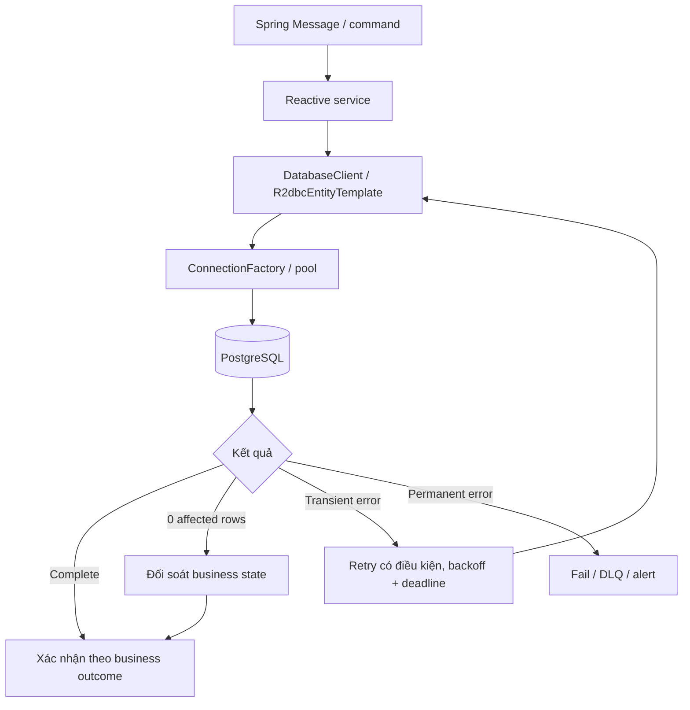
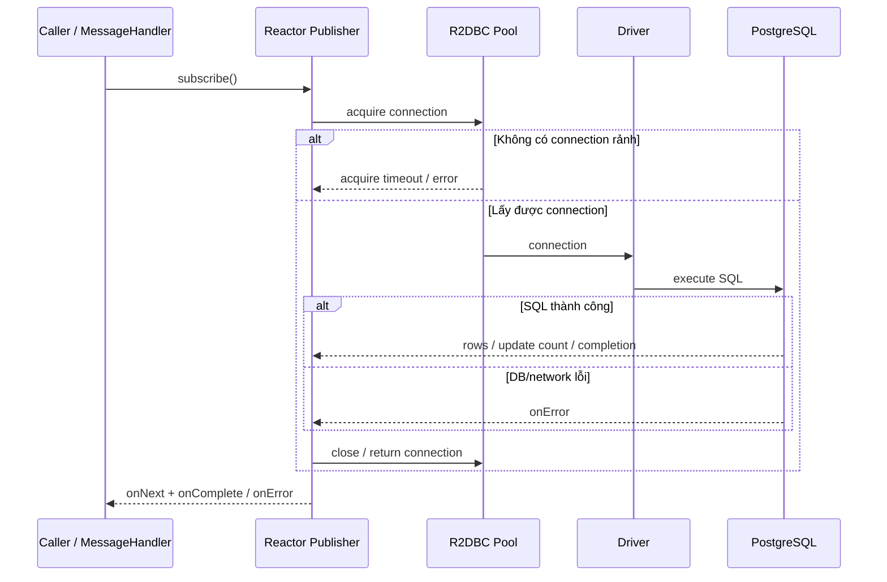
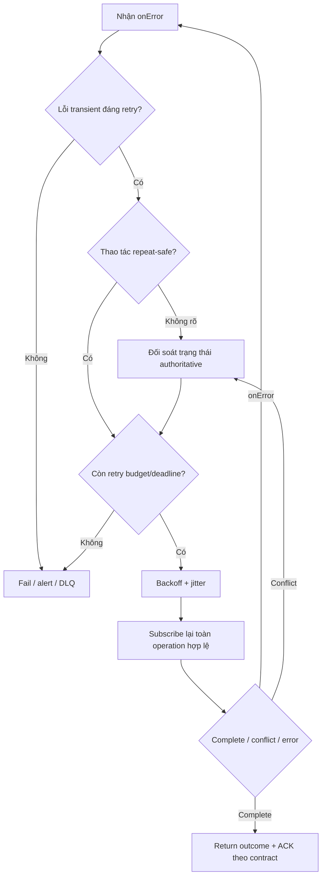
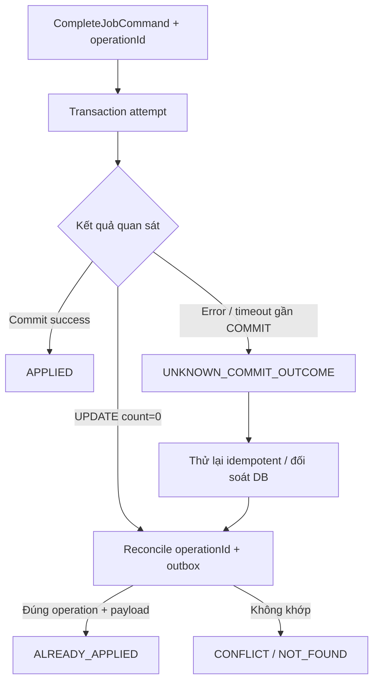

# Retry connection và transient error

> **Chương:** Adapter R2DBC  
> **Module:** SPRING_INTEGRATION_ADAPTERS  
> **Bối cảnh:** Kết nối các hệ thống ngoài vào Spring Integration bằng inbound/outbound adapter, gateway, poller và MessageChannel. Thực hành với file, SFTP, HTTP, JMS, AMQP, Kafka và cơ sở dữ liệu; chú trọng hợp đồng message, xử lý lỗi, retry, idempotency và vòng đời kết nối.

## 1. Mục tiêu học tập

Sau bài học, bạn có thể:

- Phân biệt **transient error** (có thể tự phục hồi) với **permanent error** (không thể giải quyết chỉ bằng thử lại) ở các lớp network, connection pool, database, SQL và business.
- Nhận diện `R2dbcException`/SQLSTATE của driver và `DataAccessException` đã được Spring dịch; không xem mọi `RuntimeException` là lỗi kết nối tạm thời.
- Giải thích vì sao `ConnectionFactory`/pool không tự bảo đảm một query được retry an toàn và vì sao retry một `Mono`/`Flux` thường **subscribe lại** nguồn.
- Viết `Retry.backoff(...)`, `filter(...)`, `jitter(...)` và `timeout(...)` cho query R2DBC, phân biệt **backoff**, **retry budget**, **deadline** và **circuit breaker**.
- Phân biệt **retry đọc thuần** với retry `INSERT`/`UPDATE` có side effect; xử lý trường hợp **database đã commit nhưng caller không nhận được kết quả**.
- Dùng operation ID ổn định, unique constraint và transactional outbox để đạt **idempotent effects** khi broker/HTTP redelivery.
- Đặt retry **ngoài toàn bộ reactive transaction** khi cần retry transaction sau lỗi serialization/deadlock, thay vì retry một SQL statement trong transaction đã lỗi.
- Tích hợp custom `ReactiveMessageHandler` và các R2DBC inbound/outbound adapters vào Spring Integration mà không nhầm việc gửi Spring Message với ACK/commit database.
- Thiết kế connection timeout, pool acquire timeout, statement timeout, tổng deadline, backpressure và số request đồng thời phù hợp.
- Viết test với Reactor `StepVerifier`, PostgreSQL/Testcontainers và fault injection có kiểm soát; quan sát lỗi transient và retry storm trước khi triển khai.

## 2. Bài toán thực tế: database chập chờn giữa một integration flow

Ứng dụng nhận sự kiện thanh toán từ Kafka hoặc HTTP, kiểm tra dữ liệu, ghi PostgreSQL và tạo outbox event để gửi tiếp sang AMQP/Kafka. Khi mạng rung hoặc PostgreSQL failover:

1. Mở kết nối có thể bị từ chối.
2. Một query có thể bị cắt giữa chừng.
3. Một transaction có thể rollback do deadlock/serialization failure.
4. Một lệnh ghi có thể **đã commit**, nhưng response/ACK bị mất trên đường về.
5. Poller tiếp tục tạo thêm query khi hệ thống đang nghẽn, gây **retry storm**.

Nếu retry không phân loại, lỗi schema và duplicate key sẽ lặp vô hạn. Nếu retry UPDATE có side effect không idempotent, thao tác nghiệp vụ có thể xảy ra hai lần.



**Quy tắc cốt lõi:** "Lỗi có vẻ tạm thời" **không đồng nghĩa** "phép toán có thể chạy lại mà không làm thay đổi kết quả nghiệp vụ". Hai câu hỏi phải được trả lời **riêng**.

### 2.1. Ba quyết định không được trộn lẫn

| Câu hỏi | Ví dụ | Cách quyết định |
| --- | --- | --- |
| **Lỗi có thể phục hồi?** | Connection reset, deadlock, SQL syntax error | Phân loại exception, SQLSTATE, tình trạng DB và retry budget. |
| **Thao tác có thể lặp lại an toàn?** | SELECT, UPDATE có unique operation ID, tăng số dư | Kiểm tra idempotency, transaction và kết quả commit chưa rõ. |
| **Khi nào ACK upstream?** | Kafka offset, AMQP delivery, HTTP 200 | Sau kết quả đã đủ bền theo hợp đồng, không chỉ sau khi tạo Publisher. |

Một policy tốt có thể quyết định **không tự retry** lỗi tạm thời nếu thao tác không có cách đối soát an toàn.

## 3. Từ ConnectionFactory đến SQL: lỗi có thể xuất hiện ở đâu?



### 3.1. Lỗi ở từng giai đoạn

| Giai đoạn | Triệu chứng | Lớp điều tra |
| --- | --- | --- |
| **Cấu hình/khởi tạo** | Không có driver, URL sai, bean không tạo được | R2DBC SPI, classpath, Spring Boot auto-configuration. |
| **DNS/TCP/TLS** | Host unreachable, connection refused/reset, TLS handshake failure | Network, certificate, firewall, DB endpoint/failover. |
| **Pool acquire** | Chờ lâu hoặc cạn pool; pending requests tăng | R2DBC pool size, acquire timeout, query duration, concurrency. |
| **SQL execution** | Deadlock, lock timeout, serialization error, statement timeout | Transaction/isolation, SQLSTATE, DB logs. |
| **Mapping results** | Cột thiếu, kiểu Java không tương thích, null không hợp lệ | Schema/row mapping, migration, driver conversion. |
| **Commit/response** | DB có thể đã commit nhưng response bị mất | Idempotency, operation ID, đọc trạng thái authoritative. |
| **Downstream** | Kafka/HTTP gửi lỗi sau DB commit | Outbox, broker ACK, retry và consumer dedup. |

**Không có lỗi ở tầng SQL không đồng nghĩa side effect bên ngoài đã thành công.** Đồng thời `MessageChannel.send(...)` thành công không tự chứng minh SQL đã chạy/commit.

### 3.2. Lỗi phát sinh sau khi method đã trả về

```java
Mono<Long> update = db.sql(
        "UPDATE integration_jobs SET status='DONE' WHERE job_id=:id")
        .bind("id", "job-101")
        .fetch()
        .rowsUpdated();

// Đây là một Publisher, chưa phải kết quả SQL đã thực thi.
```

Với R2DBC, lỗi kết nối/SQL thường tới từ **`onError` sau subscription**. `try/catch` quanh lời gọi tạo `Mono` không bắt đầy đủ các lỗi đến muộn này.

Hãy xử lý bằng reactive operators, error handling của endpoint hoặc một service giao kết quả reactive có contract rõ.

## 4. Transient, non-transient và business conflict

### 4.1. Transient không có nghĩa chắc chắn phục hồi ngay

**Transient error** là tình trạng có khả năng hết sau thời gian ngắn hoặc sau thay đổi điều kiện tải; ví dụ DB failover, deadlock victim hoặc tài nguyên connection pool đang bận.

Nhưng:

- Một lỗi connection lặp lại liên tục có thể là **cấu hình sai**, không phải outage thoáng qua.
- Lỗi query timeout có thể do thiếu index và sẽ tái diễn nếu workload không đổi.
- Lỗi pool timeout có thể do concurrency quá cao; retry ngay chỉ làm nghẽn hơn.
- Một transaction timeout gần commit có thể tạo **unknown outcome**.

Vì vậy retry phải có **giới hạn**, **backoff**, **quan sát** và **idempotency**.

### 4.2. Non-transient error

Các lỗi thường **không giải quyết bằng retry cùng payload**:

- SQL syntax error, thiếu bảng/cột, sai schema migration.
- Thiếu quyền database hoặc username/password không hợp lệ.
- Duplicate key/foreign key/check constraint theo business contract hiện tại.
- DTO mapping sai kiểu dữ liệu hoặc cột nullable không được xử lý.
- Input validation sai định dạng hoặc event schema không tương thích.
- Quy tắc business: job đã DONE, version khác, chủ sở hữu claim không hợp lệ.

Đừng retry vô hạn nhóm này; nhiều trường hợp cần sửa code/migration/config hoặc đưa event vào quarantine/DLQ.

### 4.3. Business conflict không phải lỗi driver

```sql
UPDATE integration_jobs
SET status='DONE'
WHERE job_id = :id AND status='PROCESSING';
```

`rowsUpdated() == 0L` là **kết quả SQL hợp lệ**, có thể vì:

- `job_id` không tồn tại.
- Job đã `DONE`.
- Job đang `NEW`.
- Owner/token/version không còn khớp nếu SQL có thêm điều kiện.
- Chính command đã commit ở lần trước nhưng caller mất ACK.

Không chuyển mọi count 0 thành transient exception chỉ để dùng `retryWhen`; phải đối soát business state.

## 5. R2DBC exception hierarchy và SQLSTATE

### 5.1. Các lớp exception thường gặp

R2DBC SPI đưa ra `io.r2dbc.spi.R2dbcException` làm loại lỗi truy cập R2DBC; các driver có thể dùng các subclass như:

- `R2dbcTransientException`: nhánh lỗi có khả năng tạm thời theo phân loại SPI.
- `R2dbcTransientResourceException`: ví dụ tài nguyên/connection tạm thời không dùng được.
- `R2dbcTimeoutException`: timeout theo cơ chế của driver.
- `R2dbcRollbackException`: lỗi khiến transaction rollback, có thể liên quan deadlock/serialization conflict.
- `R2dbcNonTransientException` và các nhánh lỗi SQL/constraint/permission/resource không phục hồi bằng thử lại tương tự.
- `R2dbcDataIntegrityViolationException`, `R2dbcBadGrammarException` hoặc `R2dbcPermissionDeniedException` (tùy SPI/driver) thường là dấu hiệu lỗi không phù hợp retry tự động.

Spring Framework có thể **dịch** lỗi thành `org.springframework.dao.DataAccessException`. Ví dụ `TransientDataAccessException` hoặc các subclass khác xuất hiện ở outer exception, còn `R2dbcException` nằm trong cause chain.

**Không giả định class cụ thể của từng driver/pool là cố định.** Test class, SQLSTATE và cause chain trong phiên bản thực tế trước khi hoàn thiện policy.

### 5.2. Các thông tin nên lưu lại

Với `R2dbcException`:

```java
import io.r2dbc.spi.R2dbcException;

void inspect(R2dbcException exception) {
    String sqlState = exception.getSqlState();
    int vendorCode = exception.getErrorCode();

    System.out.printf(
            "SQLSTATE=%s vendorCode=%d exception=%s%n",
            sqlState,
            vendorCode,
            exception.getClass().getSimpleName());
}
```

Đoạn này là một method minh họa. **Không** log nguyên SQL có secrets, mật khẩu, PII hoặc payload nhạy cảm. SQLSTATE/vendor code chỉ hỗ trợ chẩn đoán; loại lỗi cuối cùng còn phụ thuộc tình trạng transaction và nghiệp vụ.

### 5.3. Một số SQLSTATE PostgreSQL đáng nhớ

| SQLSTATE | Mô tả PostgreSQL | Retry? |
| --- | --- | --- |
| `08001` | SQL client unable to establish connection | Ứng viên retry với backoff và readiness check. |
| `08003` | Connection does not exist | Có thể mở connection mới, nhưng kết quả command trước **chưa chắc rõ**. |
| `08006` | Connection failure | Ứng viên retry có giới hạn; kiểm tra trạng thái DB. |
| `57P01` | Admin shutdown | Thường đợi database phục hồi, có deadline/circuit breaker. |
| `40001` | Serialization failure | Thường retry **toàn transaction** sau rollback. |
| `40P01` | Deadlock detected | Thường retry **toàn transaction**, với backoff/jitter. |
| `55P03` | Lock not available | Có thể retry tùy chiến lược lock/`NOWAIT`; không mặc định. |
| `57014` | Query canceled | **Không auto retry**: có thể do user cancel/statement timeout. |
| `23505` | Unique violation | Không retry mù; kiểm tra idempotency/business key. |
| `23503` | Foreign key violation | Không retry mù; kiểm tra dữ liệu/constraint. |
| `42P01` | Undefined table | Lỗi schema/migration, sửa cấu hình/code. |
| `28P01` | Invalid password | Lỗi cấu hình/credentials; không retry cùng secret. |

Các code được dùng để **minh họa PostgreSQL**, không phải toàn bộ SQLSTATE. Có lỗi network không kịp được DB trả SQLSTATE, và một exception từ pool có thể **không mang** SQLSTATE.

**Đừng viết policy `state.startsWith("08")` mà không kiểm tra**: lớp connection exception rộng có thể bao gồm cả trường hợp server từ chối thiết lập vì lý do không tự phục hồi.

### 5.4. Dữ liệu lỗi cần phân loại theo nguồn

```text
Throwable từ reactive chain
        |
        +-- DataAccessException (Spring đã dịch)
        |       |
        |       +-- cause: R2dbcException + SQLSTATE
        |
        +-- R2dbcException (driver)
        |
        +-- Pool/Netty/TLS/runtime exception
        |
        +-- Business/validation exception
```

Không cần ép mọi lỗi vào SQLSTATE. Với `SSLHandshakeException` do certificate hết hạn, việc lặp kết nối với cùng certificate không mang lại lợi ích dù lỗi xảy ra ở tầng kết nối.

## 6. Bốn câu hỏi trước khi retry

Một decision flow hữu dụng:



### 6.1. Tiêu chí đề xuất

1. **Tính nhất thời:** SQLSTATE/cause/health check nói gì?
2. **Loại thao tác:** read-only SELECT, idempotent upsert hay side effect cộng dồn?
3. **Ranh giới transaction:** phép retry có bọc lại toàn transaction mới không?
4. **Kết quả chưa rõ:** có operation ID, unique constraint, audit/outbox để đối soát không?
5. **Giới hạn tải:** pool còn capacity, downstream còn xử lý được không?
6. **Ngân sách:** còn bao nhiêu attempts và tổng thời gian request?
7. **Điều kiện dừng:** không thể phục hồi thì trả lỗi rõ và định tuyến DLQ/alert.

Đừng biến retry thành cách "ẩn lỗi" trong dashboard. Tăng throughput tạm thời nhưng che failure root cause sẽ dẫn đến backlog lớn hơn khi DB tiếp tục gặp sự cố.

## 7. Chuẩn bị Spring Boot và PostgreSQL

Ví dụ dùng **Java 17+, Spring Boot 3.x, Spring Integration 6.x, Spring Data R2DBC 3.x và Reactor tương thích theo BOM**. Với các phiên bản khác, đối chiếu Javadoc các API được chọn và kết quả tích hợp thực tế.

### 7.1. Maven dependencies

```xml
<dependencies>
    <dependency>
        <groupId>org.springframework.boot</groupId>
        <artifactId>spring-boot-starter-integration</artifactId>
    </dependency>
    <dependency>
        <groupId>org.springframework.boot</groupId>
        <artifactId>spring-boot-starter-data-r2dbc</artifactId>
    </dependency>
    <dependency>
        <groupId>org.springframework.integration</groupId>
        <artifactId>spring-integration-r2dbc</artifactId>
    </dependency>
    <dependency>
        <groupId>org.postgresql</groupId>
        <artifactId>r2dbc-postgresql</artifactId>
        <scope>runtime</scope>
    </dependency>
    <dependency>
        <groupId>io.r2dbc</groupId>
        <artifactId>r2dbc-pool</artifactId>
    </dependency>
    <dependency>
        <groupId>io.projectreactor</groupId>
        <artifactId>reactor-test</artifactId>
        <scope>test</scope>
    </dependency>
</dependencies>
```

Không thay driver `r2dbc-postgresql` bằng JDBC `postgresql`. Spring Boot BOM quản lý versions; tránh tự ghép Spring Integration và Spring Framework khác thế hệ.

### 7.2. application.yml

```yaml
spring:
  r2dbc:
    url: r2dbc:postgresql://127.0.0.1:5432/integration_demo
    username: ${DB_USER}
    password: ${DB_PASSWORD}
    pool:
      enabled: true
      initial-size: 2
      max-size: 10
      max-acquire-time: 3s
      max-idle-time: 10m
```

`${DB_USER}` và `${DB_PASSWORD}` là Spring placeholders được lấy từ biến môi trường. **Không commit credentials** vào Git. Production phải cấu hình TLS/xác thực server nếu cần, DNS/failover hợp lý và DB user có quyền tối thiểu.

Các giá trị pool là **demo**, không phải mặc định tối ưu. 10 application instances với pool max 10 có thể dùng tối đa khoảng 100 connections, chưa tính những service khác.

### 7.3. Database schema cho retry và idempotency

Tạo PostgreSQL database `integration_demo` và các bảng:

```sql
CREATE TABLE integration_jobs (
    job_id            VARCHAR(64) PRIMARY KEY,
    status            VARCHAR(20) NOT NULL DEFAULT 'NEW',
    last_operation_id VARCHAR(80),
    version           BIGINT NOT NULL DEFAULT 0,
    updated_at        TIMESTAMPTZ NOT NULL DEFAULT NOW()
);

CREATE TABLE integration_job_audit (
    audit_id      BIGSERIAL PRIMARY KEY,
    job_id        VARCHAR(64) NOT NULL,
    operation_id  VARCHAR(80) NOT NULL,
    action        VARCHAR(32) NOT NULL,
    created_at    TIMESTAMPTZ NOT NULL DEFAULT NOW(),
    CONSTRAINT uq_job_audit UNIQUE (operation_id, action)
);

CREATE TABLE integration_outbox (
    event_id       VARCHAR(80) PRIMARY KEY,
    job_id         VARCHAR(64) NOT NULL,
    event_type     VARCHAR(40) NOT NULL,
    payload_json   TEXT NOT NULL,
    status         VARCHAR(20) NOT NULL DEFAULT 'NEW',
    created_at     TIMESTAMPTZ NOT NULL DEFAULT NOW(),
    published_at   TIMESTAMPTZ
);

CREATE INDEX idx_outbox_status_created
    ON integration_outbox(status, created_at, event_id);

INSERT INTO integration_jobs(job_id, status)
VALUES ('job-101', 'NEW'), ('job-102', 'NEW'),
       ('job-103', 'DONE');
```

**Business invariants:**

- `job_id` là khóa job, cho phép UPDATE theo PK tối đa một row.
- `operation_id` ổn định qua retry của cùng command.
- `last_operation_id` dùng để nhận diện transition đã xảy ra.
- `event_id=operation_id` trong ví dụ để cùng một command không tạo nhiều outbox events.
- Audit có unique constraint để đối soát.
- Outbox được ghi **trong cùng DB transaction** với UPDATE; publish sang broker diễn ra **sau commit** bởi relay riêng.

### 7.4. Record của command

Tạo `CompleteJobCommand.java`:

```java
public record CompleteJobCommand(
        String jobId,
        String operationId,
        String eventJson
) {
}
```

Tạo `JobOutcome.java`:

```java
public enum JobStatus {
    APPLIED,
    ALREADY_APPLIED
}
```

```java
public record JobOutcome(
        String jobId,
        String operationId,
        JobStatus status
) {
}
```

**Mỗi kiểu `public` ở một file Java riêng theo tên tương ứng.** Mẫu này giữ outcome rõ ràng để caller phân biệt lần commit mới và lần retry đã được ghi nhận.

## 8. DatabaseClient: truy vấn đọc và command ghi

### 8.1. SELECT đơn giản là ứng viên retry dễ hơn

Tạo `JobReadRepository.java`:

```java
import org.springframework.r2dbc.core.DatabaseClient;
import org.springframework.stereotype.Repository;
import reactor.core.publisher.Mono;

@Repository
public class JobReadRepository {

    private final DatabaseClient db;

    public JobReadRepository(DatabaseClient db) {
        this.db = db;
    }

    public Mono<String> findStatus(String jobId) {
        return db.sql(
                        "SELECT status FROM integration_jobs " +
                        "WHERE job_id = :id")
                .bind("id", jobId)
                .map((row, meta) ->
                        row.get("status", String.class))
                .one();
    }
}
```

`Mono<String>` có thể complete rỗng nếu không có job. Đừng gộp empty result với connection failure.

Một SELECT thuần thường ít rủi ro side effect hơn UPDATE, nhưng nếu caller phát các kết quả `Flux` sang Kafka/HTTP rồi retry sau partial emission, **downstream vẫn có thể nhận trùng**.

### 8.2. Cập nhật trạng thái có điều kiện

Ví dụ code nằm trong repository có field `db`:

```java
Mono<Long> update = db.sql(
                "UPDATE integration_jobs " +
                "SET status = 'DONE', " +
                "    last_operation_id = :operation, " +
                "    version = version + 1, " +
                "    updated_at = NOW() " +
                "WHERE job_id = :id AND status = 'NEW'")
        .bind("id", command.jobId())
        .bind("operation", command.operationId())
        .fetch()
        .rowsUpdated();
```

`rowsUpdated()` trả `Mono<Long>` theo Spring Framework 6.x. Nếu count 0, đó **không** tự là lỗi kết nối; phải xem job hiện tại hoặc transaction log.

**Điểm then chốt:** nếu câu UPDATE đã commit nhưng response mất, retry có thể trả 0 vì status đã là DONE. 0 không có nghĩa request trước chưa được áp dụng.

## 9. Reactor Retry: backoff, jitter, filter và budget

### 9.1. retry khác retryWhen

`retry(n)` có thể resubscribe lập tức, không có backoff mặc định. Điều này rủi ro khi database đang quá tải.

`retryWhen(Retry.backoff(...))` cho phép cấu hình:

- Số lần thử lại tối đa.
- Thời gian chờ tăng dần (exponential backoff).
- Jitter phân tán thời điểm các clients retry.
- Bộ lọc exception transient.
- Hook đo attempts/metrics.
- Chính sách khi hết số lần retry.

```java
import java.time.Duration;
import reactor.util.retry.Retry;

Retry retrySpec = Retry.backoff(3, Duration.ofMillis(200))
        .maxBackoff(Duration.ofSeconds(2))
        .jitter(0.3);
```

`Retry.backoff(3, ...)` cho phép **tối đa ba retries sau lần gọi đầu**, không phải tổng cộng ba executions. Số retries và tổng thời gian cần được tính cùng API/request deadline.

### 9.2. Vì sao cần jitter?

Giả sử 1.000 instances cùng kết nối lại sau PostgreSQL failover. Nếu tất cả retry tại 200ms, 400ms, 800ms, mỗi đợt tạo một spike lớn.

`jitter(0.3)` khiến thời gian chờ khác nhau có kiểm soát, giảm đồng bộ giữa clients. Nó **không** thay circuit breaker hoặc rate limiter: nếu database bị down nhiều phút, retries vẫn cần dừng/hạn chế và để recovery diễn ra.

### 9.3. Đặt retry ở cấp operation, không ở nơi đã tạo side effect chưa kiểm soát

```java
Mono<String> status = repository.findStatus("job-101")
        .retryWhen(
                Retry.backoff(2, Duration.ofMillis(100))
                     .maxBackoff(Duration.ofSeconds(1))
                     .filter(PgRetryClassifier::isRetryCandidate));
```

Đoạn trên dùng classifier ở mục 10. Query `findStatus` là SELECT không có side effect. Với UPDATE/INSERT, ngoài transient classification cần **business idempotency** trước khi áp dụng tương tự.

`retryWhen` **resubscribe** nguồn Publisher; nó không "tiếp tục" từ giữa một câu SQL đã thất bại.

### 9.4. Tổng deadline

```java
Mono<String> withDeadline = repository.findStatus("job-101")
        .retryWhen(
                Retry.backoff(2, Duration.ofMillis(100))
                     .maxBackoff(Duration.ofSeconds(1))
                     .filter(PgRetryClassifier::isRetryCandidate))
        .timeout(Duration.ofSeconds(4));
```

`timeout(...)` đặt bên ngoài retry để giới hạn **toàn pipeline gồm attempts và backoff**. Các loại timeout connection/pool/statement vẫn cần được cấu hình riêng; chúng bảo vệ các tầng khác nhau.

**Không coi timeout là bằng chứng statement chưa chạy/commit.** Đặc biệt với thao tác ghi, phải đối soát trạng thái theo operation ID.

## 10. Classifier cho lỗi đáng cân nhắc retry

### 10.1. Bộ lọc bảo thủ theo SQLSTATE

Đây là ví dụ **PostgreSQL-specific**. Tạo `PgRetryClassifier.java`:

```java
import java.util.Set;

import io.r2dbc.spi.R2dbcException;
import io.r2dbc.spi.R2dbcTransientException;
import org.springframework.dao.TransientDataAccessException;

public final class PgRetryClassifier {

    private static final Set<String> CANDIDATE_STATES = Set.of(
            "08001", // Cannot establish connection
            "08003", // Connection does not exist
            "08006", // Connection failure
            "57P01", // Admin shutdown
            "40001", // Serialization failure
            "40P01"  // Deadlock
    );

    private PgRetryClassifier() {
    }

    public static boolean isRetryCandidate(Throwable error) {
        boolean springTransient = false;
        boolean spiTransientWithoutSqlState = false;

        for (Throwable current = error;
                current != null;
                current = current.getCause()) {

            if (current instanceof R2dbcException r2dbc) {
                String sqlState = r2dbc.getSqlState();
                if (sqlState != null && !sqlState.isBlank()) {
                    // Có SQLSTATE: theo whitelist; không để wrapper
                    // TransientDataAccessException override permanent state.
                    return CANDIDATE_STATES.contains(sqlState);
                }
                if (current instanceof R2dbcTransientException) {
                    spiTransientWithoutSqlState = true;
                }
            }

            if (current instanceof TransientDataAccessException) {
                springTransient = true;
            }
        }

        return spiTransientWithoutSqlState || springTransient;
    }
}
```

**Đây là classifier cho "lỗi đáng xem xét retry", không phải giấy phép retry mọi operation.** Trước khi áp dụng phải có điều kiện operation-level: idempotent hoặc có cơ chế reconcile/transaction replay.

### 10.2. Giới hạn của classifier

- `R2dbcException.getSqlState()` có thể null.
- Pool acquire errors có thể được bọc trong exception không thuộc R2DBC SPI.
- Một Spring `TransientDataAccessException` có thể bọc lỗi driver thiếu SQLSTATE; cần test behavior.
- `08003/08006` ở transaction commit vẫn có **unknown outcome**.
- `55P03` (lock not available) không nằm trong whitelist để tránh retry tự động khi policy lock chưa rõ.
- `57014` (query canceled) không nằm trong whitelist vì có thể do cancellation có chủ đích.
- `57P01` là ứng viên reconnect khi server sẵn sàng trở lại; không có nghĩa retry ngay là thành công.
- Classifier theo PostgreSQL không dùng nguyên xi cho MySQL/SQL Server và drivers khác.

**Không kiểm tra raw message text để quyết định** ("connection was closed" substring). Message có thể khác ngôn ngữ, driver version và nested cause.

### 10.3. Thêm logging an toàn cho retry attempt

```java
Retry retrySpec = Retry.backoff(3, Duration.ofMillis(200))
        .maxBackoff(Duration.ofSeconds(2))
        .jitter(0.3)
        .filter(PgRetryClassifier::isRetryCandidate)
        .doBeforeRetry(signal ->
                System.out.printf(
                        "Retry #%d after %s%n",
                        signal.totalRetries() + 1,
                        signal.failure().getClass().getSimpleName()));
```

Không log payload nhạy cảm, password, JDBC/R2DBC URL chứa credentials hoặc entire SQL với parameter values.

### 10.4. Khi hết retries

Có thể tùy biến `onRetryExhaustedThrow(...)` để giữ nguyên root cause, rồi để caller quyết định NACK, HTTP 503 hoặc DLQ. Tuy nhiên:

- Không biến các attempt thất bại thành `Mono.empty()` rồi ACK như thành công.
- Không trả lỗi "invalid data" cho trường hợp DB down.
- Không loop retry mãi trong một HTTP request đã hết deadline.
- Không tăng đồng thời số worker trong khi DB đang cạn pool.


## 11. Retry Flux/SELECT: read-only không luôn đồng nghĩa toàn flow an toàn

### 11.1. Retry một truy vấn trả nhiều rows

```java
Flux<String> pendingJobs = db.sql(
                "SELECT job_id FROM integration_jobs " +
                "WHERE status='NEW' ORDER BY job_id LIMIT 50")
        .map((row, metadata) ->
                row.get("job_id", String.class))
        .all()
        .retryWhen(
                Retry.backoff(2, Duration.ofMillis(100))
                        .filter(PgRetryClassifier::isRetryCandidate));
```

Một query `SELECT` không sửa dữ liệu nên thường dễ retry hơn DML. Tuy nhiên, nếu `Flux` đã phát hai rows rồi gặp `onError`, `retryWhen` có thể **subscribe lại toàn query**, khiến hai rows xuất hiện lại.

Nếu downstream đã gửi mỗi row sang Kafka/HTTP thì dù SQL là read-only, **side effect của pipeline có thể bị lặp**. Không áp dụng retry toàn `Flux` mà không hiểu partial emission.

### 11.2. Ví dụ retry gây phát lại dữ liệu

```java
import reactor.core.publisher.Flux;
import reactor.util.retry.Retry;

Flux<Integer> source = Flux.defer(() ->
        Flux.concat(
                Flux.just(101, 102),
                Flux.error(new IllegalStateException("temporary"))));

Flux<Integer> repeated = source.retryWhen(Retry.max(1));
```

`repeated` có thể phát `101,102,101,102` rồi error. Bài tập này minh họa **resubscription**, không giả lập trực tiếp hoạt động của driver PostgreSQL.

### 11.3. Cursor khác ACK

```sql
SELECT job_id, status
FROM integration_jobs
WHERE job_id > :cursor
ORDER BY job_id
LIMIT :batchSize;
```

Keyset pagination hữu ích khi quét bảng lớn, nhưng `cursor` không phải bằng chứng các event trước đó đã xử lý xong.

- Commit cursor trước khi downstream ACK có thể bỏ sót event khi crash.
- Nhiều workers cần claim/lease để tránh xử lý cùng rows.
- Một khoá tự tăng không luôn phản ánh chính xác thứ tự commit của các transactions đồng thời.
- Retry query từ cursor cũ có thể phát lại dữ liệu; consumer cần idempotency.

### 11.4. Timeout Flux

```java
Flux<String> gapTimed = pendingJobs
        .timeout(Duration.ofSeconds(3));

Mono<java.util.List<String>> wholeBatchTimed = pendingJobs
        .collectList()
        .timeout(Duration.ofSeconds(8));
```

`Flux.timeout(Duration)` chủ yếu giới hạn **khoảng chờ giữa các tín hiệu**, còn `collectList().timeout(...)` ở đây giới hạn **tổng thời gian materialize batch**. Chỉ dùng `collectList()` khi SQL đã có batch size giới hạn để tránh gom không kiểm soát vào RAM.

## 12. Retry transaction: đặt retry ngoài transaction boundary

### 12.1. Không retry một SQL bên trong transaction đã bị lỗi

Trong PostgreSQL, một lỗi statement có thể khiến transaction hiện tại ở trạng thái **aborted**. Retry riêng statement đó trong cùng transaction có thể tiếp tục thất bại, không phục hồi được transaction.

```java
// KHÔNG LÀM: các phương thức là placeholder minh họa.
Mono<Void> unsafe = updateJob()
        .retryWhen(Retry.backoff(2, Duration.ofMillis(100)))
        .then(insertAudit())
        .as(tx::transactional);
```

Với deadlock/serialization failure, thường cần **rollback attempt hiện tại rồi retry toàn transaction trong một attempt mới**.

### 12.2. Bọc toàn bộ SQL trong TransactionalOperator

```text
completeOnce(command):
    work = UPDATE job có điều kiện
           -> kiểm tra affected rows
           -> INSERT audit
           -> INSERT outbox
    return transactional(work)
```

Đây là **pseudocode mô tả cấu trúc**, implementation Java đầy đủ nằm ở mục 13. `TransactionalOperator` gắn transaction với Reactor Context của subscription, không với một ThreadLocal cố định.

Đặt retry ở bên ngoài lời gọi transactional:

```java
Mono<JobOutcome> resilient =
        Mono.defer(() -> service.completeOnce(command))
                .retryWhen(
                        Retry.backoff(2, Duration.ofMillis(200))
                                .maxBackoff(Duration.ofSeconds(2))
                                .jitter(0.3)
                                .filter(PgRetryClassifier::isRetryCandidate))
                .timeout(Duration.ofSeconds(8));
```

Mỗi resubscription có thể tạo **transaction mới** sau khi transaction trước rollback. Nếu mất response vào thời điểm COMMIT, việc tạo transaction mới chỉ an toàn nếu command có **operation ID ổn định và logic đối soát**.

### 12.3. Những lỗi transaction có thể retry

| Trường hợp | Phạm vi retry hợp lý |
| --- | --- |
| SQLSTATE `40001` serialization failure | Toàn transaction mới, có backoff. |
| SQLSTATE `40P01` deadlock | Toàn transaction mới, có backoff. |
| Kết nối thất bại trước khi bắt đầu SQL | Tạo/lấy connection mới, retry toàn operation. |
| Commit reply bị mất | Đối soát theo operation ID; không giả định rollback. |
| Unique violation `23505` | Không retry mù; kiểm tra duplicate/idempotency. |
| UPDATE count = 0 | Business state reconciliation, không phải transient SQL error. |

### 12.4. @Transactional reactive cũng cần proxy/subscription

`@Transactional` có thể bảo vệ method trả `Mono`/`Flux` nếu có `ReactiveTransactionManager` và được Spring intercept đúng. Tự gọi `this.method()` trong cùng bean ở proxy mode có thể bỏ qua transaction interceptor.

Không tạo `Mono` rồi gọi `subscribe()` riêng cho từng bước SQL. Hãy compose bằng `flatMap`/`then`, để caller/framework subscribe vào **một Publisher kết quả**.

## 13. Ví dụ end-to-end: transaction + đối soát operation ID

Một command `CompleteJobCommand` gồm `jobId`, `operationId`, `eventJson`. Kết quả là `APPLIED` khi lần hiện tại commit thay đổi, `ALREADY_APPLIED` khi database chứng minh operation đã commit trước đó với đúng nội dung.

### 13.1. Code service

Tạo `JobCompletionService.java`:

```java
import org.springframework.r2dbc.core.DatabaseClient;
import org.springframework.stereotype.Service;
import org.springframework.transaction.reactive.TransactionalOperator;
import reactor.core.publisher.Mono;

@Service
public class JobCompletionService {

    private final DatabaseClient db;
    private final TransactionalOperator tx;

    public JobCompletionService(
            DatabaseClient db, TransactionalOperator tx) {
        this.db = db;
        this.tx = tx;
    }

    public Mono<JobOutcome> completeOnce(
            CompleteJobCommand cmd) {

        validate(cmd);

        Mono<JobOutcome> work = db.sql(
                        "UPDATE integration_jobs " +
                        "SET status='DONE', " +
                        "last_operation_id=:operation, " +
                        "version=version+1, updated_at=NOW() " +
                        "WHERE job_id=:id AND status='NEW'")
                .bind("id", cmd.jobId())
                .bind("operation", cmd.operationId())
                .fetch()
                .rowsUpdated()
                .flatMap(count -> {
                    if (count == 1L) {
                        return insertAuditAndOutbox(cmd);
                    }
                    if (count == 0L) {
                        return reconcileCommittedOperation(cmd);
                    }
                    return Mono.error(new IllegalStateException(
                            "Unexpected affected rows: " + count));
                });

        // Cả ba SQL statements và đường reconcile nằm trong transaction.
        return work.as(tx::transactional);
    }

    private Mono<JobOutcome> insertAuditAndOutbox(
            CompleteJobCommand cmd) {

        return db.sql(
                        "INSERT INTO integration_job_audit " +
                        "(job_id, operation_id, action) " +
                        "VALUES (:job, :operation, :action)")
                .bind("job", cmd.jobId())
                .bind("operation", cmd.operationId())
                .bind("action", "COMPLETE")
                .fetch()
                .rowsUpdated()
                .flatMap(auditCount -> {
                    if (auditCount != 1L) {
                        return Mono.error(new IllegalStateException(
                                "Unexpected audit count: " + auditCount));
                    }

                    return db.sql(
                                    "INSERT INTO integration_outbox " +
                                    "(event_id, job_id, event_type, " +
                                    "payload_json) " +
                                    "VALUES (:event, :job, :type, :body)")
                            .bind("event", cmd.operationId())
                            .bind("job", cmd.jobId())
                            .bind("type", "JOB_COMPLETED")
                            .bind("body", cmd.eventJson())
                            .fetch()
                            .rowsUpdated();
                })
                .flatMap(outboxCount -> {
                    if (outboxCount != 1L) {
                        return Mono.error(new IllegalStateException(
                                "Unexpected outbox count: " + outboxCount));
                    }
                    return Mono.just(new JobOutcome(
                            cmd.jobId(), cmd.operationId(),
                            JobStatus.APPLIED));
                });
    }

    private Mono<JobOutcome> reconcileCommittedOperation(
            CompleteJobCommand cmd) {

        return db.sql(
                        "SELECT status, last_operation_id " +
                        "FROM integration_jobs WHERE job_id=:id")
                .bind("id", cmd.jobId())
                .map((row, meta) -> new JobSnapshot(
                        row.get("status", String.class),
                        row.get("last_operation_id", String.class)))
                .one()
                .switchIfEmpty(Mono.error(
                        new IllegalStateException("Job not found")))
                .flatMap(job -> {
                    if (!"DONE".equals(job.status())
                            || !cmd.operationId().equals(
                                    job.lastOperationId())) {
                        return Mono.error(new IllegalStateException(
                                "Job state conflicts with operation"));
                    }
                    return checkOutbox(cmd);
                });
    }

    private Mono<JobOutcome> checkOutbox(
            CompleteJobCommand cmd) {

        return db.sql(
                        "SELECT job_id, event_type, payload_json " +
                        "FROM integration_outbox WHERE event_id=:id")
                .bind("id", cmd.operationId())
                .map((row, meta) -> new OutboxSnapshot(
                        row.get("job_id", String.class),
                        row.get("event_type", String.class),
                        row.get("payload_json", String.class)))
                .one()
                .switchIfEmpty(Mono.error(
                        new IllegalStateException(
                                "Operation has no matching outbox")))
                .flatMap(row -> {
                    boolean sameCommand =
                            cmd.jobId().equals(row.jobId())
                            && "JOB_COMPLETED".equals(row.eventType())
                            && cmd.eventJson().equals(row.payloadJson());

                    if (!sameCommand) {
                        return Mono.error(new IllegalStateException(
                                "Operation ID reused for different payload"));
                    }

                    return Mono.just(new JobOutcome(
                            cmd.jobId(), cmd.operationId(),
                            JobStatus.ALREADY_APPLIED));
                });
    }

    private static void validate(CompleteJobCommand cmd) {
        if (cmd == null
                || !valid(cmd.jobId(), 64)
                || !valid(cmd.operationId(), 80)
                || cmd.eventJson() == null
                || cmd.eventJson().isBlank()
                || cmd.eventJson().length() > 100_000) {
            throw new IllegalArgumentException("Invalid command");
        }
    }

    private static boolean valid(String value, int max) {
        return value != null
                && value.length() <= max
                && value.matches("[A-Za-z0-9_-]+");
    }

    private record JobSnapshot(
            String status, String lastOperationId) {
    }

    private record OutboxSnapshot(
            String jobId, String eventType, String payloadJson) {
    }
}
```

### 13.2. Tại sao code này repeat-safe hơn UPDATE đơn lẻ?

1. `UPDATE ... WHERE status='NEW'` là transition có điều kiện.
2. Khi count=1, insert audit và outbox trong **cùng transaction**.
3. Nếu audit/outbox lỗi, transaction rollback UPDATE; không để trạng thái nửa chừng.
4. Nếu count=0, tìm lại job và outbox theo **operationId**.
5. Nếu có `DONE` cùng operation và payload khớp, trả `ALREADY_APPLIED`.
6. Nếu operation khác hoặc payload khác, trả business conflict, không tiếp tục retry theo transient policy.
7. Unique constraints hỗ trợ chống ghi trùng.
8. Caller chỉ ACK input theo contract sau khi service trả outcome bền vững.

**Lưu ý:** Đoạn demo so sánh `eventJson` bằng **chuỗi**. Production nên sử dụng canonical JSON/fingerprint có version khi các serializers có thể tạo chuỗi khác nhau cho nội dung tương đương. Kiểm tra authorization, byte-size payload và schema validation riêng.

### 13.3. Outbox chưa phải Kafka ACK

Một outbox row `NEW` nghĩa là DB đã lưu ý định publish. Nó **không** chứng minh event đã có trong Kafka/AMQP.

Outbox relay riêng phải publish, chờ ACK, rồi đánh dấu `PUBLISHED`. Nếu crash sau broker ACK nhưng trước update DB, event có thể gửi lại; consumer cần dedup theo `event_id`.

### 13.4. Facade đặt Retry bên ngoài transaction

Tạo `JobCompletionFacade.java`:

```java
import java.time.Duration;

import org.springframework.stereotype.Service;
import reactor.core.publisher.Mono;
import reactor.util.retry.Retry;

@Service
public class JobCompletionFacade {

    private final JobCompletionService service;

    public JobCompletionFacade(JobCompletionService service) {
        this.service = service;
    }

    public Mono<JobOutcome> completeReliably(
            CompleteJobCommand cmd) {

        return Mono.defer(() -> service.completeOnce(cmd))
                .retryWhen(
                        Retry.backoff(2, Duration.ofMillis(200))
                                .maxBackoff(Duration.ofSeconds(2))
                                .jitter(0.3)
                                .filter(
                                        PgRetryClassifier::isRetryCandidate))
                .timeout(Duration.ofSeconds(8));
    }
}
```

`Retry` ở facade **retry toàn operation**; service `completeOnce` đã bọc transaction. Retry sau lost commit response có thể trả `ALREADY_APPLIED` thay vì ghi lần hai.

## 14. ConnectionFactory, pool và reconnect

### 14.1. ConnectionFactory không biết business idempotency

`io.r2dbc.spi.ConnectionFactory.create()` trả Publisher của connection. Một pool có thể cấp một connection khác sau khi connection cũ hỏng, nhưng **không tự biết** UPDATE trước đó đã commit chưa.

Phân biệt:

| Khái niệm | Bảo đảm |
| --- | --- |
| Reconnect | Cố lấy connection hợp lệ mới. |
| SQL retry | Thử thực thi lại statement/transaction. |
| Idempotency | Không tạo thêm hiệu ứng nghiệp vụ khi cùng operation lặp lại. |
| Recovery | Tìm và xử lý lại những work items chưa ACK sau restart. |

### 14.2. Pool acquire timeout và nghẽn tải

Một pool max-size=10 không có nghĩa chỉ mười requests được tạo. Hàng trăm publishers vẫn có thể đợi acquire, tiêu tốn memory và làm tăng latency.

Retry ngay sau pool timeout thường làm **tăng pending requests**. Hãy giảm concurrency, điều chỉnh SQL/index/locks, dùng backoff+jitter và giới hạn tổng số requests.

### 14.3. Tình huống kết nối

| Tình huống | Hành động |
| --- | --- |
| DB restart/failover, connection refused | Retry có giới hạn, chờ readiness và quan sát DB. |
| DNS failover propagation chậm | Backoff, kiểm tra DNS/TTL cấu hình thực. |
| TLS certificate invalid/expired | Sửa certificate/truststore, không retry mù. |
| Username/password sai | Sửa secret/permission, không retry cùng cấu hình. |
| Pool quá tải do lock contention | Giảm tải/độ dài transaction; không chỉ tăng max-size. |
| Network ngắt tại COMMIT | Đối soát theo operation ID trước khi hành động tiếp. |

### 14.4. Lifecycle khi shutdown

Khi ứng dụng shutdown, ngừng poll/nhận tasks mới, cho các subscriptions đang chạy thời gian hoàn tất có giới hạn, không ACK sớm, đóng pool và để rows chưa ACK được recovery qua broker/outbox/lease.

Không giữ một raw `Connection` singleton cho nhiều concurrent operations; dùng `DatabaseClient`/`R2dbcEntityTemplate` để framework quản lý connection.

## 15. Timeout ở nhiều lớp

### 15.1. Bảng so sánh

| Timeout | Bảo vệ | Không đồng nghĩa |
| --- | --- | --- |
| Connect timeout | Mở connection tới PostgreSQL. | SQL statement deadline. |
| Pool acquire timeout | Chờ connection từ pool. | Query đã rollback. |
| PostgreSQL `statement_timeout` | Thời gian statement chạy/chờ lock. | Toàn workflow retry budget. |
| PostgreSQL `lock_timeout` | Chờ lock. | Deadlock detection. |
| Transaction timeout | Thời gian transaction. | Kafka/HTTP ACK. |
| Reactor `timeout(...)` | Deadline/gap theo Publisher operator. | DB chắc chắn chưa commit. |
| HTTP business deadline | Tổng thời gian caller chờ. | Thời gian retry riêng lẻ. |

### 15.2. Lost reply

```text
Client gửi UPDATE
     |
     v
DB xử lý và COMMIT
     |
     v
Mạng đứt trước khi client nhận trả lời
     |
     v
Client thấy timeout/error
```

**Không kết luận UPDATE chưa chạy.** Trong tình huống này, stable operation ID + audit/outbox là nguồn dữ liệu để đối soát.

### 15.3. Circuit breaker và bulkhead

- **Circuit breaker:** giảm việc gọi DB khi hệ thống đang liên tục lỗi, dùng probe/half-open phù hợp.
- **Bulkhead/semaphore:** giới hạn in-flight DB calls, chống dồn request vào pool.
- **Retry:** chỉ thử lại lỗi được phân loại, trong deadline.
- **Queue bền vững:** giữ event khi DB down lâu hơn retry budget.
- **Idempotency:** ngăn duplicate effects khi nguồn replay.

Các cơ chế bổ sung nhau. Không tính business conflict như health failure của DB để mở circuit breaker vô cớ.

## 16. Spring Integration R2DBC outbound và custom reactive handler

### 16.1. Outbound adapter một chiều

```java
import java.util.Map;

import org.springframework.context.annotation.Bean;
import org.springframework.context.annotation.Configuration;
import org.springframework.data.r2dbc.core.R2dbcEntityTemplate;
import org.springframework.data.relational.core.query.Criteria;
import org.springframework.integration.config.EnableIntegration;
import org.springframework.integration.dsl.IntegrationFlow;
import org.springframework.integration.r2dbc.dsl.R2dbc;
import org.springframework.integration.r2dbc.outbound.R2dbcMessageHandler;
import org.springframework.messaging.Message;

@Configuration
@EnableIntegration
public class SimpleJobUpdateFlow {

    @Bean
    IntegrationFlow jobUpdateFlow(R2dbcEntityTemplate template) {
        return IntegrationFlow.from("jobUpdates")
                .handleReactive(
                        R2dbc.outboundChannelAdapter(template)
                                .queryType(R2dbcMessageHandler.Type.UPDATE)
                                .tableName("integration_jobs")
                                .criteria((Message<CompleteJobCommand> m) ->
                                        Criteria.where("job_id")
                                                .is(m.getPayload().jobId())
                                                .and("status").is("NEW"))
                                .values((Message<CompleteJobCommand> m) ->
                                        Map.of(
                                                "status", "DONE",
                                                "last_operation_id",
                                                m.getPayload().operationId()))
                )
                .get();
    }
}
```

Đoạn này chỉ minh họa **một UPDATE** qua `R2dbcMessageHandler`, không ghi audit/outbox cùng transaction.

- `handleReactive(...)` hỗ trợ xử lý `ReactiveMessageHandler` trong Java DSL (Spring Integration 6.1+).
- Outbound adapter thông thường trả completion/error `Mono<Void>`, **không tự trả `rowsUpdated()`**.
- UPDATE count=0 có thể complete bình thường; muốn strict business outcome cần custom service.
- Không gắn retry bao trùm HTTP/Kafka + DB chỉ vì tất cả endpoints trong một flow.

### 16.2. ReactiveMessageHandler có transaction/retry rõ ràng

```java
import org.springframework.context.annotation.Bean;
import org.springframework.context.annotation.Configuration;
import org.springframework.integration.config.EnableIntegration;
import org.springframework.integration.dsl.IntegrationFlow;
import org.springframework.messaging.ReactiveMessageHandler;

@Configuration
@EnableIntegration
public class ReliableJobFlowConfiguration {

    @Bean
    IntegrationFlow reliableJobFlow(JobCompletionFacade facade) {
        ReactiveMessageHandler handler = message -> {
            CompleteJobCommand cmd =
                    (CompleteJobCommand) message.getPayload();

            return facade.completeReliably(cmd).then();
        };

        return IntegrationFlow.from("completeJobCommands")
                .handleReactive(handler)
                .get();
    }
}
```

`.then()` giữ completion/error nhưng bỏ `JobOutcome`. Đây là terminal **one-way handler**; muốn caller nhận domain outcome, dùng reactive service API hoặc request-reply gateway có contract cụ thể.

**Không gọi `facade.completeReliably(cmd).subscribe()` rồi trả `Mono.empty()`**. Điều đó tách DB error/commit khỏi lifecycle handler và khiến nguồn có thể ACK trước khi DB hoàn tất.

### 16.3. Retry toàn MessageChannel có thể lặp side effect khác

```text
Receive Kafka -> HTTP call -> R2DBC UPDATE -> Kafka publish
```

Nếu retry **toàn flow** vì DB lỗi, HTTP call trước đó có thể lặp. Nếu retry sau broker publish thành công nhưng ACK mất, Kafka event cũng có thể phát lại.

Hãy đặt retry quanh **operation có contract idempotent**, và đặt ACK/dedup riêng cho mỗi boundary.

## 17. R2DBC inbound poller, Flux và redelivery

### 17.1. Một lần poll có thể chứa nhiều row

`R2dbcMessageSource` thường phát một `Message<Flux<T>>` khi `expectSingleResult=false`, không mặc định phát N Spring Messages.

```text
Poller -> R2dbcMessageSource
                   |
                   v
           Message<Flux<JobEntity>>
                   |
                   v
            FluxMessageChannel
                   |
                   v
                Splitter
                   |
                   +-- Message<JobEntity> #1
                   +-- Message<JobEntity> #2
```

`maxMessagesPerPoll(1)` giới hạn số lần gọi `receive()`, **không giới hạn số rows**. Dùng SQL `LIMIT` và strategy claim phù hợp.

### 17.2. Retry SELECT khác event redelivery

Nếu query đã phát row #1 rồi gặp error ở row #2, retry có thể đọc lại #1. Nếu #1 đã gửi HTTP/Kafka, phải dedup ngoài DB.

Nếu `updateSql` ở R2DBC source đánh dấu row đã đọc/claim, đó **không mặc định là ACK sau khi downstream xử lý**. Worker chết giữa claim và downstream ACK cần lease/recovery.

### 17.3. Hai pollers có thể đọc trùng

```sql
SELECT event_id, payload_json
FROM integration_outbox
WHERE status='NEW'
ORDER BY created_at
LIMIT 25;
```

Hai instances có thể SELECT cùng rows. Backpressure và fixedDelay không tự cho một worker quyền sở hữu row.

Với PostgreSQL có thể claim theo batch:

```sql
WITH picked AS (
    SELECT event_id
    FROM integration_outbox
    WHERE status='NEW'
    ORDER BY created_at, event_id
    LIMIT :batchSize
    FOR UPDATE SKIP LOCKED
)
UPDATE integration_outbox AS o
SET status='PROCESSING'
FROM picked
WHERE o.event_id=picked.event_id
RETURNING o.event_id, o.job_id, o.payload_json;
```

Đây là **atomic claim statement** riêng PostgreSQL. Schema demo cần thêm owner/token/lease_until/attempt_count và recovery trước khi dùng production; không retry mù một `Flux` của `UPDATE ... RETURNING` vì subscribe lại có thể claim **batch khác**.

## 18. Broker/HTTP retry và ACK nguồn

### 18.1. Nhiều tầng retry có thể nhân số attempts

| Tầng | Điều kích hoạt retry | Nguy cơ |
| --- | --- | --- |
| Reactor `retryWhen` | R2DBC `onError` | SQL/transaction chạy lại. |
| Kafka redelivery | Offset chưa commit | Cùng event được consume lại. |
| AMQP/JMS redelivery | NACK/requeue/connection loss | Message đến lại consumer. |
| HTTP retry | Timeout/5xx | Server có thể đã xử lý nhưng reply mất. |
| File/SFTP poller | File còn được phát hiện | Cùng file được đọc lại. |
| Outbox relay | Broker ACK chưa rõ | Cùng event được publish nhiều lần. |

Ví dụ 3 retries DB cho mỗi broker delivery và 5 broker redeliveries có thể tạo rất nhiều SQL attempts. Phải đặt **retry budget tổng**, idempotency và capacity limits thay vì bật mọi retry không giới hạn.

### 18.2. Khi nào ACK nguồn?

1. Nhận message có `operationId` ổn định.
2. Validate payload/schema/authorization.
3. Xử lý DB transaction + outbox hoặc phát hiện `ALREADY_APPLIED`.
4. Chỉ ACK nguồn theo contract khi đã có **trạng thái đủ bền**.
5. Nếu DB unavailable, giữ/requeue event trong policy, không ACK sớm.
6. Nếu lỗi payload vĩnh viễn, đưa vào DLQ/quarantine có ghi nhận bền vững, tránh redelivery vô hạn.

### 18.3. Không có distributed rollback mặc định

`R2dbcTransactionManager` chỉ quản lý transaction trên R2DBC connection. Nó không rollback được Kafka publish, HTTP response, JMS/AMQP ACK hay file rename đã hoàn tất.

**Transactional outbox** bảo đảm dữ liệu trong DB và **ý định publish** được commit cùng nhau, nhưng relay có thể retry sau khi broker đã nhận event. Consumer cần **idempotent processing** theo `event_id`.


## 19. Đối soát trạng thái khi kết quả commit không rõ

### 19.1. Bốn kết quả nghiệp vụ khác nhau



Một dịch vụ tích hợp nên phân biệt:

- **APPLIED**: transaction mới đã ghi business state và outbox.
- **ALREADY_APPLIED**: cùng operation ID đã được commit trước đó, có dữ liệu chứng minh.
- **CONFLICT**: state/owner/version/payload không tương thích.
- **UNKNOWN_COMMIT_OUTCOME**: không có đủ bằng chứng để nói chắc chắn commit thành công hay rollback.

Một `TransientDataAccessException` không tự quyết định được bốn trạng thái trên. Exception classification và business reconciliation là hai bước khác nhau.

### 19.2. Khi nào trả kết quả cho HTTP?

| Trường hợp | Hướng xử lý |
| --- | --- |
| DB commit và command applied | Trả business success tương ứng. |
| Retry cùng operation ID, dữ liệu khớp | Trả lại outcome thành công/deduplicated theo hợp đồng. |
| Operation ID tái sử dụng cho payload khác | Trả conflict/validation failure. |
| DB unavailable, chưa đối soát được | Trả service unavailable/accepted for later reconciliation theo API contract. |
| DB committed outbox, broker chưa ACK | Không tuyên bố Kafka delivery đã hoàn tất; có thể trả "persisted/accepted" theo contract. |

Mã HTTP cụ thể (200/201/202/409/503) phụ thuộc thiết kế API; không cứng hóa mọi trường hợp vào một mã duy nhất.

### 19.3. Timeout không xóa event

Khi có persistent broker source hoặc outbox, một request timeout cần **giữ lại dấu vết để retry/đối soát**. Không tự bỏ event trong một buffer RAM rồi coi việc `Mono.timeout` là rollback hay hoàn tất.

Nếu một job đã `DONE`, event outbox `NEW` vẫn phải được relay publish. Nếu broker nhận event nhưng ACK DB về `PUBLISHED` bị mất, relay có thể publish lại; consumer phải hỗ trợ dedup.

## 20. Observability: phân biệt lỗi gốc, retry và duplicate

### 20.1. Metrics đề xuất

| Metric | Giúp trả lời |
| --- | --- |
| `r2dbc_operation_attempts_total` | Có bao nhiêu DB attempts cho mỗi loại operation? |
| `r2dbc_operation_retries_total` | Bao nhiêu retry đã được thực hiện? |
| `r2dbc_retry_exhausted_total` | Số operations hết retry budget. |
| `r2dbc_sqlstate_errors_total` | SQLSTATE nào đang tăng (phân theo nhóm/codes)? |
| `r2dbc_connection_failures_total` | Mất kết nối xảy ra bao nhiêu lần? |
| `r2dbc_pool_active`/`idle`/`pending` | Pool có đang nghẽn không? |
| `r2dbc_pool_acquire_latency_p95` | Chờ connection có lâu không? |
| `r2dbc_query_latency_p95` | Query có chậm/lock không? |
| `r2dbc_tx_commit_total`/`rollback_total` | Transaction có commit/rollback theo kỳ vọng không? |
| `r2dbc_tx_duration_p95` | Giao dịch kéo dài bao lâu? |
| `job_already_applied_total` | Có bao nhiêu duplicate requests được nhận diện? |
| `job_business_conflict_total` | Có bao nhiêu command bị từ chối do state? |
| `outbox_new_count`/`oldest_age` | Backlog event chưa publish có tăng không? |
| `outbox_publish_retries_total` | Relay có đang retry broker liên tục? |
| `downstream_ack_latency_p95` | Bottleneck ở DB hay broker? |

Các tên là **gợi ý instrument**, không khẳng định mọi tên có sẵn trong Spring/Micrometer. Không đưa `jobId`, `operationId` hoặc raw SQL vào **metric labels** có cardinality lớn.

### 20.2. Log phải phân biệt attempt, outcome và source

```text
operation=op-101 job=job-101 attempt=1
  stage=db_write errorClass=R2dbcTransientResourceException
  sqlState=08006 outcome=UNKNOWN

operation=op-101 job=job-101 attempt=2
  stage=db_reconcile outcome=ALREADY_APPLIED

operation=op-101 job=job-101
  stage=outbox_pending publishStatus=NEW
```

Đây là log minh họa, không phải output mặc định. Giữ `correlationId` của Spring Message, business operation ID và trace ID để đối soát. Không log credentials, toàn bộ JSON payload hoặc dữ liệu nhạy cảm.

### 20.3. Hook trên reactive chain

```java
Mono<JobOutcome> monitored = facade.completeReliably(command)
        .doOnSubscribe(s -> metrics.started())
        .doOnNext(result -> metrics.recordOutcome(result.status()))
        .doOnError(error -> metrics.operationError(error))
        .doFinally(signal -> metrics.finished(signal));
```

Giả định đã có một service `metrics`. `doFinally` có thể thấy complete/error/cancel. Vì các hook chạy theo subscription, không dùng `doOnNext` để publish một event quan trọng thiếu idempotency.

### 20.4. Dashboard để phát hiện retry storm

Một bảng vận hành nên đồng thời hiển thị:

- Tỷ lệ error theo SQLSTATE/exceptions.
- Attempts per operation và tỷ lệ retry exhausted.
- Pool pending, active và acquire latency.
- Query/transaction p95 và lock wait.
- Backlog outbox và tuổi event `NEW` cũ nhất.
- Broker ACK latency và redelivery count.
- Số `ALREADY_APPLIED`/business conflicts.
- Thời gian DB phục hồi sau failover.

Nếu `pool_pending`, `retry_total` và `query_latency` cùng tăng, chỉ tăng `max-size` có thể làm PostgreSQL nghẽn nặng hơn.

## 21. Kiểm thử với StepVerifier và fault injection

### 21.1. Test retry trong Reactor không cần database

Tạo một Publisher thất bại hai lần rồi thành công:

```java
import java.util.concurrent.atomic.AtomicInteger;
import org.junit.jupiter.api.Test;
import reactor.core.publisher.Mono;
import reactor.test.StepVerifier;
import reactor.util.retry.Retry;

import static org.junit.jupiter.api.Assertions.assertEquals;

@Test
void retriesUntilThirdSubscription() {
    AtomicInteger attempts = new AtomicInteger();

    Mono<String> unstable = Mono.defer(() -> {
        int n = attempts.incrementAndGet();
        if (n <= 2) {
            return Mono.error(new IllegalStateException("transient-test"));
        }
        return Mono.just("OK");
    });

    StepVerifier.create(unstable.retryWhen(Retry.max(2)))
            .expectNext("OK")
            .verifyComplete();

    assertEquals(3, attempts.get());
}
```

Đây là **method JUnit trong test class**, không phải một file Java chạy độc lập. Nó chứng minh retry **resubscribe nguồn**; không chứng minh classifier R2DBC/DB transaction thật.

### 21.2. Test không retry lỗi permanent

```java
@Test
void permanentErrorIsNotRetried() {
    AtomicInteger attempts = new AtomicInteger();

    Mono<String> invalid = Mono.defer(() -> {
        attempts.incrementAndGet();
        return Mono.error(new IllegalArgumentException("bad input"));
    });

    StepVerifier.create(
                    invalid.retryWhen(
                            Retry.max(3)
                                    .filter(error ->
                                            error instanceof IllegalStateException)))
            .expectError(IllegalArgumentException.class)
            .verify();

    assertEquals(1, attempts.get());
}
```

Một classifier production cần kiểm tra Spring/R2DBC exception types và SQLSTATE, không chỉ `IllegalStateException`. Test này kiểm tra **hành vi của filter**.

### 21.3. Test query phát một phần rồi error

```java
import reactor.core.publisher.Flux;

@Test
void reSubscriptionCanDuplicateEarlierRows() {
    Flux<Integer> source = Flux.defer(() ->
            Flux.concat(
                    Flux.just(101, 102),
                    Flux.error(new IllegalStateException("temporary"))));

    StepVerifier.create(source.retryWhen(Retry.max(1)))
            .expectNext(101, 102, 101, 102)
            .expectError()
            .verify();
}
```

Nếu rows 101 và 102 từng làm HTTP call/Kafka publish, retry sau `onError` sẽ tạo side effects trùng trừ khi consumer có idempotency.

### 21.4. Test PostgreSQL commit và retry cùng operation ID

Giả định test class có `JobCompletionFacade facade` và database test đã seed `job-101 = NEW`:

```java
@Test
void sameOperationIdIsIdempotent() {
    CompleteJobCommand cmd = new CompleteJobCommand(
            "job-101", "op-101",
            "{\"jobId\":\"job-101\",\"status\":\"DONE\"}");

    StepVerifier.create(facade.completeReliably(cmd))
            .expectNextMatches(result ->
                    result.status() == JobStatus.APPLIED)
            .verifyComplete();

    StepVerifier.create(facade.completeReliably(cmd))
            .expectNextMatches(result ->
                    result.status() == JobStatus.ALREADY_APPLIED)
            .verifyComplete();
}
```

Test cần reset fixture giữa các lượt chạy; không phụ thuộc thứ tự các test methods.

Kiểm tra thêm database:

- `integration_jobs` đúng `DONE` và `last_operation_id='op-101'`.
- Có đúng **một** audit row cho `op-101`.
- Có đúng **một** outbox row `event_id='op-101'`.
- Không tăng version lần thứ hai khi retry cùng command.

### 21.5. Test rollback khi audit lỗi

Seed trước một audit record trùng operation ID nhưng job còn `NEW`:

```sql
INSERT INTO integration_job_audit(job_id, operation_id, action)
VALUES ('job-102', 'op-conflict', 'COMPLETE');
```

Sau đó gọi `completeOnce(new CompleteJobCommand("job-102", "op-conflict", "{}"))` bằng `StepVerifier` và kỳ vọng error. Vì `INSERT audit` vi phạm unique constraint, toàn transaction phải rollback `UPDATE integration_jobs`.

Kiểm chứng bằng SELECT **sau khi error terminal signal**:

- `job-102` vẫn `NEW`.
- `last_operation_id` chưa đổi.
- Không có outbox `event_id='op-conflict'` mới từ transaction lỗi.

**Không chỉ kiểm tra exception** mà bỏ qua trạng thái database: mục tiêu là chứng minh transaction atomic.

### 21.6. Test operation ID tái sử dụng cho payload khác

Thực hiện lần đầu bằng `eventJson=A`, sau đó gọi lại với cùng `operationId` nhưng `eventJson=B`.

Kỳ vọng service **không** coi đây là duplicate hợp lệ. Đường `reconcileCommittedOperation` phải phát business conflict/error; không tạo outbox thứ hai.

Production nên sử dụng payload fingerprint/canonicalization để tránh nhầm khác biệt whitespace JSON với khác biệt dữ liệu thực.

### 21.7. Test exception classification bằng fake hoặc driver thật

Classifier `PgRetryClassifier` cần tests riêng cho:

| Dữ liệu lỗi | Kỳ vọng |
| --- | --- |
| SQLSTATE `40001` | Candidate transient, retry toàn transaction. |
| SQLSTATE `40P01` | Candidate transient, retry toàn transaction. |
| SQLSTATE `08006` | Candidate transient, cần unknown-commit reconciliation. |
| SQLSTATE `23505` | Không retry mù, có thể là duplicate business op. |
| SQLSTATE `42P01` | Không retry mù, lỗi schema. |
| SQLSTATE `28P01` | Không retry mù, secret/quyền sai. |
| Exception không có SQLSTATE | Kiểm tra wrapper SPI/Spring hoặc class pool; policy bảo thủ. |
| Lỗi validation/domain | Không tự retry bằng R2DBC policy. |

Có thể dùng stub/mock exception hoặc integration test gây SQL error trên PostgreSQL thật. Không đoán constructor của các driver-specific exception; test phải phù hợp version đang dùng.

### 21.8. Fault injection vào database

Trong môi trường Testcontainers/PostgreSQL **riêng cho test**:

1. Ngắt DB trước khi mở connection; xác minh bounded retries rồi error khi hết budget.
2. Restart DB khi đang có query; đo loại exception/SQLSTATE thực tế.
3. Giữ row lock để tạo lock wait/timeout có kiểm soát.
4. Tạo hai concurrent transactions để quan sát deadlock hoặc serialization failure khi thiết kế test đúng.
5. Kill connection ở thời điểm khác nhau (trước SQL, trong SQL, gần commit) và quan sát unknown outcome.
6. Xác minh pool trả connections sau error/cancel.
7. Kiểm tra operation ID giúp retry không tạo hai outbox events.

**Không thực hiện fault injection lên database shared/production.** Các bước này là kịch bản thực hành, không khẳng định đã chạy trong quá trình soạn bài.

## 22. Ma trận kiểm thử end-to-end

| Tình huống | Kết quả mong muốn |
| --- | --- |
| PostgreSQL chạy bình thường | Command trả APPLIED, job/audit/outbox cùng commit. |
| Retry lại cùng operation ID | ALREADY_APPLIED, không tạo audit/outbox trùng. |
| Cùng operation ID nhưng payload khác | Business conflict, không retry mù. |
| Job không tồn tại | NOT_FOUND/business error, không coi là transient. |
| Job đã DONE bởi operation khác | CONFLICT, không ghi đè. |
| SQLSTATE 08006 trước query | Có thể retry trong deadline. |
| SQLSTATE 08006 gần commit | Outcome chưa rõ, dùng operation ID đối soát. |
| SQLSTATE 40001 | Rollback và retry toàn transaction. |
| SQLSTATE 40P01 | Rollback và retry toàn transaction. |
| SQLSTATE 23505 | Đối soát unique key, không retry mãi. |
| SQLSTATE 42P01 | Báo lỗi schema/migration, không retry. |
| SQLSTATE 28P01 | Báo credential/permission, không retry. |
| R2DBC pool acquire timeout | Đo pending, giới hạn concurrency và retry budget. |
| DB outage kéo dài | Circuit breaker/deadline, không retry vô hạn. |
| Connection mở lại sau DB restart | Pool/driver recovery, không coi mọi statement trước đã rollback. |
| Flux SELECT phát 2 rows rồi lỗi | Retry có thể phát lại 2 rows. |
| Flux `take(5)` cancel | Cleanup resource, không ACK toàn batch. |
| Transaction audit INSERT lỗi | UPDATE rollback và outbox không được ghi. |
| Error bị nuốt trước transaction boundary | Test phát hiện nguy cơ commit sai. |
| Gọi `subscribe()` riêng trong service | Test phát hiện mất transaction/error propagation. |
| Outbound R2DBC adapter count=0 | SQL có thể complete nhưng không tự trả business conflict. |
| Spring Integration poll overlap | Có giới hạn active batches/ownership. |
| Kafka redelivery + R2DBC retry | Cùng operation không tạo duplicate effects. |
| Broker ACK sau DB commit | Không làm mất input khi DB ghi thất bại. |
| Relay publish thành công nhưng DB ACK mất | Event có thể publish lại; consumer idempotent. |
| Shutdown khi còn in-flight | Không ACK sớm, có recovery cho rows chưa xong. |

## 23. Troubleshooting nhanh

| Triệu chứng | Nguyên nhân có thể | Cách điều tra |
| --- | --- | --- |
| Retry tăng liên tục nhưng DB vẫn down | Thiếu budget/breaker, overload. | Đo retries, readiness, pool pending; giới hạn thử lại. |
| SQL syntax error bị retry mãi | Filter quá rộng `RuntimeException`. | Kiểm tra SQLSTATE `42...`, sửa schema/query. |
| UPDATE affected rows = 0 sau retry | Lần trước đã commit hoặc job do operation khác xử lý. | Kiểm tra `last_operation_id`, audit/outbox. |
| Duplicate outbox rows | Không có unique event ID hoặc transaction split. | Kiểm tra DDL và transaction boundary. |
| Unique violation dù cùng command | Outbox/audit đã ghi ở lần trước, policy không đối soát. | Reconcile bằng operation ID/payload. |
| Reactor timeout nhưng DB đã ghi | Lost response gần commit. | SELECT authoritative state; không retry mù. |
| Pool acquire timeout dưới tải | Transaction/query chậm, concurrency cao. | Pool pending, lock waits, duration. |
| Retry làm SQL latency tăng | Retry storm và thundering herd. | Backoff+jitter, rate limit, circuit breaker. |
| Kafka message bị ACK trước DB commit | Async handler/gateway không chờ completion. | Rà reactive subscription và adapter ACK policy. |
| R2DBC inbound đọc lặp rows | SELECT status NEW không claim, poll overlap. | Atomic claim/lease/ACK và idempotency. |
| Lỗi DB không tới error handler | onError phát sau MessageChannel send. | Quan sát subscriber/ReactiveMessageHandler error path. |
| Retry một transaction vẫn "aborted" | Retry SQL nằm bên trong transaction lỗi. | Đưa retry ra ngoài transaction. |
| Consumer trùng event dù DB chỉ ghi một outbox | Relay mất broker ACK hoặc marker update. | Dedup consumer bằng `event_id`. |

## 24. Checklist vận hành trước production

- [ ] Đã phân biệt transient/non-transient SQL errors, không retry mọi exception.
- [ ] Có SQLSTATE/cause logging **không lộ dữ liệu nhạy cảm**.
- [ ] Retry có số lần tối đa, exponential backoff, jitter và tổng deadline.
- [ ] DB transaction được retry **nguyên khối** sau rollback.
- [ ] Không tự subscribe SQL riêng trong một transaction chain.
- [ ] Có operation ID giữ nguyên qua Kafka/HTTP/JMS/AMQP redelivery.
- [ ] Có unique constraints cho operation/outbox theo hợp đồng nghiệp vụ.
- [ ] Có đường đối soát `APPLIED`/`ALREADY_APPLIED`/`CONFLICT`/unknown outcome.
- [ ] Không dùng UPDATE count=0 như bằng chứng DB down.
- [ ] Pool max-size, pending acquire timeout và SQL statement timeout được cân đối.
- [ ] Đã giới hạn in-flight concurrency và đo pool/lock/query latency.
- [ ] Poller R2DBC có SQL LIMIT và không coi một poll là một row.
- [ ] Với nhiều workers, có atomic claim, lease/recovery và ACK sau xử lý.
- [ ] Rõ ranh giới ACK nguồn broker và DB commit/outbox persistence.
- [ ] Outbox relay/consumer hỗ trợ redelivery và idempotency.
- [ ] Có dashboard retries, failed ops, oldest outbox age và pool pending.
- [ ] Có DLQ/quarantine cho lỗi payload vĩnh viễn.
- [ ] Đã kiểm thử PostgreSQL thật: rollback, commit, deadlock, DB restart, lost response.
- [ ] Đã thử shutdown/restart khi vẫn còn in-flight và chưa ACK.
- [ ] Chính sách retry không tạo side effects ngoài DB lặp lại ngoài dự kiến.

## 25. Bài tập thực hành

**Bài 1 — Phân loại lỗi.** Viết bảng SQLSTATE `08006`, `40001`, `40P01`, `23505`, `42P01`, `28P01`. Giải thích mỗi lỗi nên retry hay sửa cấu hình/code.

**Bài 2 — Backoff.** Tạo `Retry.backoff(3, 200ms).maxBackoff(2s).jitter(0.3)`; dùng `doBeforeRetry` ghi số attempts. Phân biệt 3 retries với 3 executions.

**Bài 3 — Permanent filter.** Dùng `StepVerifier` tạo lỗi validation và chứng minh filter không retry.

**Bài 4 — Partial Flux.** Cho Flux phát hai items rồi lỗi, bật retry. Mô tả vì sao downstream HTTP/Kafka có thể nhận trùng.

**Bài 5 — Connection pool.** Tạo R2DBC pool nhỏ và nhiều queries chậm trong test; đo pending, acquire latency và ảnh hưởng của retry nhanh.

**Bài 6 — Transaction boundaries.** Cố tình đặt `retryWhen` bên trong transaction quanh SQL UPDATE lỗi; so sánh với retry bên ngoài `TransactionalOperator`.

**Bài 7 — Rollback audit.** Tạo unique constraint conflict ở audit; xác minh UPDATE được rollback và không có outbox row.

**Bài 8 — Stable operation ID.** Gọi `completeOnce(cmd)` hai lần với cùng operation ID/payload; kiểm tra APPLIED rồi ALREADY_APPLIED.

**Bài 9 — Payload conflict.** Tái sử dụng operation ID với JSON khác; xác minh service trả conflict.

**Bài 10 — Lost commit response.** Mô phỏng response mất sau commit trong test cô lập; gọi lại cùng operation ID và đối soát thay vì ghi lại.

**Bài 11 — SQLSTATE classifier.** Viết tests cho class/cause/SQLSTATE không có, permanent, transient; đảm bảo `57014` không auto retry theo whitelist demo.

**Bài 12 — Spring Integration handler.** Tạo `handleReactive(handler)` gọi `completeReliably`; kiểm tra error được lan truyền tới reactive subscriber.

**Bài 13 — R2DBC poller.** Dùng `R2dbcMessageSource` đọc 25 rows, `FluxMessageChannel` và splitter. Giải thích giới hạn `maxMessagesPerPoll` khác SQL LIMIT.

**Bài 14 — Kafka/AMQP ACK.** Vẽ timeline: receive → DB commit/outbox → broker ACK, mô tả hai điểm crash dẫn tới redelivery và vai trò idempotency.

**Bài 15 — Metrics.** Tạo dashboard retry count, pool pending, SQLSTATE error, transaction latency và outbox oldest age. Đặt alert theo SLO và thử fault injection DB restart trong test.

## 26. Câu hỏi tự kiểm tra

1. Transient error khác permanent error thế nào?
2. Một lỗi connection transient có tự cho phép retry mọi UPDATE không?
3. Vì sao `retryWhen` có thể chạy lại cả query?
4. SQLSTATE `40001` và `40P01` thường cần retry ở phạm vi nào?
5. SQLSTATE `23505` có nên retry mù không?
6. SQLSTATE `28P01` có nên retry cùng password không?
7. `rowsUpdated()==0` có chứng minh database down không?
8. Vì sao cần operation ID ổn định qua retries?
9. Nếu SQL commit nhưng response bị mất, caller biết chắc transaction rollback không?
10. `Retry.backoff(3,...)` có bao nhiêu lần retry sau initial attempt?
11. Jitter giúp giảm vấn đề gì?
12. Vì sao còn cần total deadline ngoài maxRetries?
13. `R2dbcTransactionManager` quản lý tài nguyên nào?
14. Vì sao retry một statement bên trong transaction aborted thường không giúp?
15. Retry trên toàn transaction có đảm bảo exactly-once broker delivery không?
16. Spring `TransientDataAccessException` có luôn chứa SQLSTATE không?
17. Một `Flux` SELECT phát 2 rows rồi lỗi, retry có thể phát trùng không?
18. `maxMessagesPerPoll(1)` có giới hạn SELECT một row không?
19. `R2dbcMessageHandler` outbound có tự trả row count cho caller không?
20. `handleReactive` một chiều có tự trả business `JobOutcome` không?
21. Vì sao không ACK Kafka trước khi DB commit?
22. Transactional outbox giải quyết điều gì và vẫn còn rủi ro nào?
23. Vì sao pool acquire timeout không thể chữa bằng tăng retries vô hạn?
24. Khi nào nên dùng circuit breaker/bulkhead?
25. Khi DB commit outcome không xác định, nên báo trạng thái gì?
26. Các metrics nào giúp xác định retry storm?
27. Vì sao nên kiểm thử PostgreSQL thật thay vì chỉ mock Mono?
28. Tại sao `@Transactional` không tự áp được cho mọi `subscribe()` độc lập?
29. Một operation ID bị sử dụng lại cho payload khác xử lý thế nào?
30. Backpressure có thay thế idempotency và retry policy không?

**Gợi ý trả lời:** (1) Có thể phục hồi theo thời gian so với lỗi đòi sửa dữ liệu/cấu hình. (2) Không, còn phải kiểm tra idempotency. (3) Retry thực hiện resubscription. (4) Toàn transaction mới sau rollback. (5) Không, phải kiểm tra business duplicate. (6) Không. (7) Không, đó là kết quả WHERE. (8) Để nhận diện và đối soát cùng command. (9) Không. (10) Tối đa ba lần thử lại. (11) Thundering herd. (12) Tránh tổng thời gian vượt SLA. (13) R2DBC connection/transaction. (14) Transaction đã bị đánh dấu rollback/aborted. (15) Không. (16) Không. (17) Có. (18) Không, chỉ số lượt receive. (19) Không mặc định. (20) Không, chỉ complete/error. (21) Tránh mất event nếu DB ghi lỗi. (22) Atomic DB state + ý định publish; relay có thể gửi trùng. (23) Làm pending/overload nặng hơn. (24) Khi lỗi kéo dài hoặc in-flight vượt capacity. (25) UNKNOWN_COMMIT_OUTCOME/reconcile pending. (26) Retry rate, exhausted, SQLSTATE, pool pending, latency. (27) Driver/locking/transaction/failover khác mock. (28) Mỗi subscription có Reactor Context riêng. (29) Conflict nếu payload/job khác. (30) Không.

## 27. Tài liệu tham khảo

- [Spring Integration Reference — R2DBC Support](https://docs.spring.io/spring-integration/reference/r2dbc.html).
- [Spring Integration Reference — Reactive Streams Support](https://docs.spring.io/spring-integration/reference/reactive-streams.html).
- [Spring Framework Reference — Data Access with R2DBC](https://docs.spring.io/spring-framework/reference/data-access/r2dbc.html).
- [Spring Framework Reference — Programmatic Transaction Management](https://docs.spring.io/spring-framework/reference/data-access/transaction/programmatic.html).
- [Spring Framework API — R2dbcTransactionManager](https://docs.spring.io/spring-framework/docs/current/javadoc-api/org/springframework/r2dbc/connection/R2dbcTransactionManager.html).
- [Spring Framework API — DatabaseClient](https://docs.spring.io/spring-framework/docs/current/javadoc-api/org/springframework/r2dbc/core/DatabaseClient.html).
- [R2DBC Specification — Errors and ConnectionFactory](https://r2dbc.io/spec/1.0.0.RELEASE/spec/html/).
- [Project Reactor Reference — Retry và Error Handling](https://projectreactor.io/docs/core/release/reference/).
- [PostgreSQL Documentation — Error Codes](https://www.postgresql.org/docs/current/errcodes-appendix.html).
- [PostgreSQL Documentation — Transaction Isolation](https://www.postgresql.org/docs/current/transaction-iso.html).

**Điểm cần nhớ:** **Retry connection và transient error** không chỉ là gọi `retryWhen`. Cần phân biệt SQLSTATE/Spring exceptions, xác định operation có thể lặp lại an toàn, đặt **backoff + jitter + giới hạn attempts + deadline**, retry **toàn transaction** sau rollback và đối soát khi kết quả COMMIT chưa rõ. Với Spring Integration R2DBC, `MessageChannel.send()` không phải ACK database, inbound poll có thể phát `Message<Flux<T>>` chứa nhiều rows, còn outbound adapter một chiều không tự trả business row count. Để xử lý tin cậy giữa PostgreSQL và Kafka/HTTP/JMS/AMQP, hãy dùng **operation ID ổn định, unique constraints, transactional outbox, ACK đúng thời điểm, consumer idempotent, bounded concurrency và quan sát metrics**.
