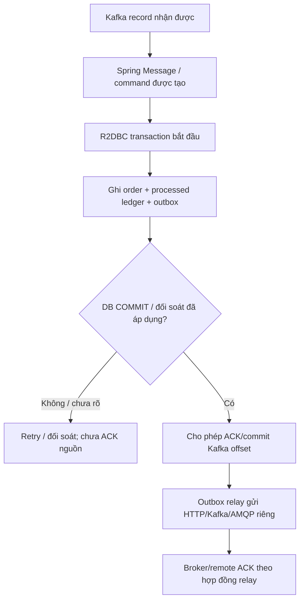
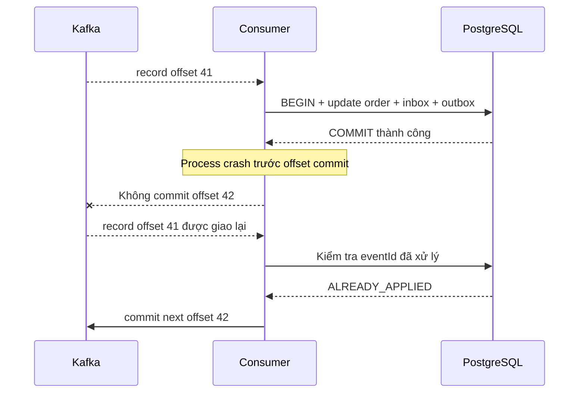
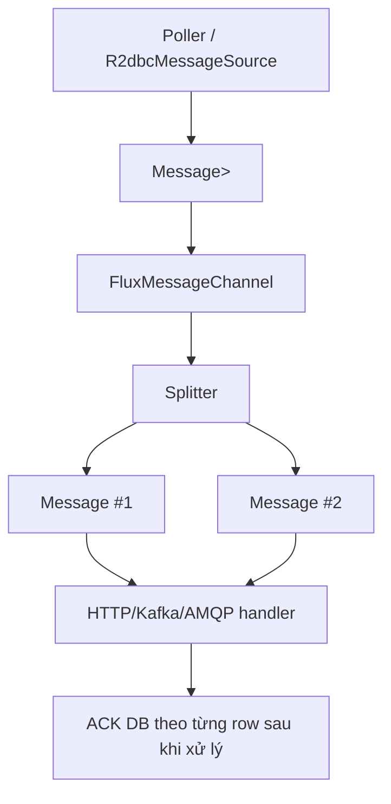

# Commit offset sau khi xử lý thành công

> **Chương:** Adapter R2DBC  
> **Module:** SPRING_INTEGRATION_ADAPTERS  
> **Bối cảnh:** Kết nối hệ thống bên ngoài vào Spring Integration bằng inbound/outbound adapter, gateway, poller và MessageChannel; trao đổi dữ liệu qua file, SFTP, HTTP, JMS, AMQP, Kafka và cơ sở dữ liệu. Bài tập trung vào ranh giới **xử lý database – xác nhận nguồn – chuyển tiếp event**, cùng hợp đồng message, lỗi và vòng đời kết nối.

## 1. Mục tiêu học tập

Sau bài học, bạn có thể:

- Phân biệt **Kafka consumer offset** với **R2DBC database transaction commit**, checkpoint đọc bảng, message acknowledgment của JMS/AMQP và business ACK.
- Giải thích **commit offset sau xử lý** nghĩa là chỉ xác nhận tiến độ nguồn sau khi kết quả nghiệp vụ cần thiết đã được **ghi bền vững**, không phải chỉ sau khi `MessageChannel.send(...)` trả về.
- Mô tả crash windows giữa **receive → process → DB COMMIT → offset COMMIT** và vì sao cơ chế này thường mang ngữ nghĩa **at-least-once**, không tự đạt exactly-once effects.
- Xây dựng dịch vụ R2DBC cập nhật order, ghi processed-event ledger và transactional outbox trong **một transaction**, với operation/event ID ổn định để xử lý redelivery.
- Cấu hình ví dụ Kafka manual acknowledgment để **chờ R2DBC transaction hoàn tất** rồi mới `acknowledge()`, đồng thời hiểu những hạn chế của listener blocking và các lựa chọn reactive.
- Phân biệt `Acknowledgment.acknowledge()` với một kết quả **broker offset đã commit bền vững** ở những cấu hình bất đồng bộ/batch.
- Hiểu offset theo từng Kafka `topic-partition`, nguyên tắc commit **tiến độ liên tục**, nguy cơ out-of-order completion và rebalance.
- Thiết kế `R2dbcMessageSource` polling với `Message<Flux<T>>` và **claim/lease/ACK**; không nhầm polling checkpoint với Kafka offset.
- Giải thích vì sao `updateSql` của R2DBC source hoặc một SQL SELECT không tự đồng nghĩa ACK **sau downstream thành công**.
- Thiết kế retry, transient-error handling, backpressure, poison message, DLQ, recovery, observability và test bằng `StepVerifier`/PostgreSQL.

## 2. Định nghĩa đúng chữ “offset”

### 2.1. Kafka có consumer offset

Trong Kafka, một **topic** được chia thành nhiều **partitions**, và mỗi record có **offset** trong partition tương ứng. Consumer group lưu tiến độ đã commit để một consumer tiếp tục đọc sau restart hoặc rebalance.

Ví dụ partition 2 có:

```text
Topic: payment-events
Partition: 2

Record offset:      100     101     102     103
                    |       |       |       |
                    v       v       v       v
                 Event A Event B Event C Event D

Consumer group commit offset 102
  -> vị trí tiếp tục tiêu thụ thông thường là record offset 102
  -> các record trước 102 được coi là đã vượt qua tiến độ commit
```

**Trong Kafka, committed offset là vị trí tiếp theo cần đọc**, không phải ID của nghiệp vụ và không phải một transaction R2DBC.

Vì thế nếu record đang xử lý có offset `101`, vị trí commit để đi qua record này thường là **`102`**. Kafka API acknowledgment có thể nhận record hiện tại rồi nội bộ tính offset tiếp theo; không tự cộng `+1` khi API đã quản lý.

### 2.2. R2DBC không có “Kafka offset”

`DatabaseClient`, `R2dbcEntityTemplate`, `R2dbcMessageSource` và `R2dbcMessageHandler` không sở hữu **consumer group offset của Kafka**. R2DBC thực hiện SQL qua `ConnectionFactory` và quản lý giao dịch của database.

Khi **R2DBC inbound poller** đọc bảng PostgreSQL, ứng dụng có thể thiết kế:

- **Checkpoint/cursor**: ID hoặc thời điểm quét cuối.
- **Claim state**: `NEW → PROCESSING → DONE`.
- **Lease**: quyền xử lý có hạn, phục hồi khi worker chết.
- **Ack marker**: trạng thái xử lý đã hoàn tất trong database.
- **Outbox**: danh sách sự kiện cần gửi bền vững.

Đó là **các cơ chế nghiệp vụ do ứng dụng định nghĩa**, không phải một offset commit API tự có trong `R2dbcMessageSource`.

### 2.3. JMS và AMQP có ACK, không dùng Kafka offset

| Nguồn/đích | Đơn vị tiến độ | Cách xác nhận điển hình |
| --- | --- | --- |
| Kafka consumer | `topic + partition + offset` | Commit consumer group offset theo Kafka API/container. |
| JMS consumer | Message/session delivery state | Client/session ACK hoặc transaction theo provider/config. |
| AMQP consumer | Delivery tag/message | ACK/NACK/requeue theo channel/broker protocol. |
| R2DBC poller | Row ID, status, checkpoint do app định nghĩa | SQL update/claim/ACK transaction. |
| HTTP request | Request/response và operation ID | HTTP status/response theo API contract. |
| File/SFTP poller | File path, metadata, persistent accept filter | Rename/move/claim/marker và retry policy. |

Không gọi tất cả các cơ chế là “commit Kafka offset”. Điểm chung chỉ là **không xác nhận nguồn trước khi có đủ bằng chứng bước xử lý được yêu cầu đã hoàn tất**.

## 3. Định nghĩa “xử lý thành công” theo hợp đồng

Một Spring Message đi qua nhiều tầng. Đối với lệnh thanh toán:



Không đồng nhất các mốc:

1. **Received:** Kafka listener/poller đã nhận record.
2. **Dispatched:** `MessageChannel` đã nhận message.
3. **Subscribed:** reactive Publisher đã được subscribe.
4. **SQL executed:** database đã chạy SQL và phát count/rows.
5. **DB committed:** transaction R2DBC đã commit thành công, hoặc kết quả được đối soát bền vững.
6. **Source acknowledged:** Kafka offset/JMS/AMQP ACK đã được thực hiện theo cơ chế tương ứng.
7. **Downstream published:** một event đã được broker/API đích xác nhận.

Với mẫu **transactional outbox**, có thể định nghĩa thành công của **consumer đầu vào** là mốc **5**: database đã ghi state + ý định publish. Mốc **7** là trách nhiệm của **outbox relay**, không cần giữ Kafka input record chưa ACK cho tới khi một external HTTP/Kafka call hoàn tất.

### 3.1. Chỉ đúng “DB write started” là chưa đủ

```java
Mono<Long> update = databaseClient.sql(
                "UPDATE payment_orders SET status='PAID' " +
                "WHERE order_id=:id AND status='NEW'")
        .bind("id", "order-101")
        .fetch()
        .rowsUpdated();
```

`update` mới là **Publisher**. Nó chưa chắc được subscribe, chưa chắc SQL chạy, càng chưa chứng minh transaction đã commit. Không commit offset ngay sau khi tạo `Mono`.

### 3.2. Không coi count 0 là connection failure

Một UPDATE `WHERE status='NEW'` có thể trả `0` khi order đã `PAID`. Đây là kết quả SQL hợp lệ; cần xét xem:

- Order không tồn tại.
- Order được xử lý bởi operation khác.
- Cùng operation ID đã được commit trước đó nhưng offset chưa commit.
- Trạng thái/version/owner không còn khớp.

**Để ACK sau redelivery**, cần phân biệt **ALREADY_APPLIED** với **CONFLICT**, không chỉ kiểm tra affected row count.

## 4. Crash windows và delivery semantics

### 4.1. Commit offset TRƯỚC DB transaction

```mermaid
sequenceDiagram
    participant K as Kafka
    participant C as Consumer
    participant DB as PostgreSQL
    K-->>C: record offset 41
    C->>K: commit next offset 42
    Note over C: Process crash
    C--xDB: Chưa kịp commit DB
    Note over K,DB: Kafka nghĩ đã qua offset 41; có thể mất business event
```

Khi restart, consumer group có thể tiếp tục từ offset `42`, trong khi record `41` chưa được ghi bền vững. Đó là **mất dữ liệu do ACK sớm**.

### 4.2. Commit DB TRƯỚC offset



Đây là lựa chọn phổ biến để **tránh mất event**, chấp nhận **redelivery**. Cần idempotency ở database để việc nhận lại không tạo double charge/double event.

### 4.3. Ma trận thứ tự

| DB transaction | Offset commit | Kết quả cần chú ý |
| --- | --- | --- |
| Chưa commit | Đã commit | Nguy cơ **mất event** khi consumer tiến qua offset. |
| Đã commit | Chưa commit | **Redelivery**, cần kiểm tra operation ID và ACK lại. |
| Đã commit | Đã commit | Bình thường, nhưng vẫn chưa chứng minh outbox đã publish. |
| Rollback | Chưa commit | Có thể retry/redeliver theo error policy. |
| Không rõ commit outcome | Chưa commit | Đối soát dữ liệu authoritative trước khi ACK hoặc side effect mới. |

Một cơ chế **at-least-once consumption** thường chấp nhận trường hợp DB commit thành công nhưng offset chưa commit. **Exactly-once effect** ở DB là mục tiêu khác, đạt qua atomic state changes + dedup, không phải nhờ thứ tự gọi hai API.

## 5. Offset theo từng partition và “lỗ hổng” khi xử lý song song

### 5.1. Kafka không có một offset chung cho toàn topic

Một consumer group có **tiến độ riêng trên từng topic-partition**. Không thể dùng `max(offset)` từ tất cả partitions để commit một giá trị global.

```text
Topic payment-events

Partition 0:  100✓ 101✓ 102✗ 103✓
Partition 1:   54✓  55✓  56✓

P0: chỉ an toàn commit next offset 102
    (102 chưa xử lý xong; 103 hoàn tất sớm không bù được)
P1: có thể commit next offset 57
```

Dấu ✓ = xử lý DB đã hoàn tất bền vững; ✗ = chưa hoàn tất.

**Quy tắc contiguous:** khi offset `102` chưa thành công, không commit past `102` trên cùng partition chỉ vì offset `103` đã xong. Nếu commit `104`, Kafka có thể bỏ qua record `102` sau restart.

### 5.2. Chọn topology để tránh commit vượt lỗ hổng

Các lựa chọn:

- Xử lý tuần tự theo partition.
- Gắn state “đã xử lý” cho từng offset, chỉ advance commit khi **mọi offset liên tục trước đó** đã hoàn tất.
- Dùng Kafka consumer framework có cơ chế quản lý out-of-order acknowledgments thích hợp, hiểu rõ giới hạn, pause/rebalance và memory.
- Giữ concurrency song song **giữa các partitions**, nhưng tuần tự trong từng partition khi business ordering đòi hỏi.

Không dùng `flatMap(..., 16)` trên một `Flux<ConsumerRecord>` rồi commit offset của mỗi record hoàn tất sớm mà không kiểm soát gap.

### 5.3. Rebalance và partition ownership

Khi consumer group rebalance:

- Một partition có thể chuyển sang consumer khác.
- In-flight record của consumer cũ có thể chưa hoàn tất khi quyền sở hữu chuyển.
- Offset commit có thể fail vì generation/member thay đổi.
- Consumer mới có thể **redeliver** những records đã ghi DB nhưng chưa commit offset.
- DB dedup phải hoạt động qua **mọi instances**, không chỉ một cache trong RAM.

Không giữ một `Acknowledgment` quá lâu hoặc gọi ACK từ arbitrary threads mà không nắm rõ semantics container đang dùng.

## 6. Chuẩn bị Spring Boot, R2DBC và Kafka

Ví dụ sử dụng **Java 17+, Spring Boot 3.x, Spring Framework 6.x, Spring Data R2DBC 3.x, Spring Integration 6.x và Spring Kafka cùng BOM**. Các lớp cụ thể phải được kiểm tra khi dự án dùng thế hệ mới hơn.

### 6.1. Maven dependencies

```xml
<dependencies>
    <dependency>
        <groupId>org.springframework.boot</groupId>
        <artifactId>spring-boot-starter-integration</artifactId>
    </dependency>
    <dependency>
        <groupId>org.springframework.boot</groupId>
        <artifactId>spring-boot-starter-data-r2dbc</artifactId>
    </dependency>
    <dependency>
        <groupId>org.springframework.integration</groupId>
        <artifactId>spring-integration-r2dbc</artifactId>
    </dependency>
    <dependency>
        <groupId>org.springframework.kafka</groupId>
        <artifactId>spring-kafka</artifactId>
    </dependency>
    <dependency>
        <groupId>org.springframework.integration</groupId>
        <artifactId>spring-integration-kafka</artifactId>
    </dependency>
    <dependency>
        <groupId>org.springframework.boot</groupId>
        <artifactId>spring-boot-starter-json</artifactId>
    </dependency>
    <dependency>
        <groupId>org.postgresql</groupId>
        <artifactId>r2dbc-postgresql</artifactId>
        <scope>runtime</scope>
    </dependency>
    <dependency>
        <groupId>io.r2dbc</groupId>
        <artifactId>r2dbc-pool</artifactId>
    </dependency>
    <dependency>
        <groupId>org.springframework.boot</groupId>
        <artifactId>spring-boot-starter-test</artifactId>
        <scope>test</scope>
    </dependency>
    <dependency>
        <groupId>io.projectreactor</groupId>
        <artifactId>reactor-test</artifactId>
        <scope>test</scope>
    </dependency>
</dependencies>
```

`spring-integration-kafka` phục vụ adapter Kafka nếu chọn Java DSL của Spring Integration; ví dụ `@KafkaListener` ở mục 11 dùng Spring Kafka trực tiếp tại consumer boundary. Hai cách tích hợp có thể dùng chung service R2DBC nhưng không nên bật **hai consumer nhận cùng topic/group** trong demo khi chưa chủ động thiết kế phân phối.

### 6.2. application.yml

```yaml
spring:
  r2dbc:
    url: r2dbc:postgresql://127.0.0.1:5432/integration_demo
    username: ${DB_USER}
    password: ${DB_PASSWORD}
    pool:
      enabled: true
      initial-size: 2
      max-size: 10
      max-acquire-time: 3s
  kafka:
    bootstrap-servers: 127.0.0.1:9092
    consumer:
      group-id: payment-db-writer
      enable-auto-commit: false
      auto-offset-reset: earliest
      key-deserializer: org.apache.kafka.common.serialization.StringDeserializer
      value-deserializer: org.apache.kafka.common.serialization.StringDeserializer
```

`${DB_USER}`/`${DB_PASSWORD}` đại diện cho biến môi trường `DB_USER`/`DB_PASSWORD`. Kafka bootstrap server trong demo là localhost; thực tế phải cấu hình TLS/SASL, credentials và broker bootstrap addresses phù hợp.

**Tắt `enable-auto-commit` là điều kiện quan trọng**, nhưng vẫn phải cấu hình ACK mode, error handler và consumer/container lifecycle đúng. Tắt auto-commit **một mình** chưa đủ để có commit-after-DB.

### 6.3. Những thứ không nên vô tình bật

- `enable.auto.commit=true` trong consumer cần manual commit.
- Logic tự ACK trong transformer ngay khi nhận event.
- Handler gọi `Mono.subscribe()` rồi trả về trước khi SQL kết thúc.
- Cơ chế auto-recovery loại bỏ record lỗi mà chưa có DLT/quarantine bền vững.
- Cấu hình container cho phép out-of-order acknowledgment nhưng không hiểu pause/rebalance semantics.

## 7. Schema PostgreSQL cho xử lý idempotent

Để bảo đảm retry không ghi đúp business state, xây một **processed event ledger** cùng transaction với order update và outbox.

### 7.1. Bảng orders

```sql
CREATE TABLE payment_orders (
    order_id         VARCHAR(64) PRIMARY KEY,
    status           VARCHAR(20) NOT NULL DEFAULT 'NEW',
    last_event_id    VARCHAR(80),
    updated_at       TIMESTAMPTZ NOT NULL DEFAULT NOW()
);
```

### 7.2. Inbox / processed ledger

```sql
CREATE TABLE processed_payment_events (
    event_id        VARCHAR(80) PRIMARY KEY,
    order_id        VARCHAR(64) NOT NULL,
    payload_digest  VARCHAR(64) NOT NULL,
    source_topic    VARCHAR(200) NOT NULL,
    source_partition INTEGER NOT NULL,
    source_offset   BIGINT NOT NULL,
    processed_at    TIMESTAMPTZ NOT NULL DEFAULT NOW(),
    CONSTRAINT uq_processed_source_position
        UNIQUE (source_topic, source_partition, source_offset)
);
```

`event_id` là **business event identity**, còn bộ `topic-partition-offset` là **source position**. Hai khóa khác nhau vì một event có thể được tái publish ở offset khác và vì business dedup cần ổn định xuyên nguồn/attempts.

### 7.3. Outbox

```sql
CREATE TABLE payment_outbox (
    event_id       VARCHAR(80) PRIMARY KEY,
    order_id       VARCHAR(64) NOT NULL,
    event_type     VARCHAR(64) NOT NULL,
    payload_json   TEXT NOT NULL,
    status         VARCHAR(24) NOT NULL DEFAULT 'NEW',
    created_at     TIMESTAMPTZ NOT NULL DEFAULT NOW(),
    published_at   TIMESTAMPTZ
);

CREATE INDEX idx_payment_outbox_status
    ON payment_outbox(status, created_at, event_id);
```

### 7.4. Dữ liệu mẫu

```sql
INSERT INTO payment_orders(order_id, status)
VALUES
    ('order-101', 'NEW'),
    ('order-102', 'NEW'),
    ('order-103', 'PAID');
```

Bảng này là **lab schema**. Production cần thêm retention, schema version, payload encryption nếu có PII, partitioning khi ledger lớn và operation authorization.

### 7.5. Tại sao ba bảng cùng transaction?

```text
BEGIN R2DBC transaction
  INSERT processed_payment_events (event_id unique)
  UPDATE payment_orders WHERE status='NEW'
  INSERT payment_outbox(event_id unique)
COMMIT
        |
        v
Cho phép ACK Kafka input record
```

Nếu UPDATE bị conflict hoặc INSERT outbox lỗi, transaction phải rollback cả processed ledger. Nếu ledger đã commit mà business order/outbox chưa được ghi thì **redelivery sẽ bị nhận nhầm là duplicate thành công** — đó là lỗi rất nghiêm trọng.

## 8. Command và outcome có hợp đồng rõ

### 8.1. Business event

Tạo `PaymentEvent.java`:

```java
public record PaymentEvent(
        String eventId,
        String orderId,
        String payloadDigest,
        String outboxJson,
        String topic,
        int partition,
        long offset
) {
}
```

`payloadDigest` là hash của **payload chuẩn hóa** (ví dụ SHA-256 hex) được tính theo một chính sách thống nhất; tránh sử dụng một chuỗi tùy ý không thể xác minh trong production. `eventId` không phải Kafka offset.

### 8.2. Domain outcome

Tạo `PaymentStatus.java`:

```java
public enum PaymentStatus {
    APPLIED,
    ALREADY_APPLIED
}
```

Tạo `PaymentOutcome.java`:

```java
public record PaymentOutcome(
        String eventId,
        PaymentStatus status
) {
}
```

Mỗi kiểu `public` ở một tệp Java riêng. Các kết quả khác như `NOT_FOUND`, `CONFLICT`, `PERMANENT_FAILURE` hay `UNKNOWN_COMMIT_OUTCOME` có thể biểu diễn bằng domain result/exception theo API contract, không gán bừa thành `ALREADY_APPLIED`.

### 8.3. API trả Publisher

```java
public interface PaymentEventProcessor {
    reactor.core.publisher.Mono<PaymentOutcome> apply(
            PaymentEvent event);
}
```

Việc gọi `apply(...)` trả một `Mono`, **không tự chứng minh SQL đã chạy**. Consumer phải subscribe/await đúng lifecycle trước khi xác nhận offset.

## 9. Ranh giới transaction và failure matrix

| Lỗi | Dữ liệu trong DB | Hành động với offset |
| --- | --- | --- |
| Validation sai trước SQL | Không ghi | Không commit như success; route DLT/quarantine theo policy. |
| Unique event ID đã xử lý đúng payload | Đã có state/outbox bền vững | Có thể ACK như duplicate thành công sau khi đối soát. |
| Unique ID trùng nhưng payload khác | Conflict/dấu hiệu sai dữ liệu | Không ACK thành công; điều tra hoặc DLT bền vững. |
| DB unavailable trước transaction | Chưa rõ có thao tác trước đó hay không | Retry/reconcile có giới hạn, chưa ACK. |
| DB rollback chắc chắn | Không ghi state mới | Chưa ACK; xử lý retry theo broker/container policy. |
| Connection reset gần COMMIT | **Chưa biết** commit hay rollback | Đối soát bằng event ID; chưa khẳng định failure. |
| DB commit success, Kafka offset commit thất bại | Business đã ghi | Redelivery có thể xảy ra; dedup/ACK lại. |
| Offset đã commit, outbox chưa publish | DB đã giữ outbox NEW | Relay chịu trách nhiệm publish riêng. |
| Broker relay nhận ACK nhưng chưa đánh dấu outbox | Có thể gửi lại cùng event | Consumer ngoài DB cần idempotency. |

**Điểm nhớ:** offset commit là **tiến độ của consumer group**, không phải giao dịch đa tài nguyên giữa Kafka và PostgreSQL.


## 10. Dịch vụ R2DBC: commit business state + inbox + outbox cùng transaction

### 10.1. Tạo TransactionalOperator

Nếu Spring Boot đã tạo `ReactiveTransactionManager` cho R2DBC `ConnectionFactory`, cấu hình:

```java
import org.springframework.context.annotation.Bean;
import org.springframework.context.annotation.Configuration;
import org.springframework.transaction.ReactiveTransactionManager;
import org.springframework.transaction.reactive.TransactionalOperator;

@Configuration
public class PaymentTransactionConfiguration {

    @Bean
    TransactionalOperator paymentTx(ReactiveTransactionManager manager) {
        return TransactionalOperator.create(manager);
    }
}
```

`TransactionalOperator` gắn transaction với **Reactor Context/subscription**, không dựa vào ThreadLocal JDBC thông thường. Mọi SQL của ví dụ phải chạy qua `DatabaseClient` tham gia cùng R2DBC ConnectionFactory/transaction manager.

### 10.2. Dịch vụ ghi một event hoặc đối soát duplicate

Tạo `R2dbcPaymentProcessor.java`:

```java
import org.springframework.r2dbc.core.DatabaseClient;
import org.springframework.stereotype.Service;
import org.springframework.transaction.reactive.TransactionalOperator;
import reactor.core.publisher.Mono;

@Service
public class R2dbcPaymentProcessor
        implements PaymentEventProcessor {

    private final DatabaseClient db;
    private final TransactionalOperator tx;

    public R2dbcPaymentProcessor(
            DatabaseClient db, TransactionalOperator tx) {
        this.db = db;
        this.tx = tx;
    }

    @Override
    public Mono<PaymentOutcome> apply(PaymentEvent event) {
        validate(event);

        Mono<PaymentOutcome> attempt = db.sql(
                        "INSERT INTO processed_payment_events " +
                        "(event_id, order_id, payload_digest, " +
                        "source_topic, source_partition, source_offset) " +
                        "VALUES (:event, :order, :digest, " +
                        ":topic, :part, :offset) " +
                        "ON CONFLICT (event_id) DO NOTHING " +
                        "RETURNING event_id")
                .bind("event", event.eventId())
                .bind("order", event.orderId())
                .bind("digest", event.payloadDigest())
                .bind("topic", event.topic())
                .bind("part", event.partition())
                .bind("offset", event.offset())
                .map((row, meta) ->
                        row.get("event_id", String.class))
                .one()
                .flatMap(insertedEventId -> updateOrderAndOutbox(event))
                .switchIfEmpty(Mono.defer(
                        () -> verifyAlreadyApplied(event)));

        return attempt.as(tx::transactional);
    }

    private Mono<PaymentOutcome> updateOrderAndOutbox(
            PaymentEvent event) {

        return db.sql(
                        "UPDATE payment_orders " +
                        "SET status='PAID', last_event_id=:event, " +
                        "updated_at=NOW() " +
                        "WHERE order_id=:order AND status='NEW'")
                .bind("order", event.orderId())
                .bind("event", event.eventId())
                .fetch()
                .rowsUpdated()
                .flatMap(count -> {
                    if (count != 1L) {
                        return Mono.error(new IllegalStateException(
                                "Order transition not applied: " +
                                event.orderId() + ", rows=" + count));
                    }

                    return db.sql(
                                    "INSERT INTO payment_outbox " +
                                    "(event_id, order_id, event_type, " +
                                    "payload_json) " +
                                    "VALUES (:event, :order, :type, :body)")
                            .bind("event", event.eventId())
                            .bind("order", event.orderId())
                            .bind("type", "ORDER_PAID")
                            .bind("body", event.outboxJson())
                            .fetch()
                            .rowsUpdated();
                })
                .flatMap(outboxCount -> {
                    if (outboxCount != 1L) {
                        return Mono.error(new IllegalStateException(
                                "Unexpected outbox count=" + outboxCount));
                    }

                    return Mono.just(new PaymentOutcome(
                            event.eventId(), PaymentStatus.APPLIED));
                });
    }

    private Mono<PaymentOutcome> verifyAlreadyApplied(
            PaymentEvent event) {

        return db.sql(
                        "SELECT p.order_id, p.payload_digest, " +
                        "o.status, o.last_event_id " +
                        "FROM processed_payment_events p " +
                        "JOIN payment_orders o ON o.order_id=p.order_id " +
                        "WHERE p.event_id=:event")
                .bind("event", event.eventId())
                .map((row, meta) -> new ProcessedSnapshot(
                        row.get("order_id", String.class),
                        row.get("payload_digest", String.class),
                        row.get("status", String.class),
                        row.get("last_event_id", String.class)))
                .one()
                .switchIfEmpty(Mono.error(
                        new IllegalStateException(
                                "Processed ledger missing for event")))
                .flatMap(saved -> {
                    boolean sameOperation =
                            event.orderId().equals(saved.orderId())
                            && event.payloadDigest().equals(
                                    saved.payloadDigest())
                            && "PAID".equals(saved.status())
                            && event.eventId().equals(
                                    saved.lastEventId());

                    if (!sameOperation) {
                        return Mono.error(new IllegalStateException(
                                "Event ID conflict or inconsistent state"));
                    }

                    return db.sql(
                                    "SELECT order_id, event_type, " +
                                    "payload_json FROM payment_outbox " +
                                    "WHERE event_id=:event")
                            .bind("event", event.eventId())
                            .map((row, meta) -> new OutboxSnapshot(
                                    row.get("order_id", String.class),
                                    row.get("event_type", String.class),
                                    row.get("payload_json", String.class)))
                            .one()
                            .switchIfEmpty(Mono.error(
                                    new IllegalStateException(
                                            "Outbox missing for applied event")))
                            .flatMap(outbox -> {
                                boolean matches =
                                        event.orderId().equals(outbox.orderId())
                                        && "ORDER_PAID".equals(outbox.eventType())
                                        && event.outboxJson().equals(
                                                outbox.payloadJson());

                                return matches
                                        ? Mono.just(new PaymentOutcome(
                                                event.eventId(),
                                                PaymentStatus.ALREADY_APPLIED))
                                        : Mono.error(
                                                new IllegalStateException(
                                                        "Outbox conflict"));
                            });
                });
    }

    private static void validate(PaymentEvent event) {
        if (event == null
                || !valid(event.eventId(), 80)
                || !valid(event.orderId(), 64)
                || !valid(event.topic(), 200)
                || event.payloadDigest() == null
                || !event.payloadDigest().matches("[0-9a-f]{64}")
                || event.outboxJson() == null
                || event.outboxJson().isBlank()
                || event.outboxJson().length() > 100_000
                || event.partition() < 0
                || event.offset() < 0) {
            throw new IllegalArgumentException("Invalid PaymentEvent");
        }
    }

    private static boolean valid(String s, int max) {
        return s != null
                && s.length() <= max
                && s.matches("[A-Za-z0-9_.-]+");
    }

    private record ProcessedSnapshot(
            String orderId, String payloadDigest,
            String status, String lastEventId) {
    }

    private record OutboxSnapshot(
            String orderId, String eventType, String payloadJson) {
    }
}
```

**Các bước quan trọng:**

1. Một event ID mới được thêm vào ledger bằng `INSERT ... ON CONFLICT (event_id) DO NOTHING RETURNING event_id`.
2. Nếu insert thành công, service cập nhật order theo điều kiện `status='NEW'`, rồi thêm outbox row.
3. Nếu UPDATE trả 0, phát `Mono.error` để **rollback** insert ledger, tránh nhận nhầm một command không được áp dụng là "đã xử lý".
4. Nếu ledger đã có event ID, chạy `verifyAlreadyApplied` để kiểm tra **order ID, digest, trạng thái, last_event_id và outbox payload**.
5. Nếu dữ liệu khớp, trả `ALREADY_APPLIED` mà không tạo side effect mới.
6. Nếu dữ liệu không khớp, trả lỗi domain/invariant, không giả định duplicate hợp lệ.
7. `.as(tx::transactional)` bao cả insert ledger, update order, insert outbox và đường reconcile.
8. Chỉ khi **transaction publisher hoàn tất bình thường**, caller mới được xem outcome này là thành công đủ bền theo DB contract.

### 10.3. Vì sao “đã có ledger” không đủ?

Nếu code chỉ kiểm tra `event_id` tồn tại rồi trả success, có thể che lỗi từ dữ liệu đã bị ghi thiếu, migration lỗi hoặc event ID bị tái sử dụng cho order/payload khác.

Ở bài này, `ALREADY_APPLIED` đòi **dấu vết nhất quán ở cả ledger, order và outbox**. Đây là một chính sách minh họa, có thể cần thêm audit/ledger trạng thái lịch sử nếu nghiệp vụ cho phép order thay đổi trạng thái sau `PAID`.

### 10.4. Giới hạn của ví dụ

- `payloadDigest` được caller/parser tạo ra từ payload chuẩn hóa; bản demo kiểm tra **định dạng**, không tự chứng minh digest đúng. Production phải tính lại từ nội dung tin cậy, kiểm tra JSON schema và quyền người gửi.
- `outboxJson()` được so sánh theo chuỗi; muốn semantic equality giữa các JSON serialization khác nhau cần canonical JSON hoặc hash có version.
- Khi `processed_payment_events` có cùng `event_id` ở offset khác, code có thể nhận diện duplicate nghiệp vụ: không bắt buộc offset mới trùng offset cũ.
- Nếu có **same offset nhưng event ID khác**, unique constraint trên source position có thể phát lỗi. Đây là tín hiệu cần điều tra.
- Nếu đơn hàng đã `PAID` do operation khác, code phát conflict, không tự ghi đè.
- Không đặt HTTP/Kafka side effect trong reactive transaction. Ghi outbox rồi publish ngoài transaction.
- Với workload lớn cần retention/archive ledger và bảo đảm dedup window phù hợp thời gian Kafka retention/replay.

### 10.5. Reactor subscription và transaction commit

```text
PaymentEventProcessor.apply(event) -> Mono<PaymentOutcome>
    |
    v
Subscriber subscribe
    |
    v
BEGIN -> INSERT ledger -> UPDATE order -> INSERT outbox
    |
    +-- onError => ROLLBACK / propagate failure
    |
    +-- normal termination => COMMIT -> outcome visible to caller
    |
    v
Caller được phép ACK nguồn khi business contract chấp nhận
```

Đừng tự `subscribe()` từng câu SQL bên trong service: điều đó có thể tách connection/transaction và khiến source offset được ACK trước khi một SQL thất bại.

## 11. Kafka manual ACK sau R2DBC transaction

Có nhiều cách nối Kafka với R2DBC. Đoạn sau sử dụng **Spring Kafka record listener** ở boundary để thể hiện rõ thứ tự ACK, đồng thời dùng R2DBC service ở mục 10. Phần Spring Integration Java DSL được trình bày ở mục 13.

### 11.1. Cấu hình Kafka listener ACK thủ công

```java
import org.apache.kafka.clients.consumer.ConsumerRecord;
import org.springframework.context.annotation.Bean;
import org.springframework.context.annotation.Configuration;
import org.springframework.kafka.config.ConcurrentKafkaListenerContainerFactory;
import org.springframework.kafka.core.ConsumerFactory;
import org.springframework.kafka.listener.ContainerProperties;

@Configuration
public class PaymentKafkaConfiguration {

    @Bean
    ConcurrentKafkaListenerContainerFactory<String, String>
    paymentManualAckContainerFactory(
            ConsumerFactory<String, String> consumerFactory) {

        var factory =
                new ConcurrentKafkaListenerContainerFactory<String, String>();

        factory.setConsumerFactory(consumerFactory);
        factory.getContainerProperties().setAckMode(
                ContainerProperties.AckMode.MANUAL_IMMEDIATE);
        factory.getContainerProperties().setSyncCommits(true);
        return factory;
    }
}
```

Kết hợp với `spring.kafka.consumer.enable-auto-commit=false` ở mục 6.

**Không dùng snippet này một mình làm cấu hình lỗi production:** vẫn cần thiết kế `CommonErrorHandler`/retry/`DeadLetterPublishingRecoverer` theo nhóm lỗi, bảo đảm các record không thể xử lý được **chỉ được bỏ qua sau khi đưa vào DLT/quarantine bền vững**. Tùy container và cách recovery, một record có thể được coi recovered/committed mà không gọi `Acknowledgment.acknowledge()` trong listener.

### 11.2. Parser tách Kafka envelope khỏi business record

```java
import org.apache.kafka.clients.consumer.ConsumerRecord;

public interface PaymentKafkaParser {
    PaymentEvent parse(ConsumerRecord<String, String> record);
}
```

Một implementation phải:

- Parse và validate JSON/schema của record `value()`.
- Tạo `eventId` bền vững, **không** tạo UUID mới mỗi lần consume.
- Tính `payloadDigest` trên canonical/trusted payload.
- Chuẩn bị `outboxJson` một cách deterministic hoặc có version.
- Đọc `record.topic()`, `record.partition()`, `record.offset()` làm source metadata.
- Không tin tưởng một operation ID bất kỳ từ client không được xác thực.

Parser ở đây là **hợp đồng được inject**, cho phép lớp listener tập trung vào ACK ordering. Khi thực hành phải cung cấp implementation/bean parser tương ứng.

### 11.3. Listener xử lý tuần tự: chỉ ACK sau DB success

```java
import java.time.Duration;

import org.apache.kafka.clients.consumer.ConsumerRecord;
import org.springframework.kafka.annotation.KafkaListener;
import org.springframework.kafka.support.Acknowledgment;
import org.springframework.stereotype.Component;

@Component
public class PaymentKafkaConsumer {

    private final PaymentKafkaParser parser;
    private final PaymentEventProcessor processor;

    public PaymentKafkaConsumer(
            PaymentKafkaParser parser,
            PaymentEventProcessor processor) {
        this.parser = parser;
        this.processor = processor;
    }

    @KafkaListener(
            topics = "payment-events",
            containerFactory = "paymentManualAckContainerFactory")
    public void consume(
            ConsumerRecord<String, String> record,
            Acknowledgment acknowledgment) {

        PaymentEvent event = parser.parse(record);

        // Đây là bridge BLOCKING CÓ CHỦ ĐÍCH tại listener thread
        // truyền thống của Kafka; không dùng .block() trên event loop.
        PaymentOutcome outcome = processor.apply(event)
                .timeout(Duration.ofSeconds(8))
                .block(Duration.ofSeconds(9));

        if (outcome == null
                || (outcome.status() != PaymentStatus.APPLIED
                    && outcome.status() != PaymentStatus.ALREADY_APPLIED)) {
            throw new IllegalStateException(
                    "No durable payment outcome for " + event.eventId());
        }

        // Chỉ chạy sau khi reactive transaction đã hoàn tất thành công.
        acknowledgment.acknowledge();
    }
}
```

**Luồng thời gian:**

1. Kafka listener nhận record.
2. Parser tạo event có ID ổn định và source metadata.
3. `processor.apply(event)` được subscribe bằng `block(...)` tại **Kafka record-listener thread truyền thống**.
4. R2DBC transaction UPDATE + ledger + outbox được thực hiện.
5. Nếu Publisher error/timeout, exception lan ra listener; **không gọi `acknowledge()`** trên đường thành công.
6. Khi nhận `APPLIED` hoặc `ALREADY_APPLIED`, gọi `acknowledge()`.
7. Nếu offset commit thất bại sau DB success, record có thể redeliver và được nhận diện duplicate.

### 11.4. Vì sao ví dụ cố ý block?

Listener record-style thông thường là callback **đồng bộ**. `acknowledge()` phải đi theo completion của Publisher; gọi `subscribe()` không await sẽ gây ACK sớm.

`block()` ở đây chỉ dùng tại **boundary truyền thống vốn đang blocking**, để giữ ACK/record ownership theo listener thread và tránh ACK bất đồng bộ ngoài contract. Đây là điểm đánh đổi:

- Mỗi listener thread xử lý một record cho tới khi DB hoàn tất.
- Có thể ảnh hưởng `max.poll.interval.ms` nếu block quá lâu.
- Không phù hợp khi method đã chạy trên Reactor/Netty event loop.
- Không nên giữ transaction DB mở xuyên một remote HTTP call chậm.
- Muốn hoàn toàn non-blocking, dùng thiết kế consumer reactive + quản lý commits/partition ordering rõ ràng.

Đây là ví dụ **dễ kiểm tra thứ tự và failure semantics**, không phải mẫu throughput cao nhất.

### 11.5. Lưu ý về acknowledge và actual offset commit

Trong `MANUAL_IMMEDIATE`, ACK gọi trên **consumer/listener thread** thường kích hoạt commit theo container policy. Nhưng:

- Thời điểm commit broker được xác nhận còn tùy `syncCommits`/`async`/container.
- Một commit có thể fail khi rebalance hoặc broker unavailable.
- Không xem việc gọi `acknowledge()` là bằng chứng **mọi partitions** đã commit.
- Không gọi ACK trước DB commit để tránh mất event.
- Error handler/recoverer có thể có logic commit riêng; phải test trên phiên bản/config cụ thể.

**Điểm quyết định của ví dụ là thứ tự:** hoàn tất DB **trước** khi yêu cầu commit offset. Việc retry khi commit failure là việc của broker container và idempotency trên replay.

### 11.6. Parser JSON tối thiểu để chạy lab

Để có một implementation cho `PaymentKafkaParser`, giả định **topic đã được xác thực và chứa event xác nhận thanh toán** với JSON chỉ gồm `eventId` và `orderId`:

```json
{"eventId":"pay-101","orderId":"order-101"}
```

Ví dụ `JacksonPaymentKafkaParser.java`:

```java
import java.nio.charset.StandardCharsets;
import java.security.MessageDigest;
import java.security.NoSuchAlgorithmException;
import java.util.HexFormat;

import com.fasterxml.jackson.core.JsonProcessingException;
import com.fasterxml.jackson.databind.JsonNode;
import com.fasterxml.jackson.databind.ObjectMapper;
import com.fasterxml.jackson.databind.node.ObjectNode;
import org.apache.kafka.clients.consumer.ConsumerRecord;
import org.springframework.stereotype.Component;

@Component
public class JacksonPaymentKafkaParser implements PaymentKafkaParser {

    private final ObjectMapper mapper;

    public JacksonPaymentKafkaParser(ObjectMapper mapper) {
        this.mapper = mapper;
    }

    @Override
    public PaymentEvent parse(ConsumerRecord<String, String> record) {
        try {
            JsonNode root = mapper.readTree(record.value());
            if (root == null || !root.isObject() || root.size() != 2) {
                throw new IllegalArgumentException(
                        "Expected eventId and orderId only");
            }

            String eventId = required(root, "eventId");
            String orderId = required(root, "orderId");

            ObjectNode canonical = mapper.createObjectNode();
            canonical.put("eventId", eventId);
            canonical.put("orderId", orderId);

            ObjectNode outbox = mapper.createObjectNode();
            outbox.put("eventId", eventId);
            outbox.put("orderId", orderId);
            outbox.put("status", "PAID");

            String canonicalJson = mapper.writeValueAsString(canonical);

            return new PaymentEvent(
                    eventId, orderId, sha256(canonicalJson),
                    mapper.writeValueAsString(outbox),
                    record.topic(), record.partition(), record.offset());
        }
        catch (JsonProcessingException error) {
            throw new IllegalArgumentException(
                    "Invalid payment event JSON", error);
        }
    }

    private static String required(JsonNode root, String field) {
        JsonNode value = root.get(field);
        if (value == null || !value.isTextual()
                || value.textValue().isBlank()) {
            throw new IllegalArgumentException(
                    "Missing or invalid: " + field);
        }
        return value.textValue();
    }

    private static String sha256(String value) {
        try {
            byte[] hash = MessageDigest.getInstance("SHA-256")
                    .digest(value.getBytes(StandardCharsets.UTF_8));
            return HexFormat.of().formatHex(hash);
        }
        catch (NoSuchAlgorithmException error) {
            throw new IllegalStateException("SHA-256 unavailable", error);
        }
    }
}
```

Đây là **parser lab**, không phải bộ xác minh thanh toán thật. Production phải xác thực **nguồn phát, chữ ký hoặc tin cậy transport, schema/version, quyền cập nhật order** và kiểm tra sự kiện thật sự xác nhận tiền đã nhận. Cấu trúc canonical JSON phải được cố định/version hóa giữa mọi producer/consumer để cùng một event không tạo hash khác sau nâng cấp.

## 12. Thử thách: commit offset khi có xử lý song song

### 12.1. Bài toán gap cùng partition

Giả sử nhận offset 50, 51, 52 trong cùng partition:

```text
DB process(50): success
DB process(51): slow / error
DB process(52): success

Sai: commit next offset 53 khi 51 chưa thành công.

Đúng: chỉ advance tới next offset 51,
      hoặc chờ 51 thành công rồi mới advance qua 52.
```

Một callback `flatMap` với concurrency nhiều hơn 1 có thể làm các results hoàn tất khác thứ tự. Đừng ACK offset 52 như “tiến độ tới 53” nếu offset 51 còn chưa hoàn tất.

### 12.2. Lựa chọn xử lý tuần tự theo partition

- Nếu consumer thread xử lý tuần tự theo record như mục 11, code đơn giản hơn và dễ giữ thứ tự.
- Có thể tăng concurrency của Kafka listener container để xử lý **nhiều partitions trên nhiều consumer threads**, nhưng ordering bên trong partition vẫn cần tôn trọng.
- Với reactive Kafka, có thể group theo `topic-partition` và xử lý bằng `concatMap` để giữ thứ tự trong partition.
- Nếu cần concurrency trong cùng partition, cần cấu trúc **đánh dấu completed offsets và tính contiguous watermark** trước khi commit.

### 12.3. Commit tracking theo contiguous watermark

Ví dụ một tracker:

```text
nextSafeOffset = 50
completed = {}

complete(52): completed={52}; nextSafeOffset vẫn 50
complete(50): completed={50,52}; nextSafeOffset=51
complete(51): completed={50,51,52}; nextSafeOffset=53
commit(nextSafeOffset)
```

Một tracker thực tế cần:

- State riêng cho mỗi topic-partition.
- Biết offset đầu tiên được giao/committed.
- Chống race và quản lý memory của in-flight records.
- Xử lý partition revoked/reassigned khi rebalance.
- Pause nhận thêm khi backlog/gaps quá lớn.
- Không xóa trạng thái trước khi offset commit/ownership được quản lý đúng.
- Đề phòng DB processing xong nhưng broker commit failed; replay phải idempotent.

Một **hash map trong RAM** không tạo exactly-once và có thể mất khi crash; tiến độ authoritative vẫn là Kafka committed offset + processed ledger.

### 12.4. Kafka poll interval và xử lý lâu

Nếu một record cần hàng chục phút, conventional listener blocking có thể vượt `max.poll.interval.ms`, khiến rebalance. Consumer mới có thể nhận lại records, còn consumer cũ vẫn đang xử lý.

Giải pháp: giới hạn xử lý tại listener, tách công việc dài thành **durable enqueue/outbox** rồi ACK sau enqueue thành công; hoặc dùng pause/resume/async processing đúng framework semantics và tài liệu phiên bản đang dùng.

Không tăng poll interval vô hạn để che một kiến trúc chưa có work queue.

## 13. Spring Integration: MessageChannel và completion của R2DBC

### 13.1. Ranh giới một chiều

Trong Spring Integration, một flow có thể:

```text
Kafka inbound adapter
      |
      v
MessageChannel
      |
      v
R2dbcMessageHandler / ReactiveMessageHandler
      |
      v
R2DBC Mono<Void> complete/error
```

**Không khẳng định** `MessageChannel.send()` thành công nghĩa là `Mono<Void>` đã complete. Topology đồng bộ/asynchronous và channel type quyết định mức độ chờ. Nếu Kafka ACK được gọi ngay sau `send()`, có thể ACK trước DB transaction.

### 13.2. Outbound R2DBC adapter khác custom service

Spring Integration cung cấp `R2dbcMessageHandler` để thao tác INSERT/UPDATE/DELETE từ Spring Message. Mặc dù thích hợp cho một SQL write, nó thường phát **completion/error**, không tự sinh reply mang affected-row count và không tạo ledger/outbox transaction nhiều bảng.

Với mục tiêu **commit source offset sau DB durable processing**, custom service trả `Mono<PaymentOutcome>` phù hợp vì người điều phối có thể await một outcome rõ ràng.

### 13.3. IntegrationFlow gọi custom ReactiveMessageHandler

```java
import org.springframework.context.annotation.Bean;
import org.springframework.context.annotation.Configuration;
import org.springframework.integration.config.EnableIntegration;
import org.springframework.integration.dsl.IntegrationFlow;
import org.springframework.messaging.ReactiveMessageHandler;

@Configuration
@EnableIntegration
public class PaymentIntegrationConfiguration {

    @Bean
    IntegrationFlow paymentProcessingFlow(
            PaymentEventProcessor processor) {

        ReactiveMessageHandler handler = message -> {
            PaymentEvent event =
                    (PaymentEvent) message.getPayload();

            return processor.apply(event).then();
        };

        return IntegrationFlow
                .from("paymentProcessingCommands")
                .handleReactive(handler)
                .get();
    }
}
```

`handleReactive(...)` (Spring Integration 6.1+ theo phiên bản hỗ trợ) xử lý `ReactiveMessageHandler` và Publisher lifecycle. `.then()` giữ completion/error nhưng bỏ `PaymentOutcome`.

**Quan trọng:** đây là **terminal one-way endpoint**, không trả domain outcome cho caller. Nếu Kafka consumer cần biết chính xác `APPLIED/ALREADY_APPLIED` để ACK, hãy dùng service trả Publisher trực tiếp như mục 11, hoặc xây request-reply gateway có completion và error propagation được kiểm thử. **Không** gửi một message tới `paymentProcessingCommands` rồi ACK chỉ vì channel đã chấp nhận message.

### 13.4. Khi cần tích hợp Kafka inbound adapter

Với `spring-integration-kafka`, một Kafka message-driven inbound adapter có thể đưa records vào Spring Integration flow. Để manual ACK đúng:

- Tắt Kafka auto-commit, đặt listener container manual ACK.
- Mang acknowledgement callback/metadata của **record nguồn** qua mọi transformer cần thiết nếu flow phụ thuộc vào callback đó.
- Chỉ gọi ACK tại endpoint có bằng chứng DB commit hoàn tất, không phải lúc tạo async Publisher.
- Không dùng `split`/`publishSubscribe` tạo nhiều asynchronous branches rồi ACK trước khi tất cả nhánh bắt buộc complete.
- Phân biệt ACK record với commit contiguous offset của partition khi có xử lý song song.
- Test error propagation, rebalance, recovery/DLT của **chính adapter + channel topology**.

Không giả định một header ACK lúc nào cũng tồn tại: header và callback type phụ thuộc Kafka adapter mode, Spring Integration/Kafka versions và converter.


## 14. R2DBC inbound poller: “offset” phải được định nghĩa thành checkpoint hoặc ACK trạng thái

### 14.1. Message source là gì?

`R2dbcMessageSource` là nguồn Spring Integration được kích hoạt bởi poller. Với chế độ nhiều kết quả, một lượt `receive()` có thể phát **`Message<Flux<T>>`**.



`maxMessagesPerPoll(1)` giới hạn số lần gọi `receive()` trong một poll task, **không giới hạn SQL SELECT một row**. Muốn batch 25 rows, cần `LIMIT 25` hoặc cơ chế query tương đương.

### 14.2. Tại sao SELECT không đủ để biết row đã xử lý?

```sql
SELECT id, event_key, payload_json
FROM r2dbc_work_queue
WHERE status='NEW'
ORDER BY id
LIMIT 25;
```

Nếu hàng vẫn ở trạng thái `NEW`, poll tiếp theo lại có thể đọc chúng. Hai app instances cũng có thể cùng SELECT. Sử dụng `Flux`/backpressure không tự giải quyết ownership.

### 14.3. Checkpoint đơn giản và giới hạn

Một ứng dụng có thể tạo bảng:

```sql
CREATE TABLE r2dbc_scan_checkpoints (
    source_name VARCHAR(100) PRIMARY KEY,
    last_done_id BIGINT NOT NULL
);
```

Với thao tác quét thuần có snapshot ổn định, lưu `last_done_id` **chỉ sau khi mọi row trước đó đã hoàn tất** là một cách giảm đọc lặp.

Nhưng checkpoint dạng ID có rủi ro:

- `BIGSERIAL`/sequence ID **không đảm bảo đúng thứ tự commit** giữa các transactions concurrent.
- Row có ID nhỏ hơn cursor có thể commit muộn hơn và bị bỏ qua.
- Nếu worker crash sau downstream side effect nhưng trước checkpoint, row được đọc lại.
- Với nhiều workers, chỉ một cursor global không biểu diễn trạng thái processing/ACK từng row.
- Nếu checkpoint commit trước side effect, ứng dụng có thể **mất job**.

Với work queue cần giao đủ, dùng **atomic claim/lease + ACK từng row** thường an toàn hơn checkpoint-only.

### 14.4. Work queue có ownership

```sql
CREATE TABLE r2dbc_work_queue (
    id             BIGSERIAL PRIMARY KEY,
    event_key      VARCHAR(80) NOT NULL UNIQUE,
    payload_json   TEXT NOT NULL,
    status         VARCHAR(20) NOT NULL DEFAULT 'NEW',
    claim_owner    VARCHAR(80),
    claim_token    VARCHAR(80),
    lease_until    TIMESTAMPTZ,
    attempt_count  INTEGER NOT NULL DEFAULT 0,
    created_at     TIMESTAMPTZ NOT NULL DEFAULT NOW(),
    finished_at    TIMESTAMPTZ
);

CREATE INDEX idx_r2dbc_work_status
    ON r2dbc_work_queue(status, id);
```

`status` thể hiện business processing state; đây **không** phải Kafka offset.

### 14.5. Claim một batch an toàn hơn SELECT thuần

PostgreSQL hỗ trợ một statement claim batch:

```sql
WITH picked AS (
    SELECT id
    FROM r2dbc_work_queue
    WHERE status='NEW'
    ORDER BY id
    LIMIT :batchSize
    FOR UPDATE SKIP LOCKED
)
UPDATE r2dbc_work_queue AS q
SET status='PROCESSING',
    claim_owner=:owner,
    claim_token=:token,
    lease_until=NOW() + INTERVAL '60 seconds',
    attempt_count=attempt_count+1
FROM picked
WHERE q.id=picked.id
RETURNING q.id, q.event_key, q.payload_json;
```

Query chọn các hàng chưa bị worker khác lock, claim và trả **những rows đã claim**. Câu SQL trên là mẫu riêng của PostgreSQL. Hệ thống thật cần thiết kế cơ chế **recovery các row `PROCESSING` đã hết lease**, attempt limits và cách xử lý token cũ.

### 14.6. ACK row sau downstream completion

```sql
UPDATE r2dbc_work_queue
SET status='DONE',
    finished_at=NOW(),
    lease_until=NULL
WHERE id=:id
  AND status='PROCESSING'
  AND claim_owner=:owner
  AND claim_token=:token;
```

Với `DatabaseClient.fetch().rowsUpdated()`:

| Affected rows | Ý nghĩa |
| --- | --- |
| `1` | Đúng row còn thuộc owner/token đã được đánh dấu DONE. |
| `0` | Row không còn đúng trạng thái/owner/token hoặc không tồn tại; phải đối soát. |
| `onError` | Có lỗi truy cập DB; chưa được phép tuyên bố ACK bền vững. |

**ACK row sau downstream side effect có thể tạo duplicate** khi side effect đã thành công nhưng UPDATE DONE/response bị mất. Consumer bên ngoài cần stable `event_key` và idempotency.

### 14.7. Chọn giữa checkpoint và claim/ACK

| Nhu cầu | Thiết kế cân nhắc |
| --- | --- |
| Scan báo cáo có snapshot cố định, có thể chạy lại toàn job | Checkpoint/cursor theo version snapshot và ordering ổn định. |
| Chuyển events sang broker và phải bảo đảm không bỏ sót | Outbox hoặc claim/lease/ACK. |
| Một worker, batch nhỏ, dữ liệu bất biến | Cursor có thể đủ nếu dữ liệu/commit ordering được kiểm chứng. |
| Nhiều workers đồng thời | Atomic claim + owner/lease/recovery. |
| Source là Kafka chứ không phải bảng | Kafka consumer offsets, tách riêng với R2DBC SQL. |

### 14.8. Không coi updateSql là ACK sau xử lý

Một số cấu hình R2DBC inbound source hỗ trợ update query nhằm đánh dấu các rows được nguồn đọc. Dù hữu ích cho claim/mark, thao tác này có thể xảy ra **trong giai đoạn nhận từ DB**, trước khi splitter và downstream handler hoàn tất.

Vì vậy **`updateSql` không tự là callback “after Kafka publish/HTTP success”**. Muốn bảo đảm ACK theo từng row, ghi trạng thái khi downstream đã có completion signal, kèm ownership và recovery.

### 14.9. Java DSL R2DBC inbound poller: minh họa một lần poll nhiều rows

Tạo DTO/entity phù hợp Spring Data mapping:

```java
import org.springframework.data.annotation.Id;
import org.springframework.data.relational.core.mapping.Column;
import org.springframework.data.relational.core.mapping.Table;

@Table("r2dbc_work_queue")
public record QueueRow(
        @Id Long id,
        @Column("event_key") String eventKey,
        @Column("payload_json") String payloadJson
) {
}
```

Tạo flow **chỉ đọc và log** để kiểm tra payload/sequence:

```java
import org.springframework.context.annotation.Bean;
import org.springframework.context.annotation.Configuration;
import org.springframework.data.r2dbc.core.R2dbcEntityTemplate;
import org.springframework.integration.config.EnableIntegration;
import org.springframework.integration.dsl.IntegrationFlow;
import org.springframework.integration.dsl.MessageChannels;
import org.springframework.integration.r2dbc.dsl.R2dbc;

@Configuration
@EnableIntegration
public class WorkQueuePollingConfiguration {

    @Bean
    IntegrationFlow observeQueueRows(R2dbcEntityTemplate template) {
        return IntegrationFlow.from(
                        R2dbc.inboundChannelAdapter(
                                template,
                                "SELECT id, event_key, payload_json " +
                                "FROM r2dbc_work_queue " +
                                "WHERE status='NEW' " +
                                "ORDER BY id LIMIT 20")
                                .payloadType(QueueRow.class)
                                .expectSingleResult(false),
                        endpoint -> endpoint.poller(p ->
                                p.fixedDelay(2_000)
                                 .maxMessagesPerPoll(1)))
                .channel(MessageChannels.flux())
                .split()
                .channel(MessageChannels.flux())
                .handle(QueueRow.class, (row, headers) -> {
                    System.out.printf("Queue id=%d key=%s%n",
                            row.id(), row.eventKey());
                    return null;
                })
                .get();
    }
}
```

**Đây không phải reliable consumer production:** chỉ SELECT rồi log; các lần poll có thể đọc lại cùng row. `payloadType(QueueRow.class)` chọn kiểu của **mỗi item trong Flux**, còn `split()` mới tạo từng `Message<QueueRow>` downstream. Khi tích hợp thực, thay bằng atomic claim và ACK có owner/token sau downstream completion; không tự đánh dấu DONE trong message source trước khi handler hoàn tất.

## 15. Backpressure và commit offset: hạn chế inflight để tránh lỗ hổng

### 15.1. Những giới hạn khác nhau

| Giới hạn | Tác dụng |
| --- | --- |
| Kafka `max.poll.records` | Số records poll trả trong một lượt, không đảm bảo số SQL queries. |
| Kafka consumer concurrency | Số consumer threads/instances tham gia đọc partitions. |
| Reactor `flatMap(..., concurrency)` | Số inner publishers active trong một pipeline. |
| R2DBC pool max size | Số database connections của pool. |
| SQL `LIMIT` | Số rows tối đa của một query. |
| Spring Integration `maxMessagesPerPoll` | Số lần `MessageSource.receive()` mỗi poll cycle. |
| Buffer capacity | Số items được chứa trong bộ đệm tương ứng. |

Giảm concurrency có thể làm giảm số gap khó commit nhưng không thay thế idempotency. Tăng pool size không tự giải quyết lock contention hay Kafka ordering.

### 15.2. Kiến trúc theo partition

```text
Kafka topic
   |
   +-- Partition 0 -> sequential processing -> DB commit -> offset advance P0
   |
   +-- Partition 1 -> sequential processing -> DB commit -> offset advance P1
   |
   +-- Partition 2 -> sequential processing -> DB commit -> offset advance P2

Các partitions có thể chạy song song;
một partition không commit vượt record chưa hoàn tất.
```

Nếu throughput cần cao hơn một partition cho một business aggregate, cần nghĩ tới partition-key strategy hoặc out-of-order commit tracking, không đơn thuần tăng `flatMap`.

### 15.3. Async handler và sự khác biệt giữa dispatch và completion

Đối với R2DBC:

```java
Mono<PaymentOutcome> result = processor.apply(event);
```

Dòng trên **chưa xử lý xong**. Kể cả:

```java
result.subscribe();
acknowledgment.acknowledge();
```

là **mẫu không an toàn**: ACK chạy ngay sau khi tạo subscription, không chờ SQL/transaction completion.

Nếu dùng callback asynchronous, phải xử lý cả completion/error, thread-safety của ACK, record ownership và contiguous partition offsets theo container/API contract. Mẫu listener ở mục 11 dùng bridge đồng bộ rõ ràng để tránh bẫy này.

### 15.4. Khi DB chậm hơn Kafka

Không cố giảm lag bằng cách ACK trước DB. Thay vào đó:

- Giới hạn in-flight DB operations.
- Đo pool pending, statement timeouts và retry rate.
- Điều chỉnh consumer polling/pause/resume theo framework hỗ trợ.
- Bảo đảm timeout và processing time hợp với `max.poll.interval.ms`.
- Nếu công việc dài, commit vào durable inbox/queue/outbox **ngắn và atomic**, sau đó mới ACK nguồn.
- Có dead-letter/recovery cho record không thể xử lý, không bỏ quên trong RAM.

## 16. Retry, poison messages và commit policy

### 16.1. Lỗi transient

Ví dụ:

- PostgreSQL restart/failover, connection reset.
- Pool acquire timeout do tải đột biến.
- Transaction serialization failure/deadlock.
- Network timeout ở thời điểm commit.

Những lỗi này **có thể** retry có giới hạn, nhưng phải có idempotency vì một lần trước có thể đã commit. Với serialization failure/deadlock, thường retry **toàn transaction mới**.

### 16.2. Lỗi permanent

Ví dụ:

- JSON/schema không hợp lệ.
- Order ID không tồn tại theo business policy.
- Kafka event ID trùng nhưng payload digest khác.
- PostgreSQL thiếu bảng/cột, quyền SQL sai.
- Unique constraint/invariant conflict không thể tự phục hồi.

Không retry vô hạn. Một policy thường tách: lỗi payload bất hợp lệ → **DLT/quarantine bền vững**; lỗi schema/config → dừng/alert để sửa; lỗi business conflict → ghi nhận/audit rồi quyết định xử lý.

### 16.3. ACK sau khi chuyển DLT thành công

Với poison message, “xử lý thành công” đôi khi được định nghĩa là **đã đưa record vào DLT bền vững** chứ không phải ghi order. Khi đó thứ tự:

```text
Kafka record không thể xử lý
         |
         v
Classify permanent error
         |
         v
Publish DLT/quarantine và chờ ACK đủ bền
         |
         v
Commit original topic-partition offset
```

Không ACK offset trước khi DLT publish hoàn tất theo contract, nếu không record có thể mất cả ở source lẫn DLT khi process crash.

`DefaultErrorHandler` của Spring Kafka và recoverer có hành vi riêng khi attempts exhausted. **Đọc kỹ policy commit recovered record của phiên bản đang dùng**; đừng dựa vào việc listener không gọi `acknowledge()` để khẳng định message chắc chắn không bị tiến offset.

### 16.4. Retry budget của nhiều tầng

Một Kafka redelivery có thể kích hoạt R2DBC retryWhen nhiều lần; nếu listener container cũng retry rồi outbox relay retry, tổng số attempts lớn hơn nhiều số retries ở một tầng.

Cần giới hạn:

- Attempts mỗi R2DBC transaction.
- Total deadline của một listener call.
- Redelivery/backoff của Kafka/AMQP/JMS.
- Consumer circuit breaker/bulkhead.
- Quota database connection/pool.
- DLT/alert threshold cho event permanent.
- Retention và reprocessing policy của processed ledger/outbox.

## 17. Timeout, cancellation và commit chưa rõ kết quả

### 17.1. Timeout ở các lớp

| Timeout | Phạm vi |
| --- | --- |
| Database connect timeout | Mở connection R2DBC. |
| Pool acquire timeout | Chờ connection rảnh. |
| SQL statement/lock timeout | Query hoặc row lock chờ quá lâu. |
| R2DBC transaction timeout | Giao dịch kéo dài. |
| Reactor `timeout(...)` | Publisher/whole chain timeout theo vị trí operator. |
| Kafka `max.poll.interval.ms` | Thời hạn xử lý giữa các poll của consumer group. |
| Kafka commit timeout | Thời hạn chờ broker offset commit/response. |
| HTTP deadline | Tổng thời gian caller chờ business response. |

### 17.2. Timeout không chứng minh DB rollback

```text
Consumer gửi SQL
  -> PostgreSQL UPDATE + INSERT ledger/outbox
  -> COMMIT
  -> Network mất trước khi client nhận phản hồi
  -> Reactor timeout -> listener error (không ACK)
  -> Kafka redelivery
  -> Service kiểm tra eventId -> ALREADY_APPLIED
  -> Cho phép ACK offset
```

Nếu chỉ catch timeout rồi trả `SUCCESS` mà không kiểm tra DB, hoặc retry với event ID mới, cả hai đều có thể sai.

### 17.3. Cancellation không xóa side effects

Khi subscriber cancel:

- Một phần SQL có thể đã chạy.
- Transaction manager/driver có thể cố rollback/cleanup, nhưng trường hợp gần COMMIT vẫn cần xác minh authoritative state.
- HTTP/Kafka side effects trước đó không tự rollback.
- Không ACK source record chỉ vì timeout/cancel đã xảy ra.
- Đo cancellation rate và pool connection leaks.

## 18. Observability: theo dõi DB commit cùng offset commit

### 18.1. Các metrics đáng đo

| Metric gợi ý | Mục đích |
| --- | --- |
| `kafka_records_received_total` | Số records đã nhận theo topic/partition. |
| `kafka_records_db_applied_total` | Event mới đã commit business state. |
| `kafka_records_db_already_applied_total` | Redelivery được nhận diện duplicate hợp lệ. |
| `kafka_offset_commit_success_total` | Số commit offset thành công. |
| `kafka_offset_commit_failure_total` | Số lần commit offset lỗi. |
| `kafka_consumer_lag` | Số records còn sau committed position. |
| `kafka_rebalance_total` | Số rebalance và ownership changes. |
| `payment_event_conflict_total` | Event ID/payload/owner conflict. |
| `r2dbc_tx_commit_total`/`rollback_total` | Giao dịch DB commit/rollback. |
| `r2dbc_tx_duration_p95` | Transaction có giữ connection lâu không? |
| `r2dbc_pool_active`/`pending` | Tình trạng pool. |
| `processed_ledger_insert_total` | Số event ledger mới. |
| `outbox_new_count`/`oldest_age` | Event chưa publish và tuổi tồn đọng. |
| `downstream_publish_retry_total` | Retry relay/broker. |
| `r2dbc_claim_expired_total` | Work queue row hết lease chưa ACK. |

Các tên trên là **gợi ý instrumentation**, không khẳng định tất cả có sẵn trong Spring Boot/Micrometer. Tránh dùng raw event ID làm metric label vì cardinality rất cao.

### 18.2. Log theo hai loại vị trí

```text
eventId=pay-101 topic=payment-events partition=2 offset=41
  stage=db_transaction result=APPLIED

eventId=pay-101 topic=payment-events partition=2 offset=41
  stage=kafka_ack requested=true

eventId=pay-101 topic=payment-events partition=2 offset=41
  stage=outbox status=NEW

eventId=pay-101 topic=payment-events partition=2 offset=41
  stage=outbox_published brokerAck=true
```

Đây là log minh họa, không phải output mặc định. **Không** ghi "offset committed" ngay khi chỉ mới gọi ACK nếu chưa có bằng chứng broker commit theo container policy.

### 18.3. Tracing xuyên boundaries

Một trace hữu ích lưu các liên kết:

- Spring `MessageHeaders` correlation ID.
- Kafka `topic/partition/offset`.
- `eventId`/`operationId` nghiệp vụ.
- R2DBC transaction ID/log correlation (nếu có).
- Outbox `event_id`.
- Broker publish ACK hoặc HTTP request ID.

Không dùng Spring Message ID làm khóa idempotency khi cùng business event có thể được tạo thành **message mới** sau redelivery.


## 19. Kiểm thử với StepVerifier và database thật

### 19.1. Cần kiểm tra đúng hai loại “commit”

Bộ kiểm thử phải phân biệt:

- **R2DBC transaction commit:** order/ledger/outbox đã nhất quán trong PostgreSQL.
- **Kafka offset commit:** consumer group đã ghi nhận tiến độ theo topic-partition.

Mock một `Mono.just(...)` chỉ kiểm tra Java composition, không chứng minh **transaction rollback**, **broker offset recovery**, **deadlock**, **rebalance** hay **driver cancellation**.

Dùng PostgreSQL Testcontainers (hoặc DB test tương đương) và Kafka Testcontainers/embedded broker khi kiểm thử tích hợp thực. Không fault-inject trên production database.

### 19.2. Test một event mới được ghi chính xác một lần

Giả sử một JUnit integration test class inject `PaymentEventProcessor processor` và tạo fixture `order-101` ở trạng thái `NEW`:

```java
import org.junit.jupiter.api.Test;
import reactor.test.StepVerifier;

import static org.junit.jupiter.api.Assertions.*;

@Test
void firstPaymentIsApplied() {
    PaymentEvent event = new PaymentEvent(
            "pay-101",
            "order-101",
            "a".repeat(64), // Chỉ dùng làm digest fixture hợp lệ
            "{\"eventId\":\"pay-101\",\"orderId\":\"order-101\",\"status\":\"PAID\"}",
            "payment-events",
            2,
            41L
    );

    StepVerifier.create(processor.apply(event))
            .assertNext(outcome -> {
                assertEquals("pay-101", outcome.eventId());
                assertEquals(PaymentStatus.APPLIED, outcome.status());
            })
            .verifyComplete();
}
```

Đoạn test nằm trong class có field `processor` và database fixture riêng. `"a".repeat(64)` chỉ là digest **giả lập hợp lệ về định dạng**, không phải hash của JSON mẫu. Ở ingress thật parser phải tự tính SHA-256 đáng tin cậy.

### 19.3. Test redelivery sau DB commit

Sau test trước, cùng event ID/payload được nhận lại:

```java
@Test
void redeliveryReturnsAlreadyApplied() {
    PaymentEvent event = seededCommittedEvent();

    StepVerifier.create(processor.apply(event))
            .assertNext(outcome ->
                    org.junit.jupiter.api.Assertions.assertEquals(
                            PaymentStatus.ALREADY_APPLIED,
                            outcome.status()))
            .verifyComplete();
}
```

`seededCommittedEvent()` là fixture helper trả về **cùng event đã được ghi trước test này**. Không phụ thuộc vào thứ tự chạy của những method `@Test` khác.

Bên cạnh outcome, xác minh bằng SQL:

```sql
SELECT COUNT(*) FROM processed_payment_events
WHERE event_id = 'pay-101';

SELECT COUNT(*) FROM payment_outbox
WHERE event_id = 'pay-101';

SELECT status, last_event_id FROM payment_orders
WHERE order_id = 'order-101';
```

Kỳ vọng một ledger, một outbox row và order ở `PAID` với `last_event_id='pay-101'`. Nếu sau redelivery số rows tăng, **idempotency đã bị phá**.

### 19.4. Test rollback khi outbox INSERT lỗi

Trong một fixture độc lập:

1. Seed `order-102 = NEW`.
2. Chèn trước vào `payment_outbox` một record có `event_id='pay-conflict'` nhưng chưa có processed ledger.
3. Gọi `processor.apply(event)` với `eventId='pay-conflict'`, `orderId='order-102'`.
4. INSERT ledger và UPDATE order có thể chạy, sau đó INSERT outbox đụng primary key.
5. `StepVerifier` phải nhận `onError`.
6. Query DB **sau transaction rollback** và xác nhận `order-102` vẫn `NEW`, processed ledger mới **không tồn tại**.

Test phải kiểm tra state, không chỉ exception class. Khi outbox lỗi mà ledger vẫn commit, redelivery có thể bị nhận nhầm là đã hoàn tất.

### 19.5. Test event ID trùng nhưng payload khác

```text
Lần 1: eventId=pay-101, orderId=order-101, digest=A -> APPLIED
Lần 2: eventId=pay-101, orderId=order-101, digest=B -> CONFLICT/error
```

`verifyAlreadyApplied` phải từ chối lần hai. Không được ACK như một duplicate hợp lệ chỉ vì `event_id` trùng.

### 19.6. Test no row và business conflict

Nếu `order-999` không tồn tại hoặc `order-103` đã `PAID` do event khác, `UPDATE ... WHERE status='NEW'` trả 0.

Trong service ví dụ, code chuyển count 0 thành `onError`, transaction rollback ledger. Container không nên ACK source record như success. Policy tiếp theo (DLT/quarantine/reconcile) tùy nghiệp vụ, **không tự retry như một lỗi network**.

### 19.7. Test offset watermark logic độc lập

Ví dụ Java nhỏ để học **contiguous completion**. Đây **không phải Kafka broker committer**, chỉ tính next-safe offset của **một partition** trên một thread:

```java
import java.util.NavigableSet;
import java.util.TreeSet;

public final class ContiguousOffsetTracker {

    private long nextSafeOffset;
    private final NavigableSet<Long> completed = new TreeSet<>();

    public ContiguousOffsetTracker(long initialNextOffset) {
        this.nextSafeOffset = initialNextOffset;
    }

    public synchronized long completed(long offset) {
        if (offset >= nextSafeOffset) {
            completed.add(offset);
        }

        while (completed.remove(nextSafeOffset)) {
            nextSafeOffset++;
        }

        return nextSafeOffset;
    }

    public synchronized long nextSafeOffset() {
        return nextSafeOffset;
    }
}
```

Kiểm thử:

```java
import org.junit.jupiter.api.Test;

import static org.junit.jupiter.api.Assertions.assertEquals;

@Test
void offsetCannotLeapOverIncompleteRecord() {
    ContiguousOffsetTracker tracker =
            new ContiguousOffsetTracker(50);

    assertEquals(50, tracker.completed(52));
    assertEquals(51, tracker.completed(50));
    assertEquals(53, tracker.completed(51));
}
```

Ứng dụng thật phải bind tracker với **topic-partition, assignment generation, synchronization, capacity bound, rebalance handling và Kafka commit outcome**. Nếu offset 51 không bao giờ complete, tập completed có thể tăng không giới hạn; cần pause/retry/DLT policy.

### 19.8. Test thứ tự ACK ở listener

Một unit test có thể inject fake `PaymentEventProcessor` trả một `Mono` chưa complete và mock `Acknowledgment`:

1. Gọi listener trên một test thread (vì ví dụ đang `block()`).
2. Trước khi Publisher complete, xác nhận `acknowledge()` **chưa được gọi**.
3. Phát `PaymentOutcome(APPLIED)` và terminal complete.
4. Xác nhận ACK được gọi đúng một lần.
5. Với `Mono.error(...)`, xác nhận ACK **không** được gọi trên đường thành công.

Test này xác minh ordering **trong code listener**, không thay thế integration test broker offset commit/rebalance.

### 19.9. Test Kafka broker + PostgreSQL

Trong test tích hợp dùng Kafka test broker:

- Produce record offset N.
- Consumer nhận record, transaction PostgreSQL commit.
- Cố tình crash consumer **trước khi offset commit thành công**.
- Restart cùng group, record có thể redeliver.
- Xác minh ledger/outbox có đúng một event, order không đổi lần hai.
- Cho commit offset thành công và restart lần nữa; kiểm tra consumer tiến từ vị trí phù hợp.
- Test một record lỗi ở offset N, record N+1 hoàn tất sớm: không commit vượt N trong cùng partition.
- Test rebalance ở thời điểm in-flight; consumer mới vẫn xử lý được nhờ dedup.
- Test DLT publish thành công/trục trặc theo contract; không âm thầm bỏ original record.

## 20. Ma trận fault injection end-to-end

| Sự kiện | Điều cần xác minh |
| --- | --- |
| PostgreSQL unavailable trước SQL | Không ACK offset; retry/backoff có giới hạn. |
| Connection lỗi giữa SQL | Không tuyên bố commit fail tuyệt đối; đối soát. |
| PostgreSQL COMMIT success nhưng response mất | Redelivery nhận `ALREADY_APPLIED`, không ghi lại. |
| Ledger INSERT thành công nhưng UPDATE lỗi | Transaction rollback ledger. |
| UPDATE order thành công nhưng outbox INSERT lỗi | Rollback order và ledger. |
| Cùng event ID, digest khác | Business conflict, không ACK success. |
| Cùng event ID ở offset Kafka mới | Có thể đối soát duplicate theo event ID. |
| Cùng topic-partition-offset nhưng event ID khác | Unique source-position conflict, điều tra. |
| Kafka offset commit fail sau DB success | Redelivery xử lý idempotent. |
| Kafka offset commit success, outbox còn NEW | Relay vẫn có trách nhiệm publish. |
| Kafka rebalance giữa processing | Không mất dữ liệu; dedup qua DB. |
| Offset 52 complete trước 51 | Không commit vượt record 51 chưa xong. |
| Consumer process chậm quá max.poll.interval | Có rebalance/retry phù hợp, không commit stale ownership. |
| Poision/invalid JSON | DLT/quarantine bền trước khi bỏ qua. |
| DLT publish lỗi | Không xác nhận original record như recovered success. |
| HTTP/Kafka outbound đã nhận nhưng ACK về relay mất | Outbox có thể publish lại; consumer idempotent. |
| R2DBC inbound SELECT NEW lặp | Không coi poll là ACK; có claim/lease. |
| R2DBC claim worker chết | Lease expiry/recovery cho rows chưa ACK. |
| R2DBC ACK affected rows=0 | Đối soát owner/token, không ghi nhận DONE giả. |
| Pool exhausted | Giới hạn concurrency/pending; không retry storm. |
| Subscriber cancel | Không ACK khi chưa có durable outcome. |
| Spring Integration async handler | Source ACK gắn completion thay vì send. |
| Application shutdown giữa batch | Recovery từ Kafka offsets và DB ledger/outbox. |

## 21. Troubleshooting

| Triệu chứng | Nguyên nhân thường gặp | Cách kiểm tra |
| --- | --- | --- |
| Kafka lag bằng 0 nhưng DB thiếu event | Auto-commit/ACK quá sớm, DLT recovery không bền. | Kiểm tra consumer config, offset commit và transaction logs. |
| DB có order PAID nhưng Kafka giao lại record | DB commit xong trước khi offset commit/crash. | Xem processed ledger và Kafka committed offset. |
| Một event ghi hai lần | Thiếu stable event ID hoặc transaction split. | Đối chiếu event_id, unique constraints, code subscribe. |
| Ledger có row nhưng outbox không có | Transaction không bao trọn 3 SQL hoặc dữ liệu cũ bị sai. | Rà `TransactionalOperator`, query cùng ConnectionFactory. |
| `@KafkaListener` ACK sớm | Gọi `subscribe()` rồi ACK thay vì chờ Mono. | Rà execution timeline, Completion/Error signals. |
| Listener đứng lâu, rebalance thường xuyên | DB chậm, timeout/`max.poll.interval.ms` không phù hợp. | Đo processing latency/poll interval, tách enqueue. |
| Offset commit sau record hoàn tất nhưng record trước lỗi | Out-of-order ACK/commit vượt gap. | Theo dõi next-safe offset per partition. |
| Unique violation trên ledger | Duplicate source/event ID hoặc reused key khác payload. | Đọc digest/source position trước khi quyết định. |
| Kafka record biến mất khi exception | Container error handler recovered/skipped record. | Rà DLT recoverer và commit recovered policy. |
| R2DBC poll đọc lặp một row | SELECT NEW không đổi trạng thái. | Claim/ACK với owner/token và lease. |
| Claim row PROCESSING bị kẹt | Worker crash, không có lease recovery. | Tìm expired leases và attempt count. |
| Outbox tăng mãi dù input offsets đã commit | Relay lỗi hoặc chưa chạy. | Đo outbox oldest age, broker ACK/retries. |
| Event gửi lại dù outbox đánh dấu PUBLISHED | Crash/ACK ambiguity hoặc consumer retry. | Đối soát event_id ở consumer. |
| Pool pending tăng cùng Kafka lag | DB throughput thấp hoặc transaction giữ lock lâu. | Giới hạn in-flight, kiểm tra SQL plan và locks. |

## 22. Checklist thiết kế trước production

- [ ] Tách rõ Kafka offset, R2DBC transaction, database cursor/checkpoint và JMS/AMQP ACK.
- [ ] Kafka `enable.auto.commit=false` khi yêu cầu manual commit.
- [ ] ACK mode và container error/recovery policy được cấu hình, kiểm thử rõ.
- [ ] Không ACK chỉ vì `MessageChannel.send()` trả thành công.
- [ ] Không gọi `Mono.subscribe()` rồi ACK khi DB Publisher chưa hoàn tất.
- [ ] Sau DB commit hoặc `ALREADY_APPLIED` mới cho phép ACK nguồn.
- [ ] Có stable event ID, unique constraints và processed ledger bền vững.
- [ ] Ledger, business state và outbox cùng một R2DBC transaction.
- [ ] Xác minh duplicate đúng order/digest/outbox, không chỉ trùng event ID.
- [ ] Error near COMMIT được đối soát; không tự kết luận rollback.
- [ ] Retry transient lỗi có budget/backoff/jitter và đúng transaction scope.
- [ ] Permanent errors có DLT/quarantine durable trước khi skip/commit.
- [ ] Offset commit không vượt gap chưa xử lý trong cùng partition.
- [ ] Có chính sách rebalance, stale ownership và in-flight completion.
- [ ] Không giữ DB transaction mở qua HTTP/Kafka publish chậm.
- [ ] R2DBC inbound có SQL batch, claim/lease/recovery và ACK theo từng row khi cần.
- [ ] Không dùng cursor/checkpoint đơn giản để thay at-least-once delivery khi commit ordering không chắc chắn.
- [ ] Outbox relay và consumer downstream chịu được duplicate.
- [ ] Có giới hạn DB pool/in-flight concurrency và cảnh báo Kafka lag/outbox backlog.
- [ ] Đã kiểm tra crash trước/sau DB commit, trước/sau offset commit và khi DLT lỗi.
- [ ] Có quy trình replay/backfill event và retention ledger/outbox phù hợp.

## 23. Bài tập thực hành

**Bài 1 — Vị trí commit.** Topic partition có records offset 20–24. Nếu đã xử lý tới 22, vị trí commit tiếp theo là bao nhiêu? Tại sao không lưu 22 như “next offset”?

**Bài 2 — Crash trước DB commit.** Vẽ timeline khi Kafka offset được commit trước UPDATE PostgreSQL; xác định điểm mất dữ liệu.

**Bài 3 — Crash sau DB commit.** Vẽ timeline khi order/outbox commit nhưng Kafka ACK chưa thực hiện; giải thích redelivery và idempotency.

**Bài 4 — Transaction.** Tạo bảng `payment_orders`, `processed_payment_events` và `payment_outbox`. Dùng `TransactionalOperator` thực hiện 3 SQL atomically.

**Bài 5 — Duplicate đúng payload.** Gửi lại cùng `PaymentEvent` với stable event ID. Xác nhận `ALREADY_APPLIED`, DB không ghi business transition lần hai.

**Bài 6 — Duplicate sai payload.** Gửi cùng event ID nhưng order hoặc payload digest khác. Giải thích vì sao phải trả conflict.

**Bài 7 — Rollback.** Cho outbox insert vi phạm constraint; kiểm tra order và ledger đều rollback.

**Bài 8 — Manual ACK.** Cấu hình Kafka listener `MANUAL_IMMEDIATE` và tắt auto-commit. Dùng fake processor trả `Mono` có điều khiển; chứng minh ACK chỉ sau completion.

**Bài 9 — Blocking boundary.** Giải thích vì sao `.block()` được dùng có chủ đích ở listener truyền thống nhưng không được gọi trên Reactor/Netty event loop.

**Bài 10 — Contiguous offsets.** Với offsets 100, 101, 102: xử lý 100 và 102 thành công trước 101. Tính next-safe offset và mô phỏng khi 101 hoàn tất.

**Bài 11 — Rebalance.** Cho consumer A bị revoke partition sau khi đã DB commit record. Consumer B nhận lại record; dùng ledger để tránh double effect.

**Bài 12 — Poison message.** Một record có JSON không hợp lệ. Thiết kế retry/DLT sao cho không mất record khi DLT producer lỗi.

**Bài 13 — Outbox.** Tạo relay riêng publish `payment_outbox` và update trạng thái chỉ sau broker ACK. Mô phỏng relay crash sau publish nhưng trước UPDATE và kiểm chứng dedup consumer.

**Bài 14 — R2DBC polling.** Dùng `R2dbcMessageSource`/`FluxMessageChannel`/splitter để đọc 20 rows; chỉ ra vì sao một poll không phải một offset commit.

**Bài 15 — Claim/ACK.** Tạo work queue PostgreSQL với owner/token/lease. Claim qua `SKIP LOCKED` và ACK từng row sau downstream completion.

**Bài 16 — Checkpoint.** Thiết kế bảng `last_done_id`, chứng minh trường hợp hai transactions cấp sequence ID theo thứ tự khác thứ tự commit dẫn tới nguy cơ bỏ sót khi cursor đi quá nhanh.

**Bài 17 — Backpressure.** Tăng Kafka consumer concurrency và giảm R2DBC pool size. Đo lag, pending connection, transaction latency; đề xuất capacity budget.

**Bài 18 — End-to-end chaos test.** Ngắt database trước/giữa COMMIT, kill consumer trước Kafka ACK và restart. Xác minh không mất event, business state/outbox đúng một lần.

## 24. Câu hỏi tự kiểm tra

1. Offset của Kafka được định danh bởi những thông tin nào?
2. “Committed offset” trong Kafka là record vừa xử lý hay vị trí tiếp theo cần đọc?
3. R2DBC có Kafka consumer offset API mặc định không?
4. JMS/AMQP ACK có phải Kafka offset commit không?
5. `MessageChannel.send()` thành công có nghĩa SQL R2DBC đã commit chưa?
6. Vì sao phải subscribe `Mono`/`Flux` mới biết transaction hoàn tất?
7. Commit offset trước DB commit có thể gây lỗi gì?
8. Commit DB trước offset commit có thể gây điều gì khi crash?
9. Tại sao cần processed-event ledger?
10. Vì sao ledger, order update và outbox phải cùng transaction?
11. Vì sao duplicate event ID phải được kiểm tra thêm payload digest?
12. `ALREADY_APPLIED` có phải là thất bại cần retry vô hạn không?
13. Khi DB commit response bị mất, có thể khẳng định transaction rollback không?
14. Outbox row `NEW` có chứng minh Kafka downstream đã nhận event không?
15. `@KafkaListener` trong ví dụ gọi `acknowledge()` trước hay sau `block()`?
16. `AckMode.MANUAL_IMMEDIATE` có đảm bảo broker luôn commit thành công không?
17. Tại sao `max.poll.interval.ms` liên quan tới listener block lâu?
18. Kafka offsets có thể được commit như một số global cho toàn topic không?
19. Nếu offset 52 xử lý xong nhưng 51 chưa xong, được commit next offset 53 không?
20. `flatMap` đồng thời có thể gây khó khăn gì cho offset commit?
21. Vì sao in-memory offset tracker không đủ cho exactly-once?
22. Khi rebalance, vì sao consumer mới có thể nhận lại event đã ghi DB?
23. `R2dbcMessageSource` có thể phát payload loại gì khi có nhiều rows?
24. `maxMessagesPerPoll(1)` có nghĩa SQL chỉ đọc một row không?
25. `updateSql` trong inbound source có mặc định ACK sau downstream thành công không?
26. Một checkpoint theo `BIGSERIAL id` có chắc phản ánh commit ordering không?
27. Vì sao worker claim cần owner/token/lease?
28. Khi nào được commit offset của poison message qua DLT?
29. Kafka lag bằng 0 có đủ chứng minh database không mất event không?
30. Những metric nào giúp phát hiện DB throughput thấp hơn Kafka input và outbox relay lỗi?

**Gợi ý trả lời:** (1) Topic, partition, offset. (2) Vị trí tiếp theo. (3) Không. (4) Không, đó là ACK theo protocol riêng. (5) Không. (6) Publisher cần subscription và terminal signal. (7) Mất event khi crash. (8) Redelivery, cần idempotency. (9) Lưu event identity bền qua restart/replay. (10) Tránh ledger nói thành công khi business/outbox chưa ghi. (11) Phát hiện reused ID với nội dung khác. (12) Không, có thể ACK như duplicate hợp lệ. (13) Không, phải đối soát. (14) Không. (15) Sau transaction completion. (16) Không, commit vẫn có thể lỗi. (17) Consumer group có thể rebalance khi xử lý quá lâu. (18) Không, theo partition. (19) Không. (20) Completion out-of-order tạo gap. (21) Crash/rebalance mất tracker, cần DB dedup và broker offset. (22) Offset trước đó chưa commit. (23) `Message<Flux<T>>`. (24) Không. (25) Không mặc định. (26) Không. (27) Quyền sở hữu, recovery, ACK an toàn. (28) Sau DLT/quarantine bền theo recovery contract. (29) Không, có thể ACK sớm hoặc skip không bền. (30) Kafka lag, pool pending, DB latency, outbox backlog/oldest age, broker ACK lag.

## 25. Tài liệu tham khảo

- [Apache Kafka Consumer Documentation — Offset commits](https://kafka.apache.org/documentation/#consumerconfigs).
- [Spring Kafka Reference — Committing Offsets / Listener Container](https://docs.spring.io/spring-kafka/reference/kafka/receiving-messages/message-listener-container.html).
- [Spring Kafka Reference — Handling Exceptions / DefaultErrorHandler](https://docs.spring.io/spring-kafka/reference/kafka/annotation-error-handling.html).
- [Spring Integration Reference — Kafka Support](https://docs.spring.io/spring-integration/reference/kafka.html).
- [Spring Integration Reference — R2DBC Support](https://docs.spring.io/spring-integration/reference/r2dbc.html).
- [Spring Integration Reference — Reactive Streams Support](https://docs.spring.io/spring-integration/reference/reactive-streams.html).
- [Spring Framework Reference — R2DBC Data Access](https://docs.spring.io/spring-framework/reference/data-access/r2dbc.html).
- [Spring Framework Reference — Programmatic Reactive Transactions](https://docs.spring.io/spring-framework/reference/data-access/transaction/programmatic.html).
- [Project Reactor Reference Guide](https://projectreactor.io/docs/core/release/reference/).
- [PostgreSQL Documentation — Transaction Isolation and Locking](https://www.postgresql.org/docs/current/transaction-iso.html).

**Điểm cần nhớ:** **Commit offset sau khi xử lý thành công** nghĩa là **không tiến consumer source position trước khi kết quả cần thiết đã được ghi bền vững**. Với Kafka → R2DBC, ghi **business state + processed ledger + outbox trong cùng transaction**, rồi chỉ ACK/commit Kafka offset khi có `APPLIED` hoặc `ALREADY_APPLIED` đã được đối soát. Đây thường là **at-least-once delivery với idempotent database effects**, không phải một distributed transaction hay bảo đảm broker publish exactly once. Với **R2DBC inbound poller**, không có Kafka offset mặc định: dùng checkpoint được thiết kế cẩn thận hoặc **atomic claim + lease + ACK từng row**, kiểm soát concurrency, timeout, recovery và thứ tự commit.
