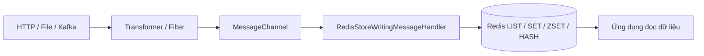

# Redis store outbound adapter trong Spring Integration

## 1. Redis store outbound adapter giải quyết bài toán gì?

Trong một luồng tích hợp, dữ liệu có thể đến từ HTTP, file, SFTP, JMS, Kafka hoặc một `MessageChannel` nội bộ. Đôi khi đích của luồng không phải một dịch vụ nhận message mà là **một cấu trúc dữ liệu lưu trong Redis**: danh sách sự kiện, tập mã đã xử lý, bảng trạng thái theo mã đơn hàng hoặc bảng xếp hạng. **Redis store outbound adapter** là endpoint cuối luồng, nhận `Message<?>` của Spring Integration rồi ghi **payload** vào collection Redis được chọn.

Trong module **SPRING_INTEGRATION_ADAPTERS**, đây là trường hợp điển hình của *outbound adapter*: chuyển message từ hệ thống xử lý của Spring Integration sang hệ thống ngoài qua `RedisConnectionFactory` hoặc `RedisTemplate`. Thành phần triển khai là `RedisStoreWritingMessageHandler` (`org.springframework.integration.redis.outbound`). Nó đóng vai trò `MessageHandler`, không cần một poller để ghi và không tạo reply message cho bước kế tiếp.

Ví dụ: hệ thống nhận sự kiện đơn hàng từ HTTP, xác thực và chuẩn hóa thành chuỗi `order-1001:CREATED`, sau đó lưu vào Redis List `orders:audit`. Một ứng dụng phân tích khác có thể đọc collection này bằng Redis client hoặc một inbound adapter phù hợp.



### Phân biệt các adapter Redis

| Thành phần | Tác dụng | Dữ liệu ở phía Redis | Dùng khi |
|---|---|---|---|
| **Store outbound** | Ghi payload vào collection | `LIST`, `SET`, `ZSET`, `MAP`, `PROPERTIES` | Tích lũy dữ liệu, tra cứu hoặc chia sẻ trạng thái |
| Redis Pub/Sub outbound | Phát message đến topic | Kênh Pub/Sub, không lưu message để đọc lại | Gửi thông báo cho subscriber đang kết nối |
| Redis queue outbound | Đẩy message vào Redis List theo quy ước hàng đợi | List với hướng push được cấu hình | Ghép với queue inbound để tiêu thụ theo thứ tự thích hợp |
| Store inbound | Poll dữ liệu từ collection Redis | Đọc collection đã tồn tại | Chuyển dữ liệu Redis trở lại Spring `Message` |
| Redis outbound gateway | Thực thi lệnh Redis và nhận kết quả | Phụ thuộc lệnh | Cần phản hồi từ Redis, không chỉ ghi một chiều |

> **Lưu ý:** Redis *store outbound adapter* không đồng nghĩa với `RedisMessageStore` dùng để lưu trữ message group của aggregator/resequencer. Cả hai sử dụng Redis nhưng có hợp đồng và mục đích khác nhau.

## 2. Hợp đồng message và cách ánh xạ sang Redis

Một message có hai phần: `payload` chứa giá trị cần ghi và `headers` chứa metadata để định tuyến, chẳng hạn key Redis hoặc hash field. Adapter không tự ghi toàn bộ Spring `Message` thành một đối tượng message trừ khi chính bạn chuyển đổi payload cho mục đích đó.

### Các collection được hỗ trợ

`collectionType` thuộc enum `org.springframework.data.redis.support.collections.RedisCollectionFactoryBean.CollectionType`. Nếu không chỉ định, handler dùng `LIST`.

| `collectionType` | Kiểu Redis / ý nghĩa | Payload phù hợp | Hành vi điển hình |
|---|---|---|---|
| `LIST` | Danh sách có thứ tự | Một giá trị hoặc `Collection` | Thêm phần tử; giữ được giá trị trùng lặp |
| `SET` | Tập hợp không trùng | Một giá trị hoặc `Collection` | Thêm thành viên; giá trị đã tồn tại không tạo bản sao |
| `ZSET` | Tập hợp có thứ tự theo điểm (`score`) | Giá trị + score, hoặc `Map<member, score>` | Thêm/cập nhật thành viên theo điểm |
| `MAP` | Redis Hash | `Map<field, value>` hoặc một giá trị với field riêng | Ghi các cặp field/value |
| `PROPERTIES` | Dạng properties dựa trên Redis | `Properties` hoặc cặp key/value | Ghi các thuộc tính theo tên |

Việc chọn collection ảnh hưởng trực tiếp đến ngữ nghĩa ghi. Chẳng hạn `SET` phù hợp cho tập ID duy nhất, nhưng không phù hợp nếu cần lưu đầy đủ mọi lần xuất hiện của một sự kiện. `LIST` lưu được bản ghi trùng; `ZSET` yêu cầu xác định ý nghĩa của `score` trước khi thiết kế cấu trúc.

### `extractPayloadElements`: ghi từng phần tử hay ghi cả payload?

Thuộc tính `extractPayloadElements` (XML: `extract-payload-elements`) mặc định là `true`:

- Với `Collection` và `LIST`/`SET`, `true` ghi lần lượt các phần tử bằng ngữ nghĩa `addAll`; `false` cố ghi cả `Collection` như **một** phần tử.
- Với `Map` và `MAP`/`PROPERTIES`, `true` ghi nhiều cặp field/value; `false` coi cả `Map` là **một** giá trị và cần một field để lưu nó.
- Với giá trị đơn như `String`, cờ này không đổi cách ghi: giá trị vẫn là một phần tử.
- Với `ZSET`, `Map` có thể biểu diễn các cặp *member → score*. Nếu muốn lưu toàn bộ map làm một thành viên, phải cấu hình serializer và cách xác định score tương ứng.

Ví dụ cùng một payload `List.of("A", "B")` gửi vào Redis List:

| Cấu hình | Số phần tử thêm vào Redis List | Ý nghĩa |
|---|---:|---|
| `extractPayloadElements=true` | 2 | Hai phần tử `A`, `B` |
| `extractPayloadElements=false` | 1 | Một phần tử đại diện cho toàn bộ `List` đã được serialize |

Trường hợp thứ hai **không** có nghĩa Redis tự tạo List lồng nhau: Redis vẫn lưu một giá trị nhị phân ở một vị trí trong List. Ứng dụng đọc cần đúng serializer để giải mã nó.

### Key của collection, field của Map và score của ZSET

Ba khái niệm dễ nhầm lẫn:

| Cấu hình / header | Vai trò | Ví dụ |
|---|---|---|
| `key` hoặc `keyExpression` | Chọn **Redis key chứa collection** | `orders:audit`, `inventory:shop-a` |
| `mapKeyExpression` hoặc `RedisHeaders.MAP_KEY` | Chọn **field bên trong Redis Hash**, chỉ cần khi ghi một giá trị vào `MAP`/`PROPERTIES` | `sku-100` |
| `RedisHeaders.ZSET_SCORE` | Điểm của một member trong `ZSET` nếu payload không phải map member → score | `95.5` |

`key` và `keyExpression` là hai cách cấu hình thay thế nhau; chỉ nên dùng một cách cho cùng một handler. Nếu không đặt cả hai, handler có thể đọc key từ `RedisHeaders.KEY`; trong ứng dụng thực tế nên đặt rõ key hoặc đảm bảo header hợp lệ. `mapKeyExpression` mặc định đọc `RedisHeaders.MAP_KEY`. Với `ZSET`, handler còn hỗ trợ `zsetIncrementExpression` (mặc định dựa vào `RedisHeaders.ZSET_INCREMENT_SCORE`) khi cần ngữ nghĩa tăng điểm thay vì đặt điểm thông thường.

## 3. Cài đặt và ví dụ chạy được với Spring Boot

Ví dụ sau dùng Java DSL để ghi từng chuỗi vào Redis List. Giả định ứng dụng đã dùng Spring Boot tương thích với phiên bản Spring Integration của dự án và Redis đang chạy cục bộ ở cổng `6379`.

**Gradle** (để Spring Boot quản lý phiên bản dependency tương thích):

```groovy
dependencies {
    implementation 'org.springframework.boot:spring-boot-starter-integration'
    implementation 'org.springframework.boot:spring-boot-starter-data-redis'
    implementation 'org.springframework.integration:spring-integration-redis'
}
```

**`application.yml`:**

```yaml
spring:
  data:
    redis:
      host: localhost
      port: 6379
```

`spring-boot-starter-data-redis` cung cấp tích hợp Spring Data Redis và Redis client thông dụng; Spring Boot có thể tự cấu hình `RedisConnectionFactory`. Ngoài Spring Boot, phải tự đăng ký bean `RedisConnectionFactory` và cấu hình kết nối Redis.

**Khai báo endpoint bằng Java DSL:**

```java
import org.springframework.context.annotation.Bean;
import org.springframework.context.annotation.Configuration;
import org.springframework.data.redis.connection.RedisConnectionFactory;
import org.springframework.data.redis.support.collections.RedisCollectionFactoryBean.CollectionType;
import org.springframework.integration.channel.DirectChannel;
import org.springframework.integration.config.EnableIntegration;
import org.springframework.integration.dsl.IntegrationFlow;
import org.springframework.integration.redis.dsl.Redis;
import org.springframework.messaging.MessageChannel;

@Configuration
@EnableIntegration
public class RedisStoreFlowConfig {

    @Bean
    MessageChannel orderAuditChannel() {
        return new DirectChannel();
    }

    @Bean
    IntegrationFlow orderAuditToRedis(RedisConnectionFactory connectionFactory) {
        return IntegrationFlow.from("orderAuditChannel")
                .handle(Redis.storeOutboundChannelAdapter(connectionFactory)
                        .collectionType(CollectionType.LIST)
                        .key("orders:audit"))
                .get();
    }
}
```

Ở đây `orderAuditChannel` là đầu vào. Mỗi message đi qua `DirectChannel` được chuyển tới handler và ghi payload vào collection `orders:audit`. Endpoint này là bước cuối, do đó không thiết lập `outputChannel`. Với một `DirectChannel` đồng bộ, lỗi ghi Redis có thể lan ngược về người gửi; hành vi sẽ khác khi luồng dùng channel bất đồng bộ.

**Gửi message từ một service:**

```java
import org.springframework.beans.factory.annotation.Qualifier;
import org.springframework.messaging.MessageChannel;
import org.springframework.messaging.support.MessageBuilder;
import org.springframework.stereotype.Service;

@Service
public class OrderAuditPublisher {
    private final MessageChannel channel;

    public OrderAuditPublisher(
            @Qualifier("orderAuditChannel") MessageChannel channel) {
        this.channel = channel;
    }

    public boolean publish(String orderId, String state) {
        return channel.send(MessageBuilder
                .withPayload(orderId + ":" + state)
                .build());
    }
}
```

Giả sử gọi `publish("order-1001", "CREATED")` rồi `publish("order-1001", "PAID")`. Có thể kiểm tra từ terminal:

```bash
redis-cli TYPE orders:audit
# list
redis-cli LRANGE orders:audit 0 -1
# 1) "order-1001:CREATED"
# 2) "order-1001:PAID"
```

Kết quả trên giả định key trước đó chưa có dữ liệu và không có producer khác ghi đồng thời. Đối với List, thứ tự đọc trên Redis phản ánh thao tác thêm vào collection và sự xen kẽ từ các producer, không phải lời hứa về thứ tự toàn cục của mọi nguồn message.

### Cấu hình cùng endpoint bằng `@ServiceActivator`

Nếu muốn tạo handler trực tiếp thay vì dùng Java DSL:

```java
import org.springframework.context.annotation.Bean;
import org.springframework.context.annotation.Configuration;
import org.springframework.data.redis.connection.RedisConnectionFactory;
import org.springframework.data.redis.support.collections.RedisCollectionFactoryBean.CollectionType;
import org.springframework.integration.annotation.ServiceActivator;
import org.springframework.integration.redis.outbound.RedisStoreWritingMessageHandler;
import org.springframework.messaging.MessageHandler;

@Configuration
class RedisStoreHandlerConfig {
    @Bean
    @ServiceActivator(inputChannel = "orderAuditChannel")
    MessageHandler redisOrderAuditHandler(RedisConnectionFactory connectionFactory) {
        RedisStoreWritingMessageHandler handler =
                new RedisStoreWritingMessageHandler(connectionFactory);
        handler.setCollectionType(CollectionType.LIST);
        handler.setKey("orders:audit");
        return handler;
    }
}
```

Đây là **phương án thay thế** cho bean `IntegrationFlow` ở trên. Không đăng ký cả hai endpoint cùng tiêu thụ `orderAuditChannel` nếu mục tiêu là ghi mỗi message đúng một lần: với point-to-point channel, các consumer có thể cạnh tranh nhận message.

### Cấu hình XML

```xml
<int-redis:store-outbound-channel-adapter
        id="orderAuditRedisWriter"
        channel="orderAuditChannel"
        connection-factory="redisConnectionFactory"
        collection-type="LIST"
        key="orders:audit"
        extract-payload-elements="true" />
```

Các namespace `int` và `int-redis` phải được khai báo trong tài liệu Spring XML. XML hữu ích khi dự án đã duy trì integration flow theo cấu hình declarative; Java DSL và `@ServiceActivator` có cùng ý tưởng xử lý message.

## 4. Các tình huống thiết kế thường gặp

### Tình huống A: Tạo tập ID đã xử lý (`SET`)

Hệ thống cần biết đơn hàng nào đã được tiếp nhận để lọc trùng ở tầng ứng dụng. Nếu payload luôn là `String`:

```java
@Bean
IntegrationFlow processedIdsFlow(RedisConnectionFactory factory) {
    return IntegrationFlow.from("processedIdChannel")
            .handle(Redis.storeOutboundChannelAdapter(factory)
                    .collectionType(CollectionType.SET)
                    .key("orders:processed"))
            .get();
}
```

Gửi lần lượt `order-1001`, `order-1002`, `order-1001` thì `SMEMBERS orders:processed` chỉ còn hai member phân biệt. Tuy nhiên, việc `SET` loại trùng khi lưu **không tự biến toàn bộ quy trình xử lý trước đó thành idempotent**: những side effect như ghi database hoặc gọi HTTP có thể đã xảy ra trước khi thêm vào Redis.

### Tình huống B: Ghi giá trị từng field vào Hash (`MAP`)

Giả sử một hệ thống tồn kho muốn lưu số lượng theo `sku` và tách dữ liệu mỗi tenant ở một Redis key riêng. Khi payload là giá trị đơn, field hash cần xác định qua `mapKeyExpression`.

```java
import org.springframework.context.annotation.Bean;
import org.springframework.data.redis.connection.RedisConnectionFactory;
import org.springframework.data.redis.support.collections.RedisCollectionFactoryBean.CollectionType;
import org.springframework.integration.dsl.IntegrationFlow;
import org.springframework.integration.redis.outbound.RedisStoreWritingMessageHandler;

@Bean
IntegrationFlow inventoryFlow(RedisConnectionFactory factory) {
    RedisStoreWritingMessageHandler writer =
            new RedisStoreWritingMessageHandler(factory);
    writer.setCollectionType(CollectionType.MAP);
    writer.setKeyExpressionString("'inventory:' + headers['tenantId']");
    writer.setMapKeyExpressionString("headers['sku']");

    return IntegrationFlow.from("inventoryWriteChannel")
            .handle(writer)
            .get();
}
```

Gửi message:

```java
MessageBuilder.withPayload("42")
        .setHeader("tenantId", "shop-a")
        .setHeader("sku", "sku-100")
        .build();
```

Kết quả Redis mong đợi:

```bash
redis-cli HGET inventory:shop-a sku-100
# "42"
```

Nếu payload là `Map.of("sku-100", "42", "sku-200", "13")` và `extractPayloadElements=true`, adapter có thể ghi nhiều field vào cùng Redis Hash; lúc này không cần truyền field riêng cho từng phần tử. Với `extractPayloadElements=false`, cần xác định `mapKeyExpression` và serializer có thể biểu diễn cả Map như một giá trị.

**Bảo vệ key động:** `tenantId`/`sku` phải được kiểm tra rỗng, định dạng, độ dài và giới hạn quyền truy cập ở bước trước handler. Không dùng trực tiếp một biểu thức key tùy ý do client cung cấp vì có thể ghi đè namespace Redis của ứng dụng khác.

### Tình huống C: Bảng xếp hạng (`ZSET`)

Một payload kiểu `Map<String, Double>` có thể cung cấp trực tiếp *member → score*:

```java
@Bean
IntegrationFlow leaderboardFlow(RedisConnectionFactory factory) {
    return IntegrationFlow.from("leaderboardChannel")
            .handle(Redis.storeOutboundChannelAdapter(factory)
                    .collectionType(CollectionType.ZSET)
                    .key("ranking:weekly"))
            .get();
}

// Ví dụ payload cần gửi đến leaderboardChannel:
Map<String, Double> scores = Map.of("alice", 98.5, "bob", 76.0);
```

Sau khi gửi payload `scores` với chế độ mặc định `extractPayloadElements=true`:

```bash
redis-cli ZSCORE ranking:weekly alice
# "98.5"
redis-cli ZREVRANGE ranking:weekly 0 -1 WITHSCORES
# Các member xếp theo điểm giảm dần
```

Với payload là một member đơn lẻ, có thể cấp score bằng header `RedisHeaders.ZSET_SCORE`. Nếu không có score, handler sử dụng điểm mặc định `1`. Cần phân biệt **đặt score** và **tăng score**; với yêu cầu cộng dồn, cấu hình `zsetIncrementExpression` tương ứng và kiểm thử tình huống gửi lặp.

## 5. Serializer: phần dễ gây lỗi giữa hai ứng dụng

Redis lưu byte, còn Spring Integration nhận Java object. Cách serializer chuyển đổi key và value cần được xác định cùng phía ghi và phía đọc.

Mặc định, khi tạo handler từ `RedisConnectionFactory`:

| Chế độ | Template/serializer mặc định | Hệ quả |
|---|---|---|
| `extractPayloadElements=true` | `StringRedisTemplate` với serializer chuỗi cho key, value và hash field/value | Phù hợp dữ liệu chuỗi; không tự hỗ trợ mọi POJO |
| `extractPayloadElements=false` | `RedisTemplate` có key/hash key dùng serializer chuỗi, còn value/hash value dùng JDK serialization | Có thể lưu object Java phù hợp, nhưng byte dữ liệu không còn là chuỗi dễ đọc bằng `redis-cli` |
| Cấp `RedisTemplate` riêng | Theo `keySerializer`, `valueSerializer`, `hashKeySerializer`, `hashValueSerializer` được cấu hình | Kiểm soát kiểu dữ liệu, định dạng và tương thích giữa producer/consumer |

Ví dụ minh họa cấp template do ứng dụng quản lý (giả định dữ liệu value và hash value đều là chuỗi):

```java
@Bean
RedisTemplate<String, String> integrationStringRedisTemplate(
        RedisConnectionFactory connectionFactory) {
    RedisTemplate<String, String> template = new RedisTemplate<>();
    template.setConnectionFactory(connectionFactory);
    StringRedisSerializer serializer = new StringRedisSerializer();
    template.setKeySerializer(serializer);
    template.setValueSerializer(serializer);
    template.setHashKeySerializer(serializer);
    template.setHashValueSerializer(serializer);
    template.afterPropertiesSet();
    return template;
}

@Bean
@ServiceActivator(inputChannel = "stringStoreChannel")
MessageHandler stringStoreHandler(
        @Qualifier("integrationStringRedisTemplate")
        RedisTemplate<String, String> template) {
    RedisStoreWritingMessageHandler handler =
            new RedisStoreWritingMessageHandler(template);
    handler.setCollectionType(CollectionType.MAP);
    handler.setKey("catalog:prices");
    return handler;
}
```

Các import tương ứng là `org.springframework.data.redis.core.RedisTemplate`, `org.springframework.data.redis.serializer.StringRedisSerializer`, `org.springframework.integration.annotation.ServiceActivator` và `org.springframework.messaging.MessageHandler`.

Khi cần JSON cho đối tượng nghiệp vụ, hãy chọn serializer JSON thống nhất, định nghĩa rõ kiểu dữ liệu và kiểm tra việc giải mã từ ứng dụng đọc. Tránh phụ thuộc lâu dài vào JDK serialization giữa các service sử dụng ngôn ngữ hoặc phiên bản class khác nhau. `StringRedisSerializer` không thể thay thế trực tiếp cho một serializer POJO: nếu gửi object không phù hợp, thao tác serialize có thể thất bại.

## 6. Lỗi, độ tin cậy và vòng đời kết nối

Store outbound adapter gửi dữ liệu tới Redis khi handler nhận message. Vì là outbound endpoint, nó không tự poll, không cung cấp reply từ một lời gọi ghi và không tự thiết lập chính sách retry, TTL hay cơ chế bảo đảm *exactly once* cho cả pipeline. Những điều này thuộc thiết kế luồng và hạ tầng xung quanh.

| Sự cố | Dấu hiệu thường gặp | Hướng xử lý |
|---|---|---|
| Redis không kết nối được | `RedisConnectionFailureException` hoặc lỗi kết nối từ client | Kiểm tra host, port, auth/TLS, timeout; cân nhắc retry có giới hạn tại luồng hoặc phía producer |
| Key đã tồn tại với kiểu khác | Redis trả lỗi sai kiểu (`WRONGTYPE`) | Tách namespace Redis theo cấu trúc, kiểm tra `TYPE`, tránh tái sử dụng key giữa List/Set/Hash |
| Payload không phù hợp serializer | Exception khi serialize hoặc giá trị không đọc lại được | Chốt hợp đồng kiểu dữ liệu và cấu hình serializer đồng nhất |
| Thiếu key hoặc hash field | Biểu thức trả `null`/rỗng, không ghi được | Xác thực headers, đặt key tĩnh hoặc thêm nhánh xử lý message lỗi |
| Gửi lặp do retry | List có thêm bản ghi trùng; Map/Set/ZSet có hành vi cập nhật khác nhau | Chọn cấu trúc phù hợp, thêm khóa idempotency hoặc quy tắc xử lý lặp |
| Redis tăng dung lượng không kiểm soát | List/Set/Hash tiếp tục phình to | Thiết kế retention, cắt bớt List, TTL hoặc dọn dẹp riêng theo chính sách |

**Lưu ý về retry và idempotency:** trong một luồng đồng bộ, Redis có thể ghi thành công rồi phía gọi mất kết nối trước khi biết kết quả. Retry cùng payload có thể tạo thêm phần tử trong `LIST`. Nếu bài toán cần xử lý đúng một lần theo khóa nghiệp vụ, phải thiết kế kiểm tra trùng/ghi nguyên tử (chẳng hạn Lua script, lệnh Redis phù hợp, hoặc gateway chuyên biệt), không thể suy ra bảo đảm này chỉ từ outbound adapter.

**Lưu ý về lỗi của Spring Integration:** Với `DirectChannel`, exception thường truyền trở lại phía gửi. Nếu dùng `ExecutorChannel` hoặc flow bất đồng bộ, lỗi có thể xuất hiện dưới dạng `ErrorMessage` tại error channel; cần cấu hình cách quan sát và xử lý phù hợp với loại channel. Log nên có message ID, correlation ID, Redis key đã chuẩn hóa và loại collection; tránh ghi thông tin nhạy cảm của payload.

**Lưu ý về TTL:** adapter ghi vào collection, không mặc định `EXPIRE` từng khi message đến. Nếu dùng Redis làm cache hoặc lưu trạng thái tạm, cấu hình TTL bằng bước riêng (`RedisTemplate.expire`, Redis command phù hợp) và làm rõ liệu TTL được đặt khi tạo key hay gia hạn mỗi lần ghi.

## 7. Thực hành: tự xác minh một flow Redis Store

1. Khởi chạy Redis và ứng dụng Spring Boot có flow `orderAuditToRedis` ở mục 3. Kiểm tra `redis-cli PING` trả `PONG`.
2. Gửi hai message chuỗi trên `orderAuditChannel` và dùng `TYPE orders:audit`, `LLEN orders:audit`, `LRANGE orders:audit 0 -1` để kiểm tra số phần tử và nội dung.
3. Đổi đích sang `SET` với **key mới** như `orders:processed`, gửi cùng một ID hai lần; kiểm tra `SCARD orders:processed` không tăng ở lần thứ hai.
4. Tạo flow Hash ở mục 4; gửi payload chuỗi với headers `tenantId` và `sku`. Dùng `HGET inventory:shop-a sku-100` để xác minh dữ liệu nằm đúng field.
5. Thử message thiếu `sku` và quan sát cách xử lý lỗi. Bổ sung bước `filter`/`transform` để từ chối message không thỏa hợp đồng trước khi ghi.
6. Thử một payload `List<String>` với `extractPayloadElements=true`; quan sát Redis List có nhiều phần tử. Khi thử `false`, sử dụng **key khác**, cấu hình serializer phù hợp và kiểm tra kết quả bằng Java thay vì giả định `redis-cli LRANGE` hiển thị chuỗi rõ ràng.

### Các câu hỏi kiểm tra hiểu biết

- Khi nào dùng `store-outbound-channel-adapter` thay vì `queue-outbound-channel-adapter` hoặc Pub/Sub outbound?
- Nếu gửi `List.of("x", "y")` vào `LIST`, `extractPayloadElements=true` khác `false` ra sao?
- Tại sao `keyExpression` và `mapKeyExpression` trả lời hai câu hỏi khác nhau?
- Điều gì xảy ra khi retry một message ghi vào `LIST` so với `SET`?
- Vì sao phải thống nhất serializer với ứng dụng đọc Redis và cần chính sách TTL riêng?

## 8. Tài liệu tham khảo

- [Spring Integration Reference — Redis Support, phần RedisStore Outbound Channel Adapter](https://docs.spring.io/spring-integration/reference/redis.html#redisstore-outbound-channel-adapter).
- [Spring Integration API — `RedisStoreWritingMessageHandler`](https://docs.spring.io/spring-integration/api/org/springframework/integration/redis/outbound/RedisStoreWritingMessageHandler.html).
- [Spring Data Redis API — `RedisCollectionFactoryBean.CollectionType`](https://docs.spring.io/spring-data-redis/docs/current/api/org/springframework/data/redis/support/collections/RedisCollectionFactoryBean.CollectionType.html).

**Điểm cốt lõi cần nắm:** xác định đúng collection, Redis key, hình dạng payload và serializer trước khi nối outbound adapter vào `MessageChannel`; sau đó chủ động thiết kế xử lý lỗi, retry, trùng lặp và vòng đời dữ liệu theo nghiệp vụ.
