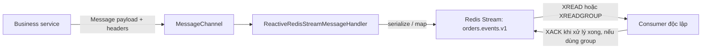

# Redis Stream Outbound Adapter trong Spring Integration

## 1. Mục tiêu và bài toán

Trong một hệ thống xử lý đơn hàng, sau khi đơn được xác nhận, dịch vụ đặt hàng cần phát sự kiện `OrderPlaced` để dịch vụ kho, thông báo và phân tích xử lý độc lập. Nếu gọi HTTP trực tiếp đến từng dịch vụ, bên phát sự kiện phải biết địa chỉ và tình trạng của từng bên nhận. **Redis Streams** cung cấp một nhật ký sự kiện có thứ tự trong từng stream: bên phát ghi thêm bản ghi, còn các bên nhận có thể đọc sau, kể cả khi chúng không trực tuyến tại thời điểm ghi (miễn là bản ghi chưa bị xóa hoặc trim).

**Redis Stream outbound channel adapter** nối một `MessageChannel` của Spring Integration với thao tác ghi vào Redis Stream. Trong Spring Integration, thành phần này là `ReactiveRedisStreamMessageHandler`, được giới thiệu từ phiên bản **5.4**. Handler nhận một Spring `Message<?>`, xác định stream đích, ánh xạ dữ liệu thành bản ghi Redis và dùng `ReactiveStreamOperations.add(...)` (tương ứng thao tác `XADD`) để thêm bản ghi.

Kết thúc bài, bạn có thể:

- Phân biệt Redis Stream outbound với Pub/Sub outbound, Redis List và các gateway có phản hồi.
- Cấu hình handler bằng `@ServiceActivator` (và Java DSL ở phiên bản hỗ trợ), gửi một sự kiện thực tế vào stream.
- Chọn stream key, cách trích xuất payload, serializer và `HashMapper` phù hợp với bên đọc.
- Kiểm tra bản ghi bằng `redis-cli`, nhận diện lỗi và thiết kế retry, idempotency, retention khi đưa vào production.

## 2. Luồng xử lý và hợp đồng dữ liệu



Ví dụ sau là **mô hình bản ghi logic** của sự kiện đơn hàng, trước khi được ánh xạ hoặc tuần tự hóa theo cấu hình thực tế:

| Thành phần | Ví dụ | Ý nghĩa |
| --- | --- | --- |
| Stream key | `orders.events.v1` | Tên Redis key có kiểu dữ liệu Stream; có thể cố định hoặc tính từ message. |
| Record ID | `1790000000000-0` | ID minh họa do Redis sinh khi `XADD *`; không phải `eventId` nghiệp vụ. |
| Payload | `{"eventId":"evt-1001","orderId":"ORD-42","type":"OrderPlaced"}` | Dữ liệu sự kiện mà bên tiêu thụ cần giải mã. |
| Headers của Spring Message | `correlationId`, `traceId` | Metadata nội bộ của luồng Spring; **không mặc định** được lưu như các field khi `extractPayload=true`. |

Redis Stream lưu bản ghi dưới dạng **ID + tập field/value**, không lưu trực tiếp đối tượng `Message<?>` của Spring. Khi ghi một `String` hoặc POJO, Spring Data Redis có thể dùng `ObjectRecord` và `HashMapper` để tạo các field; dữ liệu nhìn thấy trong `XRANGE` phụ thuộc vào cấu hình mapping và serializer. Vì thế JSON ở bảng trên là **hợp đồng nghiệp vụ minh họa**, không phải cam kết rằng Redis sẽ tự tạo đúng một field `payload` chứa JSON.

### So sánh cách truyền message qua Redis

| Cơ chế | Cách ghi | Cách đọc | Phù hợp |
| --- | --- | --- | --- |
| Redis Pub/Sub | `PUBLISH` | Subscriber nhận lúc đang subscribe; Redis không giữ lịch sử Pub/Sub | Thông báo tức thời, chấp nhận bỏ lỡ khi subscriber offline. |
| Redis List | `LPUSH`/`RPUSH` | `LPOP`/`RPOP` hoặc lệnh blocking | Hàng đợi đơn giản; phần tử thường bị lấy ra khỏi list khi pop. |
| **Redis Stream** | **`XADD`** | `XREAD`/`XREADGROUP`; có ID và consumer group | Sự kiện cần lưu lại, đọc theo vị trí và quản lý trạng thái tiêu thụ. |

Outbound adapter là **đầu ra một chiều**. Nó thực hiện ghi, không trả về `RecordId` như một outbound gateway, không đọc dữ liệu và không cấu hình consumer group. Quản lý group, pending entries và `XACK` là trách nhiệm của **bên đọc**; chỉ khi sử dụng `XREADGROUP` mới có ý nghĩa quản lý acknowledgment theo group.

## 3. Chuẩn bị môi trường

Ví dụ dùng Java 17+, Spring Boot có Spring Integration và Redis chạy tại `localhost:6379`. Đối với ứng dụng Spring Boot, thêm các dependency do BOM của Boot quản lý phiên bản:

```xml
<dependencies>
    <dependency>
        <groupId>org.springframework.boot</groupId>
        <artifactId>spring-boot-starter-integration</artifactId>
    </dependency>
    <dependency>
        <groupId>org.springframework.integration</groupId>
        <artifactId>spring-integration-redis</artifactId>
    </dependency>
    <dependency>
        <groupId>org.springframework.boot</groupId>
        <artifactId>spring-boot-starter-data-redis-reactive</artifactId>
    </dependency>
</dependencies>
```

```yaml
# application.yml (ví dụ Spring Boot 3.x)
spring:
  data:
    redis:
      host: localhost
      port: 6379
```

Client Lettuce trong starter Redis hỗ trợ kết nối reactive. Bean cần đưa vào handler có kiểu **`ReactiveRedisConnectionFactory`**; một `RedisConnectionFactory` chỉ hỗ trợ thao tác đồng bộ sẽ không thỏa mãn hợp đồng này. Ứng dụng có thể dùng `LettuceConnectionFactory` được Boot cấu hình sẵn. Tạo Redis thử nghiệm (nếu chưa có) bằng môi trường Redis bạn đang dùng, rồi kiểm tra:

```bash
redis-cli PING
# PONG
```

Tên stream không cần tạo trước: `XADD` sẽ tạo key stream khi thêm bản ghi đầu tiên, miễn là key chưa tồn tại dưới một kiểu Redis khác.

## 4. Ví dụ hoàn chỉnh: publish sự kiện đơn hàng bằng `@ServiceActivator`

Định nghĩa channel `orderEvents` và gắn handler đầu ra vào channel bằng `@ServiceActivator`. Cách cấu hình bean này dùng được từ Spring Integration 5.4, kể cả các ứng dụng Spring Boot 3.x dùng Spring Integration 6.x:

```java
// RedisStreamOutboundConfig.java
import org.springframework.context.annotation.Bean;
import org.springframework.context.annotation.Configuration;
import org.springframework.data.redis.connection.ReactiveRedisConnectionFactory;
import org.springframework.integration.annotation.ServiceActivator;
import org.springframework.integration.channel.DirectChannel;
import org.springframework.integration.redis.outbound.ReactiveRedisStreamMessageHandler;
import org.springframework.messaging.MessageChannel;

@Configuration
public class RedisStreamOutboundConfig {

    @Bean
    MessageChannel orderEvents() {
        return new DirectChannel();
    }

    @Bean
    @ServiceActivator(inputChannel = "orderEvents")
    ReactiveRedisStreamMessageHandler orderEventsWriter(
            ReactiveRedisConnectionFactory connectionFactory) {

        ReactiveRedisStreamMessageHandler handler =
                new ReactiveRedisStreamMessageHandler(
                        connectionFactory, "orders.events.v1");
        handler.setExtractPayload(true); // mặc định là true
        return handler;
    }
}
```

`DirectChannel` chuyển message đến endpoint đã đăng ký; `@ServiceActivator` dùng handler để ghi dữ liệu vào Redis. Không cần `Poller` cho bước outbound này, vì handler được kích hoạt khi có message tới channel. Đây là Redis **Stream** outbound, khác với `RedisPublishingMessageHandler` dùng để phát Redis Pub/Sub.

Ứng dụng nghiệp vụ có thể gửi một sự kiện JSON theo hợp đồng đã thống nhất:

```java
// OrderEventPublisher.java
import org.springframework.beans.factory.annotation.Qualifier;
import org.springframework.messaging.MessageChannel;
import org.springframework.messaging.support.MessageBuilder;
import org.springframework.stereotype.Service;

@Service
public class OrderEventPublisher {

    private final MessageChannel orderEvents;

    public OrderEventPublisher(@Qualifier("orderEvents") MessageChannel orderEvents) {
        this.orderEvents = orderEvents;
    }

    public void publishOrderPlaced() {
        String json = """
                {"eventId":"evt-1001","orderId":"ORD-42",
                 "type":"OrderPlaced","schemaVersion":1}
                """;

        boolean accepted = orderEvents.send(
                MessageBuilder.withPayload(json)
                        .setHeader("correlationId", "req-9001")
                        .build());

        if (!accepted) {
            throw new IllegalStateException("Flow không nhận message");
        }
    }
}
```

Gọi `publishOrderPlaced()` từ nghiệp vụ hoặc kiểm thử tích hợp trong khi Redis đang chạy. `send(...) == true` chỉ xác nhận **channel nhận message**; với một handler reactive, không được suy luận từ đó rằng Redis đã ghi thành công hoặc consumer đã xử lý xong. Cần theo dõi kết quả ghi và lỗi ở luồng xử lý reactive; với yêu cầu xác nhận chặt chẽ, thiết kế một bước ghi trực tiếp trả về `Mono<RecordId>` hoặc cơ chế xác nhận riêng cho ứng dụng.

### Đọc kết quả từ Redis

Sau khi quá trình ghi đã hoàn tất:

```bash
redis-cli TYPE orders.events.v1
# stream
redis-cli XLEN orders.events.v1
# 1 (nếu đây là bản ghi đầu tiên)
redis-cli XRANGE orders.events.v1 - + COUNT 5
redis-cli XINFO STREAM orders.events.v1
```

`XRANGE` hiển thị ID và các field/value thực tế. Nếu trường được tuần tự hóa thành byte hoặc Redis hiển thị các field như `_class`, `_raw`, hãy kiểm tra `RedisSerializationContext` và cơ chế ánh xạ object thay vì cho rằng adapter ghi sai. Chạy lại phương thức publish sẽ **append thêm** một record với ID mới; Redis không tự thay thế record cũ theo `eventId` nghiệp vụ.

## 5. Cấu hình thay thế bằng Java DSL (Spring Integration 7.1+)

Từ **Spring Integration 7.1**, có thể dùng builder `Redis.streamOutboundChannelAdapter(...)` để cấu hình ngay trong `IntegrationFlow`. Đây là **phương án thay thế** cho `@ServiceActivator` ở mục 4; chỉ bật một phương án đối với cùng channel. Ở Spring Integration 6.x, dùng handler trực tiếp như mục 4.

```java
// Phương án dành cho Spring Integration 7.1+
import org.springframework.context.annotation.Bean;
import org.springframework.context.annotation.Configuration;
import org.springframework.data.redis.connection.ReactiveRedisConnectionFactory;
import org.springframework.integration.dsl.IntegrationFlow;
import org.springframework.integration.redis.dsl.Redis;

@Configuration
class RedisStreamDslConfig {

    @Bean
    IntegrationFlow orderEventsToRedisStream(
            ReactiveRedisConnectionFactory connectionFactory) {

        return IntegrationFlow.from("orderEvents")
                .handle(Redis.streamOutboundChannelAdapter(
                                connectionFactory, "orders.events.v1")
                        .extractPayload(true))
                .get();
    }
}
```

`IntegrationFlow.from("orderEvents")` khai báo input của flow; Spring Integration tạo hoặc kết nối channel có tên này. API DSL `.serializationContext(...)`, `.hashMapper(...)`, `.extractPayload(boolean)` cung cấp các tùy chọn tương ứng của handler.

**Stream key động.** Constructor `ReactiveRedisStreamMessageHandler(factory, String)` dùng stream key cố định. Constructor còn lại nhận `org.springframework.expression.Expression` để xác định stream key từ từng request message, và dùng được cả với cấu hình `@ServiceActivator` ở mục 4. Ví dụ khi sự kiện đã được xác thực và gắn header `targetStream`:

```java
Expression keyExpression = new SpelExpressionParser()
        .parseExpression("headers['targetStream']");

ReactiveRedisStreamMessageHandler handler =
        new ReactiveRedisStreamMessageHandler(factory, keyExpression);
```

Trong đoạn này, `factory` là `ReactiveRedisConnectionFactory` có sẵn; các import bổ sung là `org.springframework.expression.Expression` và `org.springframework.expression.spel.standard.SpelExpressionParser`. Kiểm tra header tồn tại, được phép và chỉ tới tên stream hợp lệ **trước khi** chuyển message vào handler. Không dùng tên stream tùy ý từ request bên ngoài vì dễ tạo vô số key hoặc ghi vào nhầm luồng dữ liệu.

## 6. Payload, serialization và hash mapping

Bốn thiết lập có ảnh hưởng trực tiếp đến dữ liệu bên nhận đọc được:

| Thiết lập | Vai trò | Lưu ý |
| --- | --- | --- |
| `setExtractPayload(true)` / `.extractPayload(true)` | Chuyển **payload** của Spring Message thành dữ liệu của record. | Đây là mặc định. Header `correlationId` trong ví dụ không tự trở thành field của Redis. |
| `setExtractPayload(false)` / `.extractPayload(false)` | Dùng cả đối tượng `Message<?>` làm giá trị được ánh xạ. | Phức tạp hơn về tuần tự hóa và phụ thuộc kiểu Spring; phải kiểm tra với bên nhận. |
| `setSerializationContext(...)` / `.serializationContext(...)` | Chọn cách mã hóa stream key, hash field và hash value. | Writer và reader phải dùng bộ serializer tương thích. |
| `setHashMapper(...)` / `.hashMapper(...)` | Ánh xạ đối tượng Java thành các field/value Redis. | Cần thiết khi dữ liệu nhiều thuộc tính hoặc các bên dùng ngôn ngữ khác nhau. |

Các setter áp dụng trực tiếp cho handler từ phiên bản 5.4; các phương thức DSL tương ứng chỉ dùng khi dự án hỗ trợ `RedisStreamOutboundChannelAdapterSpec` (7.1+).

Theo hợp đồng của Spring Data Redis, `Record#getStream()` dùng serializer của key; tên field dùng **hash-key serializer**; giá trị field dùng **hash-value serializer**. Với dữ liệu trao đổi liên dịch vụ, nên cố định schema (`eventId`, `eventType`, `schemaVersion`, `occurredAt`, `data`) và biểu diễn bằng UTF-8/JSON hoặc các field string đã thống nhất. Nếu cần lưu JSON nguyên khối, kiểm tra cách `ObjectRecord` ánh xạ một `String` (có thể sinh field `_raw` cùng metadata kiểu). Nếu muốn từng field như `eventId`, `orderId` xuất hiện trực tiếp, hãy kiểm soát việc chuyển payload thành map và serializer, rồi kiểm tra `XRANGE` trước khi công bố contract.

Ví dụ ý tưởng hợp đồng Redis field/value khi hai dịch vụ thống nhất ghi theo dạng field tường minh:

```text
XADD orders.events.v1 *
  eventId evt-1001
  eventType OrderPlaced
  schemaVersion 1
  orderId ORD-42
```

Đây là **lệnh Redis minh họa cho schema**, không phải output được đảm bảo từ cấu hình mặc định ở mục 4. Nếu cần kiểm soát chính xác từng field của Redis và nhận `RecordId`, Spring Data Redis cho phép dùng `StreamRecords.mapBacked(...)` cùng `ReactiveRedisTemplate.opsForStream().add(...)` ở nơi phù hợp; adapter của Spring Integration giải quyết nhu cầu tích hợp **một chiều từ channel**.

Một nguyên tắc quan trọng: `eventId` phục vụ chống trùng nghiệp vụ, còn `RecordId` phục vụ định vị record trong stream. Hai giá trị này không thể hoán đổi cho nhau. `traceId`, `correlationId`, tenant hoặc version cần cho consumer phải được đưa vào **hợp đồng payload/field** một cách có chủ đích.

## 7. Khi nào ghi thành công và khi nào xử lý thành công?

Các mốc sau độc lập với nhau:

1. **Flow tiếp nhận message:** application gửi được message vào `MessageChannel`.
2. **Redis chấp nhận bản ghi:** thao tác `XADD` hoàn tất, Redis tạo record ID.
3. **Consumer nhận bản ghi:** một hoặc nhiều bên đọc qua `XREAD` hoặc `XREADGROUP`.
4. **Consumer xử lý và xác nhận:** nếu dùng consumer group, phía consumer gọi `XACK` sau khi hoàn tất nghiệp vụ.

Outbound adapter chỉ chịu trách nhiệm phát sinh **bước ghi**. Nó không đảm bảo bước 3 hoặc 4. `XACK` không xóa bản ghi ra khỏi stream; việc xóa hoặc trim do chính sách lưu giữ dữ liệu quản lý. Consumer chậm có thể khiến backlog tăng dù producer vẫn ghi bình thường.

### Xử lý lỗi và retry

- **Redis không truy cập được / timeout / lỗi serialize:** ghi không thành công; phải quan sát exception ở đường đi reactive, kiểm tra cấu hình xử lý lỗi của endpoint và ghi log đủ `eventId`, stream key. Không chỉ dựa vào giá trị trả về của `MessageChannel.send` để đánh dấu nghiệp vụ đã publish.
- **Không biết `XADD` đã thành công hay chưa:** một lần retry có thể tạo **hai record khác ID** cho cùng `eventId`. Consumer phải idempotent, ví dụ lưu `eventId` đã xử lý hoặc dùng ràng buộc unique trong cơ sở dữ liệu.
- **Ứng dụng cập nhật database rồi crash trước khi publish:** hai thao tác không tự thành một transaction chung. Khi sự kiện có tính bắt buộc, dùng **transactional outbox**: ghi thay đổi nghiệp vụ và bản ghi outbox trong cùng transaction database, rồi worker phát ra Redis và đánh dấu outbox sau khi xác nhận.
- **Dồn tải lên Redis:** giới hạn lượng message đang chờ, quan sát độ trễ và số lỗi; không retry vô hạn trong vòng lặp nóng. Cần có chính sách backoff và đường xử lý sự kiện thất bại phù hợp.

Không coi Redis Streams + adapter là bảo đảm exactly-once ở cấp nghiệp vụ. Thiết kế thông thường là **at-least-once ở các bước có retry**, kèm consumer idempotent, monitoring và cơ chế khôi phục.

## 8. Production: retention, phân luồng và quan sát

**Retention.** Stream tiếp tục tăng khi chỉ `XADD`. Dùng `XTRIM`/chính sách `MAXLEN` hoặc `MINID` để hạn chế dữ liệu; chọn ngưỡng theo khả năng replay của consumer chậm nhất. Trim quá sớm có thể khiến consumer mất record chưa xử lý. Từ Spring Integration **6.5**, `ReactiveRedisStreamMessageHandler` có `setAddOptionsFunction(Function<Message<?>, RedisStreamCommands.XAddOptions>)` để tạo tùy chọn `XADD` từ message, kể cả nhu cầu áp dụng chính sách trim phù hợp với phiên bản Redis/Spring Data đang dùng. Java DSL 7.1+ cung cấp `.addOptionsFunction(...)` tương ứng.

**Stream key và version.** Đặt tên theo domain, ví dụ `orders.events.v1`, giữ số lượng key trong tầm kiểm soát. Thay đổi không tương thích schema thì phát sang version mới hoặc hỗ trợ consumer đọc hai version trong giai đoạn chuyển tiếp. Nếu chia stream theo tenant hoặc loại sự kiện, phải cân nhắc thứ tự: thứ tự record chỉ được xác lập **trong mỗi stream**, không phải thứ tự toàn cục giữa các stream.

**Tối thiểu nên giám sát:** số lần publish thành công/thất bại, độ trễ ghi, kết nối Redis, `XLEN`, tốc độ tăng độ dài stream, `XINFO STREAM`, và nếu dùng consumer group thì `XINFO GROUPS`, `XPENDING` cùng độ trễ xử lý. Cần alert khi producer lỗi liên tiếp hoặc backlog vượt ngưỡng. Không ghi các dữ liệu nhạy cảm không cần thiết vào payload hoặc log.

**Phân biệt bảo mật dữ liệu với tính bền vững.** Redis có cơ chế persistence và replication tùy cấu hình triển khai; việc `XADD` trả thành công không tự bảo đảm dữ liệu còn tồn tại sau mọi sự cố. Với sự kiện quan trọng, xác định rõ mức durability, chiến lược backup và khả năng phục hồi phù hợp với hệ thống.

## 9. Thực hành và checklist tự kiểm tra

**Bài tập:** Dịch vụ thanh toán cần phát `PaymentCaptured` cho dịch vụ lập hóa đơn. Hãy tạo flow `paymentEvents` ghi vào `payments.events.v1`; payload chứa `eventId`, `paymentId`, `orderId`, `capturedAt`, `schemaVersion`. Sau đó gửi hai lần một sự kiện và quan sát `XRANGE`. Tự trả lời: vì sao có thể có hai record ID dù `eventId` giống nhau, và nên loại trùng ở đâu?

Checklist để hoàn tất bài:

- [ ] Ứng dụng có `ReactiveRedisConnectionFactory` và dependency `spring-integration-redis` tương thích với Spring Boot đang chạy.
- [ ] Flow hoặc `@ServiceActivator` nhận message từ đúng channel và ghi đúng stream key.
- [ ] Đã gọi publish và xác minh bản ghi bằng `XLEN`/`XRANGE`, kể cả khả năng serializer hiển thị dữ liệu nhị phân.
- [ ] Đã xác định `extractPayload`, schema/serialization và cách chuyển các header thiết yếu vào payload.
- [ ] Đã xác định retry, idempotency, retention và cách giám sát khi ứng dụng chạy lâu dài.

## Tài liệu tham khảo

- [Spring Integration Reference – Redis Stream Outbound Channel Adapter](https://docs.spring.io/spring-integration/reference/redis.html#redis-stream-outbound-channel-adapter): cấu hình Java DSL, Java và các tùy chọn handler.
- [Spring Integration API – `ReactiveRedisStreamMessageHandler`](https://docs.spring.io/spring-integration/api/org/springframework/integration/redis/outbound/ReactiveRedisStreamMessageHandler.html): constructor, `extractPayload`, `serializationContext`, `hashMapper`, `addOptionsFunction`.
- [Spring Data Redis – Redis Streams](https://docs.spring.io/spring-data/redis/reference/redis/redis-streams.html): `Record`, `StreamOperations`, serialization, object mapping và consumer group.
