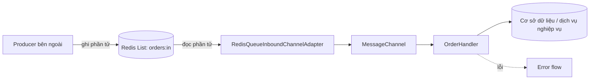
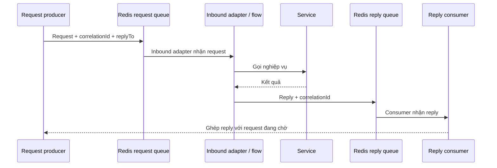

# Redis queue inbound gateway

## Mục tiêu

Sau bài này, bạn có thể giải thích cách một message từ Redis List đi vào luồng xử lý Spring Integration, cấu hình điểm nhận queue, xác định hợp đồng dữ liệu giữa producer và consumer, và lựa chọn cách xử lý lỗi phù hợp với đặc tính của queue.

## Redis queue đứng ở đâu trong Spring Integration?

Redis thường được dùng làm hàng đợi nhẹ giữa các tiến trình: ứng dụng A ghi công việc vào Redis, còn ứng dụng B lấy từng công việc để xử lý. Spring Integration đưa ranh giới đó vào mô hình message bằng adapter và `MessageChannel`.

Với Redis List, thành phần inbound thường dùng là `RedisQueueInboundChannelAdapter` trong module `spring-integration-redis`. Adapter đọc phần tử từ một key Redis và phát payload thành Spring `Message<?>` trên channel đầu ra. Nó đóng vai trò cửa vào của flow: hệ thống bên ngoài gửi dữ liệu vào Redis, còn flow Spring Integration nhận dữ liệu từ queue rồi chuyển tới service, router, transformer hoặc endpoint khác.

Tên bài dùng từ “gateway” theo nghĩa cổng nhận message. Cần phân biệt rõ loại endpoint: queue inbound channel adapter là một chiều, nhận message rồi phát vào channel. Bản thân adapter không tự tạo một cuộc trao đổi request/reply có tương quan. Nếu nghiệp vụ cần trả lời cho từng yêu cầu, flow phải định nghĩa thêm đường gửi reply, địa chỉ nhận reply và khóa tương quan; phần đó được trình bày ở mục riêng bên dưới.



Adapter giúp flow không phải tự quản lý kết nối Redis, lệnh đọc queue và việc chuyển dữ liệu thành message. Flow vẫn chịu trách nhiệm xử lý nghiệp vụ, xác thực dữ liệu và quyết định điều gì xảy ra khi xử lý thất bại.

## Chuẩn bị dependency và kết nối

Ứng dụng cần Spring Integration Redis và một Redis connection factory do Spring Data Redis cung cấp. Với Spring Boot, dependency quản lý phiên bản nên được đồng bộ theo BOM của phiên bản Boot đang dùng.

```xml
<dependency>
    <groupId>org.springframework.integration</groupId>
    <artifactId>spring-integration-redis</artifactId>
</dependency>
```

Nếu ứng dụng chưa có Redis client và cấu hình kết nối, bổ sung dependency Spring Data Redis hoặc starter tương ứng. Cấu hình `RedisConnectionFactory` với host, port, database, thông tin xác thực và TLS theo môi trường triển khai. Không đặt mật khẩu thật trong source code; dùng secret hoặc biến môi trường do nền tảng triển khai quản lý.

Producer và consumer phải thống nhất key queue và cách serialize giá trị. Ví dụ, nếu producer ghi JSON dạng chuỗi thì consumer cần đọc đúng dạng chuỗi hoặc chuyển đổi byte tương ứng. Không giả định mọi `RedisTemplate` đều dùng cùng serializer: serializer mặc định, serializer của key và serializer của value có thể khác nhau. Một cấu hình lệch serializer có thể khiến consumer nhận byte không giải mã được hoặc nhận kiểu dữ liệu không như handler mong đợi.

## Cấu hình inbound adapter bằng Java DSL

Ví dụ dưới đây tạo một flow nhận dữ liệu từ queue `orders:in`, sau đó chuyển payload đến `OrderHandler`. `RedisConnectionFactory` được inject từ cấu hình Spring Data Redis.

```java
import org.springframework.context.annotation.Bean;
import org.springframework.context.annotation.Configuration;
import org.springframework.data.redis.connection.RedisConnectionFactory;
import org.springframework.integration.dsl.IntegrationFlow;
import org.springframework.integration.redis.inbound.RedisQueueInboundChannelAdapter;

@Configuration
class RedisInboundConfiguration {

    @Bean
    IntegrationFlow redisOrdersInboundFlow(
            RedisConnectionFactory connectionFactory,
            OrderHandler orderHandler) {

        RedisQueueInboundChannelAdapter inboundAdapter =
                new RedisQueueInboundChannelAdapter(
                        connectionFactory, "orders:in");

        return IntegrationFlow.from(inboundAdapter)
                .handle(orderHandler, "handle")
                .get();
    }
}
```

Handler nên nhận kiểu payload tương ứng với serializer đã cấu hình. Ví dụ, nếu Redis lưu JSON text, handler có thể nhận `String` rồi dùng `ObjectMapper` chuyển thành DTO. Trong hệ thống thực tế, nên tách bước kiểm tra envelope, giải mã DTO và xử lý nghiệp vụ thành các bước rõ ràng để lỗi dữ liệu không hợp lệ được phân loại chính xác.

```java
import org.springframework.stereotype.Component;

@Component
class OrderHandler {

    public void handle(Object payload) {
        // Chuyển payload theo serializer đã thống nhất với producer.
        // Kiểm tra schema và dữ liệu trước khi gọi nghiệp vụ.
    }
}
```

Tên queue là hợp đồng tích hợp giữa producer và consumer. Nên đặt tên có namespace và môi trường, chẳng hạn `orders:in:dev` hoặc `billing:invoice:in`, thay vì dùng một key chung chung như `queue`. Với nhiều loại message, cân nhắc tách queue theo mục đích xử lý để một nhóm consumer chậm không làm nghẽn các công việc không liên quan.

## Hợp đồng message

Redis List chỉ lưu phần tử theo serializer đã chọn. Khi message đi qua ranh giới tiến trình, không nên dựa vào các header chỉ tồn tại trong bộ nhớ của một ứng dụng. Những thông tin cần thiết để consumer xử lý độc lập phải nằm trong payload hoặc envelope được serialize rõ ràng.

Ví dụ một envelope JSON:

```json
{
  "eventId": "evt-8d12",
  "eventType": "OrderCreated",
  "schemaVersion": 1,
  "occurredAt": "2026-11-23T07:00:00Z",
  "correlationId": "req-42",
  "payload": {
    "orderId": "ORD-1008",
    "customerId": "CUS-205"
  }
}
```

`eventId` giúp nhận diện một sự kiện và hỗ trợ chống xử lý trùng. `eventType` và `schemaVersion` cho biết cách diễn giải payload. `occurredAt` phục vụ kiểm tra thời điểm phát sinh và điều tra sự cố. `correlationId` nối các message thuộc cùng một yêu cầu hoặc quy trình. Phần `payload` chứa dữ liệu nghiệp vụ; tránh nhét đối tượng Java đã serialize bằng cơ chế phụ thuộc class nội bộ nếu producer và consumer được triển khai độc lập.

Khi thay đổi schema, cần có quy tắc tương thích. Consumer có thể bỏ qua field mới không bắt buộc, nhưng phải từ chối hoặc xử lý có chủ đích khi gặp version không hỗ trợ. Không âm thầm diễn giải một payload sai cấu trúc thành giá trị mặc định vì điều đó có thể tạo ra dữ liệu nghiệp vụ sai mà khó phát hiện.

## Queue inbound và request/reply

Inbound adapter phù hợp với luồng một chiều: message được đưa vào queue, consumer nhận message và thực hiện công việc. Nếu producer cần nhận kết quả, hãy thiết kế thêm reply path. Một cách phổ biến là đặt thông tin `replyTo` và `correlationId` trong envelope; consumer xử lý xong thì gửi kết quả tới queue reply đã chỉ định thông qua thành phần outbound Redis tương ứng.



Reply consumer dùng `correlationId` để ghép kết quả với yêu cầu ban đầu. Nếu nhiều request dùng chung reply queue, mỗi request phải có correlation ID duy nhất trong phạm vi cần thiết và phía chờ phải quản lý timeout, trạng thái request đang chờ, reply đến muộn và reply không có request tương ứng. Nếu dùng reply queue riêng cho từng request, cần có quy tắc tạo, hết hạn và dọn queue để tránh tích lũy key không còn sử dụng.

Đừng coi việc gửi reply là bằng chứng request đã được xử lý đúng một lần. Producer có thể gửi lại khi timeout dù consumer đã hoàn thành; consumer cũng có thể gửi reply nhưng kết nối bị ngắt trước khi producer nhận được. Thiết kế phải chấp nhận khả năng gửi lại và xử lý trùng.

## Ngữ nghĩa nhận message và xử lý lỗi

Redis List là cấu trúc hàng đợi đơn giản. Khi adapter lấy một phần tử bằng thao tác pop, phần tử bị loại khỏi List tại thời điểm lấy. Vì vậy, nếu tiến trình dừng sau khi pop nhưng trước khi hoàn tất nghiệp vụ, phần tử có thể không còn trong queue để consumer khác nhận lại. Redis List không cung cấp sẵn cơ chế acknowledgement và pending-message recovery như Redis Streams consumer group.

Điều này ảnh hưởng trực tiếp đến cách thiết kế handler:

- Làm cho xử lý có tính idempotent. Lưu `eventId` đã xử lý hoặc dùng khóa nghiệp vụ duy nhất để một lần gửi lại không tạo ra tác động lặp.
- Phân biệt lỗi tạm thời với lỗi dữ liệu. Lỗi kết nối hoặc dịch vụ phụ thuộc có thể thử lại có giới hạn; payload sai schema cần được đưa sang luồng cách ly để điều tra.
- Nếu cần retry, lưu lại message và số lần thử một cách có kiểm soát. Tránh vòng lặp đẩy lại ngay lập tức khiến một message lỗi chiếm toàn bộ năng lực consumer.
- Thiết kế dead-letter queue (DLQ) hoặc cơ chế lưu lỗi riêng. Ghi kèm payload, event ID, thời điểm, nguyên nhân và số lần thử để có thể sửa dữ liệu hoặc phát lại có kiểm soát.
- Dùng `errorChannel`, error flow và advice phù hợp với topology Spring Integration để quan sát và xử lý exception. Xác định rõ lỗi xảy ra ở bước nhận, chuyển đổi hay handler; không giả định mọi exception đều tự động làm message quay lại Redis List.

Redis List phù hợp khi cần một work queue đơn giản và chấp nhận tự xây dựng phần phục hồi. Nếu yêu cầu có consumer group, acknowledgement, danh sách pending và khả năng claim lại message chưa hoàn tất, hãy đánh giá Redis Streams. Nếu yêu cầu phát broadcast cho các subscriber đang hoạt động và chấp nhận subscriber offline bỏ lỡ message, Redis Pub/Sub mới là lựa chọn phù hợp; Pub/Sub không thay thế queue bền vững.

## Vận hành và vòng đời adapter

Inbound adapter là một endpoint thuộc vòng đời Spring Integration. Khi ứng dụng khởi động, endpoint được khởi chạy theo cấu hình lifecycle; khi ứng dụng dừng, cần cho nó thời gian ngừng nhận công việc và hoàn tất các xử lý đang chạy. Kiểm tra cấu hình `autoStartup`, phase và thời gian shutdown của phiên bản Spring Integration đang sử dụng nếu cần điều khiển thứ tự khởi động hoặc dừng.

Với queue nhận theo kiểu blocking pop, timeout và thời gian chờ có ảnh hưởng tới khả năng dừng endpoint và mức độ phản hồi khi queue rỗng. Hãy kiểm tra API của phiên bản đang dùng để cấu hình receive timeout; không áp một poller định kỳ theo thói quen nếu adapter đã tự quản lý vòng đọc. Mỗi consumer cần connection pool và giới hạn tài nguyên phù hợp. Tránh để nhiều tác vụ blocking chiếm hết connection dành cho các thao tác Redis khác.

Theo dõi ít nhất độ dài queue, tốc độ enqueue/dequeue, số message xử lý thành công, số lỗi, thời gian xử lý và số lần retry. Với Redis List, `LLEN` có thể cung cấp độ dài queue tại một thời điểm; metric này không cho biết tuổi của message cũ nhất, vì vậy nếu cần đo độ trễ phải ghi timestamp trong envelope hoặc bổ sung cơ chế quan sát riêng. Không ghi toàn bộ payload nhạy cảm vào log.

Khi chạy nhiều instance consumer, các instance cùng lấy message từ queue và thường chia nhau công việc. Điều này tăng throughput nhưng thứ tự hoàn tất có thể khác thứ tự nhận do thời gian xử lý khác nhau. Nếu nghiệp vụ yêu cầu thứ tự theo một khóa, cần phân vùng queue theo khóa hoặc tuần tự hóa xử lý cho khóa đó; không dựa vào thứ tự List để suy ra thứ tự hoàn tất ở nhiều consumer song song.

## Ví dụ luồng xử lý đơn hàng

Giả sử dịch vụ Order API ghi một envelope `OrderCreated` vào `orders:in`. Adapter nhận phần tử và phát message vào flow. Flow kiểm tra `schemaVersion`, chuyển payload thành `OrderCreated`, kiểm tra `eventId` đã xử lý hay chưa, sau đó gọi `OrderService`. Khi lưu đơn hàng thành công, dịch vụ ghi nhận `eventId` trong cùng ranh giới giao dịch nghiệp vụ nếu có thể. Nếu producer gửi lại cùng event, handler phát hiện ID đã tồn tại và không tạo đơn hàng lần thứ hai.

Nếu `OrderService` tạm thời không truy cập được cơ sở dữ liệu, chính sách retry có giới hạn sẽ quyết định thử lại ở tầng nào. Với Redis List, message đã pop nên retry nội bộ trong tiến trình không bảo vệ được trường hợp tiến trình bị dừng đột ngột. Nếu cần đảm bảo phục hồi sau crash, hãy lưu bản sao message trước khi xử lý, dùng một queue retry có quy tắc chuyển trạng thái rõ ràng, hoặc chuyển sang Redis Streams hay broker có acknowledgement phù hợp với yêu cầu.

## Kiểm thử

Kiểm thử tích hợp nên dùng Redis thật trong môi trường test, chẳng hạn Redis Testcontainers, để xác minh hành vi serialize và nhận message đúng với môi trường triển khai. Một bài kiểm thử cơ bản cần:

1. Khởi tạo Redis và cấu hình connection factory giống cấu hình ứng dụng.
2. Khởi chạy inbound flow và gửi một envelope hợp lệ vào đúng queue.
3. Xác minh handler nhận đúng payload, kiểu dữ liệu và các trường hợp đồng.
4. Gửi payload sai schema để kiểm tra error flow hoặc DLQ.
5. Gửi lại cùng `eventId` để xác minh xử lý idempotent.
6. Dừng ứng dụng trong lúc xử lý để kiểm tra chính sách phục hồi đã thiết kế.

Không chỉ mock `RedisTemplate` rồi kết luận adapter hoạt động đúng: mock không xác minh được lệnh Redis, serializer, hành vi pop và kết nối thực tế.

## Checklist thiết kế

- [ ] Producer và consumer thống nhất tên queue, serializer và schema version.
- [ ] Envelope có event ID và correlation ID khi nghiệp vụ cần tương quan.
- [ ] Handler kiểm tra dữ liệu trước khi thực hiện tác động nghiệp vụ.
- [ ] Xử lý trùng có idempotency key hoặc cơ chế tương đương.
- [ ] Retry có giới hạn, có backoff và có nơi cách ly message lỗi.
- [ ] Đã đánh giá rủi ro message bị mất sau thao tác pop khi consumer crash.
- [ ] Có metric về queue depth, throughput, lỗi và thời gian xử lý.
- [ ] Có kiểm thử tích hợp với Redis và kiểm thử dừng ứng dụng giữa chừng.

## Kết luận

Redis queue inbound adapter tạo điểm nhận đơn giản để đưa phần tử trong Redis List vào `MessageChannel` và xử lý bằng các thành phần Spring Integration. Chất lượng của giải pháp phụ thuộc vào hợp đồng message, serializer, tính idempotent và chiến lược phục hồi. Với queue List, hãy đặc biệt chú ý việc pop loại message khỏi queue trước khi nghiệp vụ hoàn tất; nếu cần acknowledgement và phục hồi message đang chờ, hãy chọn cấu trúc hoặc broker có ngữ nghĩa phù hợp hơn.
