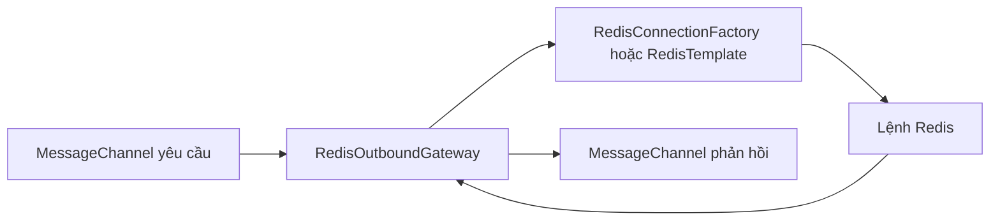

# Redis outbound command gateway

## Mục tiêu

Sau bài học, bạn có thể:

- Giải thích vai trò của `RedisOutboundGateway` trong một luồng Spring Integration.
- Ánh xạ `Message` thành tên lệnh Redis và danh sách đối số của lệnh.
- Cấu hình `RedisConnectionFactory` hoặc `RedisTemplate`, bộ tuần tự hóa đối số và kênh phản hồi.
- Đọc kiểu kết quả do từng lệnh Redis trả về, xử lý trường hợp kết quả `null` và thiết kế retry an toàn.
- Phân biệt command gateway với Redis publish, queue và store outbound adapter.

## Gateway giải quyết vấn đề gì?

Một luồng Spring Integration thường nhận và biến đổi `Message<?>`. Khi cần gọi một thao tác Redis, bạn có thể viết một service riêng dùng `RedisTemplate`. Tuy nhiên, nếu muốn giữ thao tác Redis như một endpoint trong luồng, có kênh yêu cầu, kênh phản hồi và khả năng định tuyến tiếp kết quả, `RedisOutboundGateway` là lựa chọn phù hợp.

Redis outbound command gateway thực thi một lệnh Redis thông qua API tổng quát `RedisConnection#execute`. Lệnh được chọn từ cấu hình hoặc từ message; các đối số được lấy từ payload hay chiến lược ánh xạ đã cấu hình. Kết quả lệnh được đóng gói thành message phản hồi để các endpoint phía sau tiếp tục xử lý.



Gateway phù hợp khi cần gọi trực tiếp các lệnh như `GET`, `SET`, `INCR`, `MGET` hoặc một lệnh Redis khác mà các adapter chuyên biệt không biểu diễn được. Nó thực thi lệnh khi nhận message; đây không phải một nguồn polling.

## Hợp đồng message yêu cầu và phản hồi

Gateway nhận một Spring Integration `Message`. Các thành phần chính của hợp đồng là:

| Thành phần | Vai trò |
|---|---|
| `payload` | Nguồn đối số mặc định của lệnh nếu không cấu hình `argument-expressions` hoặc `arguments-strategy`. |
| Header `redis_command` | Nguồn tên lệnh mặc định khi không đặt một `command-expression` khác. |
| `command-expression` | SpEL expression trả về tên lệnh Redis. Có thể đặt cố định, ví dụ `'INCR'`, hoặc tính từ message. Biểu thức không được trả về `null`. |
| `argument-expressions` | Danh sách SpEL expression, phân tách bằng dấu phẩy, tạo các đối số theo đúng thứ tự mà lệnh Redis yêu cầu. |
| `arguments-strategy` | Một triển khai `ArgumentsStrategy` tùy chỉnh để ánh xạ message thành các đối số. Không dùng đồng thời với `argument-expressions`. |
| `arguments-serializer` | `RedisSerializer` dùng để chuyển từng đối số thành `byte[]` khi cần. |
| Message phản hồi | Payload là kết quả lệnh. Kiểu dữ liệu phụ thuộc vào lệnh và Redis client; gateway không đảm bảo mọi kết quả đều là `String`. |

Nếu không cấu hình chiến lược đối số hay `argument-expressions`, gateway dùng payload làm nguồn đối số. Ví dụ, với `INCR`, payload có thể là tên key cần tăng. Với `SET`, lệnh cần ít nhất key và value, vì vậy cần ánh xạ hai đối số theo đúng thứ tự.

Tên lệnh mặc định được đọc từ header `redis_command`. Nếu dùng command expression cố định, chẳng hạn `'INCR'`, message không cần header này. Khi dùng lệnh động, hãy kiểm tra và giới hạn các giá trị được phép trước khi gửi message vào gateway.

## Kết nối Redis

Spring Integration dùng các abstraction của Spring Data Redis để tạo kết nối. Ứng dụng cần dependency `spring-integration-redis` và một Redis client tương thích, thường là Lettuce hoặc Jedis. Hãy dùng các phiên bản tương thích với Spring Boot hoặc Spring Integration BOM của dự án.

Gateway nhận một trong hai cấu hình:

- `RedisConnectionFactory`: abstraction quản lý kết nối Redis; nếu không chỉ định rõ, endpoint có thể sử dụng bean tên `redisConnectionFactory`.
- `RedisTemplate`: dùng khi ứng dụng đã có template được cấu hình và muốn truyền bean đó cho gateway.

Hai thuộc tính `connection-factory` và `redis-template` loại trừ lẫn nhau. Chọn một trong hai. Với cấu hình Java, constructor của `RedisOutboundGateway` cũng nhận một trong hai loại bean này.

## Ví dụ: tăng bộ đếm bằng `INCR`

Ví dụ sau nhận tên key từ payload, thực thi `INCR` và gửi giá trị mới vào một `QueueChannel` để endpoint hoặc service khác đọc.

```java
import org.springframework.context.annotation.Bean;
import org.springframework.context.annotation.Configuration;
import org.springframework.data.redis.connection.RedisConnectionFactory;
import org.springframework.data.redis.serializer.StringRedisSerializer;
import org.springframework.integration.channel.DirectChannel;
import org.springframework.integration.channel.QueueChannel;
import org.springframework.integration.dsl.IntegrationFlow;
import org.springframework.integration.redis.dsl.Redis;
import org.springframework.messaging.Message;
import org.springframework.messaging.MessageChannel;
import org.springframework.messaging.PollableChannel;
import org.springframework.messaging.support.MessageBuilder;

@Configuration
class RedisCommandFlowConfiguration {

    @Bean
    MessageChannel redisCommandRequests() {
        return new DirectChannel();
    }

    @Bean
    PollableChannel redisCommandReplies() {
        return new QueueChannel();
    }

    @Bean
    IntegrationFlow incrementRedisCounter(RedisConnectionFactory connectionFactory) {
        return IntegrationFlow.from("redisCommandRequests")
                .handle(Redis.outboundGateway(connectionFactory)
                        .command("INCR")
                        .argumentsSerializer(new StringRedisSerializer()))
                .channel("redisCommandReplies")
                .get();
    }
}
```

Các import liên quan đến DSL gồm `org.springframework.integration.redis.dsl.Redis`; serializer là `org.springframework.data.redis.serializer.StringRedisSerializer`. Ví dụ giả định bean `RedisConnectionFactory` đã được cấu hình để kết nối tới Redis.

Gửi yêu cầu và đọc phản hồi từ service đã được inject hai channel bean:

```java
Long increment(MessageChannel redisCommandRequests, PollableChannel redisCommandReplies) {
    redisCommandRequests.send(
            MessageBuilder.withPayload("metrics:orders").build());

    Message<?> reply = redisCommandReplies.receive(1_000);
    return reply == null ? null : (Long) reply.getPayload();
}
```

`metrics:orders` là key được truyền làm đối số cho `INCR`. Redis tăng giá trị nguyên tại key đó và trả về giá trị mới; với lệnh này, kết quả thường được biểu diễn bằng `Long`. Lệnh `INCR` tự khởi tạo key với giá trị `0` trước khi tăng nếu key chưa tồn tại. Nếu key đang chứa dữ liệu không phải số nguyên hợp lệ, Redis trả lỗi.

Trong ví dụ, `DirectChannel` gọi handler ngay trong luồng gửi message. `QueueChannel` giữ message phản hồi để bên gọi đọc bằng `receive`. Nếu dùng `ExecutorChannel` hoặc một kênh bất đồng bộ khác, hãy thiết kế việc chờ và tương quan phản hồi phù hợp với mô hình xử lý của ứng dụng.

## Ánh xạ nhiều đối số bằng XML

Với lệnh cần nhiều đối số, `argument-expressions` xác định từng giá trị theo đúng thứ tự của lệnh Redis. Ví dụ dưới đây ghi payload vào key `orders:1001` bằng lệnh `SET`:

```xml
<bean id="redisStringSerializer"
      class="org.springframework.data.redis.serializer.StringRedisSerializer" />

<int-redis:outbound-gateway
        request-channel="redisSetRequests"
        reply-channel="redisSetReplies"
        connection-factory="redisConnectionFactory"
        command-expression="'SET'"
        argument-expressions="'orders:1001', payload"
        arguments-serializer="redisStringSerializer" />
```

Trong cấu hình này, biểu thức thứ nhất tạo đối số key, biểu thức thứ hai lấy value từ payload. `StringRedisSerializer` tuần tự hóa các đối số gửi tới Redis; đây là serializer cho đối số lệnh, không phải cam kết rằng payload phản hồi sẽ tự động được chuyển thành `String`.

Nếu cần quyết định số lượng hoặc cấu trúc đối số bằng logic Java, triển khai `ArgumentsStrategy` và gắn nó vào gateway. Không cấu hình đồng thời `arguments-strategy` và `argument-expressions`. Khi `argument-expressions` được dùng, thuộc tính `use-command-variable` có thể đưa tên lệnh đã đánh giá vào biến `#cmd` trong ngữ cảnh SpEL; thuộc tính này không có tác dụng nếu không dùng `argument-expressions`.

## Phản hồi và các thuộc tính quan trọng

| Thuộc tính | Ý nghĩa và cách dùng |
|---|---|
| `request-channel` | Kênh nhận các message yêu cầu. |
| `reply-channel` | Kênh nhận message phản hồi. Có thể dùng reply channel từ header của message theo cơ chế gateway chung của Spring Integration. |
| `requires-reply` | Mặc định `true`. Nếu Redis trả `null`, gateway phát sinh `ReplyRequiredException`. Đặt `false` khi kết quả `null` là tình huống hợp lệ và luồng chấp nhận không phát message phản hồi. |
| `reply-timeout` | Thời gian chờ gửi message phản hồi, hữu ích với reply channel có giới hạn dung lượng. Đây không phải timeout thực thi lệnh hay timeout kết nối Redis. |
| `arguments-serializer` | Tuần tự hóa từng đối số lệnh thành byte array khi cần. Chọn serializer thống nhất với cách ứng dụng ghi và đọc dữ liệu Redis. |

Kiểu kết quả phụ thuộc lệnh. `INCR` trả về giá trị số; `MGET` có thể trả về `List<byte[]>`. Vì vậy, hãy xác định hợp đồng kiểu dữ liệu cho từng flow và chuyển đổi kết quả ở endpoint phía sau nếu logic nghiệp vụ cần một kiểu cụ thể. Đừng ép mọi payload phản hồi thành chuỗi.

Một số tình huống cần chú ý:

- `GET` với key chưa tồn tại có thể trả `null`. Nếu giữ `requires-reply=true`, gateway sẽ báo `ReplyRequiredException`; nếu đây là trường hợp bình thường, cân nhắc `requires-reply=false` và thiết kế nhánh xử lý không có phản hồi.
- Lỗi kết nối, lỗi lệnh Redis và lỗi tuần tự hóa có thể làm endpoint thất bại. Đưa lỗi vào cơ chế xử lý lỗi của Spring Integration, ghi log có ngữ cảnh và phân loại lỗi có thể retry với lỗi cần xử lý thủ công.
- Cấu hình timeout kết nối và timeout thao tác ở Redis client/connection factory. `reply-timeout` chỉ điều khiển việc gửi message phản hồi tới channel.

## Retry, tính nhất quán và bảo mật

Một lệnh Redis có thể được thực thi thành công ở server nhưng phản hồi bị mất trên đường truyền. Khi ứng dụng retry vì không nhận được phản hồi, nó không luôn biết lần thực thi trước đã xảy ra hay chưa. Do đó, retry phải dựa trên tính idempotent của lệnh và nghiệp vụ:

- Gửi lại `SET` với cùng key và cùng value thường cho cùng trạng thái cuối.
- Gửi lại `INCR`, `LPUSH` hoặc một lệnh cộng dồn có thể thay đổi trạng thái thêm lần nữa. Không tự động retry các lệnh này nếu chưa có khóa idempotency, cơ chế chống trùng hoặc thiết kế nghiệp vụ phù hợp.
- Với thao tác cần nhiều bước, xem xét script Lua hoặc cơ chế nguyên tử phù hợp của Redis thay vì giả định nhiều message riêng lẻ tạo thành một transaction.

Lệnh động cần được giới hạn bằng allowlist; không để dữ liệu bên ngoài tùy ý chọn lệnh. Dùng Redis ACL với quyền tối thiểu, phân vùng key theo namespace của ứng dụng và tránh cấp quyền cho các lệnh quản trị nguy hiểm trong luồng nghiệp vụ. Cân nhắc chi phí của lệnh trên dữ liệu lớn; ví dụ `KEYS` có thể chặn Redis khi keyspace lớn, nên chọn cách tra cứu phù hợp với cấu trúc dữ liệu.

## Phân biệt với các Redis outbound endpoint khác

| Endpoint | Thao tác chính | Có trả kết quả lệnh về flow? |
|---|---|---|
| Redis outbound channel adapter | Publish message lên Redis topic bằng Pub/Sub. | Không; đây là adapter gửi một chiều. |
| Redis queue outbound channel adapter | Đẩy payload vào Redis List. | Không; đây là adapter gửi một chiều. |
| Redis store outbound channel adapter | Ghi payload vào collection như List, Set, ZSet, Map hoặc Properties. | Không theo mô hình command reply. |
| Redis outbound command gateway | Thực thi lệnh Redis tùy chọn qua `RedisConnection#execute`. | Có; kết quả lệnh trở thành message phản hồi. |
| Redis queue outbound gateway | Gửi yêu cầu theo giao thức queue request/reply dùng conversation UUID và các Redis List. | Có; phản hồi đến qua giao thức queue riêng. |

Điểm phân biệt quan trọng là command gateway trả kết quả của chính lệnh Redis được gọi. Queue outbound gateway lại phối hợp hai phía qua các list và mã hội thoại; hai endpoint không thay thế cho nhau.

## Thực hành

1. Cấu hình Redis client và `RedisConnectionFactory`, sau đó tạo flow nhận message trên một `DirectChannel`.
2. Dùng command gateway thực thi `INCR` với payload là tên key. Xác minh kiểu và giá trị phản hồi qua `QueueChannel`.
3. Đổi sang `GET` với key chưa tồn tại. Quan sát hành vi khi `requires-reply=true`, sau đó thử `false` và thiết kế cách xử lý trường hợp không có message phản hồi.
4. Cấu hình `SET` với hai đối số bằng `argument-expressions`; xác minh serializer ghi đúng key và value bằng một Redis client độc lập.
5. Mô phỏng lỗi kết nối và đánh giá lệnh nào có thể retry an toàn. Đặc biệt kiểm tra tình huống `INCR` đã chạy ở Redis nhưng client không nhận được phản hồi.

## Lỗi thường gặp

- Thiếu header `redis_command` trong khi không đặt `command-expression`, khiến gateway không xác định được lệnh.
- Đặt `command-expression` trả về `null`.
- Truyền sai số lượng hoặc thứ tự đối số; ví dụ `SET` cần key trước value.
- Dùng serializer không tương thích với kiểu dữ liệu mà Redis đang lưu, dẫn tới giá trị đọc được là byte array không như mong đợi hoặc lệnh bị lỗi.
- Mong đợi mọi lệnh trả về `String`, trong khi kiểu kết quả phụ thuộc lệnh và Redis client.
- Hiểu nhầm `reply-timeout` là timeout của lệnh Redis.
- Retry mù quáng các lệnh không idempotent sau timeout, gây tăng bộ đếm hoặc ghi dữ liệu lặp.

## Kết luận

`RedisOutboundGateway` đưa thao tác Redis vào flow theo mô hình yêu cầu/phản hồi: message đầu vào xác định lệnh và đối số, gateway gọi Redis, rồi kết quả được gửi tiếp qua reply channel. Thiết kế tốt cần xác định rõ hợp đồng message, serializer, kiểu phản hồi, hành vi khi kết quả `null`, timeout và chính sách retry cho từng lệnh.

## Tài liệu tham khảo

- [Spring Integration Reference — Redis Support](https://docs.spring.io/spring-integration/reference/redis.html)
- [Spring Data Redis Reference](https://docs.spring.io/spring-data/redis/reference/)
