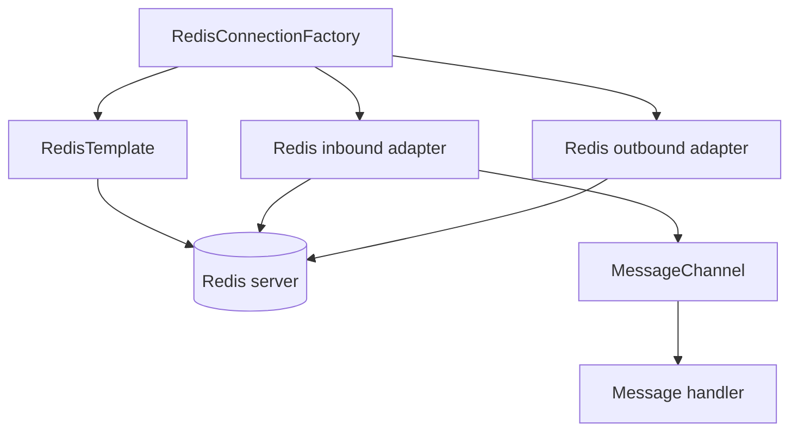

# Redis connection factory và serializer

## Mục tiêu

Trong Spring Integration, các Redis adapter cần một kết nối tới Redis và một quy ước chuyển đổi dữ liệu thống nhất với ứng dụng gửi message. Bài này trình bày vai trò của `RedisConnectionFactory`, cách cấu hình kết nối bằng Lettuce hoặc Spring Boot, cách chọn serializer cho key và value, và cách bảo đảm producer, inbound adapter, outbound adapter cùng hiểu một định dạng message.

Nội dung thuộc module `SPRING_INTEGRATION_ADAPTERS`: kết nối hệ thống ngoài vào flow Spring Integration qua adapter, gateway và `MessageChannel`. Redis là một ví dụ cụ thể để thực hành cấu hình kết nối, hợp đồng message, xử lý lỗi và vòng đời tài nguyên.

## RedisConnectionFactory làm nhiệm vụ gì?

`RedisConnectionFactory` là abstraction của Spring Data Redis dùng để tạo các kết nối Redis. Các thành phần như `RedisTemplate`, `StringRedisTemplate` và nhiều endpoint của Spring Integration nhận factory này thay vì tự quản lý socket, giao thức RESP, xác thực hoặc việc tạo kết nối.

Trong một flow, factory thường được khai báo thành Spring bean rồi inject vào adapter. Adapter sử dụng factory để thực hiện thao tác Redis; flow tập trung vào việc chuyển message qua `MessageChannel` và xử lý nghiệp vụ.



Factory không quyết định cấu trúc JSON hay cách mã hóa payload. Đó là trách nhiệm của serializer và hợp đồng dữ liệu. Cần phân biệt ba lớp:

| Thành phần | Trách nhiệm |
|---|---|
| `RedisConnectionFactory` | Tạo kết nối và áp dụng cấu hình client, endpoint, xác thực, TLS, timeout |
| Redis operation / template / adapter | Thực hiện lệnh như `GET`, `SET`, `LPUSH`, `BRPOP` hoặc thao tác tương ứng |
| `RedisSerializer` | Chuyển key và value giữa byte trong Redis với kiểu dữ liệu Java |

Một factory có thể được nhiều template và adapter dùng chung. Không nên tạo một factory mới cho từng message hoặc mỗi lần gọi handler; việc đó làm tăng chi phí kết nối và khiến vòng đời tài nguyên khó kiểm soát.

## Chọn client và cấu hình kết nối

Spring Data Redis hỗ trợ các client như Lettuce và Jedis. Lettuce dựa trên Netty và hỗ trợ API đồng bộ, bất đồng bộ, reactive; đây là lựa chọn thường gặp trong các ứng dụng Spring Boot hiện đại. Jedis cũng có thể được dùng khi ứng dụng đã chuẩn hóa theo client đó. Chọn một client phù hợp với stack, cách sử dụng và yêu cầu vận hành của hệ thống; tránh để nhiều thư viện client không cần thiết cùng tồn tại.

Với Spring Boot, có thể để auto-configuration tạo `RedisConnectionFactory` từ cấu hình bên ngoài. Ví dụ cho Spring Boot 3:

```yaml
spring:
  data:
    redis:
      host: ${REDIS_HOST:localhost}
      port: ${REDIS_PORT:6379}
      username: ${REDIS_USERNAME:}
      password: ${REDIS_PASSWORD:}
      database: 0
      timeout: 2s
```

Tên prefix cấu hình có thể khác ở các thế hệ Spring Boot cũ; hãy dùng đúng tài liệu của phiên bản ứng dụng. Giá trị nhạy cảm nên lấy từ secret manager hoặc biến môi trường do nền tảng triển khai cung cấp. Không commit mật khẩu Redis vào repository.

Nếu cần cấu hình thủ công, có thể khai báo `LettuceConnectionFactory` với `RedisStandaloneConfiguration`:

```java
import java.time.Duration;

import org.springframework.context.annotation.Bean;
import org.springframework.context.annotation.Configuration;
import org.springframework.data.redis.connection.RedisPassword;
import org.springframework.data.redis.connection.RedisStandaloneConfiguration;
import org.springframework.data.redis.connection.lettuce.LettuceClientConfiguration;
import org.springframework.data.redis.connection.lettuce.LettuceConnectionFactory;

@Configuration
class RedisConnectionConfiguration {

    @Bean
    LettuceConnectionFactory redisConnectionFactory() {
        RedisStandaloneConfiguration server =
                new RedisStandaloneConfiguration("localhost", 6379);
        server.setDatabase(0);
        // Lấy mật khẩu từ cấu hình bảo mật của môi trường triển khai.
        // server.setPassword(RedisPassword.of(redisPassword));

        LettuceClientConfiguration client =
                LettuceClientConfiguration.builder()
                        .commandTimeout(Duration.ofSeconds(2))
                        .shutdownTimeout(Duration.ZERO)
                        .build();

        return new LettuceConnectionFactory(server, client);
    }
}
```

Đây là ví dụ Redis standalone cho môi trường phát triển. Khi triển khai, thay host, port, database và thông tin xác thực bằng cấu hình môi trường. Nếu Redis yêu cầu TLS, bật SSL trong `LettuceClientConfiguration` và cấu hình trust material theo chính sách của tổ chức. Với Redis Sentinel hoặc Cluster, dùng cấu hình topology tương ứng thay vì mô hình standalone.

Timeout cần được chọn theo thời gian phản hồi của Redis và đặc điểm thao tác. Timeout quá ngắn gây lỗi giả khi hệ thống tải cao; timeout quá dài khiến request hoặc worker bị giữ lâu khi Redis không phản hồi. Với thao tác blocking pop của queue adapter, cần phân biệt thời gian chờ lấy message với command timeout và thời gian dừng ứng dụng. Chúng có mục đích khác nhau.

### Kết nối và vòng đời

`LettuceConnectionFactory` là Spring bean có vòng đời quản lý. Để container Spring khởi tạo và đóng factory theo lifecycle của ứng dụng. Không tự gọi `destroy()` sau mỗi message. Khi shutdown, ứng dụng nên ngừng nhận công việc, hoàn tất hoặc xử lý các tác vụ đang chạy theo chính sách của hệ thống, rồi đóng tài nguyên Redis.

Lettuce có thể chia sẻ kết nối ở nhiều chế độ sử dụng; không mặc định rằng mọi thao tác đều cần một connection pool. Pool chỉ nên bật khi kiểu sử dụng và số lượng kết nối đồng thời thực sự cần nó, và phải đặt giới hạn phù hợp. Đối với blocking command, hãy đánh giá riêng số tác vụ chờ, connection được giữ trong lúc chờ và tài nguyên còn lại cho các lệnh thông thường.

## Serializer là hợp đồng byte giữa các ứng dụng

Redis lưu key và value dưới dạng byte. Khi ứng dụng Java ghi một đối tượng, serializer chuyển đối tượng đó thành byte; khi đọc, serializer chuyển byte trở lại kiểu Java. Nếu producer và consumer dùng serializer khác nhau, consumer có thể nhận dữ liệu không giải mã được hoặc diễn giải sai payload.

`RedisTemplate` có serializer cho nhiều vị trí khác nhau:

| Serializer | Dữ liệu được chuyển đổi |
|---|---|
| Key serializer | Key của các cấu trúc Redis như string, list, set |
| Value serializer | Value của thao tác key-value |
| Hash key serializer | Field name trong Redis Hash |
| Hash value serializer | Value của từng field trong Redis Hash |
| Default serializer | Serializer dự phòng khi vị trí cụ thể không được cấu hình |

Không nên chỉ đặt value serializer rồi cho rằng key và hash cũng đã có cùng định dạng. Cần xác định rõ từng vị trí được sử dụng trong ứng dụng.

### StringRedisSerializer và StringRedisTemplate

Khi message là text hoặc JSON text, `StringRedisSerializer` là lựa chọn đơn giản. `StringRedisTemplate` được cấu hình sẵn để làm việc với chuỗi và thường phù hợp cho producer ghi JSON vào Redis List.

```java
import org.springframework.data.redis.core.StringRedisTemplate;
import org.springframework.stereotype.Component;

@Component
class OrderQueuePublisher {

    private final StringRedisTemplate redis;

    OrderQueuePublisher(StringRedisTemplate redis) {
        this.redis = redis;
    }

    void publish(String json) {
        redis.opsForList().leftPush("orders:in", json);
    }
}
```

Trong ví dụ này, `json` đã là chuỗi JSON được tạo từ DTO bằng `ObjectMapper`. Redis nhận byte của chuỗi; consumer cũng phải đọc và giải mã chuỗi theo cùng quy ước.

Nếu cần `RedisTemplate` riêng, cấu hình rõ serializer cho key, value và hash:

```java
import org.springframework.context.annotation.Bean;
import org.springframework.context.annotation.Configuration;
import org.springframework.data.redis.connection.RedisConnectionFactory;
import org.springframework.data.redis.core.RedisTemplate;
import org.springframework.data.redis.serializer.StringRedisSerializer;

@Configuration
class RedisTemplateConfiguration {

    @Bean
    RedisTemplate<String, String> textRedisTemplate(
            RedisConnectionFactory connectionFactory) {
        RedisTemplate<String, String> template = new RedisTemplate<>();
        StringRedisSerializer strings = new StringRedisSerializer();

        template.setConnectionFactory(connectionFactory);
        template.setKeySerializer(strings);
        template.setValueSerializer(strings);
        template.setHashKeySerializer(strings);
        template.setHashValueSerializer(strings);
        template.afterPropertiesSet();
        return template;
    }
}
```

### JSON và DTO

JSON giúp producer và consumer ít phụ thuộc vào class Java của nhau. Producer chuyển DTO thành JSON text; consumer nhận chuỗi rồi chuyển thành DTO bằng `ObjectMapper`.

```java
import com.fasterxml.jackson.core.JsonProcessingException;
import com.fasterxml.jackson.databind.ObjectMapper;

record OrderCreated(String eventId, String orderId, int schemaVersion) {}

class OrderJsonCodec {

    private final ObjectMapper objectMapper;

    OrderJsonCodec(ObjectMapper objectMapper) {
        this.objectMapper = objectMapper;
    }

    String encode(OrderCreated event) throws JsonProcessingException {
        return objectMapper.writeValueAsString(event);
    }

    OrderCreated decode(String json) throws JsonProcessingException {
        return objectMapper.readValue(json, OrderCreated.class);
    }
}
```

Hãy định nghĩa schema và version của message. Khi thêm field mới, xác định field đó có bắt buộc không và consumer cũ có thể bỏ qua hay không. Khi đổi kiểu field hoặc ý nghĩa nghiệp vụ, tăng version và triển khai quy tắc tương thích. Không dùng tên class Java làm hợp đồng duy nhất giữa các dịch vụ độc lập.

### Java serialization

Một số cấu hình mặc định hoặc cấu hình cũ có thể sử dụng `JdkSerializationRedisSerializer`. Cách này chuyển đối tượng Java thành dạng nhị phân phụ thuộc vào cơ chế serialization của Java và class tương ứng. Nó tiện trong hệ thống Java đồng nhất, nhưng làm producer và consumer phụ thuộc chặt vào class, serialVersionUID và phiên bản triển khai. Payload cũng khó kiểm tra trực tiếp bằng công cụ Redis.

Với tích hợp giữa nhiều dịch vụ hoặc cần tiến hóa schema, JSON hoặc một định dạng có schema rõ ràng thường dễ vận hành hơn. Không deserialize dữ liệu Java không đáng tin cậy từ bên ngoài; chỉ nhận payload từ nguồn được kiểm soát và dùng định dạng có quy tắc xác thực.

## Cấu hình serializer cho Redis adapter

Một điểm dễ nhầm là cấu hình serializer của `RedisTemplate` không tự động có nghĩa mọi Spring Integration Redis adapter sẽ dùng chính template bean đó. Adapter có thể quản lý thao tác Redis nội bộ dựa trên `RedisConnectionFactory` và có cấu hình serializer riêng. Vì vậy cần kiểm tra đúng API của phiên bản Spring Integration đang dùng và cấu hình serializer trực tiếp trên endpoint nếu endpoint hỗ trợ thuộc tính đó.

Ví dụ inbound adapter nhận JSON text từ Redis List:

```java
import org.springframework.context.annotation.Bean;
import org.springframework.context.annotation.Configuration;
import org.springframework.data.redis.connection.RedisConnectionFactory;
import org.springframework.data.redis.serializer.StringRedisSerializer;
import org.springframework.integration.dsl.IntegrationFlow;
import org.springframework.integration.redis.inbound.RedisQueueInboundChannelAdapter;

@Configuration
class RedisInboundConfiguration {

    @Bean
    IntegrationFlow ordersInboundFlow(
            RedisConnectionFactory connectionFactory,
            OrderHandler orderHandler) {
        RedisQueueInboundChannelAdapter adapter =
                new RedisQueueInboundChannelAdapter(
                        connectionFactory, "orders:in");
        adapter.setSerializer(new StringRedisSerializer());

        return IntegrationFlow.from(adapter)
                .handle(orderHandler, "handle")
                .get();
    }
}
```

`OrderHandler` trong ví dụ nhận payload chuỗi, xác thực envelope rồi giải mã JSON. Nếu phiên bản thư viện đang dùng có API cấu hình serializer khác, hãy áp dụng API tương ứng của phiên bản đó; nguyên tắc là serializer của adapter phải khớp với cách producer ghi dữ liệu. Không dựa vào serializer của một bean khác nếu endpoint không sử dụng bean đó.

Với outbound adapter, áp dụng cùng nguyên tắc: chọn serializer ghi payload thành byte theo hợp đồng của queue và bảo đảm inbound consumer đọc được đúng định dạng. Nếu một bên ghi JSON text còn bên kia dùng Java serialization, hai bên không thể trao đổi message hợp lệ dù cùng kết nối tới một Redis server.

## Theo dõi byte và kiểm tra dữ liệu thực tế

Khi điều tra lỗi serializer, hãy xác định dữ liệu được ghi vào key nào, cấu trúc Redis là gì và byte được chuyển đổi ở lớp nào. Redis CLI hiển thị chuỗi dễ đọc nếu dữ liệu là text; payload nhị phân có thể hiện ký tự khó đọc. Đừng kết luận dữ liệu bị hỏng chỉ từ cách terminal hiển thị byte.

Một số kiểm tra hữu ích trong môi trường phát triển:

```text
TYPE orders:in
LLEN orders:in
LRANGE orders:in 0 4
```

Các lệnh trên xác nhận kiểu dữ liệu và một phần nội dung List. Không chạy lệnh xóa hoặc pop trên queue production để thử nghiệm vì thao tác đó có thể làm mất message đang chờ xử lý. Nếu cần kiểm tra payload, dùng queue thử nghiệm riêng hoặc một bản sao dữ liệu đã được phép sử dụng.

Khi ghi log, ưu tiên event ID, correlation ID, schema version và kết quả giải mã. Tránh ghi thông tin cá nhân, token, mật khẩu hoặc toàn bộ payload nhạy cảm. Có thể ghi độ dài payload và loại lỗi để chẩn đoán mà không làm lộ dữ liệu.

## Xử lý lỗi kết nối và lỗi serialization

Lỗi kết nối và lỗi serializer cần được phân loại riêng:

| Loại lỗi | Ví dụ | Hướng xử lý |
|---|---|---|
| Kết nối | Redis không reachable, xác thực sai, TLS handshake lỗi | Kiểm tra endpoint, secret, chứng chỉ, network policy và timeout; retry có backoff khi lỗi có thể hồi phục |
| Serialization | Không giải mã được byte, sai charset, payload không đúng kiểu | Kiểm tra serializer ở producer và consumer, key/value serializer và schema thực tế |
| Schema | Thiếu field bắt buộc, version không hỗ trợ | Từ chối có kiểm soát, đưa message sang DLQ hoặc vùng cách ly |
| Nghiệp vụ | Dữ liệu hợp lệ về cấu trúc nhưng vi phạm quy tắc đơn hàng | Trả lỗi nghiệp vụ hoặc chuyển sang quy trình xử lý thủ công theo chính sách |

Retry kết nối không sửa được payload sai định dạng. Ngược lại, chuyển payload hợp lệ vào DLQ chỉ vì Redis tạm thời mất kết nối có thể làm tăng thao tác không cần thiết. Xác định lỗi ở bước lấy message, deserialize, chuyển đổi hay xử lý nghiệp vụ để chọn chính sách phù hợp.

Với queue List, cần nhớ rằng thao tác lấy phần tử có thể đã loại nó khỏi List trước khi flow hoàn tất xử lý. Nếu consumer dừng sau khi nhận message, việc retry kết nối không tự khôi phục phần tử đã pop. Nếu yêu cầu cần acknowledgement, pending message và khả năng claim lại sau crash, hãy đánh giá Redis Streams consumer group hoặc một broker có cơ chế xác nhận phù hợp.

## Kiểm thử cấu hình

Kiểm thử tích hợp với Redis thật giúp xác minh factory, serializer và adapter phối hợp đúng. Có thể dùng Redis Testcontainers để khởi tạo server tạm thời trong test.

Một bộ kiểm thử nên bao gồm:

1. Tạo Redis container và khởi tạo `RedisConnectionFactory` bằng host, port được container cung cấp.
2. Ghi một JSON text bằng `StringRedisTemplate` vào queue thử nghiệm.
3. Khởi chạy inbound adapter với `StringRedisSerializer` và xác minh handler nhận đúng chuỗi.
4. Giải mã JSON thành DTO, xác minh event ID, schema version và field nghiệp vụ.
5. Thử payload sai JSON hoặc version không hỗ trợ để xác minh error flow/DLQ.
6. Xác minh ứng dụng đóng factory và adapter theo lifecycle khi context dừng.

Nên có thêm kiểm thử tương thích giữa producer và consumer khi schema thay đổi. Mock `RedisConnectionFactory` có thể hữu ích cho unit test logic handler, nhưng không thay thế kiểm thử tích hợp serializer và lệnh Redis thực tế.

## Checklist triển khai

- [ ] Chọn client Redis và topology phù hợp: standalone, Sentinel hoặc Cluster.
- [ ] Cấu hình host, port, database, username/password, TLS và timeout từ môi trường.
- [ ] Dùng một `RedisConnectionFactory` được quản lý bởi Spring container.
- [ ] Xác định serializer cho key, value, hash key và hash value.
- [ ] Producer, inbound adapter và outbound adapter dùng chung quy ước byte.
- [ ] Dùng JSON hoặc định dạng có schema cho message trao đổi giữa dịch vụ.
- [ ] Có version, event ID và correlation ID khi nghiệp vụ cần.
- [ ] Phân biệt lỗi kết nối, lỗi serialization, lỗi schema và lỗi nghiệp vụ.
- [ ] Có kiểm thử tích hợp với Redis và kiểm thử lifecycle khi shutdown.
- [ ] Không ghi secret hoặc payload nhạy cảm vào log.

## Kết luận

`RedisConnectionFactory` cung cấp kết nối Redis cho template và Spring Integration adapter; serializer quyết định byte được ghi và cách byte đó trở lại thành dữ liệu Java. Hai cấu hình này giải quyết hai trách nhiệm riêng nhưng phải phối hợp nhất quán. Khi producer và consumer thống nhất key, serializer và schema, Redis adapter có thể đưa message vào hoặc ra `MessageChannel` một cách dự đoán được. Khi gặp lỗi, hãy xác định đó là lỗi kết nối, giải mã hay nghiệp vụ để xử lý đúng tầng và giữ vòng đời tài nguyên trong quyền quản lý của Spring.
