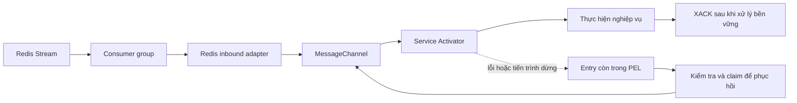

# Consumer group và stream offset

Trong module `SPRING_INTEGRATION_ADAPTERS`, Redis Stream là một nguồn message có thể kết nối với Spring Integration thông qua inbound adapter. Consumer group giúp nhiều instance cùng xử lý một stream; stream ID, trạng thái đã giao và danh sách pending quyết định message nào được đọc lại, message nào cần xác nhận và message nào cần phục hồi sau sự cố.

Khi thiết kế luồng này, cần phân biệt **đã được giao cho consumer** với **đã xử lý thành công**. Redis ghi nhận hai trạng thái đó riêng biệt. Hiểu đúng sự khác nhau này giúp tránh mất message khi ứng dụng lỗi, đồng thời kiểm soát được việc xử lý lặp.

## Mục tiêu

Sau bài học, bạn có thể:

- Giải thích stream ID, consumer group, consumer, last-delivered ID và Pending Entries List (PEL).
- Tạo consumer group, đọc message mới và xác nhận message bằng các lệnh Redis Streams.
- Phân biệt đọc message mới với đọc lại message pending.
- Phục hồi message bị bỏ dở khi consumer dừng đột ngột.
- Thiết kế inbound adapter, MessageChannel và service handler trong Spring Integration với chiến lược acknowledgment phù hợp.
- Chọn cách retry, chống xử lý trùng và theo dõi độ trễ của consumer group.

## 1. Các khái niệm của Redis Streams

Redis Stream lưu các entry theo thứ tự. Mỗi entry có một ID và một tập field/value. Redis thường sinh ID theo dạng `<milliseconds>-<sequence>`, ví dụ `1700000000000-0`. Phần đầu thường biểu diễn thời điểm theo mili giây; phần sau phân biệt các entry có cùng mốc thời gian. ID là định danh có thứ tự, không phải số thứ tự liên tục như offset của một partition Kafka.

Một stream có thể có nhiều consumer group. Mỗi group theo dõi tiến độ đọc riêng, vì vậy hai group khác nhau có thể nhận cùng một entry độc lập. Trong một group, nhiều consumer chia nhau các entry mới.

| Thành phần | Ý nghĩa |
|---|---|
| Stream | Kho entry, ví dụ `orders` |
| Entry ID | Định danh có thứ tự của một entry, ví dụ `1700000000000-0` |
| Consumer group | Nhóm xử lý có tiến độ đọc riêng, ví dụ `order-workers` |
| Consumer | Một thành viên của group, thường đại diện cho một instance ứng dụng |
| Last-delivered ID | ID lớn nhất đã được giao cho group |
| Pending Entries List (PEL) | Danh sách entry đã giao nhưng chưa được xác nhận |
| Acknowledgment | Xác nhận entry đã được xử lý; với Redis Streams, thao tác này thường dùng `XACK` |

**Last-delivered ID không phải vị trí của message cuối cùng đã xử lý thành công.** Khi Redis giao một entry cho consumer, tiến độ giao của group có thể tăng ngay cả khi entry đó vẫn còn trong PEL. Lệnh `XACK` loại entry khỏi PEL; nó không xóa entry khỏi stream và cũng không phải thao tác xóa stream ID.

Có thể hình dung một group đang ở trạng thái:

- Last-delivered ID là `105-0`.
- Entry `103-0` đã được xác nhận.
- Entry `104-0` đang pending ở consumer `worker-01`.
- Entry `105-0` đang pending ở consumer `worker-02`.

Group đã giao đến `105-0`, nhưng vẫn còn hai entry chưa được xác nhận. Vì vậy, chỉ nhìn last-delivered ID không đủ để kết luận hệ thống đã xử lý xong toàn bộ message.

## 2. Consumer group vận hành như thế nào?

Khi một consumer đọc entry mới bằng ID đặc biệt `>`, Redis chỉ trả về các entry chưa từng được giao cho consumer nào trong group đó. Redis cập nhật tiến độ giao và ghi nhận entry vào PEL, gắn với consumer nhận entry.

Sau khi xử lý thành công, ứng dụng xác nhận entry. Nếu consumer dừng trước khi xác nhận, entry vẫn nằm trong PEL. Consumer khác có thể tiếp quản entry đó sau một khoảng thời gian chờ phù hợp.

Luồng tổng quát khi kết nối Redis Streams với Spring Integration:



Inbound adapter nhận entry từ stream và chuyển dữ liệu thành Spring Message để đưa vào channel. Service Activator hoặc handler tiếp nhận payload và thực hiện nghiệp vụ. Thông tin định danh của entry phải được giữ lại trong message hoặc envelope để hệ thống có thể xác nhận đúng entry sau khi xử lý.

Trong thực tế, cách adapter đọc và xác nhận message phụ thuộc phiên bản Spring Integration, Spring Data Redis và chế độ acknowledgment được cấu hình. Hãy kiểm tra rõ adapter xác nhận tự động vào thời điểm nào, hay cho phép ứng dụng xác nhận thủ công. Nếu adapter xác nhận ngay khi vừa chuyển message vào một channel bất đồng bộ, việc service handler thất bại sau đó có thể khiến message đã bị xác nhận quá sớm. Với luồng cần bảo đảm xử lý bền vững, thời điểm xác nhận phải gắn với kết quả xử lý nghiệp vụ, không chỉ với việc message đã được gửi vào channel.

## 3. Tạo group, ghi entry và đọc message mới

Ví dụ dưới đây dùng stream `orders` và group `order-workers`.

Tạo group từ đầu stream:

```redis
XGROUP CREATE orders order-workers 0-0 MKSTREAM
```

- `orders` là tên stream.
- `order-workers` là consumer group.
- `0-0` yêu cầu group bắt đầu từ các entry hiện có trong stream.
- `MKSTREAM` tạo stream nếu key chưa tồn tại.

Nếu chỉ muốn group nhận entry được ghi sau thời điểm tạo group, có thể dùng `$` thay cho `0-0`. Lựa chọn này ảnh hưởng trực tiếp đến dữ liệu ban đầu mà group sẽ xử lý. Khi khởi tạo ứng dụng nhiều lần, cần xử lý trường hợp group đã tồn tại (`BUSYGROUP`) như một trạng thái khởi tạo bình thường, thay vì coi đó là lỗi khiến ứng dụng không thể chạy.

Ghi một order event:

```redis
XADD orders * orderId 1001 status PAID
```

Redis trả về ID của entry vừa tạo. Dùng ID này để đối chiếu khi kiểm tra pending hoặc xác nhận message.

Đọc tối đa 10 entry mới, chờ tối đa 2 giây:

```redis
XREADGROUP GROUP order-workers worker-01 COUNT 10 BLOCK 2000 STREAMS orders >
```

Ở đây, `worker-01` là tên consumer. Ký hiệu `>` yêu cầu Redis trả về entry mới chưa được giao cho consumer nào trong group. Sau khi nhận kết quả, ứng dụng xử lý từng entry và xác nhận bằng ID tương ứng:

```redis
XACK orders order-workers 1700000000000-0
```

Thay ID ví dụ bằng ID thực tế Redis trả về. Có thể xác nhận nhiều ID trong cùng một lệnh `XACK`. Chỉ xác nhận những entry đã đạt điều kiện hoàn tất theo quy tắc nghiệp vụ của ứng dụng.

## 4. Đọc lại pending và hiểu tiến độ

Có hai nhu cầu đọc khác nhau:

1. **Đọc entry mới:** dùng `>`. Redis chỉ giao entry chưa từng được giao trong group.
2. **Đọc lại entry pending của consumer hiện tại:** dùng một ID cụ thể, thường bắt đầu từ `0`, trong lệnh `XREADGROUP`. Redis trả về các entry pending thuộc consumer đang gọi lệnh đó.

Ví dụ đọc lại pending của `worker-01`:

```redis
XREADGROUP GROUP order-workers worker-01 COUNT 10 STREAMS orders 0
```

Lệnh này không có nghĩa là đọc lại toàn bộ stream từ đầu. Nó dùng để lấy lại các entry đang pending của chính consumer `worker-01`. Nếu một consumer khác đã dừng và để lại pending, consumer mới không tự nhận các entry đó chỉ bằng cách đọc `>`. Cần có bước kiểm tra và chuyển quyền sở hữu pending.

Các lệnh kiểm tra hữu ích:

```redis
XINFO GROUPS orders
XINFO CONSUMERS orders order-workers
XPENDING orders order-workers
```

`XINFO GROUPS` cho biết trạng thái các group, bao gồm last-delivered ID và một số thông tin lag tùy phiên bản Redis. `XINFO CONSUMERS` cho biết trạng thái consumer trong group. `XPENDING` cho biết số lượng và thông tin entry chưa được xác nhận. Khi điều tra sự cố, hãy xem cả tiến độ giao, pending và hoạt động của từng consumer; một con số last-delivered ID riêng lẻ không phản ánh đầy đủ tình trạng xử lý.

## 5. Phục hồi entry khi consumer gặp sự cố

Giả sử `worker-01` nhận một order event rồi bị dừng trước khi xác nhận. Entry vẫn nằm trong PEL và gắn với `worker-01`. Nếu không có cơ chế phục hồi, message có thể bị treo dù các consumer khác vẫn hoạt động.

Trước tiên, kiểm tra pending:

```redis
XPENDING orders order-workers
```

Để xem chi tiết theo khoảng ID hoặc consumer, dùng dạng mở rộng của `XPENDING`. Khi xác định entry đã nằm yên đủ lâu và consumer sở hữu nó không còn xử lý, có thể chuyển entry sang consumer khác bằng `XAUTOCLAIM` (Redis 6.2 trở lên):

```redis
XAUTOCLAIM orders order-workers worker-02 60000 0-0 COUNT 10
```

Lệnh trên tìm các entry pending có thời gian idle tối thiểu 60.000 mili giây, rồi chuyển quyền sở hữu phù hợp sang `worker-02`. Kết quả có thể gồm cursor để tiếp tục quét và các entry được claim. Khi cần xử lý nhiều pending, hãy tiếp tục từ cursor Redis trả về cho đến khi hoàn tất lượt quét.

Ngưỡng idle phải dài hơn thời gian xử lý bình thường của message, có tính đến các đợt tải cao và thời gian chờ dịch vụ phụ thuộc. Nếu đặt ngưỡng quá ngắn, một worker đang xử lý chậm có thể bị worker khác claim cùng entry. Nếu đặt quá dài, thời gian phục hồi sau sự cố sẽ tăng. Khi claim, hệ thống cần chấp nhận khả năng entry được giao lại và phải xử lý lặp an toàn.

## 6. Đưa consumer group vào Spring Integration

Trong một integration flow, inbound adapter chịu trách nhiệm kết nối với stream và consumer group; MessageChannel chuyển message đến các thành phần xử lý; service handler thực hiện nghiệp vụ. Khi cấu hình, cần xác định rõ các thông tin sau:

| Quyết định cấu hình | Điều cần xác định |
|---|---|
| Stream key | Tên stream mà adapter sẽ đọc |
| Consumer group | Nhóm xử lý dùng chung tiến độ |
| Consumer name | Tên duy nhất cho mỗi consumer đang hoạt động trong group |
| Read behavior | Đọc entry mới, đọc pending của consumer hay có cơ chế claim pending |
| Batch size | Số entry nhận trong một lần đọc |
| Block/poll timeout | Thời gian chờ entry mới trước khi tiếp tục vòng đọc |
| Message conversion | Cách ánh xạ field/value của Redis thành payload và header |
| Acknowledgment | Thời điểm và thành phần chịu trách nhiệm xác nhận |
| Error handling | Retry, error channel, chuyển message lỗi sang stream khác và cảnh báo |

Một consumer name nên phân biệt được các instance đang chạy đồng thời. Nếu nhiều instance dùng chung một consumer name, việc theo dõi pending và xác định instance sở hữu entry sẽ khó khăn hơn. Với môi trường có nhiều bản triển khai, có thể tạo tên từ định danh instance ổn định trong vòng đời tiến trình.

Cần chú ý loại channel. Với channel đồng bộ, handler có thể hoàn tất trong cùng luồng gọi trước khi adapter tiếp tục, tùy cách adapter phát message. Với channel dùng executor hoặc xử lý bất đồng bộ, adapter có thể chỉ biết rằng message đã được chuyển đi, chưa biết nghiệp vụ đã thành công. Do đó, acknowledgment phải được thiết kế cùng với ranh giới xử lý bất đồng bộ. Không suy luận rằng việc gửi message vào MessageChannel đồng nghĩa với việc xử lý đã hoàn tất.

API và tên thuộc tính cụ thể của Redis Stream inbound adapter thay đổi theo phiên bản thư viện. Khi triển khai, hãy đối chiếu phiên bản Spring Integration và Spring Data Redis đang dùng để chọn đúng builder, kiểu endpoint, chế độ đọc và API acknowledgment. Các lệnh Redis trong bài mô tả hành vi của Redis Streams; chúng không phải tên thuộc tính cấu hình mặc định của Spring.

## 7. Retry, acknowledgment và chống xử lý trùng

Redis Streams consumer group hỗ trợ giao lại message, nhưng không tự tạo ra giao dịch nguyên tử giữa Redis và cơ sở dữ liệu nghiệp vụ. Có hai tình huống phổ biến:

- **Nghiệp vụ đã commit, nhưng ứng dụng dừng trước khi XACK:** Redis vẫn giữ entry trong PEL và có thể giao lại. Handler sẽ nhìn thấy cùng một entry lần nữa.
- **Ứng dụng XACK trước khi nghiệp vụ commit:** nếu tiến trình dừng sau acknowledgment, entry đã rời PEL dù thay đổi nghiệp vụ chưa được lưu bền vững. Message có thể bị mất khỏi luồng xử lý.

Vì vậy, thứ tự an toàn thường là:

1. Nhận entry và giữ lại stream ID.
2. Kiểm tra hoặc ghi nhận khóa chống trùng.
3. Thực hiện thay đổi nghiệp vụ và commit dữ liệu bền vững.
4. Chỉ sau khi bước nghiệp vụ thành công mới xác nhận entry.
5. Nếu acknowledgment thất bại, chấp nhận khả năng message được giao lại và để cơ chế chống trùng bảo vệ dữ liệu.

Một cách phổ biến là lưu cặp `stream key + entry ID` vào bảng `processed_event` có unique constraint trong cùng transaction với cập nhật nghiệp vụ. Khi entry được giao lại, ứng dụng phát hiện khóa đã tồn tại, bỏ qua tác động nghiệp vụ lặp và tiếp tục xác nhận. Nếu nghiệp vụ gọi dịch vụ ngoài, cần có idempotency key hoặc cơ chế đối soát tương ứng.

Không nên gọi mô hình này là exactly-once chỉ vì có consumer group và `XACK`. Trong thực tế, thiết kế thường hướng tới **at-least-once delivery kết hợp xử lý idempotent**. Cách tiếp cận này làm rõ rằng một message có thể được giao nhiều lần, còn tính đúng đắn được bảo vệ ở tầng nghiệp vụ.

Với lỗi tạm thời, có thể retry có giới hạn và backoff. Với lỗi dữ liệu hoặc lỗi không thể khắc phục, có thể ghi entry cùng thông tin lỗi sang một dead-letter stream, lưu số lần thử và nguyên nhân, sau đó xác nhận entry gốc theo chính sách đã thống nhất. Việc chuyển sang dead-letter stream cũng cần idempotent để tránh tạo nhiều bản ghi lỗi khi tiến trình dừng giữa lúc ghi DLQ và xác nhận entry gốc.

## 8. Mở rộng consumer và thứ tự xử lý

Nhiều consumer trong cùng một group chia sẻ entry mới: mỗi entry mới được giao cho một consumer trong group. Nếu cần nhiều nhóm ứng dụng độc lập cùng nhận toàn bộ sự kiện, hãy tạo group riêng cho từng nhóm. Mỗi group có tiến độ và PEL riêng.

Tăng số consumer có thể tăng thông lượng, nhưng không tự bảo đảm thứ tự hoàn tất nghiệp vụ. Redis giao entry theo thứ tự stream; các handler chạy song song có thể hoàn tất theo thứ tự khác nhau. Nếu các sự kiện của cùng một order phải được xử lý tuần tự, hãy cân nhắc tuần tự hóa theo khóa nghiệp vụ, phân luồng vào các channel phù hợp hoặc giới hạn concurrency. Nếu cần mở rộng theo nhiều luồng độc lập, có thể phân chia dữ liệu vào nhiều stream theo khóa hoặc miền nghiệp vụ.

Batch size lớn có thể tăng hiệu quả đọc nhưng cũng làm tăng số message đang được giao và có thể trở thành pending nếu worker gặp sự cố. Block timeout quá ngắn làm tăng số lần polling; quá dài có thể ảnh hưởng thời gian phản hồi khi shutdown hoặc thay đổi trạng thái. Hãy chọn các giá trị dựa trên lưu lượng, thời gian xử lý và mục tiêu phục hồi của hệ thống.

## 9. Retention và giám sát

Consumer group chỉ hữu ích khi dữ liệu còn tồn tại đủ lâu để consumer xử lý hoặc phục hồi. Nếu trim stream quá sớm, entry cần điều tra hoặc phát lại có thể không còn payload để xử lý. Chính sách retention cần tính đến tốc độ tiêu thụ, thời gian outage dự kiến, pending lâu nhất và yêu cầu replay. Không dùng kích thước stream hiện tại làm chỉ báo duy nhất cho mức an toàn của retention.

Nên theo dõi tối thiểu:

- Số entry pending của từng group và tuổi của entry pending lâu nhất.
- Last-delivered ID và lag của group khi phiên bản Redis cung cấp chỉ số này.
- Số consumer đang hoạt động, consumer có idle bất thường và tốc độ xử lý.
- Tỷ lệ acknowledgment, retry, claim và dead-letter.
- Thời gian từ lúc entry được ghi đến lúc nghiệp vụ hoàn tất.

Khi một group bị chậm, hãy xác định nguyên nhân ở phía đọc, channel, handler hay dịch vụ phụ thuộc. Pending tăng có thể do handler chậm, consumer bị dừng, lỗi liên tục hoặc acknowledgment không được gọi. Một group có last-delivered ID tiến đều vẫn có thể có nhiều pending chưa được xử lý xong.

## 10. Ví dụ vận hành: xử lý order event

Giả sử hệ thống ghi sự kiện thanh toán vào stream `orders`, còn Spring Integration chuyển entry đến handler cập nhật đơn hàng.

1. Khởi tạo group `order-workers` từ `0-0` nếu cần xử lý cả dữ liệu đã có; xử lý riêng trường hợp group đã tồn tại.
2. Mỗi instance ứng dụng tham gia group bằng một consumer name riêng.
3. Inbound adapter đọc entry mới và chuyển payload cùng stream ID qua channel.
4. Service handler kiểm tra khóa chống trùng, cập nhật đơn hàng trong transaction và commit.
5. Sau khi nghiệp vụ hoàn tất, acknowledgment xác nhận đúng stream ID.
6. Nếu instance dừng trước acknowledgment, entry ở lại PEL. Bộ phục hồi kiểm tra idle time rồi claim entry sang consumer khỏe mạnh.
7. Handler nhận lại entry, nhận ra event đã được xử lý nếu transaction trước đó đã commit, rồi xác nhận entry.
8. Nếu event liên tục thất bại, ghi thông tin vào dead-letter stream theo chính sách retry và cảnh báo để người vận hành điều tra.

Quy trình này giúp hệ thống tiếp tục hoạt động sau khi một consumer dừng, đồng thời giới hạn tác động của việc giao message lặp.

## 11. Lỗi thường gặp

| Hiện tượng | Nguyên nhân có thể | Hướng kiểm tra |
|---|---|---|
| Consumer không nhận entry cũ | Group được tạo với ID `$` | Kiểm tra ID lúc tạo group; cân nhắc tạo group mới hoặc điều chỉnh quy trình replay |
| Last-delivered ID tăng nhưng pending vẫn cao | Entry đã được giao nhưng chưa được xác nhận | Kiểm tra `XPENDING`, handler và acknowledgment |
| Consumer mới không nhận pending của consumer cũ | `>` chỉ đọc entry chưa từng giao | Dùng quy trình kiểm tra pending và `XAUTOCLAIM` |
| Một entry được xử lý nhiều lần | Consumer dừng trước XACK hoặc entry được claim lại | Thiết kế handler idempotent và chọn idle threshold phù hợp |
| Entry biến mất khỏi xử lý sau lỗi | XACK xảy ra trước khi nghiệp vụ commit | Đưa acknowledgment về sau bước xử lý bền vững |
| Pending tăng liên tục | Handler chậm, lỗi lặp hoặc không xác nhận | Kiểm tra thời gian xử lý, retry, error flow và consumer health |
| Message lỗi được ghi DLQ nhiều lần | Ghi DLQ và xác nhận entry gốc không có cơ chế chống trùng | Dùng stream ID làm khóa idempotency cho thao tác DLQ |

## 12. Checklist trước khi đưa vào production

- [ ] Đã chọn rõ group bắt đầu từ `0-0` hay `$` và hiểu tác động đến dữ liệu có sẵn.
- [ ] Mỗi consumer đang hoạt động có tên phân biệt được.
- [ ] Đã xác minh thời điểm acknowledgment thực tế của phiên bản adapter đang dùng.
- [ ] Message giữ được stream ID xuyên suốt channel và handler.
- [ ] Nghiệp vụ có cơ chế chống xử lý trùng.
- [ ] Pending có quy trình quan sát, claim và retry.
- [ ] Idle threshold phù hợp với thời gian xử lý thực tế.
- [ ] Có chính sách dead-letter cho lỗi không thể retry vô hạn.
- [ ] Retention đủ dài cho outage, điều tra và replay.
- [ ] Có cảnh báo khi pending, lag hoặc tuổi message vượt ngưỡng.

## Kết luận

Consumer group phân phối entry mới giữa các consumer và duy trì trạng thái giao nhận cho từng group. Last-delivered ID biểu diễn tiến độ đã giao; PEL biểu diễn các entry đang chờ xác nhận. Trong Spring Integration, inbound adapter, MessageChannel và service handler cần phối hợp với acknowledgment để entry chỉ được xác nhận sau khi nghiệp vụ đã hoàn tất bền vững. Kết hợp quy trình phục hồi pending, xử lý idempotent và giám sát lag sẽ tạo nên một luồng Redis Streams có khả năng chịu lỗi và mở rộng tốt.

