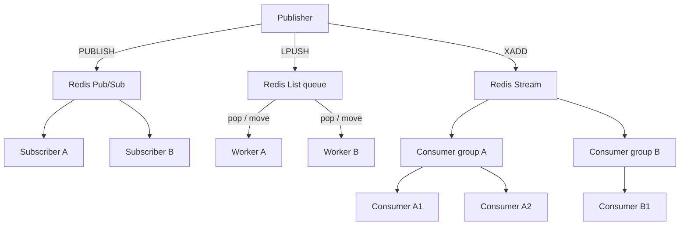
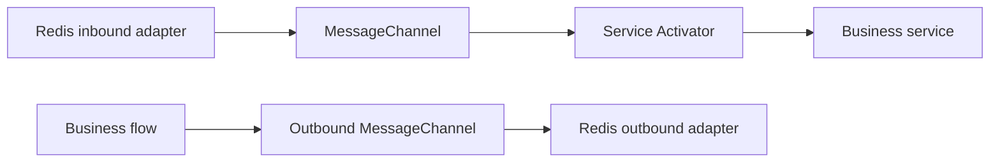

# Pub/Sub so với queue và stream

Trong module `SPRING_INTEGRATION_ADAPTERS`, Redis có ba cách trao đổi message thường gặp: Pub/Sub, queue dựa trên List và Stream. Cả ba đều có thể kết nối với Spring Integration qua adapter, MessageChannel và handler, nhưng chúng giải quyết các nhu cầu khác nhau. Pub/Sub phát thông báo tới subscriber đang lắng nghe; queue phân phối công việc cho consumer; Stream lưu các entry theo thứ tự và hỗ trợ consumer group, pending cùng acknowledgment.

Việc chọn sai mô hình dễ dẫn đến mất thông báo khi subscriber ngắt kết nối, công việc bị treo sau khi worker dừng hoặc hệ thống không thể phát lại sự kiện. Bài học này so sánh cơ chế giao nhận, khả năng lưu trữ, xử lý lỗi và cách đưa từng mô hình vào integration flow.

## Mục tiêu

Sau bài học, bạn có thể:

- Phân biệt Redis Pub/Sub, List queue và Redis Streams theo cách lưu message và giao message.
- Chọn mô hình phù hợp với thông báo tức thời, tác vụ nền hoặc luồng sự kiện cần replay.
- Giải thích fan-out, competing consumers, acknowledgment, pending và retention.
- Nhận diện rủi ro mất message, giao message lặp và xử lý sai thứ tự.
- Kết nối từng mô hình với Spring Integration bằng inbound/outbound adapter và MessageChannel.
- Thiết kế retry, chống xử lý trùng, giám sát và phục hồi khi consumer gặp sự cố.

## 1. Ba mô hình giải quyết ba nhu cầu khác nhau

### Pub/Sub: phát thông báo cho subscriber đang trực tuyến

Redis Pub/Sub dùng channel để publisher phát một message. Mọi subscriber đang đăng ký channel đó đều nhận được message. Subscriber có thể đăng ký một channel cụ thể hoặc pattern channel.

Ví dụ:

```redis
SUBSCRIBE order-events
```

Ở một client khác, publisher gửi:

```redis
PUBLISH order-events '{"orderId":1001,"status":"PAID"}'
```

Nếu có ba subscriber đang nghe `order-events`, cả ba đều nhận thông báo. Publisher không chỉ định một subscriber duy nhất để nhận việc. Đây là mô hình fan-out: một lần publish có thể tạo ra nhiều lần nhận ở các subscriber.

Pub/Sub không lưu message để subscriber đọc sau. Nếu một subscriber mất kết nối khi message được publish, subscriber đó bỏ lỡ message. Giá trị trả về từ `PUBLISH` cho biết số subscriber được server nhận diện là đã nhận message, không phải số subscriber đã hoàn tất xử lý nghiệp vụ. Pub/Sub không có acknowledgment theo từng message, pending list hoặc cơ chế replay tích hợp.

Vì vậy, Pub/Sub phù hợp với thông tin có giá trị khi đang diễn ra, chẳng hạn thông báo trạng thái hiện thời, cập nhật giao diện, cache invalidation hoặc tín hiệu đánh thức một thành phần khác. Nếu subscriber bắt buộc phải nhận đủ mọi sự kiện, Pub/Sub đơn thuần không đáp ứng yêu cầu đó.

### Queue: phân phối một công việc cho một consumer

Queue thường dùng Redis List. Producer thêm công việc vào list; các worker cùng đọc từ list. Khi một worker lấy một phần tử, phần tử đó bị loại khỏi queue. Mỗi công việc thường chỉ được giao cho một worker trong nhóm cạnh tranh.

Ví dụ dùng `LPUSH` để thêm việc và `BRPOP` để chờ lấy việc ở đầu bên kia của list:

```redis
LPUSH order:queue '{"taskId":"task-1001","orderId":1001}'
BRPOP order:queue 0
```

Kết hợp `LPUSH` và `BRPOP` theo cách này tạo thứ tự FIFO cho các phần tử được thêm vào cùng một list. Worker chờ bằng thao tác blocking pop, nên không cần liên tục hỏi Redis khi queue rỗng.

Tuy nhiên, pop loại phần tử khỏi queue ngay khi giao cho worker. Nếu worker dừng sau khi pop nhưng trước khi lưu kết quả, công việc có thể mất khỏi queue. Redis List lưu dữ liệu như một key, nhưng việc lấy bằng pop là thao tác tiêu thụ có tính hủy. Khả năng khôi phục dữ liệu khi Redis restart còn phụ thuộc cấu hình persistence và replication.

Có thể xây dựng queue đáng tin cậy hơn bằng cách chuyển nguyên tử công việc từ list chờ sang list đang xử lý. Worker xác nhận bằng cách xóa công việc khỏi list đang xử lý sau khi hoàn tất. Cách này cần thêm cơ chế phát hiện công việc bị bỏ dở và đưa chúng trở lại queue. Redis List không cung cấp consumer group, pending entry list hoặc lease timeout hoàn chỉnh như một phần của queue pattern.

### Stream: lưu chuỗi sự kiện và theo dõi tiến độ consumer

Redis Streams lưu entry trong một stream, mỗi entry có ID và các field/value. Producer thêm entry bằng `XADD`. Consumer có thể đọc độc lập; khi dùng consumer group, nhiều consumer chia nhau entry mới và Redis theo dõi những entry đã giao nhưng chưa xác nhận.

Ví dụ:

```redis
XADD orders * orderId 1001 status PAID
XGROUP CREATE orders order-workers 0-0 MKSTREAM
XREADGROUP GROUP order-workers worker-01 COUNT 10 BLOCK 2000 STREAMS orders >
XACK orders order-workers 1700000000000-0
```

ID ở lệnh `XACK` phải được thay bằng ID thực tế của entry vừa nhận. Entry được giữ trong stream theo chính sách retention. Khi consumer group giao một entry, entry đó được ghi vào Pending Entries List (PEL). Sau khi nghiệp vụ hoàn tất, consumer xác nhận bằng `XACK`. Nếu consumer dừng trước acknowledgment, entry vẫn pending và có thể được đọc lại hoặc claim sang consumer khác.

Một stream có thể có nhiều consumer group độc lập. Mỗi group có tiến độ riêng và có thể nhận cùng các entry. Điều này hữu ích khi nhiều hệ thống cần xử lý cùng một luồng sự kiện, ví dụ một group cập nhật đơn hàng, group khác cập nhật báo cáo và group thứ ba gửi thông báo.

## 2. So sánh trực tiếp

| Tiêu chí | Pub/Sub | List queue | Stream |
|---|---|---|---|
| Cách giao | Fan-out đến subscriber đang đăng ký | Một worker lấy một phần tử | Consumer độc lập hoặc chia việc trong group |
| Lưu message | Không lưu để đọc sau | List lưu đến khi bị pop/xóa | Entry lưu đến khi bị xóa hoặc trim |
| Subscriber/consumer offline | Bỏ lỡ message | Công việc còn trong queue nếu chưa pop | Entry còn trong stream; group theo dõi tiến độ |
| Acknowledgment | Không có theo message | Phải tự xây dựng bằng processing list hoặc cơ chế khác | Có `XACK` và PEL trong consumer group |
| Replay | Không hỗ trợ | Cần lưu bản sao hoặc tự thiết kế | Có thể đọc lại theo ID hoặc dùng group riêng |
| Chia tải worker | Không phải mục tiêu; mỗi subscriber nhận bản sao | Worker cạnh tranh lấy phần tử | Consumer trong cùng group chia entry |
| Nhiều ứng dụng cùng nhận đủ sự kiện | Mỗi ứng dụng đăng ký channel khi online | Thường cần queue riêng cho từng ứng dụng | Tạo group riêng cho từng ứng dụng |
| Theo dõi tiến độ | Không có tiến độ xử lý | Tự lưu trạng thái | Có last-delivered ID, PEL và thông tin group |
| Phục hồi sau worker crash | Không có message để phục hồi | Cần processing list và reaper | Có thể claim pending |
| Phù hợp | Thông báo tức thời, không bắt buộc nhận đủ | Tác vụ nền đơn giản | Event processing cần acknowledgment, replay và nhiều group |

Không nên hiểu rằng Stream tự động bảo đảm dữ liệu bền vững trong mọi sự cố. Entry còn trong stream cho đến khi bị xóa hoặc trim, nhưng mức độ an toàn khi Redis mất dữ liệu vẫn phụ thuộc cấu hình AOF/RDB, replication, failover và chính sách vận hành. Tương tự, queue List chỉ có thể khôi phục công việc đã pop nếu ứng dụng xây dựng quy trình lưu trạng thái và phục hồi phù hợp.

## 3. Hình dung luồng giao nhận



Trong Pub/Sub, A và B đều nhận cùng thông báo nếu đang đăng ký. Trong queue, A và B cùng cạnh tranh để lấy các công việc khác nhau. Trong Stream, consumer A1 và A2 chia sẻ tiến độ trong group A, còn group B có tiến độ riêng và cũng nhận các entry của stream.

Một MessageChannel trong Spring Integration chỉ là điểm chuyển tiếp message bên trong ứng dụng. Nó không tự biến một Pub/Sub thành queue bền vững hoặc biến một queue thành Stream. Cơ chế lưu trữ và giao nhận vẫn do Redis cùng adapter quyết định.

## 4. Redis Pub/Sub: fan-out và giới hạn giao nhận

Publisher gửi message tới một channel:

```redis
PUBLISH inventory.changed '{"sku":"SKU-01","quantity":12}'
```

Subscriber có thể nghe một channel:

```redis
SUBSCRIBE inventory.changed
```

Hoặc đăng ký theo pattern:

```redis
PSUBSCRIBE inventory.*
```

Một message gửi tới channel phù hợp sẽ được chuyển tới các subscriber tương ứng đang hoạt động. Pattern subscription tiện khi nhiều channel dùng chung quy ước tên, nhưng cần quản lý pattern để tránh một subscriber nhận nhiều bản sao ngoài ý muốn khi đồng thời đăng ký cả channel cụ thể lẫn pattern khớp với channel đó.

Các đặc tính cần ghi nhớ:

- **Fan-out:** mọi subscriber đang lắng nghe channel đều nhận thông báo.
- **Không có backlog:** subscriber kết nối lại không nhận lại message đã phát trong thời gian offline.
- **Không có ack nghiệp vụ:** publisher không biết subscriber đã commit dữ liệu hay hoàn tất công việc.
- **Không có replay theo ID:** Pub/Sub không giữ log message để consumer yêu cầu đọc lại.
- **Thông lượng và độ trễ:** phù hợp với tín hiệu nhẹ, cần phân phối nhanh tới các thành phần đang online.

Ví dụ, khi một sản phẩm thay đổi giá, ứng dụng có thể publish `product.price.changed` để các instance cập nhật cache. Nếu một instance bỏ lỡ thông báo, nó có thể nạp lại cache từ nguồn dữ liệu chính khi khởi động hoặc khi phát hiện cache hết hạn. Cách này phù hợp nếu cache có thể tái tạo. Nếu thông báo biểu diễn một giao dịch bắt buộc phải xử lý, hãy dùng queue hoặc Stream và xem Pub/Sub như một tín hiệu phụ trợ.

## 5. Redis List queue: competing consumers và xử lý công việc

Với queue, nhiều worker có thể cùng chờ trên một list. Redis giao một phần tử cho một worker bằng thao tác pop. Cần thống nhất hướng push/pop để giữ thứ tự FIFO.

Một queue đơn giản:

```redis
LPUSH email:queue '{"taskId":"mail-001","to":"user@example.test"}'
BRPOP email:queue 0
```

Lệnh blocking pop chờ vô hạn khi queue rỗng. Trong ứng dụng, cần có chiến lược shutdown để worker thoát có kiểm soát và xử lý lỗi kết nối.

### Mẫu chuyển sang processing list

Để giảm rủi ro mất việc khi worker dừng sau khi lấy phần tử, có thể chuyển nguyên tử từ queue sang processing list bằng `BLMOVE` (Redis 6.2 trở lên):

```redis
LPUSH email:queue '{"taskId":"mail-001","to":"user@example.test"}'
BLMOVE email:queue email:processing RIGHT LEFT 0
```

Worker xử lý xong thì xác nhận bằng cách xóa phần tử tương ứng:

```redis
LREM email:processing 1 '{"taskId":"mail-001","to":"user@example.test"}'
```

Nếu dùng Redis cũ hơn, `BRPOPLPUSH` là lệnh blocking thường gặp cho mẫu chuyển phần tử giữa hai list; lệnh này đã được đánh dấu deprecated từ Redis 6.2 và có thể thay bằng `BLMOVE`.

Mẫu này có một trạng thái trung gian rõ ràng: phần tử đã rời queue chờ và đang nằm trong processing. Tuy vậy, Redis không tự biết worker còn sống hay không. Nếu worker dừng sau khi chuyển phần tử, công việc vẫn nằm trong processing. Một tiến trình phục hồi phải xác định công việc nào đã quá hạn rồi chuyển chúng về queue hoặc đưa vào hàng xử lý lỗi.

Một list processing đơn thuần không lưu thời điểm bắt đầu, lease owner hoặc số lần thử một cách có cấu trúc. Hệ thống thực tế thường lưu metadata riêng theo task ID, chẳng hạn hash cho trạng thái và sorted set cho deadline. Khi claim hoặc requeue, cần thao tác nguyên tử phù hợp (transaction hoặc Lua script) để tránh một task bị hai worker tiếp quản cùng lúc.

Dùng task ID duy nhất trong payload. Nếu chỉ xóa theo payload giống nhau, hai công việc có nội dung giống hệt có thể khiến `LREM` xóa nhầm phần tử. Handler cũng nên idempotent vì worker có thể hoàn tất nghiệp vụ nhưng dừng trước khi xóa task khỏi processing, dẫn đến task được giao lại.

## 6. Redis Streams: consumer group, pending và replay

Stream phù hợp khi message vừa là công việc cần xử lý vừa là sự kiện cần lưu giữ trong một khoảng thời gian. Producer thêm entry:

```redis
XADD orders * orderId 1001 status PAID
```

Tạo consumer group:

```redis
XGROUP CREATE orders order-workers 0-0 MKSTREAM
```

`0-0` yêu cầu group bắt đầu từ entry hiện có. Nếu chỉ muốn nhận entry được thêm sau khi group được tạo, có thể dùng `$`. Lựa chọn này quyết định group có xử lý dữ liệu lịch sử đang còn trong stream hay không. Khi khởi tạo lặp, ứng dụng cần xử lý trường hợp group đã tồn tại (`BUSYGROUP`).

Đọc entry mới:

```redis
XREADGROUP GROUP order-workers worker-01 COUNT 10 BLOCK 2000 STREAMS orders >
```

Ký hiệu `>` yêu cầu Redis giao entry chưa từng được giao cho consumer nào trong group. Entry đã giao nhưng chưa xác nhận sẽ nằm trong PEL. Sau khi nghiệp vụ hoàn tất:

```redis
XACK orders order-workers 1700000000000-0
```

Một consumer group khác, ví dụ `billing-reporters`, có thể đọc cùng stream độc lập:

```redis
XGROUP CREATE orders billing-reporters 0-0 MKSTREAM
```

Mỗi group có tiến độ riêng. Consumer group A xác nhận entry không làm entry biến mất khỏi group B. Tuy nhiên, entry vẫn có thể bị xóa hoặc trim khỏi stream theo chính sách retention, vì vậy replay dài hạn cần được tính toán trước.

### Pending và phục hồi

Nếu consumer nhận entry rồi dừng trước `XACK`, entry vẫn ở PEL. Có thể kiểm tra:

```redis
XPENDING orders order-workers
XINFO GROUPS orders
XINFO CONSUMERS orders order-workers
```

Consumer hiện tại có thể đọc lại pending của chính nó bằng ID cụ thể thay vì `>`. Để chuyển pending từ consumer cũ sang consumer khỏe mạnh, có thể dùng `XAUTOCLAIM` (Redis 6.2 trở lên):

```redis
XAUTOCLAIM orders order-workers worker-02 60000 0-0 COUNT 10
```

Tham số `60000` là thời gian idle tối thiểu tính bằng mili giây. Chọn ngưỡng đủ dài so với thời gian xử lý thông thường, nếu quá ngắn một worker chậm vẫn đang chạy có thể bị claim. Sau khi claim, entry có thể được giao lại nên handler phải xử lý trùng an toàn.

### Replay và retention

Một group mới có thể đọc các entry còn tồn tại từ ID được chọn. Một group đã chạy cũng có thể đọc theo ID trong những trường hợp replay được kiểm soát. Replay không thể lấy lại entry đã bị xóa hoặc trim. Chính sách retention phải cân bằng dung lượng Redis với khoảng thời gian cần phục hồi, điều tra và phát lại.

Stream ID có thứ tự, nhưng không phải số offset liên tục như Kafka partition. ID thường có dạng `<milliseconds>-<sequence>`. Không nên tự tăng ID hoặc giả định khoảng cách giữa hai ID biểu diễn số lượng message bị thiếu.

## 7. Kết nối với Spring Integration

Spring Integration đưa các hệ thống Redis vào integration flow bằng inbound adapter, outbound adapter hoặc endpoint tương ứng với cấu trúc dữ liệu. Một outbound adapter nhận Spring Message từ channel rồi gửi dữ liệu sang Redis. Một inbound adapter lắng nghe, đọc hoặc nhận dữ liệu từ Redis rồi phát Spring Message vào channel.

| Mô hình Redis | Vai trò outbound | Vai trò inbound | Điểm cần chú ý |
|---|---|---|---|
| Pub/Sub | Publish message tới channel Redis | Subscribe channel/pattern và phát message vào flow | Không có backlog hoặc acknowledgment |
| List queue | Đẩy task vào list | Chờ lấy hoặc poll list, chuyển task thành message | Cần quy ước pop, processing, ack và recovery |
| Stream | Thêm entry bằng thao tác tương đương `XADD` | Đọc stream, thường qua consumer group | Cần quản lý group, consumer, pending và acknowledgment |

Tên class, builder và thuộc tính cấu hình cụ thể thay đổi theo phiên bản Spring Integration và Spring Data Redis. Khi triển khai, cần đối chiếu đúng phiên bản thư viện đang dùng để chọn adapter hoặc message source phù hợp. Không lấy tên Redis command làm tên thuộc tính Spring một cách máy móc.

### MessageChannel là hợp đồng nội bộ

Một flow điển hình có dạng:



Payload nên biểu diễn dữ liệu nghiệp vụ, còn header có thể giữ thông tin vận chuyển như channel, stream key, stream ID, consumer group, correlation ID hoặc thời điểm nhận. Với queue hoặc Stream, giữ task ID/entry ID xuyên suốt flow để handler hoặc bước xác nhận biết chính xác message nào cần ack.

Chọn channel phù hợp với ngữ nghĩa xử lý:

- `DirectChannel` chuyển message đồng bộ tới subscriber trong cùng luồng gọi. Điều này có thể giúp adapter quan sát lỗi handler đồng bộ, tùy cơ chế ack của adapter.
- `QueueChannel` lưu message trong bộ nhớ ứng dụng để một consumer lấy sau; nó không thay thế persistence ở Redis và message có thể mất khi tiến trình dừng.
- Channel dùng executor có thể xử lý bất đồng bộ. Khi đó, việc adapter gửi message thành công vào channel chưa chứng minh nghiệp vụ đã commit.

Với Stream hoặc queue cần acknowledgment sau khi xử lý bền vững, phải xác minh adapter có hỗ trợ manual acknowledgment hay không và cách chuyển acknowledgment tới handler. Nếu adapter tự xác nhận ngay khi phát message vào một channel bất đồng bộ, handler có thể thất bại sau khi entry đã được xác nhận. Cần chọn cấu hình hoặc thiết kế endpoint để acknowledgment gắn với kết quả nghiệp vụ.

### Chuyển đổi message và xử lý lỗi

Redis Pub/Sub thường truyền payload dạng byte/string; List chứa phần tử; Stream chứa entry ID cùng field/value. Adapter phải chuyển dữ liệu thành payload Spring Message nhất quán. Hãy xác định serializer, encoding, schema và cách xử lý trường thiếu hoặc sai kiểu. Không giả định mọi producer đều gửi cùng một định dạng chỉ vì dùng chung channel hoặc stream.

Error channel có thể tiếp nhận lỗi phát sinh trong integration flow. Với lỗi tạm thời, retry có giới hạn và backoff; với lỗi dữ liệu không thể khắc phục, có thể lưu thông tin lỗi vào dead-letter queue hoặc dead-letter stream. Cần giữ ID nguồn, số lần thử, nguyên nhân và thời điểm lỗi để đối soát. Ghi DLQ và xác nhận message gốc cũng cần chống trùng nếu ứng dụng có thể dừng giữa hai thao tác.

## 8. Delivery semantics và tính đúng đắn nghiệp vụ

Ba mô hình có khả năng giao nhận khác nhau:

- **Pub/Sub:** message được chuyển tới subscriber đang online, không có xác nhận nghiệp vụ và không có replay. Subscriber offline bỏ lỡ message.
- **List queue đơn giản:** pop giao message và xóa khỏi queue. Nếu worker dừng sau pop, công việc có thể mất. Mẫu processing list giảm rủi ro nhưng cần recovery do ứng dụng xây dựng.
- **Stream consumer group:** entry đã giao nhưng chưa ack nằm trong PEL và có thể được giao lại. Điều này thường dẫn đến mô hình at-least-once khi kết hợp retry và phục hồi.

Không mô hình nào tự tạo ra giao dịch nguyên tử giữa Redis và cơ sở dữ liệu nghiệp vụ. Ví dụ, handler commit cập nhật đơn hàng rồi dừng trước `XACK`; Stream sẽ có thể giao lại entry. Ngược lại, nếu `XACK` trước khi commit, entry có thể rời PEL trong khi nghiệp vụ chưa được lưu.

Một chiến lược thực tế là:

1. Giữ định danh duy nhất của message (task ID hoặc stream ID).
2. Kiểm tra khóa chống trùng hoặc ghi nhận message trong bảng xử lý.
3. Thực hiện thay đổi nghiệp vụ và commit dữ liệu bền vững.
4. Chỉ sau khi nghiệp vụ thành công mới xác nhận hoặc xóa khỏi processing.
5. Nếu xác nhận thất bại, cho phép giao lại và dùng idempotency để không lặp tác động.

Với cơ sở dữ liệu quan hệ, có thể lưu khóa `source + messageId` trong bảng `processed_message` có unique constraint cùng transaction cập nhật nghiệp vụ. Với lời gọi dịch vụ ngoài, dùng idempotency key hoặc cơ chế đối soát. Không gọi đây là exactly-once chỉ vì có `XACK`; tính đúng đắn thường dựa vào at-least-once delivery kết hợp xử lý idempotent.

## 9. Chọn mô hình theo yêu cầu

| Yêu cầu | Lựa chọn thường phù hợp | Lý do |
|---|---|---|
| Gửi tín hiệu tức thời tới các instance đang online | Pub/Sub | Fan-out đơn giản, độ trễ thấp |
| Thông báo cache invalidation có thể tái tạo khi bỏ lỡ | Pub/Sub | Có thể nạp lại cache từ nguồn chính |
| Giao một tác vụ cho một worker trong nhóm | List queue hoặc Stream group | Hỗ trợ competing consumers |
| Tác vụ phải có acknowledgment và phục hồi worker lỗi | Stream group | PEL, `XACK`, claim pending |
| Nhiều ứng dụng cần đọc độc lập cùng sự kiện | Stream với group riêng | Mỗi group có tiến độ riêng |
| Cần replay sự kiện còn trong thời hạn lưu trữ | Stream | Có entry ID và khả năng đọc lại |
| Queue nhỏ, đơn giản, không cần lịch sử và chấp nhận tự xây recovery | List queue | Cấu trúc đơn giản, ít khái niệm |
| Sự kiện không được bỏ lỡ khi subscriber offline | Stream hoặc queue có lưu trữ | Pub/Sub không giữ backlog |

Một cách chọn nhanh:

- Nếu message chỉ là tín hiệu cho thành phần đang hoạt động và có thể bỏ lỡ, chọn Pub/Sub.
- Nếu message là một công việc cần một worker thực hiện, chọn queue.
- Nếu cần lưu chuỗi sự kiện, nhiều consumer group, acknowledgment, phục hồi và replay, chọn Stream.
- Nếu yêu cầu nghiệp vụ vượt quá khả năng của Redis (ví dụ lưu lịch sử dài hạn, replay nhiều tháng, phân vùng lớn hoặc tích hợp event log liên tổ chức), đánh giá thêm nền tảng message broker hoặc event streaming chuyên dụng.

## 10. Ví dụ thiết kế: sự kiện thanh toán đơn hàng

Giả sử hệ thống phát sinh `OrderPaid` sau khi thanh toán thành công. Có ba thành phần tiêu thụ: cập nhật giao diện quản trị, gửi email và cập nhật báo cáo.

**Nếu dùng Pub/Sub:** publisher phát `order.paid`. Giao diện quản trị đang online nhận thông báo để cập nhật trạng thái. Nếu một instance offline, nó có thể tải lại trạng thái từ API khi kết nối lại. Cách này phù hợp với thông tin cập nhật giao diện, nhưng không nên dùng làm nguồn duy nhất để bảo đảm email và báo cáo được xử lý.

**Nếu dùng một queue:** publisher thêm một task vào queue; các worker cạnh tranh để lấy task. Nếu một queue duy nhất được dùng cho cả email và báo cáo, chỉ một worker lấy được mỗi task, nên hai nghiệp vụ có thể không cùng nhận sự kiện. Muốn mỗi nghiệp vụ nhận một bản, cần queue riêng hoặc cơ chế fan-out trước khi đưa vào queue.

**Nếu dùng Stream:** publisher ghi một entry vào `orders`. Group `email-workers` xử lý email, group `report-workers` cập nhật báo cáo, và group `admin-notifications` có thể phát thông báo tiếp theo. Mỗi group có tiến độ độc lập; một group lỗi không làm group khác mất tiến độ. Email worker có thể xác nhận entry sau khi nhà cung cấp email chấp nhận yêu cầu gửi và hệ thống lưu trạng thái phù hợp. Vì gửi email là tác động ngoài có thể lặp, cần idempotency key hoặc đối soát để tránh gửi trùng khi worker dừng trước acknowledgment.

Trong thực tế, có thể kết hợp mô hình: Stream làm nguồn sự kiện cần xử lý bền vững; sau khi xử lý, một thành phần publish Pub/Sub để báo các màn hình đang mở rằng có dữ liệu mới. Khi đó, Pub/Sub chỉ là tín hiệu làm mới, còn nguồn dữ liệu chính vẫn có thể truy vấn lại.

## 11. Vận hành và giám sát

Các chỉ số cần theo dõi tùy mô hình:

| Mô hình | Chỉ số/điểm kiểm tra |
|---|---|
| Pub/Sub | Số subscriber, tốc độ publish, độ trễ xử lý ở ứng dụng, số lần subscriber reconnect |
| List queue | Queue length, tuổi task cũ nhất, số task trong processing, task quá hạn, retry và dead-letter |
| Stream | Group lag nếu phiên bản cung cấp, số pending, tuổi pending lâu nhất, consumer idle, tốc độ ack và claim |

Với Pub/Sub, Redis không có backlog để đếm message bị bỏ lỡ. Nếu cần biết subscriber đã xử lý đủ, ứng dụng phải phát heartbeat, lưu trạng thái hoặc dùng một luồng lưu trữ khác.

Với List queue, queue length thấp chưa chắc hệ thống khỏe: công việc có thể đang mắc trong processing list. Cần giám sát cả queue chờ lẫn processing và tuổi task. Reaper phải có giới hạn retry và tránh đưa một task lỗi vĩnh viễn vào vòng lặp vô hạn.

Với Stream, pending tăng có thể do handler chậm, consumer dừng, lỗi liên tục hoặc acknowledgment không được gọi. Theo dõi cả last-delivered ID, PEL và trạng thái từng consumer. Chính sách trim phải giữ entry đủ lâu cho thời gian outage, điều tra và replay dự kiến.

Cả ba mô hình đều cần quan sát Redis memory, persistence, replication, kết nối client, timeout và giới hạn tài nguyên. Cấu hình lưu trữ ở Redis không thay thế thiết kế retry và chống xử lý trùng trong ứng dụng.

## 12. Lỗi thường gặp

| Hiện tượng | Nguyên nhân | Cách xử lý |
|---|---|---|
| Subscriber không nhận message khi kết nối lại | Pub/Sub không lưu backlog | Dùng Stream/queue nếu cần nhận đủ; hoặc tải lại trạng thái từ nguồn chính |
| Nhiều subscriber đều xử lý cùng một thông báo | Pub/Sub fan-out tới mọi subscriber | Đây là hành vi đúng; nếu chỉ muốn một worker, dùng queue hoặc Stream group |
| Publisher nghĩ message đã xử lý vì `PUBLISH` trả số lượng | Giá trị trả về là số subscriber nhận message, không phải ack nghiệp vụ | Theo dõi kết quả xử lý qua cơ chế riêng |
| Task biến mất khi worker dừng | Worker dùng destructive pop | Dùng processing list, lease và reaper hoặc chuyển sang Stream |
| Task bị xử lý hai lần | Worker hoàn tất nghiệp vụ nhưng chưa ack/xóa task | Thêm task ID và handler idempotent |
| Task nằm mãi trong processing | Không có tiến trình phục hồi | Theo dõi deadline và requeue/đưa vào DLQ có kiểm soát |
| Worker mới không nhận pending của worker cũ trong Stream | Đọc `>` chỉ lấy entry chưa từng giao | Kiểm tra PEL và claim pending |
| Stream group có lag hoặc pending tăng | Consumer chậm, lỗi handler hoặc ack thiếu | Tăng năng lực xử lý, sửa lỗi, điều chỉnh batch và theo dõi claim |
| Email hoặc cập nhật nghiệp vụ bị lặp | Giao lại message sau sự cố | Dùng idempotency key hoặc bảng processed message |

## 13. Checklist trước khi triển khai

- [ ] Đã xác định message là thông báo tức thời, tác vụ cần một worker hay sự kiện cần replay.
- [ ] Đã xác định subscriber offline có được phép bỏ lỡ message hay không.
- [ ] Đã xác định một message cần fan-out tới mọi ứng dụng hay chỉ một consumer.
- [ ] Với List queue, đã có processing state, timeout, reaper và chính sách retry.
- [ ] Với Stream, đã chọn group start ID, consumer name, acknowledgment và retention.
- [ ] Message giữ được task ID hoặc stream ID xuyên suốt MessageChannel và handler.
- [ ] Đã xác minh thời điểm ack thực tế của Redis adapter và loại channel đang dùng.
- [ ] Nghiệp vụ có cơ chế idempotency khi message được giao lại.
- [ ] Có error flow, dead-letter và cảnh báo cho lỗi không thể retry.
- [ ] Đã kiểm tra cấu hình Redis persistence, replication và giới hạn tài nguyên theo yêu cầu dữ liệu.

## Kết luận

Pub/Sub là cơ chế fan-out cho subscriber đang trực tuyến; Redis List có thể tạo queue cạnh tranh giữa các worker; Redis Streams cung cấp log entry cùng consumer group, pending và acknowledgment. Chọn mô hình dựa trên việc message có cần được lưu, giao cho một hay nhiều consumer, xác nhận, phục hồi và replay hay không. Trong Spring Integration, inbound/outbound adapter và MessageChannel kết nối các mô hình đó với flow nghiệp vụ, còn tính đúng đắn khi retry vẫn cần được bảo vệ bằng acknowledgment đúng thời điểm và xử lý idempotent.

