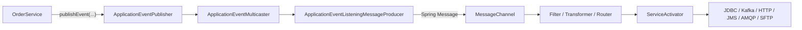
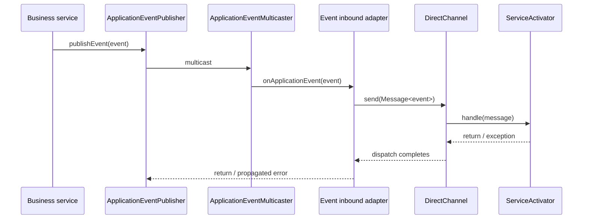
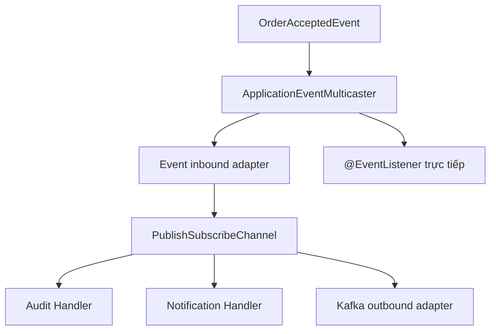
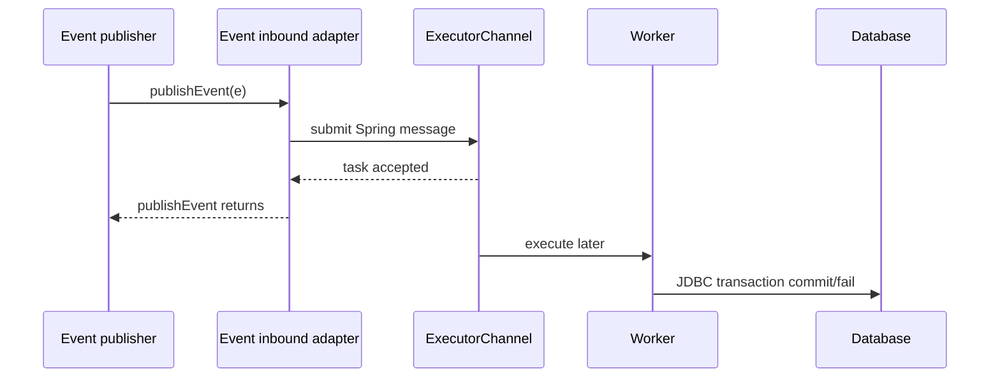
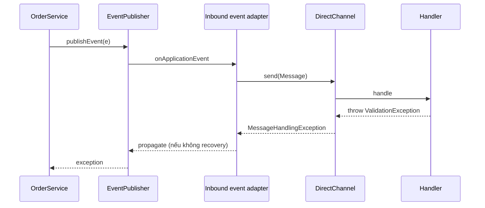
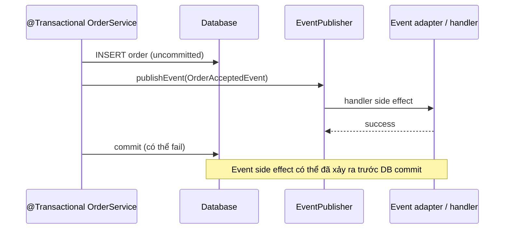
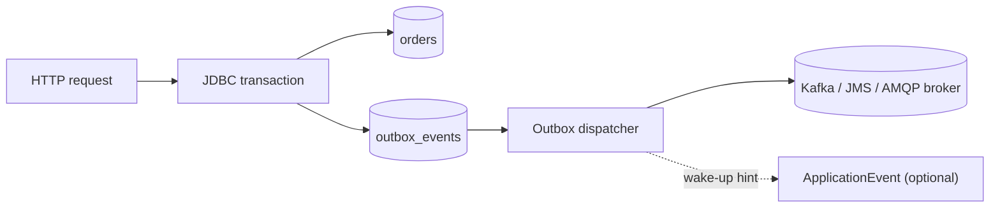
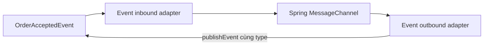

# Nhận Spring ApplicationEvent bằng adapter

**Spring `ApplicationEvent`** là cơ chế phát thông báo giữa các thành phần trong một Spring `ApplicationContext`. **Spring Integration Event Inbound Adapter** tiếp nhận những thông báo đó và chuyển thành `Message<?>` gửi vào `MessageChannel`, từ đó bạn có thể dùng filter, transformer, router, service activator và outbound adapter. Class chính là **`ApplicationEventListeningMessageProducer`**.

Bài thuộc chương **Adapter sự kiện** của module **SPRING_INTEGRATION_ADAPTERS**. Module hướng tới kết nối hệ thống ngoài bằng inbound/outbound adapter, gateway, poller và `MessageChannel`; thực hành với file, SFTP, HTTP, JMS, AMQP, Kafka và database, bao gồm message contract, lỗi và lifecycle. Riêng bài này tập trung vào **nguồn sự kiện Spring nội bộ**, không phải một message broker ở ngoài JVM.

> **Ghi nhớ:** `ApplicationEventListeningMessageProducer` là **inbound** vì nó phát **Spring Integration message** vào output channel. Nó **không** tự gửi Kafka/JMS/AMQP, không lưu event bền vững và không phát lại event sau khi JVM crash.

## 1. Mục tiêu học tập

Sau bài này, bạn có thể:

1. Phân biệt `ApplicationEvent`, `ApplicationEventPublisher`, `ApplicationEventMulticaster`, `ApplicationListener` và Spring `Message<?>`.
2. Diễn giải đường đi `publishEvent(...) → ApplicationEventListeningMessageProducer → MessageChannel → MessageHandler`.
3. Thêm dependency `spring-integration-event` và cấu hình event inbound adapter với Java.
4. Dùng `setEventTypes(...)` để chỉ nhận những event có chủ đích.
5. Giải thích ba nhánh tạo payload: `ApplicationEvent` thường, `PayloadApplicationEvent` và event có `Message` làm source.
6. Dùng `setPayloadExpressionString(...)` để trích dữ liệu theo SpEL.
7. Xây demo Spring Boot công bố `OrderAcceptedEvent` và nhận trong `@ServiceActivator`.
8. Cấu hình Java DSL hoặc XML namespace `int-event` thay cho Java bean thuần.
9. So sánh `DirectChannel`, `PublishSubscribeChannel`, `ExecutorChannel` và `QueueChannel`.
10. Phân tích lỗi đồng bộ, `errorChannel`, retry, lỗi bị swallow và business completion.
11. Tránh nhầm event publication với JDBC transaction commit; dùng `@TransactionalEventListener` hoặc outbox đúng phạm vi.
12. Kiểm thử routing, payload conversion, event loop, startup/shutdown và thiết kế production khi phải đi qua process boundary.

## 2. Bài toán: domain event nội bộ đi vào integration flow

Giả sử `OrderService` chấp nhận đơn hàng rồi cần gửi audit, gọi HTTP, phát Kafka hoặc viết file. Nếu trực tiếp gọi mọi adapter, service bị phụ thuộc chặt vào từng công nghệ. Có thể phát **Spring application event** để tách phần tạo thông báo khỏi các nhánh xử lý.



Mọi thành phần cho tới event outbound adapter đều có thể nằm trong **cùng một JVM**. Việc nhận được application event không đồng nghĩa một message đã được persist trong Kafka hay database.

### 2.1. Phân biệt các thành phần

| Thành phần | Vai trò | Không phải |
|---|---|---|
| `ApplicationEventPublisher` | Công bố event tới Spring context | Kafka producer |
| `ApplicationEvent` | Object biểu diễn sự kiện Spring | Spring Integration message tự động |
| `PayloadApplicationEvent<T>` | Wrapper cho một POJO/record được publish | Durable envelope |
| `ApplicationEventMulticaster` | Gửi event đến Spring listeners | Broker bền |
| `GenericApplicationListener` | Contract listener có thể lọc type | Spring `PollableChannel` |
| **`ApplicationEventListeningMessageProducer`** | Event inbound → Spring message output | Outbound event publisher |
| `MessageChannel` | Nối các Integration endpoints | Kafka topic |
| `@ServiceActivator` | Xử lý message từ channel | `@EventListener` |
| `ApplicationEventPublishingMessageHandler` | Spring message → Spring application event | Inbound adapter |

### 2.2. Khi nào cần event adapter?

Dùng event adapter nếu ứng dụng có Spring Integration flow, muốn dùng sẵn:

- Message routing/filter/transformation, enrichment và correlation.
- Event-driven consumer trên `SubscribableChannel`.
- Một nhánh audit và nhánh chuyển event sang broker.
- Error channel/metrics/test channels theo phong cách Spring Messaging.
- Đổi transport downstream mà không đổi API `publishEvent(...)` của business service.

Nếu chỉ có một method phản ứng với event rất đơn giản, `@EventListener` trực tiếp thường ít cấu hình hơn.

## 3. ApplicationEvent và Spring Message khác gì?

`ApplicationEvent` thuộc Spring Framework; Spring Integration dùng `Message<T>` từ Spring Messaging.

```text
ApplicationEvent
  source: Object
  timestamp: long
  domain-specific fields: eventId, orderId, version,...

Spring Message<T>
  payload: T
  headers: MessageHeaders
    id
    timestamp
    custom metadata
```

| Thuộc tính | Spring event | Spring Integration message |
|---|---|---|
| Mục đích | Phát sự kiện trong context | Truyền payload/headers qua flow |
| Routing mặc định | Chọn `ApplicationListener` theo event type | Chọn channel subscriber/flow endpoint |
| Metadata | `source`, timestamp, domain fields | Message headers + payload |
| Thực thi | Multicaster có thể sync/async | Channel có thể sync/async/queue |
| Phát lại sau crash | Không tự có | Phụ thuộc storage/transport được cấu hình |
| Transaction | Không tự đợi DB commit | Không tự tạo distributed transaction |
| Offset/ack broker | Không | Chỉ có khi nối adapter Kafka/JMS/AMQP cụ thể |

Không dùng `MessageHeaders.ID` như event ID nghiệp vụ. Một event được tái chuyển thành Spring message có thể nhận message ID khác. Hãy tạo business `eventId` độc lập cho idempotency.

### 3.1. Spring Framework cho phép publish POJO/record

`ApplicationEventPublisher` có overload:

```java
void publishEvent(ApplicationEvent event);
void publishEvent(Object event);
```

Khi phát một object không kế thừa `ApplicationEvent`, Spring có thể bọc nó thành `PayloadApplicationEvent<T>`. Adapter nhận payload event và thường chuyển **payload gốc** thành payload Spring message.

## 4. ApplicationEventListeningMessageProducer hoạt động như thế nào?

Class đầy đủ: `org.springframework.integration.event.inbound.ApplicationEventListeningMessageProducer`. Nó implements `GenericApplicationListener`, kế thừa `ExpressionMessageProducerSupport` và phát Spring message vào output channel khi event phù hợp xuất hiện.



Đường này mô tả **multicaster đồng bộ + DirectChannel**. Nếu có `ExecutorChannel` hoặc multicaster dùng `TaskExecutor`, publisher có thể hoàn thành trước handler.

### 4.1. Đây là push listener, không phải poller

File/SFTP/JDBC inbound adapters thường lấy dữ liệu bằng poller. Event inbound nhận **callback từ ApplicationEventMulticaster**, do đó không phải `MessageSource.receive()`:

```text
Spring event: publish -> listener callback -> MessageChannel
File polling: scheduler -> MessageSource.receive() -> MessageChannel
```

Không thiết kế một `@Poller` chỉ để adapter nhận Spring ApplicationEvent.

### 4.2. Lifecycle và application context

Adapter là Spring-managed bean. Nó có thể nhận event trong lúc context còn sống và đã đăng ký listener. Event publish **trước khi adapter sẵn sàng** hoặc sau khi context đóng có thể không được nhận. Các lifecycle events như `ContextRefreshedEvent` cũng có thể được multicaster phát ra; lọc types để tránh sai payload.

**ApplicationEvent không có durable buffer mặc định.** Dù adapter implements Spring lifecycle, việc start/stop không biến nó thành broker có retained messages.

## 5. Dependency và cấu hình môi trường

Tính năng này thuộc module `spring-integration-event`. Với Spring Boot dùng BOM tương thích:

```xml
<dependencies>
    <dependency>
        <groupId>org.springframework.boot</groupId>
        <artifactId>spring-boot-starter-integration</artifactId>
    </dependency>
    <dependency>
        <groupId>org.springframework.integration</groupId>
        <artifactId>spring-integration-event</artifactId>
    </dependency>
</dependencies>
```

Không tự đặt một version `spring-integration-event` lệch xa khỏi `spring-integration-core` do Boot BOM quản lý. Demo Java dùng Java 17+ và class APIs phổ biến ở Spring Integration 6.x/7.x; kiểm tra exact BOM/Javadoc cho production.

Các imports chính:

```java
import org.springframework.context.ApplicationEvent;
import org.springframework.context.ApplicationEventPublisher;
import org.springframework.integration.event.inbound.ApplicationEventListeningMessageProducer;
import org.springframework.integration.channel.DirectChannel;
import org.springframework.integration.annotation.ServiceActivator;
import org.springframework.messaging.Message;
import org.springframework.messaging.MessageChannel;
```

**Cảnh báo tên class:** Chiều outbound ngược lại dùng `org.springframework.integration.event.outbound.ApplicationEventPublishingMessageHandler`, không phải `ApplicationEventListeningMessageProducer`.

## 6. Ví dụ Spring Boot đầy đủ: OrderAcceptedEvent

Thiết kế:

```text
OrderApplicationService.accept(orderId)
  -> ApplicationEventPublisher.publishEvent(OrderAcceptedEvent)
  -> ApplicationEventListeningMessageProducer
       setEventTypes(OrderAcceptedEvent.class)
  -> DirectChannel("ordersEventChannel")
  -> OrderEventHandler @ServiceActivator
```

Demo không cần Kafka broker, JDBC hoặc external service, vì chỉ quan sát đoạn **nhận ApplicationEvent thành Spring Message**.

### 6.1. Event class: OrderAcceptedEvent.java

```java
package com.example.events;

import java.util.Objects;
import org.springframework.context.ApplicationEvent;

public final class OrderAcceptedEvent extends ApplicationEvent {
    private final String eventId;
    private final String orderId;

    public OrderAcceptedEvent(
            Object source, String eventId, String orderId) {
        super(source);
        this.eventId = Objects.requireNonNull(eventId, "eventId");
        this.orderId = Objects.requireNonNull(orderId, "orderId");
    }

    public String getEventId() {
        return eventId;
    }

    public String getOrderId() {
        return orderId;
    }
}
```

`source` bắt buộc không null; ví dụ này sẽ dùng một business service làm source. **Không** serialize nguyên object source để gửi Kafka/HTTP; source có thể chứa cả Spring bean, transaction state hoặc reference không an toàn.

### 6.2. Adapter bean và output channel: EventInboundConfig.java

```java
package com.example.events;

import org.springframework.beans.factory.annotation.Qualifier;
import org.springframework.context.annotation.Bean;
import org.springframework.context.annotation.Configuration;
import org.springframework.integration.channel.DirectChannel;
import org.springframework.integration.config.EnableIntegration;
import org.springframework.integration.event.inbound.ApplicationEventListeningMessageProducer;
import org.springframework.messaging.MessageChannel;

@Configuration
@EnableIntegration
public class EventInboundConfig {

    @Bean("ordersEventChannel")
    public MessageChannel ordersEventChannel() {
        return new DirectChannel();
    }

    @Bean("ordersEventInboundAdapter")
    public ApplicationEventListeningMessageProducer ordersEventAdapter(
            @Qualifier("ordersEventChannel") MessageChannel channel) {

        ApplicationEventListeningMessageProducer adapter =
                new ApplicationEventListeningMessageProducer();

        // Chỉ nhận domain event mục tiêu.
        adapter.setEventTypes(OrderAcceptedEvent.class);
        adapter.setOutputChannel(channel);
        return adapter;
    }
}
```

Các điểm quan trọng:

1. `@EnableIntegration` kích hoạt hạ tầng Spring Integration trong context cấu hình thủ công.
2. `ordersEventChannel` là **output channel của inbound adapter**, không phải broker topic.
3. `setEventTypes(...)` là allowlist giúp loại context lifecycle events.
4. `DirectChannel` dispatch tới handler đồng bộ trên caller thread.
5. Một event có thể còn được các `@EventListener` khác nhận trực tiếp; adapter không chiếm quyền event.
6. Đăng ký hai adapters cùng nhận `OrderAcceptedEvent` có thể tạo hai Spring messages; phải chủ động thiết kế fan-out.

### 6.3. Handler: OrderEventHandler.java

```java
package com.example.events;

import org.springframework.integration.annotation.ServiceActivator;
import org.springframework.messaging.Message;
import org.springframework.stereotype.Component;

@Component
public class OrderEventHandler {

    @ServiceActivator(inputChannel = "ordersEventChannel")
    public void handle(Message<OrderAcceptedEvent> message) {
        OrderAcceptedEvent event = message.getPayload();

        if (event.getOrderId().isBlank()) {
            throw new IllegalArgumentException(
                    "Invalid orderId");
        }

        System.out.printf(
                "EVENT thread=%s eventId=%s orderId=%s messageId=%s%n",
                Thread.currentThread().getName(),
                event.getEventId(),
                event.getOrderId(),
                message.getHeaders().getId());
    }
}
```

Handler nhận `Message<OrderAcceptedEvent>` vì ở demo này event có source là service bean, không có payload expression. Trong production, thay log bằng service có transaction/idempotency hoặc outbound adapter với policy lỗi/durability phù hợp.

### 6.4. Publisher service: OrderApplicationService.java

```java
package com.example.events;

import java.util.UUID;
import org.springframework.context.ApplicationEventPublisher;
import org.springframework.stereotype.Service;

@Service
public class OrderApplicationService {

    private final ApplicationEventPublisher publisher;

    public OrderApplicationService(
            ApplicationEventPublisher publisher) {
        this.publisher = publisher;
    }

    public void accept(String orderId) {
        // Demo: không có DB transaction.
        String eventId = UUID.randomUUID().toString();

        publisher.publishEvent(
                new OrderAcceptedEvent(this, eventId, orderId));
    }
}
```

`publisher.publishEvent(...)` đưa event vào **ApplicationContext hiện tại**, không gọi một Kafka topic/JMS broker. Với multicaster và channel đồng bộ, lời gọi này có thể block cho tới khi handler trả về.

### 6.5. Main class và ApplicationRunner

```java
package com.example.events;

import org.springframework.boot.ApplicationRunner;
import org.springframework.boot.SpringApplication;
import org.springframework.boot.autoconfigure.SpringBootApplication;
import org.springframework.context.annotation.Bean;

@SpringBootApplication
public class EventAdapterDemoApplication {

    public static void main(String[] args) {
        SpringApplication.run(
                EventAdapterDemoApplication.class, args);
    }

    @Bean
    ApplicationRunner sample(OrderApplicationService orders) {
        return args -> {
            orders.accept("ORD-101");
            orders.accept("ORD-202");
        };
    }
}
```

Đặt classes trong package `com.example.events`. Kết quả quan sát điển hình:

```text
EVENT thread=main eventId=... orderId=ORD-101 messageId=...
EVENT thread=main eventId=... orderId=ORD-202 messageId=...
```

Tên thread/ordering phụ thuộc cấu hình, nhưng nếu không bật async, handler được gọi trên publisher thread. `ApplicationRunner` chạy sau khi context đã khởi tạo cơ bản, an toàn hơn việc publish trong constructor/`@PostConstruct` cho demo.

## 7. Quy tắc chuyển event thành Spring message

Đừng giả định **mọi** event đều trở thành Spring message mang event object. Theo Spring Integration Reference:

| Input event | Quy tắc | Payload/message phát ra |
|---|---|---|
| `OrderAcceptedEvent` có source thường, không expression | Default | Payload **`OrderAcceptedEvent`** |
| `OrderAcceptedEvent` có source thường, có expression | Evaluate SpEL trên event | Payload là **kết quả expression** |
| `ApplicationEvent` có `Message<?>` làm source | Ưu tiên source Message | **Chuyển nguyên Message** |
| `PayloadApplicationEvent<T>` | Payload event hỗ trợ từ Spring 4.2 | Payload **T** gốc |
| Event không thuộc `setEventTypes` | Không match filter | **Không gửi message** |
| Không có `setEventTypes` | Adapter nhận mọi loại event phù hợp | Có thể gồm context events |

### 7.1. Event source là Message

```java
Message<String> original =
        MessageBuilder.withPayload("ORD-101")
                .setHeader("eventId", "evt-400")
                .build();

ApplicationEvent wrapped =
        new ApplicationEvent(original) {};

publisher.publishEvent(wrapped);
```

Imports cần thêm `org.springframework.messaging.Message`, `org.springframework.messaging.support.MessageBuilder`, `org.springframework.context.ApplicationEvent`.

Khi adapter nhận type này, nếu source là một `Message`, nó truyền **message đó** — payload `"ORD-101"` và header `eventId` được giữ theo contract. Ví dụ này cần một adapter với event-type filter phù hợp (`wrapped` là anonymous subclass), không phải adapter chỉ lọc `OrderAcceptedEvent.class` ở demo.

**Không** xem source reference như durable envelope. Nó tồn tại trong memory và có thể chứa object không nên serialize.

### 7.2. Không bỏ metadata nghiệp vụ quan trọng

Nếu handler cần `eventId` để dedup, `orderId` để route, `aggregateVersion` để ordering, hãy giữ nguyên DTO hoặc dùng transformer để chuyển thành một message kèm headers. Trích chỉ `orderId` ở inbound có thể làm mất eventId.

## 8. Filter đầu vào với setEventTypes(...)

Mặc định adapter nhận mọi event phù hợp. Trong Spring context có thể xuất hiện `ContextRefreshedEvent`, `ContextClosedEvent` cùng nhiều framework events. Một handler typed `Message<OrderAcceptedEvent>` có thể lỗi nếu event type khác lọt vào.

```java
adapter.setEventTypes(OrderAcceptedEvent.class);
```

Để nhận hai types khi flow có router:

```java
adapter.setEventTypes(
        OrderAcceptedEvent.class,
        OrderCancelledEvent.class);
```

Trong snippet, `OrderCancelledEvent` cần được định nghĩa riêng. `setEventTypes(Class<?>...)` hỗ trợ payload event types nữa, không chỉ subclass `ApplicationEvent`, bởi adapter implements `GenericApplicationListener`.

### 8.1. Filter không giống business validation

`setEventTypes(OrderAcceptedEvent.class)` chỉ kiểm tra **type**, không tự validate:

- `orderId` có rỗng?
- `eventId` đã tồn tại?
- `aggregateVersion` có tăng đúng?
- Actor có quyền tạo event?
- Event có dữ liệu nhạy cảm cần mask?

Đặt validation trong domain service hoặc transformer/filter downstream. Không để user payload tự quyết định class filtering hay SpEL expression.

## 9. payloadExpression: thay đổi hợp đồng payload

`ApplicationEventListeningMessageProducer` kế thừa `ExpressionMessageProducerSupport`, hỗ trợ:

```java
adapter.setPayloadExpressionString("orderId");
```

Với `OrderAcceptedEvent.getOrderId()`, expression `orderId` được evaluate trên event nếu source không phải `Message`, tạo Spring message với payload String như `"ORD-101"`.

### 9.1. Cấu hình thay thế

```java
@Bean("ordersEventInboundAdapter")
ApplicationEventListeningMessageProducer ordersEventAdapter(
        @Qualifier("ordersEventChannel") MessageChannel channel) {

    ApplicationEventListeningMessageProducer adapter =
            new ApplicationEventListeningMessageProducer();
    adapter.setEventTypes(OrderAcceptedEvent.class);
    adapter.setPayloadExpressionString("orderId");
    adapter.setOutputChannel(channel);
    return adapter;
}
```

Đây là **phương án thay thế** bean mục 6.2. Handler tương ứng phải nhận `Message<String>`:

```java
@ServiceActivator(inputChannel = "ordersEventChannel")
public void handleOrderId(Message<String> message) {
    System.out.println(message.getPayload());
}
```

Đây cũng là **phương án thay thế** handler typed `OrderAcceptedEvent`; không để hai handlers cạnh tranh cùng `DirectChannel` khi muốn xử lý mỗi event đúng một lần.

### 9.2. Ưu tiên transformer khi payload phức tạp

```text
Event inbound adapter
  -> Message<OrderAcceptedEvent>
  -> Transformer: OrderAcceptedEvent -> OrderNotificationDTO
  -> Message<OrderNotificationDTO> (+ correlation headers)
  -> Outbound adapter
```

Cách này dễ kiểm tra schema, validation và metadata hơn SpEL expression dài. Với event có `Message` làm source, source Message được chuyển như nguyên bản, không giả định payloadExpression luôn override.

## 10. PayloadApplicationEvent với Java record

Spring cho phép `publishEvent(Object)` với record/POJO:

```java
package com.example.events;

public record InventoryAdjusted(
        String eventId, String sku, int delta) {}
```

```java
publisher.publishEvent(
        new InventoryAdjusted("evt-301", "SKU-9", -4));
```

Spring Framework bọc object trong `PayloadApplicationEvent<InventoryAdjusted>`. Adapter có thể filter theo **payload class**:

```java
ApplicationEventListeningMessageProducer adapter =
        new ApplicationEventListeningMessageProducer();

adapter.setEventTypes(InventoryAdjusted.class);
adapter.setOutputChannel(inventoryEventsChannel);
```

`inventoryEventsChannel` là bean `MessageChannel` đã định nghĩa trong cấu hình riêng. Handler nhận:

```java
@ServiceActivator(inputChannel = "inventoryEventsChannel")
public void onInventory(Message<InventoryAdjusted> message) {
    InventoryAdjusted event = message.getPayload();
    System.out.println(event.sku() + " " + event.delta());
}
```

**Điểm cần hiểu:** Event type resolution có thể liên quan `ResolvableType` và generic payload type. Với event generic phức tạp, test trên đúng Spring version để xác nhận filtering, không suy luận toàn bộ từ Java type erasure.

## 11. Java DSL và inbound event producer

Nếu dùng Spring Integration Java DSL, đăng ký event producer bean trước, rồi cho flow lấy nó làm source event-driven.

```java
package com.example.events;

import org.springframework.context.annotation.Bean;
import org.springframework.context.annotation.Configuration;
import org.springframework.integration.dsl.IntegrationFlow;
import org.springframework.integration.event.inbound.ApplicationEventListeningMessageProducer;

@Configuration
public class EventDslConfig {

    @Bean
    ApplicationEventListeningMessageProducer inboundEventSource() {
        ApplicationEventListeningMessageProducer p =
                new ApplicationEventListeningMessageProducer();
        p.setEventTypes(OrderAcceptedEvent.class);
        return p;
    }

    @Bean
    IntegrationFlow ordersEventFlow(
            ApplicationEventListeningMessageProducer inboundEventSource) {

        return IntegrationFlow.from(inboundEventSource)
                .handle(OrderAcceptedEvent.class, (event, headers) -> {
                    System.out.println("DSL " + event.getOrderId());
                    return null;
                })
                .get();
    }
}
```

Đây là **lựa chọn thay thế** toàn bộ adapter/channel/handler mục 6, không thêm đồng thời vào cùng ApplicationContext nếu chỉ cần một logical subscriber.

Java DSL cũng cho phép cấu hình error channel ngay trên endpoint:

```java
IntegrationFlow.from(
        inboundEventSource,
        endpoint -> endpoint.errorChannel(eventErrorChannel))
    .handle(...)
    .get();
```

Snippet với `...` chỉ để minh họa DSL API, không phải code compile độc lập. `eventErrorChannel` là một `MessageChannel` có subscriber; khi áp dụng phải hoàn thiện handler/recovery.

### 11.1. Vì sao không sử dụng PollerSpec?

`IntegrationFlow.from(MessageSource, PollerSpec)` dành cho polling sources. `ApplicationEventListeningMessageProducer` là **event listener**, nhận callback thay vì định kỳ gọi `receive()`.

## 12. XML namespace cho event inbound adapter

```xml
<?xml version="1.0" encoding="UTF-8"?>
<beans xmlns="http://www.springframework.org/schema/beans"
       xmlns:xsi="http://www.w3.org/2001/XMLSchema-instance"
       xmlns:int="http://www.springframework.org/schema/integration"
       xmlns:int-event="http://www.springframework.org/schema/integration/event"
       xsi:schemaLocation="
          http://www.springframework.org/schema/beans
          http://www.springframework.org/schema/beans/spring-beans.xsd
          http://www.springframework.org/schema/integration
          http://www.springframework.org/schema/integration/spring-integration.xsd
          http://www.springframework.org/schema/integration/event
          http://www.springframework.org/schema/integration/event/spring-integration-event.xsd">

    <int:channel id="ordersEventChannel"/>

    <int-event:inbound-channel-adapter
        channel="ordersEventChannel"
        event-types="com.example.events.OrderAcceptedEvent"/>

    <int:service-activator
        input-channel="ordersEventChannel"
        ref="orderEventHandler"
        method="handle"/>
</beans>
```

`orderEventHandler` phải là bean trong context (có thể do `@Component` hoặc XML tạo). Đừng đồng thời tạo adapter Java và XML cho cùng event mà không muốn nhân hai messages. Không đặt cả `@ServiceActivator` và XML service activator với cùng business logic nếu không muốn cạnh tranh trên một DirectChannel.

Cấu hình optional error channel:

```xml
<int-event:inbound-channel-adapter
    channel="ordersEventChannel"
    event-types="com.example.events.OrderAcceptedEvent"
    error-channel="ordersEventErrors"/>

<int:channel id="ordersEventErrors"/>
```

Phải có consumer cho `ordersEventErrors`; error channel không tự ghi bền hoặc tạo Kafka DLT.

## 13. Threading, channel và fan-out

Spring event multicaster và Spring Integration channel **đều có thể phân phối message**, nhưng ở **hai tầng khác nhau**:



Nếu vừa có `@EventListener` trực tiếp ghi audit DB, vừa có `ServiceActivator` nhận event adapter cũng ghi audit, **một event có thể gây hai side effects**. Phải chỉ định một business owner hoặc dùng eventId idempotency.

### 13.1. DirectChannel — đồng bộ với publisher

```text
HTTP request thread
  -> OrderService.accept(...)
  -> publishEvent(...)
  -> ApplicationEventListeningMessageProducer
  -> DirectChannel
  -> ServiceActivator
  -> return / throw
  -> publishEvent(...) returns / throws
```

Đây là đường đi mặc định của demo. Nếu handler cần 800 ms, publisher có thể bị giữ 800 ms. Lỗi đồng bộ có cơ hội quay lại publisher, giúp định nghĩa transaction/error boundary rõ.

### 13.2. PublishSubscribeChannel — nhiều nhánh

`PublishSubscribeChannel` gửi một Spring message cho nhiều subscribers. Điều này phù hợp khi audit, metrics và Kafka outbound cùng cần nhận một event. Tuy nhiên, **fan-out không phải distributed transaction**. Nếu nhánh audit DB thành công còn Kafka outbound thất bại, phải có recovery/compensation hoặc outbox. Khi dùng executor cho publish-subscribe, thứ tự và error propagation còn thay đổi.

### 13.3. DirectChannel hai subscribers không phải broadcast

`DirectChannel` là point-to-point channel dựa trên dispatcher strategy. Khi hai service activators subscribe cùng channel, framework chọn subscriber để xử lý, **không đảm bảo cả hai cùng nhận mỗi message**.

Vì vậy đừng gắn hai `@ServiceActivator(inputChannel="ordersEventChannel")` và kỳ vọng cả hai đều ghi audit cho một event. Muốn broadcast, đổi sang `PublishSubscribeChannel` hoặc tạo các flows/adapter listeners được thiết kế rõ.

### 13.4. ExecutorChannel — async handoff

`ExecutorChannel` giao công việc sang executor:



Hệ quả:

- Publisher return chỉ chứng minh **task được chấp nhận**, không đảm bảo DB commit.
- Worker exception không nhất thiết propagate lên publisher thread.
- Thread-bound transaction/security/trace context có thể mất khi chuyển thread.
- Hai events cùng order có thể hoàn tất sai thứ tự.
- Nếu task chỉ nằm trong queue RAM, JVM crash có thể làm mất công việc đã accept.

### 13.5. QueueChannel — buffer không tự bền

`QueueChannel` nhận message rồi đợi một `PollingConsumer`/poller xử lý. QueueChannel dùng memory queue mặc định không sống sót qua restart; nếu muốn durable handoff, cần `MessageStore`/transaction policy thích hợp.

```text
publishEvent
  -> inbound adapter
  -> QueueChannel.enqueue(message)    [accepted]
  -> publisher returns

Sau đó:
  -> PollingConsumer.dequeue
  -> ServiceActivator
  -> JDBC/HTTP side effect
```

Không coi `enqueue success` là `business success`. Nếu cần audit/financial events phải không mất, dùng transactional outbox hoặc broker đã cấu hình độ bền phù hợp.

### 13.6. So sánh các channel

| Channel | Khi nào handler chạy? | Thích hợp | Rủi ro |
|---|---|---|---|
| `DirectChannel` | Cùng thread publisher/listener | Luồng sync, exception rõ | Blocking upstream |
| `PublishSubscribeChannel` | Mọi subscribers, sync nếu không executor | Fan-out nội bộ | Partial success giữa các nhánh |
| `ExecutorChannel` | Worker thread | Bất đồng bộ có kiểm soát | Ordering/error/context khác |
| `QueueChannel` | Khi downstream poll | Buffer, backpressure theo poller | RAM queue không tự durable |

## 14. Spring ApplicationEventMulticaster mặc định đồng bộ

Spring Framework dùng `SimpleApplicationEventMulticaster` với synchronous listener invocation theo default. Do đó `publishEvent(...)` có thể block trong lúc listeners xử lý. Đây là thuộc tính **của Spring event bus**, tách với việc chọn `MessageChannel`.

### 14.1. Thay bằng executor có ý nghĩa gì?

Có thể cấu hình một bean `applicationEventMulticaster` và `TaskExecutor`:

```java
@Bean(name = "applicationEventMulticaster")
ApplicationEventMulticaster applicationEventMulticaster(
        TaskExecutor taskExecutor) {
    SimpleApplicationEventMulticaster multicaster =
            new SimpleApplicationEventMulticaster();
    multicaster.setTaskExecutor(taskExecutor);
    return multicaster;
}
```

Imports từ `org.springframework.context.event.ApplicationEventMulticaster`, `SimpleApplicationEventMulticaster` và `org.springframework.core.task.TaskExecutor`. Cần cấu hình `taskExecutor` bean và đánh giá loại listeners cho phép async.

**Đây là một lựa chọn toàn context**, không chỉ đổi event inbound adapter. Một số transactional listeners hoặc context lifecycle listeners có ràng buộc đặc biệt khi dispatch; phải đọc `supportsAsyncExecution`/Javadoc hiện hành thay vì giả định mọi listener có thể async an toàn.

### 14.2. Async multicaster khác ExecutorChannel

- Async **multicaster**: listener `onApplicationEvent` chạy trong executor thread.
- `ExecutorChannel`: adapter đã nhận event nhưng message handler downstream chạy trên worker.
- `QueueChannel`: adapter enqueue, polling consumer nhận sau.
- `@Async @EventListener`: Spring annotation listener có thể chạy bất đồng bộ, không đồng nghĩa tất cả adapter listeners tự async.

Ở cả ba trường hợp, business transaction ban đầu **không tự đồng bộ hóa** với side effect cuối.

### 14.3. Ordering giữa events

`ApplicationEvent` mặc định không có Kafka partition key hoặc ordered log. Nếu hai threads publish `OrderAcceptedEvent` cho cùng order và downstream chạy đa luồng, không có bảo đảm tổng thứ tự nghiệp vụ. Cần `aggregateVersion`, optimistic lock hoặc chuyển sang durable transport phân vùng theo business key khi thực sự cần thứ tự trên nhiều pods.

## 15. Exception propagation và errorChannel

Với multicaster mặc định, `DirectChannel` và **không error channel**, downstream `ServiceActivator` ném exception có thể khiến `publishEvent(...)` ném `MessagingException`/exception liên quan.



Nếu có `errorChannel` hoặc custom multicaster `ErrorHandler`, exception có thể được định tuyến/bắt thay vì trả về publisher. Nếu async, exception thường không thể propagate theo stack của publisher.

### 15.1. Cấu hình error channel

```java
@Bean("ordersEventErrors")
MessageChannel ordersEventErrors() {
    return new DirectChannel();
}

@Bean("ordersEventInboundAdapter")
ApplicationEventListeningMessageProducer ordersEventAdapter(
        @Qualifier("ordersEventChannel") MessageChannel output,
        @Qualifier("ordersEventErrors") MessageChannel errors) {

    ApplicationEventListeningMessageProducer p =
            new ApplicationEventListeningMessageProducer();
    p.setEventTypes(OrderAcceptedEvent.class);
    p.setOutputChannel(output);
    p.setErrorChannel(errors);
    return p;
}
```

Đoạn này thay thế cấu hình bean mục 6, không thêm một bean cùng tên. Error handler:

```java
@ServiceActivator(inputChannel = "ordersEventErrors")
public void onError(ErrorMessage errorMessage) {
    Throwable failure = errorMessage.getPayload();
    System.err.println("EVENT PROCESSING ERROR: " + failure);
}
```

Import `org.springframework.messaging.support.ErrorMessage`. Error message có thể chứa failed message/cause; contract chi tiết phụ thuộc tầng phát lỗi.

### 15.2. Lỗi bị swallow và false success

Nếu errorChannel subscriber chỉ log rồi return thành công, publisher có thể thấy `publishEvent(...)` return thành công **dù business side effect thất bại**. Đó là hành vi có thể chấp nhận khi error flow đã đảm nhiệm durable recovery, nhưng nguy hiểm nếu dùng log làm “bằng chứng xử lý”.

Không đánh đồng **ErrorMessage** với **Kafka dead-letter topic**. Muốn lưu record lỗi bền, cần một storage/outbound adapter có kiểm tra ACK/retry cùng owner vận hành.

### 15.3. Retry và poison event

Một `ApplicationEvent` không có broker-managed offset, nên không có auto redelivery sau restart. Khi retry downstream:

1. Phân loại lỗi transient/permanent.
2. Giới hạn attempts và backoff; tránh block publisher vô hạn.
3. Gắn business `eventId` cho idempotent side effects.
4. Khi hết retry, lưu durable quarantine/outbox/DLT theo transport cụ thể.
5. Nếu recovery cũng thất bại, không tự báo success.
6. Đo cả số attempts lẫn kết quả business commit.

## 16. Transaction: publishEvent trong @Transactional

Một hiểu nhầm phổ biến: “Spring ApplicationEvent sẽ chỉ chạy sau khi JDBC commit”. **Mặc định là sai.** Khi service đang trong JDBC `@Transactional` gọi `publishEvent(...)`, listener sync có thể chạy **ngay bên trong method trước DB commit**:



Ví dụ nếu adapter gửi HTTP webhook rồi database rollback, đối tác có thể đã nhận “order accepted” cho một order không tồn tại.

### 16.1. @TransactionalEventListener

Spring Framework hỗ trợ xử lý event theo transaction phase:

```java
@TransactionalEventListener(phase = TransactionPhase.AFTER_COMMIT)
public void handleAfterCommit(OrderSubmitted event) {
    // Chạy sau khi transaction có event được commit.
}
```

Các phases: `BEFORE_COMMIT`, `AFTER_COMMIT` (default), `AFTER_ROLLBACK`, `AFTER_COMPLETION`. Khi không có active transaction, listener mặc định **không chạy**, trừ khi đặt `fallbackExecution=true`.

**Nhưng:** `ApplicationEventListeningMessageProducer` không phải `@TransactionalEventListener`. Nếu producer nhận chính `OrderSubmitted` trước DB commit, nó vẫn có thể dispatch sớm.

### 16.2. Bridge hai event types để adapter chỉ nhận sau commit

```text
OrderService @Transactional
    -> UPDATE orders
    -> publishEvent(OrderSubmittedEvent)
    -> JDBC commit thành công

@TransactionalEventListener(AFTER_COMMIT)
    -> publishEvent(OrderCommittedEvent)
    -> Event inbound adapter
         setEventTypes(OrderCommittedEvent.class)
    -> Spring Integration flow
```

Phải dùng **hai loại event khác nhau** để event inbound adapter không nhận `OrderSubmittedEvent` trước commit. Đây là lựa chọn timing trong cùng JVM; nó **vẫn không có durable handoff**. JVM crash ngay sau DB commit trước lúc after-commit callback publish có thể mất event.

### 16.3. JDBC trong AFTER_COMMIT callback

Spring lưu ý sau-commit callback có thể còn truy cập resources transaction đã hoàn tất. Nếu cần ghi thêm JDBC trong after-commit callback, việc chỉ gọi repository theo transaction cũ có thể không commit như mong muốn. Dùng service mới với `@Transactional(propagation = Propagation.REQUIRES_NEW)` hoặc transaction boundary tường minh.

### 16.4. Transactional outbox khi không được mất event

Thiết kế phù hợp hơn cho DB→Kafka/JMS/AMQP:



Trong **một DB transaction**, ghi business data và outbox record. Dispatcher có retry/reconcile đọc outbox, publish broker, sau ACK mới mark SENT; nếu crash sau broker ACK trước mark SENT sẽ có thể publish lại, nên consumer cần dedup `eventId`.

Spring ApplicationEvent có thể chỉ là một **tín hiệu đánh thức dispatcher**, không phải nguồn dữ liệu bền duy nhất.

## 17. Ranh giới với những adapter khác của module

| Nguồn/đích | Độ bền/ack mặc định | Hướng tích hợp |
|---|---|---|
| Spring ApplicationEvent | In-memory, không offset/ack broker | Event adapter inbound |
| Spring DirectChannel | Sync dispatch, không persistence | ServiceActivator |
| Spring QueueChannel RAM | Enqueue in-memory | Poller/MessageStore nếu muốn durable |
| Kafka outbound | Broker ACK/producer transaction theo config | KafkaProducerMessageHandler |
| JMS/AMQP outbound | Message persistence/broker ACK theo config | JMS/AMQP adapter |
| HTTP outbound | Request/response, timeout/retry | HTTP gateway |
| File/SFTP outbound | File write/remote session | File/SFTP handler |
| JDBC | JDBC transaction | JDBC adapter/service |
| Transactional outbox | DB transaction | Durable bridge giữa DB và broker |

Một flow:

```text
ApplicationEvent
 -> Event inbound adapter
 -> DirectChannel
 -> Transformer
 -> Kafka outbound adapter
 -> KafkaTemplate / broker
```

**Không** tự atomic với JDBC commit chỉ nhờ ApplicationEvent. Kafka ACK cũng không tự bảo đảm hệ thống downstream đã commit database/HTTP side effect.

### 17.1. Không tự truyền event sang pod khác

Hai pods cùng ứng dụng và cùng tên `ApplicationContext` vẫn là **hai JVM/processes**; `publishEvent(...)` trên pod A không tự đến adapter ở pod B. Nếu cần cross-process fan-out, phải dùng broker, network gateway hoặc distributed storage riêng.

### 17.2. HTTP và idempotency

Khi event inbound flow gọi HTTP outbound gateway, request timeout có thể xảy ra **sau khi phía đối tác đã xử lý**. Retry mà không có idempotency key có thể nhân giao dịch. ApplicationEvent không giải quyết ambiguity của kết quả HTTP.

## 18. Feedback loop giữa inbound và outbound event adapters

Spring Integration có adapter chiều ngược: `ApplicationEventPublishingMessageHandler` (Spring message → Spring application event).



Nếu outbound handler phát đúng loại event mà inbound adapter đang nghe, ứng dụng có thể tạo feedback loop vô hạn hoặc event storm. Với multicaster sync, còn có nguy cơ recursive calls/stack overflow.

### 18.1. Phòng tránh

- Filter `setEventTypes(...)` chặt.
- Dùng event types khác nhau cho inbound và outbound (`OrderAcceptedEvent` khác `AuditCompletedEvent`).
- Đặt correlation/eventId và loop detection/TTL nếu topology phức tạp.
- Không nối trực tiếp hai adapters theo vòng không có điều kiện dừng.
- Test số messages hữu hạn sau một input.
- Nếu flow ra broker và quay lại nội bộ, cần idempotency và source identification.

### 18.2. publish-payload của outbound adapter

`ApplicationEventPublishingMessageHandler` có `setPublishPayload(true)`:

```java
ApplicationEventPublishingMessageHandler handler =
        new ApplicationEventPublishingMessageHandler();
handler.setPublishPayload(true);
```

Đây là ví dụ **chiều outbound** để nhận diện nguy cơ loop, không phải cấu hình của inbound producer. Khi outbound publish payload event type đã được inbound filter cho phép, adapter có thể nhận lại.

## 19. Khi nào dùng @EventListener trực tiếp?

| Tiêu chí | `@EventListener` | Event Inbound Adapter |
|---|---|---|
| Một callback đơn giản | Rất phù hợp | Có thể nhiều wiring không cần thiết |
| MessageChannel/endpoint pattern | Phải tự thiết kế | Có sẵn |
| Filter/router/transformer | Viết trong listener | Dùng IntegrationFlow |
| ErrorMessage/errorChannel | Không mặc định | Hỗ trợ theo Spring Integration |
| Headers và correlation | Tự map | Tạo/giữ Spring Message headers |
| Fan-out internal | Nhiều listeners | PublishSubscribeChannel / nhiều flows |
| Durable queue | Không tự có | Cũng không tự có |
| Gửi Kafka/JMS/HTTP/SFTP | Cần code/adapter | Tích hợp outbound adapter thuận tiện |

Chọn `@EventListener` nếu một bean chỉ cần phản ứng đơn giản trong cùng context. Chọn adapter khi bạn đã dùng Spring Integration và cần **chuyển event thành Spring message** để quản trị nhiều endpoints.

### 19.1. Không ghi cùng một business effect hai lần

Đừng vừa có một `@EventListener(OrderAcceptedEvent.class)` ghi audit DB, vừa có Event Adapter → ServiceActivator ghi cùng audit DB nếu không chủ động muốn hai độc lập handlers. Dùng một owner, hoặc eventId/unique constraint nếu side effect có khả năng nhận trùng.

## 20. Kiểm thử adapter với Spring test context

Test đúng cần xác minh **event type → Spring message payload → destination channel**, không chỉ mock `publishEvent`.

### 20.1. Dependency test

```xml
<dependency>
    <groupId>org.springframework.boot</groupId>
    <artifactId>spring-boot-starter-test</artifactId>
    <scope>test</scope>
</dependency>
```

### 20.2. Test dùng QueueChannel làm nơi quan sát

```java
package com.example.events;

import static org.assertj.core.api.Assertions.assertThat;

import org.junit.jupiter.api.Test;
import org.springframework.beans.factory.annotation.Autowired;
import org.springframework.context.ApplicationEventPublisher;
import org.springframework.context.annotation.Bean;
import org.springframework.context.annotation.Configuration;
import org.springframework.integration.channel.QueueChannel;
import org.springframework.integration.config.EnableIntegration;
import org.springframework.integration.event.inbound.ApplicationEventListeningMessageProducer;
import org.springframework.messaging.Message;
import org.springframework.test.context.junit.jupiter.SpringJUnitConfig;

@SpringJUnitConfig(classes = EventAdapterTest.TestConfig.class)
class EventAdapterTest {

    @Configuration
    @EnableIntegration
    static class TestConfig {

        @Bean
        QueueChannel testEvents() {
            return new QueueChannel();
        }

        @Bean
        ApplicationEventListeningMessageProducer adapter(
                QueueChannel testEvents) {
            ApplicationEventListeningMessageProducer p =
                    new ApplicationEventListeningMessageProducer();
            p.setEventTypes(OrderAcceptedEvent.class);
            p.setOutputChannel(testEvents);
            return p;
        }
    }

    @Autowired ApplicationEventPublisher publisher;
    @Autowired QueueChannel testEvents;

    @Test
    void routesApplicationEventAsMessage() {
        publisher.publishEvent(
            new OrderAcceptedEvent(
                this, "evt-001", "ORD-101"));

        Message<?> message = testEvents.receive(1_000);
        assertThat(message).isNotNull();
        assertThat(message.getPayload())
                .isInstanceOf(OrderAcceptedEvent.class);

        OrderAcceptedEvent event =
                (OrderAcceptedEvent) message.getPayload();

        assertThat(event.getEventId()).isEqualTo("evt-001");
        assertThat(event.getOrderId()).isEqualTo("ORD-101");
    }
}
```

`QueueChannel` ở đây chỉ được dùng trong test để `receive(timeout)`, không nhằm đưa ra đảm bảo durability cho application production. Class event thuộc package demo ở mục 6.

### 20.3. Test filter loại event khác

```java
publisher.publishEvent("unrelated payload");

Message<?> unexpected = testEvents.receive(100);
assertThat(unexpected).isNull();
```

Trong một test context chỉ có adapter filter `OrderAcceptedEvent.class`, `String` payload event này không được gửi đến test channel. Nếu dùng chung context và queue còn tồn message từ test trước, cần drain/isolated test; nếu không assertion có thể sai do dữ liệu cũ.

### 20.4. Test expression và source Message

- Trong context test khác, đặt `setPayloadExpressionString("orderId")`; publish event và assert payload là `String "ORD-101"`.
- Tạo event có source là Spring `Message<String>` chứa header `eventId`; assert downstream nhận nguyên payload/header.
- Test POJO `InventoryAdjusted` với `setEventTypes(InventoryAdjusted.class)`.
- Test lifecycle/startup event bằng cách publish trước/sau thời điểm context đã initialized.
- Không đánh đồng một in-memory test pass với khả năng survive JVM crash.

### 20.5. Test exception/errorChannel

- `DirectChannel` + handler throw, không errorChannel: assert publisher có exception theo contract.
- Có errorChannel và error subscriber: xác nhận `ErrorMessage` chứa cause/failed message.
- Async channel: xác minh publisher return không đồng nghĩa business commit.
- JDBC rollback: publish trước commit và xem downstream đã chạy chưa.
- Outbox: crash sau DB commit trước broker publish và xác minh dispatcher retry.

## 21. Observability và vận hành

| Metric/trace gợi ý | Mục tiêu |
|---|---|
| `application_event_published_total` | Đã publish bao nhiêu event? |
| `event_adapter_received_total{type}` | Adapter nhận bao nhiêu events? |
| `event_adapter_filtered_total{type}` | Những events bị loại do type? |
| `event_channel_dispatch_error_total` | Channel/subscriber thất bại? |
| `event_handler_success_total` | Side effect nghiệp vụ thành công bao nhiêu lần? |
| `event_handler_failure_total` | Handler lỗi thuộc nhóm nào? |
| `event_handler_duration_p95/p99` | Publisher bị block bao lâu? |
| `event_executor_queue_depth` | Async backlog có tăng không? |
| `event_error_channel_unhandled_total` | Có lỗi chưa recover/triage? |
| `event_broker_publish_failure_total` | Kafka/JMS/AMQP outbound thất bại? |
| `event_idempotency_duplicate_total` | Gặp eventId trùng bao nhiêu lần? |
| `event_outbox_oldest_pending_age` | Đang có DB event chờ publish quá lâu? |

Đây là **tên metric nghiệp vụ đề xuất**, không phải cam kết Spring/Micrometer tự phát tất cả meter. Cần đo **received**, **dispatched** và **business committed** riêng.

### 21.1. Structured log

```text
eventType=OrderAcceptedEvent
eventId=evt-101
orderId=ORD-101
springMessageId=...
publisherThread=http-nio-8080-exec-7
handlerThread=http-nio-8080-exec-7
dispatch=SUCCESS
businessCommit=SUCCESS
```

Đây là ví dụ tên thread/fields. Tránh log payload chứa PII, credentials hoặc security tokens. Khi dùng async, tracing/security context cần propagate theo executor strategy đã được kiểm chứng.

### 21.2. Giám sát lifecycle

- Adapter bean có được đăng ký trong cùng ApplicationContext với publisher?
- Filter type có match event thực tế?
- Channel có subscriber khi event được phát?
- Lúc startup, event có bị publish sớm trước khi handler sẵn sàng?
- Async queue có vượt capacity khi downstream chậm?
- Khi shutdown, in-flight tasks có bị bỏ lại?
- Outbox/broker đã publish bền trước khi trả trạng thái success chưa?

## 22. Tình huống lỗi và chẩn đoán

| Hiện tượng | Nguyên nhân có thể | Cách kiểm tra |
|---|---|---|
| Không có message | Adapter chưa đăng ký hoặc filter type không match | Bean list, event type, listener setup |
| Nhận ContextRefreshedEvent thay domain event | Không có `setEventTypes` | Type allowlist |
| Handler nhận String thay OrderAcceptedEvent | Có `payloadExpression` hoặc payload event | Message payload class |
| Header eventId biến mất | Expression chỉ lấy orderId | Transformer/header enrichment |
| Publisher block lâu | Sync multicaster/DirectChannel handler chậm | Thread dump, handler p99 |
| Publisher return sớm nhưng DB chưa ghi | ExecutorChannel/QueueChannel | Dispatch vs business timing |
| Publisher báo success dù handler throw | Error channel/custom error handler swallow | ErrorMessage recovery policy |
| Spring handler chạy hai lần | Duplicate listeners/adapters hoặc double publish | EventId, subscriptions |
| Event bị mất lúc startup | Publish trước khi adapter sẵn sàng | Context lifecycle |
| Pod B không nhận event từ pod A | Spring event bus local JVM | Dùng broker/outbox |
| HTTP/Kafka gửi trùng | Retry/replay không có business idempotency | eventId/unique key |
| DB rollback mà webhook đã gửi | Publish trong transaction trước commit | @TransactionalEventListener/outbox |
| Event loop, stack overflow | Inbound và outbound cùng type | Type filtering/topology |
| Executor backlog tăng | Downstream chậm, không có backpressure | Queue depth, saturation |
| ErrorMessage không có nơi xử lý | errorChannel thiếu subscriber | Channel graph/handler |

### 22.1. Quy trình điều tra

1. Xác định event type, eventId, publisher thread và context.
2. Kiểm tra adapter được đăng ký một lần và `setEventTypes` đúng.
3. Kiểm tra payload conversion: event object, `PayloadApplicationEvent`, source `Message`, SpEL.
4. Xem `DirectChannel` có subscriber và method signature đúng không.
5. Phân biệt lỗi đồng bộ với async executor/queue.
6. Kiểm tra `errorChannel` có durable recovery hay chỉ logging.
7. Kiểm tra JDBC/HTTP/Kafka side effect và idempotency.
8. Nếu liên quan transaction, xác nhận publish trước/sau commit thật.
9. Nếu mất dữ liệu sau restart, xác định nguồn sự thật bền (outbox/broker) thay vì hy vọng replay ApplicationEvent.

## 23. Những hiểu lầm cần tránh

| Hiểu lầm | Cách hiểu đúng |
|---|---|
| “ApplicationEventListeningMessageProducer là Kafka producer.” | Nó phát Spring message vào MessageChannel. |
| “Event inbound phải dùng poller.” | Nó nhận push qua ApplicationListener. |
| “ApplicationEvent durable qua restart.” | Không mặc định; là event nội bộ JVM. |
| “Không lọc eventTypes cũng chỉ có domain events.” | Context lifecycle events có thể đến. |
| “Mọi event đều thành payload ApplicationEvent.” | PayloadApplicationEvent và source Message khác. |
| “payloadExpression không đổi handler signature.” | Payload có thể chuyển từ event sang String. |
| “DirectChannel broadcast tới mọi subscribers.” | Không; dùng PublishSubscribeChannel cho broadcast. |
| “QueueChannel RAM đảm bảo event không mất.” | Crash có thể làm mất queued work. |
| “Async publisher return nghĩa DB transaction đã xong.” | Return có thể chỉ nghĩa task accepted. |
| “ErrorChannel tự là Kafka DLT.” | ErrorMessage không tự persist/replay. |
| “Một log success nghĩa broker đã ACK.” | Cần kiểm tra producer send/transaction outcome. |
| “@Transactional luôn trì hoãn ApplicationEvent tới sau commit.” | Event listener đồng bộ có thể chạy trước commit. |
| “@TransactionalEventListener là cùng class với event adapter.” | Là mechanism riêng, phải bridge/filter đúng. |
| “AFTER_COMMIT callback thay được outbox.” | Crash window vẫn có. |
| “ApplicationEvent tự tới tất cả pods.” | Chỉ cùng application context/process. |
| “Inbound nối outbound cùng type là vô hại.” | Có thể tạo loop. |
| “Có Spring Message ID là đủ dedup.” | Cần business eventId/idempotency. |

## 24. Bài tập thực hành

### Bài 1 — End-to-end event adapter

Chạy demo mục 6 và xác minh mỗi `OrderAcceptedEvent` thành một `Message<OrderAcceptedEvent>` trên `ordersEventChannel`.

### Bài 2 — Type allowlist

Bỏ `setEventTypes` rồi quan sát các events được nhận trong test context, sau đó thêm filter và chứng minh chỉ OrderAcceptedEvent đi vào flow.

### Bài 3 — payloadExpression

Đặt `setPayloadExpressionString("orderId")`, sửa handler thành `Message<String>` và giải thích metadata eventId bị mất nếu không map vào headers.

### Bài 4 — Payload record

Publish `InventoryAdjusted` record qua `publishEvent(Object)`, filter theo `InventoryAdjusted.class`, kiểm tra payload Spring message.

### Bài 5 — Spring Message source

Tạo `ApplicationEvent` có source `Message<String>` với header eventId; kiểm tra adapter chuyển nguyên message theo contract.

### Bài 6 — DirectChannel vs PublishSubscribeChannel

Đăng ký hai handlers, so sánh delivery giữa hai channel types. Khi nào cả hai business branches được gọi?

### Bài 7 — Async multicaster

Tạo custom `applicationEventMulticaster` với executor và handler chậm. Đo publisher latency và so sánh với sync default.

### Bài 8 — ExecutorChannel

Thay output DirectChannel bằng ExecutorChannel và tiêm lỗi worker. Kiểm tra publisher nhận exception hay không, đâu là business completion?

### Bài 9 — QueueChannel durability

Enqueue event vào QueueChannel RAM rồi kill JVM trước khi xử lý DB. Giải thích sự mất dữ liệu và cách durable outbox/handoff khắc phục.

### Bài 10 — Error channel

Cho handler ném exception, kiểm tra trường hợp không errorChannel và có errorChannel. Vì sao log-and-return có thể che business failure?

### Bài 11 — Transaction timing

Trong JDBC `@Transactional` method, publish trước commit rồi rollback. Quan sát side effect của event listener đã xảy ra chưa.

### Bài 12 — After-commit bridge

Dùng `@TransactionalEventListener(AFTER_COMMIT)` phát một event type khác; filter adapter chỉ nhận event sau commit. Tiêm crash giữa DB commit và event publication.

### Bài 13 — Transactional outbox

Ghi order và outbox row trong cùng JDBC transaction; dispatcher dùng Kafka outbound adapter gửi message. Chứng minh recovery khi process crash trước send và idempotency sau send.

### Bài 14 — Java DSL

Viết `IntegrationFlow.from(inboundEventSource)` với handler lambda. Chỉ chạy một adapter source để tránh duplicates.

### Bài 15 — XML namespace

Chuyển Java bean adapter sang `int-event:inbound-channel-adapter` và kiểm tra không có double registration.

### Bài 16 — Feedback loop

Kết nối event inbound với `ApplicationEventPublishingMessageHandler` outbound trong môi trường lab; quan sát loop risk, sau đó tách event types và thêm guard.

### Bài 17 — Integration tests

Dùng `@SpringJUnitConfig` và QueueChannel, assert payload, lọc event không phù hợp, source Message headers, error path và timeout.

### Bài 18 — Production architecture review

Thiết kế hệ thống order service phát event nội bộ, ghi JDBC, gửi Kafka và HTTP webhook. Phân biệt event in-process, broker ACK, DB commit; chọn error handling, outbox, eventId, replay/monitoring và các crash windows cần test.

## 25. Câu hỏi tự kiểm tra

1. `ApplicationEventPublisher` và `MessageChannel` có cùng vai trò không?
2. `ApplicationEventListeningMessageProducer` nhận dữ liệu bằng callback hay poller?
3. Vì sao class có chữ `Producer` nhưng được gọi là inbound adapter?
4. Artifact Maven nào bổ sung Spring event adapter?
5. `GenericApplicationListener` có vai trò gì?
6. Nếu không đặt `eventTypes`, adapter có thể nhận lifecycle events không?
7. Với event thường và không expression, payload Spring message là gì?
8. `PayloadApplicationEvent<T>` có thể tạo từ nguồn nào?
9. Adapter chuyển gì khi event có `Message` làm source?
10. `payloadExpression` được evaluate trên đối tượng nào?
11. Vì sao đặt expression `orderId` khiến handler nhận String?
12. Một event có source `Message` có giữ custom headers không?
13. `DirectChannel` dùng thread nào?
14. Hai subscribers `DirectChannel` có đều nhận mọi message không?
15. Khi nào chọn `PublishSubscribeChannel`?
16. Async multicaster khác `ExecutorChannel` thế nào?
17. Khi `publishEvent` return trong async flow, business side effect đã chắc hoàn tất chưa?
18. `errorChannel` nhận domain event hay `ErrorMessage`?
19. Vì sao logging errorChannel chưa đủ để đạt durable recovery?
20. Event publish trong JDBC `@Transactional` có tự đợi commit không?
21. `@TransactionalEventListener` mặc định thuộc phase nào?
22. `fallbackExecution` của transactional event listener có ý nghĩa gì?
23. Khi ghi JDBC trong AFTER_COMMIT, vì sao có thể cần `REQUIRES_NEW`?
24. AFTER_COMMIT bridge có loại bỏ crash window không?
25. Tại sao cần transactional outbox nếu không được phép mất event?
26. `ApplicationEventPublishingMessageHandler` dùng cho chiều nào?
27. Cách nào chống event loop giữa inbound/outbound adapters?
28. Spring event trong pod A có tự đến pod B không?
29. Khi nào `@EventListener` trực tiếp đơn giản hơn event adapter?
30. Test nào chứng minh event được chuyển thành đúng Spring Message?

## 26. Tổng kết

`ApplicationEventListeningMessageProducer` là cầu nối từ **Spring `ApplicationEvent`** sang **Spring Integration `Message<?>`**:

```text
Business service
   -> ApplicationEventPublisher.publishEvent(event)
   -> ApplicationEventMulticaster
   -> ApplicationEventListeningMessageProducer
        setEventTypes(...) / payloadExpression (optional)
   -> output MessageChannel
   -> Filter / Transformer / Router / ServiceActivator
   -> JDBC / Kafka / HTTP / JMS / AMQP / SFTP / File
```

Để sử dụng đúng, hãy lọc event type, xác định payload/headers, phân biệt sync và async dispatch, thiết kế error propagation, cảnh giác feedback loop và transaction timing. **Spring ApplicationEvent là tín hiệu nội bộ, không phải durable broker.** Nếu yêu cầu không mất event qua DB commit, restart hoặc lỗi mạng, cần thêm outbox, idempotency, retry và transport có độ bền phù hợp.

## Tài liệu tham khảo

- [Spring Integration Reference — Spring ApplicationEvent Support](https://docs.spring.io/spring-integration/reference/event.html)
- [Spring Integration API — ApplicationEventListeningMessageProducer](https://docs.spring.io/spring-integration/api/org/springframework/integration/event/inbound/ApplicationEventListeningMessageProducer.html)
- [Spring Integration API — ApplicationEventPublishingMessageHandler](https://docs.spring.io/spring-integration/api/org/springframework/integration/event/outbound/ApplicationEventPublishingMessageHandler.html)
- [Spring Integration Reference — Channel Adapter](https://docs.spring.io/spring-integration/reference/channel-adapter.html)
- [Spring Integration Reference — Message Channels](https://docs.spring.io/spring-integration/reference/channel.html)
- [Spring Integration Reference — Error Handling](https://docs.spring.io/spring-integration/reference/error-handling.html)
- [Spring Framework Reference — ApplicationContext Events](https://docs.spring.io/spring-framework/reference/core/beans/context-introduction.html)
- [Spring Framework Reference — Transaction-bound Events](https://docs.spring.io/spring-framework/reference/data-access/transaction/event.html)
- [Spring Framework API — ApplicationEventPublisher](https://docs.spring.io/spring-framework/docs/current/javadoc-api/org/springframework/context/ApplicationEventPublisher.html)
- [Spring Framework API — TransactionalEventListener](https://docs.spring.io/spring-framework/docs/current/javadoc-api/org/springframework/transaction/event/TransactionalEventListener.html)
