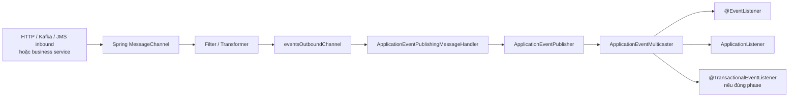
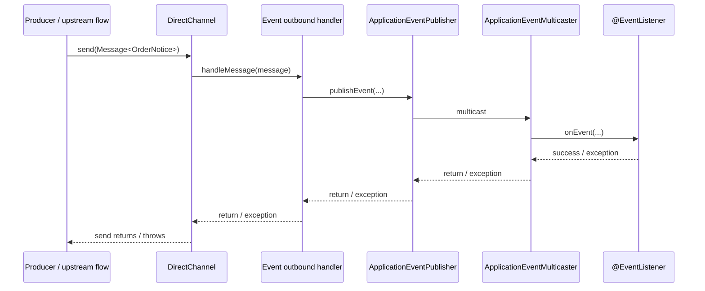
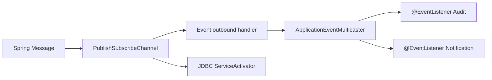
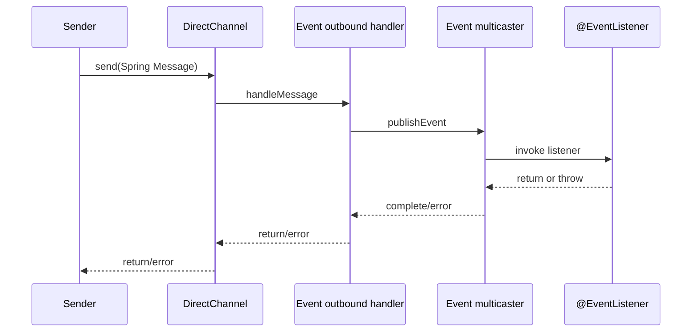
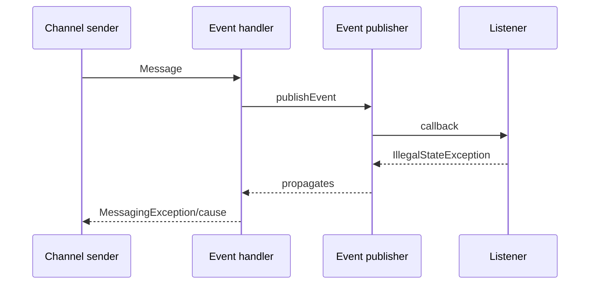
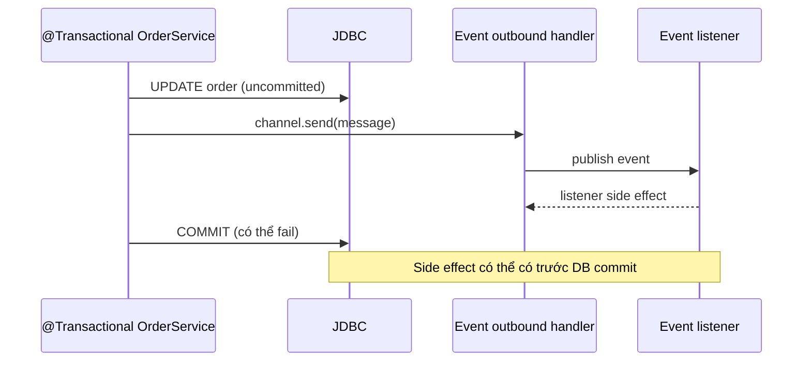
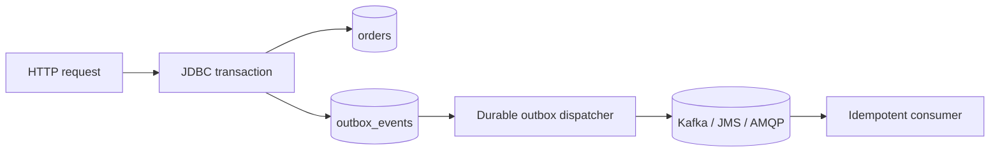
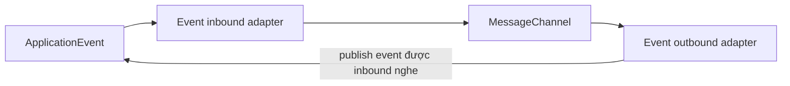

# Gửi Spring ApplicationEvent từ message

**Spring Integration Event Outbound Channel Adapter** chuyển một Spring Messaging `Message<?>` đang đi qua `MessageChannel` thành sự kiện được công bố qua **`ApplicationEventPublisher`** của cùng Spring `ApplicationContext`. Thành phần thực hiện là **`ApplicationEventPublishingMessageHandler`**. Đây là chiều **ngược** với event inbound adapter: không phải nghe `ApplicationEvent` để tạo message, mà nhận message từ một flow để **phát Spring ApplicationEvent** cho `ApplicationListener` hoặc `@EventListener`.

Bài thuộc chương **Adapter sự kiện** của module **SPRING_INTEGRATION_ADAPTERS**. Module hướng tới kết nối các hệ thống ngoài bằng inbound/outbound adapter, gateway, poller và `MessageChannel`; thực hành file, SFTP, HTTP, JMS, AMQP, Kafka và cơ sở dữ liệu; xử lý hợp đồng message, lỗi và vòng đời kết nối. Bài này tập trung vào **công bố sự kiện nội bộ từ Spring Integration message**, sau đó giải thích ranh giới với transport bền vững khi flow có Kafka/JMS/AMQP, HTTP, SFTP hoặc JDBC.

> **Nguyên tắc:** Mặc định, outbound handler **bọc `Message<?>` trong `MessagingEvent`**. Nếu payload **đã là `ApplicationEvent`**, handler phát **nguyên event**. Nếu bật `publishPayload=true`, handler gửi **payload trực tiếp** cho `ApplicationEventPublisher`: POJO/record sẽ được Spring Framework bọc thành `PayloadApplicationEvent` nếu cần. Không xem các cơ chế đó như một durable message broker.

## 1. Mục tiêu học tập

Hoàn thành bài này, bạn có thể:

1. Vẽ đường đi `MessageChannel → ApplicationEventPublishingMessageHandler → ApplicationEventPublisher → ApplicationListener`.
2. Phân biệt **event inbound** `ApplicationEventListeningMessageProducer` và **event outbound** `ApplicationEventPublishingMessageHandler`.
3. Giải thích `MessagingEvent`, `getMessage()`, payload, headers và Spring `ApplicationEvent`.
4. Chọn chính xác ba trường hợp công bố: payload event, `publishPayload=false` và `publishPayload=true`.
5. Cấu hình Spring Boot, `spring-integration-event`, `@EnableIntegration`, `DirectChannel`, `@ServiceActivator` trên handler bean.
6. Viết Java DSL `IntegrationFlow.from(...).handle(...)` và XML `int-event:outbound-channel-adapter`.
7. Nhận sự kiện qua `@EventListener`, `ApplicationListener` hoặc `@TransactionalEventListener` với contract đúng.
8. Giải thích `DirectChannel`/`ExecutorChannel`/`QueueChannel`, poller, fan-out và timing.
9. Hiểu cách xử lý exception từ listener, multicaster error handler, retry, backpressure và `errorChannel`.
10. Nhận diện nguy cơ vòng lặp khi kết hợp event inbound và outbound trong cùng context.
11. Phân biệt Spring application event với Kafka/JMS/AMQP broker event, tính bền, replay và acknowledgment.
12. Thiết kế idempotency, outbox/inbox và transaction phase khi có side effect JDBC/HTTP/SFTP.
13. Viết kiểm thử chứng minh `MessagingEvent` giữ headers, payload events đúng type và lỗi đồng bộ.
14. Quan sát lifecycle, metrics và các failure windows trong production.

## 2. Nguồn và đích của outbound event adapter

Ví dụ `OrderProcessingFlow` nhận một Spring message từ HTTP inbound gateway, Kafka inbound adapter hoặc một business service. Sau khi transform, flow gửi message vào `eventsOutboundChannel`; event outbound handler công bố Spring event để những beans trong cùng context nhận:



Điều kiện ngầm trong sơ đồ là các listeners đăng ký trong **Spring application context đích** và event type phù hợp. Spring event không tự chuyển giữa hai JVM/pods; mỗi process có context và các listener riêng.

### 2.1. Đừng nhầm hướng của hai adapter

| Tiêu chí | Event **inbound** adapter | Event **outbound** adapter |
|---|---|---|
| Class | `ApplicationEventListeningMessageProducer` | `ApplicationEventPublishingMessageHandler` |
| Input thực tế | `ApplicationEvent` notification | Spring `Message<?>` |
| Output thực tế | Spring `MessageChannel` | `ApplicationEventPublisher` |
| Spring Integration pattern | Message-producing inbound endpoint | Message-consuming outbound endpoint |
| Hợp đồng đặc biệt | `eventTypes`, `payloadExpression` | `publishPayload` |
| Kết nối Kafka broker? | Không tự | Không tự |
| Cần poller? | Không: event callback | **Chỉ khi input channel là PollableChannel** |
| Xử lý lỗi | Lỗi publish Spring message | Lỗi phát Spring event/listener |
| Độ bền | In-memory mặc định | In-memory mặc định |

**Tên “outbound”** nói về **hướng Spring message rời integration flow**, không có nghĩa đã đi ra mạng hoặc broker.

## 3. Hai abstraction: Message và ApplicationEvent

Spring Messaging `Message<T>` mang payload và headers:

```text
Spring Message<OrderNotification>:
  payload:
    eventId: evt-101
    orderId: ORD-101
    state: ACCEPTED
  headers:
    id: <message UUID>
    timestamp: <creation time>
    correlationId: corr-9001
    sourceSystem: orders-service
```

Spring Framework `ApplicationEvent` kế thừa `EventObject`, có `source` và timestamp. ApplicationEventPublisher thông báo event cho các Spring application listeners. Nếu publish một object **không extends `ApplicationEvent`**, Spring Framework có thể bọc nó thành **`PayloadApplicationEvent<T>`**.

| Thuộc tính | Spring `Message<?>` | Spring `ApplicationEvent` |
|---|---|---|
| Cấu trúc | Payload + `MessageHeaders` | Source + timestamp + event fields |
| Hành trình | MessageChannel và integration endpoints | ApplicationEventMulticaster và application listeners |
| Kiểu nhận | `@ServiceActivator`, message handler | `@EventListener`, `ApplicationListener` |
| Lifecycle | Endpoint/channel | Spring ApplicationContext |
| Độ bền mặc định | Tùy channel; DirectChannel không bền | Không bền/in-process |
| Correlation | Headers/eventId do app định nghĩa | Fields/eventId do app định nghĩa |
| Retry | Advice/error flow tùy endpoint | Listener/multicaster policy; không có broker replay mặc định |

**`MessageHeaders.ID` không phải business event ID.** Một event có thể được tạo lại dưới một message ID mới khi retry. Với side effects nhạy cảm, dùng `eventId` có ý nghĩa nghiệp vụ.

## 4. ApplicationEventPublishingMessageHandler làm gì?

Class đầy đủ: `org.springframework.integration.event.outbound.ApplicationEventPublishingMessageHandler`. Nó kế thừa `AbstractMessageHandler`, implements `ApplicationEventPublisherAware` và nhận một `Message<?>` rồi công bố event tới context.



Sơ đồ mô tả **multicaster mặc định đồng bộ + DirectChannel**. Nếu thay sang async multicaster, `ExecutorChannel` hoặc `QueueChannel`, publisher có thể return sớm hơn business listener.

### 4.1. Tự được inject ApplicationEventPublisher

Khi handler là **Spring-managed bean**, framework gọi `setApplicationEventPublisher(...)` nhờ `ApplicationEventPublisherAware`. Không cần tạo một `ApplicationEventPublisher` tùy ý hay gọi setter thủ công trong cấu hình thông thường.

Nếu tự `new ApplicationEventPublishingMessageHandler()` bên ngoài Spring context rồi gọi `handleMessage`, nó có thể chưa được inject publisher và thiếu lifecycle. Hãy đăng ký bean/endpoint để Spring quản lý.

### 4.2. Một outbound handler là one-way

`ApplicationEventPublishingMessageHandler` là `MessageHandler`; nó không cung cấp Kafka consumer ACK hay reply message theo giao thức request–reply. `ApplicationEventPublisher.publishEvent` thường trả `void`; không diễn giải return của `send()` trên Spring channel thành kết quả xử lý mọi downstream listener trong trường hợp async.

## 5. Ba trường hợp quan trọng nhất của payload

Tài liệu Spring Integration mô tả **chính xác** logic:

1. Nếu `message.getPayload() instanceof ApplicationEvent`, publish **payload như event gốc**.
2. Nếu không là ApplicationEvent và `publishPayload=false` (mặc định), bọc **nguyên `Message<?>`** vào `MessagingEvent`.
3. Nếu không là ApplicationEvent và `publishPayload=true`, publish **payload trực tiếp** qua Spring ApplicationEventPublisher.

| Spring Message payload | `publishPayload` | Event published | Listener thích hợp | Headers có còn accessible? |
|---|---|---|---|---|
| `OrderAcceptedEvent extends ApplicationEvent` | `false` | `OrderAcceptedEvent` gốc | `@EventListener(OrderAcceptedEvent)` | Không tự chuyển Spring headers |
| `OrderAcceptedEvent extends ApplicationEvent` | `true` | `OrderAcceptedEvent` gốc | `@EventListener(OrderAcceptedEvent)` | Không tự chuyển Spring headers |
| `OrderNotice` Java record/POJO | `false` | **`MessagingEvent`** | `@EventListener(MessagingEvent)` | Có, qua `getMessage()` |
| `OrderNotice` Java record/POJO | `true` | Payload `OrderNotice`; Spring có thể wrap `PayloadApplicationEvent<OrderNotice>` | `@EventListener(OrderNotice)` | Không tự chuyển headers |
| `String` | `false` | **`MessagingEvent`** | `@EventListener(MessagingEvent)` | Có, qua wrapped message |
| `String` | `true` | Payload String, Spring wrap thành payload event | `@EventListener(String)` | Không tự chuyển headers |
| `PayloadApplicationEvent<OrderNotice>` | Cả hai | Chính `PayloadApplicationEvent` | `@EventListener(OrderNotice)` hoặc listener phù hợp | Không tự chuyển outer Spring headers |

### 5.1. MessagingEvent là gì?

`MessagingEvent` thuộc package **`org.springframework.integration.event.core.MessagingEvent`**. Đây là subclass của Spring `ApplicationEvent`, dùng để bọc một Spring `Message<?>`. Nó có:

```java
Message<?> message = messagingEvent.getMessage();
Object payload = message.getPayload();
MessageHeaders headers = message.getHeaders();
```

Điều này cho phép Spring listener truy cập **nguyên payload + headers** do integration flow gửi đến. `getSource()` cũng trỏ tới message, nhưng dùng `getMessage()` rõ ràng hơn.

### 5.2. publishPayload=true và mất outer headers

Với `publishPayload=true`, handler gọi Spring event publication trên **payload**, không đóng gói `MessageHeaders`. Ví dụ một `Message<OrderNotice>` chứa header `correlationId=corr-1` sẽ trở thành payload event chứa OrderNotice **mà listener không tự thấy header đó**.

Nếu correlation/trace/audit quan trọng, có các cách:

- Đưa business `eventId`, `correlationId`, `tenantId` vào DTO event có schema rõ.
- Giữ `publishPayload=false`, để listener nhận `MessagingEvent` và dùng `getMessage().getHeaders()`.
- Dùng transformer tạo event class riêng mang metadata từ header vào fields.
- Không phụ thuộc vào trace context thread-local nếu có async handoff.

### 5.3. `ApplicationEvent` luôn được publish trực tiếp

Kể cả `publishPayload=false`, nếu payload là subclass của `ApplicationEvent`, handler **không bọc `MessagingEvent`**. Đây là ngoại lệ quan trọng: không viết một `@EventListener(MessagingEvent.class)` rồi kỳ vọng nhận mọi message đi qua outbound adapter.

## 6. Maven dependencies và versioning

Dùng Spring Boot BOM tương thích với Spring Integration:

```xml
<dependencies>
    <dependency>
        <groupId>org.springframework.boot</groupId>
        <artifactId>spring-boot-starter-integration</artifactId>
    </dependency>
    <dependency>
        <groupId>org.springframework.integration</groupId>
        <artifactId>spring-integration-event</artifactId>
    </dependency>
</dependencies>
```

`spring-integration-event` là module riêng; không chỉ thêm `spring-integration-core` rồi mặc định class outbound event handler luôn trên classpath. Không trộn Spring Framework và Spring Integration versions ngoài BOM khi chưa kiểm tra compatibility.

Imports chủ yếu:

```java
import org.springframework.integration.event.outbound.ApplicationEventPublishingMessageHandler;
import org.springframework.integration.event.core.MessagingEvent;
import org.springframework.integration.annotation.ServiceActivator;
import org.springframework.integration.channel.DirectChannel;
import org.springframework.messaging.Message;
import org.springframework.messaging.MessageChannel;
import org.springframework.messaging.support.MessageBuilder;
```

Những APIs nêu trong bài có mặt trong các nhánh Spring Integration hiện đại; nếu dùng codebase rất cũ, đối chiếu Javadoc/version trước khi sao chép code. `publishPayload` có từ Spring Integration 4.2.

## 7. Demo A — Gửi Spring Message thành MessagingEvent (mặc định)

Ta xây ứng dụng Spring Boot nơi một service tạo `Message<OrderNotice>`, gửi vào `DirectChannel`; handler outbound phát **`MessagingEvent`**, còn `@EventListener` truy cập payload/headers.

### 7.1. Domain payload: OrderNotice.java

```java
package com.example.events;

public record OrderNotice(
        String eventId,
        String orderId,
        String state) {
}
```

`OrderNotice` **không extends ApplicationEvent**. Ở demo A, `publishPayload` để mặc định `false` nên listener nhận `MessagingEvent`.

### 7.2. Spring Integration config: EventOutboundConfig.java

```java
package com.example.events;

import org.springframework.beans.factory.annotation.Qualifier;
import org.springframework.context.annotation.Bean;
import org.springframework.context.annotation.Configuration;
import org.springframework.integration.annotation.ServiceActivator;
import org.springframework.integration.channel.DirectChannel;
import org.springframework.integration.config.EnableIntegration;
import org.springframework.integration.event.outbound.ApplicationEventPublishingMessageHandler;
import org.springframework.messaging.MessageChannel;

@Configuration
@EnableIntegration
public class EventOutboundConfig {

    @Bean("ordersToApplicationEvents")
    public MessageChannel ordersToApplicationEvents() {
        return new DirectChannel();
    }

    @Bean
    @ServiceActivator(inputChannel = "ordersToApplicationEvents")
    public ApplicationEventPublishingMessageHandler eventOutboundHandler() {
        ApplicationEventPublishingMessageHandler handler =
                new ApplicationEventPublishingMessageHandler();

        // Mặc định false; ghi rõ để thể hiện contract.
        handler.setPublishPayload(false);
        return handler;
    }
}
```

**Giải thích:**

1. `ordersToApplicationEvents` là Spring **input channel của outbound adapter**.
2. `@ServiceActivator` trên `@Bean` tạo **consumer endpoint** subscribe channel và gọi handler.
3. Spring quản lý handler và inject `ApplicationEventPublisher`.
4. `publishPayload=false` khiến Spring `Message<OrderNotice>` được bọc trong `MessagingEvent`.
5. Sử dụng `DirectChannel` giúp path đồng bộ với sender nếu multicaster cũng đồng bộ.
6. Chỉ cần **một** handler subscribe channel trong demo; nhiều service activators cùng DirectChannel sẽ cạnh tranh, không broadcast.

### 7.3. Business service gửi Spring message: OrderNoticeService.java

```java
package com.example.events;

import java.util.Objects;
import java.util.UUID;

import org.springframework.beans.factory.annotation.Qualifier;
import org.springframework.messaging.Message;
import org.springframework.messaging.MessageChannel;
import org.springframework.messaging.support.MessageBuilder;
import org.springframework.stereotype.Service;

@Service
public class OrderNoticeService {

    private final MessageChannel outboundChannel;

    public OrderNoticeService(
            @Qualifier("ordersToApplicationEvents")
            MessageChannel outboundChannel) {
        this.outboundChannel = outboundChannel;
    }

    public void accept(String orderId) {
        Objects.requireNonNull(orderId, "orderId");

        OrderNotice notice = new OrderNotice(
                UUID.randomUUID().toString(),
                orderId,
                "ACCEPTED");

        Message<OrderNotice> message =
                MessageBuilder.withPayload(notice)
                    .setHeader("correlationId", "order-" + orderId)
                    .setHeader("sourceSystem", "orders-module")
                    .build();

        boolean sent = outboundChannel.send(message);
        if (!sent) {
            throw new IllegalStateException(
                    "Spring channel rejected the message");
        }
    }
}
```

`send(message)` không phải Kafka `KafkaTemplate.send`. Khi đồng bộ, có thể nhận exception của downstream listener, nhưng khi async thì `true` có thể chỉ cho biết message đã được accepted/queued.

### 7.4. Spring event listener: OrderNoticeAudit.java

```java
package com.example.events;

import org.springframework.context.event.EventListener;
import org.springframework.integration.event.core.MessagingEvent;
import org.springframework.messaging.Message;
import org.springframework.stereotype.Component;

@Component
public class OrderNoticeAudit {

    @EventListener
    public void onMessagingEvent(MessagingEvent event) {
        Message<?> message = event.getMessage();

        if (!(message.getPayload() instanceof OrderNotice notice)) {
            return; // Các MessagingEvent khác không thuộc use case.
        }

        Object correlation =
                message.getHeaders().get("correlationId");

        System.out.printf(
            "AUDIT eventId=%s orderId=%s state=%s corr=%s%n",
            notice.eventId(),
            notice.orderId(),
            notice.state(),
            correlation);
    }
}
```

Lưu ý `@EventListener(MessagingEvent)` có thể nhận **các MessagingEvent khác** do cùng context công bố. Nếu ứng dụng có nhiều IntegrationFlows dùng event outbound, cần filter theo payload class và sourceSystem/route/headers đáng tin cậy.

### 7.5. Khởi chạy từ ApplicationRunner

```java
package com.example.events;

import org.springframework.boot.ApplicationRunner;
import org.springframework.boot.SpringApplication;
import org.springframework.boot.autoconfigure.SpringBootApplication;
import org.springframework.context.annotation.Bean;

@SpringBootApplication
public class EventOutboundDemoApplication {

    public static void main(String[] args) {
        SpringApplication.run(
                EventOutboundDemoApplication.class, args);
    }

    @Bean
    ApplicationRunner runOnce(OrderNoticeService service) {
        return args -> {
            service.accept("ORD-101");
            service.accept("ORD-202");
        };
    }
}
```

Các classes cùng package `com.example.events` để Boot component scan nhận ra tất cả. Output dự kiến:

```text
AUDIT eventId=... orderId=ORD-101 state=ACCEPTED corr=order-ORD-101
AUDIT eventId=... orderId=ORD-202 state=ACCEPTED corr=order-ORD-202
```

Không dựa vào thứ tự log giữa nhiều threads nếu ứng dụng cấu hình executor. Demo chỉ log, không có persistent audit database.

### 7.6. Checklist hợp đồng demo A

- Payload là `OrderNotice` (không extends `ApplicationEvent`).
- Outbound handler **`publishPayload=false`**.
- Event published là **`MessagingEvent`**.
- Listener nhận `MessagingEvent`, rồi `event.getMessage()`.
- Headers `correlationId` và `sourceSystem` có trong wrapped message.
- Sự kiện chỉ trong **cùng Spring ApplicationContext** và không có Kafka broker nào được gọi.
- Event không có durable replay sau crash.

## 8. Demo B — Công bố payload bằng publishPayload=true

Khi muốn listener nhận domain object trực tiếp, đổi config (thay thế handler ở demo A):

```java
@Bean
@ServiceActivator(inputChannel = "ordersToApplicationEvents")
public ApplicationEventPublishingMessageHandler eventOutboundHandler() {

    ApplicationEventPublishingMessageHandler handler =
            new ApplicationEventPublishingMessageHandler();
    handler.setPublishPayload(true);
    return handler;
}
```

Với message payload `OrderNotice`, handler gọi `publishEvent(notice)`. Spring Framework hỗ trợ `publishEvent(Object)` và có thể bọc notice thành `PayloadApplicationEvent<OrderNotice>`.

### 8.1. Listener theo type domain

```java
@Component
public class OrderNoticePayloadListener {

    @EventListener
    public void onNotice(OrderNotice notice) {
        System.out.println(
            "PAYLOAD eventId=" + notice.eventId()
            + " orderId=" + notice.orderId());
    }
}
```

Trong demo B, `@EventListener(OrderNotice.class)` được chọn theo payload type. Không cần listener nhận `MessagingEvent` nữa để dùng nội dung event.

**Đổi lại:** Spring headers như `correlationId`/`sourceSystem` **không tự có** trong event object. Nếu cần, bổ sung correlation vào OrderNotice DTO hoặc dùng demo A.

### 8.2. Vì sao listener POJO không nhận MessagingEvent trong demo A?

Với `publishPayload=false`, event class thực sự là `MessagingEvent`, nên Spring không mặc nhiên unwrap payload để coi đó là `OrderNotice` listener. `@EventListener(OrderNotice.class)` là một contract khác, chỉ hợp khi publish payload trực tiếp.

### 8.3. Test đối chiếu hai modes

| Cấu hình | `@EventListener(MessagingEvent)` | `@EventListener(OrderNotice)` |
|---|---|---|
| `publishPayload=false`, payload OrderNotice | Có event, truy cập message/headers | Không được chọn chỉ vì payload bên trong là OrderNotice |
| `publishPayload=true`, payload OrderNotice | Không phải event wrapper loại MessagingEvent | Có |
| Payload `ApplicationEvent` bất kỳ | Theo actual event class; không mặc định MessagingEvent | Nếu listener type tương ứng với actual event |

**Đừng đăng ký hai cấu hình `@Bean` có cùng tên và cùng channel trong một context.** Hai demo là các phương án thay thế; khi so sánh bằng test, dựng test context riêng cho mỗi mode.

## 9. Demo C — Payload đã extends ApplicationEvent

Nếu Spring message payload đã là một `ApplicationEvent`, adapter **publish event nguyên bản**, **không cần publishPayload=true**.

### 9.1. Domain event: OrderShippedEvent.java

```java
package com.example.events;

import org.springframework.context.ApplicationEvent;

public final class OrderShippedEvent extends ApplicationEvent {

    private final String eventId;
    private final String orderId;

    public OrderShippedEvent(
            Object source, String eventId, String orderId) {
        super(source);
        this.eventId = eventId;
        this.orderId = orderId;
    }

    public String getEventId() {
        return eventId;
    }

    public String getOrderId() {
        return orderId;
    }
}
```

Sender:

```java
Message<OrderShippedEvent> message = MessageBuilder
        .withPayload(
            new OrderShippedEvent(this, "evt-400", "ORD-101"))
        .setHeader("traceRef", "trace-9001")
        .build();

ordersToApplicationEvents.send(message);
```

Listener:

```java
@EventListener
public void onShipped(OrderShippedEvent event) {
    System.out.println(
        "SHIPPED " + event.getOrderId()
        + " eventId=" + event.getEventId());
}
```

Dù `setPublishPayload(false)`, event outbound vẫn công bố `OrderShippedEvent` gốc. `traceRef` là header của **Spring message bên ngoài** và **không tự được copy vào OrderShippedEvent**.

### 9.2. Tại sao không nên xem event.source là context metadata?

`ApplicationEvent` có `getSource()`. Nó có thể trỏ tới `this` (một Spring bean), một domain object hoặc một reference khác. Không biến `getSource()` thành payload Kafka/JMS/HTTP mà không kiểm tra, vì có thể leak internal objects hoặc dữ liệu nhạy cảm.

Nếu muốn event lâu bền/cross-process, dùng DTO có schema tường minh như `eventId`, `aggregateId`, `eventType`, `eventVersion`, `occurredAt`.

## 10. Java DSL với ApplicationEventPublishingMessageHandler

Bên cạnh `@ServiceActivator` trên `@Bean`, Java DSL có thể dùng cùng handler trong IntegrationFlow.

```java
package com.example.events;

import org.springframework.context.annotation.Bean;
import org.springframework.context.annotation.Configuration;
import org.springframework.integration.dsl.IntegrationFlow;
import org.springframework.integration.event.outbound.ApplicationEventPublishingMessageHandler;

@Configuration
public class EventOutboundDslConfig {

    @Bean
    ApplicationEventPublishingMessageHandler eventHandler() {
        ApplicationEventPublishingMessageHandler handler =
                new ApplicationEventPublishingMessageHandler();
        handler.setPublishPayload(true);
        return handler;
    }

    @Bean
    IntegrationFlow eventOutFlow(
            ApplicationEventPublishingMessageHandler eventHandler) {

        return IntegrationFlow
                .from("ordersToApplicationEvents")
                .handle(eventHandler)
                .get();
    }
}
```

`ordersToApplicationEvents` phải tồn tại như channel bean hoặc được DSL resolver tạo theo quy tắc bean/name. **Đây là cấu hình thay thế demo A `@Bean @ServiceActivator`**; không đăng ký cùng một handler bean vừa bằng annotation endpoint vừa bằng DSL handle để tránh hai endpoints nhận message sai mong đợi.

### 10.1. Java DSL functional form

Spring Integration Reference cũng có dạng:

```java
@Bean
public IntegrationFlow eventsOutFlow(
        ApplicationEventPublishingMessageHandler eventHandler) {

    return flow -> flow.handle(eventHandler);
}
```

Với dạng functional, framework gán input channel của flow theo bean name/endpoint conventions; nếu muốn caller gửi bằng một channel đã biết, cách `IntegrationFlow.from("ordersToApplicationEvents")` ở trên dễ đọc và test hơn.

### 10.2. Pipeline có transformer trước outbound

```java
@Bean
IntegrationFlow noticesToEvents(
        ApplicationEventPublishingMessageHandler eventHandler) {

    return IntegrationFlow
        .from("incomingOrderMessages")
        .filter(OrderNotice.class,
            notice -> !"IGNORED".equals(notice.state()))
        .transform(OrderNotice.class, notice -> notice)
        .handle(eventHandler)
        .get();
}
```

Ở đây transformer là identity chỉ để minh họa vị trí của bước chuyển đổi. Production nên dùng transformer **thực sự map event schema/headers** hoặc bỏ bước này để tránh complexity thừa. Input channel `incomingOrderMessages` là nơi message từ service/adapter khác đến. `eventHandler` được cấu hình publishPayload theo contract yêu cầu.

## 11. XML outbound-channel-adapter và poller

Spring Integration cung cấp namespace `int-event` với `outbound-channel-adapter`:

```xml
<?xml version="1.0" encoding="UTF-8"?>
<beans xmlns="http://www.springframework.org/schema/beans"
       xmlns:xsi="http://www.w3.org/2001/XMLSchema-instance"
       xmlns:int="http://www.springframework.org/schema/integration"
       xmlns:int-event="http://www.springframework.org/schema/integration/event"
       xsi:schemaLocation="
          http://www.springframework.org/schema/beans
          http://www.springframework.org/schema/beans/spring-beans.xsd
          http://www.springframework.org/schema/integration
          http://www.springframework.org/schema/integration/spring-integration.xsd
          http://www.springframework.org/schema/integration/event
          http://www.springframework.org/schema/integration/event/spring-integration-event.xsd">

    <int:channel id="ordersToApplicationEvents"/>

    <int-event:outbound-channel-adapter
        channel="ordersToApplicationEvents"
        publish-payload="true"/>
</beans>
```

Nhận xét:

- `publish-payload="true"` tương đương `handler.setPublishPayload(true)`.
- Bỏ thuộc tính đó thì default `false`: POJO message được bọc `MessagingEvent`.
- Channel được dùng là **input** của outbound adapter.
- Không cần poller nếu channel là `DirectChannel`/`SubscribableChannel`.

### 11.1. QueueChannel phải có poller

Nếu `ordersToApplicationEvents` là `QueueChannel`, endpoint nhận message bằng polling:

```xml
<int:channel id="ordersToApplicationEvents">
    <int:queue capacity="500"/>
</int:channel>

<int-event:outbound-channel-adapter
    channel="ordersToApplicationEvents"
    publish-payload="false">
    <int:poller fixed-rate="100"
                max-messages-per-poll="10"/>
</int-event:outbound-channel-adapter>
```

**Giải nghĩa:** Poller lấy tối đa 10 Spring messages mỗi lần chạy rồi gọi outbound event handler. `fixed-rate="100"` tính theo milliseconds trong cấu hình này. Queue trong ví dụ là **RAM queue**, không durable; crash trước poll có thể mất các messages đã enqueue.

### 11.2. Poller task-executor

Namespace cho phép dùng `task-executor` để chuyển polling sang executor:

```xml
<int:channel id="ordersToApplicationEvents">
    <int:queue/>
</int:channel>

<int-event:outbound-channel-adapter
    channel="ordersToApplicationEvents">
    <int:poller
        fixed-rate="100"
        max-messages-per-poll="1"
        task-executor="eventDispatchExecutor"/>
</int-event:outbound-channel-adapter>
```

Cần định nghĩa một bean `eventDispatchExecutor` phù hợp (ví dụ `ThreadPoolTaskExecutor`) trong context. Khi nhiều worker cùng publish events, thứ tự hoàn tất và exception handling khác với DirectChannel đồng bộ. **Không chọn QueueChannel chỉ vì tên outbound adapter**, mà vì thiết kế backpressure/async và durability có chủ đích.

## 12. Channel đồng bộ, fan-out và điểm hoàn tất

Một outbound event handler có thể nằm sau nhiều channel. **Khi nào `MessageChannel.send(...)` trả về** là phần hợp đồng phải xác định trước khi nói tới kết quả xử lý.

| Channel | Đường tới outbound handler | Caller có chờ listeners? | Bền vững mặc định? |
|---|---|---|---|
| `DirectChannel` | Handler trên thread gọi send | Có thể, khi multicaster sync | Không |
| `ExecutorChannel` | Dispatch sang executor | Không nhất thiết | Không |
| `QueueChannel` | Enqueue, endpoint poll sau | Không | Không với RAM queue |
| `PublishSubscribeChannel` | Fan-out Spring message tới nhiều handlers | Tùy executor | Không |
| QueueChannel với durable store | Poll và transaction theo store | Tùy cấu hình | Theo message store |

### 12.1. Fan-out hai lần: Spring Integration rồi Spring Event



Nếu cả JDBC service activator và `@EventListener Audit` cùng ghi audit DB, một message có thể gây **hai side effects**. Fan-out không tự cung cấp dedup hoặc transaction chung. Cần phân định owner theo eventId.

### 12.2. DirectChannel không chạy trên một global worker

`DirectChannel` dispatch **trên thread của caller**. Nếu ba HTTP requests hoặc Kafka consumers cùng gọi `send()`, một singleton `@EventListener` có thể nhận callbacks từ ba threads. Listener phải thread-safe; event bus không khóa toàn bộ domain order.

### 12.3. Spring send success không phải broker ACK

Trong flow đồng bộ, `send()` trả về có thể chứng tỏ handler không throw khi được invoke. Nó **không** chứng minh Kafka producer ACK, JMS durable store hay external JDBC commit nếu event listener chỉ enqueue task. Với async dispatch, `send()` có thể hoàn tất **trước cả khi listener bắt đầu**.

## 13. ApplicationEventMulticaster: sync và async

Spring Framework mặc định thường dùng `SimpleApplicationEventMulticaster` với listener invocation **đồng bộ**, nếu không tùy chỉnh executor.



Với sync multicaster, một listener chạy lâu có thể giữ thread của caller. Thêm executor thay đổi thời điểm return và đường lan truyền lỗi.

### 13.1. Async multicaster là thay đổi cấp ApplicationContext

```java
@Bean(name = "applicationEventMulticaster")
ApplicationEventMulticaster applicationEventMulticaster(
        TaskExecutor executor) {

    SimpleApplicationEventMulticaster m =
            new SimpleApplicationEventMulticaster();
    m.setTaskExecutor(executor);
    return m;
}
```

Imports:

```java
import org.springframework.context.event.ApplicationEventMulticaster;
import org.springframework.context.event.SimpleApplicationEventMulticaster;
import org.springframework.core.task.TaskExecutor;
```

Cần bean `TaskExecutor` phù hợp. Một số listeners không hỗ trợ async execution; xem `supportsAsyncExecution()`/Spring Framework Javadoc theo version. Đừng bật executor trên multicaster mà không kiểm tra cả listeners khác trong context.

### 13.2. Bốn kiểu async không đồng nhất

- `ExecutorChannel`: message chưa tới outbound handler trên thread gốc.
- Async multicaster: outbound handler publish nhưng listener chạy qua executor.
- `QueueChannel`: message còn nằm trong queue chờ poller.
- `@Async @EventListener`: một listener method có lựa chọn async riêng.

**Khác thread đồng nghĩa transaction/thread-local context không tự được chuyển**, exception có thể không propagate về sender, và hoàn tất có thể đảo thứ tự.

## 14. Ordering của event giữa threads

`Spring ApplicationEvent` không có Kafka partition log. Giả sử gửi:

```text
e1: ORD-101 state=ACCEPTED version=1
e2: ORD-101 state=SHIPPED version=2
```

Với một thread và sync path, callbacks thường theo trình tự gửi. Nhưng với hai upstream threads, executor hoặc HTTP listener async, e2 có thể hoàn tất trước e1.

### 14.1. Version theo aggregate

```java
public record OrderStateChanged(
        String eventId,
        String orderId,
        long aggregateVersion,
        String state) {}
```

DB handler có thể dùng `aggregateVersion` và optimistic locking/state machine để phát hiện stale event. Nếu cần scale nhiều pods và per-key ordering, chọn Kafka partition key/orderId hoặc transport tương ứng, nhưng vẫn cần producer causal ordering.

### 14.2. @Order chỉ là thứ tự listener invocation

```java
@EventListener
@Order(10)
public void validate(OrderNotice notice) { /* validate */ }

@EventListener
@Order(20)
public void observe(OrderNotice notice) { /* log */ }
```

`@Order` có thể chỉ định thứ tự listener invocation trong synchronous dispatch, **không** tạo distributed transaction; async completion vẫn có thể khác.

## 15. Error propagation và các side effect đã hoàn tất

Với sync multicaster + `DirectChannel` và không có error handler nuốt lỗi, khi event listener ném exception, lỗi có thể quay về Spring channel sender:



### 15.1. Listener ví dụ lỗi

```java
@EventListener
public void onNotice(OrderNotice notice) {
    if ("INVALID".equals(notice.state())) {
        throw new IllegalArgumentException(
                "Unsupported order state");
    }
}
```

Đây là contract của `publishPayload=true`. Nếu default `publishPayload=false`, listener nhận `MessagingEvent`, lấy `OrderNotice` từ `event.getMessage()`.

### 15.2. Retry toàn event có thể nhân side effect

```text
Publish event:
  Listener A -> ghi audit DB thành công
  Listener B -> HTTP timeout

Retry toàn handler:
  Listener A -> có thể ghi audit lần thứ hai
  Listener B -> retry HTTP
```

Không thể rollback JDBC transaction của A chỉ bằng exception từ B. Nếu retry là cần thiết, dùng business `eventId`, unique constraint/inbox; hoặc tách side effects sang độc lập durable consumers.

### 15.3. ErrorChannel không tự bảo vệ DirectChannel

Lỗi trên sync DirectChannel có thể ném thẳng về caller, **không tự** trở thành global `ErrorMessage` nếu không có endpoint/gateway/poller hoặc error flow riêng cấu hình. Với executor/poller, lỗi có thể đi qua errorChannel tương ứng; cần subscriber và chính sách recovery.

**Log error ≠ lưu event bền.** Nếu error handler log rồi return, caller có thể tưởng đã hoàn tất; phải đánh giá durable recovery và telemetry.

### 15.4. Multiple listeners và lỗi giữa chừng

Nếu listener A xử lý xong, listener B throw, sync multicaster có thể dừng publication trước các listeners sau đó (tùy custom error handler). Không nói “mọi listener đã nhận event” chỉ vì event outbound handler được gọi.

## 16. Transaction timing: JDBC commit không chờ event

Nếu service gửi Spring message trong body `@Transactional` JDBC:



Đặc biệt nguy hiểm nếu listener gọi webhook/SMTP/Kafka trước khi order transaction cuối cùng bị rollback.

### 16.1. @TransactionalEventListener và đúng event type

```java
@TransactionalEventListener(
        phase = TransactionPhase.AFTER_COMMIT)
public void onOrderNotice(OrderNotice notice) {
    // Sau transaction commit thành công.
}
```

**Chú ý contract:**

- Với `publishPayload=true` và payload POJO OrderNotice, listener có thể nhận OrderNotice.
- Với **default `publishPayload=false`**, actual event là `MessagingEvent`. Nếu muốn after-commit, listener phải nhận `MessagingEvent` rồi unwrap message, hoặc đổi flag.
- Với payload extends `ApplicationEvent`, listener phải nhận event class đó.

### 16.2. Transaction phases và no-transaction behavior

`BEFORE_COMMIT`, `AFTER_COMMIT` (mặc định), `AFTER_ROLLBACK`, `AFTER_COMPLETION`. Khi publish không có active transaction, transactional event listener mặc định **không chạy**, trừ khi `fallbackExecution=true`.

### 16.3. Async thread có thể mất JDBC transaction context

Nếu trước outbound handler là `ExecutorChannel`, handler có thể chạy ở thread **không gắn transaction** của OrderService. Khi đó `@TransactionalEventListener(AFTER_COMMIT)` có thể không được gọi. `ThreadLocal` transaction semantics không tự vượt ranh giới thread.

Reactive transaction dùng Reactor context khác với classic thread-bound transaction; Spring Framework mới hỗ trợ transaction-bound events theo cơ chế cần context phù hợp.

### 16.4. AFTER_COMMIT không phải durable outbox

```text
JDBC COMMIT thành công
    -> JVM crash trước AFTER_COMMIT callback
    -> Spring event chưa publish, không có replay log
```

Muốn không mất event, ghi **outbox row cùng business state trong một JDBC transaction**. Event outbound handler có thể làm tín hiệu đánh thức dispatcher, không làm nguồn bền duy nhất.

### 16.5. Ghi DB trong AFTER_COMMIT listener

Spring có thể còn bound một số resources sau commit. Nếu listener cần ghi database transaction khác, dùng service mới với `@Transactional(propagation = REQUIRES_NEW)` hoặc boundary rõ, không mặc nhiên tin write cùng transaction cũ sẽ được commit lần nữa.

## 17. Outbox/inbox cho business effect xuyên Kafka/JMS/HTTP



1. Ghi order + outbox eventId trong **cùng DB transaction**.
2. Dispatcher đọc/claim outbox rows có trạng thái PENDING.
3. Gửi broker, xác minh ACK/transaction outcome theo transport.
4. Mark SENT sau thành công.
5. Crash sau ACK trước SENT có thể republish event: downstream dedup bằng eventId.
6. Spring event outbound có thể làm **wake-up hint**, nhưng dispatcher phải polling/check pending rows sau restart.

```sql
CREATE TABLE outbox_events (
    event_id VARCHAR(128) PRIMARY KEY,
    aggregate_id VARCHAR(128) NOT NULL,
    event_type VARCHAR(128) NOT NULL,
    payload TEXT NOT NULL,
    status VARCHAR(20) NOT NULL,
    created_at TIMESTAMP NOT NULL DEFAULT CURRENT_TIMESTAMP
);
```

Schema minh họa; production bổ sung locking/claim, retry schedule, indexes, audit, retention.

### 17.1. Inbox

```sql
CREATE TABLE processed_events (
    event_id VARCHAR(128) PRIMARY KEY,
    processed_at TIMESTAMP NOT NULL DEFAULT CURRENT_TIMESTAMP
);
```

Trong cùng JDBC transaction với side effect, insert `eventId` qua unique constraint; nếu đã tồn tại, bỏ qua duplicate hoặc reconcile. **Spring Message ID** không thay business eventId khi republish có message ID khác.

## 18. Vòng lặp giữa event inbound và outbound adapters

Khi có cả:

- `ApplicationEventListeningMessageProducer`: nhận ApplicationEvent rồi gửi Spring Message.
- `ApplicationEventPublishingMessageHandler`: nhận Spring Message rồi publish ApplicationEvent.

Một topology nối sai có thể tạo vòng:



### 18.1. publishPayload=false tạo vòng với MessagingEvent

```text
Message<OrderNotice>
  -> outbound publishPayload=false
  -> MessagingEvent(source = Message<OrderNotice>)
  -> inbound nhận MessagingEvent, source là Message
  -> inbound chuyển Message nguyên dạng vào channel
  -> outbound publish lại MessagingEvent
  -> ...
```

Synchronous path có thể dẫn tới recursion/StackOverflowError; async path có thể thành event storm và OOM.

### 18.2. publishPayload=true vẫn có thể tạo vòng

```text
Message<OrderNotice>
  -> outbound publishPayload=true
  -> PayloadApplicationEvent<OrderNotice>
  -> inbound adapter filter OrderNotice.class
  -> Message<OrderNotice>
  -> outbound tiếp tục publish
  -> ...
```

Đổi flag **không** tự sửa vòng.

### 18.3. Phòng ngừa

1. Tách event types và chiều event: inbound nghe `AuditCompletedEvent`, outbound phát `OrderAcceptedEvent`.
2. Không nối thẳng inbound output channel trở lại outbound input channel cùng event type.
3. Đặt routing guard theo sourceSystem, direction, eventId, hopCount/TTL.
4. Giới hạn fan-out, có alert event-rate/queue depth và retry counts.
5. Viết integration test xác nhận một input sinh số hữu hạn events.
6. Khi đi qua broker, dùng dedup/inbox và source/destination topic guard.

## 19. Ranh giới với các adapter khác

| Thành phần | Phạm vi | Độ bền/ack |
|---|---|---|
| ApplicationEventPublisher | Spring context / cùng JVM | Không có durable replay mặc định |
| Event outbound handler | In-process Spring message → event | Không tự tạo broker ACK |
| DirectChannel | In-process sync | Không persist |
| QueueChannel RAM | In-process buffer | Không survive crash |
| Kafka outbound adapter | Kafka cluster/topic | Broker ACK/transaction theo config |
| JMS/AMQP outbound adapter | Broker destinations | Persistence/ack/DLQ theo broker |
| HTTP outbound gateway | Network | Timeout có ambiguity; cần idempotency |
| SFTP/File outbound | Filesystem/remote server | Durable file contract tùy write/rename |
| JDBC/outbox | DB | Transaction và durable status |

Khi Kafka inbound adapter nhận record rồi gửi event outbound tới async listener, **Kafka offset có thể commit trước JDBC side effect** nếu callback Kafka hoàn tất sớm. Cần đồng bộ/durable handoff hoặc idempotent consumer/inbox; không chỉ vì event “đã publish local” mà ack Kafka.

### 19.1. Không tự truyền event sang pod khác

Hai pods cùng source code/cùng tên bean vẫn là **hai Spring ApplicationContexts độc lập**. Event outbound ở pod A không tự đến event listener ở pod B. Muốn cross-process fan-out, dùng Kafka/JMS/AMQP, network gateway hoặc durable shared storage.

### 19.2. Security và dữ liệu nhạy cảm

Với `publishPayload=false`, `MessagingEvent.getMessage()` chứa mọi headers. Không đẩy tokens/PII vào headers nếu listeners không được phép đọc. Với `publishPayload=true`, DTO phải mang những fields correlation/tenant được validate; không tin headers đã bị bỏ để thực hiện authorization. Thread-bound security/tracing context không tự propagate qua async.

## 20. Integration test: MessagingEvent giữ headers

Dùng test context sync với `DirectChannel`. Không cần Kafka broker để kiểm chứng wrapper semantics.

### 20.1. Dependency test

```xml
<dependency>
    <groupId>org.springframework.boot</groupId>
    <artifactId>spring-boot-starter-test</artifactId>
    <scope>test</scope>
</dependency>
```

### 20.2. Test Java

```java
package com.example.events;

import static org.assertj.core.api.Assertions.assertThat;

import java.util.concurrent.atomic.AtomicReference;
import org.junit.jupiter.api.Test;
import org.springframework.beans.factory.annotation.Autowired;
import org.springframework.beans.factory.annotation.Qualifier;
import org.springframework.context.annotation.Bean;
import org.springframework.context.annotation.Configuration;
import org.springframework.context.event.EventListener;
import org.springframework.integration.annotation.ServiceActivator;
import org.springframework.integration.channel.DirectChannel;
import org.springframework.integration.config.EnableIntegration;
import org.springframework.integration.event.core.MessagingEvent;
import org.springframework.integration.event.outbound.ApplicationEventPublishingMessageHandler;
import org.springframework.messaging.Message;
import org.springframework.messaging.MessageChannel;
import org.springframework.messaging.support.MessageBuilder;
import org.springframework.test.context.junit.jupiter.SpringJUnitConfig;

@SpringJUnitConfig(classes = EventOutboundTest.Config.class)
class EventOutboundTest {

    @Configuration
    @EnableIntegration
    static class Config {
        @Bean("outboundEvents")
        MessageChannel outboundEvents() {
            return new DirectChannel();
        }

        @Bean
        @ServiceActivator(inputChannel = "outboundEvents")
        ApplicationEventPublishingMessageHandler handler() {
            ApplicationEventPublishingMessageHandler handler =
                    new ApplicationEventPublishingMessageHandler();
            handler.setPublishPayload(false);
            return handler;
        }

        @Bean
        Recorder recorder() {
            return new Recorder();
        }
    }

    static class Recorder {
        final AtomicReference<MessagingEvent> last =
                new AtomicReference<>();

        @EventListener
        public void record(MessagingEvent event) {
            last.set(event);
        }
    }

    @Autowired
    @Qualifier("outboundEvents")
    MessageChannel channel;

    @Autowired Recorder recorder;

    @Test
    void wrapsOriginalMessageWithHeaders() {
        OrderNotice dto = new OrderNotice(
                "evt-test", "ORD-101", "ACCEPTED");

        Message<OrderNotice> source = MessageBuilder
                .withPayload(dto)
                .setHeader("correlationId", "corr-77")
                .build();

        assertThat(channel.send(source)).isTrue();
        MessagingEvent seen = recorder.last.get();
        assertThat(seen).isNotNull();
        assertThat(seen.getMessage()).isSameAs(source);
        assertThat(seen.getMessage().getPayload()).isEqualTo(dto);
        assertThat(seen.getMessage().getHeaders()
                .get("correlationId")).isEqualTo("corr-77");
    }
}
```

Test sử dụng record `OrderNotice` ở demo A và default synchronous multicaster; vì thế có thể assert ngay sau `send()`. Test này không chứng minh durable delivery/rollback semantics.

### 20.3. Test publishPayload=true trong context riêng

```java
static class PayloadRecorder {
    final AtomicReference<OrderNotice> last =
            new AtomicReference<>();

    @EventListener
    public void record(OrderNotice notice) {
        last.set(notice);
    }
}
```

Đổi handler thành `setPublishPayload(true)`, tạo test context tách biệt. Assert listener này nhận OrderNotice, còn outer header correlationId không tự trở thành field của event DTO.

### 20.4. Test ApplicationEvent gốc

Dùng `Message<OrderShippedEvent>`, thử flag false và true trong hai contexts. `@EventListener(OrderShippedEvent)` phải nhận gốc; `@EventListener(MessagingEvent)` không phải listener phù hợp cho custom event đó.

### 20.5. Test error path

- Cho sync listener throw; kiểm tra `channel.send(...)` có exception.
- Thêm custom async multicaster; chứng minh caller return có thể trước lỗi.
- Với multi-listeners, cho A commit, B fail; quan sát partial success và duplicate khi retry.
- Đổi input channel thành QueueChannel; cần poller, kiểm tra send thành công trước callback.
- Dùng CountDownLatch/await có timeout thay vì sleep để tránh flaky async tests.

## 21. Lifecycle và quan sát vận hành

### 21.1. Startup

```text
ApplicationContext refresh
  -> tạo MessageChannel
  -> tạo ApplicationEventPublishingMessageHandler
  -> Spring inject ApplicationEventPublisher
  -> ServiceActivator / IntegrationFlow endpoint đăng ký
  -> Spring @EventListener methods đăng ký
  -> business services bắt đầu send messages
```

Không gửi vào `DirectChannel` từ constructor khi endpoint chưa có subscriber; với demo, dùng `ApplicationRunner` sau startup. Nếu no subscribers, send có thể thất bại. Nếu QueueChannel RAM buffer, hãy phân biệt accepted với event đã được publish.

### 21.2. Shutdown

- Ngừng inbound sources/gateways trước khi đóng outbound endpoint.
- Drain queue/executor nếu có, trong shutdown deadline.
- In-flight Spring events không có persistent broker offset để replay.
- Đừng trả business success khi còn async side effect chưa hoàn tất bền.
- Với outbox, dispatcher khởi động lại phải tiếp tục pending rows.

### 21.3. Metrics phân biệt ba mốc

| Metric gợi ý | Ý nghĩa |
|---|---|
| `event_outbound_message_received_total` | Handler đã nhận Spring messages |
| `spring_application_event_published_total` | Đã gọi publisher |
| `event_listener_business_commit_total` | Business effect hoàn tất |
| `event_listener_failure_total` | Listener exceptions |
| `event_listener_latency_p99` | Thời gian handler |
| `event_executor_queue_depth` | Async backlog |
| `event_feedback_loop_detected_total` | Guard phát hiện event cycle |
| `event_duplicate_id_total` | Duplicate business event IDs |
| `outbox_oldest_pending_seconds` | Durable event chưa chuyển broker |
| `downstream_publish_failure_total` | Kafka/JMS/HTTP network errors |

Tên metrics chỉ là đề xuất, không khẳng định framework tự cung cấp đủ từng meter. Log `eventId`, event class thực tế, payload type, correlationId, source channel, listener thread, transaction status; tránh PII/credential.

## 22. Bảng chẩn đoán nhanh

| Triệu chứng | Nguyên nhân thường gặp | Kiểm tra |
|---|---|---|
| `@EventListener(OrderNotice)` không chạy | Flag false nên MessagingEvent | `publishPayload` |
| `@EventListener(MessagingEvent)` không chạy | Flag true hoặc payload là ApplicationEvent | Payload runtime type |
| Không thấy header correlationId | Publish payload trực tiếp | Message wrapper vs DTO |
| Outbound không publish | Endpoint chưa subscribe channel | Bean registration, DSL/XML |
| `@Bean` handler tự tạo ngoài context lỗi | Chưa inject ApplicationEventPublisher | Bean lifecycle |
| QueueChannel có messages nhưng không có event | Thiếu poller | Polling consumer config |
| Caller return trước listener | ExecutorChannel/async multicaster | Thread boundary |
| Listener A ghi DB trùng | Retry toàn event sau B lỗi | eventId/inbox |
| Event chỉ đến pod A | Spring event in-process | Durable broker |
| StackOverflow/event storm | Inbound/outbound cycle | Graph/type filter |
| DB rollback nhưng webhook đã gửi | Event trong transaction trước commit | Outbox/phase |
| AFTER_COMMIT listener không chạy | Không có active tx/sai event class | Fallback, MessagingEvent vs POJO |
| Queue crash mất event | RAM queue | Durable MessageStore/outbox |
| Kafka offset đã tiến, DB chưa xong | Async local event side effect | Ack/completion barrier |

## 23. Những sai lầm cần tránh

| Hiểu nhầm | Sự thật |
|---|---|
| “Event outbound adapter là Kafka publisher.” | Nó gọi ApplicationEventPublisher trong context. |
| “publishPayload mặc định true.” | Mặc định **false**. |
| “POJO payload mặc định được publish như POJO event.” | Mặc định wrapper **MessagingEvent**. |
| “ApplicationEvent payload vẫn thành MessagingEvent.” | Publish trực tiếp ApplicationEvent gốc. |
| “MessagingEvent thuộc Spring Framework.” | Class của **Spring Integration**, package `event.core`. |
| “Flag true giữ Spring headers.” | Chỉ publish payload; headers không tự mang theo. |
| “@EventListener(POJO) được gọi khi event là MessagingEvent.” | Không chỉ vì POJO nằm trong wrapped Message. |
| “Spring event có durable offset/ACK.” | Không mặc định. |
| “DirectChannel tự broadcast.” | Không; dùng PublishSubscribeChannel. |
| “QueueChannel không cần poller.” | Cần polling consumer để lấy messages. |
| “Async success là business completed.” | Có thể chỉ accepted/enqueued. |
| “Retry event không nhân side effect.” | Listeners đã thành công có thể chạy lại. |
| “publishEvent tự chờ JDBC commit.” | Sync event có thể phát trước commit. |
| “AFTER_COMMIT đảm bảo không mất event.” | Crash window trước callback vẫn tồn tại. |
| “Kafka inbound ACK bảo vệ async local listener.” | Không nếu callback trả về sớm. |
| “Bật publishPayload=true sẽ tránh event loop.” | Cả hai modes có thể lặp. |
| “ApplicationEvent tự đến pods khác.” | Không có cross-process transport. |
| “MessageHeaders.ID là business eventId.” | Cần eventId ổn định ngoài message ID. |

## 24. Bài tập thực hành

### Bài 1 — MessagingEvent mặc định

Chạy demo A; assert `@EventListener(MessagingEvent)` nhận event, `getMessage()` giữ payload và headers.

### Bài 2 — publishPayload=true

Đổi mode trong test context riêng, nhận `OrderNotice` qua `@EventListener`. Vì sao outer `correlationId` không còn?

### Bài 3 — ApplicationEvent payload

Gửi `Message<OrderShippedEvent>` với flag false; listener nào nhận? Kiểm tra identity event.

### Bài 4 — Business eventId

Gửi hai Spring messages khác ID nhưng cùng `OrderNotice.eventId`, thiết kế unique constraint/inbox để tránh side effect trùng.

### Bài 5 — Java DSL

Thay `@ServiceActivator` bean endpoint bằng `IntegrationFlow.from(...).handle(handler)`, kiểm tra không double-register.

### Bài 6 — XML namespace

Cấu hình `int-event:outbound-channel-adapter` mặc định rồi với `publish-payload="true"`; quan sát event type.

### Bài 7 — QueueChannel poller

Đổi input thành QueueChannel, cho poller chạy mỗi 100 ms. Kiểm tra queue depth và event publishing.

### Bài 8 — Thiếu poller

Bỏ poller khỏi QueueChannel, gửi 5 messages, xác minh `send()` success không đồng nghĩa listeners nhận.

### Bài 9 — Async multicaster

Dùng TaskExecutor cho multicaster, chèn listener delay/failure. Đo caller return và business completion.

### Bài 10 — ExecutorChannel

So sánh sync channel và ExecutorChannel khi listener gửi HTTP, mô phỏng timeout và crash trước completion.

### Bài 11 — Fan-out partial success

Hai listeners A và B; A commit DB, B throw. Retry toàn handler có thể làm gì? Bổ sung idempotency.

### Bài 12 — @TransactionalEventListener

Với flag true, nhận OrderNotice ở AFTER_COMMIT; test commit, rollback, no transaction và fallbackExecution.

### Bài 13 — Transaction-bound MessagingEvent

Giữ flag false, thử `@TransactionalEventListener(MessagingEvent)` rồi unwrap, đối chiếu listener nhận POJO.

### Bài 14 — Transactional outbox

Trong một JDBC transaction ghi order và outbox; Spring event chỉ wake dispatcher. Crash trước broker send, kiểm tra recovery.

### Bài 15 — Vòng lặp MessagingEvent

Nối inbound producer và outbound handler cùng channel, dùng counter guard phát hiện loop rồi tách event types.

### Bài 16 — Vòng lặp payload POJO

Dùng publishPayload=true với inbound lọc `OrderNotice.class`. Giải thích vì sao loop vẫn có thể xảy ra.

### Bài 17 — Cross-process

Chạy hai JVM riêng; publish local ở JVM A, đo JVM B không nhận. Thay bằng Kafka/AMQP/JMS khi cần.

### Bài 18 — Kafka inbound → event outbound

Cho Kafka listener đưa message tới event outbound, listener ứng dụng chạy async JDBC. Test offset vs business completion.

### Bài 19 — Tenant/correlation bảo mật

Thiết kế DTO có eventId, tenantId, correlationId. So sánh wrapper/payload mode và masking/logging.

### Bài 20 — Production design review

Thiết kế luồng JDBC + event outbound + Kafka/JMS + HTTP webhook: transaction boundary, owner, idempotency, outbox, retries, observability và chaos crash windows.

## 25. Câu hỏi tự kiểm tra

1. `ApplicationEventPublishingMessageHandler` là inbound hay outbound?
2. Nó nhận `Message<?>` từ đâu?
3. Nó gửi Spring ApplicationEvent qua API nào?
4. Vì sao ApplicationEventPublisher không phải Kafka producer?
5. Dependency Maven bổ sung là gì?
6. `ApplicationEventPublisherAware` được Spring sử dụng để làm gì?
7. Default `publishPayload` là gì?
8. Khi payload là POJO, flag false phát event class nào?
9. `MessagingEvent` có method nào để lấy Spring Message?
10. Package của `MessagingEvent` là gì?
11. Khi flag true, Spring Framework xử lý POJO published thế nào?
12. Vì sao outer headers không tự được mang khi publish payload?
13. Khi payload extends ApplicationEvent, handler làm gì?
14. `@EventListener(OrderNotice)` có mặc nhiên nhận MessagingEvent không?
15. `@EventListener(MessagingEvent)` có nhận OrderShippedEvent gốc không?
16. Java DSL đăng ký handler ở đâu?
17. XML element nào là outbound event adapter?
18. QueueChannel yêu cầu thành phần nào để poll?
19. DirectChannel chạy handler trên thread nào?
20. DirectChannel hai subscribers có broadcast không?
21. Async multicaster khác ExecutorChannel ở ranh giới nào?
22. Retry cả event sau một listener lỗi có thể tạo duplicate thế nào?
23. TransactionalEventListener mặc định là phase nào?
24. Khi event actual type là MessagingEvent, transaction-bound listener nên nhận type nào?
25. AFTER_COMMIT có giải quyết crash window hoàn toàn không?
26. Inbox và outbox giải quyết failure window nào?
27. Khi Kafka source offset commit nhưng listener async còn chạy, dữ liệu có thể mất không?
28. Vòng lặp inbound/outbound xảy ra với flag false ra sao?
29. Flag true có tự ngăn event loop không?
30. Spring event có truyền tự động sang pod khác không?
31. EventId và MessageHeaders.ID khác nhau ở nhiệm vụ nào?
32. Ba mốc accepted, published, business committed khác nhau thế nào?
33. Test nào xác nhận headers được giữ trong MessagingEvent?
34. Khi cần không mất event từ DB sang broker, nên chọn pattern gì?

## 26. Tổng kết

**`ApplicationEventPublishingMessageHandler`** đưa một Spring `Message<?>` ra khỏi Spring Integration flow và công bố thành **Spring ApplicationEvent trong cùng application context**.

```text
Spring MessageChannel
 -> ApplicationEventPublishingMessageHandler
      payload instanceof ApplicationEvent -> publish nguyên event
      publishPayload=false -> MessagingEvent(Message<?>)
      publishPayload=true -> publish payload trực tiếp
 -> ApplicationEventPublisher
 -> ApplicationEventMulticaster
 -> @EventListener / ApplicationListener
 -> business side effects / local processing
```

Điểm cần thiết kế rõ: **loại event thực sự**, khả năng giữ headers, sync/async channel và multicaster, exception propagation, transaction timing, feedback-loop guard và idempotency. Spring event **không phải durable broker**, không có replay/offset/cross-process delivery mặc định. Với yêu cầu không mất sự kiện và xử lý đáng tin cậy, cần outbox/inbox, transport bền và kiểm thử failure windows.

## Tài liệu tham khảo

- [Spring Integration Reference — Spring ApplicationEvent Support](https://docs.spring.io/spring-integration/reference/event.html)
- [Spring Integration API — ApplicationEventPublishingMessageHandler](https://docs.spring.io/spring-integration/api/org/springframework/integration/event/outbound/ApplicationEventPublishingMessageHandler.html)
- [Spring Integration API — MessagingEvent](https://docs.spring.io/spring-integration/api/org/springframework/integration/event/core/MessagingEvent.html)
- [Spring Integration API — ApplicationEventListeningMessageProducer](https://docs.spring.io/spring-integration/api/org/springframework/integration/event/inbound/ApplicationEventListeningMessageProducer.html)
- [Spring Integration Reference — Message Channels](https://docs.spring.io/spring-integration/reference/channel.html)
- [Spring Integration Reference — Error Handling](https://docs.spring.io/spring-integration/reference/error-handling.html)
- [Spring Framework Reference — ApplicationContext Events](https://docs.spring.io/spring-framework/reference/core/beans/context-introduction.html)
- [Spring Framework Reference — Transaction-bound Events](https://docs.spring.io/spring-framework/reference/data-access/transaction/event.html)
- [Spring Framework API — ApplicationEventPublisher](https://docs.spring.io/spring-framework/docs/current/javadoc-api/org/springframework/context/ApplicationEventPublisher.html)
- [Spring Framework API — TransactionalEventListener](https://docs.spring.io/spring-framework/docs/current/javadoc-api/org/springframework/transaction/event/TransactionalEventListener.html)
