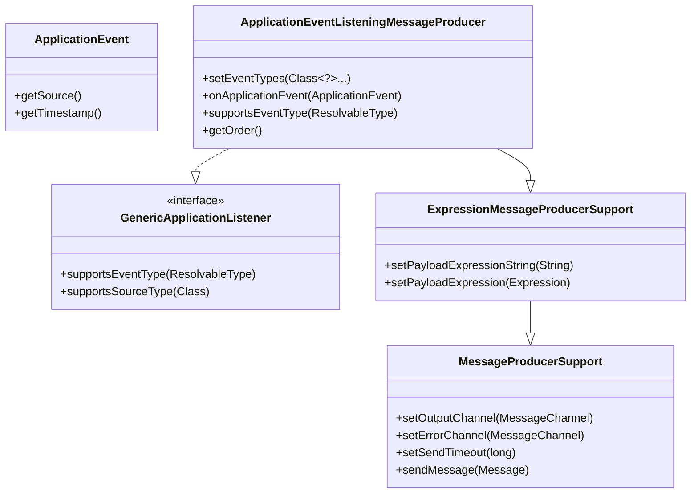
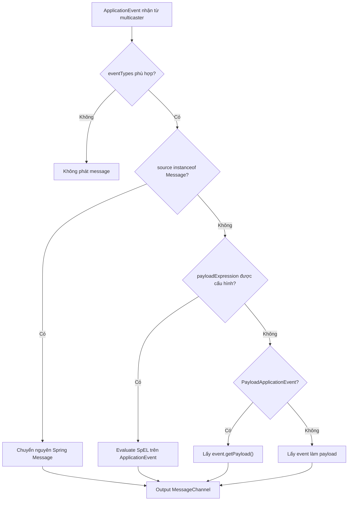
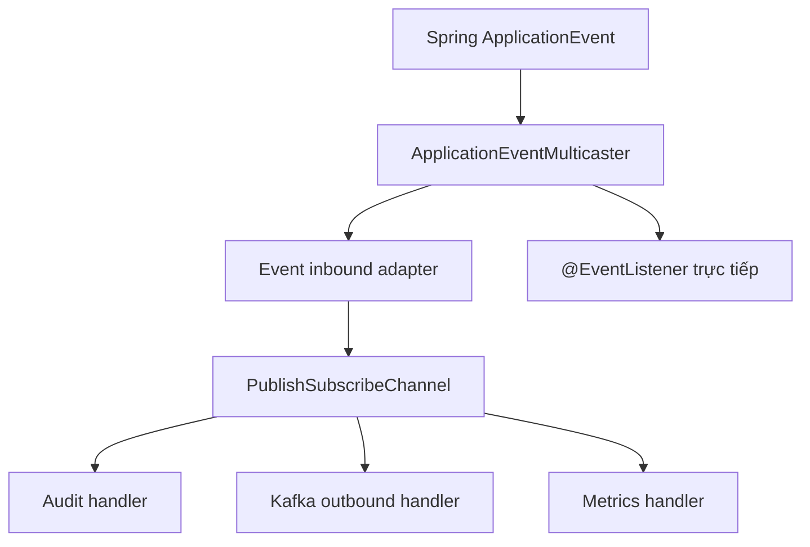
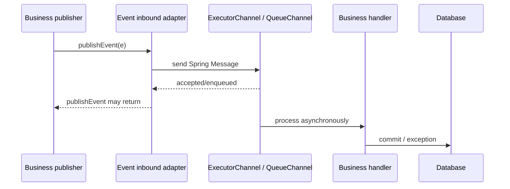
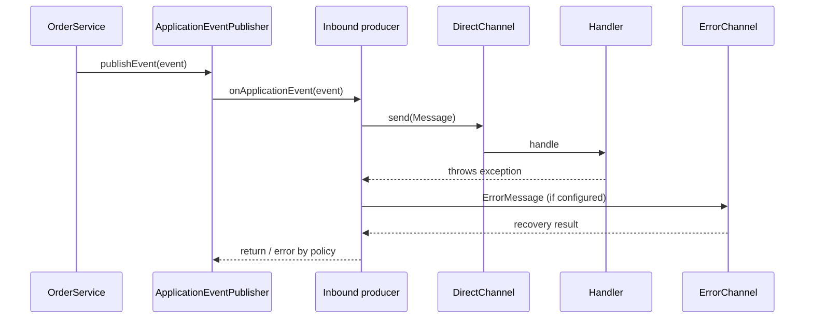
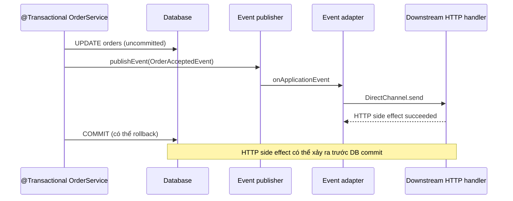
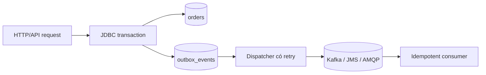
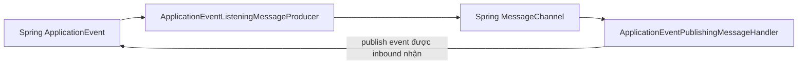

# ApplicationEventListeningMessageProducer

**`ApplicationEventListeningMessageProducer`** là thành phần **event-driven inbound channel adapter** trong Spring Integration: nó đăng ký như một Spring `ApplicationListener`, lắng nghe `ApplicationEvent` do `ApplicationEventPublisher` phát trong `ApplicationContext` và chuyển sự kiện phù hợp thành Spring Messaging `Message<?>` cho một **output `MessageChannel`**. Class này giúp sự kiện nội bộ đi vào pipeline Spring Integration mà không cần viết một listener thủ công để gọi `channel.send(...)`.

Bài thuộc chương **Adapter sự kiện** trong module **SPRING_INTEGRATION_ADAPTERS**. Module kết nối các hệ thống ngoài bằng inbound/outbound adapter, gateway, poller và `MessageChannel`; thực hành file, SFTP, HTTP, JMS, AMQP, Kafka và cơ sở dữ liệu; xử lý message contract, lỗi và lifecycle. Riêng ở đây, “nguồn bên ngoài flow” chính là **Spring application event bus trong cùng context**, không phải Kafka/JMS/AMQP broker. Bài tập trung vào API và ngữ nghĩa thực tế của **`ApplicationEventListeningMessageProducer`**, không nhầm với adapter chiều ngược `ApplicationEventPublishingMessageHandler`.

> **Cốt lõi:** Event inbound adapter **nghe sự kiện** rồi **phát Spring message**. Nó không tự cấp broker offset, durable storage, cross-process delivery hay exactly-once business effect. Những bảo đảm ấy phải có kiến trúc transport, transaction và idempotency phù hợp.

## 1. Mục tiêu học tập

Sau bài học, bạn có thể:

1. Giải thích tại sao `ApplicationEventListeningMessageProducer` là inbound adapter dù tên chứa `Producer`.
2. Mô tả class inheritance: `ExpressionMessageProducerSupport`, `MessageProducerSupport` và `GenericApplicationListener`.
3. Phân biệt `ApplicationEvent`, `PayloadApplicationEvent<T>`, Spring `Message<T>` và `MessageChannel`.
4. Nêu chính xác thứ tự quyết định payload khi event có `Message` làm source, có `payloadExpression` hoặc là payload event.
5. Cấu hình `setEventTypes(Class<?>...)` và hiểu `supportsEventType(ResolvableType)`, `supportsSourceType(...)` cùng listener cache.
6. Viết một demo Spring Boot: domain event → listener adapter → `DirectChannel` → `@ServiceActivator`.
7. Viết ví dụ dùng `setPayloadExpressionString(...)` để trích `orderId` hoặc tạo contract payload mới.
8. Dùng Java DSL `IntegrationFlow.from(producer)` và XML `int-event:inbound-channel-adapter`.
9. Hiểu `setOutputChannel`, `setErrorChannel`, `setSendTimeout` và những giới hạn của từng lựa chọn.
10. Phân biệt sync/async event multicaster, `DirectChannel`, `ExecutorChannel`, `PublishSubscribeChannel`, `QueueChannel`.
11. Phân tích `@TransactionalEventListener`, event publication timing và transactional outbox.
12. Nhận diện vòng lặp với event outbound adapter, duplicate listener và early event publication.
13. Xây integration tests cho event filtering, payload precedence, headers và error propagation.
14. Thiết kế metrics, troubleshooting và migration sang Kafka/JMS/AMQP nếu cần độ bền.

## 2. Sơ đồ luồng hoạt động

```mermaid
flowchart LR
  S["Business Service"] -->|"publishEvent(event)"| P["ApplicationEventPublisher"]
  P --> M["ApplicationEventMulticaster"]
  M -->|"onApplicationEvent"| A["ApplicationEventListeningMessageProducer"]
  A -->|"send Spring Message"| CH["output MessageChannel"]
  CH --> F["Filter / Transformer / Router"]
  F --> H["ServiceActivator"]
  H --> O["JDBC / HTTP / Kafka / JMS / AMQP / SFTP"]
```



Trong sơ đồ:

- `ApplicationEventPublisher` là API của Spring Framework để công bố sự kiện.
- `ApplicationEventMulticaster` phân phối sự kiện tới những listener đang đăng ký trong context.
- `ApplicationEventListeningMessageProducer` là **một listener**; nó lọc loại event và chuyển sang Spring `Message<?>`.
- Output `MessageChannel` đưa message vào integration flow; event adapter không quyết định downstream dùng JDBC, Kafka hay HTTP.
- Một event cũng có thể được các `@EventListener` khác nhận trực tiếp: adapter **không độc quyền tiêu thụ** sự kiện.

### 2.1. Tại sao đây là inbound, không phải outbound?

| Từ góc nhìn | Đầu vào | Đầu ra |
|---|---|---|
| Spring Framework event bus | `ApplicationEvent` notification | Callbacks tới listeners |
| **Event inbound adapter** | `ApplicationEvent` | **Spring `Message<?>`** trên output channel |
| Spring Integration flow | Spring Message | Filter/transformer/handler |
| Event outbound adapter (chiều ngược) | Spring `Message<?>` | `ApplicationEventPublisher.publishEvent(...)` |
| Kafka outbound adapter (khác) | Spring Message | Kafka producer record lên broker |

Chữ **`Producer`** trong tên class là “Spring Integration message producer”, **không phải** Kafka Producer.

### 2.2. Vì sao không cần poller?

`ApplicationEventListeningMessageProducer` nhận callback `onApplicationEvent(...)`. Nó là **event-driven**; không thực hiện `MessageSource.receive()` theo định kỳ như file/JDBC polling adapter.

```text
Spring event:
  publishEvent -> onApplicationEvent -> outputChannel.send

File/JDBC polling:
  scheduler -> MessageSource.receive -> outputChannel.send
```

Không gắn `@Poller`/`fixedDelay` vào class này chỉ vì các inbound adapters khác của module có poller.

## 3. Cấu trúc class và các API quan trọng

Import class từ package `org.springframework.integration.event.inbound`:

```java
import org.springframework.integration.event.inbound.ApplicationEventListeningMessageProducer;
```

Mô hình kế thừa:



### 3.1. API trực tiếp của class

| API | Tác dụng | Điểm cần chú ý |
|---|---|---|
| `new ApplicationEventListeningMessageProducer()` | Tạo adapter | Đăng ký làm Spring bean để Spring quản lý listener/lifecycle |
| `setEventTypes(Class<?>...)` | Chọn loại event/payload event | Mặc định nhận mọi loại; nên cấu hình allowlist |
| `supportsEventType(ResolvableType)` | Spring multicaster tra cứu khả năng nhận event | Không phải filter nội dung domain |
| `onApplicationEvent(ApplicationEvent)` | Callback thực thi khi event được gửi tới listener | Thường không gọi trực tiếp từ business code |
| `getOrder()` | Tham gia ordering giữa listeners theo Spring `Ordered` | Không bảo đảm business transaction ordering |
| `getComponentType()` | Metadata Spring Integration component | Không phải Kafka event type |

### 3.2. API kế thừa cần biết

| API | Class nguồn | Tác dụng |
|---|---|---|
| `setOutputChannel(...)` | `MessageProducerSupport` | Đích phát Spring Message |
| `setOutputChannelName(...)` | `MessageProducerSupport` | Resolve đích bằng bean name |
| `setErrorChannel(...)` | `MessageProducerSupport` | Định tuyến `ErrorMessage` khi exception phù hợp |
| `setErrorChannelName(...)` | `MessageProducerSupport` | Error channel qua bean name |
| `setSendTimeout(...)` | `MessageProducerSupport` | Timeout khi gửi qua channel có hỗ trợ chờ |
| `setPayloadExpressionString(...)` | `ExpressionMessageProducerSupport` | SpEL lấy payload từ event |
| `setPayloadExpression(...)` | `ExpressionMessageProducerSupport` | Dùng `Expression` đã chuẩn bị |
| `setAutoStartup(...)`, `start()`/`stop()` | `AbstractEndpoint` | Lifecycle Spring Integration endpoint |

Đừng dùng `getComponentType()` để định tuyến business event, hoặc xem `getOrder()` là giá trị offset/partition.

### 3.3. GenericApplicationListener và ResolvableType

Kể từ Spring Integration 4.2, adapter triển khai `GenericApplicationListener` để Spring event infrastructure có thể xét **loại event** và **loại payload bên trong `PayloadApplicationEvent`**.

```text
ApplicationEvent:
   OrderAcceptedEvent extends ApplicationEvent
   -> ResolvableType của actual event class

Payload event:
   publisher.publishEvent(new StockAdjusted(...))
   -> PayloadApplicationEvent<StockAdjusted>
   -> có thể match setEventTypes(StockAdjusted.class)
```

`supportsEventType(ResolvableType)` được Spring multicaster sử dụng; bạn không cần gọi nó mỗi lần. `supportsSourceType(...)` thuộc listener contract, **không phải business filter theo event.source object**. Để lọc `orderId`/tenant/version, dùng domain validation hoặc Spring Integration `filter`/router.

### 3.4. setEventTypes ảnh hưởng listener cache

Javadoc ghi rõ: gọi `setEventTypes(...)` còn có cơ chế **đăng ký lại current adapter với ApplicationEventMulticaster để xóa listener cache**, sau đó cache được tái tạo cho event tiếp theo.

Vì vậy:

- Cấu hình allowlist **trước khi context hoạt động** là cách đơn giản nhất.
- Nếu đổi filter động khi app chạy, cần kiểm thử routing và concurrent publication, không dựa vào stale listener cache.
- Đừng coi setEventTypes như một cơ chế đăng ký ACL động/truy cập per-tenant; class types là cấp độ lọc thô.
- Dùng Spring Integration router/filter nếu thay đổi business policy thường xuyên.

## 4. Thứ tự quyết định payload — chi tiết quan trọng nhất

Spring Integration Reference nêu các trường hợp chính:

1. Nếu `ApplicationEvent.getSource()` là một **Spring `Message<?>`**, adapter **chuyển nguyên Message**.
2. Nếu source không phải Message và có **`payloadExpression`**, adapter evaluate expression trên `ApplicationEvent` để lấy payload.
3. Khi nhận một **`PayloadApplicationEvent<T>`** phù hợp và không có trường hợp ưu tiên cao hơn, adapter dùng **payload T** thay vì wrapper.
4. Với `ApplicationEvent` thường, source không phải Message và không có expression, adapter dùng **event object** làm payload.



**Điểm cần xác minh theo version:** Nhánh `PayloadApplicationEvent` và `payloadExpression` cùng tồn tại thì cách ưu tiên cần kiểm thử bằng tích hợp trên Spring Integration version bạn dùng; đừng kết hợp SpEL trên wrapper với giả định root luôn là DTO. Để chắc chắn, giữ một strategy rõ ràng cho một adapter/flow.

### 4.1. Bảng mapping

| Event được publish | Filter có nhận? | Có expression? | Spring message phát ra |
|---|---|---|---|
| `OrderAcceptedEvent`, source = `OrderService` | `OrderAcceptedEvent.class` | Không | `Message<OrderAcceptedEvent>` |
| `OrderAcceptedEvent`, source = `OrderService` | `OrderAcceptedEvent.class` | `"orderId"` | `Message<String>` (orderId) |
| `ApplicationEvent` có source = `Message<String>` | Event class được chọn | Có hoặc không | **Original `Message<String>`**, giữ headers |
| `PayloadApplicationEvent<StockAdjusted>` | `StockAdjusted.class` | Không | `Message<StockAdjusted>` |
| `PayloadApplicationEvent<StockAdjusted>` | Không match | Không | **Không phát message** |
| Context lifecycle event | Filter chỉ chọn OrderAcceptedEvent | Không | **Không phát** |
| Context lifecycle event | Không khai báo eventTypes | Không | Có thể phát `Message<ContextRefreshedEvent>` |

### 4.2. Không đánh đồng event metadata với MessageHeaders

`ApplicationEvent.getTimestamp()` là timestamp của event source. Khi adapter tạo một Spring `Message<?>` mới, message sẽ có `MessageHeaders.ID` và `MessageHeaders.TIMESTAMP` theo quy trình tạo message. Hai timestamp/ID không nhất thiết bằng nhau.

Với event source **đã là `Message`**, adapter chuyển nguyên message, nên headers ban đầu được giữ. Đây là trường hợp khác hẳn message mới tạo từ event object.

### 4.3. Tác động lên idempotency

Khi một event phát lại từ nguồn khác, adapter có thể tạo một Spring message mới với header ID mới. **Không** dùng `MessageHeaders.ID` làm business eventId. Đặt `eventId`/`aggregateId` trên domain event hoặc gắn vào headers bằng transformer/enricher với quy tắc rõ.

## 5. Dependencies và cấu hình môi trường

Với Spring Boot BOM tương thích Spring Framework và Spring Integration:

```xml
<dependencies>
    <dependency>
        <groupId>org.springframework.boot</groupId>
        <artifactId>spring-boot-starter-integration</artifactId>
    </dependency>
    <dependency>
        <groupId>org.springframework.integration</groupId>
        <artifactId>spring-integration-event</artifactId>
    </dependency>
</dependencies>
```

Class này thuộc module **`spring-integration-event`**; chỉ có `spring-integration-core` có thể chưa đủ. Để ví dụ test JUnit ở phần sau, dùng thêm:

```xml
<dependency>
    <groupId>org.springframework.boot</groupId>
    <artifactId>spring-boot-starter-test</artifactId>
    <scope>test</scope>
</dependency>
```

Không gắn cố định version phụ thuộc một cách tùy ý nếu đã dùng Spring Boot BOM. Bài mô tả APIs có trong các nhánh Spring Integration 6.x/7.x; Java examples dùng Java 17+ và cần điều chỉnh theo BOM thực tế.

### 5.1. Những import quan trọng

```java
import org.springframework.context.ApplicationEvent;
import org.springframework.context.ApplicationEventPublisher;
import org.springframework.context.PayloadApplicationEvent;
import org.springframework.integration.event.inbound.ApplicationEventListeningMessageProducer;
import org.springframework.integration.channel.DirectChannel;
import org.springframework.integration.annotation.ServiceActivator;
import org.springframework.messaging.Message;
import org.springframework.messaging.MessageChannel;
```

Spring `ApplicationEvent` và `PayloadApplicationEvent` đến từ Spring Framework. `Message<?>`/`MessageChannel` đến từ Spring Messaging. Adapter nằm trong Spring Integration.

## 6. Demo Spring Boot: domain event thành Spring message

Mục tiêu: một `OrderService` gọi `publishEvent(new OrderAcceptedEvent(...))`; adapter nhận **chỉ OrderAcceptedEvent**, gửi vào `DirectChannel`; `@ServiceActivator` in eventId/orderId.

### 6.1. Event contract: OrderAcceptedEvent.java

```java
package com.example.eventadapter;

import java.util.Objects;
import org.springframework.context.ApplicationEvent;

public final class OrderAcceptedEvent extends ApplicationEvent {

    private final String eventId;
    private final String orderId;
    private final int aggregateVersion;

    public OrderAcceptedEvent(
            Object source,
            String eventId,
            String orderId,
            int aggregateVersion) {

        super(source);
        this.eventId = Objects.requireNonNull(eventId, "eventId");
        this.orderId = Objects.requireNonNull(orderId, "orderId");
        this.aggregateVersion = aggregateVersion;
    }

    public String getEventId() {
        return eventId;
    }

    public String getOrderId() {
        return orderId;
    }

    public int getAggregateVersion() {
        return aggregateVersion;
    }
}
```

`eventId` là business idempotency key, `orderId` là aggregate identity, `aggregateVersion` là thứ tự nghiệp vụ. `source` ở đây sẽ là service bean, **không phải JSON DTO cần serialize**.

### 6.2. Adapter và output channel: OrderEventAdapterConfig.java

```java
package com.example.eventadapter;

import org.springframework.beans.factory.annotation.Qualifier;
import org.springframework.context.annotation.Bean;
import org.springframework.context.annotation.Configuration;
import org.springframework.integration.channel.DirectChannel;
import org.springframework.integration.config.EnableIntegration;
import org.springframework.integration.event.inbound.ApplicationEventListeningMessageProducer;
import org.springframework.messaging.MessageChannel;

@Configuration
@EnableIntegration
public class OrderEventAdapterConfig {

    @Bean("orderEventsFromContext")
    public MessageChannel orderEventsFromContext() {
        return new DirectChannel();
    }

    @Bean("orderAcceptedEventInbound")
    public ApplicationEventListeningMessageProducer eventInbound(
            @Qualifier("orderEventsFromContext")
            MessageChannel channel) {

        ApplicationEventListeningMessageProducer producer =
                new ApplicationEventListeningMessageProducer();

        // Chỉ những event nghiệp vụ đã chọn.
        producer.setEventTypes(OrderAcceptedEvent.class);

        // Đích là Spring Integration output channel.
        producer.setOutputChannel(channel);
        return producer;
    }
}
```

**Giải thích từng quyết định:**

1. `@EnableIntegration` kích hoạt hạ tầng Spring Integration cho cấu hình.
2. `DirectChannel` chuyển message đến subscriber trên **caller thread**.
3. `setEventTypes` loại những event như `ContextRefreshedEvent` khi flow chỉ hiểu OrderAcceptedEvent.
4. `setOutputChannel` là bắt buộc theo thiết kế flow: adapter phải biết gửi message đi đâu.
5. Adapter là Spring bean, giúp lifecycle và listener registration được Spring quản lý.
6. Không cần `@Poller`, `MessageSource` hay Kafka ConsumerFactory.
7. Nếu nhiều bean `ApplicationEventListeningMessageProducer` cùng nhận một event type, có thể tạo nhiều messages/side effects; phải chủ động thiết kế fan-out.

### 6.3. Service activator: OrderAcceptedHandler.java

```java
package com.example.eventadapter;

import org.springframework.integration.annotation.ServiceActivator;
import org.springframework.messaging.Message;
import org.springframework.stereotype.Component;

@Component
public class OrderAcceptedHandler {

    @ServiceActivator(inputChannel = "orderEventsFromContext")
    public void onMessage(Message<OrderAcceptedEvent> message) {

        OrderAcceptedEvent event = message.getPayload();

        if (event.getOrderId().isBlank()) {
            throw new IllegalArgumentException(
                    "orderId không được rỗng");
        }

        System.out.printf(
                "eventId=%s orderId=%s version=%d msgId=%s thread=%s%n",
                event.getEventId(),
                event.getOrderId(),
                event.getAggregateVersion(),
                message.getHeaders().getId(),
                Thread.currentThread().getName());
    }
}
```

Mỗi event phù hợp được chuyển thành Spring message với payload `OrderAcceptedEvent`. Một handler singleton có thể được gọi từ **nhiều threads** nếu nhiều publisher threads phát event song song. Không đặt `lastOrderId` mutable field trên handler rồi giả định chỉ có một thread.

### 6.4. Publisher: OrderApplicationService.java

```java
package com.example.eventadapter;

import java.util.UUID;
import org.springframework.context.ApplicationEventPublisher;
import org.springframework.stereotype.Service;

@Service
public class OrderApplicationService {

    private final ApplicationEventPublisher publisher;

    public OrderApplicationService(
            ApplicationEventPublisher publisher) {
        this.publisher = publisher;
    }

    public void accept(String orderId) {
        String eventId = UUID.randomUUID().toString();

        publisher.publishEvent(
                new OrderAcceptedEvent(
                        this, eventId, orderId, 1));
    }
}
```

`publishEvent(...)` chỉ gửi tới Spring ApplicationContext hiện tại, không tới broker hoặc server khác.

### 6.5. Main và ApplicationRunner

```java
package com.example.eventadapter;

import org.springframework.boot.ApplicationRunner;
import org.springframework.boot.SpringApplication;
import org.springframework.boot.autoconfigure.SpringBootApplication;
import org.springframework.context.annotation.Bean;

@SpringBootApplication
public class EventAdapterApplication {

    public static void main(String[] args) {
        SpringApplication.run(EventAdapterApplication.class, args);
    }

    @Bean
    ApplicationRunner demo(OrderApplicationService service) {
        return args -> {
            service.accept("ORD-101");
            service.accept("ORD-202");
        };
    }
}
```

Đặt toàn bộ các classes trên trong package `com.example.eventadapter`. Dữ liệu quan sát điển hình:

```text
eventId=... orderId=ORD-101 version=1 msgId=... thread=main
eventId=... orderId=ORD-202 version=1 msgId=... thread=main
```

Tên thread là ví dụ. Khi dùng sync multicaster mặc định và DirectChannel, callbacks chạy trên publisher thread. `ApplicationRunner` phù hợp để demo sau khi Spring context đã dựng cơ bản, tốt hơn publish sớm trong constructor/`@PostConstruct`.

### 6.6. Đo kết quả đúng

Những dấu hiệu chứng minh adapter hoạt động:

- Handler nhận `Message<OrderAcceptedEvent>` chứ không nhận raw Kafka `ConsumerRecord`.
- EventId và orderId đúng nội dung đã publish.
- Không cần HTTP/Kafka/JMS broker.
- Các lifecycle events không lọt vào handler typed OrderAcceptedEvent.
- Nếu handler throw, đường lỗi phụ thuộc sync/async multicaster và `errorChannel`.
- Các log không chứng minh có durability/replay nếu process chết.

## 7. Demo chuyển payload bằng SpEL

`ExpressionMessageProducerSupport` cung cấp:

```java
producer.setPayloadExpressionString("orderId");
```

Với `OrderAcceptedEvent` có getter `getOrderId()`, SpEL root là **đối tượng event**; expression `orderId` tạo payload kiểu `String`.

### 7.1. Adapter cấu hình thay thế

```java
@Bean("orderAcceptedEventInbound")
public ApplicationEventListeningMessageProducer eventInbound(
        @Qualifier("orderEventsFromContext")
        MessageChannel channel) {

    ApplicationEventListeningMessageProducer producer =
            new ApplicationEventListeningMessageProducer();
    producer.setEventTypes(OrderAcceptedEvent.class);
    producer.setPayloadExpressionString("orderId");
    producer.setOutputChannel(channel);
    return producer;
}
```

**Không tạo hai bean cùng tên trong một application**: đây là phương án thay thế bean mục 6.2. Bây giờ handler phải đổi contract:

```java
@ServiceActivator(inputChannel = "orderEventsFromContext")
public void onOrderId(Message<String> message) {
    String orderId = message.getPayload();
    System.out.println("Order: " + orderId);
}
```

Đoạn này cũng **thay thế** `OrderAcceptedHandler` ban đầu, không đăng ký hai `@ServiceActivator` cạnh tranh trên một `DirectChannel`.

### 7.2. Expression có thể làm mất eventId và version

Nếu chỉ gửi `orderId`, message mới không tự còn các domain fields như `eventId` và `aggregateVersion`. Với nghiệp vụ có retry/idempotency hoặc multi-tenant routing, nên dùng transformer/DTO chứa toàn bộ metadata cần thiết.

```text
ApplicationEventListeningMessageProducer
    -> Message<OrderAcceptedEvent>
    -> Transformer: event -> OrderNotificationDTO
    -> HeaderEnricher: correlationId, eventId
    -> Message<OrderNotificationDTO>
    -> Kafka/HTTP/JDBC outbound
```

### 7.3. Không đánh giá SpEL từ nội dung user gửi

`payloadExpression` là expression thực thi trong application context. Không cho HTTP clients cung cấp expression tùy ý rồi evaluate trực tiếp: có thể gây truy cập property/bean không dự kiến, rò rỉ dữ liệu hoặc side effects. SpEL nên là **cấu hình tin cậy**, được test cùng DTO schema.

### 7.4. Nếu SpEL lỗi

Nếu getter không tồn tại, trả dữ liệu không phù hợp hoặc expression throw, adapter có thể tạo lỗi tại bước chuyển event → Spring message. Xử lý qua error channel/propagation theo contract. Đừng giả định lỗi SpEL là “event bị filter” và im lặng mất đi.

## 8. PayloadApplicationEvent với Java record/POJO

Không nhất thiết phải tạo subclass `ApplicationEvent`. Spring Framework hỗ trợ `publishEvent(Object)`; POJO/record có thể được bọc thành `PayloadApplicationEvent<T>`.

### 8.1. Một Java record làm payload event

```java
package com.example.eventadapter;

public record StockAdjusted(
        String eventId,
        String sku,
        int delta) {}
```

Publisher:

```java
publisher.publishEvent(
        new StockAdjusted("evt-301", "SKU-42", -3));
```

Spring có thể tạo `PayloadApplicationEvent<StockAdjusted>` để gửi tới listeners. Để adapter chỉ nhận StockAdjusted:

```java
ApplicationEventListeningMessageProducer producer =
        new ApplicationEventListeningMessageProducer();

producer.setEventTypes(StockAdjusted.class);
producer.setOutputChannel(inventoryFromEvents);
```

Trong snippet, `inventoryFromEvents` là `MessageChannel` bean được inject trong config riêng. Downstream:

```java
@ServiceActivator(inputChannel = "inventoryFromEvents")
public void onStock(Message<StockAdjusted> message) {
    StockAdjusted payload = message.getPayload();
    System.out.println(payload.sku() + ": " + payload.delta());
}
```

### 8.2. Vì sao GenericApplicationListener cần thiết?

Nếu chỉ kiểm tra `event.getClass()`, wrapper thực tế là `PayloadApplicationEvent`, không phải `StockAdjusted`. `GenericApplicationListener` với `ResolvableType` hỗ trợ xử lý loại payload bên trong wrapper trong trường hợp Spring Framework cung cấp đủ type information.

Khi dùng generic type phức tạp (`PayloadApplicationEvent<List<Something>>`), Java type erasure và publisher metadata có thể khiến khả năng match khác suy đoán; nên integration test trên đúng Spring version.

### 8.3. Khi nên dùng POJO thay vì extends ApplicationEvent

POJO/record có những ưu điểm:

- Domain model ít phụ thuộc Spring Framework.
- Fields immutable và dễ serialize/schema-version khi chuyển Kafka/JMS/JSON.
- Test logic domain không cần `ApplicationContext`.
- Không vô tình serialize `getSource()` trỏ tới Spring service bean.

Nhưng publishEvent(Object) vẫn **in-process**: không biến một Java record thành persistent event stream.
## 9. Event có Spring Message làm source: giữ nguyên message

Một `ApplicationEvent` có constructor nhận `Object source`. Nếu `source` **chính là Spring `Message<?>`**, adapter chuyển **nguyên message** sang output channel, thay vì tạo một wrapper message mới với payload là event.

### 9.1. Ví dụ carrier event

```java
package com.example.eventadapter;

import org.springframework.context.ApplicationEvent;
import org.springframework.messaging.Message;

public final class CarrierEvent extends ApplicationEvent {

    public CarrierEvent(Message<?> source) {
        super(source);
    }
}
```

Công bố:

```java
Message<String> sourceMessage = MessageBuilder
        .withPayload("ORD-101")
        .setHeader("eventId", "evt-401")
        .setHeader("sourceSystem", "demo")
        .build();

publisher.publishEvent(new CarrierEvent(sourceMessage));
```

Cần import `org.springframework.messaging.support.MessageBuilder`. Adapter **phải được cấu hình nhận `CarrierEvent.class`**, thay vì `OrderAcceptedEvent.class`:

```java
producer.setEventTypes(CarrierEvent.class);
producer.setOutputChannel(carrierEventMessages);
```

Handler nhận:

```java
@ServiceActivator(inputChannel = "carrierEventMessages")
public void onCarrierMessage(Message<String> message) {
    System.out.println(message.getPayload());
    System.out.println(message.getHeaders().get("eventId"));
}
```

Với direct synchronous dispatch, message chuyển đến có thể chính là `sourceMessage` gốc: các headers như `eventId` vẫn có. Kiểm tra identity bằng `assertThat(received).isSameAs(sourceMessage)` trong integration test.

### 9.2. precedence so với payloadExpression

Nếu `CarrierEvent.getSource()` đã là `Message<?>`, adapter **chuyển chính Message đó** theo contract; `setPayloadExpressionString("...")` không phải cơ chế chắc chắn thay payload trong nhánh này. Không cấu hình expression rồi kỳ vọng headers được enrich/override.

Muốn thay payload/header, hãy đặt transformer hoặc header enricher **sau output channel** và kiểm thử message contract.

### 9.3. Rủi ro với message do bên ngoài tạo

Message từ caller có thể có:

- Headers tự khai báo `tenantId`, `authenticatedUser` hoặc `sourceSystem` không đáng tin.
- Payload là object mutable đang bị thread khác sửa.
- Resource references như `File`, `InputStream`, JPA entity proxy.
- Trạng thái không còn hợp lệ khi chuyển sang async channel.

Không coi việc “giữ nguyên Message” là xác thực dữ liệu. Validate business identity và copy/canonicalize payload trước side effect nhạy cảm.

## 10. Java DSL: IntegrationFlow.from(ApplicationEventListeningMessageProducer)

Nếu dùng Java DSL, producer được cấu hình **không cần setOutputChannel thủ công**; DSL xây endpoint và nối channel tự động.

### 10.1. Cấu hình tương đương

```java
package com.example.eventadapter;

import org.springframework.context.annotation.Bean;
import org.springframework.context.annotation.Configuration;
import org.springframework.integration.dsl.IntegrationFlow;
import org.springframework.integration.event.inbound.ApplicationEventListeningMessageProducer;

@Configuration
public class OrderEventDslConfig {

    @Bean
    ApplicationEventListeningMessageProducer orderEventSource() {
        ApplicationEventListeningMessageProducer p =
                new ApplicationEventListeningMessageProducer();
        p.setEventTypes(OrderAcceptedEvent.class);
        return p;
    }

    @Bean
    IntegrationFlow orderEventFlow(
            ApplicationEventListeningMessageProducer orderEventSource) {

        return IntegrationFlow.from(orderEventSource)
                .handle(OrderAcceptedEvent.class,
                        (event, headers) -> {
                            System.out.println(event.getOrderId());
                            return null; // One-way handler.
                        })
                .get();
    }
}
```

Đây là **phương án thay thế toàn bộ phần config + handler** ở mục 6. Không đồng thời đăng ký `OrderEventAdapterConfig` và `OrderEventDslConfig` cùng target trong một context nếu một event chỉ cần xử lý một lần.

### 10.2. Error channel ngay trên DSL endpoint

Spring Integration Reference có dạng:

```java
@Bean
IntegrationFlow orderEventFlow(
        ApplicationEventListeningMessageProducer source,
        MessageChannel eventErrors) {

    return IntegrationFlow
            .from(source,
                    endpoint -> endpoint.errorChannel(eventErrors))
            .handle(OrderAcceptedEvent.class, (event, headers) -> {
                process(event);
                return null;
            })
            .get();
}
```

Snippet yêu cầu một `MessageChannel eventErrors` bean và method `process(...)` do ứng dụng định nghĩa. Các overload/option cụ thể cần dùng theo Spring Integration BOM tương ứng.

### 10.3. Không nhầm với MessageSource polling

`IntegrationFlow.from(source, pollerSpec)` dành cho nguồn `MessageSource`. `ApplicationEventListeningMessageProducer` **đăng ký làm ApplicationListener**, không phải nguồn cần poller. Nếu buộc cấu hình poller cho event inbound trong Java DSL, đang chọn sai abstraction.

### 10.4. Vì sao DSL vẫn cần adapter bean?

DSL đăng ký wiring giữa message producer và những endpoints tiếp theo; nó không tự biến `ApplicationEventPublisher` thành một `MessageSource`. Adapter vẫn cần eventTypes, output mapping và lifecycle; DSL chỉ giảm phần khai báo channel/endpoint.

## 11. XML namespace cho ApplicationEventListeningMessageProducer

Spring Integration hỗ trợ namespace `int-event` với element `inbound-channel-adapter`.

```xml
<?xml version="1.0" encoding="UTF-8"?>
<beans xmlns="http://www.springframework.org/schema/beans"
       xmlns:xsi="http://www.w3.org/2001/XMLSchema-instance"
       xmlns:int="http://www.springframework.org/schema/integration"
       xmlns:int-event="http://www.springframework.org/schema/integration/event"
       xsi:schemaLocation="
         http://www.springframework.org/schema/beans
         http://www.springframework.org/schema/beans/spring-beans.xsd
         http://www.springframework.org/schema/integration
         http://www.springframework.org/schema/integration/spring-integration.xsd
         http://www.springframework.org/schema/integration/event
         http://www.springframework.org/schema/integration/event/spring-integration-event.xsd">

    <int:channel id="orderEventsFromContext"/>

    <int-event:inbound-channel-adapter
        channel="orderEventsFromContext"
        event-types="com.example.eventadapter.OrderAcceptedEvent"/>

    <int:service-activator
        input-channel="orderEventsFromContext"
        ref="orderAcceptedHandler"
        method="onMessage"/>
</beans>
```

Bean `orderAcceptedHandler` phải tồn tại trong context. Nếu đã dùng `@ServiceActivator` trên same handler/method, không tạo thêm XML endpoint xử lý cùng logic mà không chủ định. Một `DirectChannel` có nhiều subscribers **không đồng nghĩa broadcast**: nó dispatch đến một subscriber theo strategy.

### 11.1. event-types cho cả ApplicationEvent và payload events

Theo tài liệu chính thức:

```xml
<int-event:inbound-channel-adapter
    channel="inventoryEvents"
    event-types="com.example.eventadapter.StockAdjusted, java.util.Date"/>
```

`StockAdjusted` là domain record/POJO đã định nghĩa trong ví dụ mục 8. `Date` ở đây chỉ minh họa rằng `event-types` có thể tham chiếu loại payload event, không phải cứ extends `ApplicationEvent`.

### 11.2. XML error-channel

```xml
<int-event:inbound-channel-adapter
    channel="orderEventsFromContext"
    event-types="com.example.eventadapter.OrderAcceptedEvent"
    error-channel="eventErrors"/>

<int:channel id="eventErrors"/>
```

Vẫn cần **error handler** subscribe `eventErrors` và một recovery policy. `error-channel` không tự là Kafka DLT, không persist failed event sau JVM crash.

### 11.3. Không đăng ký ba adapters cho cùng event nếu chỉ muốn một

Java `@Bean`, Java DSL và XML là **ba phương án cấu hình**. Nếu cùng khởi tạo ba `ApplicationEventListeningMessageProducer` nhận OrderAcceptedEvent, một event có thể đi vào ba flows hoặc tạo nhiều side effects. Nên chọn một phương án hoặc thiết kế fan-out có owner và idempotency rõ.

## 12. setEventTypes và supportsEventType: chuyên sâu

### 12.1. Mặc định có thể nhận toàn bộ context events

Nếu không gọi `setEventTypes(...)`, adapter **không giới hạn loại event**, nên có thể nhận cả:

- `ContextRefreshedEvent`.
- `ContextStartedEvent` / `ContextStoppedEvent`.
- `ContextClosedEvent`.
- Domain events do business publisher phát.
- `PayloadApplicationEvent<T>` từ `publishEvent(Object)`.

Với handler chỉ nhận `OrderAcceptedEvent`, điều này dẫn tới sai payload type hoặc lỗi conversion. Vì vậy luôn xác định allowlist phù hợp contract.

### 12.2. Class hierarchy và payload type matching

`setEventTypes(SomeBaseEvent.class)` có thể nhận những subtype phù hợp với quan hệ loại. Với `PayloadApplicationEvent<T>`, Spring dùng `ResolvableType` để xét generic payload type. Kiểm thử subclass, interface, generics và wrapper behavior thay vì chỉ suy ra từ tên class.

### 12.3. Filter theo field bên trong event

Không thể làm:

```java
// Không hợp lệ: setEventTypes yêu cầu Class<?>..., không phải predicate.
producer.setEventTypes(event -> event.getOrderId().startsWith("VIP"));
```

Muốn lọc `orderId`, `tenantId`, `eventVersion` hoặc trạng thái nghiệp vụ, dùng `filter`/router/validator downstream:

```java
// Ví dụ DSL trên message payload đã là OrderAcceptedEvent.
return IntegrationFlow.from(orderEventSource)
        .filter(OrderAcceptedEvent.class,
                event -> event.getOrderId().startsWith("VIP-"))
        .handle(OrderAcceptedEvent.class, (event, headers) -> {
            processVipOrder(event);
            return null;
        })
        .get();
```

Hai method `processVipOrder`/DSL bean cần ứng dụng định nghĩa. Type filter giúp tránh xử lý những loại event không liên quan; predicate filter mới xem business fields.

### 12.4. Thay đổi filter khi app đang chạy

Javadoc nêu `setEventTypes(...)` đăng ký lại adapter với `ApplicationEventMulticaster` để làm sạch listener cache. Dù hỗ trợ cập nhật, đây không phải message replay mechanism: events không khớp filter trước đó **đã bị bỏ qua**, không xuất hiện lại sau thay đổi.

Khi đổi allowlist động, cần test:

- Loại event cũ còn được nhận không.
- Loại event mới đã match đúng không.
- Có concurrent publish trong thời điểm đổi cấu hình không.
- Có trùng listener/side effects sau refresh cache không.
- Các beans downstream đã sẵn sàng cho payload mới chưa.

Đối với policy thường xuyên thay đổi, ưu tiên config trong business filter/router thay vì sửa eventTypes runtime.

## 13. Channel semantics: đồng bộ, async và fan-out

`ApplicationEventListeningMessageProducer` chỉ quyết định **khi nào tạo Spring message**; `MessageChannel` quyết định **cách dispatch** tới downstream.

| Output channel | Delivery đến handler | Khi phù hợp | Giới hạn |
|---|---|---|---|
| `DirectChannel` | Đồng bộ trên listener/publisher thread | Luồng đơn giản, exception propagate | Handler chậm làm publisher chậm |
| `PublishSubscribeChannel` | Broadcast đến các subscribers | Fan-out trong cùng JVM | Partial success, mỗi nhánh có state riêng |
| `ExecutorChannel` | Dispatch sang executor | Async processing có kiểm soát | Caller return sớm, mất thread-bound context |
| `QueueChannel` | Enqueue; poller nhận sau | Buffer/decouple tốc độ | Memory queue không durable mặc định |
| Durable QueueChannel | MessageStore + poller/transaction thích hợp | Durable handoff nội bộ | Cần cấu hình atomic enqueue/dequeue |

### 13.1. DirectChannel không phải một single-thread event loop

`DirectChannel` sử dụng **thread gửi message**. Hai publishers phát event cùng lúc có thể gọi cùng `@ServiceActivator` bean song song từ hai threads. Không lưu mutable `currentOrderId` trong singleton handler rồi nghĩ rằng `DirectChannel` sẽ tuần tự hóa toàn hệ thống.

### 13.2. PublishSubscribeChannel: hai tầng fan-out



Một event có thể kích hoạt cả `@EventListener` trực tiếp và nhiều Spring Integration subscribers. Nếu cùng business side effect được thực thi ở hai nhánh, cần loại trùng bằng architecture/`eventId`.

### 13.3. ExecutorChannel và QueueChannel



Nếu event chuyển sang executor hoặc memory queue, `publishEvent` trả về **không chứng minh DB commit**. JVM crash sau enqueue và trước DB commit có thể mất business effect. Cần durable handoff, outbox hoặc transaction/ack barrier tương ứng.

### 13.4. Error semantics cũng thay đổi theo channel

- Sync `DirectChannel`: exception từ handler có thể propagate về adapter/publisher.
- `ExecutorChannel`: exception thường xảy ra trong worker, không có caller stack để propagate trực tiếp.
- `QueueChannel`: publisher chỉ biết enqueue; lỗi tại polling consumer có error flow riêng.
- `PublishSubscribeChannel`: một nhánh thành công, nhánh khác fail có thể để lại partial side effects.

**Đừng thiết kế retry chỉ dựa vào kết quả Boolean từ `send()`** khi downstream xử lý async.
## 14. Event multicaster, thread và ordering

Theo mặc định, `SimpleApplicationEventMulticaster` của Spring Framework thường gọi listeners **đồng bộ** nếu không cấu hình executor. Vậy trong demo:

```text
OrderService.accept(...)
  -> publisher.publishEvent(...)
  -> ApplicationEventMulticaster
  -> onApplicationEvent(...) [adapter]
  -> DirectChannel.send(Message)
  -> @ServiceActivator.handle(Message)
  -> return / exception
  -> publishEvent(...) returns / throws
```

### 14.1. Nếu multicaster có TaskExecutor

```java
@Bean(name = "applicationEventMulticaster")
ApplicationEventMulticaster applicationEventMulticaster(
        TaskExecutor taskExecutor) {

    SimpleApplicationEventMulticaster multicaster =
            new SimpleApplicationEventMulticaster();
    multicaster.setTaskExecutor(taskExecutor);
    return multicaster;
}
```

Các imports:

```java
import org.springframework.context.event.ApplicationEventMulticaster;
import org.springframework.context.event.SimpleApplicationEventMulticaster;
import org.springframework.core.task.TaskExecutor;
```

Cần TaskExecutor bean phù hợp; không đặt config này vào demo mặc định mà không đổi test assumptions. Một số listener như transactional listeners có hạn chế về async execution; đọc `supportsAsyncExecution()` Javadoc/behavior theo Spring version.

### 14.2. ThreadLocal không được giữ qua executor

Khi Spring multicaster hoặc output channel dùng executor, các context dựa trên ThreadLocal như JDBC transaction, MDC, security context có thể không đi theo worker nếu không có propagation strategy. Không dùng `@TransactionalEventListener(AFTER_COMMIT)` để bảo vệ một listener chạy ở thread không có transaction context như mong muốn.

### 14.3. Ordering không giống Kafka partition log

Spring ApplicationEvent không có ordered partition log, committed offsets hay group assignment. Nếu `OrderAcceptedEvent(version=1)` và `OrderAcceptedEvent(version=2)` được phát từ hai threads, downstream có thể hoàn tất đảo thứ tự khi dùng executor/HTTP.

Muốn giữ thứ tự nghiệp vụ, dùng aggregate version/optimistic locking hoặc durable partition-key transport với hợp đồng ordering rõ.

## 15. ErrorChannel, propagation và recovery

Tài liệu Spring Integration mô tả:

- Nếu có **`errorChannel`** trên event inbound adapter, khi downstream throw exception phù hợp, adapter có thể gửi `ErrorMessage` chứa failed message/exception tới channel đó.
- Nếu **không có errorChannel** và downstream channels đồng bộ, exception có thể propagate về caller `publishEvent(...)`.
- Trong async flow, propagation phụ thuộc executor/poller/error flow.



### 15.1. Java error channel configuration

```java
@Bean("eventErrors")
public MessageChannel eventErrors() {
    return new DirectChannel();
}

@Bean("orderAcceptedEventInbound")
public ApplicationEventListeningMessageProducer eventInbound(
        @Qualifier("orderEventsFromContext") MessageChannel output,
        @Qualifier("eventErrors") MessageChannel errors) {

    ApplicationEventListeningMessageProducer p =
            new ApplicationEventListeningMessageProducer();
    p.setEventTypes(OrderAcceptedEvent.class);
    p.setOutputChannel(output);
    p.setErrorChannel(errors);
    return p;
}
```

Đây là **phương án thay thế** bean config ở mục 6.2, không khai báo đồng thời hai bean cùng tên. Một error consumer:

```java
@ServiceActivator(inputChannel = "eventErrors")
public void onEventError(ErrorMessage error) {
    Throwable cause = error.getPayload();
    System.err.println("Event flow failed: " + cause);
}
```

Import `org.springframework.messaging.support.ErrorMessage`.

### 15.2. Khi error handler chỉ log rồi return

Nếu recovery nhận ErrorMessage và **return thành công** mà không lưu event/khắc phục nghiệp vụ, publisher có thể tưởng event đã được xử lý. Đây là **false success** nếu business contract yêu cầu side effect bền.

ErrorMessage channel **không phải Kafka dead-letter topic**. Để có recovery sau crash, cần durable storage, broker DLT/DLQ hoặc outbox.

### 15.3. Bước nào có thể lỗi?

| Điểm lỗi | Ví dụ | Hướng xử lý |
|---|---|---|
| Type/payload expression | Property thiếu hoặc SpEL không hợp lệ | Validate contract, xử lý exception |
| Tạo Spring message | Payload null/sai kiểu | Validation, explicit transform |
| Output channel send | Không có subscriber, send timeout | Sửa wiring, capacity, retry có giới hạn |
| Service activator | DB constraint, HTTP 500 | Idempotency, transaction/retry |
| Publish-subscribe nhánh 2 | Audit thành công, webhook fail | Fan-out recovery, tránh duplicate side effect |
| Executor/poller | Worker rejection, queue full, crash | Backpressure, durable handoff |
| Event loop | Recursion hoặc storm | Loại type/guard, giám sát event rate |

### 15.4. Retry một event có thể gọi lại nhánh đã thành công

Nếu `PublishSubscribeChannel` chuyển một event tới audit handler (DB committed) và HTTP handler (timeout), retry **toàn pipeline** có thể làm audit insert thêm lần nữa. Phải dùng business `eventId`/unique constraint hoặc tách các nhánh qua durable queues/groups.


## 16. Transaction timing: ApplicationEvent không đợi JDBC commit

Trong một Spring service có JDBC `@Transactional`, gọi `publisher.publishEvent(...)` **không mặc nhiên trì hoãn event cho tới sau commit**. Với listener adapter và channel đồng bộ, downstream có thể chạy **trong lúc database transaction còn mở**.



Nếu một webhook/Kafka event được gửi trước khi DB commit rồi DB rollback, bên ngoài có thể quan sát thông báo cho dữ liệu chưa tồn tại.

### 16.1. `@TransactionalEventListener` là một listener khác

Spring Framework có:

```java
@TransactionalEventListener(
        phase = TransactionPhase.AFTER_COMMIT)
public void afterCommitted(OrderSubmittedEvent event) {
    // Callback khi transaction gắn với event commit thành công.
}
```

Phases gồm `BEFORE_COMMIT`, `AFTER_COMMIT` (mặc định), `AFTER_ROLLBACK`, `AFTER_COMPLETION`. Khi không có transaction hoạt động, listener mặc định không chạy, trừ khi đặt `fallbackExecution=true`.

**`ApplicationEventListeningMessageProducer` không tự là `@TransactionalEventListener`.** Nếu nó lọc nhận `OrderSubmittedEvent`, nó vẫn được notify khi event được publish, kể cả trước JDBC commit.

### 16.2. Pattern bridge sau commit với hai event types

```text
OrderService @Transactional
   -> UPDATE orders
   -> publishEvent(OrderSubmittedEvent)
   -> COMMIT JDBC

@TransactionalEventListener(AFTER_COMMIT)
   -> publishEvent(OrderCommittedEvent)

ApplicationEventListeningMessageProducer
   -> setEventTypes(OrderCommittedEvent.class)
   -> DirectChannel
   -> Kafka / HTTP outbound adapter
```

Phải có **hai event types riêng**: nếu producer cũng nhận OrderSubmittedEvent thì flow vẫn chạy trước commit. Đây chỉ là **timing control trong JVM**. JVM crash sau DB commit trước after-commit callback vẫn có thể mất thông báo.

### 16.3. Sau commit callback không phải transaction mới tự động

Trong Spring, sau-commit resources có thể vẫn bound vào thread. Nếu cần ghi JDBC trong callback, gọi một service khác với `@Transactional(propagation = Propagation.REQUIRES_NEW)` hoặc thiết kế transaction boundary rõ, tránh tưởng rằng mọi JDBC write trong callback sẽ được commit lần nữa.

### 16.4. Async phá ranh giới transaction

Nếu event multicaster hoặc output channel chuyển sang thread khác, transaction ThreadLocal gốc không tự đi kèm. Khi đó `@TransactionalEventListener` hoặc JDBC transaction trong worker phải được thiết kế theo API/transaction manager thực tế, không dựa vào caller thread.

## 17. Transactional outbox, inbox và durable bridge

Nếu yêu cầu “DB commit thì **cuối cùng phải có event** gửi sang Kafka/JMS/AMQP, kể cả JVM crash”, Spring ApplicationEvent một mình **không đáp ứng**. Dùng **transactional outbox**:



Quy trình:

1. Trong một JDBC transaction, ghi business entity + outbox row mang eventId, aggregateId, payload và PENDING.
2. Khi commit thành công, event được lưu bền trong DB. Event in-memory có thể chỉ làm `wake-up hint` cho dispatcher.
3. Dispatcher đọc/claim rows, publish broker, chờ acknowledgment thích hợp.
4. Sau publish thành công, đánh dấu row SENT.
5. Crash sau broker ACK trước mark SENT có thể làm publisher gửi lại eventId; downstream phải dedup.

```sql
CREATE TABLE outbox_events (
    event_id VARCHAR(128) PRIMARY KEY,
    aggregate_id VARCHAR(128) NOT NULL,
    event_type VARCHAR(128) NOT NULL,
    payload TEXT NOT NULL,
    status VARCHAR(20) NOT NULL,
    created_at TIMESTAMP NOT NULL DEFAULT CURRENT_TIMESTAMP
);
```

Schema chỉ minh họa; production cần indexes, claim locking, retry schedule, retention và dead-letter/quarantine.

### 17.1. Inbox chống duplicate khi Kafka/JMS/retry quay lại

```sql
CREATE TABLE processed_events (
    event_id VARCHAR(128) PRIMARY KEY,
    processed_at TIMESTAMP NOT NULL DEFAULT CURRENT_TIMESTAMP
);
```

Đặt việc insert processed event ID và business update **cùng JDBC transaction**. Unique constraint khiến cùng eventId được replay không gây side effect lặp. Đừng dùng Spring message header ID thay cho eventId nếu publisher có thể tạo message mới ở mỗi lần retry.

### 17.2. Event inbound adapter trong outbox architecture

`ApplicationEventListeningMessageProducer` có thể nhận `OutboxChangedEvent` nội bộ để yêu cầu dispatcher kiểm tra DB sớm hơn, nhưng chính **outbox rows** mới quyết định sự kiện cần gửi:

```text
JDBC transaction COMMIT [business + outbox row]
   -> ApplicationEvent OutboxChangedEvent (optional hint)
   -> event inbound adapter
   -> dispatcher wake-up

Cùng lúc:
   -> scheduled dispatcher scan pending outbox rows
   -> retry nếu hint bị mất / JVM restart
```

Đừng gắn công bố event in-memory làm **cách duy nhất** kích hoạt publisher bền.

## 18. Cẩn trọng với chiều outbound: vòng lặp sự kiện

Spring Integration có chiều ngược `ApplicationEventPublishingMessageHandler`: nhận Spring `Message<?>` và publish Spring `ApplicationEvent`.



Nếu không có condition dừng, mỗi event có thể kích hoạt **chính nó**. Với synchronous dispatch, có nguy cơ recursion/`StackOverflowError`; với executor, có thể tạo event storm hoặc tràn hàng đợi.

### 18.1. Vòng lặp khi outbound bọc MessagingEvent

```text
Spring Message<OrderNotice>
  -> outbound publishPayload=false
  -> MessagingEvent(source=Spring Message)
  -> inbound adapter nhận MessagingEvent
  -> source là Message nên inbound chuyển nguyên message
  -> outbound lại publish MessagingEvent
  -> ...
```

Chính quy tắc **giữ original Message khi source instanceof Message** có thể khiến vòng rất khó nhìn thấy khi log chỉ in payload.

### 18.2. Vòng lặp với PayloadApplicationEvent

```text
Spring Message<StockAdjusted>
  -> outbound publishPayload=true
  -> Spring PayloadApplicationEvent<StockAdjusted>
  -> inbound setEventTypes(StockAdjusted.class)
  -> Spring Message<StockAdjusted>
  -> outbound publish lại
  -> ...
```

Thay `publishPayload` sang true **không loại bỏ loop**.

### 18.3. Chống loop ở cấp topology và contract

- Phân biệt event types theo chiều: `OrderAcceptedEvent` và `AuditCompletedEvent`.
- Không nối trực tiếp inbound output channel trở lại outbound input channel cùng type.
- Dùng `sourceSystem`, `direction`, `eventId`, `hopCount`/TTL và filter có kiểm chứng.
- Có alert theo event rate/stack depth/queue depth.
- Viết integration test với guard counter để tránh tạo endless loop thật.
- Khi đi qua Kafka/JMS, áp dụng thêm topic/destination guard và idempotent consumer.

## 19. Startup, lifecycle và management

`ApplicationEventListeningMessageProducer` kế thừa `AbstractEndpoint`/`MessageProducerSupport`, có lifecycle APIs như `setAutoStartup`, `start`, `stop`, `isRunning` và Spring Integration metrics/management integration.

### 19.1. Không hiểu nhầm lifecycle thành replay

Javadoc cho thấy `doStop()` được kế thừa/override với behavior “no action by default” ở những version hiện hành. Do đó không nên **tự suy** rằng gọi `stop()` chắc chắn gỡ đăng ký event listener khỏi multicaster hoặc buffer event cho lần `start()` sau. Điều cần kiểm chứng là:

- Adapter bean có được đăng ký listener trong context?
- Nó có active/running state đúng thời điểm publish?
- Có event bị publish quá sớm trước khi adapter/handler subscribe?
- Flow có subscriber khi inbound adapter gọi `sendMessage`?
- Khi shutdown, in-flight handlers/async tasks có được drain?

**Không** sử dụng stop/start như một durable pause/resume queue. Những event không được tiêu thụ không tự có backlog.

### 19.2. Tránh publish từ constructor quá sớm

```text
ApplicationContext starting
  -> business bean constructor publishes event
  -> event adapter chưa đăng ký / output channel chưa có consumer
  -> event có thể mất hoặc dispatch fail
```

Dùng `ApplicationRunner`/readiness-managed workflow cho demo startup và test event timing. Nhưng nó **không** thay message durability: events có thể vẫn mất nếu application chết trong lúc xử lý.

### 19.3. Nếu có nhiều ApplicationContexts

Spring có thể có parent/child contexts. Event publication và propagation tùy quan hệ context và `ApplicationEventMulticaster` configuration. Không giả định mọi `ApplicationEvent` sẽ lan giữa **mọi** contexts hoặc tất cả pods; kiểm tra producer/listener đăng ký cùng context kỳ vọng.

### 19.4. Component identity và metrics

`getComponentType`/`getComponentName`/bean name hỗ trợ Spring Integration management. Đặt tên bean/flow rõ để trace:

```text
bean: orderAcceptedEventInbound
channel: orderEventsFromContext
endpoint: orderAcceptedEventHandler
businessType: OrderAcceptedEvent
```

Không trộn component ID với eventId: component ID phục vụ cấu hình/quan sát endpoint, eventId phục vụ business idempotency.

## 20. Integration tests: chứng minh contract của class

Test tốt nên dựa trên **Spring ApplicationContext thật**: mock `ApplicationEventPublisher` không chứng minh Spring multicast, filter hay message conversion.

### 20.1. Test context có QueueChannel để quan sát

```java
package com.example.eventadapter;

import static org.assertj.core.api.Assertions.assertThat;

import org.junit.jupiter.api.Test;
import org.springframework.beans.factory.annotation.Autowired;
import org.springframework.context.ApplicationEventPublisher;
import org.springframework.context.annotation.Bean;
import org.springframework.context.annotation.Configuration;
import org.springframework.integration.channel.QueueChannel;
import org.springframework.integration.config.EnableIntegration;
import org.springframework.integration.event.inbound.ApplicationEventListeningMessageProducer;
import org.springframework.messaging.Message;
import org.springframework.test.context.junit.jupiter.SpringJUnitConfig;

@SpringJUnitConfig(classes = EventInboundTest.TestConfig.class)
class EventInboundTest {

    @Configuration
    @EnableIntegration
    static class TestConfig {

        @Bean("capturedEvents")
        QueueChannel capturedEvents() {
            return new QueueChannel();
        }

        @Bean
        ApplicationEventListeningMessageProducer eventInbound(
                QueueChannel capturedEvents) {

            ApplicationEventListeningMessageProducer adapter =
                    new ApplicationEventListeningMessageProducer();
            adapter.setEventTypes(OrderAcceptedEvent.class);
            adapter.setOutputChannel(capturedEvents);
            return adapter;
        }
    }

    @Autowired ApplicationEventPublisher publisher;
    @Autowired QueueChannel capturedEvents;

    @Test
    void acceptsSelectedEventAsSpringMessage() {
        publisher.publishEvent(
                new OrderAcceptedEvent(
                        this, "evt-test-01", "ORD-101", 1));

        Message<?> received = capturedEvents.receive(1_000);
        assertThat(received).isNotNull();
        assertThat(received.getPayload())
                .isInstanceOf(OrderAcceptedEvent.class);

        OrderAcceptedEvent event =
                (OrderAcceptedEvent) received.getPayload();

        assertThat(event.getEventId()).isEqualTo("evt-test-01");
        assertThat(event.getOrderId()).isEqualTo("ORD-101");
    }

    @Test
    void ignoresUnrelatedPayloadEvent() {
        publisher.publishEvent("not-an-order-event");

        Message<?> notDelivered = capturedEvents.receive(100);
        assertThat(notDelivered).isNull();
    }
}
```

Đây là test context riêng. `QueueChannel` chỉ dùng để `receive(timeout)` làm assertion; trong production nó **không tự durable**. Nếu test suite giữ chung context và queue còn events của test khác, dùng context isolation/drain để tránh false positives/negatives.

### 20.2. Test payloadExpression trong context thay thế

Trong một `TestConfig` **khác**:

```java
adapter.setEventTypes(OrderAcceptedEvent.class);
adapter.setPayloadExpressionString("orderId");
adapter.setOutputChannel(capturedEvents);
```

Publish `OrderAcceptedEvent(...,"ORD-101",...)`, assert:

```java
Message<?> received = capturedEvents.receive(1_000);
assertThat(received).isNotNull();
assertThat(received.getPayload()).isEqualTo("ORD-101");
assertThat(received.getPayload()).isInstanceOf(String.class);
```

Không để hai adapters (một gửi event, một gửi String) cùng dùng một test queue nếu bạn muốn assertion xác định một contract.

### 20.3. Test original Message khi event.source là Message

Dùng event subclass `CarrierEvent` từ mục 9:

```java
Message<String> original = MessageBuilder
        .withPayload("ORD-101")
        .setHeader("eventId", "evt-original")
        .build();

publisher.publishEvent(new CarrierEvent(original));

Message<?> received = capturedEvents.receive(1_000);

assertThat(received).isSameAs(original);
assertThat(received.getHeaders().get("eventId"))
        .isEqualTo("evt-original");
```

Cần import `org.springframework.messaging.support.MessageBuilder`. **Điều kiện:** Trong context test này, adapter phải lọc `CarrierEvent.class`, không phải `OrderAcceptedEvent.class`; test chính minh họa API priority, không copy nguyên vào context mục 20.1.

### 20.4. Test PayloadApplicationEvent

Trong context thứ ba:

```java
adapter.setEventTypes(StockAdjusted.class);
adapter.setOutputChannel(capturedEvents);
```

Publish:

```java
StockAdjusted event =
        new StockAdjusted("evt-stock", "SKU-42", -3);
publisher.publishEvent(event);

Message<?> received = capturedEvents.receive(1_000);
assertThat(received.getPayload()).isEqualTo(event);
```

Nhờ `GenericApplicationListener`/`ResolvableType`, adapter nhận payload type phù hợp. Với generic wrappers phức tạp, thêm tests riêng.

### 20.5. Test không filter: cảnh giác lifecycle events

Trong test riêng, bỏ `setEventTypes` và đặt một `QueueChannel`. Khi context refresh, các context events có thể đã được gửi đến queue trước test. Đừng giả định `receive(1_000)` sẽ lấy đúng domain event đầu tiên: cần drain/control environment hoặc dùng handler generic phân loại event.

### 20.6. Test đồng bộ exception

Với `DirectChannel` và một `@ServiceActivator` ném exception:

1. Không có adapter `errorChannel`: test `publisher.publishEvent(...)` có thể throw exception/wrapper.
2. Có adapter `errorChannel` và handler nhận `ErrorMessage`: assert failure được route.
3. Nếu handler ErrorMessage chỉ log/return, ghi nhận behavior caller để không kết luận business commit.
4. Dùng async multicaster/ExecutorChannel: kiểm tra caller có thể return trước khi worker fail.
5. Với transaction, test DB commit/rollback độc lập với publication event.

### 20.7. Test lifecycle và shutdown

- Publish trong `ApplicationRunner` sau context setup và quan sát nhận.
- Publish quá sớm trong môi trường test riêng, quan sát không có durable backlog.
- Đổi `eventTypes` khi context đang chạy và test listener cache được cập nhật.
- Stop/start adapter trong môi trường test, quan sát behavior trên đúng Spring version thay vì mặc định stop = unregister listener.
- Nếu có executor, test shutdown in-flight tasks có được drain theo deadline không.

## 21. Observability và performance

| Metric gợi ý | Ý nghĩa |
|---|---|
| `event_published_total{type}` | Business service đã publish bao nhiêu events? |
| `event_adapter_accepted_total{type}` | Adapter đã nhận event match filter? |
| `event_adapter_filtered_total{type}` | Có event bị bỏ vì type? |
| `event_to_message_duration_p99` | Conversion + dispatch mất bao lâu? |
| `event_message_send_failure_total` | Output channel/handler fail? |
| `event_error_channel_handled_total` | Bao nhiêu ErrorMessages đã được xử lý? |
| `event_handler_business_commit_total` | Side effect thực sự committed? |
| `event_handler_failure_total` | Handler lỗi theo nguyên nhân nào? |
| `event_executor_queue_depth` | Async backlog có nghẽn? |
| `event_duplicate_event_id_total` | Có duplicate business eventId? |
| `event_feedback_loop_total` | Có loop guard triggered? |
| `outbox_oldest_pending_seconds` | Durable business event có kẹt? |

Đây là **tên metric đề xuất**, không khẳng định Spring/Micrometer tự phát đúng từng meter. Có thể dùng Spring Integration management/Actuator và custom instrumentation để đo **event published**, **message dispatched**, **business effect committed** tách biệt.

### 21.1. Structured logging

```text
component=orderAcceptedEventInbound
springEventType=OrderAcceptedEvent
eventId=evt-101
aggregateId=ORD-101
aggregateVersion=1
messageId=...
channel=orderEventsFromContext
publisherThread=http-nio-8080-exec-5
handlerThread=http-nio-8080-exec-5
conversion=SUCCESS
businessCommit=SUCCESS
```

Tên threads minh họa sync path; với executor có thể khác nhau. Không log credential, raw PII hay access token trong payload/headers.

### 21.2. Performance bottleneck

Trong sync multicast + DirectChannel, handler chậm giữ publisher thread. Nếu event listener gọi HTTP mất 5 giây, method business `publishEvent` cũng có thể bị block, ảnh hưởng request latency và transaction duration.

Không dùng `ExecutorChannel` một cách tự động để “giải quyết” latency nếu chấp nhận side effect được enqueue trong RAM rồi mất khi crash là không thể. Hãy phân biệt **performance improvement** với **delivery guarantee**.

## 22. Bảng xử lý sự cố

| Triệu chứng | Nguyên nhân khả dĩ | Cách xử lý |
|---|---|---|
| Handler không nhận event | Adapter bean chưa đăng ký/không match eventTypes | Kiểm tra bean/context/type |
| Nhận ContextRefreshedEvent ngoài ý muốn | Không có type allowlist | `setEventTypes` rõ |
| Handler nhận String thay event | Có `payloadExpression` | Chỉnh handler DTO contract |
| SpEL exception | Getter không có/không hợp lệ | Test expression trên event type thực |
| Header eventId bị mất | Tạo Message mới từ event, chưa enrich | Transformer/header enricher |
| Original headers vẫn tồn tại | Event source là Spring Message | Kiểm tra message identity |
| PayloadApplicationEvent không match | Filter sai payload type/generics | `ResolvableType`/test |
| Publish sớm nhưng message không tới | Listener/endpoint chưa sẵn sàng | Startup sequencing/outbox |
| Publisher bị block | Sync multicast/DirectChannel handler chậm | p95/p99/timeout |
| Publisher return sớm, DB chưa xong | Async multicaster/ExecutorChannel/QueueChannel | Completion barrier/durable handoff |
| Lỗi không propagate | ErrorChannel hoặc async worker | Kiểm tra recovery/wiring |
| Event được xử lý hai lần | Nhiều adapter/listeners hoặc retry | EventId/idempotency |
| Vòng lặp vô hạn | Inbound + outbound cùng type | Type routing/guard |
| Pod B không nhận event từ pod A | Event bus chỉ trong context/process | Broker/shared store |
| DB rollback nhưng event đã gửi | Publish trước transaction commit | Transaction phase/outbox |
| AFTER_COMMIT callback không chạy | Không có active tx/sai type | `TransactionalEventListener` setup |
| Queue backlog tăng | Downstream chậm | Backpressure/metrics/capacity |
| App restart làm mất event | Không durable store | Transactional outbox |

### 22.1. Thứ tự điều tra

1. Ghi nhận event class/payload class và publisher context thực tế.
2. Kiểm tra adapter bean tồn tại, đã được đăng ký listener và `setEventTypes` đúng.
3. Kiểm tra `ApplicationEvent.getSource()` có phải Spring `Message` không.
4. Xác minh `payloadExpression` và class của payload Spring message downstream.
5. Kiểm tra output channel có subscriber/poller phù hợp.
6. Phân biệt multicaster thread và handler thread.
7. Kiểm tra error channel là recovery hay chỉ logging.
8. Xác nhận business effect/DB commit/network ACK độc lập với event publication.
9. Nếu cần replay, tìm outbox/broker/MessageStore có durable state.
10. Nếu traffic bất thường, kiểm tra feedback loop.

## 23. Những hiểu lầm cần tránh

| Hiểu lầm | Cách hiểu đúng |
|---|---|
| “ApplicationEventListeningMessageProducer là Kafka producer.” | Nó tạo **Spring Integration message**, không gửi Kafka record. |
| “Inbound event adapter cần poller.” | Nó nhận callback từ Spring event multicaster. |
| “Không đặt eventTypes vẫn chỉ nhận domain events.” | Có thể nhận lifecycle/context events. |
| “eventTypes lọc orderId hoặc tenant.” | Chỉ lọc type; business filter cần endpoint riêng. |
| “supportsEventType dùng để validate business fields.” | Đây là type matching cho multicaster. |
| “PayloadApplicationEvent luôn được gửi nguyên wrapper.” | Adapter thường lấy payload gốc khi phù hợp. |
| “SpEL luôn được chạy trước mọi quy tắc.” | Event có source `Message` được chuyển nguyên. |
| “Source Message có MessageHeaders mới.” | Adapter truyền original Message nên có thể giữ nguyên ID/headers. |
| “Spring event có durable offset.” | Không có broker offset/replay mặc định. |
| “setAutoStartup làm event tự buffer trước startup.” | Lifecycle không đồng nghĩa durable queue. |
| “DirectChannel chạy một thread cố định.” | Dùng caller thread; nhiều publishers có thể song song. |
| “DirectChannel có hai subscribers là broadcast.” | Không; dùng PublishSubscribeChannel. |
| “ErrorChannel tự là DLT.” | ErrorMessage không tự persist/republish. |
| “publishEvent return nghĩa JDBC commit.” | Chỉ đúng nếu business commit thực sự nằm trên sync path. |
| “ApplicationEvent luôn chạy sau DB commit.” | Listener sync có thể chạy trước commit. |
| “AFTER_COMMIT là outbox bền.” | Crash window vẫn tồn tại. |
| “Event inbound và outbound nối vòng không gây vấn đề.” | Có thể recursion/event storm. |
| “Event tự lan tới mọi pods.” | Không có cross-process delivery tự động. |
| “Message header ID đủ cho business dedup.” | Cần stable eventId. |
| “Test mock publisher chứng minh adapter routing.” | Cần test với real Spring context/multicaster. |

## 24. Bài tập thực hành

### Bài 1 — Chạy example cơ bản

Chạy demo mục 6. Phân biệt ApplicationEvent, Spring Message và thread mà handler chạy.

### Bài 2 — setEventTypes

Bỏ filter và đo các event types adapter nhận. Đặt lại `OrderAcceptedEvent.class`, chứng minh lifecycle events không đi vào handler.

### Bài 3 — Payload expression

Dùng `setPayloadExpressionString("orderId")`, sửa handler nhận String. Xác định vì sao eventId/aggregateVersion không tự có trong payload mới.

### Bài 4 — Trích DTO đủ fields

Viết transformer `OrderAcceptedEvent → OrderNotificationDTO` có eventId/orderId/version, không dùng SpEL một-field khi cần dedup.

### Bài 5 — PayloadApplicationEvent

Publish `StockAdjusted` Java record, filter bằng `StockAdjusted.class`, assert Spring message payload là record, không phải wrapper.

### Bài 6 — Event source là Message

Tạo `CarrierEvent` với source là `Message<String>` có header eventId. Assert message identity/headers sau adapter.

### Bài 7 — Ưu tiên source Message vs expression

Cấu hình expression trên adapter nhận `CarrierEvent`, công bố event có source Message. Giải thích vì sao payload không bị thay theo expression như với event thường.

### Bài 8 — Java DSL

Đổi bean adapter/output/handler sang `IntegrationFlow.from(eventProducer)`. Kiểm tra không bị duplicate endpoints.

### Bài 9 — XML namespace

Cấu hình `int-event:inbound-channel-adapter` với hai event types. Kiểm tra XML và Java không cùng tạo hai adapters vô tình.

### Bài 10 — Dynamic setEventTypes

Đổi types lúc runtime trong integration test, quan sát listener cache/routing. Thiết kế test concurrent publication và nêu hạn chế.

### Bài 11 — DirectChannel vs PublishSubscribeChannel

Đăng ký hai handlers; đo delivery khi dùng DirectChannel rồi PublishSubscribeChannel. Giải thích rủi ro partial side effect.

### Bài 12 — ExecutorChannel

Chèn handler delay rồi so sánh thời điểm `publishEvent` return với DB side effect hoàn tất. Kiểm tra transaction context khác thread.

### Bài 13 — QueueChannel durability

Enqueue một event vào RAM QueueChannel, kill JVM trước poll, xác minh event không có cách replay mặc định.

### Bài 14 — ErrorChannel

Cho handler throw; test propagation khi không errorChannel và nhận `ErrorMessage` khi có errorChannel. Phân biệt logging với durable recovery.

### Bài 15 — Publish trong JDBC transaction

Đang `@Transactional`, publish event rồi rollback. Quan sát downstream có thể chạy trước commit.

### Bài 16 — After-commit bridge

Dùng `OrderSubmittedEvent` và `OrderCommittedEvent` khác type. Filter adapter chỉ nhận committed event; test crash window sau DB commit.

### Bài 17 — Transactional outbox

Trong DB transaction ghi business state + outbox row, dispatcher gửi Kafka với retry. Spring event chỉ là wake-up hint; kiểm tra restart recovery.

### Bài 18 — Feedback loop

Nối event inbound với event outbound adapter cùng type trong lab nhưng có counter guard; quan sát loop, sửa bằng event-type/direction routing.

### Bài 19 — Multi-tenant security

Thêm tenantId, eventId, aggregateVersion vào DTO; kiểm thử không dùng untrusted event.source/headers làm quyền truy cập.

### Bài 20 — Mô hình tích hợp production

Một service nhận order từ Kafka, ghi JDBC, phát HTTP webhook và JMS message. Chỉ rõ phần nào Spring event adapter thực hiện, phần nào cần broker/outbox/idempotency/error recovery.

## 25. Câu hỏi tự kiểm tra

1. Vì sao `ApplicationEventListeningMessageProducer` là inbound adapter?
2. Class thuộc package và Maven module nào?
3. Nó implements listener interface gì?
4. Class kế thừa `ExpressionMessageProducerSupport` nhằm mục đích gì?
5. `onApplicationEvent` được ai gọi?
6. `setEventTypes` mặc định nhận bao nhiêu loại event?
7. Vì sao nên dùng event-type allowlist?
8. `supportsEventType(ResolvableType)` làm gì?
9. `setEventTypes` có ảnh hưởng listener cache không?
10. `supportsSourceType` có thay thế business validation không?
11. Event thường không có expression sẽ thành payload gì?
12. Event có source là Spring `Message` sẽ được chuyển thế nào?
13. Khi source là Message, payloadExpression có tự thay payload không?
14. `PayloadApplicationEvent<T>` thường tạo ra khi nào?
15. Với payload POJO, filter theo class nào?
16. `setPayloadExpressionString("orderId")` áp dụng trên object nào?
17. Vì sao SpEL có thể làm mất metadata nghiệp vụ?
18. `setOutputChannel` nhận đối tượng gì?
19. `setErrorChannel` có tự lưu lỗi bền không?
20. Vì sao event adapter không cần poller?
21. `IntegrationFlow.from(eventProducer)` khác polling MessageSource ở đâu?
22. XML element cho inbound event là gì?
23. `DirectChannel` chạy handler trên thread nào?
24. Hai subscribers của DirectChannel có chắc đều nhận event không?
25. Async multicaster khác ExecutorChannel thế nào?
26. Khi nào `publishEvent` return trước khi business handler hoàn tất?
27. `@TransactionalEventListener` mặc định ở phase nào?
28. ApplicationEventListeningMessageProducer có tự đợi JDBC commit không?
29. Vì sao after-commit bridge không thay outbox?
30. Cơ chế chống duplicate side effect là gì?
31. Vòng lặp event inbound/outbound hình thành thế nào?
32. Spring event tự đi qua các pods không?
33. Vì sao message header ID không thay business eventId?
34. Nên kiểm thử original Message source identity bằng assertion nào?
35. Mốc nào khác nhau giữa event published, message dispatched, business committed?
36. Khi cần durable event delivery qua database và Kafka, pattern nào hợp lý?

## 26. Tổng kết

**`ApplicationEventListeningMessageProducer`** là listener-aware inbound channel adapter, giúp sự kiện Spring đi vào Spring Integration flow:

```text
ApplicationEventPublisher.publishEvent(...)
  -> ApplicationEventMulticaster
  -> ApplicationEventListeningMessageProducer
       setEventTypes(...)          [lọc type]
       source instanceof Message? [giữ nguyên Message]
       payloadExpression?         [map payload]
       PayloadApplicationEvent?   [lấy domain payload]
  -> output MessageChannel
  -> Filter / Transformer / Router / ServiceActivator
  -> JDBC / HTTP / Kafka / JMS / AMQP / SFTP / File
```

Để dùng đúng class này, hãy nắm chắc **event type filtering**, **thứ tự quyết định payload**, **độ tin cậy của source/headers**, **sync/async channel**, **error propagation** và **transaction timing**. Spring event không phải broker bền, nên khi cần không mất event hoặc không lặp side effect, hãy kết hợp **idempotency, transactional outbox, durable transport và kiểm thử crash windows**.

## Tài liệu tham khảo

- [Spring Integration Reference — Spring ApplicationEvent Support](https://docs.spring.io/spring-integration/reference/event.html)
- [Spring Integration API — ApplicationEventListeningMessageProducer](https://docs.spring.io/spring-integration/api/org/springframework/integration/event/inbound/ApplicationEventListeningMessageProducer.html)
- [Spring Integration API — ExpressionMessageProducerSupport](https://docs.spring.io/spring-integration/api/org/springframework/integration/endpoint/ExpressionMessageProducerSupport.html)
- [Spring Integration API — MessageProducerSupport](https://docs.spring.io/spring-integration/api/org/springframework/integration/endpoint/MessageProducerSupport.html)
- [Spring Integration Reference — Message Channels](https://docs.spring.io/spring-integration/reference/channel.html)
- [Spring Integration Reference — Error Handling](https://docs.spring.io/spring-integration/reference/error-handling.html)
- [Spring Framework Reference — ApplicationContext Events](https://docs.spring.io/spring-framework/reference/core/beans/context-introduction.html)
- [Spring Framework Reference — Transaction-bound Events](https://docs.spring.io/spring-framework/reference/data-access/transaction/event.html)
- [Spring Framework API — ApplicationEventPublisher](https://docs.spring.io/spring-framework/docs/current/javadoc-api/org/springframework/context/ApplicationEventPublisher.html)
- [Spring Framework API — GenericApplicationListener](https://docs.spring.io/spring-framework/docs/current/javadoc-api/org/springframework/context/event/GenericApplicationListener.html)
- [Spring Framework API — PayloadApplicationEvent](https://docs.spring.io/spring-framework/docs/current/javadoc-api/org/springframework/context/PayloadApplicationEvent.html)
- [Spring Framework API — TransactionalEventListener](https://docs.spring.io/spring-framework/docs/current/javadoc-api/org/springframework/transaction/event/TransactionalEventListener.html)
