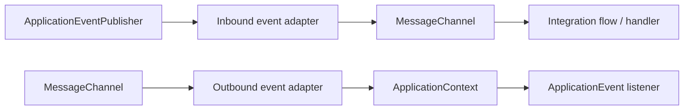

# Kiểm thử event adapter

Event adapter kết nối vòng đời sự kiện của Spring với message flow. Inbound event adapter lắng nghe `ApplicationEvent` trong `ApplicationContext` rồi chuyển sự kiện thành Spring Integration `Message`; outbound event adapter nhận message từ `MessageChannel` và phát payload thành application event. Kiểm thử hai chiều này giúp xác nhận hợp đồng giữa publisher, adapter, channel và listener, đồng thời phát hiện lỗi lọc event, chuyển payload, xử lý đồng bộ và vòng đời endpoint.

Trong module Spring Integration Adapters, event adapter là một trong các cách kết nối hệ thống bên ngoài hoặc thành phần trong ứng dụng vào flow. Dù flow còn trao đổi qua file, SFTP, HTTP, JMS, AMQP, Kafka hay cơ sở dữ liệu, cách kiểm thử vẫn cần làm rõ message nào được nhận, payload/header nào được giữ, lỗi đi đâu và kết nối được khởi tạo hoặc dừng như thế nào. Bài này tập trung vào application event adapter của Spring Integration.

## 1. Xác định hợp đồng cần kiểm thử

Trước khi viết test, mô tả đường đi của event theo từng chiều:



Với inbound adapter, test cần trả lời:

- Event thuộc loại nào được adapter tiếp nhận? Event khác loại có bị bỏ qua không?
- Payload trong message có phải đúng event đã phát hay không?
- Message có đến đúng channel và đúng thời điểm theo cấu hình đồng bộ/bất đồng bộ không?
- Nếu channel hoặc handler ném exception, lỗi được truyền về publisher hay được xử lý qua error flow?

Với outbound adapter, test cần trả lời:

- Message gửi vào channel có được phát thành application event không?
- Event listener trong cùng application context có nhận đúng loại và đúng dữ liệu không?
- Khi publisher hoặc listener lỗi, hành vi quan sát được có đúng chính sách của ứng dụng không?

Nên kiểm tra hành vi qua ranh giới thật của adapter ít nhất một lần. Unit test chỉ gọi trực tiếp một handler hoặc mock `ApplicationEventPublisher` không chứng minh Spring đã đăng ký listener, endpoint và channel đúng cách.

## 2. Chuẩn bị dependency và event mẫu

Ứng dụng cần module event của Spring Integration. Test thường dùng Spring Boot Test hoặc Spring Test cùng Spring Integration Test khi cần các tiện ích kiểm thử endpoint.

Ví dụ Maven, để phiên bản được quản lý bởi Spring Boot hoặc Spring Integration BOM:

```xml
<dependency>
    <groupId>org.springframework.integration</groupId>
    <artifactId>spring-integration-event</artifactId>
</dependency>

<dependency>
    <groupId>org.springframework.integration</groupId>
    <artifactId>spring-integration-test</artifactId>
    <scope>test</scope>
</dependency>
```

Nếu dự án dùng Spring Boot, có thể bổ sung `spring-boot-starter-test` cho JUnit Jupiter và AssertJ. Không khai báo một phiên bản riêng cho từng module khi BOM của dự án đã quản lý phiên bản; các module Spring Integration nên cùng một dòng phiên bản tương thích với Spring Framework đang dùng.

Tạo một event nghiệp vụ có định danh ổn định để test dễ kiểm tra:

```java
public final class OrderCreatedEvent extends ApplicationEvent {

    private final String orderId;

    public OrderCreatedEvent(Object source, String orderId) {
        super(source);
        this.orderId = orderId;
    }

    public String getOrderId() {
        return orderId;
    }
}
```

Trong ứng dụng thực tế, event nên mang dữ liệu nghiệp vụ cần thiết và tránh chứa đối tượng phụ thuộc vào trạng thái nội bộ có thể thay đổi. Nếu hai thành phần được triển khai độc lập, hãy xem event như một hợp đồng dữ liệu: định nghĩa rõ tên, phiên bản, trường bắt buộc và cách xử lý trường không biết.

## 3. Kiểm thử inbound event adapter

`ApplicationEventListeningMessageProducer` lắng nghe application event và phát message tới output channel. Cấu hình sau chỉ nhận `OrderCreatedEvent`:

```java
@Configuration
@EnableIntegration
class EventAdapterConfiguration {

    @Bean
    QueueChannel orderEventsIn() {
        return new QueueChannel();
    }

    @Bean
    ApplicationEventListeningMessageProducer orderEventInboundAdapter(
            QueueChannel orderEventsIn) {

        var adapter = new ApplicationEventListeningMessageProducer();
        adapter.setEventTypes(OrderCreatedEvent.class);
        adapter.setOutputChannel(orderEventsIn);
        return adapter;
    }
}
```

Test phát event qua `ApplicationEventPublisher` thật của context và nhận message từ `QueueChannel`:

```java
@SpringBootTest
class InboundEventAdapterTests {

    @Autowired
    ApplicationEventPublisher eventPublisher;

    @Autowired
    QueueChannel orderEventsIn;

    @Test
    void convertsMatchingApplicationEventToMessage() {
        var event = new OrderCreatedEvent(this, "ORD-1001");

        eventPublisher.publishEvent(event);

        Message<?> message = orderEventsIn.receive(1_000);

        assertThat(message).isNotNull();
        assertThat(message.getPayload()).isSameAs(event);
        assertThat(((OrderCreatedEvent) message.getPayload()).getOrderId())
                .isEqualTo("ORD-1001");
    }
}
```

`QueueChannel` giúp test quan sát message mà không cần chạy toàn bộ downstream flow. Thời gian chờ hữu hạn khiến test thất bại rõ ràng nếu event không tới. Khi event multicaster chạy đồng bộ, message thường có sẵn ngay sau `publishEvent`; timeout vẫn hữu ích nếu cấu hình context sử dụng executor bất đồng bộ.

Nên có thêm test lọc loại event. Phát một event không thuộc tập `eventTypes`, sau đó xác nhận channel không nhận message trong khoảng chờ ngắn. Nếu adapter được cấu hình nhận một lớp cha hoặc nhiều lớp event, kiểm tra cả event con và event ngoài phạm vi để cố định hành vi lọc mong muốn. Dùng event có ID riêng cho mỗi test để tránh nhầm message còn sót trong queue.

## 4. Kiểm thử outbound event adapter

`ApplicationEventPublishingMessageHandler` nhận message và phát payload thành application event. Có thể đăng ký handler làm service activator trên một channel:

```java
@Configuration
@EnableIntegration
class OutboundEventAdapterConfiguration {

    @Bean
    MessageChannel orderEventsOut() {
        return new DirectChannel();
    }

    @Bean
    @ServiceActivator(inputChannel = "orderEventsOut")
    MessageHandler orderEventOutboundAdapter() {
        return new ApplicationEventPublishingMessageHandler();
    }
}
```

Tạo một listener quan sát event được phát trong context:

```java
@Component
class OrderEventProbe {

    private final BlockingQueue<OrderCreatedEvent> received =
            new LinkedBlockingQueue<>();

    @EventListener
    public void onOrderCreated(OrderCreatedEvent event) {
        received.offer(event);
    }

    OrderCreatedEvent poll(Duration timeout) throws InterruptedException {
        return received.poll(timeout.toMillis(), TimeUnit.MILLISECONDS);
    }
}
```

Test gửi message vào channel và chờ listener nhận event:

```java
@SpringBootTest
class OutboundEventAdapterTests {

    @Autowired
    MessageChannel orderEventsOut;

    @Autowired
    OrderEventProbe probe;

    @Test
    void publishesMessagePayloadAsApplicationEvent() throws Exception {
        var event = new OrderCreatedEvent(this, "ORD-1002");
        Message<OrderCreatedEvent> message =
                MessageBuilder.withPayload(event).build();

        assertThat(orderEventsOut.send(message)).isTrue();
        assertThat(probe.poll(Duration.ofSeconds(1))).isSameAs(event);
    }
}
```

Ví dụ dùng một `ApplicationEvent` cụ thể làm payload để listener có thể lọc theo kiểu event. Khi payload là một đối tượng thông thường, Spring có thể biểu diễn nó dưới dạng `PayloadApplicationEvent`; lúc đó listener và bộ lọc phải được thiết kế theo kiểu event bao ngoài và payload thực tế. Hãy kiểm tra đúng hợp đồng mà ứng dụng chọn, thay vì chỉ xác nhận rằng có một event bất kỳ được phát.

## 5. Kiểm thử lỗi và xử lý bất đồng bộ

Event multicaster mặc định của Spring thường gọi listener đồng bộ trên thread phát event. Nếu ứng dụng cấu hình executor cho multicaster hoặc listener tự chuyển công việc sang executor khác, thời điểm quan sát được sẽ thay đổi. Test không nên dựa vào `Thread.sleep()` cố định. Dùng `QueueChannel.receive(timeout)`, `BlockingQueue.poll(timeout)`, `CountDownLatch.await(timeout)` hoặc một công cụ chờ có điều kiện để đợi kết quả với giới hạn thời gian.

Các trường hợp lỗi nên được kiểm tra theo cấu hình thực tế:

| Tình huống | Điều cần xác nhận |
| --- | --- |
| Inbound adapter không có output channel hợp lệ | Context không khởi động hoặc lỗi cấu hình được báo rõ |
| Handler phía sau inbound channel ném exception | Exception được truyền về publisher trong chế độ đồng bộ, hoặc được chuyển tới cơ chế xử lý lỗi đã cấu hình |
| Listener của outbound event ném exception | Hành vi phù hợp với event multicaster đồng bộ/bất đồng bộ và error handler của ứng dụng |
| Event không đúng loại | Không tạo message ngoài hợp đồng |
| Listener xử lý chậm | Test chờ có giới hạn; hệ thống có quan sát được độ trễ và backlog hay không |
| Context đóng | Adapter dừng nhận event và không để lại executor hoặc listener ngoài vòng đời ứng dụng |

Để kiểm tra lỗi ở inbound path, có thể nối output channel tới `DirectChannel` với một handler cố ý ném exception trong test. Với chế độ đồng bộ, test có thể xác nhận exception quan sát được khi gọi `publishEvent`. Nếu flow dùng `ExecutorChannel`, poller hoặc event multicaster bất đồng bộ, exception có thể xuất hiện ở thread khác; khi đó hãy kiểm tra error channel, error handler hoặc cơ chế retry mà ứng dụng đã cấu hình. Không áp đặt một kết quả đồng bộ lên một flow vốn bất đồng bộ.

Kiểm thử lỗi cần phân biệt lỗi phát event với lỗi xử lý nghiệp vụ. Event được publish thành công chỉ chứng minh event đã được chuyển tới cơ chế dispatch; nó không tự chứng minh mọi listener đã hoàn tất công việc. Nếu nghiệp vụ yêu cầu bảo đảm sau commit, hãy kiểm thử riêng listener dùng `@TransactionalEventListener` và trạng thái transaction tương ứng. Application event trong bộ nhớ cũng không phải message broker bền vững: process dừng đột ngột có thể làm mất công việc chưa hoàn tất.

## 6. Kiểm thử header, payload và tính lặp

Message của Spring Integration có payload và headers. Khi event được chuyển thành message, xác định trường nào thuộc payload, trường nào là metadata do adapter hoặc flow bổ sung. Không dựa vào một header nội bộ chưa được cam kết trong hợp đồng công khai của ứng dụng. Nếu flow cần correlation ID, tenant ID hoặc trace ID, hãy đưa chúng vào event hoặc tạo chúng bằng một bước chuyển đổi có kiểm thử riêng.

Một số kiểm tra hữu ích:

- Xác nhận payload giữ đúng kiểu và dữ liệu nghiệp vụ, đặc biệt khi event có kế thừa hoặc chuyển đổi.
- Xác nhận correlation ID và các header nghiệp vụ cần thiết được giữ hoặc ánh xạ theo thiết kế.
- Xác nhận event thiếu trường bắt buộc bị từ chối ở validation handler với lỗi có thể quan sát.
- Gửi cùng một event ID nhiều lần để kiểm tra listener có idempotent hay không nếu producer có thể phát lặp.
- Xác nhận thứ tự chỉ khi hệ thống cam kết thứ tự. Nhiều publisher hoặc executor bất đồng bộ có thể làm thứ tự hoàn tất khác thứ tự phát.

Nếu event được chuyển thành message rồi đi tiếp tới Kafka, JMS hoặc AMQP, kiểm thử adapter event không thay thế kiểm thử serializer, mapping header và xác nhận gửi của broker adapter. Nên có test riêng ở ranh giới tương ứng, dùng payload mẫu và xác nhận round-trip theo hợp đồng tích hợp.

## 7. Cô lập test và quản lý vòng đời

Spring application context quản lý listener và endpoint. Một test khởi tạo nhiều context hoặc đăng ký listener thủ công mà không hủy đăng ký có thể khiến một event bị xử lý nhiều lần. Để test ổn định:

1. Ưu tiên để Spring quản lý adapter và listener qua bean lifecycle; tránh tự đăng ký listener trong từng test nếu không có bước hủy đăng ký tương ứng.
2. Dùng mã event duy nhất cho từng tình huống và làm sạch queue/probe sau mỗi test khi context được tái sử dụng.
3. Không chạy các test cùng ghi vào một queue hoặc probe dùng chung theo kiểu song song nếu chúng không được thiết kế để cô lập.
4. Dùng context test nhỏ với đúng adapter cần kiểm tra khi một ứng dụng lớn có nhiều listener và flow không liên quan.
5. Đóng context sau test và xác nhận executor tùy chỉnh được shutdown đúng cách.

Nếu cần thay thế một endpoint Spring Integration bằng mock trong test flow lớn, có thể dùng tiện ích của `spring-integration-test` như `MockIntegrationContext` và các mock endpoint phù hợp với loại endpoint. Việc thay thế này hữu ích để kiểm thử các bước trước/sau adapter, nhưng nên giữ ít nhất một test tích hợp khởi động adapter thật để xác nhận cấu hình đăng ký event và channel.

## 8. Checklist cho một bộ test event adapter

| Nhóm | Ca kiểm thử tối thiểu |
| --- | --- |
| Khởi tạo | Context khởi động được; adapter gắn đúng channel và event type |
| Inbound | Event hợp lệ tạo đúng message; event ngoài phạm vi bị bỏ qua |
| Outbound | Message hợp lệ phát đúng event; listener nhận đúng payload |
| Hợp đồng | Kiểu payload, dữ liệu, correlation ID và validation được kiểm tra |
| Đồng bộ | Kết quả xuất hiện trong giới hạn thời gian đã định |
| Bất đồng bộ | Test chờ có điều kiện; không phụ thuộc sleep hoặc thứ tự không được cam kết |
| Lỗi | Exception được truyền hoặc chuyển tới error handling đúng cấu hình |
| Vòng đời | Context đóng thì adapter/listener/executor được dừng đúng cách |
| Tính lặp | Event ID lặp không gây side effect trùng nếu nghiệp vụ yêu cầu idempotency |

Một bộ test tốt xác nhận cả đường đi thành công lẫn cách adapter phản ứng khi hợp đồng bị vi phạm. Hãy kiểm thử inbound và outbound qua `ApplicationContext` thật, dùng channel có thể quan sát, chờ có giới hạn và event có định danh rõ ràng. Nhờ vậy, thay đổi cấu hình Spring Integration sẽ được phát hiện sớm trước khi event trở thành đầu vào của một flow sản xuất.
