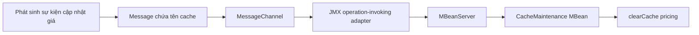

# JMX operation-invoking adapter trong Spring Integration

## 1. Bài toán và vị trí trong luồng tích hợp

Trong một hệ thống chạy Java, nhiều thao tác quản trị được công bố qua **Java Management Extensions (JMX)**: làm mới bộ đệm, buộc đồng bộ lại cấu hình, kích hoạt thu thập thống kê hoặc yêu cầu một thành phần thực hiện tác vụ bảo trì. Các thao tác đó được gọi là **operation** của một **MBean**. Thông thường, người vận hành gọi chúng từ JConsole/VisualVM hoặc từ một JMX client. Nhưng một luồng tích hợp đôi khi cần phát lệnh quản trị ngay khi nhận được sự kiện từ hệ thống khác.

**JMX operation-invoking channel adapter** giải quyết bài toán đó: nó nhận `Message<?>` từ một `MessageChannel` của Spring Integration và gọi operation tương ứng trên MBean thông qua `MBeanServer`. Đây là **outbound adapter hướng sự kiện** (message-driven): khi message đến, adapter xử lý; không cần poller để định kỳ truy vấn MBean.

Trong module **`SPRING_INTEGRATION_ADAPTERS`**, adapter này là một cách nối Spring Integration với giao diện quản trị Java bên cạnh các adapter file, SFTP, HTTP, JMS, AMQP, Kafka và cơ sở dữ liệu. Trọng tâm của bài là hợp đồng message, định tuyến vào adapter, lựa chọn operation, quản lý lỗi và vòng đời kết nối với JMX.

Ví dụ: một luồng nhận sự kiện cập nhật bảng giá rồi gửi lệnh xóa cache `pricing` để MBean quản trị chuẩn bị dữ liệu mới:



Điểm quan trọng: việc gọi operation qua JMX có thể có **tác dụng phụ**. Gửi lại một message có thể chạy lại operation. Vì vậy, các lệnh như xóa cache thường phù hợp hơn những lệnh không thể thực hiện lại một cách an toàn, chẳng hạn ghi tăng số dư.

## 2. Thành phần và hợp đồng message

Một lời gọi JMX cần biết **MBean nào**, **operation nào** và **các tham số** của operation (nếu có). Spring Integration lấy các giá trị này từ cấu hình adapter hoặc message:

| Thành phần | Ý nghĩa | Cách cung cấp |
| --- | --- | --- |
| `object-name` | `ObjectName` định danh MBean, ví dụ `demo.integration:type=Maintenance,name=Cache` | Thuộc tính XML hoặc header `JmxHeaders.OBJECT_NAME` |
| `operation-name` | Tên operation được MBean công bố, ví dụ `clearCache` | Thuộc tính XML hoặc header `JmxHeaders.OPERATION_NAME` |
| `payload` | Giá trị tham số truyền vào operation | Payload của message; bị bỏ qua với operation không nhận tham số |
| `mbean-server` | Bean tham chiếu tới `MBeanServer` | Mặc định dò bean có tên `mbeanServer`; có thể chỉ định tên khác |
| `channel` | Đầu vào nhận message của outbound adapter | Tên `MessageChannel` ở Spring Integration |

**Thứ tự ưu tiên:** với tên MBean và tên operation, adapter kiểm tra header trước. Nếu header không có thì sử dụng giá trị mặc định đã cấu hình trên adapter. Header không được kiểm soát có thể khiến message gọi nhầm MBean/operation, kể cả khi XML đã khai báo mặc định.

Để ghi header bằng Java, dùng chính các hằng số trong `org.springframework.integration.jmx.JmxHeaders` thay vì tự gõ chuỗi như `jmx_operationName`.

### Payload được ánh xạ sang tham số như thế nào?

| Chữ ký operation | Payload phù hợp | Lưu ý |
| --- | --- | --- |
| `void refresh()` | Bất kỳ payload hợp lệ nào, ví dụ `"now"` | Operation không có tham số nên adapter bỏ qua payload |
| `void clearCache(String cacheName)` | `"pricing"` | Một tham số nhận trực tiếp một giá trị |
| `void setThreshold(String cacheName, int seconds)` | `List.of("pricing", 60)` hoặc `new Object[]{"pricing", 60}` | Danh sách/mảng theo thứ tự tham số |
| `void setThreshold(String cacheName, int seconds)` | `Map.of("cacheName", "pricing", "seconds", 60)` | Dựa vào tên tham số mà thông tin MBean công bố; cần kiểm tra metadata JMX thực tế |

`Map<String, ?>` sử dụng **tên tham số** làm khóa; `List` hoặc mảng dùng **vị trí tham số**. Nếu MBean không xuất tên tham số như mong đợi, ưu tiên danh sách theo thứ tự. Các kiểu giá trị phải tương thích với kiểu tham số MBean (ví dụ `Integer` cho `int`); đừng giả định adapter sẽ tự chuyển một chuỗi `"60"` thành số nguyên. Với operation bị overload, kiểm tra tên và chữ ký được JMX công bố để tránh gọi sai hoặc thất bại khi phân giải.

## 3. Ví dụ chạy tại chỗ: gọi lệnh xóa cache

Ví dụ gồm một MBean, một bean `MBeanServer`, một kênh message và outbound adapter. Các đoạn mã dưới đây minh họa cấu hình dựa trên XML namespace; ứng dụng dùng Java DSL cũng áp dụng cùng hợp đồng JMX.

### Bước 1: Bổ sung thư viện JMX

Với Maven và Spring Integration BOM/Spring Boot quản lý phiên bản:

```xml
<dependency>
    <groupId>org.springframework.integration</groupId>
    <artifactId>spring-integration-jmx</artifactId>
</dependency>
```

Nếu dự án không dùng BOM hoặc dependency management, cần khai báo phiên bản `spring-integration-jmx` tương thích với Spring Integration đang sử dụng.

### Bước 2: Tạo MBean công bố operation

```java
package demo.jmx;

import org.springframework.jmx.export.annotation.ManagedOperation;
import org.springframework.jmx.export.annotation.ManagedOperationParameter;
import org.springframework.jmx.export.annotation.ManagedResource;

@ManagedResource(objectName = "demo.integration:type=Maintenance,name=Cache")
public class CacheMaintenance {

    @ManagedOperation(description = "Xóa một cache theo tên")
    @ManagedOperationParameter(
        name = "cacheName", description = "Tên cache cần xóa")
    public void clearCache(String cacheName) {
        if (!"pricing".equals(cacheName) && !"catalog".equals(cacheName)) {
            throw new IllegalArgumentException("Cache không được phép: " + cacheName);
        }

        // Demo: thay bằng thao tác xóa cache thật trong ứng dụng.
        System.out.println("Cleared cache: " + cacheName);
    }
}
```

`@ManagedResource` chỉ định `ObjectName`; `@ManagedOperation` công bố phương thức thao tác; `@ManagedOperationParameter` mô tả tên tham số cho metadata JMX. Việc chỉ tạo bean Java **chưa đủ**: bean còn phải được đăng ký với `MBeanServer` thông qua một `MBeanExporter`.

### Bước 3: Khai báo Spring Integration XML

Ví dụ `jmx-integration.xml`:

```xml
<?xml version="1.0" encoding="UTF-8"?>
<beans xmlns="http://www.springframework.org/schema/beans"
       xmlns:xsi="http://www.w3.org/2001/XMLSchema-instance"
       xmlns:context="http://www.springframework.org/schema/context"
       xmlns:int="http://www.springframework.org/schema/integration"
       xmlns:int-jmx="http://www.springframework.org/schema/integration/jmx"
       xsi:schemaLocation="
           http://www.springframework.org/schema/beans
           https://www.springframework.org/schema/beans/spring-beans.xsd
           http://www.springframework.org/schema/context
           https://www.springframework.org/schema/context/spring-context.xsd
           http://www.springframework.org/schema/integration
           https://www.springframework.org/schema/integration/spring-integration.xsd
           http://www.springframework.org/schema/integration/jmx
           https://www.springframework.org/schema/integration/jmx/spring-integration-jmx.xsd">

    <!-- Tạo/tìm MBeanServer với tên bean mặc định mbeanServer. -->
    <context:mbean-server/>

    <!-- Export các bean mang annotation quản trị tới cùng server. -->
    <context:mbean-export server="mbeanServer"/>
    <bean id="cacheMaintenance" class="demo.jmx.CacheMaintenance"/>

    <int:channel id="cacheCommands"/>

    <int-jmx:operation-invoking-channel-adapter
        id="clearCacheAdapter"
        channel="cacheCommands"
        mbean-server="mbeanServer"
        object-name="demo.integration:type=Maintenance,name=Cache"
        operation-name="clearCache"/>
</beans>
```

`<context:mbean-server/>` cung cấp server mà adapter tra cứu; `<context:mbean-export/>` đăng ký MBean vào server đó. Hai vai trò khác nhau: **server là nơi thực thi truy vấn/lệnh**, **exporter chịu trách nhiệm công bố đối tượng quản trị**. Khi tích hợp với MBean đã tồn tại, không nhất thiết phải export một MBean mới; chỉ cần đảm bảo adapter dùng đúng `MBeanServer` đang chứa đối tượng đó.

`cacheCommands` là một `DirectChannel` theo mặc định. Khi luồng gửi message vào kênh, lời gọi JMX chạy đồng bộ trên luồng gửi, và lỗi gọi operation có thể lan ngược về nơi gửi.

### Bước 4: Gửi lệnh qua `MessageChannel`

Giả sử cấu hình XML đã được nạp vào `ApplicationContext`:

```java
import org.springframework.context.ApplicationContext;
import org.springframework.integration.support.MessageBuilder;
import org.springframework.messaging.MessageChannel;

// context là ApplicationContext đã nạp jmx-integration.xml.
MessageChannel commands = context.getBean("cacheCommands", MessageChannel.class);

boolean accepted = commands.send(
    MessageBuilder.withPayload("pricing").build()
);

if (!accepted) {
    throw new IllegalStateException("Không gửi được lệnh xóa cache");
}
```

Với ví dụ trên, adapter gọi operation tương đương:

```java
mbeanServer.invoke(
    new javax.management.ObjectName("demo.integration:type=Maintenance,name=Cache"),
    "clearCache",
    new Object[] { "pricing" },
    new String[] { "java.lang.String" }
);
```

Đây là **mô hình tương đương để giải thích**, không phải đoạn mã mà ứng dụng cần tự gọi. Nếu thao tác thành công, demo in `Cleared cache: pricing`. `send(...)` trả `true` cho biết message được kênh chấp nhận; nó **không phải** một biên nhận nghiệp vụ xác nhận cache đã được xóa bền vững trong hệ thống khác.

## 4. Dùng header để lựa chọn MBean/operation

Một outbound adapter có thể nhận tên đích từ header, ví dụ khi điều phối nhiều lệnh quản trị. Khi đó không nhất thiết phải cấu hình cố định `object-name` và `operation-name`:

```xml
<int-jmx:operation-invoking-channel-adapter
    id="dynamicJmxAdapter"
    channel="jmxCommands"
    mbean-server="mbeanServer"/>
```

Gửi message có hai header:

```java
import org.springframework.integration.jmx.JmxHeaders;
import org.springframework.integration.support.MessageBuilder;

var command = MessageBuilder.withPayload("catalog")
    .setHeader(JmxHeaders.OBJECT_NAME,
        "demo.integration:type=Maintenance,name=Cache")
    .setHeader(JmxHeaders.OPERATION_NAME, "clearCache")
    .build();

jmxCommands.send(command);
```

Ở đây `jmxCommands` là `MessageChannel` đã được lấy từ context, và trước khi chạy cần khai báo `<int:channel id="jmxCommands"/>`. Nếu một header hiện diện, giá trị đó **ưu tiên hơn** giá trị mặc định có cùng vai trò. Việc chỉ định đích bằng header thích hợp cho một bộ điều phối nội bộ có kiểm soát, nhưng cần xác thực và kiểm tra **danh sách MBean/operation được phép gọi** trước khi đưa message vào adapter. Không chuyển thẳng tên operation do người dùng hoặc sự kiện bên ngoài tự khai báo vào JMX.

## 5. Phân biệt adapter với outbound gateway và các adapter JMX khác

| Thành phần | Hướng và cơ chế | Đầu ra mong đợi | Dùng khi nào |
| --- | --- | --- | --- |
| **Operation-invoking channel adapter** | Outbound, kích hoạt khi có message | Không thiết kế luồng reply | Gửi lệnh quản trị, thường là operation `void` |
| **Operation-invoking outbound gateway** | Outbound request/reply | Giá trị trả về được đóng gói thành reply message | Operation trả dữ liệu mà bước tiếp theo cần sử dụng |
| **Attribute-polling channel adapter** | Inbound, dùng poller | Message chứa giá trị một JMX attribute | Định kỳ đọc trạng thái, chỉ số |
| **Notification-listening channel adapter** | Inbound, nhận JMX notification | Message tạo từ notification | Phản ứng khi MBean phát sự kiện |

Ví dụ nếu muốn gọi `getQueueDepth()` rồi quyết định có điều tiết tốc độ xử lý hay không, hãy dùng **operation-invoking outbound gateway** và `reply-channel` thay vì gắn outbound adapter vào một luồng trông chờ phản hồi. Một operation thực tế có thể trả giá trị dù adapter vẫn được gọi, nhưng adapter không cung cấp hợp đồng request/reply cho bước tiếp theo.

## 6. Vòng đời, xử lý lỗi và vận hành an toàn

### Các lỗi dễ gặp

| Triệu chứng | Nguyên nhân thường gặp | Cách kiểm tra/xử lý |
| --- | --- | --- |
| Không tìm thấy MBean (`InstanceNotFoundException`) | Sai `ObjectName`, chưa export MBean, adapter trỏ sai `MBeanServer` | Xem danh sách MBean trong JConsole; so sánh chính xác domain, key properties và server |
| Không tìm thấy operation hoặc không khớp chữ ký (`ReflectionException`/lỗi invoke) | Sai `operation-name`, thứ tự/kiểu tham số, MBean không công bố method | Kiểm tra operation và signature trong `MBeanInfo`; chuẩn hóa payload trước khi gửi |
| Lỗi bên trong operation (`MBeanException` hoặc ngoại lệ được bọc) | MBean thực thi lệnh thất bại | Ghi log nguyên nhân gốc, xác định lệnh có an toàn khi chạy lại hay không |
| Khởi động lỗi vì thiếu `mbeanServer` | Không có bean server tên mặc định hoặc tham chiếu sai | Định nghĩa bean đúng tên hoặc sửa thuộc tính `mbean-server` |
| Gọi nhầm đích dù XML có giá trị mặc định | Message chứa `JmxHeaders.OBJECT_NAME`/`OPERATION_NAME` | Lọc, loại bỏ hoặc kiểm soát header ở biên luồng |
| Luồng gửi bị chậm | Operation JMX thực thi lâu trên `DirectChannel` | Đo thời gian operation; cân nhắc tách kênh bất đồng bộ nếu phù hợp và thiết kế cơ chế lỗi tương ứng |

### Quy ước triển khai

1. **Kiểm soát đối tượng và quyền gọi:** giữ danh sách lệnh quản trị hợp lệ; chỉ cấp quyền JMX tối thiểu cần thiết. Nếu dùng JMX từ xa, cấu hình kết nối, xác thực và mã hóa phù hợp với môi trường. Outbound adapter không tự cung cấp xác thực cho mọi JMX server.
2. **Phân biệt lỗi đồng bộ/bất đồng bộ:** với `DirectChannel`, lỗi từ handler thường được ném về bên gửi; khi sử dụng `ExecutorChannel` hoặc kênh bất đồng bộ, thiết kế `errorChannel`/cơ chế thu lỗi riêng. Tránh hiểu việc `send()` hoàn tất là operation chắc chắn đã thành công trong trường hợp bất đồng bộ.
3. **Chủ động với retry:** timeout, lỗi kết nối hoặc ngoại lệ sau khi operation đã chạy có thể khiến phía gọi không chắc thao tác đã diễn ra hay chưa. Chỉ retry tự động khi operation có tính idempotent hoặc có cơ chế chống thực thi lặp.
4. **Quan sát được luồng:** log `ObjectName`, tên operation, correlation ID, thời gian xử lý và lỗi; loại bỏ mật khẩu/token khỏi payload và log. Đo số lần thất bại để phát hiện MBean không đăng ký hoặc trục trặc kết nối.
5. **Quản lý vòng đời:** bảo đảm MBean đã được đăng ký khi message bắt đầu đến, cùng `MBeanServer` được cấu hình; nếu quản trị MBean ở JVM khác, phải cấu hình kết nối JMX remote phù hợp. Tắt ứng dụng/đóng kết nối theo vòng đời của bean thay vì mở một JMX connection mới cho từng message.

### Kiểm tra thủ công nhanh

1. Khởi động context có `CacheMaintenance`, `mbeanServer` và adapter, xác nhận không có lỗi đăng ký MBean.
2. Mở JConsole/VisualVM kết nối vào JVM, tìm `demo.integration:type=Maintenance,name=Cache`, xác nhận có operation `clearCache(java.lang.String)`.
3. Gửi payload `"pricing"` vào `cacheCommands`; kiểm tra log hiển thị `Cleared cache: pricing`.
4. Gửi payload `"unknown"`; xác nhận lỗi từ MBean được quan sát và không đánh dấu lệnh này đã thành công.
5. Đổi sai `object-name` trong môi trường thử nghiệm; xác nhận phát hiện được lỗi không tìm thấy MBean, sau đó khôi phục cấu hình.

Không cần đặt poller cho `cacheCommands`: đây là luồng đẩy lệnh theo sự kiện. Nếu sự kiện đến từ HTTP, Kafka, JMS hay file adapter, chỉ cần biến đổi chúng thành message có payload phù hợp và định tuyến vào kênh này.

## 7. Câu hỏi tự kiểm tra

1. Vì sao operation-invoking **channel adapter** được xem là outbound adapter dù nó nhận message từ một channel nội bộ?
2. Khi cấu hình `operation-name="clearCache"` nhưng message có header `JmxHeaders.OPERATION_NAME="refresh"`, operation nào được chọn?
3. Đối với operation có hai tham số, khi nào nên dùng payload `List`, khi nào nên dùng `Map`?
4. Khi cần sử dụng giá trị trả về từ JMX operation để xử lý tiếp, thành phần nào phù hợp hơn?
5. Vì sao retry một operation quản trị có tác dụng phụ có thể gây lỗi dữ liệu, và nên xử lý thế nào?

## Tài liệu tham khảo

- [Spring Integration Reference — JMX Support](https://docs.spring.io/spring-integration/reference/jmx.html): operation-invoking channel adapter, các kiểu payload và outbound gateway.
- [Spring Integration API — OperationInvokingMessageHandler](https://docs.spring.io/spring-integration/api/org/springframework/integration/jmx/OperationInvokingMessageHandler.html): cách phân giải object/operation từ message header và cấu hình mặc định.
- [Spring Framework — Exporting Your Beans to JMX](https://docs.spring.io/spring-framework/reference/integration/jmx/exporting.html): `MBeanExporter` và đăng ký MBean.
