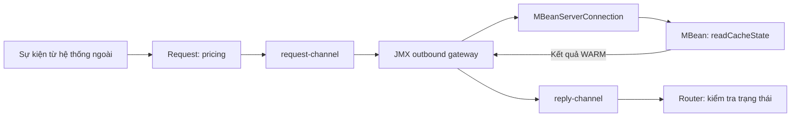

# JMX outbound gateway trong Spring Integration

## 1. JMX outbound gateway giải quyết bài toán gì?

**Java Management Extensions (JMX)** cung cấp giao diện quan sát và điều khiển các thành phần Java thông qua **MBean**. Một MBean có thể công bố *attribute* để đọc trạng thái và *operation* để thực thi một phương thức quản trị. Chẳng hạn, một dịch vụ cache có operation `readCacheState(String name)` trả về `"WARM"`, `"COLD"` hoặc `"UNKNOWN"`.

Nếu luồng Spring Integration cần **gọi operation JMX và dùng kết quả cho bước xử lý kế tiếp**, thành phần phù hợp là **JMX operation-invoking outbound gateway**. Gateway nhận request message, gọi operation trên MBean qua `MBeanServerConnection`, sau đó tạo reply message chứa giá trị trả về của operation.

Trong module **`SPRING_INTEGRATION_ADAPTERS`**, bài này minh họa cách kết nối Spring Integration với một thành phần quản trị Java theo hợp đồng request/reply. Luồng bên ngoài có thể bắt đầu từ file, SFTP, HTTP, JMS, AMQP, Kafka hoặc cơ sở dữ liệu; sau khi biến đổi dữ liệu đầu vào thành message, gateway có thể kiểm tra trạng thái nội bộ trước khi quyết định tuyến xử lý tiếp theo.

Ví dụ: một sự kiện cập nhật giá kích hoạt kiểm tra trạng thái cache `pricing`. Nếu cache đã ấm (`"WARM"`), luồng mới cho phép công bố dữ liệu; nếu chưa, hệ thống có thể trì hoãn hoặc thực hiện bước khởi tạo khác.



Đây là **outbound** vì Spring Integration chủ động gọi hệ thống quản trị bên ngoài luồng message; là **gateway** vì một request tương ứng với một phản hồi khi operation trả về giá trị. Không cần *poller* cho endpoint này nếu request được đẩy vào channel theo sự kiện.

## 2. Phân biệt outbound gateway với operation-invoking channel adapter

| Tiêu chí | JMX operation-invoking channel adapter | JMX operation-invoking outbound gateway |
| --- | --- | --- |
| Mục tiêu | Gửi lệnh quản trị, thường là operation `void` | Gọi operation **có kết quả** và đưa kết quả trở lại luồng |
| Hướng | Outbound | Outbound |
| Input | `channel` nhận message | `request-channel` nhận message |
| Output | Không thiết lập tuyến reply | `reply-channel` hoặc header `replyChannel` |
| Ví dụ | `clearCache("pricing")` | `readCacheState("pricing") -> "WARM"` |
| Bước tiếp theo sử dụng kết quả | Không có hợp đồng reply | Có thể route/transform/filter theo payload của reply |

**Không nhầm lẫn với `@MessagingGateway`:** `@MessagingGateway` là một cách đưa API Java vào/ra luồng Spring Integration. Còn JMX outbound gateway là endpoint trong luồng, chuyên gọi operation trên một MBean. Hai loại gateway có thể kết hợp: Java gọi `@MessagingGateway` → request message → JMX outbound gateway → reply message → kết quả trả về phương thức Java.

## 3. Hợp đồng request/reply và các cấu hình quan trọng

JMX outbound gateway được khai báo bằng phần tử XML:

```xml
<int-jmx:operation-invoking-outbound-gateway
    request-channel="cacheStatusRequests"
    reply-channel="cacheStatusReplies"
    mbean-server="mbeanServer"
    object-name="demo.integration:type=Cache,name=Status"
    operation-name="readCacheState"/>
```

| Thuộc tính/giá trị | Vai trò | Lưu ý |
| --- | --- | --- |
| `request-channel` | Kênh nhận request message | Thường là `DirectChannel` nếu muốn xử lý đồng bộ |
| `reply-channel` | Kênh nhận reply message của gateway | Có thể bỏ qua khi request có header `replyChannel` phù hợp |
| `mbean-server` | Tham chiếu đến bean `MBeanServerConnection`/`MBeanServer` | Mặc định có thể tìm bean tên `mbeanServer` |
| `object-name` | `ObjectName` của MBean được gọi | Có thể được thay bằng header `JmxHeaders.OBJECT_NAME` |
| `operation-name` | Tên operation trên MBean | Có thể được thay bằng header `JmxHeaders.OPERATION_NAME` |
| `payload` của request | Tham số đầu vào của operation | Định dạng phụ thuộc số lượng tham số |
| `payload` của reply | Giá trị return của operation | Ví dụ `"WARM"` hoặc một giá trị kiểu `Integer` |

**Quy tắc chọn đích:** gateway ưu tiên `JmxHeaders.OBJECT_NAME` và `JmxHeaders.OPERATION_NAME` có trong request; nếu không có thì dùng các giá trị mặc định `object-name` và `operation-name` đã cấu hình. Giá trị header phải được kiểm soát vì chúng có thể thay đổi operation sẽ được thực thi.

### Ánh xạ payload thành tham số JMX

| Operation được công bố | Payload ví dụ | Cách diễn giải |
| --- | --- | --- |
| `String getVersion()` | `"trigger"` | Không có tham số: payload được bỏ qua |
| `String readCacheState(String name)` | `"pricing"` | Một payload tương ứng một tham số |
| `int countByPrefix(String prefix, int limit)` | `List.of("prod-", 20)` | `List`/mảng biểu diễn tham số theo thứ tự |
| `int countByPrefix(String prefix, int limit)` | `Map.of("prefix", "prod-", "limit", 20)` | `Map<String, ?>` ánh xạ tham số theo **tên** được công bố trong JMX metadata |

Khi dùng `Map`, cần kiểm tra tên tham số thực tế trong `MBeanInfo`/JConsole; tên hiển thị có thể khác tên biến Java nếu exporter không cung cấp metadata. Với `List` hoặc mảng, thứ tự và kiểu tham số phải đúng; không nên mặc định rằng một chuỗi số sẽ tự chuyển thành `int`. Với các operation trùng tên nhưng khác chữ ký (*overload*), kiểm tra metadata để tránh chọn sai phương thức.

### Chọn `reply-channel` như thế nào?

Có hai cách phổ biến:

1. **Kênh cố định trong XML:** khai báo `reply-channel="cacheStatusReplies"`. Phù hợp với một pipeline xác định trước hoặc ví dụ có `QueueChannel` để nhận kết quả thủ công.
2. **Kênh từ request header:** không khai báo `reply-channel`; gateway gửi reply đến channel trong header `IntegrationMessageHeaderAccessor.REPLY_CHANNEL` (thường được đặt bằng `MessageHeaders.REPLY_CHANNEL`). Cách này phù hợp khi upstream là một messaging gateway đã tạo reply channel cho từng request.

Nếu tự gửi message vào `request-channel` bằng Java và không khai báo `reply-channel` trong XML, **phải đặt reply channel vào header**. Nếu thiếu cả hai, gateway có thể gọi MBean thành công nhưng không có địa chỉ hợp lệ để gửi kết quả về luồng.

## 4. Ví dụ end-to-end: hỏi trạng thái cache qua JMX

Ví dụ sử dụng một MBean thật trong cùng JVM và một `QueueChannel` nhận reply. Các đoạn dưới đây có thể đặt trong dự án Spring Framework/Spring Integration dùng XML configuration.

### Bước 1. Thêm dependency

```xml
<dependency>
    <groupId>org.springframework.integration</groupId>
    <artifactId>spring-integration-jmx</artifactId>
</dependency>
```

Khi dự án không có dependency management (Spring Boot/BOM), chọn một phiên bản `spring-integration-jmx` tương thích với các thư viện Spring hiện dùng. Để biên dịch ví dụ, dự án cũng cần phần cơ sở Spring Integration (qua dependency transitive phù hợp) và Spring Framework.

### Bước 2. Tạo MBean có operation trả về giá trị

File `src/main/java/demo/jmx/CacheStatusService.java`:

```java
package demo.jmx;

import org.springframework.jmx.export.annotation.ManagedOperation;
import org.springframework.jmx.export.annotation.ManagedOperationParameter;
import org.springframework.jmx.export.annotation.ManagedResource;

@ManagedResource(objectName = "demo.integration:type=Cache,name=Status")
public class CacheStatusService {

    @ManagedOperation(description = "Đọc trạng thái của cache")
    @ManagedOperationParameter(
        name = "cacheName", description = "Tên cache cần kiểm tra")
    public String readCacheState(String cacheName) {
        if ("pricing".equals(cacheName)) {
            return "WARM";
        }
        if ("catalog".equals(cacheName)) {
            return "COLD";
        }
        return "UNKNOWN";
    }

    @ManagedOperation(description = "Đọc phiên bản của cache")
    @ManagedOperationParameter(
        name = "cacheName", description = "Tên cache cần kiểm tra")
    public String readCacheVersion(String cacheName) {
        return "v2:" + cacheName;
    }
}
```

`@ManagedResource` gắn `ObjectName` cho MBean; `@ManagedOperation` công bố operation, và `@ManagedOperationParameter` khai báo tên tham số trong metadata JMX. Để MBean được truy cập, cần export bean vào cùng `MBeanServer` mà outbound gateway sử dụng.

### Bước 3. Cấu hình server, exporter và các channel

File `src/main/resources/jmx-gateway.xml`:

```xml
<?xml version="1.0" encoding="UTF-8"?>
<beans xmlns="http://www.springframework.org/schema/beans"
       xmlns:xsi="http://www.w3.org/2001/XMLSchema-instance"
       xmlns:context="http://www.springframework.org/schema/context"
       xmlns:int="http://www.springframework.org/schema/integration"
       xmlns:int-jmx="http://www.springframework.org/schema/integration/jmx"
       xsi:schemaLocation="
           http://www.springframework.org/schema/beans
           https://www.springframework.org/schema/beans/spring-beans.xsd
           http://www.springframework.org/schema/context
           https://www.springframework.org/schema/context/spring-context.xsd
           http://www.springframework.org/schema/integration
           https://www.springframework.org/schema/integration/spring-integration.xsd
           http://www.springframework.org/schema/integration/jmx
           https://www.springframework.org/schema/integration/jmx/spring-integration-jmx.xsd">

    <!-- Đăng ký một MBeanServer để exporter và gateway cùng sử dụng. -->
    <context:mbean-server/>
    <context:mbean-export server="mbeanServer"/>

    <bean id="cacheStatusService" class="demo.jmx.CacheStatusService"/>

    <int:channel id="cacheStatusRequests"/>

    <!-- QueueChannel cho phép code ví dụ chủ động lấy reply. -->
    <int:channel id="cacheStatusReplies">
        <int:queue capacity="10"/>
    </int:channel>

    <int-jmx:operation-invoking-outbound-gateway
        id="cacheStatusGateway"
        request-channel="cacheStatusRequests"
        reply-channel="cacheStatusReplies"
        mbean-server="mbeanServer"
        object-name="demo.integration:type=Cache,name=Status"
        operation-name="readCacheState"/>
</beans>
```

`<context:mbean-export>` là Spring Framework exporter dành cho bean ứng dụng có `@ManagedResource`. Nó khác `IntegrationMBeanExporter` dùng để đưa chính các channel/handler của Spring Integration ra JMX cho việc quan sát. Ví dụ này chỉ cần exporter của Spring Framework cho `CacheStatusService`.

`cacheStatusRequests` là `DirectChannel` mặc định: request đi đến gateway đồng bộ trong luồng gọi `send(...)`. `cacheStatusReplies` là `QueueChannel`: kết quả được gửi vào hàng đợi và lấy bằng `receive(timeout)`. Khi dùng trong ứng dụng thực, reply cũng có thể đi tới `ServiceActivator`, router hoặc transformer thay vì hàng đợi.

### Bước 4. Gửi request và nhận reply

File `src/main/java/demo/jmx/RunJmxGateway.java`:

```java
package demo.jmx;

import org.springframework.context.support.ClassPathXmlApplicationContext;
import org.springframework.integration.support.MessageBuilder;
import org.springframework.messaging.Message;
import org.springframework.messaging.MessageChannel;
import org.springframework.messaging.PollableChannel;

public class RunJmxGateway {

    public static void main(String[] args) {
        try (var context = new ClassPathXmlApplicationContext("jmx-gateway.xml")) {
            MessageChannel requests = context.getBean(
                "cacheStatusRequests", MessageChannel.class);
            PollableChannel replies = context.getBean(
                "cacheStatusReplies", PollableChannel.class);

            boolean accepted = requests.send(
                MessageBuilder.withPayload("pricing").build());
            if (!accepted) {
                throw new IllegalStateException("Gateway không nhận request");
            }

            Message<?> reply = replies.receive(3_000);
            if (reply == null) {
                throw new IllegalStateException("Không nhận được reply trong 3 giây");
            }
            System.out.println("Cache status = " + reply.getPayload());
        }
    }
}
```

Kết quả kỳ vọng:

```text
Cache status = WARM
```

Đường đi tương đương của thao tác JMX:

```java
Object result = mbeanServer.invoke(
    new javax.management.ObjectName("demo.integration:type=Cache,name=Status"),
    "readCacheState",
    new Object[] { "pricing" },
    new String[] { "java.lang.String" }
);
// result == "WARM"
```

Đoạn `mbeanServer.invoke(...)` chỉ để minh họa thao tác do gateway đảm nhận; không cần tự viết trong `RunJmxGateway`. Mặc dù kết quả chỉ là chuỗi, khi đi qua Spring Integration nó trở thành **payload của một reply `Message<?>`**. Các bước downstream có thể dựa vào payload đó để định tuyến.

**Phân biệt thời gian chờ:** `replies.receive(3_000)` chỉ đặt giới hạn chờ lấy message từ `QueueChannel`; nó không đặt timeout cho việc thực thi JMX operation. Với `DirectChannel`, `requests.send(...)` có thể bị chặn trước khi chương trình đến được lệnh `receive(...)` nếu MBean xử lý lâu.

## 5. Hai trường hợp cần cấu hình reply rõ ràng

### Trường hợp A: một kênh reply cố định cho cả luồng

Ví dụ trên dùng `reply-channel="cacheStatusReplies"`. Cách này tiện khi một processor tiêu thụ mọi reply theo luồng cố định. Tuy nhiên, nếu nhiều request được gửi song song và nhiều caller tự `receive()` trên **cùng** queue, mỗi caller có thể lấy reply của caller khác.

Giải pháp cho tác vụ đồng thời là dùng reply channel riêng cho mỗi request, hoặc thiết kế tương quan message bằng correlation ID và thành phần gom/chia đúng người nhận. Không giả định thứ tự phản hồi tự đủ để ghép request với kết quả.

### Trường hợp B: reply channel nằm trong message header

Giả sử sửa khai báo gateway để **bỏ** `reply-channel`:

```xml
<int-jmx:operation-invoking-outbound-gateway
    id="cacheStatusGateway"
    request-channel="cacheStatusRequests"
    mbean-server="mbeanServer"
    object-name="demo.integration:type=Cache,name=Status"
    operation-name="readCacheState"/>
```

Người gửi có thể tạo một `QueueChannel` riêng và chỉ định trong header `MessageHeaders.REPLY_CHANNEL`:

```java
import org.springframework.integration.channel.QueueChannel;
import org.springframework.integration.support.MessageBuilder;
import org.springframework.messaging.Message;
import org.springframework.messaging.MessageHeaders;

QueueChannel myReplies = new QueueChannel();

requests.send(MessageBuilder.withPayload("catalog")
    .setHeader(MessageHeaders.REPLY_CHANNEL, myReplies)
    .build());

Message<?> reply = myReplies.receive(3_000);
// reply.getPayload() == "COLD" nếu thao tác hoàn tất thành công.
```

Trong ví dụ này, `requests` là `MessageChannel` đã được lấy từ `ApplicationContext`. Một `@MessagingGateway` ở đầu luồng thường tự thiết lập reply channel/correlation cần thiết, còn code gửi message thủ công phải tự thực hiện. Nếu không có kênh reply hợp lệ, luồng không thể chuyển kết quả đến caller như mong đợi.

## 6. Chọn operation động bằng JMX headers

Gateway có thể dùng operation được cấu hình sẵn, hoặc đọc `JmxHeaders.OBJECT_NAME` và `JmxHeaders.OPERATION_NAME` trên từng request. Các header được xem xét **trước** các giá trị mặc định trong cấu hình.

Ví dụ `CacheStatusService` còn có operation `readCacheVersion(String cacheName)`. Dù XML đặt mặc định `readCacheState`, request sau sẽ gọi `readCacheVersion`:

```java
import org.springframework.integration.jmx.JmxHeaders;
import org.springframework.integration.support.MessageBuilder;

requests.send(MessageBuilder.withPayload("pricing")
    .setHeader(JmxHeaders.OPERATION_NAME, "readCacheVersion")
    .build());

// Reply payload kỳ vọng: "v2:pricing"
```

Nếu MBean khác được phép cung cấp kết quả, có thể đặt thêm `JmxHeaders.OBJECT_NAME` với `ObjectName` tương ứng. Với request đến từ HTTP, Kafka, JMS hoặc hệ thống bên ngoài, **không đưa trực tiếp tên MBean/operation từ nguồn không tin cậy vào header**. Nên ánh xạ các lệnh nghiệp vụ cố định (ví dụ `CHECK_CACHE`) sang danh sách `ObjectName`/operation được phép trong tầng nội bộ.

## 7. Dùng reply để ra quyết định trong luồng

Sau khi gateway trả trạng thái, có thể dùng router để chọn hướng xử lý:

```xml
<int:router input-channel="cacheStatusReplies" expression="payload">
    <int:mapping value="WARM" channel="readyToPublish"/>
    <int:mapping value="COLD" channel="needsWarmup"/>
    <int:mapping value="UNKNOWN" channel="manualReview"/>
</int:router>

<int:channel id="readyToPublish"/>
<int:channel id="needsWarmup"/>
<int:channel id="manualReview"/>
```

Đây là **cấu hình thay thế cho `QueueChannel` của ví dụ thủ công**: khi dùng router, khai báo `cacheStatusReplies` thành một `DirectChannel` (hoặc một kênh point-to-point phù hợp), vì router là handler nhận message ngay khi có reply. Không nên vừa để nhiều đoạn code tự `receive()` vừa cho router tiêu thụ cùng một queue nếu các consumer cần đầy đủ mọi kết quả.

Với các luồng có kiểm toán hoặc đồng thời, nên lưu một correlation ID ổn định từ request, ghi nhận kết quả operation và xác định rõ thời điểm quyết định. Reply có thể được Spring Integration sao chép các header thông thường từ request, nhưng cần kiểm tra cách xử lý các header đặc biệt như `replyChannel`/`errorChannel` tại ranh giới luồng.

## 8. Lỗi thường gặp và cách vận hành

| Hiện tượng | Nguyên nhân có thể | Xử lý |
| --- | --- | --- |
| `InstanceNotFoundException` | MBean chưa được export, sai `ObjectName` hoặc khác server | Xem JConsole/VisualVM; kiểm tra `mbeanServer` và tên đăng ký |
| `ReflectionException`/lỗi phân giải operation | Sai tên operation, kiểu hoặc số tham số | Đối chiếu operation/signature trong `MBeanInfo`; kiểm tra payload |
| `MBeanException`/ngoại lệ trong operation | Phương thức của MBean thực thi lỗi | Quan sát nguyên nhân gốc; ghi lại correlation ID; đặt quy tắc retry phù hợp |
| Không thấy reply trên queue | Thiếu/sai `reply-channel`, thiếu header reply, operation trả `null`, hoặc reply đã được consumer khác lấy | Kiểm tra routing, log gateway, biến kết quả và số consumer |
| Request chậm, `send()` bị kẹt | MBean xử lý lâu hoặc JMX remote chậm | Đo thời gian invoke thực tế; thiết kế timeout ở tầng JMX/kết nối, hạn chế đồng bộ quá lâu |
| Caller nhận nhầm reply | Nhiều caller cùng đọc một shared queue | Dùng reply channel riêng hoặc tương quan request/reply chính xác |
| Operation không mong đợi bị gọi | `JmxHeaders.OPERATION_NAME`/`OBJECT_NAME` từ nguồn ngoài | Kiểm soát, loại bỏ hoặc ánh xạ lại các header tại đầu vào |

### Những quy tắc cần giữ khi triển khai

1. **Chọn operation phù hợp:** outbound gateway được thiết kế cho lời gọi có giá trị trả về. Tránh dùng operation `void` hoặc operation có thể trả `null` nếu downstream bắt buộc nhận reply: một `Message` không thể mang payload `null`; luồng có thể không tạo reply như mong đợi.
2. **Hiểu lỗi đồng bộ và bất đồng bộ:** với `DirectChannel`, ngoại lệ trong lời gọi operation thường lan về nơi gửi request. Nếu thay bằng `ExecutorChannel` hoặc cơ chế bất đồng bộ, phải thiết kế `errorChannel`, timeout và quan sát lỗi riêng.
3. **Hạn chế tác dụng phụ và retry mù:** một thao tác như tăng bộ đếm có thể đã được MBean thực thi dù caller timeout. Chỉ thử lại khi có tính idempotent hoặc cơ chế chống thực thi trùng.
4. **Kiểm soát quyền JMX:** chỉ export/cho phép gọi các operation cần thiết. Với JMX remote, cấu hình xác thực, TLS và phạm vi mạng phù hợp; tránh ghi thông tin nhạy cảm trong payload/header/log.
5. **Quản lý vòng đời:** bảo đảm MBean đã đăng ký trước khi nhận request và server/connection còn hoạt động. Khai báo kết nối như bean được quản lý bởi container, không tạo một kết nối mới cho từng message.

### Checklist kiểm tra thủ công

1. Khởi động ứng dụng và xác nhận MBean `demo.integration:type=Cache,name=Status` xuất hiện trong JConsole/VisualVM.
2. Kiểm tra MBean công bố `readCacheState(java.lang.String)` và `readCacheVersion(java.lang.String)`.
3. Gửi payload `"pricing"`, xác nhận reply payload `"WARM"` từ queue.
4. Gửi payload `"catalog"`, xác nhận `"COLD"`; gửi request có header operation `readCacheVersion`, xác nhận `"v2:pricing"`.
5. Thử một `ObjectName` không tồn tại trong môi trường thử nghiệm và xác nhận lỗi được ghi nhận thay vì đợi reply vô thời hạn.
6. Thử cấu hình bỏ `reply-channel` và truyền reply channel riêng trong header; xác nhận mỗi caller nhận đúng kết quả.

## 9. Câu hỏi tự kiểm tra

1. Tại sao một operation trả về trạng thái cache nên đi qua JMX outbound gateway thay vì operation-invoking channel adapter?
2. Khi nào gateway dùng `reply-channel` cấu hình trong XML, và khi nào nó lấy từ header `replyChannel`?
3. Tại sao một `QueueChannel` chung có thể làm hai caller nhận nhầm kết quả?
4. Gateway chọn operation nào nếu XML đặt `readCacheState` nhưng request có `JmxHeaders.OPERATION_NAME` là `readCacheVersion`?
5. Khác biệt giữa timeout `QueueChannel.receive(3_000)` và timeout của lời gọi JMX là gì?
6. Vì sao không nên retry mọi lỗi JMX operation nếu operation có tác dụng phụ?

## Tài liệu tham khảo

- [Spring Integration Reference — JMX Support](https://docs.spring.io/spring-integration/reference/jmx.html): cấu hình operation-invoking outbound gateway, ánh xạ payload, lựa chọn kênh trả lời.
- [Spring Integration API — `OperationInvokingMessageHandler`](https://docs.spring.io/spring-integration/api/org/springframework/integration/jmx/OperationInvokingMessageHandler.html): ưu tiên header, các phương thức cấu hình và kết quả xử lý operation.
- [Spring Integration Reference — Messaging Gateways](https://docs.spring.io/spring-integration/reference/gateway.html): cơ chế Java/messaging gateway và tạo reply channel ở ranh giới luồng.
- [Spring Framework Reference — JMX Exporting](https://docs.spring.io/spring-framework/reference/integration/jmx/exporting.html): export bean có `@ManagedResource` thông qua `MBeanExporter`.
