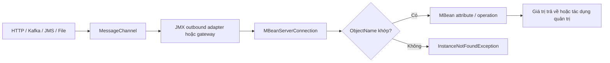

# MBeanServer và ObjectName trong Spring Integration Adapter JMX

## 1. Vì sao cần hiểu MBeanServer và ObjectName?

**Java Management Extensions (JMX)** là cơ chế chuẩn của Java để quan sát và điều khiển các thành phần đang chạy trong JVM. Ứng dụng có thể công bố trạng thái hàng đợi, số lượng kết nối, mức sử dụng bộ nhớ hoặc các thao tác quản trị dưới dạng **MBean** (managed bean). Để gọi đúng một operation hay đọc đúng một attribute, phía client JMX cần trả lời hai câu hỏi:

1. **Gọi qua server nào?** — `MBeanServer` hoặc giao diện chung `MBeanServerConnection`.
2. **Gọi đối tượng nào trên server đó?** — `ObjectName` định danh MBean.

Hai yếu tố này cũng là nền tảng của nhóm **Adapter JMX** trong module `SPRING_INTEGRATION_ADAPTERS`. Các endpoint của Spring Integration như *attribute-polling inbound adapter*, *operation-invoking outbound adapter/gateway* hoặc *notification-listening adapter* đều phải xác định nguồn MBean chính xác. Chúng kết nối giao diện quản trị Java với `MessageChannel`, transformer, router và các luồng bắt đầu từ file, SFTP, HTTP, JMS, AMQP, Kafka hay cơ sở dữ liệu.

Ví dụ: hệ thống nhận sự kiện từ Kafka yêu cầu xóa bộ đệm của một dịch vụ Java. Message đi vào Spring Integration; outbound adapter sử dụng `MBeanServer` để tìm MBean có `ObjectName` đã cấu hình rồi gọi operation `reset()`. Nếu trỏ sai server hoặc tên đối tượng, thao tác sẽ thất bại dù payload và tên operation đều đúng.



## 2. MBeanServer: sổ đăng ký và điểm truy cập MBean

`javax.management.MBeanServer` là giao diện trung tâm của JMX ở phía JVM. Nó quản lý các MBean được đăng ký, hỗ trợ tìm kiếm và gọi thao tác quản trị. Một `MBeanServer` có thể chứa nhiều MBean, nhưng **mỗi `ObjectName` chỉ định danh tối đa một MBean tại một thời điểm trong chính server đó**.

| API JMX | Ý nghĩa | Tình huống sử dụng |
| --- | --- | --- |
| `registerMBean(mbean, objectName)` | Đăng ký MBean với tên cụ thể | Đưa một đối tượng quản trị vào server |
| `unregisterMBean(objectName)` | Hủy đăng ký MBean | Dọn dẹp đối tượng do ứng dụng sở hữu |
| `isRegistered(objectName)` | Kiểm tra tên đã có MBean chưa | Khảo sát trạng thái đăng ký |
| `queryNames(pattern, query)` | Tìm các `ObjectName` phù hợp | Liệt kê MBean theo domain/type/name |
| `getMBeanInfo(objectName)` | Đọc metadata attribute, operation, notification | Xác minh chữ ký operation trước khi gọi |
| `getAttribute(objectName, attribute)` | Đọc một attribute | Lấy giá trị trạng thái/metric |
| `setAttribute(objectName, attribute)` | Ghi attribute có quyền ghi | Điều chỉnh cấu hình quản trị nếu được cho phép |
| `invoke(objectName, operation, args, signature)` | Gọi operation của MBean | Xóa cache, reset metric, yêu cầu refresh |

### 2.1. Phân biệt `MBeanServer` và `MBeanServerConnection`

`MBeanServer` mở rộng `MBeanServerConnection`:

- **`MBeanServer`** có khả năng đăng ký trực tiếp một Java object bằng `registerMBean(...)`, thường được dùng khi ứng dụng **sở hữu và công bố** MBean trong JVM.
- **`MBeanServerConnection`** chứa các thao tác quan sát/điều khiển như `queryNames`, `getAttribute` và `invoke`, dùng được cho cả kết nối cục bộ lẫn kết nối JMX từ xa. Nó không cung cấp phương thức đăng ký một Java object cục bộ bằng `registerMBean`.

Các endpoint Spring Integration tương tác với MBean thông qua server/connection tương ứng. Khi cấu hình một endpoint để đọc attribute hoặc gọi operation, thứ cần bảo đảm là **endpoint đang dùng connection trỏ tới đúng server chứa MBean đó**.

### 2.2. Platform MBeanServer và các server độc lập

Trong JVM Java thông thường, có thể lấy **platform MBeanServer** bằng:

```java
import java.lang.management.ManagementFactory;
import javax.management.MBeanServer;

MBeanServer server = ManagementFactory.getPlatformMBeanServer();
```

Platform server thường chứa các MBean tiêu chuẩn của JVM như memory, thread và garbage collector; ứng dụng có thể đăng ký thêm MBean của mình. Java cũng cho phép tạo các `MBeanServer` độc lập thông qua `MBeanServerFactory`, vì vậy **không phải mọi MBean trong cùng một JVM đều tự động xuất hiện trên cùng một server**.

Spring Framework thường cung cấp bean tên `mbeanServer` để nhiều thành phần cùng sử dụng. `MBeanExporter` chịu trách nhiệm **đăng ký** bean ứng dụng vào server; còn JMX adapter/gateway sử dụng server đó để **truy xuất** MBean. Việc hai thành phần ở trong cùng ứng dụng Spring không bảo đảm chúng đã trỏ đến cùng server nếu người phát triển cấu hình các server khác nhau.

## 3. ObjectName: địa chỉ của một MBean

`javax.management.ObjectName` xác định MBean bằng **domain** và tập **key properties**. Cú pháp điển hình:

```text
<domain>:<key1>=<value1>,<key2>=<value2>,...
```

Ví dụ:

```text
learning.integration:type=QueueMetrics,name=Orders
java.lang:type=Memory
learning.integration:type=Cache,name=Pricing,tenant=internal
```

Với `learning.integration:type=QueueMetrics,name=Orders`:

- `learning.integration` là **domain**, giúp phân nhóm đối tượng quản trị.
- `type=QueueMetrics` và `name=Orders` là **key properties**, giúp phân biệt MBean trong domain.
- `type`, `name` và `tenant` là các tên khóa **theo quy ước của ứng dụng**; JMX không bắt buộc phải có đúng những khóa đó. Các key property là một phần của danh tính MBean.

`ObjectName` là tên quản trị JMX, **không phải** tên class Java, tên Spring bean, URL, tên Kafka topic hay đường dẫn file. Việc class Java tên `QueueMetrics` không tự tạo `ObjectName` tương ứng; cần một thao tác đăng ký/export rõ ràng.

### 3.1. Tạo và kiểm tra ObjectName bằng Java

```java
import javax.management.ObjectName;

ObjectName name = new ObjectName(
    "learning.integration:type=QueueMetrics,name=Orders");

System.out.println(name.getDomain());              // learning.integration
System.out.println(name.getKeyProperty("type"));    // QueueMetrics
System.out.println(name.getKeyProperty("name"));    // Orders
System.out.println(name.getCanonicalName());
System.out.println(name.isPattern());               // false
```

`getCanonicalName()` sắp xếp key properties về dạng chuẩn. Hai chuỗi chứa **cùng domain và cùng tập key/value nhưng khác thứ tự key properties** có thể định danh cùng MBean:

```java
ObjectName a = new ObjectName(
    "learning.integration:type=QueueMetrics,name=Orders");
ObjectName b = new ObjectName(
    "learning.integration:name=Orders,type=QueueMetrics");

System.out.println(a.equals(b)); // true
```

Nên dùng `ObjectName` hoặc `getCanonicalName()` khi so sánh danh tính, thay vì so sánh trực tiếp hai chuỗi tự xây dựng.

### 3.2. Ký tự đặc biệt và `ObjectName.quote(...)`

Tên tenant, cache hoặc queue có thể chứa dấu phẩy, dấu hai chấm, dấu bằng, dấu ngoặc kép hoặc ký tự đại diện. Khi ghép thành key property, cần **quote giá trị** thay vì nối chuỗi thô:

```java
String queueName = "orders,priority=high";

ObjectName safeName = new ObjectName(
    "learning.integration:type=QueueMetrics,name="
        + ObjectName.quote(queueName));

System.out.println(safeName);
// learning.integration:type=QueueMetrics,name="orders,priority=high"
```

`ObjectName.quote(...)` giúp bảo toàn giá trị key property, bao gồm cả ký tự `*`/`?` vốn có ý nghĩa đặc biệt trong mẫu tìm kiếm. Vẫn cần kiểm tra đầu vào theo quy tắc nghiệp vụ: quote đúng cú pháp không có nghĩa là một tên do client cung cấp đã được **ủy quyền** để truy cập.

### 3.3. ObjectName chính xác và ObjectName pattern

JMX hỗ trợ tìm nhiều MBean bằng **mẫu ObjectName**:

| Ví dụ | Ý nghĩa |
| --- | --- |
| `learning.integration:type=QueueMetrics,name=Orders` | Tên chính xác của một MBean |
| `learning.integration:type=QueueMetrics,name=*` | Mẫu tên `name` bất kỳ với đúng tập key properties này |
| `learning.integration:type=QueueMetrics,*` | Mọi MBean có `type=QueueMetrics`, kể cả khi có các key properties bổ sung |
| `learning.integration:*` | Mọi MBean trong domain `learning.integration` |
| `java.lang:type=Memory` | MBean memory tiêu chuẩn của JVM, nếu server đó có đăng ký |

```java
ObjectName pattern = new ObjectName(
    "learning.integration:type=QueueMetrics,*");

System.out.println(pattern.isPattern());  // true

for (ObjectName matched : server.queryNames(pattern, null)) {
    System.out.println(matched.getCanonicalName());
}
```

**Mẫu dùng để truy vấn**, còn `registerMBean`, `getAttribute` và `invoke` cần **tên cụ thể** của MBean. Đừng đưa `name=*` vào cấu hình `object-name` của một outbound adapter muốn gọi operation trên một MBean xác định. Nếu cần điều phối nhiều đích, trước tiên hãy resolve và kiểm tra MBean thực tế rồi chọn tên chính xác cho từng message.

## 4. Ví dụ Java thuần: đăng ký, tìm, đọc và gọi MBean

Ví dụ dưới đây giúp hiểu đúng quan hệ `MBeanServer`–`ObjectName` trước khi đưa vào `MessageChannel`. Nó dùng **Standard MBean** của JDK, không cần Spring; sử dụng Java 17 trở lên cho thống nhất với các ví dụ hiện đại.

### 4.1. Định nghĩa giao diện quản trị

File `src/main/java/demo/jmx/QueueMetricsMBean.java`:

```java
package demo.jmx;

public interface QueueMetricsMBean {
    int getDepth();
    void reset();
}
```

Theo quy ước Standard MBean, class `QueueMetrics` triển khai interface công khai `QueueMetricsMBean`. Getter `getDepth()` sẽ được công bố thành attribute JMX tên **`Depth`**, còn `reset()` trở thành operation.

File `src/main/java/demo/jmx/QueueMetrics.java`:

```java
package demo.jmx;

import java.util.concurrent.atomic.AtomicInteger;

public final class QueueMetrics implements QueueMetricsMBean {
    private final AtomicInteger depth = new AtomicInteger(7);

    @Override
    public int getDepth() {
        return depth.get();
    }

    @Override
    public void reset() {
        depth.set(0);
    }
}
```

### 4.2. Sử dụng MBeanServer

File `src/main/java/demo/jmx/JmxServerDemo.java`:

```java
package demo.jmx;

import java.lang.management.ManagementFactory;
import javax.management.MBeanInfo;
import javax.management.MBeanOperationInfo;
import javax.management.MBeanServer;
import javax.management.ObjectName;

public class JmxServerDemo {
    public static void main(String[] args) throws Exception {
        MBeanServer server = ManagementFactory.getPlatformMBeanServer();
        ObjectName name = new ObjectName(
            "learning.integration:type=QueueMetrics,name=Orders");

        // Mỗi ObjectName chỉ được đăng ký một lần trong server này.
        server.registerMBean(new QueueMetrics(), name);
        try {
            int before = (Integer) server.getAttribute(name, "Depth");
            System.out.println("Depth before = " + before);

            MBeanInfo info = server.getMBeanInfo(name);
            for (MBeanOperationInfo operation : info.getOperations()) {
                System.out.println("Operation: " + operation.getName());
            }

            ObjectName search = new ObjectName(
                "learning.integration:type=QueueMetrics,*");
            System.out.println("Matching MBeans = "
                + server.queryNames(search, null).size());

            server.invoke(name, "reset", new Object[0], new String[0]);

            int after = (Integer) server.getAttribute(name, "Depth");
            System.out.println("Depth after = " + after);
        } finally {
            // Chỉ hủy đăng ký MBean mà chương trình này đã tạo.
            server.unregisterMBean(name);
        }
    }
}
```

Kết quả điển hình:

```text
Depth before = 7
Operation: reset
Matching MBeans = 1
Depth after = 0
```

Đoạn code minh họa ba cơ chế khác nhau: **đăng ký** MBean bằng `registerMBean`, **định danh** bằng `ObjectName`, và **tương tác** bằng `getAttribute`/`invoke`. `new Object[0]` và `new String[0]` thể hiện operation `reset()` không nhận tham số. Nếu operation có tham số, mảng `args` và `signature` phải khớp thứ tự/kiểu tham số JMX công bố.

Nếu chạy lại đoạn đăng ký khi một MBean khác đã dùng tên đó, JMX có thể ném `InstanceAlreadyExistsException`. Không nên gọi `unregisterMBean` một tên đã tồn tại do thành phần khác sở hữu chỉ để tránh trùng tên. Trong ứng dụng Spring thực tế, ưu tiên để `MBeanExporter` quản lý vòng đời đăng ký và hủy đăng ký.

## 5. Đưa MBeanServer và ObjectName vào Spring Integration

Khi Spring Integration gửi một message tới JMX adapter/gateway, bản thân message **không mang một tham chiếu trực tiếp đến Java object**. Endpoint sử dụng `ObjectName` để tìm MBean trong server/connection đã cấu hình.

### 5.1. Cấu hình XML: dùng chung một MBeanServer

Giả sử hai class `QueueMetrics` và `QueueMetricsMBean` của ví dụ trên đã có trong ứng dụng. Có thể để Spring đăng ký MBean thông qua `MBeanExporter`:

```xml
<?xml version="1.0" encoding="UTF-8"?>
<beans xmlns="http://www.springframework.org/schema/beans"
       xmlns:xsi="http://www.w3.org/2001/XMLSchema-instance"
       xmlns:context="http://www.springframework.org/schema/context"
       xmlns:int="http://www.springframework.org/schema/integration"
       xmlns:int-jmx="http://www.springframework.org/schema/integration/jmx"
       xsi:schemaLocation="
           http://www.springframework.org/schema/beans
           https://www.springframework.org/schema/beans/spring-beans.xsd
           http://www.springframework.org/schema/context
           https://www.springframework.org/schema/context/spring-context.xsd
           http://www.springframework.org/schema/integration
           https://www.springframework.org/schema/integration/spring-integration.xsd
           http://www.springframework.org/schema/integration/jmx
           https://www.springframework.org/schema/integration/jmx/spring-integration-jmx.xsd">

    <!-- Khai báo server chung để đăng ký và gọi JMX. -->
    <context:mbean-server/>

    <bean id="queueMetrics" class="demo.jmx.QueueMetrics"/>

    <bean id="mbeanExporter"
          class="org.springframework.jmx.export.MBeanExporter">
        <property name="server" ref="mbeanServer"/>
        <property name="beans">
            <map>
                <entry key="learning.integration:type=QueueMetrics,name=Orders"
                       value-ref="queueMetrics"/>
            </map>
        </property>
    </bean>

    <int:channel id="resetCommands"/>

    <int-jmx:operation-invoking-channel-adapter
        id="resetMetricsAdapter"
        channel="resetCommands"
        mbean-server="mbeanServer"
        object-name="learning.integration:type=QueueMetrics,name=Orders"
        operation-name="reset"/>
</beans>
```

Lúc khởi động, `MBeanExporter` đăng ký `queueMetrics` dưới `ObjectName` đã chọn. Khi message tới `resetCommands`, outbound adapter gọi operation `reset` qua `mbeanServer`. Với operation không tham số, giá trị payload chỉ đóng vai trò kích hoạt; adapter không cần tạo reply.

Gửi message từ Java:

```java
import org.springframework.integration.support.MessageBuilder;
import org.springframework.messaging.MessageChannel;

MessageChannel resetCommands = context.getBean(
    "resetCommands", MessageChannel.class);

resetCommands.send(MessageBuilder.withPayload("reset-request").build());
```

Ở đây `context` là `ApplicationContext` đã nạp cấu hình XML. Đây là **một cách triển khai riêng** của demo JMX thuần; không chạy đồng thời lệnh `registerMBean` của `JmxServerDemo` với `MBeanExporter` cùng tên trên cùng server, vì sẽ gây xung đột đăng ký.

Nếu ứng dụng dùng Spring JMX annotations, có thể thay cấu hình exporter thủ công bằng `@ManagedResource(objectName = "...")`, `@ManagedAttribute`, `@ManagedOperation` kết hợp `<context:mbean-export server="mbeanServer"/>`. Vẫn cần giữ nhất quán `ObjectName` và server được sử dụng.

### 5.2. ObjectName lấy từ header của message

Với một số JMX operation-invoking endpoint, `object-name` và `operation-name` có thể đặt mặc định trong cấu hình hoặc được chọn động bằng header Spring Integration:

```java
import org.springframework.integration.jmx.JmxHeaders;
import org.springframework.integration.support.MessageBuilder;

var command = MessageBuilder.withPayload("reset-request")
    .setHeader(JmxHeaders.OBJECT_NAME,
        "learning.integration:type=QueueMetrics,name=Orders")
    .setHeader(JmxHeaders.OPERATION_NAME, "reset")
    .build();

resetCommands.send(command);
```

**Header được ưu tiên hơn giá trị mặc định** với các endpoint hỗ trợ chọn MBean/operation bằng header. Điều này cho phép một luồng chọn đích theo nghiệp vụ, nhưng cũng có thể dẫn tới việc gọi **MBean khác ngoài dự kiến** nếu header được sao chép từ nguồn không tin cậy. Cần ánh xạ request bên ngoài thành tên đích từ danh sách cho phép rồi mới gửi vào adapter.

### 5.3. MBeanServer dùng cho nhiều loại JMX endpoint

| Endpoint | Tác động của `ObjectName` và server | Luồng message |
| --- | --- | --- |
| Attribute-polling inbound adapter | Chọn MBean và attribute được đọc theo poller | JMX → `MessageChannel` |
| Notification-listening inbound adapter | Chọn MBean phát notification để lắng nghe | JMX → `MessageChannel` |
| Operation-invoking outbound adapter | Chọn MBean/operation và gọi khi có message | `MessageChannel` → JMX |
| Operation-invoking outbound gateway | Chọn MBean/operation, gọi và chuyển kết quả thành reply | Request `MessageChannel` → JMX → Reply |

Tên gọi *outbound* mô tả hướng chủ động truy cập JMX từ luồng Spring Integration; *inbound* mô tả dữ liệu/notification đi từ JMX vào luồng. Bất kể chiều nào, sai `ObjectName` hoặc sai server đều có thể khiến endpoint không tìm thấy nguồn đích.

## 6. MBeanServer cục bộ và kết nối JMX từ xa

Nếu MBean nằm trong **cùng JVM**, thường có thể dùng `ManagementFactory.getPlatformMBeanServer()` hoặc bean `mbeanServer` do Spring quản lý. Nếu MBean nằm ở **JVM khác**, chỉ có `ObjectName` thôi là chưa đủ: cần một `MBeanServerConnection` truy cập được JMX connector ở máy đích.

Ví dụ JMX client kết nối từ xa (cấu hình URL, chứng thực và TLS lấy từ môi trường triển khai):

```java
import javax.management.MBeanServerConnection;
import javax.management.ObjectName;
import javax.management.remote.JMXConnector;
import javax.management.remote.JMXConnectorFactory;
import javax.management.remote.JMXServiceURL;
import java.util.Map;

// url và environment được cấu hình bởi môi trường triển khai.
JMXServiceURL url = new JMXServiceURL(jmxServiceUrl);
Map<String, ?> environment = jmxConnectionEnvironment;

try (JMXConnector connector = JMXConnectorFactory.connect(url, environment)) {
    MBeanServerConnection remote = connector.getMBeanServerConnection();
    ObjectName name = new ObjectName(
        "learning.integration:type=QueueMetrics,name=Orders");

    Integer depth = (Integer) remote.getAttribute(name, "Depth");
    System.out.println("Remote depth = " + depth);
}
```

`jmxServiceUrl` và `jmxConnectionEnvironment` là hai biến cấu hình được cung cấp sẵn trong ngữ cảnh gọi, không phải chuỗi mẫu có thể dùng nguyên xi. Khi tích hợp với Spring, có thể khai báo connection dưới dạng bean do container quản lý rồi tham chiếu bằng `mbean-server` trên JMX adapter/gateway; ứng dụng phải quản lý vòng đời/đóng kết nối đúng cách.

**Các giới hạn cần phân biệt:**

- `ObjectName` chỉ là **định danh bên trong server**. Cùng chuỗi `ObjectName` trên hai JVM/server có thể chỉ đến hai MBean hoàn toàn khác nhau.
- `MBeanServerConnection` là **kênh truy cập** tới server; nó không tự bảo đảm mạng, TLS, quyền thực thi operation hay timeout phù hợp.
- Không truyền giá trị JMX endpoint, thông tin xác thực hoặc tên operation nhận trực tiếp từ client không tin cậy mà thiếu chính sách kiểm tra/cho phép.
- Kết nối từ xa có thể đứt hoặc hết hạn; khi retry, cần xét tác dụng phụ của operation vì lần gọi trước có thể đã thực thi dù client không nhận được kết quả.

## 7. Lỗi thường gặp: tìm đúng server và đúng ObjectName

| Triệu chứng | Nguyên nhân điển hình | Cách kiểm tra |
| --- | --- | --- |
| `MalformedObjectNameException` | Chuỗi tên sai cú pháp, key/value chưa quote | Tạo `new ObjectName(...)` trong thử nghiệm, dùng `ObjectName.quote(...)` cho giá trị động |
| `InstanceNotFoundException` | Chưa đăng ký MBean; sai domain/key properties; kết nối nhầm server/JVM | Gọi `queryNames(...)`, so `getCanonicalName()`, kiểm tra server/connection đang dùng |
| `InstanceAlreadyExistsException` | Hai exporter hoặc thành phần cùng đăng ký một tên trên cùng server | Gán chủ sở hữu đăng ký rõ ràng; rà các cấu hình `MBeanExporter` |
| `AttributeNotFoundException` | Nhầm tên attribute hoặc không công bố attribute đó | Gọi `getMBeanInfo()` và kiểm tra `getAttributes()`; lưu ý `getDepth()` là `Depth` |
| `ReflectionException` | Sai tên/chữ ký operation hoặc method chưa được công bố qua JMX | Kiểm tra `MBeanOperationInfo` và mảng `signature` |
| `MBeanException` | Operation của MBean ném ngoại lệ trong khi chạy | Phân tích nguyên nhân gốc và trạng thái operation trước khi retry |
| `IOException` khi gọi từ xa | Lỗi mạng hoặc JMX connector không còn khả dụng | Kiểm tra địa chỉ, kết nối, quyền, TLS và chính sách timeout/reconnect |
| Có MBean trong JConsole nhưng adapter không đọc được | JConsole và adapter đang truy cập **hai server hoặc JVM khác nhau**, hoặc thiếu quyền | So sánh JVM đích, URL kết nối, `ObjectName` chuẩn và quyền JMX |

### 7.1. Quy trình chẩn đoán theo từng lớp

1. **Xác minh đăng ký:** trong JVM/server đích, chạy `queryNames(...)` hoặc mở JConsole/VisualVM để xem tên MBean đã tồn tại chưa.
2. **Xác minh tên:** so sánh domain, key properties và dạng canonical. Không suy tên từ Java class hoặc Spring bean ID.
3. **Xác minh giao diện:** dùng `getMBeanInfo()` để xem attributes, operations và chữ ký tham số mà JMX thực sự công bố.
4. **Xác minh kết nối:** xác định adapter dùng bean `mbeanServer` nào; nếu từ xa, kiểm tra connector, credentials, TLS, đường mạng và JVM đích.
5. **Xác minh message:** kiểm tra `JmxHeaders.OBJECT_NAME`, `JmxHeaders.OPERATION_NAME`, payload và quy tắc mapping; lọc header ngoài danh sách cho phép.
6. **Xác minh vòng đời:** kiểm tra MBean còn đăng ký trong lúc luồng chạy, không bị hủy sớm hoặc đăng ký trùng khi restart; xử lý lỗi kết nối/retry theo bản chất operation.

### 7.2. Một số quy ước vận hành

- Thiết kế tên có cấu trúc ổn định như `<domain>:type=<component>,name=<instance>`, bổ sung `tenant` hoặc `node` khi cần phân biệt. Không đưa dữ liệu nhạy cảm vào `ObjectName` vì tên này có thể hiện trong các công cụ quản trị.
- Chỉ cho phép adapter gọi các MBean/operation cần thiết. Lệnh JMX có thể có tác dụng phụ mạnh như reset, reload hoặc thay đổi cấu hình.
- MBean chịu trách nhiệm an toàn luồng khi nhiều request đồng thời đến từ các channel/connector. `MBeanServer` không biến mọi phương thức quản trị thành thao tác thread-safe.
- Ghi log tên MBean ở dạng canonical, operation, correlation ID, thời gian thực thi và lỗi để dễ truy dấu; không log credentials hay tham số bí mật.
- Coi việc đăng ký/hủy đăng ký là trách nhiệm của một thành phần rõ ràng (`MBeanExporter` hoặc code quản lý thủ công); tránh tranh chấp tên khi nhiều instance khởi động.

## 8. Bài thực hành và câu hỏi tự kiểm tra

**Bài thực hành:** sử dụng `QueueMetrics` ở mục 4 và cấu hình Spring Integration ở mục 5.

1. Gọi `getAttribute(..., "Depth")` và xác nhận giá trị ban đầu bằng `7`.
2. Gửi message tới `resetCommands`; gọi lại `getAttribute(..., "Depth")` và xác nhận bằng `0`.
3. Truy vấn bằng pattern `learning.integration:type=QueueMetrics,*`, kiểm tra tên cụ thể xuất hiện.
4. Thử `ObjectName` sai `name=Other`; quan sát `InstanceNotFoundException` và xác minh tên trong server.
5. Thử tạo hai `ObjectName` có key properties đảo thứ tự và kiểm tra `equals` trả `true`.
6. Thử tên queue chứa dấu phẩy; tạo tên bằng `ObjectName.quote(...)` và so với tên ghép thủ công.

**Câu hỏi ôn tập:**

1. `MBeanServer` khác `MBeanServerConnection` ở khả năng nào và tại sao nó quan trọng khi quản lý MBean trong/ngoài JVM?
2. Tại sao `ObjectName` chính xác lại quan trọng hơn tên Java class khi Spring Integration gọi operation?
3. Hai `ObjectName` có thứ tự key properties khác nhau có thể bằng nhau không?
4. Vì sao không dùng wildcard `ObjectName` trực tiếp khi muốn gọi operation của một MBean cụ thể?
5. Điều gì xảy ra khi hai `MBeanExporter` đăng ký cùng `ObjectName` lên cùng server?
6. Vì sao một MBean nhìn thấy trên JConsole vẫn có thể không được JMX adapter tìm thấy?

## Tài liệu tham khảo

- [Java SE API — `MBeanServer`](https://docs.oracle.com/en/java/javase/21/docs/api/java.management/javax/management/MBeanServer.html): đăng ký MBean và các phương thức quản trị.
- [Java SE API — `ObjectName`](https://docs.oracle.com/en/java/javase/21/docs/api/java.management/javax/management/ObjectName.html): cú pháp tên, pattern, key properties, quote và canonical name.
- [Java SE API — `MBeanServerConnection`](https://docs.oracle.com/en/java/javase/21/docs/api/java.management/javax/management/MBeanServerConnection.html): các thao tác dùng chung cho server cục bộ và kết nối từ xa.
- [Spring Framework Reference — JMX Exporting](https://docs.spring.io/spring-framework/reference/integration/jmx/exporting.html): `MBeanExporter`, tên MBean và tích hợp Spring.
- [Spring Integration Reference — JMX Support](https://docs.spring.io/spring-integration/reference/jmx.html): cách các adapter/gateway JMX kết hợp `MBeanServer`, `ObjectName` và `MessageChannel`.
