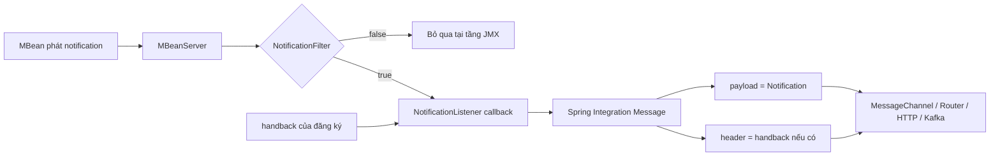

# Notification filter và handback trong JMX Adapter của Spring Integration

## 1. Bài toán: chỉ nhận sự kiện JMX cần thiết và biết nó thuộc đăng ký nào

Một ứng dụng Java có thể phát **JMX notification** khi hàng đợi vượt ngưỡng, kết nối bị đứt, bộ đệm được làm mới hoặc một thành phần chuyển trạng thái. Spring Integration cung cấp **notification-listening inbound channel adapter** để nhận các notification đó rồi đẩy vào `MessageChannel` cho các bước xử lý tiếp theo.

Trong module **`SPRING_INTEGRATION_ADAPTERS`**, luồng này có thể kết hợp với transformer, filter, router, gateway hoặc các adapter HTTP, JMS, AMQP, Kafka, file, SFTP và cơ sở dữ liệu. Chẳng hạn, một MBean báo số message chờ tăng cao, Spring Integration nhận cảnh báo rồi gửi sang HTTP webhook hoặc một topic Kafka.

Tuy nhiên, một MBean có thể phát nhiều loại notification, trong khi hệ thống chỉ cần xử lý một tập con. Hơn nữa, nếu một listener được đăng ký ở nhiều nguồn, ta có thể muốn biết sự kiện đến từ **ngữ cảnh đăng ký** nào. JMX giải quyết hai nhu cầu này bằng:

- **`NotificationFilter`**: quyết định một notification có được chuyển đến listener hay không.
- **`handback`**: một đối tượng ngữ cảnh được cung cấp **khi đăng ký listener** và được chuyển lại cho chính listener khi có notification.



Adapter nhận notification theo sự kiện khi listener được gọi; nó **không cần poller**. Đây là khác biệt quan trọng với JMX attribute-polling inbound adapter vốn định kỳ gọi `getAttribute()`.

## 2. Hợp đồng JMX: Notification, filter và handback

JMX dùng giao diện `javax.management.NotificationListener` với callback:

```java
void handleNotification(Notification notification, Object handback);
```

Một listener được đăng ký qua `MBeanServerConnection` theo dạng:

```java
server.addNotificationListener(
    objectName,
    listener,
    filter,
    handback
);
```

Trong đó, `filter` và `handback` đều có thể là `null`. Đừng nhầm chúng với các phần nằm sẵn trong `Notification`:

| Khái niệm | Ai cung cấp? | Phạm vi | Dùng làm gì? |
| --- | --- | --- | --- |
| `Notification` | MBean phát sự kiện | **Từng sự kiện** | Mang `type`, `source`, `sequenceNumber`, `timeStamp`, `message`, `userData` |
| `NotificationFilter` | Bên đăng ký listener | **Từng đăng ký listener** | Quyết định có chuyển notification tới listener hay không |
| `handback` | Bên đăng ký listener | **Từng đăng ký listener** | Đính kèm ngữ cảnh để nhận diện hoặc xử lý sự kiện trong callback |
| `Notification.userData` | MBean phát sự kiện | **Từng sự kiện** | Mang dữ liệu sự kiện, chẳng hạn `{queue: orders, pending: 120}` |

**Thứ tự xử lý:** MBean phát notification → JMX áp dụng `NotificationFilter` → nếu được chấp nhận, listener nhận `Notification` **và chính `handback` đã được cấu hình khi đăng ký**. Filter không thay đổi nội dung notification; handback cũng không phải kết quả được MBean tính cho mỗi sự kiện.

Hai listener khác nhau có thể cùng đăng ký vào một MBean với hai filter hoặc hai handback khác nhau. Vì vậy, handback thích hợp để gắn nhãn tuyến nhận như `orders-monitor`, `billing-monitor`, hoặc một ID đăng ký ổn định; nó không nên chứa mật khẩu hay token.

### 2.1. `NotificationFilter` là một interface Java

```java
package javax.management;

public interface NotificationFilter extends java.io.Serializable {
    boolean isNotificationEnabled(Notification notification);
}
```

Hàm phải trả `true` nếu muốn nhận notification và `false` nếu muốn bỏ qua. Một filter có thể kiểm tra `notification.getType()`, `getSource()`, `getUserData()` hoặc các đặc tính được contract cho phép. Nên giữ filter đơn giản, nhanh, không có tác dụng phụ và thread-safe.

JDK có `NotificationFilterSupport` hỗ trợ lọc theo loại notification, nhưng nếu cần kiểm tra **chính xác type và giá trị trong `userData`**, một implementation riêng thường dễ hiểu và dễ kiểm thử hơn.

### 2.2. `handback` không phải thuộc tính của sự kiện

Ví dụ đăng ký ở mức JMX thuần:

```java
NotificationListener listener = (notification, handback) -> {
    System.out.println("type=" + notification.getType());
    System.out.println("subscription=" + handback);
};

NotificationFilter onlyBacklog = notification ->
    "demo.orders.queue.backlog".equals(notification.getType());

server.addNotificationListener(
    new ObjectName("demo.integration:type=Alerts,name=Orders"),
    listener,
    onlyBacklog,
    "orders-monitor"
);
```

Với đăng ký này, callback nhận chuỗi `"orders-monitor"` cho **mọi** notification đi qua filter. Nếu MBean phát notification chứa `userData` khác nhau, handback vẫn là nhãn đăng ký cũ. Cần hủy đúng đăng ký listener theo vòng đời; mẫu code trên minh họa cơ chế callback, chưa bao gồm phần cleanup.

## 3. Hợp đồng message của Spring Integration

Spring Integration chuyển từng notification được nhận thành một `Message<?>`:

- **Payload**: chính đối tượng `javax.management.Notification` (có thể là subclass như `AttributeChangeNotification`).
- **Header `JmxHeaders.NOTIFICATION_HANDBACK`**: chứa handback nếu cấu hình handback khác `null`.
- **Output channel**: kênh trong thuộc tính `channel` của `notification-listening-channel-adapter`.

Ví dụ cách đọc một message trong Java:

```java
import javax.management.Notification;
import org.springframework.integration.jmx.JmxHeaders;
import org.springframework.messaging.Message;

public void handle(Message<?> message) {
    Notification notification = (Notification) message.getPayload();
    Object handback = message.getHeaders().get(JmxHeaders.NOTIFICATION_HANDBACK);

    System.out.printf("type=%s, handback=%s, userData=%s%n",
        notification.getType(), handback, notification.getUserData());
}
```

**Không giả định** `JmxHeaders.NOTIFICATION_TYPE` luôn xuất hiện ở message từ *notification-listening* adapter: cách chắc chắn để lấy type là `((Notification) message.getPayload()).getType()`. Header `JmxHeaders.NOTIFICATION_TYPE` thường được dùng khi **publishing adapter** tạo JMX notification từ một message, đây là chiều tích hợp khác.

## 4. Ví dụ đầy đủ: chỉ nhận cảnh báo hàng đợi từ 100 message trở lên

Ta sẽ dựng một **Standard MBean** có thể phát hai loại notification:

| Notification type | `userData` | Filter chấp nhận? |
| --- | --- | --- |
| `demo.orders.queue.backlog` | `queue=orders, pending=120` | Có, vì backlog ≥ 100 |
| `demo.orders.queue.backlog` | `queue=orders, pending=45` | Không, vì dưới ngưỡng |
| `demo.orders.queue.recovered` | `queue=orders, pending=0` | Không, vì type khác |

Handback của đăng ký là nhãn `ordersAlertSubscription`. Khi notification được chấp nhận, endpoint tạo message với `payload=Notification` và header handback; một service activator sẽ log thông tin này.

### 4.1. Dependency

Với Maven đang dùng Spring Boot/BOM để quản lý phiên bản:

```xml
<dependency>
    <groupId>org.springframework.integration</groupId>
    <artifactId>spring-integration-jmx</artifactId>
</dependency>
```

Nếu dự án không có dependency management thì khai báo phiên bản phù hợp với toàn bộ Spring Integration stack. Các ví dụ dùng Java 17 trở lên và Spring Integration XML namespace.

### 4.2. Định nghĩa MBean phát notification

File `src/main/java/demo/jmx/OrdersAlertsMBean.java`:

```java
package demo.jmx;

public interface OrdersAlertsMBean {
    void publishBacklog(String queueName, int pending);
    void publishRecovered(String queueName, int pending);
}
```

File `src/main/java/demo/jmx/OrdersAlerts.java`:

```java
package demo.jmx;

import java.util.Map;
import java.util.concurrent.atomic.AtomicLong;
import javax.management.MBeanNotificationInfo;
import javax.management.Notification;
import javax.management.NotificationBroadcasterSupport;

public class OrdersAlerts extends NotificationBroadcasterSupport
        implements OrdersAlertsMBean {

    public static final String TYPE_BACKLOG = "demo.orders.queue.backlog";
    public static final String TYPE_RECOVERED = "demo.orders.queue.recovered";

    private final AtomicLong sequence = new AtomicLong();

    @Override
    public void publishBacklog(String queueName, int pending) {
        publish(TYPE_BACKLOG, queueName, pending);
    }

    @Override
    public void publishRecovered(String queueName, int pending) {
        publish(TYPE_RECOVERED, queueName, pending);
    }

    private void publish(String type, String queueName, int pending) {
        Notification notification = new Notification(
            type,
            this,
            sequence.incrementAndGet(),
            System.currentTimeMillis(),
            "Queue " + queueName + ": pending=" + pending
        );
        notification.setUserData(Map.of(
            "queue", queueName,
            "pending", pending
        ));
        sendNotification(notification);
    }

    @Override
    public MBeanNotificationInfo[] getNotificationInfo() {
        return new MBeanNotificationInfo[] {
            new MBeanNotificationInfo(
                new String[] { TYPE_BACKLOG, TYPE_RECOVERED },
                Notification.class.getName(),
                "Thông báo về trạng thái hàng đợi Orders"
            )
        };
    }
}
```

`OrdersAlerts` là Standard MBean vì implements `OrdersAlertsMBean`, đồng thời phát notification nhờ kế thừa `NotificationBroadcasterSupport`. `getNotificationInfo()` công bố metadata loại sự kiện. `AtomicLong` cung cấp sequence number tăng dần trong tiến trình; sequence number hữu ích để quan sát nhưng **không tự tạo cơ chế giao nhận bền vững hoặc chống trùng giữa các lần restart**.

### 4.3. Tạo NotificationFilter dựa trên type và userData

File `src/main/java/demo/jmx/OrdersBacklogFilter.java`:

```java
package demo.jmx;

import java.util.Map;
import javax.management.Notification;
import javax.management.NotificationFilter;

public final class OrdersBacklogFilter implements NotificationFilter {
    private static final long serialVersionUID = 1L;

    @Override
    public boolean isNotificationEnabled(Notification notification) {
        if (!OrdersAlerts.TYPE_BACKLOG.equals(notification.getType())) {
            return false;
        }

        if (!(notification.getUserData() instanceof Map<?, ?> data)) {
            return false;
        }

        Object queue = data.get("queue");
        Object pending = data.get("pending");
        return "orders".equals(queue)
            && pending instanceof Number count
            && count.longValue() >= 100L;
    }
}
```

Filter bỏ qua loại `recovered` và mọi backlog dưới 100. Nó cũng bỏ qua notification thiếu dữ liệu hoặc có kiểu `pending` không phải `Number`, giúp tránh `ClassCastException` khi MBean thay đổi contract. Trong hệ thống thực, cần giám sát cả tỷ lệ event bị bỏ qua và trường hợp sai schema nếu đây là tín hiệu lỗi nguồn.

### 4.4. Tạo consumer đọc notification và handback

File `src/main/java/demo/jmx/OrdersNotificationConsumer.java`:

```java
package demo.jmx;

import javax.management.Notification;
import org.springframework.integration.jmx.JmxHeaders;
import org.springframework.messaging.Message;

public final class OrdersNotificationConsumer {

    public void handle(Message<?> message) {
        if (!(message.getPayload() instanceof Notification notification)) {
            throw new IllegalArgumentException("Payload không phải JMX Notification");
        }

        Object handback = message.getHeaders()
            .get(JmxHeaders.NOTIFICATION_HANDBACK);

        System.out.printf(
            "ACCEPT type=%s, handback=%s, sequence=%d, data=%s%n",
            notification.getType(),
            handback,
            notification.getSequenceNumber(),
            notification.getUserData()
        );
    }
}
```

Consumer không cố ép handback thành dữ liệu sự kiện: thông tin `pending` nằm trong `notification.getUserData()`, còn handback chỉ là ngữ cảnh của subscription. Với nhiều tuyến downstream, có thể biến notification thành một DTO ổn định trước khi serialize sang JSON hoặc gửi Kafka/HTTP.

### 4.5. Cấu hình Spring Integration XML

File `src/main/resources/jmx-notification-filter.xml`:

```xml
<?xml version="1.0" encoding="UTF-8"?>
<beans xmlns="http://www.springframework.org/schema/beans"
       xmlns:xsi="http://www.w3.org/2001/XMLSchema-instance"
       xmlns:context="http://www.springframework.org/schema/context"
       xmlns:int="http://www.springframework.org/schema/integration"
       xmlns:int-jmx="http://www.springframework.org/schema/integration/jmx"
       xsi:schemaLocation="
           http://www.springframework.org/schema/beans
           https://www.springframework.org/schema/beans/spring-beans.xsd
           http://www.springframework.org/schema/context
           https://www.springframework.org/schema/context/spring-context.xsd
           http://www.springframework.org/schema/integration
           https://www.springframework.org/schema/integration/spring-integration.xsd
           http://www.springframework.org/schema/integration/jmx
           https://www.springframework.org/schema/integration/jmx/spring-integration-jmx.xsd">

    <context:mbean-server/>

    <bean id="ordersAlerts" class="demo.jmx.OrdersAlerts"/>

    <!-- Export một Standard MBean đến đúng server mà listener sử dụng. -->
    <bean id="mbeanExporter"
          class="org.springframework.jmx.export.MBeanExporter">
        <property name="server" ref="mbeanServer"/>
        <property name="beans">
            <map>
                <entry key="demo.integration:type=Alerts,name=Orders"
                       value-ref="ordersAlerts"/>
            </map>
        </property>
    </bean>

    <bean id="ordersBacklogFilter" class="demo.jmx.OrdersBacklogFilter"/>

    <!-- Một nhãn đăng ký; cùng giá trị nếu XML xử lý như chuỗi hoặc bean ref. -->
    <bean id="ordersAlertSubscription" class="java.lang.String">
        <constructor-arg value="ordersAlertSubscription"/>
    </bean>

    <int:channel id="receivedOrdersNotifications"/>

    <int-jmx:notification-listening-channel-adapter
        id="ordersNotificationListener"
        channel="receivedOrdersNotifications"
        mbean-server="mbeanServer"
        object-name="demo.integration:type=Alerts,name=Orders"
        notification-filter="ordersBacklogFilter"
        handback="ordersAlertSubscription"/>

    <bean id="ordersNotificationConsumer"
          class="demo.jmx.OrdersNotificationConsumer"/>

    <int:service-activator
        input-channel="receivedOrdersNotifications"
        ref="ordersNotificationConsumer"
        method="handle"/>
</beans>
```

Các thuộc tính cần chú ý:

| Thuộc tính | Ý nghĩa | Khi không khai báo |
| --- | --- | --- |
| `channel` | Tên `MessageChannel` nhận notification đã đi qua filter | Endpoint cần một kênh output hợp lệ |
| `mbean-server` | Tham chiếu tới `MBeanServer`/connection chứa MBean phát sự kiện | Spring Integration tìm bean tên `mbeanServer` theo quy ước |
| `object-name` | MBean phát notification mà listener đăng ký | Bắt buộc xác định nguồn |
| `notification-filter` | Tham chiếu tới bean triển khai `javax.management.NotificationFilter` | Listener không áp dụng filter tùy chỉnh này |
| `handback` | Giá trị/ngữ cảnh gắn với đăng ký listener | Không có header handback nếu giá trị thực là `null` |

`notification-filter` và `handback` là hai cơ chế **của JMX listener registration**. Chúng không phải tên của một Spring Integration filter hoặc một `reply-channel`.

`<int:channel/>` tạo `DirectChannel` mặc định. Vì vậy, consumer sẽ được gọi trong luồng phát/nhận notification tương ứng. Nếu handler có công việc lâu hoặc dễ lỗi, nên tách bằng queue/executor phù hợp và có cơ chế quản lý lỗi; không để một thao tác HTTP chậm chạy trực tiếp trong callback của MBean.

### 4.6. Kích hoạt notification để kiểm tra

File `src/main/java/demo/jmx/RunNotificationDemo.java`:

```java
package demo.jmx;

import org.springframework.context.support.ClassPathXmlApplicationContext;

public final class RunNotificationDemo {
    public static void main(String[] args) {
        try (var context = new ClassPathXmlApplicationContext(
                "jmx-notification-filter.xml")) {

            OrdersAlerts publisher = context.getBean(
                "ordersAlerts", OrdersAlerts.class);

            publisher.publishBacklog("orders", 120); // được nhận
            publisher.publishBacklog("orders", 45);  // bị filter loại
            publisher.publishRecovered("orders", 0); // bị filter loại
        }
    }
}
```

Kết quả mong đợi là **một dòng** bắt đầu bằng `ACCEPT`, chứa type `demo.orders.queue.backlog`, handback `ordersAlertSubscription` và `pending=120` trong userData. Thứ tự hiển thị của các phần tử `Map` không nên được dùng làm điều kiện kiểm tra vì không được bảo đảm bởi hợp đồng ở đây.

Khi `ClassPathXmlApplicationContext` khởi tạo hoàn tất, adapter phải được đăng ký với MBeanServer. Spring Integration cũng có xử lý liên quan tới `ContextRefreshedEvent` vì `MBeanExporter` có thể chưa hoàn tất đăng ký khi endpoint bắt đầu lifecycle. Dù vậy, trong ứng dụng thực vẫn cần kiểm tra tình huống MBean xuất hiện sau khi adapter khởi động hoặc bị đăng ký lại khi restart.

## 5. Phân biệt JMX NotificationFilter với Spring Integration filter

Hai cơ chế có thể cùng xuất hiện trong một flow, nhưng hoạt động ở vị trí khác nhau:

| Điểm so sánh | JMX `NotificationFilter` | Spring Integration `<int:filter>` |
| --- | --- | --- |
| Thời điểm | **Trước callback** tới JMX listener | **Sau khi message đã vào** Spring Integration |
| Đầu vào | `javax.management.Notification` | `Message<?>` với payload/header |
| API | `isNotificationEnabled(Notification)` | SpEL hoặc method/selector của Spring Integration |
| Truy cập handback? | Không có tham số handback trong interface filter | Có thể đọc header `JmxHeaders.NOTIFICATION_HANDBACK` |
| Mục đích | Giảm notification không liên quan được giao cho listener | Định tuyến và kiểm soát rule nghiệp vụ trên message |

Ví dụ: nếu chỉ lọc theo type ở JMX, bước downstream còn có thể kiểm tra tenant từ handback hoặc nội dung `userData`:

```xml
<!-- Đặt giữa adapter và handler trong một biến thể cấu hình riêng. -->
<int:filter
    input-channel="receivedOrdersNotifications"
    output-channel="validatedOrdersNotifications"
    expression="headers['jmx_notificationHandback'] == 'ordersAlertSubscription'"/>

<int:channel id="validatedOrdersNotifications"/>
```

Khi áp dụng đoạn cấu hình thay thế này, thay `input-channel` của service activator thành `validatedOrdersNotifications` để tránh hai handler cùng tranh message trên một `DirectChannel`. Dùng hằng `JmxHeaders.NOTIFICATION_HANDBACK` trong code Java giúp tránh phải hard-code key header; chuỗi `jmx_notificationHandback` ở SpEL là giá trị tương ứng được định nghĩa bởi Spring Integration.

**Vì sao vẫn dùng cả hai?** Lọc type ở tầng JMX giúp giảm message không cần thiết; lọc sau khi nhận cho phép dùng ngữ cảnh Spring Integration như header, correlation ID hoặc DTO đã chuyển đổi. Những notification bị loại ở tầng JMX **không tạo message**, nên không thể lấy lại từ router hay retry endpoint nếu nguồn không tự phát lại.

## 6. Handback hữu ích khi nhiều nguồn hoặc nhiều subscription

Giả sử dịch vụ có các nhóm cảnh báo `orders` và `payments`. Ta có thể tạo hai inbound adapter đăng ký vào các MBean khác nhau, mỗi adapter có một handback riêng:

```xml
<int-jmx:notification-listening-channel-adapter
    id="ordersListener"
    channel="businessEvents"
    object-name="demo.integration:type=Alerts,name=Orders"
    handback="orders-stream"/>

<int-jmx:notification-listening-channel-adapter
    id="paymentsListener"
    channel="businessEvents"
    object-name="demo.integration:type=Alerts,name=Payments"
    handback="payments-stream"/>
```

Đây là **một biến thể kiến trúc minh họa**, giả sử cả hai MBean đều tồn tại trên server và `businessEvents` đã được khai báo. Header handback giúp router hoặc service activator biết subscription nào đưa notification vào flow, ngay cả khi hai MBean cùng phát một `type`. Khi sử dụng tên này để phân quyền, phải có chính sách tin cậy đối với nguồn đăng ký; handback là **metadata**, không phải bằng chứng xác thực mạnh.

Nếu muốn lắng nghe nhiều MBean có tên tương tự, **notification-listening adapter hỗ trợ `ObjectName` pattern** như:

```xml
<int-jmx:notification-listening-channel-adapter
    id="allQueueAlerts"
    channel="businessEvents"
    object-name="demo.integration:type=Alerts,name=*"/>
```

Cần hiểu rõ phạm vi: một pattern có thể khớp nhiều MBean trong server. Handback cấu hình cho một adapter phản ánh **đăng ký của adapter**, không tự động trở thành tên `ObjectName` cụ thể cho từng nguồn khớp pattern. Khi cần xác định nguồn thật, kiểm tra thông tin notification và metadata JMX từ MBean, đồng thời đánh giá khả năng các MBean được đăng ký/hủy động trong lúc adapter đang chạy. Không dựa vào giả định adapter sẽ theo dõi mọi MBean mới xuất hiện trong tương lai mà chưa thử nghiệm vòng đời của phiên bản đang dùng.

## 7. Lỗi thường gặp, vòng đời và tính tin cậy

| Triệu chứng | Nguyên nhân có thể | Cách chẩn đoán |
| --- | --- | --- |
| Không có notification nào tới channel | Sai `ObjectName`, MBean chưa đăng ký, MBean không phát sự kiện, adapter chưa start | Kiểm tra `MBeanServer`, trạng thái listener và thời điểm đăng ký |
| Chỉ một số notification tới | Filter trả `false`, type không khớp, ngưỡng khác mong đợi | Log/counter trong filter thử nghiệm; kiểm tra `getType()`, `getUserData()` |
| Không có header handback | `handback` không cấu hình hoặc giá trị là `null` | Đọc `JmxHeaders.NOTIFICATION_HANDBACK` và cấu hình listener |
| Cần phân biệt các notification nhưng handback giống nhau | Đang dùng chung một handback cho nhiều MBean/subscription | Gán nhãn đăng ký phù hợp hoặc chuẩn hóa thông tin nguồn |
| `ClassCastException` trong filter | `userData` có kiểu khác giả định hoặc bị thiếu | Kiểm tra `instanceof`, contract schema và phiên bản MBean |
| Listener không còn nhận sau khi MBean restart | MBean bị unregister/re-register hoặc kết nối thay đổi | Xác minh lifecycle đăng ký lại và thử tình huống tái tạo MBean |
| Một notification gây chậm luồng phát | Handler sau `DirectChannel` chạy I/O hoặc tính toán lâu | Tách xử lý bằng channel bất đồng bộ và quản lý lỗi/độ trễ |
| Tưởng có retry dù notification đã lọc | JMX notification không phải hàng đợi durable | Nếu cần giao nhận chắc chắn, ghi sự kiện sang message broker/persistence |
| Lỗi kết nối JMX từ xa | Credential, TLS, timeout hoặc connector không ổn định | Kiểm tra connection, quyền và chiến lược reconnect/subscription |

### 7.1. Những lưu ý về lifecycle

**Đăng ký trước khi phát:** notification phát ra **trước** khi listener đăng ký có thể bị mất vĩnh viễn vì JMX notification thông thường không lưu lại thành lịch sử. Dùng MBeanExporter và adapter cùng server, xác minh thứ tự start và thử các kịch bản restart.

**Hủy đăng ký:** khi adapter dừng, Spring Integration có xử lý unregister listener khỏi MBeanServer. Với listener JMX thuần, cần gọi `removeNotificationListener(...)` theo đăng ký phù hợp để tránh giữ tài nguyên hoặc nhận lặp khi khởi động lại.

**Nhiều subscriber:** một notification có thể tới nhiều listener đã đăng ký, mỗi listener dùng filter/handback riêng; đừng xem sequence number là ID toàn cục duy nhất qua mọi JVM hoặc mọi lần restart.

**Kết nối từ xa:** `MBeanServerConnection` có thể đại diện cho JMX remote connector, nhưng cần cấu hình xác thực, TLS và vận hành theo vòng đời của connection. Filter/handback là một phần của quá trình đăng ký listener; chú ý khả năng serialization nếu chọn các object phức tạp trong môi trường remote. Handback đơn giản, bất biến thường dễ vận hành hơn.

**Hạn chế lỗi callback:** nếu filter hoặc handler ném ngoại lệ, tình trạng notification có thể khó quan sát nếu không có logging/error channel phù hợp. Thực hiện parse/validation an toàn, không chạy công việc chậm trực tiếp trong callback; xem xét giám sát số notification được chấp nhận, bị loại và số lỗi downstream.

### 7.2. Bảo mật và khả năng quan sát

1. Dùng `ObjectName` chính xác hoặc pattern hẹp, tránh subscribe rộng ngoài nhu cầu.
2. Kiểm soát quyền đọc notification/MBean và giới hạn kết nối JMX remote ở cấp mạng, TLS và tài khoản.
3. Không đưa secret vào `handback`, `Notification.message` hoặc `userData` nếu sự kiện sẽ đi vào log/broker.
4. Ghi `type`, `sequenceNumber`, `timeStamp`, nhãn handback, kết quả filter và latency xử lý để chẩn đoán.
5. Nếu downstream bắt buộc xử lý ít nhất một lần, thiết kế cầu nối sang JMS/AMQP/Kafka hoặc kho lưu bền vững kèm cơ chế retry/idempotency; JMX tự nó không bảo đảm replay.

## 8. Bài thực hành và câu hỏi tự kiểm tra

### Thực hành có thể kiểm chứng

1. Chạy `RunNotificationDemo`, xác nhận chỉ notification backlog `pending=120` tạo dòng `ACCEPT`.
2. Đổi điều kiện trong `OrdersBacklogFilter` thành `count.longValue() >= 150L`, xác nhận không còn notification được nhận trong demo.
3. Giữ filter ban đầu, đổi `handback` thành nhãn khác và xác nhận nội dung header thay đổi mà `notification.getUserData()` vẫn giữ nguyên.
4. Thêm một listener JMX thuần với handback khác và filter chỉ chấp nhận `demo.orders.queue.recovered`; chứng minh hai listener có thể thấy hai tập sự kiện khác nhau.
5. Thử bỏ `notification-filter` để thấy cả backlog nhỏ và recovered đi vào channel; sau đó khôi phục filter.
6. Thử gửi notification trước khi tạo context/lắng nghe để quan sát giới hạn không có replay.
7. Thêm `errorChannel` hoặc channel bất đồng bộ vào biến thể pipeline và kiểm tra cách lỗi handler được quan sát.

### Câu hỏi ôn tập

1. JMX `NotificationFilter` hoạt động ở giai đoạn nào so với Spring Integration `<int:filter>`?
2. `Notification.userData` và `handback` khác nhau ở người cung cấp và vòng đời ra sao?
3. Một `NotificationFilter` chỉ cần triển khai phương thức Java nào?
4. Sau khi inbound adapter tạo message, muốn lấy handback phải đọc ở payload hay header nào?
5. Nếu listener nhận từ nhiều MBean theo `ObjectName` pattern, handback có tự chỉ ra MBean phát notification cụ thể không?
6. Vì sao notification phát trước khi listener đăng ký thường không thể nhận lại bằng retry adapter?
7. Tại sao nên tách bước HTTP/Kafka chậm khỏi callback JMX bằng channel phù hợp?

## Tài liệu tham khảo

- [Spring Integration Reference — JMX Support](https://docs.spring.io/spring-integration/reference/jmx.html): cấu hình `notification-listening-channel-adapter`, `notification-filter`, `handback`, `ObjectName` pattern và vòng đời đăng ký.
- [Spring Integration API — NotificationListeningMessageProducer](https://docs.spring.io/spring-integration/api/org/springframework/integration/jmx/inbound/NotificationListeningMessageProducer.html): các phương thức `setFilter`, `setHandback`, `handleNotification`, `doStart` và `doStop`.
- [Spring Integration API — JmxHeaders](https://docs.spring.io/spring-integration/docs/current/api/org/springframework/integration/jmx/JmxHeaders.html): `NOTIFICATION_HANDBACK`, `NOTIFICATION_TYPE` và các header liên quan.
- [Java SE API — NotificationFilter](https://docs.oracle.com/en/java/javase/21/docs/api/java.management/javax/management/NotificationFilter.html): giao diện lọc notification của JMX.
- [Java SE API — NotificationBroadcasterSupport](https://docs.oracle.com/en/java/javase/21/docs/api/java.management/javax/management/NotificationBroadcasterSupport.html): cách một MBean phát notification cho các listener.
- [Java SE API — MBeanServerConnection](https://docs.oracle.com/en/java/javase/21/docs/api/java.management/javax/management/MBeanServerConnection.html): đăng ký và hủy listener, kết nối JMX cục bộ/từ xa.
