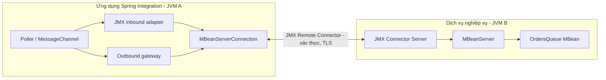

# Remote JMX connection trong Spring Integration Adapter JMX

## 1. Vì sao cần kết nối JMX từ xa?

**Java Management Extensions (JMX)** cho phép một ứng dụng Java công bố trạng thái và thao tác quản trị qua **MBean**. Nếu ứng dụng Spring Integration và MBean nằm trong cùng JVM, endpoint JMX có thể dùng `MBeanServer` cục bộ. Trong thực tế, dịch vụ cần giám sát thường chạy ở **JVM khác**, trên một máy chủ, container hoặc môi trường mạng riêng. Khi đó, một `ObjectName` đúng là chưa đủ: ứng dụng phải thiết lập được kết nối tới **MBeanServer của JVM đích**.

Trong module **`SPRING_INTEGRATION_ADAPTERS`**, remote JMX là một cách kết nối hệ thống quản trị Java vào luồng `MessageChannel`, tương tự việc kết nối file, SFTP, HTTP, JMS, AMQP, Kafka hoặc cơ sở dữ liệu. Ví dụ, một luồng polling có thể đọc `PendingCount` từ dịch vụ xử lý đơn hàng rồi phát cảnh báo; một outbound gateway khác có thể gọi operation `readQueueState("orders")` và nhận kết quả để quyết định tuyến xử lý.



**Hướng inbound/outbound được xác định theo Spring Integration**, không theo hướng socket TCP. Attribute-polling inbound adapter **lấy dữ liệu từ JMX vào message flow**; operation-invoking outbound gateway **gửi request từ message flow ra JMX rồi nhận reply**. Cả hai đều có thể dùng chung một `MBeanServerConnection` từ xa.

## 2. Các thành phần của một kết nối remote JMX

| Khái niệm | Vai trò | Ví dụ |
| --- | --- | --- |
| **MBean** | Đối tượng được quản trị, công bố attribute/operation/notification | `OrdersQueue` |
| **`ObjectName`** | Định danh MBean **bên trong một MBeanServer** | `demo.integration:type=Queue,name=Orders` |
| **`MBeanServer`** | Server đăng ký và quản lý MBean trong JVM đích | Platform MBeanServer của dịch vụ |
| **JMX Connector Server** | Công bố giao diện quản trị qua một giao thức mạng | JMX/RMI connector trong JVM đích |
| **`JMXServiceURL`** | Mô tả vị trí/giao thức của connector | `service:jmx:rmi:///jndi/rmi://app.internal:9010/jmxrmi` |
| **`JMXConnector`** | Đầu nối client mở/đóng kết nối và cung cấp connection | `JMXConnectorFactory.connect(...)` |
| **`MBeanServerConnection`** | Giao diện gọi `getAttribute`, `queryNames`, `invoke`, đăng ký notification listener | `connector.getMBeanServerConnection()` |
| **`MBeanServerConnectionFactoryBean`** | Spring `FactoryBean` quản lý kết nối từ xa theo lifecycle của ApplicationContext | Bean `remoteMBeanServer` |

### 2.1. `MBeanServer` khác `MBeanServerConnection` ở đâu?

`MBeanServer` mở rộng `MBeanServerConnection`. Trên server cục bộ, ta có thể gọi `registerMBean(javaObject, objectName)` để đăng ký một Java object. Ở phía client từ xa, thường chỉ sử dụng `MBeanServerConnection` để truy vấn/gọi MBean đã đăng ký; không thể tự đưa một Java object trong JVM client vào JVM đích thông qua `registerMBean` trên giao diện này.

Nhiều endpoint JMX của Spring Integration, ví dụ `AttributePollingMessageSource` và `NotificationListeningMessageProducer`, có phương thức `setServer(MBeanServerConnection)`. Vì vậy, khi chuyển từ JMX cục bộ sang remote JMX, luồng message có thể giữ cấu trúc cũ; thay đổi chính nằm ở **bean connection**, `ObjectName` và chính sách vận hành mạng.

### 2.2. `ObjectName` không chứa thông tin máy chủ

Hai JVM có thể cùng đăng ký MBean tên:

```text
demo.integration:type=Queue,name=Orders
```

Nhưng đó là **hai MBean khác nhau**. Một lời gọi chỉ đến đúng MBean khi **connection trỏ đúng server** và `ObjectName` khớp MBean đã đăng ký trên server đó. Không nên dùng host/port như key property thay thế cho việc cấu hình đúng `JMXServiceURL`.

## 3. Kiến trúc JMX/RMI và những điều kiện trước khi kết nối

JDK cung cấp sẵn tác nhân quản trị (management agent) có thể công bố **remote JMX qua RMI**. Trong cách triển khai thường gặp, client truy cập một **RMI registry**, tra cứu tên `jmxrmi`, nhận remote stub rồi kết nối đến đầu RMI của JMX connector.

Ví dụ URL:

```text
service:jmx:rmi:///jndi/rmi://app.internal.example:9010/jmxrmi
```

Ở đây `app.internal.example:9010` là điểm tra cứu registry; **endpoint RMI thực tế** có thể dùng cổng khác do server công bố trong stub. Chỉ mở cổng registry mà không mở cổng RMI connector có thể khiến bước tra cứu đầu thành công nhưng lời gọi JMX tiếp theo thất bại.

### 3.1. Phía JVM đích cần gì?

1. Một MBean đã được **đăng ký** trên MBeanServer mà connector công bố; không phải mọi MBean trong mọi server của cùng JVM đều tự xuất hiện trên connector.
2. Một connector JMX/RMI đang lắng nghe và được phép truy cập từ JVM client.
3. Một địa chỉ hostname/IP mà client **thực sự kết nối được**; với RMI, cần đặc biệt kiểm tra `java.rmi.server.hostname` và địa chỉ trong stub.
4. Cơ chế **xác thực và mã hóa** phù hợp, cùng chính sách phân quyền đọc/gọi operation.
5. Quy tắc firewall/NetworkPolicy cho **registry port và connector port**, trong phạm vi mạng riêng được phép.

Với management agent của JDK, các cấu hình thường được sử dụng là:

```text
-Dcom.sun.management.jmxremote.port=9010
-Dcom.sun.management.jmxremote.rmi.port=9011
-Djava.rmi.server.hostname=app.internal.example
-Dcom.sun.management.jmxremote.authenticate=true
-Dcom.sun.management.jmxremote.ssl=true
```

Đây là **nhóm tham số minh họa**, chưa phải lệnh khởi động hoàn chỉnh: với `authenticate=true`, cần cấu hình nguồn tài khoản/quyền JMX; với `ssl=true`, cần cấu hình certificate/keystore/truststore và xác nhận TLS hoạt động. Không tắt authentication hoặc SSL chỉ để làm ví dụ chạy được trên môi trường chia sẻ hoặc production. Các port 9010/9011 chỉ là ví dụ; dùng giá trị được vận hành cấp phát.

**Tại sao đôi lúc cần hai cổng?** `com.sun.management.jmxremote.port` chỉ định cổng quản lý/registry, còn `com.sun.management.jmxremote.rmi.port` cố định cổng RMI của connector. Nếu không cố định đầu RMI, server có thể xuất bản một cổng động và việc triển khai qua firewall hoặc Kubernetes trở nên khó dự đoán. Khi dùng NAT/proxy, hostname trong stub cần phù hợp với địa chỉ client có thể truy cập.

### 3.2. Xác thực JMX và quyền truy cập

Ứng dụng có thể dùng hệ thống xác thực được cấu hình cho connector (ví dụ JDK password/access files, LDAP hoặc cơ chế xác thực tùy biến). Với cơ chế file mặc định, cần phân quyền file chứa password chặt chẽ, đồng thời tách tài khoản chỉ đọc trạng thái khỏi tài khoản có thể thực thi operation quản trị. Nên ưu tiên phương án lưu secret do hạ tầng cung cấp và **không commit** tài khoản hoặc mật khẩu trong cấu hình mẫu.

TLS cần cấu hình và kiểm chứng ở cả hai phía. JMX/RMI có chi tiết về registry và connector; tùy cấu hình, registry cũng có thể được bảo vệ riêng bằng SSL. Không nên suy rằng chỉ bật một thuộc tính `ssl=true` đã kiểm soát an toàn mọi bước kết nối. Tài liệu JDK về RMI registry TLS, SSL client authentication và access file là nguồn tham chiếu chính khi triển khai.

## 4. Kết nối remote JMX trực tiếp bằng Java trước khi đưa vào Spring

Một bước chẩn đoán hiệu quả là xác minh JMX client thuần có thể đọc MBean đích. Nhờ đó, ta phân biệt lỗi mạng/xác thực/TLS với lỗi wiring của Spring Integration.

Giả sử hệ thống đã cung cấp biến môi trường `JMX_SERVICE_URL`, `JMX_USER` và `JMX_PASSWORD`, còn truststore/TLS được cấu hình bằng cơ chế bảo mật của môi trường chạy:

```java
package demo.client;

import java.util.Map;
import javax.management.MBeanServerConnection;
import javax.management.ObjectName;
import javax.management.remote.JMXConnector;
import javax.management.remote.JMXConnectorFactory;
import javax.management.remote.JMXServiceURL;

public final class RemoteJmxProbe {
    public static void main(String[] args) throws Exception {
        String serviceUrl = System.getenv("JMX_SERVICE_URL");
        String username = System.getenv("JMX_USER");
        String password = System.getenv("JMX_PASSWORD");

        if (serviceUrl == null || username == null || password == null) {
            throw new IllegalStateException("Thiếu cấu hình JMX remote");
        }

        Map<String, Object> environment = Map.of(
            JMXConnector.CREDENTIALS, new String[] { username, password }
        );

        JMXServiceURL url = new JMXServiceURL(serviceUrl);
        try (JMXConnector connector =
                 JMXConnectorFactory.connect(url, environment)) {

            MBeanServerConnection server = connector.getMBeanServerConnection();
            ObjectName target = new ObjectName(
                "demo.integration:type=Queue,name=Orders");

            if (!server.isRegistered(target)) {
                throw new IllegalStateException("Không tìm thấy MBean: " + target);
            }

            Object pending = server.getAttribute(target, "PendingCount");
            System.out.println("PendingCount = " + pending);

            Object reply = server.invoke(
                target,
                "readQueueState",
                new Object[] { "orders" },
                new String[] { "java.lang.String" }
            );
            System.out.println("State = " + reply);
        } // Đóng connector ngay cả khi truy vấn/gọi operation thất bại.
    }
}
```

Ví dụ này **phụ thuộc** MBean `demo.integration:type=Queue,name=Orders` có sẵn trên server; ta sẽ định nghĩa MBean mẫu ở phần sau. Nếu chỉ muốn xác minh kết nối tới một JVM tiêu chuẩn trước, có thể kiểm tra `java.lang:type=Runtime` và đọc attribute `Name`, miễn là tài khoản JMX có quyền tương ứng.

`JMXConnector.CREDENTIALS` là khóa chuẩn cho credentials. Với xác thực của JDK dùng tên/mật khẩu, giá trị thường là `String[]`. Một connector tùy biến có thể yêu cầu môi trường khác; không đưa nguyên một `Map` bất kỳ từ request bên ngoài vào `JMXConnectorFactory`.

`JMXConnector` sở hữu tài nguyên mạng và phải được **đóng**. `MBeanServerConnection` là giao diện thao tác qua connector, không tự đại diện cho quyền sở hữu vòng đời socket. Ví dụ `try-with-resources` giúp việc kiểm tra thủ công đóng kết nối đúng cách, kể cả khi lời gọi `getAttribute()` ném `IOException`.

## 5. Ví dụ end-to-end: một JVM công bố MBean, JVM khác đọc qua Spring Integration

Ví dụ gồm **hai process/JVM tách biệt**:

- **Server**: dịch vụ demo `OrdersQueueAdmin` đăng ký MBean trên platform MBeanServer và chạy JMX remote agent đã cấu hình.
- **Client**: ứng dụng Spring Integration thiết lập `MBeanServerConnection` từ xa, định kỳ đọc `PendingCount` và gọi operation trả về `readQueueState(...)`.

### 5.1. Dependency

Trong ứng dụng Spring Integration client, dùng Maven với Spring Boot BOM hoặc Spring Integration BOM quản lý phiên bản:

```xml
<dependency>
    <groupId>org.springframework.integration</groupId>
    <artifactId>spring-integration-jmx</artifactId>
</dependency>
```

Nếu không dùng BOM/dependency management, khai báo phiên bản tương thích với các Spring dependency đang sử dụng. Server demo cần `spring-context` để dùng `@ManagedResource`, `MBeanExporter` và XML context; có thể thay bằng Standard MBean của JDK nếu không dùng Spring.

### 5.2. MBean phía server

File `src/main/java/demo/server/OrdersQueueAdmin.java`:

```java
package demo.server;

import java.util.concurrent.atomic.AtomicInteger;
import org.springframework.jmx.export.annotation.ManagedAttribute;
import org.springframework.jmx.export.annotation.ManagedOperation;
import org.springframework.jmx.export.annotation.ManagedOperationParameter;
import org.springframework.jmx.export.annotation.ManagedResource;

@ManagedResource(objectName = "demo.integration:type=Queue,name=Orders")
public class OrdersQueueAdmin {
    private final AtomicInteger pending = new AtomicInteger(125);

    @ManagedAttribute(description = "Số đơn hàng đang đợi")
    public int getPendingCount() {
        return pending.get();
    }

    @ManagedOperation(description = "Kiểm tra trạng thái hàng đợi")
    @ManagedOperationParameter(name = "queueName", description = "Tên hàng đợi")
    public String readQueueState(String queueName) {
        if (!"orders".equals(queueName)) {
            return "UNKNOWN";
        }
        return pending.get() >= 100 ? "BACKLOG" : "NORMAL";
    }
}
```

Giá trị `125` là số liệu **giả lập** để người học thấy kết quả ngay; không có kết nối JMS/Kafka thật trong MBean này. Trong dự án thực, MBean cần đọc trạng thái từ metric hoặc service chịu trách nhiệm, đồng thời giữ contract về kiểu và đơn vị.

File `src/main/resources/jmx-server.xml`:

```xml
<?xml version="1.0" encoding="UTF-8"?>
<beans xmlns="http://www.springframework.org/schema/beans"
       xmlns:xsi="http://www.w3.org/2001/XMLSchema-instance"
       xmlns:context="http://www.springframework.org/schema/context"
       xsi:schemaLocation="
           http://www.springframework.org/schema/beans
           https://www.springframework.org/schema/beans/spring-beans.xsd
           http://www.springframework.org/schema/context
           https://www.springframework.org/schema/context/spring-context.xsd">

    <!-- Dùng platform/existing MBeanServer của JVM. -->
    <context:mbean-server/>
    <context:mbean-export server="mbeanServer"/>

    <bean id="ordersQueueAdmin" class="demo.server.OrdersQueueAdmin"/>
</beans>
```

File `src/main/java/demo/server/RunJmxServer.java`:

```java
package demo.server;

import java.util.concurrent.CountDownLatch;
import org.springframework.context.support.ClassPathXmlApplicationContext;

public final class RunJmxServer {
    public static void main(String[] args) throws Exception {
        try (var context = new ClassPathXmlApplicationContext("jmx-server.xml")) {
            System.out.println("OrdersQueueAdmin MBean đã được đăng ký");
            // Chương trình demo giữ JVM sống để JVM khác kết nối JMX.
            new CountDownLatch(1).await();
        }
    }
}
```

Chạy `RunJmxServer` với **JDK management agent remote được cấu hình ở mục 3**. XML trên chỉ export MBean vào server bên trong JVM; **bản thân `<context:mbean-server/>` không mở cổng JMX từ xa**. Chính management agent hoặc một `JMXConnectorServer` do ứng dụng/hạ tầng khởi tạo mới công bố kết nối mạng.

### 5.3. Client Spring: dùng `MBeanServerConnectionFactoryBean`

Spring Framework cung cấp `org.springframework.jmx.support.MBeanServerConnectionFactoryBean`. Bean này tạo kết nối `MBeanServerConnection` từ `serviceUrl`, hỗ trợ môi trường connector và đóng `JMXConnector` khi bean bị destroy.

Trong client, cung cấp `JMX_SERVICE_URL`, `JMX_USER`, `JMX_PASSWORD` dưới dạng biến môi trường hoặc nguồn cấu hình bảo mật do hạ tầng quản lý. Cấu hình TLS truststore cho JVM client trước khi khởi tạo context.

File `src/main/resources/jmx-client.xml`:

```xml
<?xml version="1.0" encoding="UTF-8"?>
<beans xmlns="http://www.springframework.org/schema/beans"
       xmlns:xsi="http://www.w3.org/2001/XMLSchema-instance"
       xmlns:context="http://www.springframework.org/schema/context"
       xmlns:int="http://www.springframework.org/schema/integration"
       xmlns:int-jmx="http://www.springframework.org/schema/integration/jmx"
       xsi:schemaLocation="
           http://www.springframework.org/schema/beans
           https://www.springframework.org/schema/beans/spring-beans.xsd
           http://www.springframework.org/schema/context
           https://www.springframework.org/schema/context/spring-context.xsd
           http://www.springframework.org/schema/integration
           https://www.springframework.org/schema/integration/spring-integration.xsd
           http://www.springframework.org/schema/integration/jmx
           https://www.springframework.org/schema/integration/jmx/spring-integration-jmx.xsd">

    <!-- Lấy placeholder từ môi trường được phép cung cấp. -->
    <context:property-placeholder/>

    <!-- FactoryBean trả ra MBeanServerConnection trỏ tới JVM khác. -->
    <bean id="remoteMBeanServer"
          class="org.springframework.jmx.support.MBeanServerConnectionFactoryBean">
        <property name="serviceUrl" value="${JMX_SERVICE_URL}"/>
        <property name="environmentMap">
            <map>
                <entry key="jmx.remote.credentials">
                    <array value-type="java.lang.String">
                        <value>${JMX_USER}</value>
                        <value>${JMX_PASSWORD}</value>
                    </array>
                </entry>
            </map>
        </property>
    </bean>

    <int:channel id="remotePendingCount"/>

    <!-- Inbound: đọc attribute từ remote MBean theo lịch. -->
    <int-jmx:attribute-polling-channel-adapter
        id="ordersPendingPoller"
        channel="remotePendingCount"
        mbean-server="remoteMBeanServer"
        object-name="demo.integration:type=Queue,name=Orders"
        attribute-name="PendingCount">
        <int:poller fixed-delay="5000" max-messages-per-poll="1"/>
    </int-jmx:attribute-polling-channel-adapter>

    <int:logging-channel-adapter
        channel="remotePendingCount"
        level="INFO"
        expression="'Remote Orders pending=' + payload"/>

    <int:channel id="stateRequests"/>
    <int:channel id="stateReplies">
        <int:queue capacity="10"/>
    </int:channel>

    <!-- Outbound request/reply: gọi operation trên cùng JVM từ xa. -->
    <int-jmx:operation-invoking-outbound-gateway
        id="remoteStateGateway"
        request-channel="stateRequests"
        reply-channel="stateReplies"
        mbean-server="remoteMBeanServer"
        object-name="demo.integration:type=Queue,name=Orders"
        operation-name="readQueueState"/>
</beans>
```

Điểm khác với JMX local nằm ở bean `remoteMBeanServer` và thuộc tính `mbean-server` trên hai endpoint. **Không** thêm `<context:mbean-server/>` ở client rồi trỏ adapter vào bean cục bộ nếu mục tiêu là đọc JVM đích. `MBeanServerConnectionFactoryBean` là một `FactoryBean`: tham chiếu bean `remoteMBeanServer` thông thường cung cấp **kết quả `MBeanServerConnection`**; chỉ dùng tên `&remoteMBeanServer` khi thật sự muốn lấy chính factory để quản lý cấu hình ở mức bean.

Với `connectOnStartup` mặc định là `true`, Spring cố gắng kết nối lúc khởi tạo factory. Nếu server tạm thời chưa chạy, có thể đặt `connectOnStartup="false"` dưới dạng `<property name="connectOnStartup" value="false"/>` để trì hoãn mở kết nối tới lần sử dụng đầu tiên. Tùy chọn này **không phải** cơ chế reconnect/retry vô hạn; vẫn phải thiết kế xử lý lỗi và khôi phục sau khi connector mất kết nối.

### 5.4. Client Java: gửi request và nhận kết quả

File `src/main/java/demo/client/RunJmxClient.java`:

```java
package demo.client;

import org.springframework.context.support.ClassPathXmlApplicationContext;
import org.springframework.integration.support.MessageBuilder;
import org.springframework.messaging.Message;
import org.springframework.messaging.MessageChannel;
import org.springframework.messaging.PollableChannel;

public final class RunJmxClient {
    public static void main(String[] args) throws Exception {
        try (var context = new ClassPathXmlApplicationContext("jmx-client.xml")) {
            MessageChannel requests = context.getBean(
                "stateRequests", MessageChannel.class);
            PollableChannel replies = context.getBean(
                "stateReplies", PollableChannel.class);

            boolean accepted = requests.send(
                MessageBuilder.withPayload("orders").build());
            if (!accepted) {
                throw new IllegalStateException("Không gửi được request tới gateway");
            }

            Message<?> reply = replies.receive(3_000);
            if (reply == null) {
                throw new IllegalStateException("Không nhận reply từ queue trong 3 giây");
            }
            System.out.println("Remote state=" + reply.getPayload());

            // Giữ context sống một khoảng ngắn chỉ để quan sát poller.
            Thread.sleep(11_000L);
        }
    }
}
```

Nếu server ở mục 5.2 đang chạy với kết nối hợp lệ, output kỳ vọng là `Remote state=BACKLOG` và log `Remote Orders pending=125` theo lịch polling. Các giá trị trên là kết quả **của MBean demo**, không phải metric thực từ queue.

`replies.receive(3_000)` giới hạn thời gian chờ **đọc reply từ `QueueChannel`**, **không** áp dụng timeout cho `MBeanServerConnection.invoke(...)`. Vì `stateRequests` là `DirectChannel` mặc định, lời gọi `requests.send(...)` có thể bị chặn ở thao tác JMX từ xa trước khi code tới lệnh `receive(...)`. Timeout kết nối, thời gian gọi JMX và time budget của workflow phải được cấu hình/kiểm soát ở đúng tầng.

## 6. Khi nào dùng từng endpoint với remote JMX?

| Spring Integration endpoint | Tác vụ remote JMX | Cách hoạt động | Điều cần lưu ý |
| --- | --- | --- | --- |
| `attribute-polling-channel-adapter` | Đọc một attribute như `PendingCount` | **Inbound + poller** | Chu kỳ thực tế còn phụ thuộc thời gian mạng và xử lý |
| `tree-polling-channel-adapter` | Truy vấn nhiều MBean và attribute thành cấu trúc | **Inbound + poller** | Phải giới hạn `query-name`/bộ lọc để tránh truy vấn quá rộng |
| `notification-listening-channel-adapter` | Đăng ký nhận notification từ MBean | **Inbound theo sự kiện** | Cần quản lý listener khi connection mất và kết nối lại |
| `operation-invoking-channel-adapter` | Gọi operation quản trị không cần dùng reply | **Outbound message-driven** | Cẩn thận retry với operation có tác dụng phụ |
| `operation-invoking-outbound-gateway` | Gọi operation có giá trị trả về | **Outbound request/reply** | Cần `reply-channel` hoặc header reply hợp lệ |

Điểm chung là `mbean-server` phải trỏ đến connection chứa đúng MBean. Với `notification-listening-channel-adapter`, việc nhận sự kiện remote không đòi poller, nhưng khi connector đứt, **đăng ký listener cũng cần được đánh giá/khôi phục**, không thể giả định mọi notification trong lúc mất kết nối sẽ được phát lại.

Một số JMX operation có thể được chọn qua header `JmxHeaders.OBJECT_NAME` và `JmxHeaders.OPERATION_NAME`. Không đưa trực tiếp tên MBean/operation do request HTTP hoặc message từ ngoài tự cung cấp vào gateway có quyền quản trị; dùng danh sách được phép và mapping nội bộ.

## 7. Xử lý kết nối đứt, timeout, retry và vòng đời

Remote JMX là I/O qua mạng, vì vậy phải thiết kế với các trạng thái **server chưa sẵn sàng**, **mất kết nối giữa chừng**, **gọi operation thành công nhưng reply không về**, và **MBean bị đăng ký lại**.

### 7.1. Startup và lifecycle

- `MBeanServerConnectionFactoryBean` mặc định `connectOnStartup=true`: kết nối khi context khởi tạo; lỗi ở remote server có thể khiến ứng dụng client **không khởi động được**.
- `connectOnStartup=false` trì hoãn kết nối tới lúc gọi lần đầu. Đây là lựa chọn phù hợp khi dịch vụ đích có thể khởi động muộn, nhưng **lần gọi đầu vẫn có thể thất bại**.
- Factory có `destroy()` để đóng JMX connector khi context kết thúc. Tránh tạo một connection mới cho từng message hoặc không đóng các connector trong chương trình dài hạn.
- `MBeanClientInterceptor` của Spring có tùy chọn `refreshOnConnectFailure`, nhưng tùy chọn đó **không phải property của `MBeanServerConnectionFactoryBean`**. Muốn tự động reconnect ở tầng adapter/gateway, cần thiết kế cơ chế riêng và xác minh hành vi với thư viện đang dùng.

### 7.2. Retry có thể gây gọi operation hai lần

Giả sử client gọi `incrementCounter()` qua remote JMX. Server đã chạy method, nhưng kết nối đứt trước khi client nhận được reply. Nếu client tự động retry, counter có thể tăng **hai lần**. Với operation idempotent như `setEnabled(true)` hoặc truy vấn chỉ đọc, chính sách retry dễ kiểm soát hơn; với operation có tác dụng phụ, cần request ID, kiểm tra trạng thái, hoặc cơ chế chống trùng do service đích cung cấp.

Với attribute polling (chỉ đọc), có thể retry theo backoff và quan sát số lần poll thất bại. Với notification, retry một subscription không khôi phục các event đã xảy ra trong khoảng thời gian offline vì JMX notification không tự cung cấp một hàng đợi durable.

### 7.3. Đừng nhầm timeout ở các lớp

| Thời gian chờ | Tác động | Không giải quyết |
| --- | --- | --- |
| Thời gian thiết lập JMX connector | Giới hạn/thước đo việc kết nối tới server | Thời gian thực thi operation sau khi đã kết nối |
| Thời gian RMI request/response | Tác động tới một thao tác `getAttribute`/`invoke` qua mạng | Vấn đề operation đã chạy nhưng client mất reply |
| `QueueChannel.receive(timeout)` | Chờ message đã hoàn tất ở kênh reply | Không hủy `invoke` đang block ở luồng gửi |
| `fixed-delay` trên poller | Điều tiết chu kỳ bắt đầu lần đọc tiếp theo | Không ép mỗi JMX request kết thúc đúng hạn |

Cách cấu hình timeout ở RMI/JMX có thể phụ thuộc JDK, connector provider, lớp network và hạ tầng. Không tự thêm một `timeout` attribute không tồn tại vào XML JMX adapter. Với SLA chặt, nên đưa remote call vào worker/queue có cơ chế cách ly, đo deadline và xây dựng chính sách kết nối phù hợp với JDK/connector đang triển khai.

### 7.4. Khả năng quan sát

Ghi nhận tối thiểu: tên hệ thống đích (không chứa secret), `ObjectName`, operation/attribute, kết quả success/failure, latency, thời điểm polling cuối thành công, số lần reconnect và correlation ID nếu có. Đừng log `JMX_PASSWORD`, `JMXConnector.CREDENTIALS`, thông tin token hoặc cấu hình TLS nhạy cảm.

Nếu metrics biến mất đột ngột, cần phân biệt **giá trị bằng 0**, **MBean trả `null`**, **không có message do poller lỗi**, và **server remote hoàn toàn không truy cập được**. Một cảnh báo vắng dữ liệu (no recent successful poll) thường hữu ích không kém cảnh báo về ngưỡng số liệu.

## 8. Bảo mật và vận hành remote JMX

Remote JMX là giao diện quản trị mạnh, có thể đọc thông tin nội bộ và gọi operation có tác dụng phụ. Khi triển khai thực tế:

1. **Giới hạn mạng:** ưu tiên mạng riêng, VPN hoặc quản trị qua tunnel được kiểm soát; chỉ mở các port thật sự cần thiết giữa nguồn client và JVM đích.
2. **Bảo vệ xác thực:** sử dụng tài khoản riêng với quyền tối thiểu; đặt secret trong secret manager/environment bảo vệ, không ghi mật khẩu trực tiếp vào Git, tài liệu vận hành hoặc log.
3. **Mã hóa:** dùng TLS phù hợp; cấu hình truststore và xác minh certificate/hostname; xem xét bảo vệ RMI registry và mutual TLS theo yêu cầu hệ thống.
4. **Phân quyền:** tách client chỉ đọc metric khỏi client được gọi operation quản trị. `getAttribute` và `invoke` có mức ảnh hưởng khác nhau dù cùng kết nối.
5. **Kiểm soát đích:** giới hạn `ObjectName` và operation được phép. Không tin cậy header JMX do dữ liệu ngoài tự ghi.
6. **Giảm bề mặt công bố:** chỉ export những MBean/attribute/operation thật sự phục vụ quản trị; hạn chế thông tin nhạy cảm trong JMX metadata và các giá trị trả về.
7. **Kiểm thử khôi phục:** thử restart JVM đích, mất mạng, thay certificate và thay đổi DNS/host; xác nhận adapter không mất dữ liệu quan trọng hoặc treo không kiểm soát.

Trong container/Kubernetes, lỗi rất thường gặp là client kết nối được RMI registry nhưng stub trả về **hostname hoặc port không thể truy cập** từ mạng client. Kết nối qua Service/NAT cần xử lý cả endpoint RMI được export, không chỉ đổi port trong `JMXServiceURL`.

## 9. Bảng lỗi thường gặp và quy trình chẩn đoán

| Triệu chứng | Nguyên nhân có thể | Kiểm tra/xử lý |
| --- | --- | --- |
| `MalformedURLException` khi tạo `JMXServiceURL` | URL sai cú pháp | Kiểm tra dạng `service:jmx:rmi:///jndi/rmi://host:port/jmxrmi` và scheme được connector hỗ trợ |
| `ConnectException` / `IOException` lúc connect | Server không chạy, port bị chặn, hostname sai | Kiểm tra registry **và** RMI connector port; thử JConsole/Java probe từ cùng mạng |
| Tra cứu registry được nhưng invoke treo/thất bại | Stub trỏ host/cổng không tới được, NAT/container | Kiểm tra `java.rmi.server.hostname`, `jmxremote.rmi.port`, firewall |
| `SecurityException` / authentication failed | Sai credentials, quyền truy cập, file password/access | Kiểm tra account/role, secret injection và cấu hình agent |
| `SSLHandshakeException` | Truststore/certificate/protocol TLS không khớp | Kiểm tra chain, thời hạn, hostname, truststore ở client và TLS trên server |
| `InstanceNotFoundException` | Sai `ObjectName`, MBean chưa export, trỏ nhầm JVM | `queryNames`, JConsole, so canonical ObjectName và connection đích |
| `AttributeNotFoundException` | Sai tên attribute hoặc không được công bố | Kiểm tra `MBeanInfo.getAttributes()`; chú ý chữ hoa/thường |
| `ReflectionException` hoặc lỗi invoke | Sai tên/chữ ký operation, tham số sai kiểu | Kiểm tra `MBeanOperationInfo`, `args`, `signature` và payload mapping |
| Gateway không có reply | Thiếu reply channel, operation lỗi/`void`, reply bị consumer khác lấy | Kiểm tra luồng request/reply, ngoại lệ khi gọi JMX và correlation |
| Không nhận notification sau reconnect | Listener đăng ký trên connector cũ | Thiết kế đăng ký lại listener và giám sát khoảng mất sự kiện |
| Nhiều thời điểm không có metric | Poller lỗi, remote chậm, giá trị `null` | Đo last-successful-poll và error rate; không suy `null` thành 0 |

### Quy trình kiểm tra có thứ tự

1. **Xác định JVM đích:** từ tài liệu triển khai, xác nhận hostname, các port, service URL, tài khoản và chính sách TLS đang được cấp.
2. **Kiểm tra lớp mạng:** xác minh registry và RMI port cùng hostname được server export tới được từ máy client; tránh giả định hostname nội bộ container luôn được phân giải bên ngoài.
3. **Kiểm tra TLS/xác thực:** dùng JConsole hoặc Java probe dưới đúng tài khoản/role của ứng dụng, không dùng một tài khoản quản trị mạnh hơn để kết luận rằng ứng dụng có quyền.
4. **Kiểm tra MBean:** gọi `queryNames`/`isRegistered` trên connection từ xa, sau đó `getMBeanInfo` để xem tên attribute/operation và kiểu dữ liệu thực tế.
5. **Kiểm tra Spring:** xác nhận `remoteMBeanServer` được tham chiếu bởi endpoint, placeholder đã resolve và không bị thay bằng server local.
6. **Kiểm tra message:** gửi request nhỏ, đọc reply, ghi log lỗi trong poller, xác minh timeout/retry ở tầng phù hợp; kiểm tra quy tắc an toàn khi chạy operation nhiều lần.
7. **Kiểm tra lifecycle:** tắt/bật server và quan sát xử lý mất kết nối, khởi động trễ, đăng ký lại listener và dọn connector khi client dừng.

## 10. Thực hành và câu hỏi tự kiểm tra

### Bài thực hành

1. Triển khai `OrdersQueueAdmin` trong một JVM và cấu hình JMX/RMI remote **an toàn** theo môi trường thử nghiệm có TLS/xác thực.
2. Dùng `RemoteJmxProbe` kết nối tới JVM đó; xác nhận `PendingCount=125`, `State=BACKLOG`.
3. Khởi động client Spring Integration, xác nhận polling adapter log `Remote Orders pending=125` và outbound gateway trả `BACKLOG`.
4. Đổi `JMX_SERVICE_URL` sang JVM không chứa MBean; phân biệt kết nối thành công nhưng `InstanceNotFoundException` với lỗi không kết nối được.
5. Thử server chỉ bắt đầu **sau** client. So sánh behavior giữa `connectOnStartup=true` và `false` (và ghi rõ khi nào lỗi được phát ra).
6. Chặn **chỉ** RMI connector port trong môi trường thử nghiệm, giữ registry port; quan sát sự khác biệt so với chặn cả registry.
7. Restart JVM đích và kiểm tra cơ chế phục hồi kết nối, thời điểm poll thành công tiếp theo, cũng như cách hệ thống xử lý các khoảng trống dữ liệu.
8. Gắn một operation có tác dụng phụ trong môi trường thử nghiệm, mô phỏng lỗi sau khi server thực thi và giải thích vì sao retry mù có thể tạo tác dụng phụ lặp.

### Câu hỏi ôn tập

1. `JMXServiceURL`, `JMXConnector`, `MBeanServerConnection` và `ObjectName` đóng vai trò gì trong một lời gọi remote JMX?
2. Vì sao cùng một `ObjectName` trên hai JVM có thể trả kết quả khác nhau?
3. Tại sao mở cổng RMI registry chưa chắc đủ để gọi `getAttribute()` thành công?
4. `MBeanServerConnectionFactoryBean` khác `<context:mbean-server/>` ở mục đích nào?
5. `connectOnStartup=false` có tự cung cấp retry/reconnect sau khi remote server restart không?
6. Vì sao `QueueChannel.receive(3000)` không giới hạn thời gian `MBeanServerConnection.invoke(...)`?
7. Trong trường hợp nào retry operation quản trị có thể gây ra thay đổi trạng thái hai lần?
8. Với notification-listening adapter từ xa, cần làm gì khi connector bị đứt và tạo lại?

## Tài liệu tham khảo

- [Spring Integration Reference — JMX Support](https://docs.spring.io/spring-integration/reference/jmx.html): cách gắn `mbean-server`, polling adapter, operation-invoking adapter/gateway và notification listener.
- [Spring Framework API — `MBeanServerConnectionFactoryBean`](https://docs.spring.io/spring-framework/docs/current/javadoc-api/org/springframework/jmx/support/MBeanServerConnectionFactoryBean.html): `serviceUrl`, `environmentMap`, `connectOnStartup` và `destroy()`.
- [Spring Integration API — `AttributePollingMessageSource`](https://docs.spring.io/spring-integration/api/org/springframework/integration/jmx/inbound/AttributePollingMessageSource.html): sử dụng `setServer(MBeanServerConnection)` để đọc attribute.
- [Spring Integration API — `NotificationListeningMessageProducer`](https://docs.spring.io/spring-integration/api/org/springframework/integration/jmx/inbound/NotificationListeningMessageProducer.html): listener dùng connection và quản lý đăng ký nhận notification.
- [Java SE API — `JMXConnectorFactory`](https://docs.oracle.com/en/java/javase/21/docs/api/java.management/javax/management/remote/JMXConnectorFactory.html): cách tạo kết nối remote JMX và truyền môi trường.
- [Java SE API — `MBeanServerConnection`](https://docs.oracle.com/en/java/javase/21/docs/api/java.management/javax/management/MBeanServerConnection.html): các thao tác JMX cục bộ/từ xa.
- [Java SE — Monitoring and Management Using JMX Technology](https://docs.oracle.com/en/java/javase/21/management/monitoring-and-management-using-jmx-technology.html): JVM remote management agent, xác thực, TLS và RMI connector ports.
