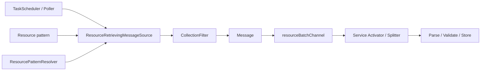
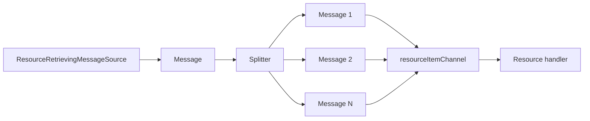

# Resource inbound channel adapter trong Spring Integration

## 1. Đặt vấn đề: đọc nhiều loại tài nguyên bằng một adapter

Giả sử dịch vụ Java cần định kỳ tìm các tệp cấu hình `*.properties` nằm trong classpath hoặc thư mục triển khai, sau đó đưa các tài nguyên mới phát hiện vào một luồng xử lý chung. Tệp có thể nằm trực tiếp trên đĩa, bên trong JAR hoặc được Spring diễn tả bằng một URL. Nếu viết code chỉ chấp nhận `java.io.File`, ứng dụng sẽ gặp khó khăn khi tài nguyên được đóng gói vào JAR hoặc khi môi trường chạy không có đường dẫn file vật lý tương ứng.

**Resource inbound channel adapter** của Spring Integration được xây trên abstraction `org.springframework.core.io.Resource`. Nó định kỳ dùng một `ResourcePatternResolver` để tìm các tài nguyên khớp một mẫu (*pattern*), rồi phát **một Spring Message chứa tập hợp tài nguyên** vào `MessageChannel`. Điểm này khác với **File inbound channel adapter**, vốn thường phát **một đối tượng `File` cho mỗi message**.

Bài học nằm trong module **SPRING_INTEGRATION_ADAPTERS**: kết nối hệ thống ngoài vào Spring Integration bằng adapter, gateway, poller và `MessageChannel`; tổ chức hợp đồng message, lỗi và vòng đời. Đối với **Adapter Resource**, ta tập trung vào việc phát hiện **resource handle** và chuyển cho downstream xử lý, không tự biến nó thành nội dung JSON, cấu hình đã parse hay một giao dịch có xác nhận như JMS/Kafka.

### Mục tiêu học tập

1. Giải thích `Resource`, `ResourcePatternResolver`, `ResourceRetrievingMessageSource`, `SourcePollingChannelAdapter` và `MessageChannel`.
2. Phân biệt mẫu `classpath:`, `classpath*:`, `file:` và những giới hạn khi sử dụng URL hoặc wildcard.
3. Viết adapter bằng XML namespace chuẩn và cấu hình Java/`@InboundChannelAdapter`.
4. Hiểu payload **`Resource[]`**, poller, `maxMessagesPerPoll`, và cách tách batch thành từng resource.
5. Thiết kế lọc `CollectionFilter<Resource>`, `AcceptOnceCollectionFilter`, đọc stream an toàn và xử lý lại khi tệp thay đổi.
6. Nhận diện ranh giới transaction, retry, lỗi downstream, resource lifecycle, bảo mật và kiểm thử.

## 2. Resource là gì?

Spring Framework định nghĩa `Resource` như một giao diện trừu tượng để thao tác với nhiều nguồn nội dung. Những implementation phổ biến:

| Implementation | Ví dụ resource | Ghi chú |
| --- | --- | --- |
| `ClassPathResource` | `classpath:rules/order.properties` | Có thể nằm trong thư mục classes hoặc bên trong JAR. |
| `FileSystemResource` | `file:/opt/app/config/order.properties` | Tương ứng đường dẫn filesystem, có thể dùng `getFile()` khi thích hợp. |
| `UrlResource` | URL tới nội dung cụ thể | Phụ thuộc giao thức, network và khả năng truy cập. |
| `ByteArrayResource` | Dữ liệu bytes trong bộ nhớ | Hữu ích trong unit test; không phải tài nguyên tự tìm thấy trong classpath. |
| `InputStreamResource` | Stream được cung cấp từ bên ngoài | Cần chú ý stream có thể không đọc lại được. |

Các method thường dùng:

```java
Resource resource = ...;

String name = resource.getFilename();
String description = resource.getDescription();
boolean exists = resource.exists();

try (InputStream stream = resource.getInputStream()) {
    // Đọc nội dung từ resource qua stream.
}
```

**Không mặc định gọi `resource.getFile()`.** Một `ClassPathResource` nằm bên trong JAR có thể đọc được qua `getInputStream()` nhưng không có `java.io.File` tương ứng. `resource.getURL()` và `lastModified()` cũng không luôn có ý nghĩa ổn định với mọi loại nguồn.

**Resource là một handle, không phải snapshot dữ liệu.** Adapter phát ra tham chiếu `Resource`; khi downstream mở stream, nội dung bên ngoài có thể đã thay đổi hoặc bị xóa. Nếu cần snapshot nhất quán, application phải đọc và lưu bytes/version tại thời điểm phù hợp.

## 3. Kiến trúc của Resource inbound channel adapter



Các thành phần:

- **`SourcePollingChannelAdapter`:** endpoint được Spring Integration scheduler kích hoạt theo poller.
- **`ResourceRetrievingMessageSource`:** `MessageSource<Resource[]>` thực hiện resolve pattern và trả về những `Resource` được chọn.
- **`ResourcePatternResolver`:** chiến lược tìm tài nguyên từ location pattern; mặc định dùng `ApplicationContext` hiện tại khi cấu hình theo namespace.
- **`CollectionFilter<Resource>`:** chọn subset tài nguyên được phát ở lần poll; có thể tránh phát lại.
- **`MessageChannel`:** tiếp nhận Spring `Message<?>` chứa batch; phía sau có thể là `DirectChannel`, splitter, router hoặc handler.

### Một lần poll tạo ra gì?

Ví dụ `classpath*:rules/*.properties` khớp ba tài nguyên:

```text
rules/shipping.properties
rules/tax.properties
rules/payment.properties
```

Adapter có thể phát:

```text
Message(
  payload = Resource[] {
    Resource("rules/shipping.properties"),
    Resource("rules/tax.properties"),
    Resource("rules/payment.properties")
  },
  headers = Spring MessageHeaders
)
```

**Một message chứa nhiều resource**, không phải ba message chỉ vì có ba kết quả. Javadoc của `ResourceRetrievingMessageSource` xác nhận kiểu source là `MessageSource<Resource[]>` và `doReceive()` trả `Resource[]`. Tài liệu reference gọi đó là *collection* theo nghĩa tập các tài nguyên. Nếu filter không trả tài nguyên đủ điều kiện, poller có thể không phát message nghiệp vụ trong lần đó.

## 4. So sánh Resource inbound và File inbound adapter

| Tiêu chí | Resource inbound | File inbound |
| --- | --- | --- |
| Abstraction | `org.springframework.core.io.Resource` | `java.io.File` |
| Payload thông thường | **`Resource[]`** — nhiều resource trong một message | **`File`** — một file trong mỗi message |
| Cơ chế tìm nguồn | `ResourcePatternResolver` với location pattern | File scanner trên thư mục, thường dùng `FileReadingMessageSource` |
| Nguồn phù hợp | Classpath, JAR, filesystem, URL phù hợp | Filesystem directory |
| Tách từng phần tử | Downstream xử lý mảng hoặc `Splitter` | Mỗi message đã tương ứng một file |
| Filter | `CollectionFilter<Resource>` | Các `FileListFilter` và scanner của module File |
| Thay đổi file theo thời gian | Tùy pattern, resolver, filter và môi trường | Tối ưu hơn cho workflow quét/thao tác từng file trên đĩa |
| Chuyển file, khóa, tránh ghi dở | Tự thiết kế nếu cần | Có các lựa chọn trong module File phù hợp hơn |

Chọn **Resource inbound** nếu mục tiêu là **khám phá resource theo abstraction Spring** hoặc khởi tạo/đọc tài nguyên cấu hình từ nhiều classpath roots. Chọn **File inbound** nếu bạn đang xây một file ingestion pipeline với scan một thư mục, claim file, xử lý từng file và yêu cầu nhiều tính năng file-specific.

Đừng dùng Resource inbound chỉ vì tên “resource” nghe tổng quát hơn: với nguồn HTTP có REST API phân trang, S3 object events hoặc file SFTP cần ack/lock, những adapter/gateway chuyên dụng thường phù hợp hơn.

## 5. Location pattern: classpath:, classpath*: và file:

Spring `ResourcePatternResolver` hỗ trợ các location pattern tùy giao thức và resolver. Trong `Resource inbound channel adapter`, pattern là chuỗi cấu hình, ví dụ:

```text
classpath:things/thing1/*.properties
classpath*:rules/**/*.properties
file:/opt/app/inbound/*.json
file:/var/app/config/rules/**/*.yml
```

### 5.1. classpath:

`classpath:things/thing1/*.properties` nhắm tới resource trong classpath. Khi classpath có nhiều JAR/thư mục cùng chứa một đường dẫn, `classpath:` không phải công cụ đáng tin để liệt kê mọi bản sao ở tất cả roots.

### 5.2. classpath*:

`classpath*:rules/**/*.properties` dùng cơ chế tìm kiếm trên nhiều classpath locations theo `PathMatchingResourcePatternResolver`, thuận tiện khi cấu hình nằm trong nhiều thư viện/JAR. Đổi lại, cần kiểm tra behavior với packaged JAR, nested JAR, module path và cách resolver thực tế enumerate resources.

**Classpath đóng gói thường không phải nguồn “hot folder”.** Thêm file vào một thư mục trên máy sau khi ứng dụng đã chạy JAR không tự khiến file đó xuất hiện trong classpath của class loader.

### 5.3. file:

`file:/opt/app/inbound/*.json` nhắm tới filesystem. Với đường dẫn theo môi trường, cấu hình ngoài source code thay vì cố định host path. Trên Windows có thể dùng URI `file:/C:/data/inbound/*.json` hoặc chuẩn hóa path qua configuration.

### 5.4. URL và wildcard

`Resource` có thể diễn tả URL như `https://example.com/config.json` khi môi trường client cho phép. Tuy nhiên, **resolve một URL cụ thể khác với tìm wildcard trong một HTTP directory**. Không suy ra `https://example.com/config/*.json` sẽ tự crawl server từ xa: giao thức HTTP thông thường không cung cấp listing directory theo glob.

Với URL:

- Xác định timeout, xác thực, TLS và giới hạn kích thước.
- Không đưa URL do người dùng không đáng tin cung cấp trực tiếp vào resolver (rủi ro SSRF).
- Kiểm tra caching, ETag/Last-Modified và semantics fetch nếu cần re-fetch theo phiên bản.
- Không coi việc URL được trả về trong resource list là nội dung đã được tải thành công.

### Ant-style wildcard

| Pattern | Ý nghĩa điển hình |
| --- | --- |
| `*.properties` | Các file có hậu tố properties trong một cấp thư mục |
| `rules/*.yml` | File yml trực tiếp trong `rules` |
| `rules/**/*.yml` | Tìm qua nhiều cấp thư mục theo khả năng resolver |
| `data/report-?.csv` | Ký tự đại diện một ký tự trong tên file |

Đối với pattern phức tạp và nhiều JAR, hãy kiểm thử danh sách `Resource` trả về ở **đúng chế độ đóng gói và class loader** của production.

## 6. XML namespace: cấu hình Resource inbound chuẩn

Tài liệu chính thức Spring Integration minh họa resource inbound channel adapter với namespace **`int`** của Spring Integration Core.

### 6.1. Ví dụ đầy đủ

```xml
<?xml version="1.0" encoding="UTF-8"?>
<beans xmlns="http://www.springframework.org/schema/beans"
       xmlns:xsi="http://www.w3.org/2001/XMLSchema-instance"
       xmlns:int="http://www.springframework.org/schema/integration"
       xsi:schemaLocation="
         http://www.springframework.org/schema/beans
         https://www.springframework.org/schema/beans/spring-beans.xsd
         http://www.springframework.org/schema/integration
         https://www.springframework.org/schema/integration/spring-integration.xsd">

    <int:channel id="resourceBatchChannel"/>

    <int:resource-inbound-channel-adapter
            id="resourceInbound"
            channel="resourceBatchChannel"
            pattern="classpath*:rules/*.properties">
        <int:poller fixed-delay="5000"
                    max-messages-per-poll="1"/>
    </int:resource-inbound-channel-adapter>

    <bean id="resourceBatchHandler"
          class="org.example.integration.ResourceBatchHandler"/>

    <int:service-activator
            input-channel="resourceBatchChannel"
            ref="resourceBatchHandler"
            method="handle"/>
</beans>
```

`ResourceBatchHandler` trong namespace `org.example.integration` là **class của ứng dụng**, sẽ được minh họa bằng Java ở phần sau; Spring không tạo sẵn class này.

**Ý nghĩa của từng cấu hình:**

1. `pattern`: mẫu tìm các tài nguyên do `ResourcePatternResolver` diễn giải.
2. `channel`: Spring Integration `MessageChannel` nhận batch.
3. `int:poller`: trigger gọi nguồn theo `fixed-delay="5000"` (5 giây sau lần poll trước, theo semantics scheduler).
4. `max-messages-per-poll="1"`: giới hạn **một lần nhận message từ MessageSource trong mỗi chu kỳ poll**; không có nghĩa chỉ một `Resource` được trả về.
5. `service-activator`: gọi handler của ứng dụng khi batch được phát.

**Không hiểu đây là một listener tự chạy khi filesystem thay đổi.** Đây là poller: mỗi chu kỳ resolver quét lại pattern theo cấu hình, sau đó filter quyết định resource nào được phát.

### 6.2. Một poll không tương đương một file

Giả sử lần đầu resolver tìm thấy 20 resource. Với cấu hình trên, adapter có thể phát:

```text
Poll #1:
  Message<Resource[]> chứa 20 Resource

Poll #2:
  Không có tài nguyên mới theo filter -> không phát batch mới
```

`max-messages-per-poll="1"` chỉ kiểm soát **số message source.receive()** mà poller có thể xử lý mỗi vòng. Muốn mỗi resource trở thành một message độc lập, phải tách batch bằng splitter.

## 7. Java configuration: ResourceRetrievingMessageSource và @InboundChannelAdapter

### 7.1. Dependencies

Với ứng dụng Spring Boot sử dụng BOM tương thích:

```xml
<dependencies>
    <dependency>
        <groupId>org.springframework.boot</groupId>
        <artifactId>spring-boot-starter-integration</artifactId>
    </dependency>
</dependencies>
```

`ResourceRetrievingMessageSource` nằm trong Spring Integration Core, không yêu cầu `spring-integration-file` cho riêng chức năng Resource inbound. Nếu ứng dụng cần File inbound adapter chuyên dụng, khi đó mới bổ sung module File tương ứng.

### 7.2. Tổ chức mẫu thực hành

Chuẩn bị dưới `src/main/resources/rules/`:

```text
src/main/resources/
└── rules/
    ├── shipping.properties
    ├── tax.properties
    └── payment.properties
```

Ví dụ nội dung `shipping.properties`:

```properties
rule.id=shipping-standard
rule.version=1
rule.enabled=true
```

Các file này thuộc classpath của ứng dụng; không tự coi chúng là dữ liệu có thể chỉnh sửa ngoài runtime JAR.

### 7.3. Cấu hình Java đầy đủ

```java
import org.springframework.context.annotation.Bean;
import org.springframework.context.annotation.Configuration;
import org.springframework.core.io.Resource;
import org.springframework.integration.annotation.InboundChannelAdapter;
import org.springframework.integration.annotation.Poller;
import org.springframework.integration.channel.DirectChannel;
import org.springframework.integration.config.EnableIntegration;
import org.springframework.integration.core.MessageSource;
import org.springframework.integration.resource.ResourceRetrievingMessageSource;
import org.springframework.integration.util.AcceptOnceCollectionFilter;
import org.springframework.messaging.MessageChannel;

@Configuration
@EnableIntegration
public class ResourceInboundConfiguration {

    @Bean
    public MessageChannel resourceBatchChannel() {
        return new DirectChannel();
    }

    @Bean
    @InboundChannelAdapter(
        channel = "resourceBatchChannel",
        poller = @Poller(
            fixedDelay = "5000",
            maxMessagesPerPoll = "1"
        )
    )
    public MessageSource<Resource[]> resourceMessageSource() {
        ResourceRetrievingMessageSource source =
            new ResourceRetrievingMessageSource(
                "classpath*:rules/*.properties"
            );

        // Java configuration: khai báo rõ chính sách accept-once.
        source.setFilter(new AcceptOnceCollectionFilter<>());
        return source;
    }
}
```

**Giải thích:**

- `resourceMessageSource()` là một bean `MessageSource<Resource[]>`; annotation `@InboundChannelAdapter` tạo polling endpoint sử dụng source đó.
- `@Poller(fixedDelay = "5000")` gọi nguồn định kỳ.
- `ResourceRetrievingMessageSource` chịu trách nhiệm resolve `Resource` theo pattern.
- `setFilter(new AcceptOnceCollectionFilter<>())` đặt chính sách không phát lại các `Resource` mà filter xem là đã xuất hiện.
- `DirectChannel` gửi message đồng bộ đến subscriber; với một handler đồng bộ, lỗi handler có thể ảnh hưởng chu kỳ poll.

**Chú ý:** Java configuration ví dụ này là **phương án thay thế** XML ở mục 6. Không bật đồng thời XML adapter và Java adapter cho cùng pattern/channel nếu không cố ý muốn hai poller độc lập.

### 7.4. Handler xử lý batch Resource[]

```java
import java.io.IOException;
import java.io.InputStream;
import java.io.InputStreamReader;
import java.nio.charset.StandardCharsets;
import java.util.Properties;

import org.springframework.core.io.Resource;
import org.springframework.integration.annotation.ServiceActivator;
import org.springframework.messaging.Message;
import org.springframework.stereotype.Component;

@Component
public class ResourceBatchHandler {

    @ServiceActivator(inputChannel = "resourceBatchChannel")
    public void handle(Message<Resource[]> message) throws IOException {
        Resource[] resources = message.getPayload();

        for (Resource resource : resources) {
            String filename = resource.getFilename();
            if (filename == null) {
                throw new IllegalArgumentException(
                    "Resource has no file name"
                );
            }

            Properties properties = new Properties();
            try (InputStream stream = resource.getInputStream();
                 InputStreamReader reader =
                     new InputStreamReader(
                         stream, StandardCharsets.UTF_8
                     )) {
                properties.load(reader);
            }

            String ruleId = properties.getProperty("rule.id");
            if (ruleId == null || ruleId.isBlank()) {
                throw new IllegalArgumentException(
                    "Missing rule.id in resource"
                );
            }

            System.out.printf(
                "Discovered ruleId=%s from %s%n",
                ruleId, filename
            );
            // TODO: validate version, persist/routing, idempotency.
        }
    }
}
```

**Ở đây adapter phát `Resource[]`, không phải `String[]` hay nội dung của các file.** Handler quyết định khi nào mở stream, parse theo UTF-8 và thực thi nghiệp vụ.

Ví dụ giả định nội dung `*.properties` được lưu UTF-8 và có contract `rule.id`. `Properties.load(Reader)` nhận reader nên xử lý được encoding đã chọn. Không dùng `Properties.load(InputStream)` rồi mặc định file properties UTF-8; API đó có semantics encoding khác.

### 7.5. Xử lý giới hạn kích thước

`Resource` có thể trỏ tới file/URL lớn. Không đọc không giới hạn bằng `readAllBytes()` với input từ nguồn không tin cậy. Ví dụ helper đọc tối đa 64 KiB:

```java
import java.io.IOException;
import java.io.InputStream;
import org.springframework.core.io.Resource;

public final class ResourceReader {

    private static final int MAX_BYTES = 64 * 1024;

    private ResourceReader() {}

    public static byte[] readLimited(Resource resource)
            throws IOException {
        try (InputStream in = resource.getInputStream()) {
            byte[] bytes = in.readNBytes(MAX_BYTES + 1);
            if (bytes.length > MAX_BYTES) {
                throw new IOException("Resource exceeds 64 KiB");
            }
            return bytes;
        }
    }
}
```

Đây là **giới hạn body do ứng dụng kiểm tra**, không tự cấu hình timeout TCP, giới hạn decompression hay số file mỗi poll. Khi đọc tài nguyên từ mạng, cần thêm giới hạn ở HTTP client/transport và chính sách bảo mật.

## 8. Tách batch thành từng Resource bằng Java DSL

Khi mỗi resource cần xử lý riêng và được route theo filename, có thể dùng `Splitter` trong integration flow:



Ví dụ Java DSL sau đây thay thế ví dụ `@InboundChannelAdapter` mục 7; **không khai báo đồng thời hai poller** cho cùng một source nếu không muốn poll hai lần:

```java
import org.springframework.context.annotation.Bean;
import org.springframework.context.annotation.Configuration;
import org.springframework.integration.channel.DirectChannel;
import org.springframework.integration.dsl.IntegrationFlow;
import org.springframework.integration.dsl.Pollers;
import org.springframework.integration.resource.ResourceRetrievingMessageSource;
import org.springframework.integration.util.AcceptOnceCollectionFilter;
import org.springframework.messaging.MessageChannel;

@Configuration
public class ResourceSplitFlowConfiguration {

    @Bean
    public ResourceRetrievingMessageSource resourceSource() {
        ResourceRetrievingMessageSource source =
            new ResourceRetrievingMessageSource(
                "classpath*:rules/*.properties"
            );
        source.setFilter(new AcceptOnceCollectionFilter<>());
        return source;
    }

    @Bean
    public MessageChannel resourceItemChannel() {
        return new DirectChannel();
    }

    @Bean
    public IntegrationFlow resourceSplitFlow(
            ResourceRetrievingMessageSource resourceSource) {
        return IntegrationFlow
            .from(
                resourceSource,
                e -> e.poller(
                    Pollers.fixedDelay(5000)
                        .maxMessagesPerPoll(1)
                )
            )
            .split()
            .channel("resourceItemChannel")
            .get();
    }
}
```

Downstream có thể dùng:

```java
import org.springframework.core.io.Resource;
import org.springframework.integration.annotation.ServiceActivator;
import org.springframework.stereotype.Component;

@Component
public class ResourceItemHandler {

    @ServiceActivator(inputChannel = "resourceItemChannel")
    public void process(Resource resource) throws Exception {
        try (var input = resource.getInputStream()) {
            // Parse/validate một resource, rồi commit nghiệp vụ.
        }
    }
}
```

**Splitter không thay đổi lúc nào resource được đánh dấu đã thấy ở source.** Nếu filter đã loại trùng trước khi batch tới splitter, lỗi ở item thứ N **không tự rollback trạng thái filter** cho resource đó. Bài toán retry sau lỗi cần một cơ chế checkpoint riêng.

### maxMessagesPerPoll và độ lớn batch

Một pattern có 10.000 resource có thể tạo một batch lớn, dù `maxMessagesPerPoll(1)`. Vì vậy:

- Giới hạn số resource trong lần resolve/filter khi cần bằng chiến lược tùy biến.
- Tránh đọc/parse toàn bộ ở một thread poller nếu xử lý lâu.
- Dùng queue/executor có giới hạn và theo dõi backpressure khi tách batch.
- Không đồng nhất **số lần poll**, **số message** và **số resource**.

## 9. CollectionFilter và AcceptOnceCollectionFilter

`CollectionFilter<T>` là strategy interface:

```java
public interface CollectionFilter<T> {
    Collection<T> filter(Collection<T> unfilteredElements);
}
```

Với Resource inbound, type là `CollectionFilter<Resource>`. Bộ lọc nhận những tài nguyên resolver tìm được rồi trả subset sẽ được phát vào message.

### 9.1. Chính sách mặc định của XML

Theo Spring Integration reference, nếu cấu hình **XML namespace** mà không chỉ định `filter`, framework dùng `AcceptOnceCollectionFilter`. Nó ghi nhớ những phần tử được đưa qua các lần gọi theo semantics của class để tránh gửi lại cùng resource.

```xml
<int:resource-inbound-channel-adapter
        id="resourceAdapter"
        channel="resourceBatchChannel"
        pattern="classpath*:rules/*.properties">
    <int:poller fixed-delay="5000"/>
</int:resource-inbound-channel-adapter>
```

Với **Java configuration**, ví dụ đặt `source.setFilter(new AcceptOnceCollectionFilter<>())` rõ ràng để dễ kiểm tra chính sách, không ngầm suy ra hành vi từ XML parser.

### 9.2. Bộ lọc tùy biến

Khi chỉ nhận các resource có filename kết thúc bằng `.properties` và muốn tự quản lý các resource đã xử lý:

```java
import org.springframework.core.io.Resource;
import org.springframework.integration.util.CollectionFilter;

CollectionFilter<Resource> nameFilter = elements ->
    elements.stream()
        .filter(r -> r.getFilename() != null)
        .filter(r -> r.getFilename().endsWith(".properties"))
        .toList();

source.setFilter(nameFilter);
```

Đoạn này minh họa API `setFilter(...)`; `source` là bean `ResourceRetrievingMessageSource` đã tạo. **Bộ lọc custom thay cho bộ lọc accept-once**, nó không tự xếp chồng hai filter. Vì thế đoạn trên **có thể phát lại cùng resource ở mỗi lần poll** nếu không có checkpoint/bộ lọc khác.

### 9.3. Tắt filter với XML

Theo reference, muốn không dùng cả default filter thì đặt:

```xml
<int:resource-inbound-channel-adapter
        id="resourceAdapter"
        channel="resourceBatchChannel"
        pattern="classpath*:rules/*.properties"
        filter="">
    <int:poller fixed-delay="5000"/>
</int:resource-inbound-channel-adapter>
```

Khi đó mỗi lần poll có thể gửi lại toàn bộ các resource đang khớp pattern. Dùng khi bạn **thật sự muốn reprocess**, có downstream idempotent hoặc một chương trình đọc lại cấu hình theo chu kỳ. Không tắt filter vô tình trong pipeline cần xử lý đúng một lần.

## 10. Chống trùng: nhận diện Resource không phải nhận diện phiên bản nội dung

Một resource có thể giữ nguyên location nhưng nội dung thay đổi. `AcceptOnceCollectionFilter` không nên được coi là **content-version tracker** hoặc **persistent checkpoint**:

- Filter hoạt động trong vòng đời bộ nhớ của bean; restart application có thể khiến resource cũ được phát lại.
- Cùng một path có thể chứa phiên bản mới nhưng `Resource` vẫn có identity tương tự; filter không bắt buộc tự phát hiện thay đổi nội dung.
- Cùng nội dung có thể xuất hiện ở hai URL khác nhau và được coi là hai resource.
- Nếu filter đã chấp nhận resource nhưng handler thất bại, trạng thái filter không tự rollback theo transaction DB.
- Triển khai nhiều pod có filter riêng; các pod có thể cùng đọc/parse cùng một resource.

### Thiết kế định danh phù hợp

Một cách định nghĩa key:

```text
resourceIdentity = normalized-location
resourceVersion  = SHA-256(content bytes) hoặc object version/ETag đáng tin
businessKey      = resourceIdentity + resourceVersion
```

Không có một cách chuẩn áp dụng cho mọi `Resource`. `lastModified()` có thể không tồn tại, độ phân giải kém hoặc không phản ánh nội dung thực. Hash nội dung giúp theo dõi thay đổi nhưng cần đọc toàn bộ dữ liệu một cách có giới hạn.

### Processed-resource ledger trong DB

Khi cần độ tin cậy:

```text
POLL resources
   |
   v
Resolve + filter ứng viên
   |
   v
Read bounded content + calculate resourceIdentity/version
   |
   v
BEGIN DB TRANSACTION
  -> claim identity/version bằng UNIQUE constraint
  -> parse/validate/apply nghiệp vụ
  -> mark PROCESSED
COMMIT
```

**Điểm cần lưu ý:** nếu source filter loại vĩnh viễn tài nguyên **trước** khi đoạn ledger xử lý thành công, downstream không có cơ hội retry. Với nguồn cần replay sau lỗi, nên dùng filter phù hợp, lưu checkpoint bền vững và cho phép quét lại các candidate; quá trình claim/commit ở DB mới xác định thành công nghiệp vụ.

### “At-most-once discovery” khác “exactly-once processing”

`AcceptOnceCollectionFilter` giúp hạn chế phát trùng ở lớp khám phá resource, **không bảo đảm** exactly-once của xử lý trong DB, không phải distributed lock và không bảo đảm tất cả resource đã đọc thành công. Khi cần nhiều instance, phải có coordination/chung idempotency store ở nơi bền vững.

## 11. Tùy biến ResourcePatternResolver

Adapter dùng `org.springframework.core.io.support.ResourcePatternResolver` để giải pattern. Mặc định ở cấu hình XML là `ApplicationContext` hiện tại; có thể tiêm implementation riêng khi cần cách tìm tài nguyên đặc thù.

### XML với pattern-resolver

```xml
<int:resource-inbound-channel-adapter
        id="resourceAdapter"
        channel="resourceBatchChannel"
        pattern="file:/opt/app/rules/*.properties"
        pattern-resolver="customResourceResolver">
    <int:poller fixed-delay="5000"/>
</int:resource-inbound-channel-adapter>

<bean id="customResourceResolver"
      class="org.example.integration.CustomResourcePatternResolver"/>
```

`CustomResourcePatternResolver` là class **ứng dụng phải tự triển khai**, không phải implementation có sẵn của Spring. Phải hỗ trợ contract của `ResourcePatternResolver`: trả các `Resource` phù hợp, xử lý lỗi và tránh quét không giới hạn.

### Java với resolver tùy chọn

```java
import org.springframework.core.io.support.PathMatchingResourcePatternResolver;
import org.springframework.integration.resource.ResourceRetrievingMessageSource;

ResourceRetrievingMessageSource source =
    new ResourceRetrievingMessageSource(
        "classpath*:rules/*.properties"
    );

source.setPatternResolver(
    new PathMatchingResourcePatternResolver()
);
```

Đoạn này minh họa cách set resolver cụ thể; trong ứng dụng Spring có `ApplicationContext`, thường không cần cấu hình tùy chọn này.

**Không coi custom resolver là cách mặc nhiên phát hiện mọi loại tài nguyên từ xa.** Với S3, HTTP endpoint phân trang hoặc một kho tài liệu có API riêng, resolver cần xử lý pagination, authentication, network, consistency và timeouts. Đôi khi adapter chuyên dụng hoặc `MessageSource` tự viết sẽ thích hợp hơn.

## 12. Xử lý lỗi và transaction boundary

Khi dùng Resource inbound, lỗi có thể xuất hiện ở nhiều tầng:

| Tầng | Ví dụ lỗi | Nơi xử lý |
| --- | --- | --- |
| Poller / resolver | Pattern sai, không có quyền đọc directory, classpath scan lỗi | Poller error handling, logging/metrics; điều chỉnh nguồn. |
| Filter | Null/exception, memory pressure, logic nhận diện sai | Sửa filter, kiểm tra performance và state. |
| Resource access | `FileNotFoundException`, network timeout, stream không thể mở | Handler/quarantine/retry có giới hạn. |
| Parse | Encoding/JSON/Properties không hợp lệ | Domain validation, dead-letter/quarantine. |
| Channel dispatch | Không có subscriber, downstream từ chối, timeout | Spring Integration error flow, channel/endpoint topology. |
| Business DB | DB unavailable, unique constraint, transaction rollback | Retry/idempotency/ledger trong DB. |

**Không có giao dịch nguyên tử tự động giữa “source đã thấy resource” và “DB đã commit”.** Poller/adapters không tạo sẵn một transaction đa tài nguyên cho filesystem, JAR, HTTP URL và database.

### Source/filter đã đánh dấu trước khi handler thành công

Một failure dễ gây mất cơ hội xử lý:

```text
Poll #1:
  Resolver thấy resource A
  AcceptOnce filter coi A là đã xuất hiện
  Handler mở A -> parser lỗi
Poll #2:
  Filter loại A
  -> handler không tự được gọi lại để retry
```

Đây là lý do **không dùng default accept-once như cơ chế bảo đảm retry**. Với resource có dữ liệu quan trọng, thiết kế filter và durable checkpoint theo mục tiêu failure recovery.

### Synchronous và asynchronous

| Topology | Khi nào `send()` có thể trả về? | Điều cần lưu ý |
| --- | --- | --- |
| Resource adapter → `DirectChannel` → handler đồng bộ | Sau khi handler trả về | Exception có thể đi về poller; filter state không tự rollback. |
| Resource adapter → `ExecutorChannel` → worker | Khi task được nhận để xử lý async | Worker vẫn có thể lỗi sau khi source chuyển sang poll tiếp. |
| Resource adapter → `QueueChannel` | Khi batch đã được đặt vào queue | Nếu queue không durable, crash có thể mất batch. |
| Resource adapter → splitter → nhiều handlers | Mỗi item có hành trình riêng | Batch source có thể đã được đánh dấu accept-once toàn bộ. |

Nếu xử lý resource lâu, cần giới hạn queue, số worker, độ lớn batch và thời gian đọc. Không tăng `maxMessagesPerPoll` rồi mặc định throughput sẽ tăng mà không có tác dụng phụ.

## 13. Poller, hiệu năng và vòng đời

### fixed-rate và fixed-delay

- `fixedDelay = "5000"`: chu kỳ sau được lên lịch sau khi công việc trước hoàn tất, phù hợp nếu không muốn chồng lấn các vòng quét dài trong một scheduler đơn giản.
- `fixedRate = "5000"`: nhắm nhịp khởi chạy theo mốc đều đặn; khi quét lâu, behavior thực tế còn phụ thuộc scheduler/executor.
- `cron`: dùng lịch định trước khi chỉ cần quét ở các khung thời gian cụ thể.

**Resource inbound là polling adapter.** Không có event push khi một file trong JAR/URL thay đổi. Nếu muốn phản ứng ngay khi filesystem tạo file, cân nhắc File adapter/watch-service hoặc cơ chế event phù hợp.

### maxMessagesPerPoll không giới hạn số Resource

`maxMessagesPerPoll=1` **không có nghĩa 1 resource mỗi chu kỳ**. Resource source có thể trả một `Resource[]` chứa N tài nguyên, làm tăng bộ nhớ và thời gian downstream.

Một số lựa chọn:

- Pattern càng hẹp càng tốt.
- Chia nguồn thành các flow/pattern riêng nếu business rules độc lập.
- Thêm giới hạn danh sách/độ lớn trong resolver hoặc filter tùy biến.
- Tách batch, dùng bounded executor/queue và cơ chế checkpoint.
- Nếu nguồn rất lớn hoặc thay đổi liên tục, chọn adapter chuyên dụng có pagination/cursor rõ ràng.

### Lifecycle

`SourcePollingChannelAdapter` được Spring quản lý qua lifecycle. Với `@InboundChannelAdapter` hoặc XML namespace, framework tạo và đăng ký endpoint poller. Khi dừng ứng dụng:

1. Ngừng phát hiện resource mới theo quy trình shutdown.
2. Cho handler/worker đang chạy hoàn tất trong thời gian giới hạn.
3. Lưu trạng thái xử lý nếu cần recovery sau restart.
4. Đóng stream bằng try-with-resources.

Không coi `stop()` của poller là lệnh rollback mọi transaction DB hoặc khôi phục resource đã được filter accept-once.

## 14. Bảo mật: resource pattern và nội dung đều có thể không đáng tin

Một file config có thể chứa secrets, URL truy cập nội bộ hoặc biểu thức không an toàn. Vì thế:

1. **Không lấy raw pattern từ input bên ngoài** để scan filesystem/classpath/URL không giới hạn.
2. Whitelist thư mục và đuôi file cho phép; không mở wildcard ra toàn bộ classpath hoặc đĩa nếu không cần.
3. Hạn chế quyền đọc của process, tránh quét các thư mục chứa private keys và credentials.
4. Không log raw `Resource.getDescription()` hoặc URL nếu nó chứa query token/userinfo.
5. Dùng `getInputStream()` với giới hạn byte và timeout theo loại resource; luôn đóng stream.
6. Với remote URL, phòng SSRF: không cho request tới loopback, metadata service hoặc mạng nội bộ ngoài allowlist.
7. Giới hạn kích thước file và số lượng resource/chu kỳ để phòng quá tải hoặc zip-bomb.
8. Validate schema/content, không deserialize loại Java tùy ý từ dữ liệu không tin cậy.
9. Nếu resource chứa bí mật, dùng secret store thay vì “quét tất cả properties trong classpath” rồi đưa ra log.
10. Phân quyền theo môi trường và tenant; không để adapter tự động nạp tài nguyên tenant khác.

**Resource handle có thể thay đổi trạng thái giữa lúc resolve và lúc đọc**: một symlink trên filesystem hoặc URL redirect có thể trỏ đến nội dung khác. Nếu bảo mật đường dẫn quan trọng, xác minh canonical location, chính sách symlink/redirect và nguồn dữ liệu trước khi sử dụng.

## 15. Quan sát, troubleshooting và kiểm thử

### 15.1. Chỉ số nên theo dõi

| Chỉ số | Tại sao cần? |
| --- | --- |
| Số lần poll thành công/thất bại | Biết poller có còn chạy và resolver có lỗi không. |
| Số resource resolver tìm được | Đánh giá pattern đúng hay quét quá rộng. |
| Số resource sau filter | Đo mức loại trùng/số resource mới. |
| Batch size (Resource[] length) | Tránh batch lớn làm nghẽn poller. |
| Thời gian resolve/filter/parse | Xác định khâu chậm. |
| Số resource parse lỗi/quarantine | Theo dõi sai hợp đồng dữ liệu. |
| Số resource đã commit theo identity/version | Tách khám phá khỏi xử lý nghiệp vụ. |
| Duplicate/replay sau restart | Biết cần cải thiện persistent checkpoint hay không. |
| Số worker đang chạy / queue depth | Phát hiện backpressure và lỗi async. |

### 15.2. Bảng chẩn đoán

| Triệu chứng | Nguyên nhân có thể | Cách kiểm tra |
| --- | --- | --- |
| Chạy lần đầu không có message | Pattern sai, thiếu classpath root, không có resource phù hợp | Dùng resolver kiểm tra danh sách khớp khi app được đóng gói thật. |
| Chỉ nhận một message cho nhiều file | Đây là payload `Resource[]` | Dùng splitter nếu cần từng item. |
| `ClassPathResource#getFile()` ném lỗi sau đóng gói JAR | Tài nguyên không phải physical File | Đọc bằng `getInputStream()`. |
| Poller chạy nhưng không phát lại sau sửa file | `AcceptOnceCollectionFilter` không theo dõi version | Thiết kế version-aware filter/checkpoint hoặc tắt filter có chủ đích. |
| Restart rồi resource cũ xuất hiện lại | Filter mặc định lưu state in-memory | Dùng processed-resource ledger nếu cần idempotency. |
| Xử lý resource lỗi nhưng không retry | Filter đã nhận diện tài nguyên là cũ | Sửa chính sách retry/checkpoint, không dựa vào poller alone. |
| Classpath pattern hoạt động ở IDE nhưng thất bại ở JAR | Khác class loader/nested JAR resource traversal | Kiểm thử fat JAR/đường dẫn đóng gói và xem resolver. |
| Quét rất chậm | Wildcard quá rộng, nhiều JAR, remote URL hoặc nhiều resource | Hẹp pattern, caching hợp lệ, timeout, đo batch. |
| Resource URL tự tải không thành công | 401, timeout, TLS hoặc URL không hỗ trợ listing | Kiểm tra credentials/client, không mặc định URL wildcard hoạt động. |
| Handler lỗi ở worker nhưng poller vẫn khỏe | Async boundary | Thêm downstream error flow và durable queue/checkpoint. |
| Nhiều pod xử lý cùng nội dung | Mỗi pod có filter riêng | Coordination/unique constraint/inbox bền vững. |

### 15.3. Kiểm thử resource resolver trước khi gắn poller

Có thể kiểm tra pattern độc lập bằng Spring `PathMatchingResourcePatternResolver`:

```java
import org.springframework.core.io.Resource;
import org.springframework.core.io.support.PathMatchingResourcePatternResolver;

PathMatchingResourcePatternResolver resolver =
    new PathMatchingResourcePatternResolver();

Resource[] resources =
    resolver.getResources("classpath*:rules/*.properties");

System.out.println("Found: " + resources.length);
for (Resource resource : resources) {
    System.out.println(resource.getFilename());
}
```

Code này cần chạy trong môi trường classpath tương ứng, xử lý `IOException` theo ngữ cảnh method. Để kiểm tra chính xác behavior, nên so sánh kết quả trong IDE với kết quả khi chạy JAR đã đóng gói.

### 15.4. Unit test nguồn với file tạm

Ví dụ JUnit 5, tập trung vào behavior của `ResourceRetrievingMessageSource`; không chạy toàn bộ poller:

```java
import static org.junit.jupiter.api.Assertions.*;

import java.nio.charset.StandardCharsets;
import java.nio.file.Files;
import java.nio.file.Path;
import org.junit.jupiter.api.Test;
import org.junit.jupiter.api.io.TempDir;
import org.springframework.core.io.Resource;
import org.springframework.core.io.support.PathMatchingResourcePatternResolver;
import org.springframework.integration.resource.ResourceRetrievingMessageSource;
import org.springframework.integration.util.AcceptOnceCollectionFilter;
import org.springframework.messaging.Message;

class ResourceSourceTest {

    @TempDir
    Path tempDirectory;

    @Test
    void acceptsNewResourceAndAvoidsImmediateRepeat() throws Exception {
        Path file = tempDirectory.resolve("one.properties");
        Files.writeString(
            file, "rule.id=demo", StandardCharsets.UTF_8
        );

        String pattern =
            tempDirectory.toUri().toString() + "*.properties";

        ResourceRetrievingMessageSource source =
            new ResourceRetrievingMessageSource(pattern);
        source.setPatternResolver(
            new PathMatchingResourcePatternResolver()
        );
        source.setFilter(new AcceptOnceCollectionFilter<>());
        source.afterPropertiesSet();

        Message<Resource[]> first = source.receive();
        assertNotNull(first);
        assertEquals(1, first.getPayload().length);
        assertEquals("one.properties",
            first.getPayload()[0].getFilename());

        Message<Resource[]> second = source.receive();
        assertNull(second); // Không có resource mới theo filter.
    }
}
```

Đây là test minh họa dùng JUnit Jupiter và thư viện Spring Integration tương thích. Nó chỉ kiểm tra source/filter trong **một JVM**, chưa kiểm tra resource sau khi restart, transaction rollback, concurrency hoặc dữ liệu đóng gói trong JAR.

### 15.5. Ma trận kiểm thử tích hợp

1. **Classpath resource:** xác minh một tài nguyên `classpath:rules/...` được tìm và đọc bằng stream.
2. **Classpath nhiều roots:** dùng `classpath*:rules/*.properties` trong JAR/IDE, xác minh số lượng match.
3. **Filesystem:** tạo resource mới phù hợp `file:...`, quan sát sau lần poll.
4. **Batch:** ba file cùng match, xác nhận một message có `Resource[]` dài 3.
5. **Splitter:** tách batch, xác minh downstream nhận ba `Resource`.
6. **Default filter:** poll lặp không phát lại resource khi chưa thay đổi.
7. **Disable filter:** với `filter=""` ở XML, quan sát resource có thể xuất hiện mỗi lần poll.
8. **Update file:** sửa nội dung cùng location, đo policy phát lại theo filter/version.
9. **Restart:** kiểm tra default filter state có bền không, và ledger xử lý trùng có đúng.
10. **Resource biến mất:** xóa file giữa resolve và đọc, kiểm tra lỗi được ghi nhận và retry/quarantine.
11. **Invalid content:** thiếu `rule.id`, không ghi dữ liệu nghiệp vụ sai.
12. **Oversized file:** vượt giới hạn byte, từ chối an toàn.
13. **Async handler:** dùng `ExecutorChannel`, mô phỏng worker fail sau enqueue.
14. **Nhiều replica:** cả hai cùng resolve, xác minh unique constraint xử lý đúng.
15. **Security:** pattern do người dùng không đáng tin không được mở rộng tới đường dẫn/URL nhạy cảm.

## 16. Bài tập có đáp án

**Bài 1 — Payload.** Resource inbound channel adapter phát một `File` hay một `Resource[]`?

**Đáp án:** Phát một `Message` có payload là **`Resource[]`** (tập tài nguyên được resolve/filtered cho lần nhận đó), không mặc định một `File` trên mỗi message.

**Bài 2 — So sánh.** Vì sao đọc classpath resource nằm trong JAR nên ưu tiên `getInputStream()` hơn `getFile()`?

**Đáp án:** Resource trong JAR không nhất thiết có file vật lý độc lập; `getFile()` có thể thất bại, còn `getInputStream()` trừu tượng hóa nguồn.

**Bài 3 — Pattern.** `classpath:` và `classpath*:` khác nhau như thế nào?

**Đáp án:** `classpath*:` dùng để tìm trên nhiều classpath locations; `classpath:` không bảo đảm liệt kê mọi bản sao ở nhiều roots/JAR.

**Bài 4 — HTTP wildcard.** `https://host/config/*.json` có tự crawl mọi file trên web server không?

**Đáp án:** Không. Resolver cần cơ chế liệt kê; HTTP URL thông thường không cung cấp glob directory listing.

**Bài 5 — Poller.** `maxMessagesPerPoll=1` và resolver tìm 30 resource, ứng dụng chỉ nhận một resource?

**Đáp án:** Không. Đó là giới hạn số message receive trong một poll; một message có thể chứa cả 30 `Resource`.

**Bài 6 — Splitter.** Muốn mỗi resource thành một Spring message, cần làm gì?

**Đáp án:** Đưa batch `Resource[]` qua `Splitter` hoặc tự tách/route downstream.

**Bài 7 — XML filter.** Không khai báo `filter` trong XML resource inbound thì mặc định là gì?

**Đáp án:** Theo reference, `AcceptOnceCollectionFilter`, nhằm hạn chế phát lại resource.

**Bài 8 — Filter trống.** `filter=""` trong XML mang ý nghĩa gì?

**Đáp án:** Tắt filter mặc định, cho phép resource được phát lại nếu vẫn khớp pattern.

**Bài 9 — Java filter.** `source.setFilter(customFilter)` có tự chạy thêm `AcceptOnceCollectionFilter` phía sau không?

**Đáp án:** Không nên giả định. Set filter là chọn strategy; muốn kết hợp phải thiết kế composition rõ ràng.

**Bài 10 — Thay đổi nội dung.** Một resource có path không đổi nhưng bytes khác. `AcceptOnceCollectionFilter` có bảo đảm phát phiên bản mới không?

**Đáp án:** Không. Cần version-aware key (hash/ETag/metadata đáng tin) và policy reprocess phù hợp.

**Bài 11 — Restart.** Filter in-memory có bảo đảm resource không xử lý lại sau restart không?

**Đáp án:** Không. Dùng ledger/idempotency bền vững nếu xử lý trùng gây hậu quả.

**Bài 12 — Handler lỗi.** Filter đã đánh dấu A, nhưng parser A ném exception. Poll tiếp theo có chắc A được xử lý lại không?

**Đáp án:** Không. Phải thiết kế retry/checkpoint tách khỏi trạng thái accept-once.

**Bài 13 — Transaction.** `@Transactional` JDBC có tự hoàn tác trạng thái filter và nguồn filesystem không?

**Đáp án:** Không. DB, filter và Resource resolver thuộc các phạm vi khác nhau.

**Bài 14 — Async.** `ExecutorChannel.send()` trả true có chứng minh worker đã parse và commit xong không?

**Đáp án:** Không. Nó có thể chỉ báo công việc được nhận để xử lý bất đồng bộ.

**Bài 15 — Nhiều instance.** Hai pod dùng cùng pattern, mỗi pod có `AcceptOnceCollectionFilter`. Có thể cùng xử lý một resource?

**Đáp án:** Có. Filter là state của từng instance; cần coordination/unique constraint khi muốn tránh duplicate business effects.

**Bài 16 — Bảo mật.** Có nên nhận một URL tùy ý từ HTTP request rồi truyền vào Resource resolver không?

**Đáp án:** Không. Có rủi ro SSRF/đọc file nhạy cảm; cần allowlist, xác thực, giới hạn và chính sách truy cập.

**Bài 17 — Mục đích.** Resource inbound có tự parse `*.properties` thành `Properties` không?

**Đáp án:** Không. Adapter phát `Resource`, handler/transformer phải mở stream, đọc và parse nội dung.

**Bài 18 — Chiến lược.** Khi cần đọc mỗi file mới trong thư mục và quản lý file-lock/di chuyển file sau xử lý, chọn adapter nào?

**Đáp án:** Thường chọn **File inbound adapter** phù hợp hơn; Resource inbound hữu ích khi cần abstraction Spring Resource và batch discovery.

## 17. Ghi nhớ

**Resource inbound channel adapter** là polling adapter dựa trên `ResourcePatternResolver`: mỗi lần phát dữ liệu, payload là **`Resource[]`** (một tập resource handles), khác với File inbound adapter thường phát từng `File`. Cấu hình namespace chuẩn là **`<int:resource-inbound-channel-adapter>`** với `pattern`, `channel`, `poller`, tùy chọn `pattern-resolver` và `filter`. Trong Java, thành phần cốt lõi là **`ResourceRetrievingMessageSource`** kết hợp `@InboundChannelAdapter` hoặc Java DSL. `AcceptOnceCollectionFilter` giúp giảm lặp ở lớp khám phá nhưng **không phải persistent checkpoint**, không tự phát hiện content version và không rollback khi handler lỗi. Muốn xử lý đáng tin cậy, cần xác định đúng location pattern, đọc `Resource#getInputStream()` có giới hạn, parse/validate nội dung, xử lý batch/splitter, thiết kế idempotency/ledger bền vững và quan sát lỗi theo từng tầng.

## Tài liệu tham khảo

- [Spring Integration Reference — Resource Support](https://docs.spring.io/spring-integration/reference/resource.html)
- [Spring Integration API — ResourceRetrievingMessageSource](https://docs.spring.io/spring-integration/api/org/springframework/integration/resource/ResourceRetrievingMessageSource.html)
- [Spring Integration API — AcceptOnceCollectionFilter](https://docs.spring.io/spring-integration/api/org/springframework/integration/util/AcceptOnceCollectionFilter.html)
- [Spring Integration API — CollectionFilter](https://docs.spring.io/spring-integration/api/org/springframework/integration/util/CollectionFilter.html)
- [Spring Integration Reference — Java DSL Inbound Adapters](https://docs.spring.io/spring-integration/reference/dsl/java-inbound-adapters.html)
- [Spring Framework Reference — Resources](https://docs.spring.io/spring-framework/reference/core/resources.html)
- [Spring Framework API — ResourcePatternResolver](https://docs.spring.io/spring-framework/docs/current/javadoc-api/org/springframework/core/io/support/ResourcePatternResolver.html)
