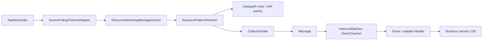
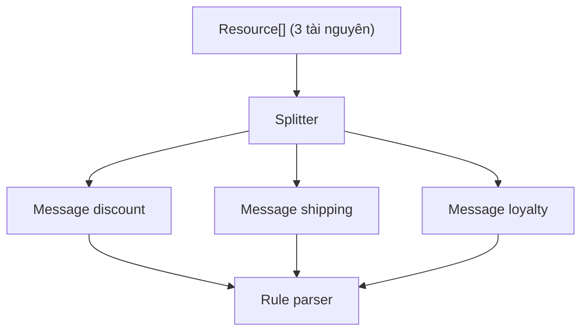
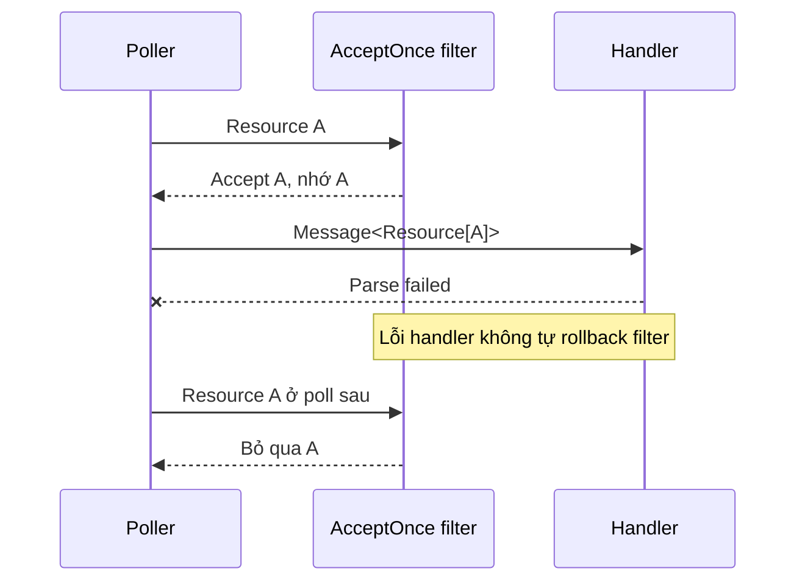
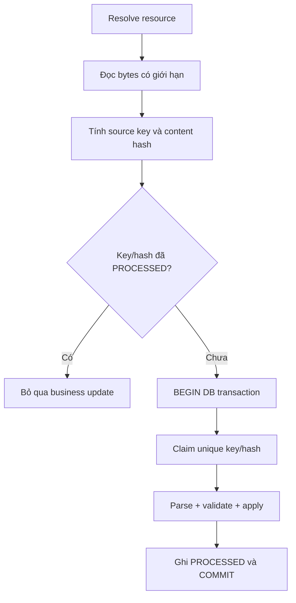

# Đọc classpath resource theo poller trong Spring Integration

## 1. Tình huống thực tế và mục tiêu

Một ứng dụng Spring Boot quản lý đơn hàng cần đọc các tệp quy tắc `.properties` được đóng gói trong `src/main/resources/catalog/rules/`. Một thư viện bổ sung cũng có thể đưa tệp quy tắc vào JAR của nó. Ứng dụng muốn định kỳ khám phá các tệp phù hợp, giải mã từng tệp, kiểm tra hợp lệ rồi chuyển dữ liệu vào luồng nghiệp vụ thông qua `MessageChannel`.

Một cách đơn giản là viết vòng lặp `Files.list(...)` trong service, nhưng cách đó ràng buộc dữ liệu vào một thư mục vật lý. Khi chạy executable JAR, classpath resource có thể nằm **bên trong JAR** và không thể xử lý như `java.io.File` thông thường.

Spring Integration cung cấp **`ResourceRetrievingMessageSource`** để tìm kiếm resource theo pattern và một **polling inbound channel adapter** để định kỳ gọi nguồn. Nguồn phát ra `Resource[]`, tức **một tập các resource handle trong một Spring Message**, rồi các thành phần downstream mới quyết định cách đọc và xử lý nội dung.

Bài học thuộc chương **Adapter Resource** của module **SPRING_INTEGRATION_ADAPTERS**: kết nối hệ thống ngoài với Spring Integration bằng inbound/outbound adapter, gateway, poller và `MessageChannel`; xử lý hợp đồng message, lỗi và vòng đời. Chủ đề ở đây là **đọc classpath resource theo poller**, không phải theo dõi thay đổi file bằng watcher, không phải xử lý một file SFTP hay xác nhận delivery của JMS/Kafka.

Sau bài học, bạn có thể:

1. Phân biệt `classpath:` với `classpath*:`, wildcard, filesystem và resource trong JAR.
2. Thiết kế `ResourceRetrievingMessageSource`, `@InboundChannelAdapter` và `@Poller` để đọc tài nguyên định kỳ.
3. Hiểu rằng `maxMessagesPerPoll` giới hạn **lần gọi receive**, không giới hạn số phần tử trong `Resource[]`.
4. Dùng `AcceptOnceCollectionFilter`, nhận diện các trường hợp không đọc lại resource và rủi ro xử lý lại sau restart.
5. Mở resource bằng `getInputStream()`, giới hạn kích thước, parse UTF-8 và kiểm tra hợp đồng.
6. Viết unit test cho resolver/filter, kiểm tra khi đóng gói JAR, quan sát lỗi và thiết kế checkpoint khi cần độ tin cậy cao.

## 2. Tổng quan luồng xử lý



Mỗi thành phần chịu một trách nhiệm:

| Thành phần | Trách nhiệm | Không tự thực hiện |
| --- | --- | --- |
| `TaskScheduler` / `@Poller` | Xác định khi nào gọi nguồn | Theo dõi mọi sự kiện file thay đổi ngay lập tức |
| `ResourceRetrievingMessageSource` | Tìm resource theo location pattern, áp dụng filter | Mở/parsing JSON hoặc properties thành domain DTO |
| `ResourcePatternResolver` | Trả về các `Resource` khớp pattern | Bảo đảm source immutable, checkpoint nghiệp vụ |
| `CollectionFilter<Resource>` | Chọn subset cần phát ở lần poll | Transaction rollback của DB |
| `MessageChannel` | Truyền Spring message tới handler | Tự đảm bảo idempotency hoặc durability |
| Handler/transformer | Đọc stream, validate, biến đổi và áp dụng nghiệp vụ | Tự thay đổi cách poller quét classpath |

Tài liệu Spring Integration mô tả Resource inbound channel adapter là **polling adapter**. Khác File inbound, nó phát **collection các `Resource` trong một message**, thay vì mặc định phát một `File` trong từng message.

## 3. Resource là một handle, không phải nội dung đã đọc

Giao diện Spring Framework `org.springframework.core.io.Resource` đại diện cho một nguồn dữ liệu. Những implementation thường gặp:

- `ClassPathResource`: tài nguyên theo đường dẫn classpath, có thể nằm trong thư mục classes hoặc bên trong JAR.
- `FileSystemResource`: tệp trên filesystem.
- `UrlResource`: nội dung truy cập qua URL được hỗ trợ.
- `ByteArrayResource`: bytes trong bộ nhớ, thuận tiện cho test.

Một handler có thể nhận:

```java
Resource resource = ...;

String name = resource.getFilename();
String description = resource.getDescription();
boolean present = resource.exists();

try (InputStream in = resource.getInputStream()) {
    // Đọc từng byte từ nguồn thực khi handler xử lý.
}
```

**Không mặc định `resource.getFile()` hoạt động.** Trong IDE, `src/main/resources` thường được copy ra thư mục classes, nên `getFile()` có thể thành công. Nhưng khi chạy packaged executable JAR, resource có thể là một entry bên trong JAR và không có `java.io.File` độc lập.

```text
Khi chạy trong IDE:
  build/classes/java/main/...
  build/resources/main/catalog/rules/discount.properties
  -> có thể có đường dẫn file vật lý

Khi chạy JAR:
  application.jar
    └── BOOT-INF/classes/catalog/rules/discount.properties
  -> thường phải đọc bằng Resource#getInputStream()
```

Hãy hiểu `Resource` như **tham chiếu có thể mở để đọc**. Việc đưa `Resource` vào Spring message chưa chứng minh bytes đã được đọc, schema đã đúng hoặc business transaction đã commit.

## 4. classpath: và classpath*: khác nhau ở đâu?

`ResourcePatternResolver` hỗ trợ location pattern dùng `classpath:` hoặc `classpath*:`.

### 4.1. classpath: — một không gian tìm kiếm classpath theo base URL

Ví dụ:

```text
classpath:catalog/rules/*.properties
```

Khi pattern có wildcard, resolver thường lấy URL của phần đường dẫn **trước wildcard** làm điểm gốc rồi tìm các resource khớp trong phạm vi đó. Nếu cùng thư mục `catalog/rules/` tồn tại tại nhiều classpath roots, `classpath:` có thể không tìm hết bản sao trên mọi JAR.

Nếu chỉ biết một resource cụ thể, không có wildcard, có thể dùng:

```text
classpath:catalog/rules/discount.properties
```

Đây là cách hợp lý khi ứng dụng có **một tài nguyên bắt buộc** và không cần quét nhiều nguồn.

### 4.2. classpath*: — thu thập từ nhiều classpath roots

Ví dụ:

```text
classpath*:catalog/rules/*.properties
```

Prefix `classpath*:` yêu cầu resolver tìm trên **nhiều vị trí classpath** phù hợp, bao gồm các JAR/thư mục có cùng base path theo khả năng class loader. Phù hợp với mô hình nhiều thư viện đóng góp resource vào một convention.

Giả sử:

```text
application.jar:
  catalog/rules/discount.properties
  catalog/rules/shipping.properties

pricing-extension.jar:
  catalog/rules/pricing.properties

shipping-extension.jar:
  catalog/rules/priority.properties
```

Với `classpath*:catalog/rules/*.properties`, ta mong muốn resolve các tệp phù hợp từ tất cả roots có thể thấy bởi class loader. **Không khẳng định số lượng match chỉ từ tên JAR**; phải kiểm thử khi đóng gói và chạy với đúng class loader/launcher.

### 4.3. So sánh nhanh

| Pattern | Mục đích | Điểm cần kiểm chứng |
| --- | --- | --- |
| `classpath:catalog/rules/discount.properties` | Đọc một resource cụ thể | Có tồn tại trên classpath runtime không? |
| `classpath:catalog/rules/*.properties` | Tìm pattern trong classpath theo base URL được chọn | Có bỏ sót thư viện khác không? |
| `classpath*:catalog/rules/*.properties` | Tìm qua nhiều classpath roots | Nested JAR/class loader có enumerate đúng không? |
| `classpath*:catalog/**/*.yml` | Tìm theo nhiều cấp thư mục | Scope rộng, nhiều JAR và chi phí quét |
| `classpath*:*.properties` | Tìm tại root classpath | **Không đáng tin** khi wildcard ở root JAR |

**Lựa chọn khuyến nghị cho bài thực hành:** `classpath*:catalog/rules/*.properties`. Nó có thư mục gốc cố định trước wildcard, dễ kiểm soát và ít phụ thuộc vào giới hạn quét ở root JAR.

## 5. Wildcard và các giới hạn class loader/JAR

Spring Framework `PathMatchingResourcePatternResolver` hỗ trợ Ant-style pattern:

| Wildcard | Ý nghĩa thường gặp | Ví dụ |
| --- | --- | --- |
| `*` | Khớp nhiều ký tự trong một segment | `*.properties` |
| `?` | Khớp một ký tự trong một segment | `rule-?.yml` |
| `**` | Khớp nhiều cấp đường dẫn | `catalog/**/*.properties` |

### 5.1. Hãy có thư mục cố định trước wildcard

Tránh:

```text
classpath*:*.xml
classpath*:**/*.json
```

Với JAR, wildcard không có root directory cụ thể có thể không liệt kê đầy đủ. Spring Framework khuyến nghị có ít nhất **một thư mục gốc cố định trước wildcard** khi dùng `classpath*:` cùng Ant-style patterns.

Ưu tiên:

```text
classpath*:catalog/rules/*.properties
classpath*:META-INF/my-service/*.json
```

### 5.2. Khác biệt classpath lúc chạy

Kết quả có thể khác nhau giữa:

1. IDE: nhiều thư mục classes/resources nằm trực tiếp trên filesystem.
2. Test runner: thêm `src/test/resources` và dependencies test.
3. Executable Spring Boot JAR: resources nằm trong `BOOT-INF/classes` hoặc nested JARs.
4. Application server: custom class loader/classpath hierarchy.
5. Java module path: cơ chế tìm kiếm còn tùy phiên bản Framework và cách đóng gói.

Nếu thiếu tài nguyên trong production nhưng đúng trong IDE, cần kiểm tra package layout, file thực sự được đóng gói, class loader, và behavior của resolver. **Không lập tức thay `getInputStream()` bằng `getFile()`**, vì thay đổi đó thường làm vấn đề nặng hơn.

### 5.3. Thứ tự tài nguyên không phải business order

`getResources(...)` trả một mảng nhưng **không nên dựa vào thứ tự giữa nhiều JAR/classpath roots** để quyết định quy tắc nào ưu tiên. Nếu hai thư viện đều có `discount.properties`:

- `Resource#getFilename()` có thể trùng.
- Vị trí URL/description có thể khác.
- Mặc định không có một quy tắc “JAR nào đến trước sẽ ghi đè” phù hợp cho mọi môi trường.

Nếu cần thứ tự/độ ưu tiên, hãy khai báo `priority` hoặc `rule.version` trong nội dung, xử lý xung đột một cách tường minh, ghi metric và fail-fast với trường hợp không hợp lệ.

## 6. Cấu trúc project dùng để thực hành

Ví dụ ứng dụng Spring Boot + Spring Integration:

```text
src/
  main/
    java/com/example/adapterresource/
      ResourcePollingConfiguration.java
      RuleResourceHandler.java
      RuleDefinition.java
    resources/
      catalog/rules/
        discount.properties
        shipping.properties
        loyalty.properties
  test/
    resources/
      fixture-rules/
        first.properties
        second.properties
```

Nội dung `discount.properties`:

```properties
rule.id=discount-standard
rule.version=1
rule.enabled=true
rule.rate=0.05
```

Nội dung `shipping.properties`:

```properties
rule.id=shipping-basic
rule.version=2
rule.enabled=true
rule.rate=0.00
```

Nội dung `loyalty.properties`:

```properties
rule.id=loyalty-silver
rule.version=1
rule.enabled=false
rule.rate=0.02
```

Đây là **hợp đồng dữ liệu do ứng dụng định nghĩa**, Spring Resource adapter không tự biết `rule.id`, `rule.version` hay `rule.rate`. Handler phải parse/validate rồi đưa vào domain service.

### Dependency

Trong dự án Maven đã dùng BOM Spring Boot tương thích:

```xml
<dependencies>
    <dependency>
        <groupId>org.springframework.boot</groupId>
        <artifactId>spring-boot-starter-integration</artifactId>
    </dependency>
</dependencies>
```

Với Resource inbound thuần, các class chính có sẵn trong **Spring Integration Core** và Spring Framework Core. Chỉ thêm adapter File/SFTP/HTTP khi thực sự cần nguồn dữ liệu thuộc các loại đó. Mẫu dưới đây dùng Java 17+ cho `record` và try-with-resources.

## 7. Cấu hình Java: MessageSource<Resource[]> và @Poller

Ví dụ dùng `@Bean` kết hợp `@InboundChannelAdapter`. Đây là cách được Spring Integration hỗ trợ cho một bean trả về `MessageSource`.

```java
package com.example.adapterresource;

import org.springframework.context.annotation.Bean;
import org.springframework.context.annotation.Configuration;
import org.springframework.core.io.Resource;
import org.springframework.integration.annotation.InboundChannelAdapter;
import org.springframework.integration.annotation.Poller;
import org.springframework.integration.channel.DirectChannel;
import org.springframework.integration.config.EnableIntegration;
import org.springframework.integration.core.MessageSource;
import org.springframework.integration.resource.ResourceRetrievingMessageSource;
import org.springframework.integration.util.AcceptOnceCollectionFilter;
import org.springframework.messaging.MessageChannel;

@Configuration
@EnableIntegration
public class ResourcePollingConfiguration {

    @Bean
    public MessageChannel resourceBatches() {
        return new DirectChannel();
    }

    @Bean
    @InboundChannelAdapter(
        channel = "resourceBatches",
        poller = @Poller(
            fixedDelay = "5000",
            initialDelay = "1000",
            maxMessagesPerPoll = "1"
        )
    )
    public MessageSource<Resource[]> classpathRuleSource() {
        ResourceRetrievingMessageSource source =
            new ResourceRetrievingMessageSource(
                "classpath*:catalog/rules/*.properties"
            );

        source.setFilter(new AcceptOnceCollectionFilter<>());
        return source;
    }
}
```

### Giải thích theo từng bước

1. `@EnableIntegration` kích hoạt hạ tầng Spring Integration cần thiết.
2. `resourceBatches()` tạo `DirectChannel` nội bộ để truyền message.
3. `@InboundChannelAdapter` tạo `SourcePollingChannelAdapter` gọi `MessageSource.receive()` theo lịch.
4. `@Poller(fixedDelay="5000")` đặt khoảng **5 giây** giữa các lần poll theo fixed-delay semantics.
5. `initialDelay="1000"` trì hoãn lần poll đầu khoảng 1 giây sau khi endpoint được lên lịch khởi chạy.
6. `maxMessagesPerPoll="1"` giới hạn một chu kỳ xử lý **tối đa một message nhận từ source**, không phải một file.
7. `ResourceRetrievingMessageSource` resolve pattern qua `ResourcePatternResolver`.
8. `AcceptOnceCollectionFilter` giảm việc phát lại cùng resource trong vòng đời bộ lọc.

**Không khai báo thêm một XML resource inbound adapter hoặc Java DSL flow khác cùng source trong demo này.** Hai poller độc lập có thể quét và gửi cùng dữ liệu hai lần, làm kết quả khó giải thích.

### Vì sao khai báo filter tường minh?

Tài liệu Resource inbound mô tả **default `AcceptOnceCollectionFilter` khi dùng XML namespace không chỉ định `filter`**. Trong Java configuration này, ta thiết lập filter rõ ràng để tránh phụ thuộc vào giả định về default của một cách khai báo khác và giúp người đọc dễ xác minh chính sách replay.

## 8. Kết quả của một chu kỳ poll: Resource[], không phải từng file

Khi resolver tìm được ba resource:

```text
classpath*:catalog/rules/*.properties
    |
    +-- discount.properties
    +-- shipping.properties
    +-- loyalty.properties
```

Kết quả ở lần poll đầu có thể là:

```text
Source.receive() -> Message<Resource[]>
    payload.length = 3
    payload[0] = Resource(discount.properties)
    payload[1] = Resource(shipping.properties)
    payload[2] = Resource(loyalty.properties)
```

Đây chỉ là **một message** có ba phần tử, thứ tự phần tử là minh họa.

| Cấu hình | Số lần receive trong một chu kỳ | Số Resource có thể nằm trong một message |
| --- | --- | --- |
| `maxMessagesPerPoll=1` | Tối đa 1 | 0, 1 hoặc nhiều resource được resolve/filtered |
| `maxMessagesPerPoll=3` | Tối đa 3, tùy có dữ liệu | Mỗi lần receive có thể tạo một batch riêng |
| `fixedDelay=5000` | Không quyết định số phần tử | Điều khiển thời gian giữa các chu kỳ |

Ví dụ với accept-once filter:

```text
Poll 1: tìm 3 resource -> filter chấp nhận 3 -> Message<Resource[3]>
Poll 2: vẫn 3 resource -> filter loại cả 3 -> không có batch mới
Poll 3: vẫn 3 resource -> filter loại cả 3 -> không có batch mới
```

**Điểm quan trọng:** poller **vẫn tiếp tục chạy** ở poll 2, poll 3 dù không có message được phát ra. Vì vậy metric `poll.count` tăng không có nghĩa số resource đã xử lý tăng.

## 9. Đọc từng resource qua InputStream một cách an toàn

Để xây hợp đồng nghiệp vụ, ta định nghĩa:

```java
package com.example.adapterresource;

import java.math.BigDecimal;

public record RuleDefinition(
    String id,
    int version,
    boolean enabled,
    BigDecimal rate
) {}
```

Handler nhận `Message<Resource[]>` và đọc các tệp. Ví dụ giới hạn **64 KiB/resource** trước khi parse:

```java
package com.example.adapterresource;

import java.io.ByteArrayInputStream;
import java.io.IOException;
import java.io.InputStream;
import java.io.InputStreamReader;
import java.math.BigDecimal;
import java.nio.charset.StandardCharsets;
import java.util.Properties;

import org.springframework.core.io.Resource;
import org.springframework.integration.annotation.ServiceActivator;
import org.springframework.messaging.Message;
import org.springframework.stereotype.Component;

@Component
public class RuleResourceHandler {

    private static final int MAX_RULE_BYTES = 64 * 1024;

    @ServiceActivator(inputChannel = "resourceBatches")
    public void receive(Message<Resource[]> batch) throws IOException {
        for (Resource resource : batch.getPayload()) {
            RuleDefinition rule = parse(resource);

            // TODO: chuyển rule sang domain service hoặc DB.
            // Không log toàn bộ file vì có thể chứa secret.
            System.out.printf(
                "Loaded rule id=%s, version=%d%n",
                rule.id(), rule.version()
            );
        }
    }

    private RuleDefinition parse(Resource resource) throws IOException {
        byte[] data;

        try (InputStream in = resource.getInputStream()) {
            data = in.readNBytes(MAX_RULE_BYTES + 1);
        }
        if (data.length > MAX_RULE_BYTES) {
            throw new IOException(
                "Rule resource exceeds configured byte limit"
            );
        }

        Properties props = new Properties();
        try (InputStreamReader reader = new InputStreamReader(
                new ByteArrayInputStream(data),
                StandardCharsets.UTF_8
        )) {
            props.load(reader);
        }

        String id = props.getProperty("rule.id");
        if (id == null || id.isBlank()) {
            throw new IllegalArgumentException("Missing rule.id");
        }

        int version = Integer.parseInt(
            props.getProperty("rule.version", "0")
        );
        if (version <= 0) {
            throw new IllegalArgumentException(
                "rule.version must be positive"
            );
        }

        String enabledValue =
            props.getProperty("rule.enabled", "false");
        if (!"true".equals(enabledValue)
                && !"false".equals(enabledValue)) {
            throw new IllegalArgumentException(
                "Invalid rule.enabled"
            );
        }

        BigDecimal rate = new BigDecimal(
            props.getProperty("rule.rate", "0")
        );
        if (rate.signum() < 0 || rate.compareTo(BigDecimal.ONE) > 0) {
            throw new IllegalArgumentException(
                "rule.rate must be between 0 and 1"
            );
        }

        return new RuleDefinition(
            id,
            version,
            Boolean.parseBoolean(enabledValue),
            rate
        );
    }
}
```

### Vì sao không dùng getFile()?

`Resource#getInputStream()` vẫn phù hợp khi tài nguyên nằm trong nested JAR hoặc filesystem. `getFile()` có thể ném exception khi không có physical file tương ứng. Try-with-resources bảo đảm stream được đóng khi parse thành công hoặc thất bại.

### Vì sao Properties.load(Reader)?

`Properties.load(InputStream)` có semantics mã hóa khác với việc chủ động đọc UTF-8. Ví dụ chọn `InputStreamReader(..., UTF_8)` và `Properties.load(Reader)` để quy ước nội dung được phát hành theo UTF-8. Hai phía publisher và consumer phải thống nhất encoding thực tế.

### Vì sao kiểm tra size?

Không nên gọi `resource.getInputStream().readAllBytes()` trên nguồn chưa được giới hạn. Dù classpath thông thường do đội phát triển đóng gói, các extension/dependency có thể góp resource không đúng contract. `readNBytes(MAX + 1)` đủ để từ chối resource vượt mức trước khi parse; nó không thay thế giới hạn bộ nhớ tổng, số resource và bảo mật dependency.

**Lưu ý:** parse thành công chưa có nghĩa đã ghi DB. Ví dụ chỉ log nhằm mô tả hợp đồng; production nên tách `RuleParser` và `RulePersistenceService` với transaction, version và idempotency rõ ràng.

## 10. Nếu mỗi resource cần một message riêng: splitter

Một `Message<Resource[]>` có thể được tách thành nhiều `Message<Resource>`:



Trong một ứng dụng **thay thế** cách khai báo annotation ở mục 7, có thể dùng Java DSL:

```java
import org.springframework.context.annotation.Bean;
import org.springframework.context.annotation.Configuration;
import org.springframework.integration.dsl.IntegrationFlow;
import org.springframework.integration.dsl.Pollers;
import org.springframework.integration.resource.ResourceRetrievingMessageSource;
import org.springframework.integration.util.AcceptOnceCollectionFilter;

@Configuration
public class ClasspathRuleSplitFlow {

    @Bean
    public ResourceRetrievingMessageSource ruleResources() {
        ResourceRetrievingMessageSource source =
            new ResourceRetrievingMessageSource(
                "classpath*:catalog/rules/*.properties"
            );
        source.setFilter(new AcceptOnceCollectionFilter<>());
        return source;
    }

    @Bean
    public IntegrationFlow ruleFlow(
            ResourceRetrievingMessageSource ruleResources,
            RuleItemService ruleItemService) {
        return IntegrationFlow
            .from(
                ruleResources,
                e -> e.poller(
                    Pollers.fixedDelay(5000)
                        .maxMessagesPerPoll(1)
                )
            )
            .split()
            .handle((payload, headers) -> {
                ruleItemService.process(
                    (org.springframework.core.io.Resource) payload
                );
                return null; // One-way handler.
            })
            .get();
    }
}
```

`RuleItemService` là service do ứng dụng tự định nghĩa có method `process(Resource)`; nó cần thực hiện parse/validate/checkpoint và quản lý exception. Ví dụ DSL là một topology **khác** với `@InboundChannelAdapter` của mục 7, không nên bật cả hai cùng pattern khi thử nghiệm.

**Splitter không tạo lại một resource đã bị accept-once filter loại bỏ.** Nếu item thứ ba lỗi sau khi batch được tạo, filter không tự rollback trạng thái “đã thấy” của item đó. Với hệ thống cần retry, phải giải quyết ở tầng checkpoint hoặc điều chỉnh chiến lược lọc.

## 11. Poller: fixed-delay, fixed-rate, initialDelay và batch

### 11.1. fixed-delay

`@Poller(fixedDelay = "5000")` có ý nghĩa các lần kích hoạt được lên lịch với khoảng chờ sau khi tác vụ trước kết thúc theo scheduler/poller tương ứng. Cách này phù hợp cho việc resolve classpath không cần chạy chồng lấn liên tục.

### 11.2. fixed-rate

`@Poller(fixedRate = "5000")` đặt nhịp khởi chạy theo lịch đều đặn. Nếu một lần resolve hoặc handler lâu hơn 5 giây, timing thực tế phụ thuộc `TaskScheduler` và số luồng; đừng mặc định scheduler sẽ tự xử lý song song vô hạn.

### 11.3. initialDelay

`initialDelay` cho phép trì hoãn lần poll đầu, ví dụ để các bean downstream sẵn sàng trước khi nhận batch. Nó **không** thay thế kiểm tra readiness của DB hoặc broker ngoài.

### 11.4. maxMessagesPerPoll

Giá trị `maxMessagesPerPoll = 1` chỉ giới hạn tối đa số message `MessageSource.receive()` mà poller xử lý trong một chu kỳ. Một `ResourceRetrievingMessageSource` có thể trả **một message chứa hàng trăm `Resource`**.

Ví dụ:

```text
T+1s:  poll #1
       source.resolve() -> 100 resources
       filter -> 100 resources
       channel.send(Message<Resource[100]>)

T+6s+: poll #2
       source.resolve() -> 100 resources
       accept-once -> 0 resources
       không có batch mới
```

**Không suy ra chính xác thời điểm T+6s chỉ từ cấu hình**: việc xử lý batch, scheduler contention và thời gian resolve có thể khiến chu kỳ thực tế lệch so với số minh họa.

### Khi nào nên poll dày hơn?

Classpath resources bên trong JAR thường chỉ thay đổi khi **build/deploy version mới**. Poll mỗi 100 ms không làm JAR tự cập nhật và chỉ gây lặp lại thao tác quét. Với tài nguyên bất biến sau startup, cân nhắc **nạp một lần khi khởi động** thay vì poll thường xuyên. Poller phù hợp hơn khi nguồn có thể thay đổi hợp lệ qua vòng đời process, chẳng hạn classpath root là một thư mục được quản lý từ bên ngoài.

## 12. AcceptOnceCollectionFilter và chuyện “đã đọc một lần”

`AcceptOnceCollectionFilter<Resource>` giữ trạng thái các resource đã được chấp nhận theo identity/equality mà filter sử dụng. Tài liệu Spring Integration quy định XML Resource inbound mặc định dùng bộ lọc này khi không chỉ định filter.

### 12.1. Ba trạng thái khác nhau

| Trạng thái | Ý nghĩa |
| --- | --- |
| **Đã resolve** | Resource khớp pattern và được resolver trả về. |
| **Đã accept** | Filter cho resource đi qua ở một lần poll. |
| **Đã xử lý nghiệp vụ** | Handler parse và DB commit thành công theo contract. |

Ba trạng thái **không đồng nhất**. Filter có thể chấp nhận resource ở `T1` nhưng handler lỗi tại `T2`.



### 12.2. Đọc lại sau khi sửa file

Với `AcceptOnceCollectionFilter`, việc thay **nội dung** mà giữ nguyên resource identity không bắt buộc khiến resource được phát lại. Filter không phải content watcher hay content-version tracker.

Với executable JAR, sửa file **bên trong JAR** khi ứng dụng đang chạy không phải workflow cập nhật cấu hình đáng tin cậy. Nếu cần hot reload, dùng một nguồn mutable chính thức như `file:` trên thư mục ngoài, database, Config Server hoặc event source riêng, có chính sách version/refresh.

### 12.3. Restart có thể khiến resource được phát lại

Trạng thái accept-once mặc định nằm trong bộ nhớ của bean. Sau restart, nó có thể “quên” các resource đã nhận, và batch cùng tài nguyên có thể xuất hiện lại. Vì vậy ứng dụng phải xử lý **duplicate business effects** nếu dữ liệu có hậu quả khi nạp nhiều lần.

### 12.4. Nếu muốn đọc lại mỗi poll?

Trong XML namespace, có thể tắt default filter:

```xml
<int:resource-inbound-channel-adapter
        id="classpathResources"
        channel="resourceBatches"
        pattern="classpath*:catalog/rules/*.properties"
        filter="">
    <int:poller fixed-delay="5000"/>
</int:resource-inbound-channel-adapter>
```

Khi tắt filter, resource vẫn khớp pattern có thể được phát lại mỗi lần poll. **Chỉ nên làm vậy khi downstream có version check/idempotency** hoặc bản chất bài toán là kiểm tra lại cấu hình theo định kỳ.

Ở Java, có thể chọn `CollectionFilter<Resource>` riêng để thực hiện policy phù hợp; không giả định gọi `setFilter(customFilter)` sẽ tự kết hợp với accept-once.

## 13. Làm sao chỉ xử lý khi nội dung thực sự thay đổi?

Một yêu cầu nâng cao là **chỉ parse lại nếu bytes khác phiên bản đã xử lý**. Pattern resolver không có trách nhiệm phát hiện business version; cần xây ở tầng ứng dụng.

### 13.1. Khóa nguồn và phiên bản

Ví dụ:

```text
resourceId     = stable source identity
contentVersion = SHA-256(resource bytes)
businessKey    = resourceId + ":" + contentVersion
```

Đừng dùng một mình `resource.getFilename()` vì nhiều JAR có thể chứa cùng filename. `resource.getURL()` có thể hữu ích để quan sát nơi xuất phát, nhưng URL/description có thể thay đổi giữa cách đóng gói hoặc giữa các lần deploy; cần thiết kế stable identity theo domain.

### 13.2. Cơ chế version-aware processing



**Chú ý ranh giới:** nếu đã dùng `AcceptOnceCollectionFilter` chặn resource từ đầu, tầng hash không có cơ hội nhận tài nguyên đó ở các poll tiếp theo. Một hệ thống cần phát hiện thay đổi phải dùng filter **version-aware** hoặc cho source phát lại rồi quyết định ở tầng content-hash/ledger.

### 13.3. At-most-once discovery khác exactly-once processing

- **Discovery:** nguồn tìm thấy resource và filter cho đi qua.
- **Delivery nội bộ:** Spring `MessageChannel` gửi reference tới handler.
- **Business outcome:** transaction/DB đã áp dụng một version hay chưa.

Một ứng dụng không thể suy ra “đã xử lý đúng một lần” chỉ từ accept-once filter. Nếu có nhiều replica hoặc mất điện sau commit, cần unique constraint/checkpoint bền vững hoặc một cơ chế coordination phù hợp.

## 14. Xử lý lỗi từ resolver đến database

Lỗi trong flow có thể phát sinh ở nhiều thời điểm:

| Giai đoạn | Lỗi ví dụ | Cách tiếp cận |
| --- | --- | --- |
| Resolve classpath | Base path sai, resource thiếu trong JAR, class loader không expose directory | Xác minh packaging và runtime resolver; cảnh báo nếu nguồn bắt buộc rỗng. |
| Filter | State sai, loại nhầm version mới | Kiểm tra filter/identity policy, reset có kiểm soát. |
| Open stream | Resource không thể mở, exception I/O | Retry có giới hạn nếu nguồn mutable; kiểm tra package/ACL. |
| Decode | Encoding không thống nhất | Chốt UTF-8 hoặc contract đã định. |
| Parse | Field thiếu, sai số, schema mismatch | Quarantine/validation error; không retry vô hạn dữ liệu lỗi. |
| Domain service | Xung đột version, trùng rule.id | Business rule rõ ràng, transaction/unique constraint. |
| DB | Timeout, deadlock, unavailable | Retry theo policy và idempotency. |
| Async worker | Exception sau khi poller đã trả về | Error flow downstream; không đợi source tự rollback. |

### 14.1. Một batch có thể thất bại ở phần tử thứ N

Ví dụ batch `[A, B, C]`: handler đọc A thành công, lưu B rồi parse C lỗi. Nếu không có transaction bao trùm tác động nghiệp vụ, có thể đã có một phần kết quả. Nếu có JDBC transaction, nó chỉ rollback **thay đổi DB trong phạm vi transaction đó**, không tự rollback `AcceptOnceCollectionFilter`.

Các lựa chọn:

1. Xử lý cả batch như một unit-of-work và rollback DB khi bất kỳ resource nào sai (khi business phù hợp).
2. Split thành từng `Resource`, mỗi item có transaction/định danh riêng.
3. Dùng ledger lưu trạng thái từng resource version để retry đúng item thất bại.
4. Quarantine tài nguyên sai và tiếp tục tài nguyên hợp lệ theo policy đã công bố.

**Không mặc định lỗi handler sẽ được poller retry message đã bị accept-once.** Phải thiết kế rõ retry/checkpoint.

### 14.2. DirectChannel và async boundary

Trong ví dụ chính, `DirectChannel` chuyển message đồng bộ tới handler; exception có thể truyền về poller. Nếu đổi sang `ExecutorChannel` hoặc `QueueChannel`:

- `send()` thành công có thể chỉ nghĩa là task được giao cho worker hoặc message đã được enqueue.
- Worker xử lý thất bại **sau** khi source/filter đã đánh dấu resource.
- Queue in-memory có thể mất nội dung khi process crash.
- Cần giới hạn queue, error channel phía worker và checkpoint độc lập.

### 14.3. Lỗi khi không có resource nào khớp

Với nhiều ứng dụng, “0 resource” là tình huống bình thường. Với rule set bắt buộc, đó lại là lỗi vận hành. `ResourceRetrievingMessageSource` không biết business requirement “ít nhất 3 rule”. Ta cần health check/validation riêng, chẳng hạn kiểm tra số rule đã nạp thành công sau startup và cảnh báo nếu chưa đạt ngưỡng.

## 15. Lưu ý đặc biệt với resource được đóng gói sẵn

Khi resource thực sự nằm trong executable JAR:

- Nội dung thường **bất biến cho tới lần build/deploy tiếp theo**.
- Repeated polling chủ yếu lặp lại thao tác enumerate/resolve, không biến nó thành file watcher.
- Nếu muốn thay đổi nóng một configuration file mà không redeploy, nên đặt ở **nguồn ngoài classpath đóng gói** và có cơ chế refresh đúng contract.
- Quét tất cả JAR mỗi vài trăm mili giây có thể tốn CPU/IO và làm tăng latency khởi động/GC nếu số resource lớn.
- `Resource#getInputStream()` thích hợp hơn `Resource#getFile()` để tương thích JAR entries.

### Khi nào không nên dùng poller?

Nếu yêu cầu là “đọc 3 tệp bất biến **một lần duy nhất lúc khởi động** để tạo bean cấu hình”, dùng `@ConfigurationProperties`, `ResourceLoader` hoặc `ApplicationRunner` có thể đơn giản hơn.

Nếu yêu cầu là “mỗi khi file trong thư mục ngoài được thay thế, xử lý ngay”, dùng `file:` + cơ chế quét/version phù hợp hoặc File inbound adapter/watch-service. Nếu yêu cầu là “nhận message từ Kafka/JMS”, dùng adapter tương ứng — classpath resolver không thay thế broker consumer.

## 16. XML namespace: cách cấu hình thay thế

Không bắt buộc dùng Java annotations. Tài liệu Spring Integration hỗ trợ XML resource inbound channel adapter:

```xml
<?xml version="1.0" encoding="UTF-8"?>
<beans xmlns="http://www.springframework.org/schema/beans"
       xmlns:xsi="http://www.w3.org/2001/XMLSchema-instance"
       xmlns:int="http://www.springframework.org/schema/integration"
       xsi:schemaLocation="
          http://www.springframework.org/schema/beans
          https://www.springframework.org/schema/beans/spring-beans.xsd
          http://www.springframework.org/schema/integration
          https://www.springframework.org/schema/integration/spring-integration.xsd">

    <int:channel id="resourceBatches"/>

    <int:resource-inbound-channel-adapter
            id="classpathResources"
            channel="resourceBatches"
            pattern="classpath*:catalog/rules/*.properties">
        <int:poller
                fixed-delay="5000"
                max-messages-per-poll="1"/>
    </int:resource-inbound-channel-adapter>

    <bean id="ruleResourceHandler"
          class="com.example.adapterresource.RuleResourceHandler"/>

    <int:service-activator
            input-channel="resourceBatches"
            ref="ruleResourceHandler"
            method="receive"/>
</beans>
```

Đây là **phương án thay thế** cấu hình Java, không bật song song hai phiên bản khi cùng tìm một tập resource. Class `RuleResourceHandler` là class của ứng dụng ở mục 9. Theo Spring Integration reference, **XML resource inbound adapter dùng `AcceptOnceCollectionFilter` mặc định** nếu không khai báo `filter`.

### Thêm custom filter/resolver

XML hỗ trợ:

```xml
<int:resource-inbound-channel-adapter
        id="customClasspathResources"
        channel="resourceBatches"
        pattern="classpath*:catalog/rules/*.properties"
        pattern-resolver="customPatternResolver"
        filter="customResourceFilter">
    <int:poller fixed-delay="5000"/>
</int:resource-inbound-channel-adapter>
```

`customPatternResolver` phải là bean triển khai `ResourcePatternResolver`, `customResourceFilter` triển khai `CollectionFilter<Resource>`; bạn phải tự khai báo hai bean. Không có sẵn những bean này chỉ vì XML đã tham chiếu tên.

## 17. Kiểm thử classpath resolution trước khi đưa vào poller

Trước khi chạy flow, bạn nên có test **chỉ kiểm tra resolver**, nhằm tách lỗi classpath/package khỏi lỗi poller, channel hoặc handler.

### 17.1. Test resolver với JUnit 5

Tạo `src/test/resources/fixture-rules/first.properties` và `second.properties`. Ví dụ:

```java
import static org.junit.jupiter.api.Assertions.assertEquals;
import static org.junit.jupiter.api.Assertions.assertNotNull;

import java.util.Arrays;
import java.util.Set;
import java.util.stream.Collectors;

import org.junit.jupiter.api.Test;
import org.springframework.core.io.Resource;
import org.springframework.core.io.support.PathMatchingResourcePatternResolver;

class ClasspathResourceResolverTest {

    @Test
    void findsFixturesUnderDedicatedClasspathFolder() throws Exception {
        var resolver = new PathMatchingResourcePatternResolver();

        Resource[] found = resolver.getResources(
            "classpath*:fixture-rules/*.properties"
        );

        Set<String> names = Arrays.stream(found)
            .map(Resource::getFilename)
            .collect(Collectors.toSet());

        assertEquals(
            Set.of("first.properties", "second.properties"), names
        );
        for (Resource resource : found) {
            try (var stream = resource.getInputStream()) {
                assertNotNull(stream);
            }
        }
    }
}
```

Unit test phải đặt fixture đúng classpath test; số lượng match có thể khác nếu test dependencies vô tình chứa cùng thư mục và filenames. Chọn tên fixture riêng cho project để tránh xung đột. `InputStream` trong vòng lặp được đóng bằng try-with-resources.

### 17.2. Test source và accept-once filter

```java
import static org.junit.jupiter.api.Assertions.*;

import org.junit.jupiter.api.Test;
import org.springframework.core.io.Resource;
import org.springframework.core.io.support.PathMatchingResourcePatternResolver;
import org.springframework.integration.resource.ResourceRetrievingMessageSource;
import org.springframework.integration.util.AcceptOnceCollectionFilter;
import org.springframework.messaging.Message;

class ClasspathResourceSourceTest {

    @Test
    void emitsOneBatchThenNoRepeatInSameSourceInstance()
            throws Exception {
        var source = new ResourceRetrievingMessageSource(
            "classpath*:fixture-rules/*.properties"
        );
        source.setPatternResolver(
            new PathMatchingResourcePatternResolver()
        );
        source.setFilter(new AcceptOnceCollectionFilter<>());
        source.afterPropertiesSet();

        Message<Resource[]> first = source.receive();
        assertNotNull(first);
        assertEquals(2, first.getPayload().length);

        Message<Resource[]> second = source.receive();
        assertNull(second);
    }
}
```

Test này xác minh **source/filter trong cùng JVM**. Nó không chạy `TaskScheduler`, không chứng minh browser/JAR packaging và cũng không chứng minh DB commit. Cần test ở các tầng tiếp theo.

### 17.3. Integration test cho poller

Trong Spring Boot integration test, bật `@EnableIntegration`, cấu hình poller nhỏ (ví dụ 100–200 ms ở test), dùng một `QueueChannel` hoặc test handler để thu message. Cần kiểm tra:

1. Có một batch chứa `Resource[]` sau lần poll đầu.
2. Batch chỉ có resource thuộc thư mục fixture.
3. Handler mở stream và parse được.
4. Không có batch mới sau đó khi filter accept-once đã ghi nhận tài nguyên.
5. Exception parse được quan sát ở error flow thích hợp.

Tránh khẳng định mỗi poll chạy đúng vào mili giây thứ N; scheduler và test runner có độ trễ, cần await có timeout hợp lý.

## 18. Test đóng gói JAR và môi trường nhiều roots

Đây là bước không thể thay thế chỉ bằng unit test chạy trong IDE.

### Ma trận tối thiểu

| Môi trường | Điều cần kiểm chứng |
| --- | --- |
| IDE / test runner | `classpath*:catalog/rules/*.properties` tìm đúng fixture và resource chính. |
| Executable JAR | `getInputStream()` mở được resource trong `BOOT-INF/classes`. |
| Dependency JAR | Resource có cùng base path ở một dependency được resolver thấy. |
| Hai JAR cùng filename | Không lấy filename làm business key duy nhất; conflict policy đúng. |
| Root wildcard `classpath*:*.xml` | Có thể bỏ sót resource trong JAR; tránh dùng. |
| Startup khi bắt buộc phải có rule | Fail/alert nếu không nạp đủ rule. |
| Restart app | Accept-once state được tạo lại; duplicate ledger không tạo tác động trùng. |
| Xử lý lỗi ở item thứ N | Không bỏ sót item lỗi khi batch đã chấp nhận. |

Nếu chạy packaged JAR và kết quả khác test runner, hãy kiểm tra **resource thực tế có được đóng gói**, base path có thư mục cố định, class loader của launcher và khả năng enumerate nested JAR. Không dùng `File#listFiles` trên đường dẫn suy ra từ `ClassPathResource#getFile()` làm phương án chữa cháy.

## 19. Quan sát và troubleshooting

| Triệu chứng | Nguyên nhân có thể | Cách kiểm tra |
| --- | --- | --- |
| Poller chạy nhưng không có batch | Pattern sai, fixture không có, filter đã loại hết | Đo resolver count vs filter count; kiểm tra classpath runtime. |
| Chỉ thấy một message cho nhiều file | Payload là `Resource[]` | Log batch length; split nếu cần từng item. |
| Không đọc được JAR resource | Dùng `getFile()` hoặc class loader không hỗ trợ pattern | Đổi sang `getInputStream()`, kiểm thử JAR. |
| File trong dependency không xuất hiện | Dùng `classpath:` khi cần tìm nhiều roots | Thử `classpath*:` và xem package layout. |
| Sau sửa file không đọc lại | Accept-once chưa theo dõi version | Dùng version-aware policy hoặc tắt filter có kiểm soát. |
| Sau restart rule bị xử lý hai lần | Filter in-memory mất state | Unique constraint/ledger theo rule ID/version/hash. |
| Một resource lỗi làm dừng cả batch | Handler duyệt tuần tự và ném exception | Split theo item hoặc định nghĩa batch atomic/quarantine. |
| Poll interval quá ngắn nhưng throughput không tăng | Classpath scan không có dữ liệu mới, handler bận | Đo latency và điều chỉnh thiết kế/cadence. |
| Kết quả đọc khác IDE | Nested JAR/class loader/packaging khác | Chạy integration test với executable JAR. |
| Không nhận resource mới khi sửa JAR runtime | Packaged classpath không phải hot folder | Redeploy hoặc dùng nguồn ngoài classpath. |
| Nhiều replica nạp cùng rule | Source/filter riêng trên từng process | Central ledger/idempotency/coordination. |

### Metrics đề xuất

Ghi nhận số chu kỳ poll, số resource resolved, số được filter chấp nhận, `Resource[]` batch size, thời gian resolve, thời gian mở/parse, số resource version commit, duplicate count, parse failures và tuổi rule version mới nhất. Tách các mốc **discovery**, **accepted by filter**, **parsed** và **committed**, tránh xem “kết nối/scheduler đang chạy” như bằng chứng dữ liệu đã hợp lệ.

### Kiểm tra an toàn

- Chỉ quét thư mục classpath cụ thể, không nhận raw pattern từ input không tin cậy.
- Không log nguyên nội dung cấu hình hoặc URL chứa secrets.
- Giới hạn kích thước resource và tổng batch size.
- Xác thực schema, version và quyền nạp rule trước khi áp dụng vào nghiệp vụ.
- Khi nhiều JAR đóng góp cùng rule ID, có conflict policy tường minh.
- Không phụ thuộc vào thứ tự ngẫu nhiên của resolver để chọn rule ưu tiên.

## 20. Bài tập thực hành có đáp án

**Bài 1 — Abstraction.** Resource nằm bên trong JAR nên mở bằng `getFile()` hay `getInputStream()`?

**Đáp án:** `getInputStream()`. Không phải mọi classpath resource đều có file vật lý riêng.

**Bài 2 — Pattern.** Khi hai dependency JAR cùng chứa `catalog/rules/*.properties`, prefix nào phù hợp để tìm ở nhiều roots?

**Đáp án:** Thường dùng `classpath*:catalog/rules/*.properties`, rồi kiểm chứng trong runtime thật.

**Bài 3 — Wildcard root.** Vì sao tránh `classpath*:*.xml` trong packaged JAR?

**Đáp án:** Resolver có giới hạn quét wildcard tại root JAR; nên có base directory cố định trước wildcard.

**Bài 4 — Poller.** `fixedDelay="5000"` có ý nghĩa listener được broker push ngay khi file đổi không?

**Đáp án:** Không. Đây là lịch gọi `MessageSource.receive()` định kỳ.

**Bài 5 — Batch.** Resolver tìm 30 resource; `maxMessagesPerPoll="1"` có nghĩa chỉ phát một resource?

**Đáp án:** Không. Một `Message<Resource[]>` có thể chứa cả 30 resource; cấu hình giới hạn số message nhận trong chu kỳ.

**Bài 6 — Filter.** Khi Java source có `setFilter(new AcceptOnceCollectionFilter<>())`, poll thứ hai có thể không phát batch dù poller vẫn chạy?

**Đáp án:** Có. Filter có thể loại toàn bộ tài nguyên đã từng chấp nhận.

**Bài 7 — Thay đổi nội dung.** Sửa bytes của một resource nhưng không đổi location có đảm bảo filter phát lại không?

**Đáp án:** Không. Accept-once không thay thế content-version tracker.

**Bài 8 — Restart.** Restart ứng dụng có bảo đảm resource không được phát lại khi dùng filter in-memory không?

**Đáp án:** Không. Cần checkpoint/idempotency bền vững nếu xử lý lại nguy hiểm.

**Bài 9 — Lỗi handler.** Filter đã accept A rồi parser ném exception. Lần poll sau có chắc A được retry?

**Đáp án:** Không. Trạng thái filter không tự rollback cùng handler hoặc DB transaction.

**Bài 10 — Splitter.** Khi muốn mỗi resource xử lý độc lập theo transaction, có thể dùng gì sau nguồn?

**Đáp án:** `Splitter` để biến `Resource[]` thành từng `Resource`, cùng checkpoint/idempotency từng item.

**Bài 11 — Properties encoding.** Vì sao ví dụ dùng `InputStreamReader(..., UTF_8)` với `Properties.load(Reader)`?

**Đáp án:** Để diễn đạt hợp đồng UTF-8 một cách tường minh, tránh nhầm semantics mã hóa của overload `load(InputStream)`.

**Bài 12 — Thứ tự.** Có nên lấy resource đầu tiên trong mảng từ các JAR làm rule ưu tiên cao nhất?

**Đáp án:** Không. Thứ tự resolver không phải business ordering; cần version/priority/conflict policy.

**Bài 13 — Duplicate names.** Hai JAR có `discount.properties`. Có nên dùng filename làm khóa source duy nhất?

**Đáp án:** Không. Phải có định danh nguồn ổn định hơn và quy tắc xử lý xung đột.

**Bài 14 — Static JAR.** Poll mỗi 100 ms có khiến nội dung JAR tự hot-reload khi build lại artifact bên ngoài không?

**Đáp án:** Không. Nguồn classpath đóng gói thường bất biến trong vòng đời app; nên redeploy hoặc dùng nguồn mutable được hỗ trợ.

**Bài 15 — DB rollback.** `@Transactional` ở handler có tự hoàn tác resource đã đi qua accept-once filter không?

**Đáp án:** Không. Filter và DB transaction là các state độc lập.

**Bài 16 — Async.** Đổi `DirectChannel` sang `ExecutorChannel` có khiến `send()` đợi worker commit xong không?

**Đáp án:** Không. Task có thể chỉ được enqueue; cần downstream completion/error flow riêng.

**Bài 17 — Packaged JAR.** Một test chạy trong IDE thành công nhưng executable JAR không tìm thấy rule. Nên kiểm tra những gì?

**Đáp án:** Packaging, `BOOT-INF/classes`, base path, class loader, nested JAR resolution và pattern `classpath*:`.

**Bài 18 — Lựa chọn adapter.** Muốn quét thư mục SFTP từ server khác và xác nhận file đã tải, có nên chỉ dùng classpath Resource poller?

**Đáp án:** Không. Dùng SFTP adapter tương ứng với session/file synchronization/remote operations; classpath resolver không quản lý SFTP.

**Bài 19 — Kiểm thử.** Unit test `ResourceRetrievingMessageSource.receive()` có chứng minh poller và JAR packaging đã đúng?

**Đáp án:** Không. Nó chỉ kiểm tra source/filter; cần integration test scheduler và packaged JAR.

**Bài 20 — Production.** Khi nạp rule ảnh hưởng tính tiền, chỉ dùng accept-once filter có bảo đảm “exactly once business processing” không?

**Đáp án:** Không. Phải dùng version/unique key, transaction và idempotency/ledger bền vững.

## 21. Ghi nhớ

**Đọc classpath resource theo poller** trong Spring Integration là quá trình `ResourceRetrievingMessageSource` giải một pattern qua `ResourcePatternResolver`, lọc các `Resource`, rồi tạo một **`Message<Resource[]>`** cho `MessageChannel` theo lịch `@Poller`. `classpath:` phù hợp cho lookup theo base classpath đã chọn; `classpath*:` cần thiết khi muốn tìm ở nhiều classpath roots/JARs. Wildcard nên có base directory cố định và phải được kiểm thử trong executable JAR, không chỉ IDE. `maxMessagesPerPoll` giới hạn số lần nhận message, **không giới hạn số resource trong batch**. `AcceptOnceCollectionFilter` có thể giảm việc phát trùng nhưng không tự phát hiện nội dung mới, không bền vững qua restart và không rollback khi handler lỗi. Với dữ liệu quan trọng, hãy đọc qua `getInputStream()`, giới hạn bytes, parse/validate tường minh, kiểm soát batch/splitter, thiết kế version-aware checkpoint và bảo vệ business commit bằng idempotency.

## Tài liệu tham khảo

- [Spring Integration Reference — Resource Support](https://docs.spring.io/spring-integration/reference/resource.html)
- [Spring Integration Javadoc — ResourceRetrievingMessageSource](https://docs.spring.io/spring-integration/api/org/springframework/integration/resource/ResourceRetrievingMessageSource.html)
- [Spring Integration Reference — Annotation Support](https://docs.spring.io/spring-integration/reference/configuration/annotations.html)
- [Spring Integration Reference — Polling Consumer](https://docs.spring.io/spring-integration/reference/endpoint/polling-consumer.html)
- [Spring Framework Reference — Resources](https://docs.spring.io/spring-framework/reference/core/resources.html)
- [Spring Framework Javadoc — PathMatchingResourcePatternResolver](https://docs.spring.io/spring-framework/docs/current/javadoc-api/org/springframework/core/io/support/PathMatchingResourcePatternResolver.html)
