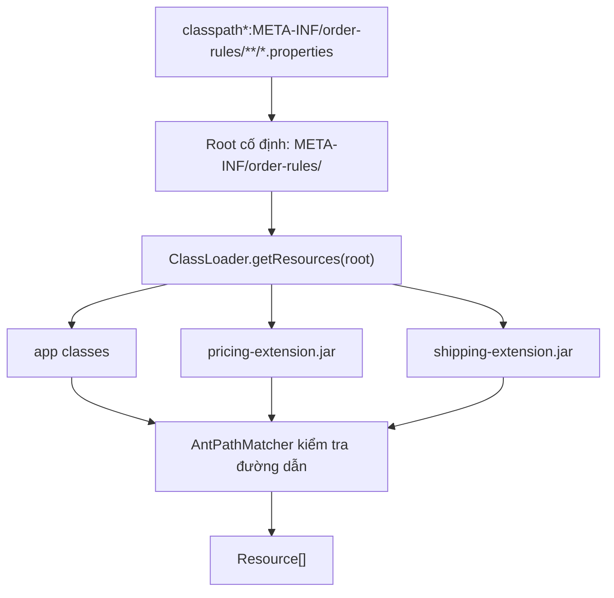
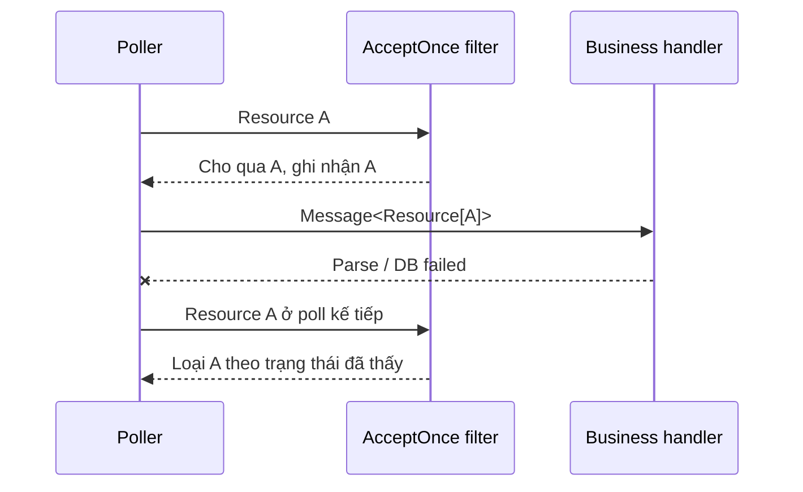
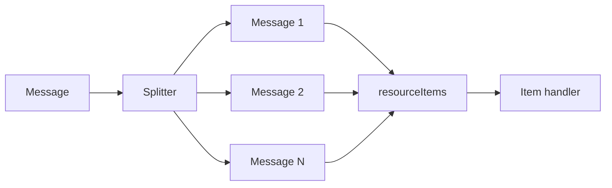

# ResourcePatternResolver và nhiều tài nguyên trong Spring Integration

## 1. Bài toán: nhiều thư viện cùng đóng góp một bộ tài nguyên

Một ứng dụng xử lý đơn hàng có quy tắc giá, giao hàng và khuyến mại được phân phối qua nhiều module:

```text
order-service.jar
  BOOT-INF/classes/META-INF/order-rules/base.properties

pricing-extension.jar
  META-INF/order-rules/discount.properties
  META-INF/order-rules/seasonal.properties

shipping-extension.jar
  META-INF/order-rules/express.properties
```

Mỗi module cùng tuân thủ thư mục `META-INF/order-rules/`. Ứng dụng cần **tìm tất cả tài nguyên khớp mẫu**, đọc chúng dưới dạng `Resource` và đưa vào Spring Integration để validate, hợp nhất hoặc xử lý riêng.

Nếu chỉ dùng `ClassLoader.getResource("META-INF/order-rules/base.properties")`, bạn có thể nhận **một** URL. Nếu dùng `classpath:` kèm wildcard, việc tìm các file trong những classpath root khác nhau cũng có thể không đầy đủ. Để khám phá nhiều tài nguyên, Spring Framework cung cấp giao diện **`ResourcePatternResolver`**, thường được triển khai bởi **`PathMatchingResourcePatternResolver`**; Spring Integration sử dụng nó trong **`ResourceRetrievingMessageSource`**.

Bài học thuộc chương **Adapter Resource**, module **SPRING_INTEGRATION_ADAPTERS**. Trong module này, adapter và gateway nối các hệ thống ngoài vào `MessageChannel`, poller điều khiển việc lấy dữ liệu, còn luồng xử lý đảm nhận message contract, lỗi và vòng đời. Chủ đề **“ResourcePatternResolver và nhiều tài nguyên”** tập trung vào giải nhiều location pattern, phát hiện các tài nguyên ở nhiều classpath roots/JAR/filesystem, và đưa **một tập tài nguyên** qua Resource inbound channel adapter.

### Sau bài học, bạn có thể

1. Phân biệt `ResourceLoader#getResource` với `ResourcePatternResolver#getResources`.
2. Dùng `classpath:`, `classpath*:`, `file:` và Ant-style wildcard đúng ngữ cảnh.
3. Hiểu cách resolver tìm root trước wildcard, quét thư mục/JAR và những giới hạn của class loader.
4. Xử lý nhiều tài nguyên **trùng filename nhưng khác nguồn**, kết quả không có thứ tự nghiệp vụ và kiểm tra version.
5. Cấu hình `ResourceRetrievingMessageSource`, custom `ResourcePatternResolver`, `CollectionFilter<Resource>` và polling endpoint.
6. Phân biệt `Resource[]`/một batch với nhiều Spring messages, sử dụng `Splitter` khi cần.
7. Thiết kế test, bảo mật, hiệu năng, error handling và checkpoint/idempotency.

## 2. Ba lớp abstraction cần phân biệt

### 2.1. Resource: đối tượng đại diện nguồn nội dung

`org.springframework.core.io.Resource` có các implementation như `ClassPathResource`, `FileSystemResource`, `UrlResource`, `ByteArrayResource`. Nó cho phép kiểm tra metadata và mở nội dung qua `getInputStream()`.

```java
Resource resource = ...;

String filename = resource.getFilename();
String description = resource.getDescription();
boolean available = resource.exists();

try (InputStream input = resource.getInputStream()) {
    // Đọc dữ liệu, rồi đóng stream.
}
```

Một `Resource` **không phải** nội dung đã được tải sẵn. Nó là một *handle* tới dữ liệu, có thể mở thất bại hoặc thay đổi giữa thời điểm được tìm thấy và thời điểm handler đọc.

### 2.2. ResourceLoader: tìm một resource theo location

`ResourceLoader` có method:

```java
Resource getResource(String location);
```

Ví dụ:

```java
Resource single = applicationContext.getResource(
    "classpath:META-INF/order-rules/base.properties"
);
```

`getResource` trả **một** đối tượng `Resource` đại diện cho location được yêu cầu. Nó không phải API “find all matches” cho một glob.

### 2.3. ResourcePatternResolver: giải pattern thành nhiều resource

`ResourcePatternResolver` mở rộng `ResourceLoader`, công bố:

```java
Resource[] getResources(String locationPattern)
        throws IOException;
```

Và hằng:

```java
ResourcePatternResolver.CLASSPATH_ALL_URL_PREFIX // "classpath*:"
```

Ví dụ:

```java
ResourcePatternResolver resolver =
    new PathMatchingResourcePatternResolver();

Resource[] all = resolver.getResources(
    "classpath*:META-INF/order-rules/*.properties"
);
```

**Một API trả về nhiều kết quả không có nghĩa nó đã xử lý nội dung của chúng.** Bạn vẫn phải xác minh số lượng, identity, quyền đọc, version và tác động nghiệp vụ.

| API | Kết quả | Mục đích |
| --- | --- | --- |
| `ResourceLoader.getResource(location)` | `Resource` | Lấy handle theo một location. |
| `ResourcePatternResolver.getResources(pattern)` | `Resource[]` | Tìm các handle khớp một pattern. |
| `Resource.getInputStream()` | `InputStream` | Đọc bytes của một handle. |
| `ResourceRetrievingMessageSource.receive()` | `Message<Resource[]>` hoặc không có message | Đưa batch đã resolve/filter vào Spring Messaging. |

### Một ApplicationContext cũng có thể là resolver

Trong Spring Framework, `ApplicationContext` thực hiện giao diện `ResourcePatternResolver`. Vì vậy có thể:

```java
Resource[] resources = applicationContext.getResources(
    "classpath*:META-INF/order-rules/*.properties"
);
```

Không bắt buộc tạo `PathMatchingResourcePatternResolver` mới nếu ứng dụng đã có `ApplicationContext` phù hợp. Với code độc lập ngoài Spring context, implementation standalone này đặc biệt tiện lợi.

## 3. PathMatchingResourcePatternResolver hoạt động ra sao?

`PathMatchingResourcePatternResolver` là implementation phổ biến của `ResourcePatternResolver`. Nó kết hợp `ResourceLoader`, `ClassLoader` và `PathMatcher`, với chiến lược tìm khác nhau tùy pattern.

### 3.1. Location không có wildcard

Với location như:

```text
classpath:META-INF/order-rules/base.properties
file:/opt/app/rules/default.properties
```

Nếu không có `classpath*:` hoặc `PathMatcher` wildcard, resolver thường trả về một resource thông qua `ResourceLoader#getResource`, không quét toàn bộ classpath.

Riêng `classpath*:META-INF/order-rules/base.properties` có ý nghĩa **tìm mọi resource cùng relative path** từ nhiều classpath roots (và module path theo phiên bản Framework), ngay cả khi không có ký tự `*` trong filename.

### 3.2. Location chứa Ant-style wildcard

Giả sử:

```text
classpath*:META-INF/order-rules/**/*.properties
```

Resolver cần:

1. Tìm **phần đường dẫn gốc không chứa wildcard**, ở đây là `META-INF/order-rules/`.
2. Với `classpath*:`, hỏi class loader các URL tương ứng với nhiều bản sao của root này.
3. Với từng root, quét directory/JAR entries tùy URL và loại class loader.
4. Dùng `PathMatcher` để so các đường dẫn với phần wildcard.
5. Trả về `Resource[]` hợp lệ theo khả năng resolver.



Đây là **mô hình nguyên lý**, không phải bảo đảm mỗi launcher/JAR luôn expose được tất cả URL hoặc duyệt đúng cùng thứ tự. Spring Framework khuyến nghị kiểm thử wildcard trong JAR theo môi trường triển khai cụ thể.

### 3.3. Ant-style wildcard

| Pattern | Ví dụ match | Ý nghĩa |
| --- | --- | --- |
| `*.properties` | `base.properties` | File trong một cấp directory. |
| `rule-?.yml` | `rule-a.yml` | `?` khớp một ký tự. |
| `**/*.properties` | `base.properties` và `region/eu.properties` | Tìm qua nhiều cấp thư mục. |
| `*-rules.json` | `shipping-rules.json` | Prefix/suffix theo tên. |

Không nhầm Ant-style glob với **regex Java**. `*`, `?` và `**` có semantics của `PathMatcher`, không phải `Pattern.compile(...)`.

## 4. classpath: và classpath*: khi có nhiều nguồn

Giả sử `pricing-extension.jar` và `shipping-extension.jar` đều chứa:

```text
META-INF/order-rules/config.properties
```

### `classpath:`: có thể chọn một root

```java
Resource[] resources = resolver.getResources(
    "classpath:META-INF/order-rules/*.properties"
);
```

Với wildcard, resolver có thể dùng URL đầu tiên cho base directory tìm được qua class loader. Kết quả **không bảo đảm bao gồm mọi JAR có cùng base path**.

### `classpath*:`: tìm nhiều roots

```java
Resource[] resources = resolver.getResources(
    "classpath*:META-INF/order-rules/*.properties"
);
```

Resolver tìm tất cả các root phù hợp mà runtime class loader cho phép quan sát và tìm wildcard trong từng root. Đây là lựa chọn thông dụng khi **nhiều JAR cùng đóng góp tài nguyên**.

### Không có wildcard cũng có thể trả nhiều kết quả

```java
Resource[] sameName = resolver.getResources(
    "classpath*:META-INF/order-rules/config.properties"
);
```

Nếu hai JAR cùng có relative path đó, kết quả có thể chứa **hai `Resource` khác nhau**, dù `getFilename()` của cả hai đều là `config.properties`.

| Nhu cầu | Pattern đề xuất | Lưu ý |
| --- | --- | --- |
| Cần đúng một file biết trước | `classpath:META-INF/order-rules/base.properties` | Kiểm tra `exists()`/đọc stream. |
| Cần tất cả bản sao cùng đường dẫn | `classpath*:META-INF/order-rules/base.properties` | Có thể có nhiều file từ nhiều JAR. |
| Cần tất cả file có phần mở rộng | `classpath*:META-INF/order-rules/*.properties` | Giữ root cố định trước wildcard. |
| Cần tìm đệ quy | `classpath*:META-INF/order-rules/**/*.properties` | Chi phí quét và tính portable cao hơn. |
| Cần quét thư mục ngoài classpath | `file:/opt/app/rules/*.properties` | Phù hợp với filesystem, không dựa vào JAR. |

## 5. Giới hạn với JAR, module path và class loader

### 5.1. Wildcard ở root JAR không portable

Tránh pattern:

```text
classpath*:*.xml
classpath*:**/*.json
```

Spring Framework Javadoc cảnh báo **`classpath*:` + Ant wildcard chỉ đáng tin cậy khi có ít nhất một root directory cụ thể trước wildcard**, trừ các file nằm trong filesystem. Vấn đề xuất phát từ API class loader dùng để tìm root rỗng và cách enumerate JAR. Framework có các nỗ lực giảm hạn chế này nhưng không bảo đảm trên mọi môi trường.

Ưu tiên:

```text
classpath*:META-INF/order-rules/*.properties
classpath*:com/example/rules/**/*.yaml
```

### 5.2. Wildcard bên trong JAR phụ thuộc cách đóng gói

Để quét JAR, resolver cần xử lý URL dạng `jar:` hoặc biến thể của container/launcher. Nó có thể dùng `JarURLConnection` hoặc cơ chế phân tích URL/JAR entry tương ứng. Với một class loader tùy biến, nested JAR hoặc application server, behavior có thể khác với IDE.

**Không sửa code thành `resource.getFile()` để “khắc phục”**: một entry trong JAR thường không phải physical file độc lập. Dùng `getInputStream()`.

### 5.3. Java Module System

Từ Spring Framework 6.0, tra cứu `classpath*:` có thể tìm cả **non-system modules trong boot module layer** trước khi tìm trên classpath bằng API class loader. Điều này không biến mọi resource trong module thành public hay luôn truy cập được: vẫn phải xét module configuration, class loader và packaging.

### 5.4. Class loader hierarchy và visibility

`classpath*:` không thể thấy những JAR **không hiện diện trong class loader/module path mà resolver sử dụng**. Ví dụ một plugin loader hoàn toàn độc lập có thể giữ các tài nguyên riêng; ứng dụng cần dùng loader phù hợp hoặc một contract plugin rõ ràng.

Nếu tài nguyên “mất tích”, phải kiểm tra:

- File có thực sự nằm trong JAR sau build không?
- Base directory có tồn tại dưới cùng đường dẫn không?
- Class loader hiện tại nhìn thấy những JAR nào?
- Pattern có bắt đầu wildcard từ root rỗng không?
- Có khác biệt giữa test classpath và production classpath không?
- Runtime là executable JAR, module path hay application server?

## 6. Nhiều resource: set semantics, trùng tên và thứ tự

Javadoc `ResourcePatternResolver#getResources` nói kết quả nên có **set semantics** và cố tránh các entry chỉ cùng một tài nguyên vật lý **trong khả năng có thể**. Điều này **không** có nghĩa:

- Hai JAR có hai resource cùng tên sẽ chỉ còn một.
- Kết quả được sort theo filename.
- Các resource có cùng bytes sẽ được tự động gộp.
- Thứ tự đầu ra ổn định giữa máy phát triển, test và production.

### 6.1. Trùng tên nhưng khác nguồn

```text
pricing-extension.jar!/META-INF/order-rules/config.properties
shipping-extension.jar!/META-INF/order-rules/config.properties
```

Cả hai có thể có `getFilename()=="config.properties"` nhưng là hai tài nguyên khác nhau. Nếu dùng map `filename -> Resource` và ghi đè vô điều kiện, một rule có thể biến mất âm thầm.

Chính sách đúng tùy nghiệp vụ:

| Yêu cầu | Chính sách hợp lý |
| --- | --- |
| Mỗi tên rule phải duy nhất | **Fail-fast** nếu cùng logical rule ID xuất hiện từ nhiều nguồn. |
| Cho phép extension override mặc định | Khai báo `priority`/`version` trong contract và giải quyết xung đột tường minh. |
| Mọi JAR đóng góp một phần cấu hình | Giữ tất cả rồi merge theo schema và deterministic rule. |
| Muốn bỏ tài nguyên vật lý trùng nhau | Deduplicate theo identity URL/URI khi đáng tin, kiểm thử theo launcher. |
| Muốn bỏ nội dung giống nhau | Hash bytes rồi so sánh, nhưng vẫn ghi nguồn và quyết định policy. |

### 6.2. Không dựa vào thứ tự mảng

Không nên viết:

```java
Resource winner = resources[0]; // Sai nếu hiểu là "ưu tiên cao nhất".
```

`ResourcePatternResolver` không cam kết đó là tài nguyên “quan trọng nhất”. Nếu cần thứ tự xử lý **chỉ để log ổn định trong một runtime**, có thể sort theo một chuỗi metadata tường minh. Nhưng **sort theo filename/URL không được mặc định là luật ưu tiên nghiệp vụ**.

### 6.3. Resource identity và business identity

| Loại identity | Ví dụ | Dùng cho |
| --- | --- | --- |
| Resource URI/description | URL của entry trong JAR | Chẩn đoán, kiểm tra nguồn vật lý. |
| `getFilename()` | `config.properties` | Hiển thị, lọc đuôi file. |
| Logical rule ID | `pricing.discount.standard` | Khóa business để hợp nhất/truy vết. |
| Content hash/version | SHA-256 hoặc `rule.version` | Phát hiện phiên bản nội dung. |
| Spring `MessageHeaders.ID` | UUID một message | Trace trong integration flow. |

**Không gộp hai logical rules chỉ vì có filename giống nhau; cũng không coi hai URL khác nhau chắc chắn chứa nội dung nghiệp vụ khác nhau.**

## 7. Thực hành 1 — gọi ResourcePatternResolver độc lập với poller

Trước khi cấu hình adapter, hãy xác minh resolver và file đóng gói thật. Java snippet:

```java
import java.io.IOException;
import java.io.InputStream;
import java.util.ArrayList;
import java.util.Comparator;
import java.util.List;
import org.springframework.core.io.Resource;
import org.springframework.core.io.support.PathMatchingResourcePatternResolver;
import org.springframework.core.io.support.ResourcePatternResolver;

public final class ResourceDiscovery {

    private ResourceDiscovery() {}

    public static List<Resource> findResources() throws IOException {
        ResourcePatternResolver resolver =
            new PathMatchingResourcePatternResolver();

        Resource[] found = resolver.getResources(
            "classpath*:META-INF/order-rules/*.properties"
        );

        List<Resource> readable = new ArrayList<>();
        for (Resource resource : found) {
            if (!resource.exists() || !resource.isReadable()) {
                continue;
            }
            readable.add(resource);
        }

        // Chỉ phục vụ log/test ổn định hơn trong một runtime;
        // KHÔNG định nghĩa business priority bằng thứ tự này.
        readable.sort(
            Comparator.comparing(Resource::getDescription)
        );
        return readable;
    }

    public static void printNames() throws IOException {
        for (Resource resource : findResources()) {
            try (InputStream in = resource.getInputStream()) {
                int firstByte = in.read();
                System.out.printf(
                    "name=%s, empty=%s%n",
                    resource.getFilename(), firstByte == -1
                );
            }
        }
    }
}
```

Lưu ý:

1. `getResources` không nhất thiết phát sinh lỗi khi không tìm thấy tài nguyên; nó có thể trả mảng rỗng. Nếu tất cả rule là bắt buộc, ứng dụng phải tự kiểm tra và fail-fast.
2. `exists()`/`isReadable()` là kiểm tra khả năng truy cập tại một thời điểm, **không** bảo đảm `getInputStream()` sau đó thành công.
3. `getDescription()` có thể chứa đường dẫn nội bộ, URL hoặc dữ liệu không phù hợp với public logs; ví dụ chỉ in filename.
4. Mở stream bằng try-with-resources. Không gọi `getFile()` khi tài nguyên có thể nằm trong JAR.
5. Sort ở đây không giải quyết version conflict, deduplication hay authorization.

### Khi cần kiểm tra đúng source tại runtime

Có thể đếm số resource, số filename trùng, số resource không thể mở và thời gian resolve. Trên test, ghi nhận filename và metadata không nhạy cảm; trên production, tránh log toàn bộ URL chứa token.

## 8. Thực hành 2 — kiểm tra trùng filename có chủ đích

Một quy tắc dễ kiểm soát: **không cho phép trùng filename trong một batch**, trừ khi nghiệp vụ định nghĩa merge riêng. Dưới đây là helper trả lỗi khi hai resource có cùng tên:

```java
import java.util.HashMap;
import java.util.Map;
import org.springframework.core.io.Resource;

public final class ResourceNameValidator {

    private ResourceNameValidator() {}

    public static void requireUniqueNames(Resource[] resources) {
        Map<String, Integer> frequencies = new HashMap<>();
        for (Resource resource : resources) {
            String name = resource.getFilename();
            if (name == null || name.isBlank()) {
                throw new IllegalArgumentException(
                    "Resource without a valid filename"
                );
            }
            frequencies.merge(name, 1, Integer::sum);
        }

        for (Map.Entry<String, Integer> entry
                : frequencies.entrySet()) {
            if (entry.getValue() > 1) {
                throw new IllegalStateException(
                    "Duplicate resource filename: "
                        + entry.getKey()
                );
            }
        }
    }
}
```

**Đây chỉ là một policy của ví dụ**. Nếu các thư viện được phép dùng cùng filename cho các namespace khác nhau, cần thay bằng khóa nghiệp vụ như `moduleId + ruleId` hoặc `tenantId + ruleId`, không áp đặt cấm trùng tên toàn cục.

### Trường hợp muốn ghi đè có ưu tiên

Mỗi rule có thể khai báo:

```properties
rule.id=shipping.express
rule.priority=20
rule.version=3
rule.enabled=true
```

Khi resolve nhiều bản sao, hãy parse và kiểm tra hợp đồng rồi nhóm theo `rule.id`; bản có `priority` cao hơn được chọn theo policy. Nếu hai bản cùng priority mà khác nội dung, **fail conflict** thay vì dựa vào thứ tự xuất hiện trong mảng. Nếu cần audit, lưu cả nguồn đã thắng và nguồn bị loại.

## 9. Hợp đồng batch trong Resource inbound channel adapter

Spring Integration `ResourceRetrievingMessageSource` dùng `ResourcePatternResolver` để tạo `Resource[]` và phát vào một `MessageChannel` theo lịch poller:


Ví dụ pattern khớp 7 tài nguyên, sau filter có 5 tài nguyên:

```text
Poll #1:
  resolve -> Resource[7]
  filter  -> Resource[5]
  source  -> Message<Resource[5]>
  channel -> 1 message

Poll #2:
  resolve -> Resource[7]
  filter  -> Resource[0]
  source  -> không có batch mới theo accept-once filter
```

**Một lần poll không đồng nghĩa một resource**. `maxMessagesPerPoll=1` giới hạn số message source nhận trong chu kỳ, **không phải một phần tử mảng**. Nếu downstream cần xử lý từng tài nguyên độc lập, dùng `Splitter` hoặc một vòng lặp có checkpoint cho từng item.

### Resource inbound khác File inbound

| Đặc điểm | Resource inbound | File inbound |
| --- | --- | --- |
| Kết quả chính | `Message<Resource[]>` | Thường là `Message<File>` |
| Khám phá nguồn | `ResourcePatternResolver` | Scanner/`FileReadingMessageSource` |
| JAR và classpath | Tự nhiên theo `Resource` | Không phải mục tiêu chính |
| Pattern nhiều roots | `classpath*:...` | Chủ yếu quét filesystem directory |
| Xử lý mỗi file một message | Cần split | Là behavior thông thường |
| Chống xử lý lại | `CollectionFilter<Resource>` và checkpoint nghiệp vụ | `FileListFilter` và cơ chế riêng của File adapter |

## 10. Thực hành 3 — Java config nối resolver vào Spring Integration

Đây là ví dụ tự chứa về mặt cấu trúc cho Spring Boot/Java 17+ dùng Spring Integration Core. Các tài nguyên tồn tại trong classpath dưới `META-INF/order-rules/`.

### 10.1. Maven

Nếu dùng Spring Boot BOM để quản lý phiên bản:

```xml
<dependencies>
    <dependency>
        <groupId>org.springframework.boot</groupId>
        <artifactId>spring-boot-starter-integration</artifactId>
    </dependency>
</dependencies>
```

Không cần module SFTP, JMS hoặc File adapter riêng để dùng `ResourceRetrievingMessageSource`. Nếu app còn kết nối các hệ thống đó, thêm đúng adapter theo nhu cầu.

### 10.2. Cấu hình ResourcePatternResolver + MessageSource

```java
package com.example.resources;

import org.springframework.context.ApplicationContext;
import org.springframework.context.annotation.Bean;
import org.springframework.context.annotation.Configuration;
import org.springframework.core.io.Resource;
import org.springframework.integration.annotation.InboundChannelAdapter;
import org.springframework.integration.annotation.Poller;
import org.springframework.integration.channel.DirectChannel;
import org.springframework.integration.config.EnableIntegration;
import org.springframework.integration.core.MessageSource;
import org.springframework.integration.resource.ResourceRetrievingMessageSource;
import org.springframework.integration.util.AcceptOnceCollectionFilter;
import org.springframework.messaging.MessageChannel;

@Configuration
@EnableIntegration
public class MultiResourceInboundConfiguration {

    @Bean
    public MessageChannel resourceBatches() {
        return new DirectChannel();
    }

    @Bean
    @InboundChannelAdapter(
        channel = "resourceBatches",
        poller = @Poller(
            fixedDelay = "10000",
            initialDelay = "1000",
            maxMessagesPerPoll = "1"
        )
    )
    public MessageSource<Resource[]> resourceMessageSource(
            ApplicationContext applicationContext) {

        ResourceRetrievingMessageSource source =
            new ResourceRetrievingMessageSource(
                "classpath*:META-INF/order-rules/*.properties"
            );

        // ApplicationContext implements ResourcePatternResolver.
        // Nêu rõ nguồn resolver; XML namespace mặc định dùng context.
        source.setPatternResolver(applicationContext);

        // Chỉ phát resource được bộ lọc xem là mới.
        source.setFilter(new AcceptOnceCollectionFilter<>());
        return source;
    }
}
```

Giải thích:

1. `@EnableIntegration` bật hạ tầng Spring Integration.
2. `ResourceRetrievingMessageSource(String)` nhận **một location pattern**.
3. `setPatternResolver(ResourcePatternResolver)` chọn chiến lược resolve; ở đây dùng `ApplicationContext` đã tiêm.
4. `setFilter(CollectionFilter<Resource>)` chọn chính sách lọc. Filter accept-once được khai báo **tường minh** trong Java.
5. `@InboundChannelAdapter` tạo polling endpoint phát message vào `resourceBatches`.
6. `@Poller` điều khiển lịch; `initialDelay=1000`, `fixedDelay=10000` đều tính bằng milliseconds trong ví dụ.
7. `DirectChannel` gửi message đồng bộ đến subscriber; không tự tạo transaction đa tài nguyên.

**Lưu ý:** Đây là một Resource inbound channel adapter. Nó không tự deserialize từng `Resource` thành JSON hoặc domain DTO, cũng không phải adapter đọc từng file rồi đưa một `File` vào channel.

### 10.3. Handler đọc toàn bộ batch theo hợp đồng

Ví dụ mỗi resource là một `.properties` nhỏ chứa `rule.id`, `rule.version`, `rule.enabled`.

```java
package com.example.resources;

import java.io.ByteArrayInputStream;
import java.io.IOException;
import java.io.InputStream;
import java.io.InputStreamReader;
import java.nio.charset.StandardCharsets;
import java.util.HashSet;
import java.util.Properties;
import java.util.Set;

import org.springframework.core.io.Resource;
import org.springframework.integration.annotation.ServiceActivator;
import org.springframework.messaging.Message;
import org.springframework.stereotype.Component;

@Component
public class MultiResourceBatchHandler {

    private static final int MAX_BYTES_PER_RULE = 64 * 1024;

    @ServiceActivator(inputChannel = "resourceBatches")
    public void receive(Message<Resource[]> message) throws IOException {
        Resource[] resources = message.getPayload();
        ResourceNameValidator.requireUniqueNames(resources);

        Set<String> logicalIds = new HashSet<>();
        for (Resource resource : resources) {
            Properties props = parseResource(resource);

            String ruleId = props.getProperty("rule.id");
            if (ruleId == null || ruleId.isBlank()) {
                throw new IllegalArgumentException("Missing rule.id");
            }
            if (!logicalIds.add(ruleId)) {
                throw new IllegalStateException(
                    "Duplicate logical rule.id: " + ruleId
                );
            }

            int version = Integer.parseInt(
                props.getProperty("rule.version", "0")
            );
            if (version < 1) {
                throw new IllegalArgumentException(
                    "Invalid rule.version"
                );
            }

            // DEMO: ở production hãy validate toàn schema rồi
            // gọi service để commit theo chính sách nghiệp vụ.
            System.out.printf(
                "Rule accepted id=%s, version=%d%n",
                ruleId, version
            );
        }
    }

    private Properties parseResource(Resource resource)
            throws IOException {
        byte[] data;
        try (InputStream in = resource.getInputStream()) {
            data = in.readNBytes(MAX_BYTES_PER_RULE + 1);
        }
        if (data.length > MAX_BYTES_PER_RULE) {
            throw new IOException("Rule resource too large");
        }

        Properties properties = new Properties();
        try (InputStreamReader reader = new InputStreamReader(
                new ByteArrayInputStream(data),
                StandardCharsets.UTF_8)) {
            properties.load(reader);
        }
        return properties;
    }
}
```

`ResourceNameValidator` là helper của mục 8, phải đặt cùng package hoặc import đúng khi sử dụng. Class ở mục 10 là **ví dụ minh họa cơ chế**, không mặc nhiên bảo đảm số lượng resource, uniqueness toàn hệ thống hay DB commit.

### Các giới hạn của ví dụ

- Nếu business cho phép hai thư viện có cùng filename, phải bỏ chính sách `requireUniqueNames` và thay bằng chính sách merge/version rõ ràng.
- Vòng lặp validate rồi log không thực hiện transaction DB; có thể log một vài rule trước khi rule sau lỗi.
- `Properties.load(Reader)` sử dụng decoder UTF-8 được đặt tường minh, khác overload `load(InputStream)`.
- `getInputStream()` cần được đóng; đọc bytes có giới hạn giúp tránh một file quá lớn, nhưng cần thêm giới hạn **tổng batch** và thời gian resolve.
- Với `AcceptOnceCollectionFilter`, resource đã accept không tự được đưa trở lại sau khi handler lỗi.

## 11. Thực hành 4 — XML namespace và custom pattern-resolver

Spring Integration cung cấp `<int:resource-inbound-channel-adapter>`. Theo reference, adapter **mặc định dùng `ApplicationContext` hiện tại để resolve pattern**, và có thể chỉ định implementation riêng qua thuộc tính `pattern-resolver`.

### 11.1. XML cơ bản

```xml
<?xml version="1.0" encoding="UTF-8"?>
<beans xmlns="http://www.springframework.org/schema/beans"
       xmlns:xsi="http://www.w3.org/2001/XMLSchema-instance"
       xmlns:int="http://www.springframework.org/schema/integration"
       xsi:schemaLocation="
         http://www.springframework.org/schema/beans
         https://www.springframework.org/schema/beans/spring-beans.xsd
         http://www.springframework.org/schema/integration
         https://www.springframework.org/schema/integration/spring-integration.xsd">

    <int:channel id="resourceBatches"/>

    <int:resource-inbound-channel-adapter
            id="multiResources"
            channel="resourceBatches"
            pattern="classpath*:META-INF/order-rules/*.properties">
        <int:poller fixed-delay="10000"
                    max-messages-per-poll="1"/>
    </int:resource-inbound-channel-adapter>

</beans>
```

Nếu không khai báo `filter` trong **XML resource inbound namespace**, default là `AcceptOnceCollectionFilter`. Theo Spring Integration reference, nó cố tránh phát cùng resource thêm lần nữa.

### 11.2. XML tham chiếu resolver bean

```xml
<bean id="explicitPatternResolver"
      class="org.springframework.core.io.support.PathMatchingResourcePatternResolver"/>

<int:resource-inbound-channel-adapter
        id="multiResourcesWithResolver"
        channel="resourceBatches"
        pattern="classpath*:META-INF/order-rules/*.properties"
        pattern-resolver="explicitPatternResolver">
    <int:poller fixed-rate="10000"/>
</int:resource-inbound-channel-adapter>
```

Đây là **phương án thay thế** adapter XML ở mục 11.1. Không dùng hai adapter cùng pattern/channel trong một demo mà không dự tính sẽ có hai nguồn poll độc lập.

### 11.3. Khi thật sự cần custom implementation

Một custom `ResourcePatternResolver` có thể:

- Chọn một class loader riêng đã được quản lý.
- Hạn chế những location pattern được phép.
- Áp dụng cache hoặc instrumentation theo SLA.
- Resolve resource từ một kho/registry đặc thù **có API liệt kê thực sự**.

Nhưng không nên tùy tiện tự viết một resolver chỉ để dùng `classpath*:` với wildcard: `PathMatchingResourcePatternResolver` đã giải bài toán phổ biến này.

**Custom resolver phải tôn trọng contract `ResourcePatternResolver`**, bao gồm `getResource(...)`, `getClassLoader()` và `getResources(...)`. Nếu dùng một wrapper/decorator, cần chuyển tiếp đầy đủ behavior của `ResourceLoader` và xử lý IOException đúng cách. Không giả định chỉ override method `getResources` là đủ để một class hiện thực interface hoàn chỉnh.

## 12. Một adapter pattern, nhiều patterns: thiết kế đúng ranh giới

Constructor của `ResourceRetrievingMessageSource` nhận **một chuỗi pattern**:

```java
new ResourceRetrievingMessageSource(
    "classpath*:META-INF/order-rules/*.properties"
);
```

Nó không có nghĩa mọi chuỗi phân tách bằng dấu phẩy hoặc dấu chấm phẩy sẽ tự được hiểu thành nhiều patterns. Nếu cần quét đồng thời:

```text
classpath*:META-INF/order-rules/*.properties
file:/opt/app/overrides/*.properties
```

Hãy chọn một thiết kế rõ ràng:

1. **Hai `ResourceRetrievingMessageSource` + hai inbound adapters**, đổ vào cùng channel rồi merge/routing theo metadata nguồn. Đơn giản nhưng hai lịch poll và hai trạng thái filter độc lập.
2. **Một custom `MessageSource<Resource[]>`**, gọi resolver cho từng pattern rồi hợp nhất bằng policy/identity rõ ràng.
3. **Một `ResourcePatternResolver` custom/decorator** hiểu cú pháp pattern riêng của ứng dụng; cần tài liệu hóa và test contract.

Không dựa vào cách parser ngầm hiểu chuỗi trộn nhiều patterns nếu chưa có tài liệu chứng minh cho phiên bản sử dụng.

### Ví dụ helper hợp nhất kết quả từ nhiều patterns

Helper dưới đây chỉ thực hiện **discovery**, chưa phải một MessageSource:

```java
import java.io.IOException;
import java.util.ArrayList;
import java.util.List;
import org.springframework.core.io.Resource;
import org.springframework.core.io.support.ResourcePatternResolver;

public final class MultiPatternDiscovery {

    private MultiPatternDiscovery() {}

    public static List<Resource> discover(
            ResourcePatternResolver resolver,
            List<String> approvedPatterns) throws IOException {

        List<Resource> all = new ArrayList<>();
        for (String pattern : approvedPatterns) {
            Resource[] found = resolver.getResources(pattern);
            for (Resource resource : found) {
                all.add(resource);
            }
        }
        return all;
    }
}
```

Đoạn này cố ý **không deduplicate** các resource: khi hai patterns chồng lấn, một physical resource có thể xuất hiện hai lần. Business service cần chính sách identity/deduplication hợp lệ, ví dụ chuẩn hóa URI theo nguồn **khi URI đáng tin**, hoặc hash nội dung + logical key. Không dùng `Resource#getFilename()` duy nhất để loại trùng nếu nhiều modules được phép dùng chung tên.

## 13. CollectionFilter và nhiều resource qua các chu kỳ poll

`ResourceRetrievingMessageSource` có setter:

```java
void setFilter(CollectionFilter<Resource> filter)
```

Với `CollectionFilter<Resource>`, filter nhận collection đã resolve rồi trả subset:

```java
Collection<Resource> filter(Collection<Resource> candidates);
```

### 13.1. AcceptOnceCollectionFilter

`AcceptOnceCollectionFilter<Resource>` ghi nhớ những phần tử đã xuất hiện theo semantics của filter nhằm tránh phát lại. Ví dụ:

```java
source.setFilter(new AcceptOnceCollectionFilter<>());
```

| Lần poll | Resolver thấy | Filter phát (minh họa) |
| --- | --- | --- |
| 1 | A, B, C | A, B, C |
| 2 | A, B, C | Không có phần tử mới |
| 3 | A, B, C, D | D |
| 4 | A, B, C, D với nội dung B đổi | **Không chắc B được phát lại** |

**Filter không phải content-version tracker**. Nó không bắt buộc kiểm tra `lastModified`, ETag hoặc hash nội dung, và không tạo một transaction giữa “đã thấy resource” với “đã xử lý thành công”.

### 13.2. Lỗi handler không rollback filter



Nếu cần retry sau lỗi, phải có cơ chế checkpoint khác hoặc filter cho phép phát lại theo policy. Đừng mặc định `@Transactional` của handler có thể rollback trạng thái trong `AcceptOnceCollectionFilter`.

### 13.3. Tắt filter khi muốn đọc lại mọi lần

Ở XML namespace, có thể đặt:

```xml
<int:resource-inbound-channel-adapter
        id="unfilteredResources"
        channel="resourceBatches"
        pattern="classpath*:META-INF/order-rules/*.properties"
        filter="">
    <int:poller fixed-delay="10000"/>
</int:resource-inbound-channel-adapter>
```

Khi đó resource còn khớp pattern **có thể được phát lại mỗi poll**. Chỉ làm vậy khi downstream có version-check hoặc idempotent processing, không vô tình kích hoạt ghi DB lặp.

### 13.4. Một custom filter thực sự lọc theo tên

```java
import org.springframework.core.io.Resource;
import org.springframework.integration.util.CollectionFilter;

CollectionFilter<Resource> propertyFiles = candidates ->
    candidates.stream()
        .filter(r -> r.getFilename() != null)
        .filter(r -> r.getFilename().endsWith(".properties"))
        .toList();

source.setFilter(propertyFiles);
```

**Đoạn này thay thế** filter hiện tại bằng một chiến lược khác; không tự xếp chồng `AcceptOnceCollectionFilter`. Nó có thể cho cùng resource đi qua ở mọi poll. Nếu cần nhiều điều kiện, hãy viết một composite filter tường minh và test tương tác/state.

## 14. Splitter và xử lý từng resource độc lập

Một lần receive có thể tạo:

```text
Message<Resource[]> với 100 phần tử
```

Nếu mỗi rule cần transaction/validation riêng, downstream nên tách:



Ví dụ Java DSL **thay thế** `@InboundChannelAdapter` ở mục 10:

```java
import org.springframework.context.annotation.Bean;
import org.springframework.context.annotation.Configuration;
import org.springframework.integration.dsl.IntegrationFlow;
import org.springframework.integration.dsl.Pollers;
import org.springframework.integration.resource.ResourceRetrievingMessageSource;
import org.springframework.integration.util.AcceptOnceCollectionFilter;

@Configuration
public class MultiResourceSplitFlow {

    @Bean
    public ResourceRetrievingMessageSource splitSource() {
        ResourceRetrievingMessageSource source =
            new ResourceRetrievingMessageSource(
                "classpath*:META-INF/order-rules/*.properties"
            );
        source.setFilter(new AcceptOnceCollectionFilter<>());
        return source;
    }

    @Bean
    public IntegrationFlow splitResources(
            ResourceRetrievingMessageSource splitSource,
            ResourceItemService resourceItemService) {
        return IntegrationFlow
            .from(
                splitSource,
                e -> e.poller(
                    Pollers.fixedDelay(10000)
                        .maxMessagesPerPoll(1)
                )
            )
            .split()
            .handle((payload, headers) -> {
                resourceItemService.process(
                    (org.springframework.core.io.Resource) payload
                );
                return null;
            })
            .get();
    }
}
```

`ResourceItemService` là interface/service **do ứng dụng triển khai**, có method `process(Resource)`. Ví dụ cần các bean đó trong context và không chạy đồng thời với adapter của mục 10 nếu không muốn hai poller độc lập.

Khi đã split, vẫn không có bảo đảm item thứ N thất bại sẽ tự xuất hiện lại sau khi source filter đã ghi nhận cả batch. Muốn xử lý đáng tin cậy, cần transaction/ledger cho từng identity/version.

## 15. Độ tin cậy: từ resource discovery đến business commit

Một resource được tìm thấy không có nghĩa nó đã được xử lý xong. Có ít nhất bốn mốc:

```text
RESOLVED → ACCEPTED_BY_FILTER → DELIVERED_TO_CHANNEL → BUSINESS_COMMITTED
```

| Mốc | Điều gì đã xảy ra | Điều chưa bảo đảm |
| --- | --- | --- |
| `RESOLVED` | Resolver trả `Resource` | Stream đọc được, bytes hợp lệ |
| `ACCEPTED_BY_FILTER` | Filter cho resource đi qua | Handler đã gọi, transaction đã commit |
| `DELIVERED_TO_CHANNEL` | Channel nhận message theo topology | Async worker đã xử lý xong |
| `BUSINESS_COMMITTED` | Domain service ghi kết quả bền vững | Resolver/filter sẽ không phát lại sau restart |

### 15.1. Version-aware processing

Giả sử một JAR được thay bằng bản chứa resource mới nhưng tên không đổi. Nếu business cần ghi nhận version, hãy dựa trên một khóa rõ ràng, ví dụ:

```text
logicalRuleId = pricing.discount.standard
sourceModule  = pricing-extension
contentHash   = SHA-256(decoded resource bytes)
businessKey   = sourceModule + logicalRuleId + contentHash
```

Hash phải được tính trên bytes được giới hạn kích thước, và có policy khi hai source xung đột logical ID. Một URL/description có thể thay đổi giữa launcher hoặc deployment; không tự dùng đường dẫn tuyệt đối làm business identity bền vững cho mọi môi trường.

### 15.2. Ledger/Inbox để chống tác động trùng

Một quy trình có thể là:

```text
Resolve resource candidates
  -> đọc bytes giới hạn
  -> parse + validate
  -> tính logicalId/version
  -> BEGIN DB
       claim (logicalId, version) bằng UNIQUE constraint
       ghi rule vào DB
       mark PROCESSED
     COMMIT
```

Đặt unique constraint giúp nhiều replica không ghi tác động nghiệp vụ trùng. Chỉ gọi `existsBy...` rồi `save()` mà không có constraint có thể race.

### 15.3. Restart và nhiều instance

Mỗi instance có `AcceptOnceCollectionFilter` trong RAM. Restart có thể khiến resource cũ được phát lại; nhiều pod có thể cùng đọc một resource. Nếu nạp rule là operation idempotent, đó có thể chấp nhận được. Nếu có side effect như phát hóa đơn hoặc tạo thanh toán, cần checkpoint/inbox bền vững.

Không coi Resource inbound là queue có ACK/NACK. Nó không có delivery receipt giống JMS/Kafka; retry và bền vững là trách nhiệm của flow và business store.

## 16. Performance: quét nhiều JAR và batch lớn

`ResourcePatternResolver#getResources` có thể quét nhiều classpath roots; pattern càng rộng, chi phí CPU/IO và số resource càng lớn.

| Rủi ro | Biểu hiện | Biện pháp |
| --- | --- | --- |
| Pattern quá rộng | Hàng nghìn resource từ nhiều JAR | Hạn chế prefix cố định và đuôi file. |
| Poll quá thường xuyên | Quét classpath bất biến mỗi vài trăm ms | Nạp một lần hoặc tăng fixed-delay. |
| Batch cực lớn | `Resource[]` chứa hàng chục nghìn phần tử | Chia nguồn/flow, giới hạn resolver/filter, split có kiểm soát. |
| Đọc resource liên tiếp quá lâu | Handler giữ poller thread | Xem topology, bounded executor và checkpoint. |
| Cùng một file được đọc nhiều lần | Filter tắt hoặc nhiều replicas | Version-aware idempotency, ledger. |
| JAR rất lớn hoặc nhiều nested JAR | Thời gian resolve tăng | Profile trên packaged executable JAR thật. |
| Streams không đóng | Rò rỉ handle/connection | `try-with-resources` mọi lần mở stream. |

**`maxMessagesPerPoll=1` không phải giới hạn một resource.** Mỗi `ResourceRetrievingMessageSource.receive()` có thể trả `Resource[]` với nhiều phần tử; để giới hạn batch thật cần một chiến lược phân trang/partition hoặc custom source/filters.

### Một lần startup có thể đủ

Nếu các resource nằm trong JAR bất biến của ứng dụng, nạp bằng `ResourcePatternResolver` **một lần khi khởi động** đôi khi tốt hơn poller. Poller hữu ích khi classpath root thực sự là thư mục mutable hoặc khi hệ thống có mục đích quét định kỳ. Không kỳ vọng chỉnh JAR đang chạy sẽ là cơ chế hot reload đáng tin cậy.

## 17. Xử lý lỗi và ranh giới async

Lỗi có thể xuất hiện từ nhiều tầng khác nhau:

| Vị trí | Ví dụ lỗi | Cách xử lý |
| --- | --- | --- |
| Resolver | Pattern sai, class loader không enumerate, IOException | Logging/metrics, kiểm tra packaging, fail-fast nếu thiếu dữ liệu bắt buộc. |
| Resource access | File/JAR entry không đọc được, URL timeout | Retry phù hợp và giới hạn thời gian/kích thước. |
| Filter | Bỏ sót resource, sai identity hoặc memory pressure | Kiểm thử policy, checkpoint state, quan sát accept-count. |
| Parser | Properties/JSON malformed, encoding lỗi | Validation, quarantine và cảnh báo chủ source. |
| Duplicate policy | Cùng logical rule ID từ hai JAR | Fail conflict hoặc merge có thứ tự tường minh. |
| Channel | Không có subscriber, queue đầy, lỗi dispatch | Spring Integration error flow theo endpoint/channel. |
| DB transaction | Timeout, deadlock, unique constraint | Transaction retry có giới hạn và idempotency. |

### DirectChannel và ExecutorChannel

- `DirectChannel` gọi subscriber đồng bộ: lỗi downstream có thể quay về poller/source path, tùy flow/error handling.
- `ExecutorChannel` chuyển sang worker bất đồng bộ: `send()` có thể trả về **trước khi** worker xử lý/commit, và lỗi cần được bắt tại downstream error flow.
- `QueueChannel` đệm message: với queue trong bộ nhớ, process crash có thể làm mất batch chưa xử lý.

Khi dùng filter accept-once, exception ở handler **không tự hoàn tác** trạng thái filter. Nếu cần retry đầy đủ, ứng dụng phải lưu trạng thái chưa hoàn tất theo resource identity/version thay vì chỉ hy vọng poller chạy lại.

## 18. Bảo mật khi resolve nhiều nguồn

Resource pattern không nên lấy trực tiếp từ input không tin cậy. Một chuỗi như `file:/**` hoặc location URL tùy ý có thể làm lộ secrets, quét filesystem ngoài phạm vi hoặc gây SSRF/DoS.

**Các biện pháp:**

1. Chỉ cho phép các prefix/path đã cấu hình trước, không chấp nhận glob runtime từ browser.
2. Không quét toàn bộ classpath theo `**/*` nếu không có nhu cầu rõ.
3. Không tự mở `https://.../*.json` và kỳ vọng HTTP server cho phép glob: URL đơn lẻ không đồng nghĩa API liệt kê thư mục.
4. Với tài nguyên từ network, kiểm soát redirects, DNS/IP ranges, TLS, timeout và byte limit.
5. Không log toàn bộ `Resource.getDescription()` nếu nó chứa URL có token, userinfo hoặc đường dẫn nhạy cảm.
6. Không deserialize tùy ý object từ resource chưa xác thực; parse theo schema/allowlist.
7. Với JAR đóng góp resource, xác minh nguồn dependency và cách build; không coi mọi dependency JAR đều đáng tin mặc định.
8. Giới hạn số tài nguyên/chu kỳ và tổng bytes khi nhiều extension được nạp cùng lúc.
9. Không để trùng filename/priority tạo override âm thầm cho security/policy rules.
10. Với hệ thống nhiều tenant, logical rule ID phải gắn tenant/scope đã xác thực; không để một extension đưa rule cho tenant khác khi chưa có quyền.

## 19. Kiểm thử resolver, nhiều JAR và adapter

### 19.1. Unit test không cần Spring Integration context

Đặt fixtures:

```text
src/test/resources/META-INF/demo-rules/
  alpha.properties
  beta.properties
```

JUnit Jupiter:

```java
import static org.junit.jupiter.api.Assertions.assertEquals;
import static org.junit.jupiter.api.Assertions.assertTrue;

import java.io.InputStream;
import java.util.Arrays;
import java.util.Set;
import java.util.stream.Collectors;

import org.junit.jupiter.api.Test;
import org.springframework.core.io.Resource;
import org.springframework.core.io.support.PathMatchingResourcePatternResolver;

class MultiResourceResolverTest {

    @Test
    void findsResourcesWithStableRoot() throws Exception {
        var resolver = new PathMatchingResourcePatternResolver();
        Resource[] found = resolver.getResources(
            "classpath*:META-INF/demo-rules/*.properties"
        );

        Set<String> names = Arrays.stream(found)
            .map(Resource::getFilename)
            .collect(Collectors.toSet());

        assertEquals(
            Set.of("alpha.properties", "beta.properties"),
            names
        );

        for (Resource resource : found) {
            try (InputStream in = resource.getInputStream()) {
                assertTrue(in.read() != -1);
            }
        }
    }
}
```

Test trên cố ý dùng **fixture path riêng của project** để tránh dependency bên ngoài có cùng thư mục. Nếu test classpath vô tình chứa thêm file, kết quả có thể thay đổi; sửa fixture isolation/test theo nhu cầu thay vì hardcode kỳ vọng sai cho môi trường dùng chung.

### 19.2. Kiểm thử source với AcceptOnceCollectionFilter

```java
import static org.junit.jupiter.api.Assertions.*;

import org.junit.jupiter.api.Test;
import org.springframework.core.io.Resource;
import org.springframework.integration.resource.ResourceRetrievingMessageSource;
import org.springframework.integration.util.AcceptOnceCollectionFilter;
import org.springframework.messaging.Message;

class MultiResourceSourceTest {

    @Test
    void emitsOneBatchThenFiltersPreviousResources() {
        var source = new ResourceRetrievingMessageSource(
            "classpath*:META-INF/demo-rules/*.properties"
        );
        source.setFilter(new AcceptOnceCollectionFilter<>());
        source.afterPropertiesSet();

        Message<Resource[]> first = source.receive();
        assertNotNull(first);
        assertEquals(2, first.getPayload().length);

        Message<Resource[]> second = source.receive();
        assertNull(second);
    }
}
```

Test trên chỉ xác nhận semantics trong **một source instance**, không chứng minh scheduler đã kích hoạt đúng, không kiểm tra JAR đóng gói nhiều thư viện và không bảo đảm business commit.

### 19.3. Kiểm thử nhiều JAR cùng một relative path

Tạo **hai thư viện fixture** ở môi trường integration test:

```text
library-a.jar!/META-INF/demo-multi/shared.properties
library-b.jar!/META-INF/demo-multi/shared.properties
```

Khởi chạy class loader thực sự nhìn thấy cả hai JAR, kiểm tra:

1. `getResources("classpath*:META-INF/demo-multi/shared.properties")` trả các bản sao thuộc hai nguồn.
2. `getFilename()` có thể bằng nhau dù nội dung khác.
3. Tên file trùng không được tự overwrite hoặc xử lý theo index mảng.
4. Nếu muốn merge, policy dựa trên logical ID/priority/version được áp dụng.
5. Kết quả sau đóng gói executable JAR được so sánh với IDE/test runtime.

Đừng lấy hai file cùng tên trong **một directory filesystem** để giả lập hai JAR — filesystem không cho tồn tại hai entry trùng tên trong cùng thư mục.

### 19.4. Ma trận kiểm thử tích hợp

| Thí nghiệm | Dự kiến cần xác nhận |
| --- | --- |
| `classpath:...` một file | Nhận một Resource cụ thể, đọc stream thành công. |
| `classpath*:...` không wildcard | Nhận nhiều bản sao cùng relative path từ các JAR phù hợp. |
| `classpath*:.../*.properties` | Nhận resource phù hợp từ nhiều roots. |
| `classpath*:*.xml` | Không coi là portable trong JAR; có test cảnh báo nếu đang dùng. |
| Recursive `**` | Đúng depth/extension, đo tốc độ quét. |
| Nhiều file trong một poll | Một `Message<Resource[]>` có đúng N phần tử. |
| Splitter | N `Resource` thành N message items khi cần. |
| Accept-once | Poll sau không phát lại resource mà filter đã thấy. |
| Restart | Filter state không được coi là checkpoint bền vững. |
| Thay bytes cùng location | Policy version/hash nhận ra thay đổi khi được thiết kế. |
| Handler lỗi ở item thứ 3 | Có quarantine/retry đúng item, không mặc định rollback filter. |
| Nhiều pod | Ledger/unique constraint chặn tác động nghiệp vụ trùng. |
| Hai JAR cùng logical ID | Conflict/priority policy ổn định, không theo array order. |
| Resource quá lớn | Từ chối trước khi parse và không tràn bộ nhớ. |
| Không đủ rule bắt buộc | Readiness/fail-fast rõ ràng thay vì im lặng. |

## 20. Quan sát và khắc phục lỗi

| Triệu chứng | Nguyên nhân thường gặp | Cách chẩn đoán |
| --- | --- | --- |
| Có một resource dù có nhiều JAR | Dùng `classpath:` hoặc class loader không thấy các JAR | Thử `classpath*:`, kiểm tra classpath/module path. |
| Tìm được resource trong IDE, không thấy trong executable JAR | Nested JAR, packaging, wildcard root hoặc loader khác | Inspect packaging và chạy test ở đúng launcher. |
| Mọi resource tên giống nhau bị ghi đè | Map chỉ dùng filename | Dùng logical ID/module/version/conflict policy. |
| Batch size lớn bất ngờ | Pattern rộng, nhiều JAR | Thu hẹp root, đo resource count, giới hạn danh sách. |
| Chỉ một message chứa nhiều file | Resource source trả `Resource[]` | Split nếu cần một message cho mỗi item. |
| `getFile()` ném exception | Tài nguyên nằm trong JAR/URL | Dùng `getInputStream()`. |
| Handler lỗi nhưng poll sau không retry | AcceptOnce đã chấp nhận | Thiết kế checkpoint/replay, không dùng filter như transaction. |
| Sửa file nhưng không nạp lại | Filter không theo dõi bytes/version | Version-aware policy hoặc bỏ filter có kiểm soát. |
| Resource mới chỉ thấy sau restart | Quét classpath bất biến, class loader cache, sai nguồn mutable | Chọn File adapter/config source ngoài JAR khi cần hot reload. |
| Không thấy đúng thứ tự business | Dựa vào array order của resolver | Sort/merge dựa trên priority/version nghiệp vụ. |
| Remote URL pattern không resolve | HTTP không hỗ trợ directory glob | Dùng API listing/pagination hoặc adapter chuyên dụng. |
| Nhiều instances xử lý cùng resource | Filter riêng từng JVM | Ledger chung, unique constraint/coordination. |

### Metrics khuyến nghị

Theo dõi số chu kỳ poll, số resource resolver trả, số sau filter, batch-size histogram, thời gian resolve, số resource parse thất bại, thời gian đọc, số duplicate logical IDs, số business versions commit, queue depth và resource-count theo module. Khi có lỗi, phân biệt **discovered**, **accepted**, **delivered** và **committed**; đừng xem các mốc này là đồng nghĩa.

## 21. Bài tập thực hành có đáp án

**Bài 1 — Định nghĩa.** `ResourcePatternResolver` khác `ResourceLoader` ở phương thức quan trọng nào?

**Đáp án:** `getResources(String)` trả `Resource[]` theo một location pattern; `ResourceLoader#getResource(String)` trả một handle `Resource`.

**Bài 2 — Classpath nhiều JAR.** Hai JAR cùng có `META-INF/order-rules/config.properties`. Dùng prefix nào để tìm cả hai?

**Đáp án:** `classpath*:META-INF/order-rules/config.properties`, rồi kiểm chứng class loader/runtime.

**Bài 3 — Wildcard.** `classpath*:META-INF/order-rules/*.properties` có lợi gì so với `classpath*:*.properties`?

**Đáp án:** Có root cố định trước wildcard nên đáng tin cậy hơn khi quét JAR.

**Bài 4 — JAR.** Vì sao `resource.getFile()` có thể thất bại dù `getInputStream()` đọc được?

**Đáp án:** Resource nằm trong JAR không nhất thiết có physical file độc lập.

**Bài 5 — Module path.** `classpath*:` có chỉ tìm classpath truyền thống ở mọi phiên bản Framework?

**Đáp án:** Không. Từ Spring Framework 6.0, resolver còn tìm các non-system modules trong boot module layer theo API tương ứng.

**Bài 6 — Ant-style.** `**/*.properties` có phải một biểu thức regex Java không?

**Đáp án:** Không. Đó là Ant-style path pattern; `**` có thể khớp nhiều cấp thư mục.

**Bài 7 — Filename.** Hai `Resource` từ hai JAR có cùng `getFilename()` thì có mặc nhiên là một physical resource không?

**Đáp án:** Không. Cần kiểm tra nguồn/URL, business ID, content hoặc version.

**Bài 8 — Set semantics.** `getResources` tránh entry chồng lấn theo Javadoc. Có nghĩa các file có bytes giống nhau sẽ tự bị loại hết trùng?

**Đáp án:** Không. Set semantics không phải content-based deduplication.

**Bài 9 — Ordering.** Có nên xử lý `resources[0]` như rule ưu tiên nhất không?

**Đáp án:** Không. Kết quả resolver không mang business ordering; dùng priority/version contract.

**Bài 10 — Batch.** Poller đặt `maxMessagesPerPoll=1`, resolver trả 20 resource. Có bao nhiêu phần tử trong message đầu?

**Đáp án:** Có thể có cả 20 `Resource` sau filter; maxMessagesPerPoll giới hạn số message chứ không giới hạn array length.

**Bài 11 — Split.** Muốn transaction theo từng resource cần thành phần nào?

**Đáp án:** Có thể dùng `Splitter` tách `Resource[]` thành từng `Resource`, sau đó xử lý/checkpoint riêng.

**Bài 12 — Filter.** `AcceptOnceCollectionFilter` có tự phát hiện resource thay đổi bytes cùng location không?

**Đáp án:** Không bảo đảm. Cần version-aware filter hoặc replay kết hợp content hash.

**Bài 13 — Rollback.** Handler ném exception sau khi filter accept. JDBC rollback có khôi phục filter không?

**Đáp án:** Không. Filter state và transaction DB là các phạm vi riêng.

**Bài 14 — Restart.** Tại sao idempotency vẫn cần nếu adapter đã dùng AcceptOnce?

**Đáp án:** Filter thường nằm trong RAM của từng instance; restart hoặc chạy nhiều replica có thể phát lại.

**Bài 15 — Multi-pattern.** Có thể giả định constructor `ResourceRetrievingMessageSource("a;b")` hiểu hai pattern không?

**Đáp án:** Không. Constructor nhận một location pattern; nếu cần nhiều patterns, dùng hai sources hoặc custom composition có test rõ ràng.

**Bài 16 — Custom resolver.** Khi custom implementation, chỉ cần implement `getResources` là đủ contract?

**Đáp án:** Không. Interface mở rộng `ResourceLoader`, cần cả behavior `getResource` và `getClassLoader`.

**Bài 17 — Idempotency.** Hai pod cùng đọc rule, kiểm tra `existsByKey` rồi lưu là đủ chống race?

**Đáp án:** Không. Cần unique constraint/transaction hoặc cơ chế claim đồng bộ đáng tin.

**Bài 18 — HTTP URL.** `https://example.com/config/*.json` có tự tạo directory listing chuẩn HTTP không?

**Đáp án:** Không. Cần API liệt kê cụ thể hoặc adapter riêng.

**Bài 19 — Lỗi async.** `ExecutorChannel.send()` trả true có chắc DB đã commit không?

**Đáp án:** Không. Worker có thể xử lý sau; cần completion/error flow riêng.

**Bài 20 — Cache và JAR.** Poll 100 ms có tự nạp lại những entry mới từ một JAR đang chạy mà không redeploy không?

**Đáp án:** Không nên kỳ vọng. Packaged classpath thường bất biến với class loader trong vòng đời ứng dụng.

**Bài 21 — Bảo mật.** Vì sao không cho browser truyền raw pattern để resolver quét `file:/**`?

**Đáp án:** Có thể lộ file nội bộ, gây DoS hoặc đọc dữ liệu không có quyền; phải dùng allowlist và scope cố định.

**Bài 22 — Production.** Khi có 30 JAR đóng góp resource, bài kiểm thử nào quan trọng nhất?

**Đáp án:** Integration test đúng packaged runtime, kiểm tra số resource, duplicate/conflict, khả năng mở stream, performance và lifecycle/restart.

## 22. Ghi nhớ

**`ResourcePatternResolver`** mở rộng `ResourceLoader` bằng `getResources(String)`, giúp tìm **nhiều `Resource`** theo location pattern. `PathMatchingResourcePatternResolver` hỗ trợ `classpath:`, `classpath*:` và Ant-style wildcard; với nhiều JAR/classpath roots, `classpath*:` thường phù hợp hơn `classpath:`. Khi wildcard trên JAR, phải có thư mục gốc cố định trước `*` và kiểm thử trên class loader/packaging thực tế. Kết quả mang tính tập hợp nhưng không định nghĩa thứ tự ưu tiên nghiệp vụ; trùng filename không đồng nghĩa cùng resource. Trong Spring Integration, `ResourceRetrievingMessageSource` dùng resolver và `CollectionFilter<Resource>` để phát **`Message<Resource[]>` theo poller**, không phải một message trên mỗi resource. Muốn xử lý chính xác, cần đọc `getInputStream()` có giới hạn, policy duplicate/priority/version minh bạch, splitter khi cần, và checkpoint/idempotency bền vững thay vì chỉ dựa vào `AcceptOnceCollectionFilter`.

## Tài liệu tham khảo

- [Spring Framework — Resources và ResourcePatternResolver](https://docs.spring.io/spring-framework/reference/core/resources.html)
- [Spring Framework API — ResourcePatternResolver](https://docs.spring.io/spring-framework/docs/current/javadoc-api/org/springframework/core/io/support/ResourcePatternResolver.html)
- [Spring Framework API — PathMatchingResourcePatternResolver](https://docs.spring.io/spring-framework/docs/current/javadoc-api/org/springframework/core/io/support/PathMatchingResourcePatternResolver.html)
- [Spring Integration Reference — Resource Support](https://docs.spring.io/spring-integration/reference/resource.html)
- [Spring Integration API — ResourceRetrievingMessageSource](https://docs.spring.io/spring-integration/docs/current/api/org/springframework/integration/resource/ResourceRetrievingMessageSource.html)
- [Spring Integration API — CollectionFilter](https://docs.spring.io/spring-integration/docs/current/api/org/springframework/integration/util/CollectionFilter.html)
- [Spring Integration API — AcceptOnceCollectionFilter](https://docs.spring.io/spring-integration/docs/current/api/org/springframework/integration/util/AcceptOnceCollectionFilter.html)
