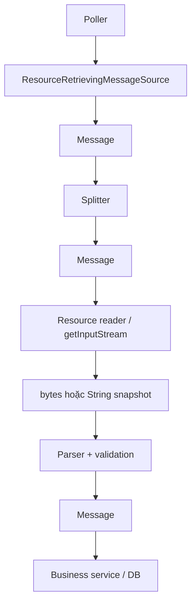
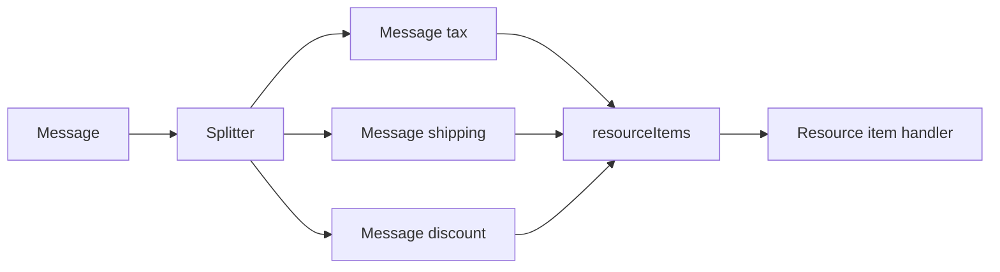
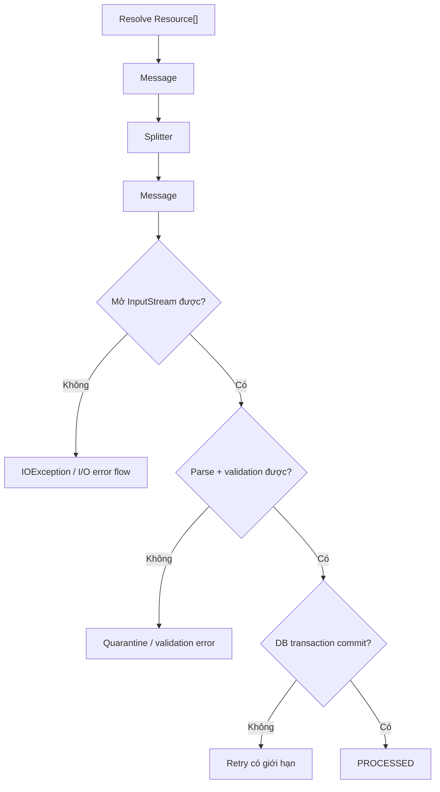

# Resource object trong message payload của Spring Integration

## 1. Tình huống: message mang dữ liệu hay mang địa chỉ để đọc dữ liệu?

Giả sử ứng dụng xử lý đơn hàng cần định kỳ tìm các tệp `.properties` trong classpath, kiểm tra quy tắc khuyến mại rồi nạp vào cơ sở dữ liệu. Có hai cách hình dung message được truyền qua Spring Integration:

1. **Message đã chứa nội dung:** payload là `String`, `byte[]` hoặc DTO `PromotionRule`; downstream có thể xử lý ngay dữ liệu đã parse.
2. **Message chứa một resource handle:** payload là đối tượng `Resource`; downstream **chưa nhận nội dung**, mà chỉ có đối tượng cho phép tìm metadata và mở stream để đọc nội dung sau.

**Resource inbound channel adapter** sử dụng phương án thứ hai: nó khám phá một hoặc nhiều `org.springframework.core.io.Resource` bằng location pattern và chuyển các đối tượng đó tới `MessageChannel`. Một chi tiết dễ nhầm: **payload phát trực tiếp từ `ResourceRetrievingMessageSource` là `Resource[]`**, tức một *mảng Resource*, không phải một `Resource` riêng lẻ. Muốn mỗi resource có một message, dùng splitter hoặc một bước chuyển đổi tương đương.

Bài này thuộc chương **Adapter Resource** trong module **SPRING_INTEGRATION_ADAPTERS**, nơi người học thực hành kết nối hệ thống ngoài bằng inbound/outbound adapter, gateway, poller và `MessageChannel`, đồng thời kiểm soát hợp đồng message, xử lý lỗi, giao dịch và vòng đời kết nối. Trọng tâm ở đây là **Resource object trong message payload**: khi nào nên giữ handle, khi nào phải đọc bytes/chuyển DTO, và vì sao ranh giới bất đồng bộ hoặc lưu bền message làm thay đổi thiết kế.

### Mục tiêu

Sau bài học, bạn có thể:

1. Mô tả `Message<Resource[]>` so với `Message<Resource>`, `Message<byte[]>` và `Message<RuleDocument>`.
2. Giải thích các thuộc tính quan trọng của `Resource`: `getInputStream()`, `exists()`, `isReadable()`, `isOpen()`, `getFile()` và metadata.
3. Tạo Resource inbound adapter bằng Java annotation/XML; nhận batch và tách thành từng message.
4. Đọc nội dung resource từ JAR/filesystem một cách an toàn, có giới hạn kích thước và đóng stream.
5. Thiết kế bước biến đổi từ Resource sang một payload nghiệp vụ bất biến, dễ serialize và kiểm thử.
6. Xử lý exception, async handoff, duplicate/restart, rủi ro SSRF, logging và transaction.
7. Viết test xác nhận payload thật thay vì suy luận theo tên adapter.

## 2. Hợp đồng message của Resource inbound adapter

Spring Integration Resource support dựa trên **`ResourceRetrievingMessageSource`**. API của class này là:

```java
public class ResourceRetrievingMessageSource
        extends AbstractMessageSource<Resource[]> {
    // ...
}
```

Về mặt ý tưởng, sau một lần poll thành công:

```text
SourcePollingChannelAdapter
    -> ResourceRetrievingMessageSource.receive()
    -> Message<Resource[]> {
           payload = [
               Resource("rules/tax.properties"),
               Resource("rules/shipping.properties"),
               Resource("rules/discount.properties")
           ],
           headers = { id, timestamp, ... }
       }
    -> resourceBatchChannel
```

Reference Spring Integration diễn đạt payload là một **collection các Resource objects**. Kiểu Java cụ thể được `ResourceRetrievingMessageSource` công bố là **`Resource[]`**. Không nên viết code chỉ nhận một `Resource` từ output channel của source này nếu chưa có bước splitter/transformer.

### Bốn dạng payload cần phân biệt

| Payload trong Spring Message | Có gì trong payload? | Nên dùng khi nào? |
| --- | --- | --- |
| `Resource[]` | Một mảng các resource handle | Source vừa resolve nhiều tài nguyên, muốn xử lý batch |
| `Resource` | Một resource handle | Sau splitter, xử lý từng resource riêng |
| `byte[]` hoặc `String` | Nội dung đã đọc vào bộ nhớ | Cần snapshot bytes/text, muốn tách khỏi nguồn |
| `RuleDocument` hoặc DTO khác | Dữ liệu nghiệp vụ đã parse/validate | Downstream business service, persistence và messaging liên hệ thống |

### Một Message có ba Resource vẫn là một Message

```text
Poll #1:
  Resolver tìm 3 tài nguyên
  Filter nhận 3 tài nguyên
  Source tạo 1 Message<Resource[3]>
  Channel nhận 1 message

Sau Splitter:
  Message<Resource tax>
  Message<Resource shipping>
  Message<Resource discount>
```

`maxMessagesPerPoll = 1` không giới hạn mảng chỉ còn một phần tử. Nó điều khiển **số message được poller nhận từ nguồn trong một chu kỳ**. Nếu có hàng trăm resource khớp pattern, một batch vẫn có thể chứa hàng trăm phần tử.

## 3. Đường đi dữ liệu: từ handle đến DTO



**Mỗi mũi tên là một ranh giới thiết kế.** Nguồn Resource inbound chỉ tạo handle. Bước đọc có thể gặp `IOException`; bước parse có thể gặp `IllegalArgumentException`; bước ghi DB có thể rollback. Ba lỗi đó **không phải cùng một lỗi adapter**.

Khi cần retry hoặc audit, nên có định danh và phiên bản nội dung rõ ràng:

```text
sourceLocation  = vị trí đã chuẩn hóa và được phép
sourceVersion   = version đáng tin cậy hoặc checksum của bytes
businessRuleId  = định danh quy tắc trong nội dung
eventId         = khóa nghiệp vụ dùng cho idempotency
```

`MessageHeaders.ID` của Spring message không nên thay cho `businessRuleId` hoặc `sourceVersion`.

## 4. Resource là một interface của Spring Framework

`Resource` mở rộng `InputStreamSource`. Các method phổ biến:

```java
Resource resource = ...;

boolean exists = resource.exists();
boolean readable = resource.isReadable();
boolean open = resource.isOpen();
boolean fileBased = resource.isFile();

String filename = resource.getFilename();
String description = resource.getDescription();

try (InputStream in = resource.getInputStream()) {
    // Đọc nội dung và đóng stream.
}
```

| Method | Ý nghĩa | Điều không được tự suy ra |
| --- | --- | --- |
| `exists()` | Kiểm tra resource có tồn tại tại thời điểm gọi | Đọc sẽ thành công ở thời điểm sau |
| `isReadable()` | Cho biết resource được đánh giá là có thể đọc | Không thay thế try/catch khi mở stream |
| `isOpen()` | Resource có giữ một stream đã mở không | `false` không chứng minh mọi nguồn có thể đọc vô hạn |
| `isFile()` | Resource đại diện cho file trên filesystem | `getFile()` chắc chắn thành công trên mọi provider |
| `getInputStream()` | Mở stream để đọc nội dung | Stream tự đóng khi method trả về |
| `getURL()` / `getURI()` | Biểu diễn location khi implementation hỗ trợ | Luôn an toàn để serialize/gửi cho client |
| `getFile()` | Yêu cầu physical `java.io.File` khi khả thi | Entry bên trong JAR được tự bung thành file |
| `contentLength()` | Có thể lấy độ dài nội dung | Không gây I/O hoặc không có side effects |
| `lastModified()` | Có thể lấy timestamp thay đổi | Timestamp đủ chính xác cho idempotency |
| `getFilename()` | Tên tệp/đối tượng nếu có | Luôn không null và duy nhất |
| `getDescription()` | Mô tả để hỗ trợ chẩn đoán | Không bao giờ chứa URL/path nhạy cảm |

### 4.1. Tại sao getInputStream() là thao tác ưu tiên?

Một tài nguyên nằm trong executable JAR:

```text
order-service.jar
  BOOT-INF/classes/rules/discount.properties
```

Có thể đọc được qua:

```java
try (InputStream in = resource.getInputStream()) {
    byte[] firstBytes = in.readNBytes(128);
}
```

Nhưng `resource.getFile()` có thể ném `FileNotFoundException` hoặc `IOException` vì entry đó không có physical `File` độc lập. Việc ví dụ chạy thành công trong IDE không chứng minh mã dựa trên `getFile()` sẽ chạy trong packaged JAR.

### 4.2. Kiểm tra exists() trước có loại hết lỗi không?

Không. Giữa hai thao tác:

```text
T1: resource.exists() == true
T2: file bị xóa / quyền thay đổi / remote server không phản hồi
T3: resource.getInputStream() -> IOException
```

Đây là vấn đề *time-of-check/time-of-use*. Với nguồn mutable/remote, phải chấp nhận đọc thất bại dù metadata trước đó trông hợp lệ.

### 4.3. Tại sao không chỉ dùng contentLength() để giới hạn?

Với một số `Resource`, việc gọi `contentLength()` có thể cần mở hoặc đọc stream; với resource có stream dùng một lần, thao tác metadata có thể gây hậu quả không mong muốn. Kiểm tra kích thước thực tế lúc đọc bằng **bounded read** đáng tin hơn cho quy tắc giới hạn payload của ứng dụng.

## 5. Các implementation thường gặp và hệ quả lên message

| Resource implementation | Nguồn | Đặc điểm cần lưu ý khi đưa vào payload |
| --- | --- | --- |
| `ClassPathResource` | Classpath/JAR | Thường đọc được qua stream, không bảo đảm `getFile()` |
| `FileSystemResource` | Filesystem | File có thể bị thay thế/xóa sau khi message tạo |
| `UrlResource` | URL | Đọc có thể phát sinh I/O network, timeout, xác thực hoặc redirect |
| `ByteArrayResource` | Mảng byte trong bộ nhớ | Mỗi lần đọc tạo stream trên byte[]; thích hợp snapshot/test có giới hạn |
| `InputStreamResource` | Một stream đã mở | Thường chỉ đọc **một lần**, `isOpen() == true`; không thích hợp lưu và đọc lặp |

### ByteArrayResource và InputStreamResource không tương đương

```java
byte[] snapshot = "rule.id=demo\n".getBytes(
    java.nio.charset.StandardCharsets.UTF_8
);

Resource repeatable = new ByteArrayResource(snapshot);
Resource singleUse = new InputStreamResource(
    new java.io.ByteArrayInputStream(snapshot)
);
```

`ByteArrayResource` hữu ích khi bạn đã **đọc xong** dữ liệu và muốn downstream có khả năng mở stream nhiều lần. Tuy vậy snapshot vẫn tiêu thụ RAM; không dùng nó để giữ hàng trăm tệp lớn mà không có giới hạn.

`InputStreamResource` bao một stream đã mở; sau khi downstream đọc/đóng stream, không được giả định có thể mở lại. Đặc biệt không nên đưa `InputStreamResource` qua `QueueChannel` hoặc worker async rồi mặc định upstream luôn giữ stream còn sống.

**Kết luận:** `Resource` là một *interface*, còn đặc tính đọc lặp, vòng đời nguồn và metadata phụ thuộc implementation. Code cần thận trọng thay vì suy luận mọi Resource có cùng hành vi.

## 6. Spring Message<T> bao payload và headers ra sao?

Spring Messaging cung cấp:

```java
Message<T> message;
T payload = message.getPayload();
MessageHeaders headers = message.getHeaders();
```

Với Resource inbound:

```java
Message<Resource[]> batchMessage = ...;
Resource[] resources = batchMessage.getPayload();

System.out.println("Batch size=" + resources.length);
System.out.println("Spring message id=" +
    batchMessage.getHeaders().getId());
```

### Những headers bạn có thể dùng

- `MessageHeaders.ID`: định danh **Spring message**, thường là UUID, không phải resource ID.
- `MessageHeaders.TIMESTAMP`: metadata lúc message được tạo, không phải `lastModified` của resource.
- Headers tự thêm bởi upstream/transformer: ví dụ `sourceType`, `resourceVersion` hoặc `ruleId` nếu code tự tạo và validate.

**Không mặc định Resource inbound tự gắn** `file_name`, `file_originalFile`, `resourceUri`, `contentType` hoặc business `eventId`. Những header như `FileHeaders.FILENAME` thuộc các adapter/file workflows khác hoặc chỉ có khi bạn chủ động tạo chúng.

### Headers có thể cùng tồn tại với payload Resource

```java
Message<Resource> resourceMessage =
    MessageBuilder.withPayload(resource)
        .setHeader("sourceType", "classpath")
        .setHeader("correlationKey", "batch-2026-11")
        .build();
```

Ví dụ trên giả định `resource` là handle đã được ứng dụng kiểm tra. `correlationKey` minh họa correlation do ứng dụng quy định; **không** nên hardcode nó cho production. Nếu header mang location, chỉ ghi location đã chuẩn hóa và không chứa token hoặc secrets.

### Resource payload không tự được serialize một cách portable

Một `Message<Resource>` có thể đi qua `DirectChannel` trong cùng JVM. Nhưng nếu đưa nguyên Resource qua Kafka/AMQP/JMS hoặc một persistent message store, serializer không có hợp đồng chung để:

- Truyền một `InputStream` đang mở.
- Truyền class loader/JAR entry từ máy nguồn sang máy nhận.
- Duy trì quyền, credentials và network access của URL.
- Bảo đảm resource không bị thay đổi hoặc bị xóa sau khi gửi.

Tại ranh giới **khác process/host**, thường nên gửi **DTO có dữ liệu đã parse** hoặc **một location ID đã kiểm soát cùng checksum/version**, không gửi nguyên object `Resource` và kỳ vọng consumer mở được.

## 7. Ví dụ 1 — cấu hình Resource inbound với payload Resource[]

### 7.1. Tệp ví dụ

Đặt trong `src/main/resources/rules/`:

```text
src/main/resources/
  rules/
    tax.properties
    shipping.properties
    discount.properties
```

Ví dụ `discount.properties`:

```properties
rule.id=discount-standard
rule.version=1
rule.enabled=true
```

Đây là schema **do bài thực hành tự định nghĩa**, không phải định dạng mà adapter tự hiểu.

### 7.2. Maven dependencies

Trong dự án Spring Boot dùng BOM quản lý phiên bản tương thích:

```xml
<dependencies>
    <dependency>
        <groupId>org.springframework.boot</groupId>
        <artifactId>spring-boot-starter-integration</artifactId>
    </dependency>
</dependencies>
```

`ResourceRetrievingMessageSource` nằm trong Spring Integration Core; không cần thêm module File riêng chỉ để nhận Spring `Resource`. Nếu cần chuyên xử lý file trên filesystem, File adapter có thể phù hợp hơn tùy bài toán.

### 7.3. Java configuration

```java
package com.example.resourceadapter;

import org.springframework.context.annotation.Bean;
import org.springframework.context.annotation.Configuration;
import org.springframework.core.io.Resource;
import org.springframework.integration.annotation.InboundChannelAdapter;
import org.springframework.integration.annotation.Poller;
import org.springframework.integration.channel.DirectChannel;
import org.springframework.integration.config.EnableIntegration;
import org.springframework.integration.core.MessageSource;
import org.springframework.integration.resource.ResourceRetrievingMessageSource;
import org.springframework.integration.util.AcceptOnceCollectionFilter;
import org.springframework.messaging.MessageChannel;

@Configuration
@EnableIntegration
public class ResourcePayloadConfiguration {

    @Bean
    public MessageChannel resourceBatches() {
        return new DirectChannel();
    }

    @Bean
    @InboundChannelAdapter(
        channel = "resourceBatches",
        poller = @Poller(
            fixedDelay = "5000",
            initialDelay = "1000",
            maxMessagesPerPoll = "1"
        )
    )
    public MessageSource<Resource[]> resourceSource() {
        ResourceRetrievingMessageSource source =
            new ResourceRetrievingMessageSource(
                "classpath*:rules/*.properties"
            );

        source.setFilter(new AcceptOnceCollectionFilter<>());
        return source;
    }
}
```

**Giải thích:**

1. `@EnableIntegration` bật hạ tầng Spring Integration.
2. `ResourceRetrievingMessageSource` tìm các resource khớp pattern.
3. `source.setFilter(...)` quy định chính sách phát lại ở lớp discovery.
4. `@InboundChannelAdapter` tạo endpoint lấy dữ liệu từ source.
5. `@Poller` chạy cố định theo lịch; `maxMessagesPerPoll` giới hạn số message từ source, không giới hạn array length.
6. `DirectChannel` chuyển Spring message đồng bộ tới subscriber; một call không tạo durable queue hoặc transaction tự động.

Chú ý: Java config chủ động đặt `AcceptOnceCollectionFilter`. **Default filter của XML Resource inbound adapter** được tài liệu Spring Integration mô tả riêng; không suy diễn mọi Java bean source đều được gắn default filter chỉ vì tên class tương tự.

## 8. Ví dụ 2 — đọc batch Resource[] trong @ServiceActivator

Nếu muốn cả batch được validate như một tập rule thống nhất, handler có thể nhận `Message<Resource[]>`:

```java
package com.example.resourceadapter;

import org.springframework.core.io.Resource;
import org.springframework.integration.annotation.ServiceActivator;
import org.springframework.messaging.Message;
import org.springframework.stereotype.Component;

@Component
public class ResourceBatchInspector {

    @ServiceActivator(inputChannel = "resourceBatches")
    public void inspect(Message<Resource[]> message) {
        Resource[] payload = message.getPayload();

        System.out.println("Resources in batch: " + payload.length);
        for (Resource resource : payload) {
            String name = resource.getFilename();
            if (name == null || name.isBlank()) {
                throw new IllegalArgumentException(
                    "Resource has no valid filename"
                );
            }
            System.out.println("Resource filename: " + name);
        }
    }
}
```

Code này **chỉ đọc metadata**, không mở nội dung. Vì vậy một log "Resource filename: ..." không có nghĩa rule đã parse, validate hoặc ghi DB thành công.

### Có thể truyền Resource[] trực tiếp vào method không?

Một service activator POJO cũng có thể khai báo tham số payload:

```java
@ServiceActivator(inputChannel = "resourceBatches")
public void inspectPayload(Resource[] resources) {
    for (Resource resource : resources) {
        // Xử lý từng resource trong cùng batch.
    }
}
```

**Đây là một cách viết thay thế** method `inspect(Message<Resource[]>)` trong ví dụ, không nên giữ **hai subscribers** trên cùng `DirectChannel` rồi giả định mỗi message đều chạy qua cả hai. Với `DirectChannel` có nhiều handlers, dispatching/round-robin semantics có thể khiến chỉ một subscriber được gọi; nếu cần fan-out, dùng `PublishSubscribeChannel` hoặc định nghĩa flow tường minh.

## 9. Ví dụ 3 — tách batch thành Message<Resource>

Nếu mỗi resource có một đường xử lý/transaction riêng, hãy thêm splitter. Spring Integration mặc định hỗ trợ split payload là mảng:



### 9.1. Java DSL thay thế topology ở ví dụ 1

Ví dụ dưới đây khai báo **source và poller trong DSL**, thay vì dùng `@InboundChannelAdapter` trên cùng source:

```java
package com.example.resourceadapter;

import org.springframework.context.annotation.Bean;
import org.springframework.context.annotation.Configuration;
import org.springframework.integration.dsl.IntegrationFlow;
import org.springframework.integration.dsl.Pollers;
import org.springframework.integration.resource.ResourceRetrievingMessageSource;
import org.springframework.integration.util.AcceptOnceCollectionFilter;

@Configuration
public class ResourceSplitFlowConfiguration {

    @Bean
    public ResourceRetrievingMessageSource splitResourceSource() {
        ResourceRetrievingMessageSource source =
            new ResourceRetrievingMessageSource(
                "classpath*:rules/*.properties"
            );
        source.setFilter(new AcceptOnceCollectionFilter<>());
        return source;
    }

    @Bean
    public IntegrationFlow resourceSplitFlow(
            ResourceRetrievingMessageSource splitResourceSource,
            ResourceItemProcessor processor) {

        return IntegrationFlow
            .from(
                splitResourceSource,
                endpoint -> endpoint.poller(
                    Pollers.fixedDelay(5000)
                        .maxMessagesPerPoll(1)
                )
            )
            .split()
            .handle((payload, headers) -> {
                processor.process(
                    (org.springframework.core.io.Resource) payload
                );
                return null; // One-way flow.
            })
            .get();
    }
}
```

`ResourceItemProcessor` là service của ứng dụng có method `process(Resource)`, được trình bày ở mục sau. Bạn **không nên bật đồng thời** Java annotation adapter và DSL flow cùng pattern trong một demo rồi giả định chỉ có một nguồn poll.

### 9.2. Dùng @Splitter khi đã có channel resourceBatches

Một cách khác là giữ nguồn của ví dụ 1, nhưng **thay service activator của ví dụ 2** bằng:

```java
import org.springframework.core.io.Resource;
import org.springframework.integration.annotation.Splitter;
import org.springframework.stereotype.Component;

@Component
public class ResourceArraySplitter {

    @Splitter(
        inputChannel = "resourceBatches",
        outputChannel = "resourceItems"
    )
    public Resource[] split(Resource[] payload) {
        return payload;
    }
}
```

Khi một splitter xử lý mảng, nó phát ra từng phần tử `Resource` làm payload của các output messages. Bạn cần khai báo `resourceItems` và một handler tiêu thụ channel đó trong context. **`Resource[]` vẫn là hợp đồng upstream; `Resource` là hợp đồng downstream sau splitter.**

### 9.3. Headers sau khi split

Spring Integration Splitter có thể bổ sung những sequence headers như `CORRELATION_ID`, `SEQUENCE_NUMBER` và `SEQUENCE_SIZE` để hỗ trợ theo dõi/correlation hoặc aggregator. Đây là **metadata của Spring Integration flow**, không phải identity của bản thân resource hay transaction ID của database.

Không nên dùng `SEQUENCE_NUMBER` làm thứ tự ưu tiên nghiệp vụ giữa nhiều JAR. Để xác định rule quan trọng hơn, cần một trường `priority`/`version` trong dữ liệu.

## 10. Ví dụ 4 — đọc Resource, biến thành RuleDocument bất biến

Một pipeline thực tế không nên giữ `Resource` ở mọi tầng. Sau khi mở và validate nội dung, có thể tạo DTO:

```java
package com.example.resourceadapter;

public record RuleDocument(
    String ruleId,
    int version,
    boolean enabled,
    String sourceName
) {}
```

`sourceName` ở đây chỉ lưu tên hiển thị đã được kiểm tra; để định danh resource bền vững cần thêm source ID/version đáng tin cậy theo business contract.

### 10.1. Reader với giới hạn kích thước

```java
package com.example.resourceadapter;

import java.io.ByteArrayInputStream;
import java.io.IOException;
import java.io.InputStream;
import java.io.InputStreamReader;
import java.nio.charset.StandardCharsets;
import java.util.Properties;

import org.springframework.core.io.Resource;
import org.springframework.stereotype.Service;

@Service
public class ResourceItemProcessor {

    private static final int MAX_BYTES = 64 * 1024;

    public RuleDocument process(Resource resource)
            throws IOException {
        if (resource == null) {
            throw new IllegalArgumentException("Resource is null");
        }

        String filename = resource.getFilename();
        if (filename == null || filename.isBlank()) {
            throw new IllegalArgumentException(
                "Missing resource filename"
            );
        }

        byte[] data;
        try (InputStream stream = resource.getInputStream()) {
            data = stream.readNBytes(MAX_BYTES + 1);
        }

        if (data.length > MAX_BYTES) {
            throw new IOException("Rule resource exceeds 64 KiB");
        }

        Properties properties = new Properties();
        try (InputStreamReader reader = new InputStreamReader(
                new ByteArrayInputStream(data),
                StandardCharsets.UTF_8
        )) {
            properties.load(reader);
        }

        String ruleId = properties.getProperty("rule.id");
        if (ruleId == null || ruleId.isBlank()) {
            throw new IllegalArgumentException("Missing rule.id");
        }

        int version = Integer.parseInt(
            properties.getProperty("rule.version", "0")
        );
        if (version < 1) {
            throw new IllegalArgumentException(
                "rule.version must be positive"
            );
        }

        String enabledText =
            properties.getProperty("rule.enabled");
        if (!"true".equals(enabledText)
                && !"false".equals(enabledText)) {
            throw new IllegalArgumentException(
                "Invalid rule.enabled"
            );
        }

        return new RuleDocument(
            ruleId,
            version,
            Boolean.parseBoolean(enabledText),
            filename
        );
    }
}
```

**Lưu ý kỹ thuật:**

- `readNBytes(MAX + 1)` đọc tối đa 65.537 bytes để phát hiện resource vượt giới hạn, không nạp file tùy ý vào RAM.
- `Properties.load(Reader)` theo `UTF_8` được dùng vì ví dụ quy định các tệp `.properties` được đóng gói dưới dạng UTF-8.
- `Integer.parseInt(...)` có thể ném `NumberFormatException` khi dữ liệu sai contract; cần đưa vào error flow/quarantine chứ không retry vô hạn.
- `getFilename()` không phải khóa source duy nhất: hai JAR có thể cùng chứa `rules/discount.properties`.
- Đọc xong mới tạo DTO; nguồn có thể bị thay đổi trước thời điểm đọc nếu nằm trên filesystem/URL.

Ví dụ demo tạo DTO chứ **chưa ghi DB**. Trong môi trường thật, một service khác nhận `RuleDocument`, kiểm tra quyền/tenant, áp dụng transaction và ghi trạng thái xử lý theo version.

### 10.2. Đưa DTO sang Spring Message

```java
Resource resource = ...;
RuleDocument rule = processor.process(resource);

Message<RuleDocument> result =
    MessageBuilder.withPayload(rule)
        .setHeader("resourceKind", "classpath")
        .setHeader("ruleVersion", rule.version())
        .build();
```

Ở đây `processor` là instance `ResourceItemProcessor` đã được injection, `MessageBuilder` là `org.springframework.messaging.support.MessageBuilder`. Nếu mã nằm trong `@Transformer`, Spring Integration có thể bọc return value thành message và chuyển các headers hợp lệ theo pipeline mà không cần tự tạo `MessageBuilder`.

## 11. @Transformer: chuyển Resource payload sang DTO downstream

Một lựa chọn khác là đặt transformer **sau splitter**:

```java
import java.io.IOException;

import org.springframework.core.io.Resource;
import org.springframework.integration.annotation.Transformer;
import org.springframework.stereotype.Component;

@Component
public class RuleResourceTransformer {

    private final ResourceItemProcessor processor;

    public RuleResourceTransformer(
            ResourceItemProcessor processor) {
        this.processor = processor;
    }

    @Transformer(
        inputChannel = "resourceItems",
        outputChannel = "validatedRules"
    )
    public RuleDocument toRule(Resource resource)
            throws IOException {
        return processor.process(resource);
    }
}
```

Sau bước này:

```text
resourceItems:
    Message<Resource>
      payload=ClassPathResource(...)

validatedRules:
    Message<RuleDocument>
      payload=RuleDocument("discount-standard", 1, true, ...)
```

Phải khai báo `resourceItems` và `validatedRules` trong application context hoặc trong flow, cùng consumer cho `validatedRules`. Đừng đưa đồng thời `@Transformer` và một handler khác vào cùng `DirectChannel` rồi giả định cả hai được chạy. Chọn một luồng chuyển đổi minh bạch.

### Vì sao nên biến đổi sớm?

Khi đã có DTO:

- Downstream không cần class loader hoặc quyền đọc source.
- Có thể validate schema, version và logical ID một lần.
- Dễ kiểm thử, audit, serialize theo contract JSON/Avro/Protobuf do ứng dụng chọn.
- Lỗi đọc/parsing nằm tại một chỗ có thể monitor.
- Tránh giữ stream mở qua transaction hoặc async queue.
- Tránh trường hợp downstream khác mở lại cùng `InputStreamResource` đã được sử dụng.

**Không nhất thiết luôn giữ toàn bộ bytes trong DTO.** Với file lớn, DTO có thể chỉ chứa metadata đã xác minh và object key/checksum của một kho bền vững, nhưng phải có cơ chế truy xuất và quyền tương ứng.

## 12. XML namespace: cùng một hợp đồng Resource[]

Spring Integration hỗ trợ:

```xml
<?xml version="1.0" encoding="UTF-8"?>
<beans xmlns="http://www.springframework.org/schema/beans"
       xmlns:xsi="http://www.w3.org/2001/XMLSchema-instance"
       xmlns:int="http://www.springframework.org/schema/integration"
       xsi:schemaLocation="
           http://www.springframework.org/schema/beans
           https://www.springframework.org/schema/beans/spring-beans.xsd
           http://www.springframework.org/schema/integration
           https://www.springframework.org/schema/integration/spring-integration.xsd">

    <int:channel id="resourceBatches"/>

    <int:resource-inbound-channel-adapter
            id="resourceInbound"
            channel="resourceBatches"
            pattern="classpath*:rules/*.properties">
        <int:poller fixed-delay="5000"
                    max-messages-per-poll="1"/>
    </int:resource-inbound-channel-adapter>

    <bean id="resourceBatchInspector"
          class="com.example.resourceadapter.ResourceBatchInspector"/>

    <int:service-activator
            input-channel="resourceBatches"
            ref="resourceBatchInspector"
            method="inspect"/>
</beans>
```

Đây là **phương án thay thế** Java configuration của mục 7, không phải cấu hình cần chạy đồng thời.

Theo reference Spring Integration, XML Resource inbound adapter không chỉ định filter sẽ dùng **`AcceptOnceCollectionFilter`** mặc định. Có thể dùng `filter="someFilter"` để tham chiếu `CollectionFilter<Resource>` tùy biến hoặc `filter=""` để tắt filter khi muốn phát lại.

Việc chọn filter ảnh hưởng **resource được phép xuất hiện trong payload**, không thay đổi kiểu payload `Resource[]` thành `byte[]` hoặc DTO.

## 13. Resource handle, lifecycle và ranh giới bất đồng bộ

### 13.1. Resource object có thể sống lâu hơn nguồn

`Message<Resource>` có thể được enqueue vào `ExecutorChannel`/`QueueChannel` rồi handler xử lý sau một khoảng thời gian. Trong lúc đó:

1. File trên filesystem bị đổi tên hoặc bị xóa.
2. URL remote hết hạn token, đổi nội dung, redirect hoặc timeout.
3. Plugin class loader được unload.
4. Một `InputStreamResource` dùng một lần đã bị đọc hoặc stream đã đóng.
5. Quyền truy cập thay đổi.

Khi worker gọi `getInputStream()`, dữ liệu có thể **khác** thời điểm resource được resolver phát hiện. Bởi vậy, nếu yêu cầu đọc một phiên bản bất biến, hãy **snapshot/validate/checksum trước async handoff** hoặc dùng một object store/versioned storage có hợp đồng tương đương.

### 13.2. Gửi Resource qua channel có an toàn không?

| Channel/topology | Có thể gửi Resource? | Rủi ro |
| --- | --- | --- |
| `DirectChannel`, xử lý đồng bộ trong cùng JVM | Thường phù hợp | Handler vẫn có thể mở stream thất bại; không auto commit |
| `ExecutorChannel` với worker async cùng process | Có thể nhưng cần policy | Resource thay đổi hoặc one-shot stream hết hạn trước lúc worker đọc |
| `QueueChannel` in-memory | Có thể nhưng không durable | Batch mất khi process crash; resource handle có thể stale |
| Publish-subscribe trong một JVM | Có thể nhưng nhiều subscriber có thể đọc cùng handle | `InputStreamResource` single-use; contention và duplicate side effects |
| JMS/Kafka/AMQP hoặc message store bền vững | **Không nên truyền raw Resource mặc định** | Không portable, serialization và quyền đọc source không được bảo đảm |

Điều phù hợp cho nội dung quan trọng thường là:

```text
Resource -> bounded read -> checksum + validated DTO
    -> durable queue/outbox/event
    -> consumer có idempotency key
```

### 13.3. Không chia sẻ InputStream giữa các subscribers

`InputStream` có vị trí đọc mutable. Hai workers cùng sử dụng một instance có thể đọc xen kẽ, nhận bytes không đầy đủ hoặc làm hỏng lifecycle. Nếu cần hai subscribers đọc cùng dữ liệu:

- Dùng `ByteArrayResource` cho payload nhỏ đã snapshot hoặc hai stream độc lập khi nguồn hỗ trợ.
- Hoặc parse thành DTO rồi fan-out DTO bất biến.
- Tránh mở stream trước khi đưa message vào flow rồi để downstream tự đóng không có hợp đồng rõ.

## 14. Error handling: phân biệt discovery, read, parse và commit



| Loại lỗi | Ví dụ | Hành động gợi ý |
| --- | --- | --- |
| Resolver/poller | Pattern sai, class loader không tìm thấy JAR entry | Kiểm tra cấu hình/packaging; alert nếu resource bắt buộc |
| Filter | AcceptOnce loại mất resource cần reprocess | Rà soát filter/version key; không coi state RAM là checkpoint |
| Mở resource | `FileNotFoundException`, URL timeout, quyền bị từ chối | Retry có giới hạn theo tính chất nguồn hoặc quarantine |
| Đọc vượt giới hạn | Resource lớn hơn policy | Từ chối/quarantine; không nạp toàn bộ vào RAM |
| Parse | `NumberFormatException`, thiếu `rule.id`, encoding sai | Lỗi dữ liệu cố định: không retry nóng vô hạn |
| Dispatch | `DirectChannel` không có subscriber hoặc handler lỗi | Spring Integration error flow của endpoint |
| Business transaction | DB timeout, deadlock, unique constraint | Transaction retry và idempotency |

### 14.1. Filter accept-once không đồng nghĩa xử lý thành công

```text
T1: resolver tìm Resource A
T2: AcceptOnceCollectionFilter chấp nhận A, ghi nhớ A
T3: message được gửi sang handler
T4: handler đọc A -> parser lỗi
T5: poll tiếp theo -> A có thể bị filter bỏ qua
```

**Ranh giới quan trọng:** Spring Integration không tự rollback trạng thái `AcceptOnceCollectionFilter` vì một downstream handler ném exception. Nếu nghiệp vụ cần retry đến khi commit, phải thiết kế checkpoint và chiến lược filter cho phép resource chưa xử lý được phát lại.

### 14.2. Chỉ cần @Transactional là đủ?

Không. `@Transactional` ở handler thường chỉ điều khiển transaction của DB tham gia; nó **không** rollback trạng thái resolver, nội dung JAR, URL remote hoặc AcceptOnce filter.

Ngay cả khi DB rollback thành công, source đã “nhìn thấy” Resource không có nghĩa sẽ tự gọi lại handler. Với hệ thống quan trọng, nên dùng **ledger bền vững** theo logical resource ID + version, có unique constraint và trạng thái `PENDING/PROCESSED/FAILED`.

### 14.3. Lỗi từng item và lỗi cả batch

Một batch `[A, B, C]` có thể được xử lý tuần tự. Nếu handler commit A, commit B rồi parse C lỗi, batch đã bị xử lý **một phần**. Có ba chiến lược phổ biến:

1. **Batch atomic:** validate tất cả trước, rồi commit trong một transaction thích hợp.
2. **Per-resource transaction:** split rồi xử lý mỗi `Resource` có ledger riêng.
3. **Quarantine:** lưu item lỗi vào khu vực kiểm tra để tiếp tục các item tốt, có audit và retry policy.

Chọn chiến lược dựa trên hợp đồng nghiệp vụ; không mặc định splitter hay một Java `for` loop tự tạo atomicity.

## 15. Resource identity và idempotency

Hai resource có thể cùng filename nhưng khác location:

```text
pricing.jar!/rules/default.properties
shipping.jar!/rules/default.properties
```

`resource.getFilename()` của cả hai đều có thể là `default.properties`. Vì vậy **filename không đủ làm primary key nghiệp vụ**.

### Nhiều loại khóa

| Khóa | Công dụng | Điểm yếu |
| --- | --- | --- |
| Filename | Hiển thị và lọc | Có thể trùng ở nhiều JAR/thư mục |
| URI/URL của Resource | Xác định vị trí vật lý | Có thể thay đổi khi deploy/di chuyển, chứa bí mật |
| Logical rule ID | Định danh nghiệp vụ | Phải parse/validate; có thể trùng nếu data sai |
| Content hash (SHA-256) | Xác định version nội dung | Cần đọc bytes; không phân biệt ngữ cảnh nếu chỉ so hash |
| `(sourceId, ruleId, version)` | Ledger xử lý bền vững | Đòi hỏi contract ổn định và DB unique constraint |

### Dedupe sau khi parse

Một chiến lược phù hợp:

```text
Resource A
  -> bounded read + UTF-8 parse
  -> ruleId, version, checksum
  -> BEGIN DB TRANSACTION
       INSERT processed_rule(sourceId, ruleId, version) UNIQUE
       UPDATE domain configuration
     COMMIT
```

Nếu hai process cùng kiểm tra “chưa thấy” rồi cùng lưu, chỉ `existsById` trước `save` **không chống được race**. Dùng unique constraint/transaction hoặc cơ chế claim đảm bảo bởi DB. Khi conflict, quyết định rõ đây là duplicate success hay version conflict.

### Restart không tạo exactly-once

`AcceptOnceCollectionFilter` là state của instance; sau restart resource có thể được phát lại. `Resource[]` không có ACK/NACK giống một broker queue. **Exactly-once business effect** phải đến từ idempotency + transaction + nguồn dữ liệu/ledger phù hợp, không phải từ kiểu payload Resource.

## 16. Metadata, provenance và bảo mật trong message

### 16.1. Không đưa path nhạy cảm vào headers

Ví dụ không nên:

```java
// Không nên làm với nguồn có URL chứa credentials:
builder.setHeader(
    "resourceDescription", resource.getDescription()
);
```

`getDescription()` thường chứa URL hoặc path vật lý, đôi khi có query token, username, internal hostname. Để giám sát, ưu tiên metadata được **sanitize/allowlist**, ví dụ:

```java
Message<RuleDocument> message =
    MessageBuilder.withPayload(rule)
        .setHeader("resourceKind", "classpath")
        .setHeader("sourceModule", "pricing")
        .setHeader("ruleVersion", rule.version())
        .build();
```

`rule` là DTO đã được validate; `sourceModule` phải do backend xác nhận chứ không tin tùy ý vào một trường trong file chưa kiểm chứng.

### 16.2. SSRF và đường dẫn không tin cậy

Nếu dùng một `UrlResource` từ URL mà người dùng nhập, application có thể đọc endpoint nội bộ như metadata service, localhost hoặc tài nguyên ở mạng private. Vì thế:

- Không cho client cung cấp raw `classpath:`, `file:` hoặc `https:` location tùy ý.
- Áp dụng allowlist scheme/host/path và kiểm tra redirect/DNS theo security model.
- Giới hạn thời gian kết nối/đọc và kích thước payload.
- Không log token hoặc dữ liệu PII trong `Resource.getDescription()`.
- Với file path, kiểm tra canonical location, symlink và quyền truy cập.
- Giới hạn số lượng resource trong batch khi resolver quét wildcard.

### 16.3. Resource không phải object tùy ý đáng tin

Classpath resource nằm trong dependency JAR. Một dependency hoặc plugin mới có thể đóng góp nội dung sai hoặc độc hại. Hãy validate schema và quyền trước khi đưa nội dung vào nghiệp vụ; không deserialize Java object tự do hoặc thực thi script từ resource chỉ vì nó ở trong classpath.

## 17. Hiệu năng: batch size, streaming và backpressure

| Vấn đề | Vì sao xảy ra | Cách xử lý |
| --- | --- | --- |
| Resource[] rất lớn | Pattern khớp hàng nghìn entries | Hẹp pattern, phân vùng nguồn, giới hạn collection |
| Poller quét classpath liên tục | Classpath/JAR thường bất biến giữa các lần deploy | Nạp một lần hoặc tăng fixed-delay |
| Handler giữ thread lâu | Mở và parse nhiều resources trong một batch đồng bộ | Split, bounded worker pool, checkpoint từng resource |
| Memory spike | Dùng `readAllBytes()` trên resource lớn | Bounded reads, streaming parser phù hợp |
| File descriptors/HTTP connections tăng | Stream không được đóng | Try-with-resources, timeout, metrics |
| Async queue chứa nhiều Resource handles | Worker đọc trễ, nguồn có thể thay đổi | Snapshot nội dung/DTO trước queue nếu yêu cầu consistency |
| Các subscriber đọc lại một one-shot stream | `InputStreamResource` không tái sử dụng | DTO bất biến hoặc `ByteArrayResource` có giới hạn |

**`maxMessagesPerPoll(1)` không giới hạn số Resource trong message.** Chức năng này thuộc poller, còn **batch size** phụ thuộc resolver/filter. Nếu mỗi poll tìm 20.000 resources, một message có thể chứa 20.000 handles dù poller chỉ gọi một lần.

### Streaming hay snapshot?

**Streaming** phù hợp với resource lớn, khi handler xử lý ngay và không cần đọc lại, đồng thời có timeout, giới hạn và kiểm soát lifecycle.

**Snapshot** phù hợp với payload nhỏ và cần tính nhất quán qua async handoff; sau khi snapshot, chuyển DTO hoặc `ByteArrayResource` có giới hạn và checksum. Không ép mọi file lớn thành `byte[]` trong RAM.

## 18. Quan sát và khắc phục lỗi

| Triệu chứng | Nguyên nhân thường gặp | Hướng kiểm tra |
| --- | --- | --- |
| `ClassCastException: Resource cannot be cast to Resource[]` | Nhầm upstream sau splitter với source batch | Xác định vị trí channel; sau splitter là `Message<Resource>` |
| `ClassCastException: Resource[] cannot be cast to Resource` | Handler một item nối trực tiếp batch | Thêm splitter hoặc sửa signature handler |
| Chỉ nhận một message dù có nhiều file | Một batch chứa nhiều `Resource` | Log `payload.length` hoặc dùng splitter |
| `getFile()` lỗi trong executable JAR | Entry không phải physical file | Đọc bằng `getInputStream()` |
| `getInputStream()` thất bại sau queue delay | File/URL thay đổi hoặc one-shot stream đã dùng | Snapshot/validate sớm, kiểm soát lifecycle |
| Nội dung trong DTO không đúng như lúc scan | Resource là handle, không phải snapshot | Tính version/checksum khi đọc, dùng source bất biến |
| Resource được phát lại sau restart | Filter state RAM không bền | Processed-resource ledger/idempotency |
| Resource không được retry sau parse error | AcceptOnce đã ghi nhớ resource | Redesign filter/checkpoint và quarantine |
| Không thấy contentType/resourceUri trong headers | Adapter không tự gắn metadata custom | Thêm header theo contract đã validate |
| Worker async fail nhưng poller vẫn chạy | Async boundary tách lỗi downstream | Error channel/metrics phía worker |
| URI chứa credential xuất hiện trong log | Log `getDescription()` hoặc raw headers | Sanitize, hạn chế logging, rotate secrets khi cần |
| Cùng filename bị overwrite | Dùng filename làm key duy nhất | Dùng sourceId/logicalId/version có conflict policy |

### Các metric nên đo

Đo số lần poll, số resource resolved, số resource sau filter, phân phối batch size, số lần mở stream thành công/thất bại, thời gian parse, số lỗi validation, số resource đã commit theo source/version, duplicate count, worker queue depth và tuổi của bản dữ liệu cuối được xác nhận. Tách riêng **discovered**, **accepted by filter**, **message delivered** và **business committed**.

## 19. Kiểm thử Resource payload bằng JUnit 5

Ví dụ tập trung kiểm tra behavior của `Resource` và hợp đồng `Message<Resource[]>`. Nó không cần chạy poller thực.

### 19.1. Test mảng Resource trong Spring Message

```java
import static org.junit.jupiter.api.Assertions.*;

import java.nio.charset.StandardCharsets;
import org.junit.jupiter.api.Test;
import org.springframework.core.io.ByteArrayResource;
import org.springframework.core.io.Resource;
import org.springframework.messaging.Message;
import org.springframework.messaging.support.MessageBuilder;

class ResourcePayloadTest {

    @Test
    void messageContainsArrayOfResourceHandles() throws Exception {
        Resource a = new ByteArrayResource(
            "rule.id=tax\n".getBytes(StandardCharsets.UTF_8)
        );
        Resource b = new ByteArrayResource(
            "rule.id=shipping\n".getBytes(StandardCharsets.UTF_8)
        );

        Message<Resource[]> batch = MessageBuilder
            .withPayload(new Resource[] { a, b })
            .build();

        assertEquals(2, batch.getPayload().length);
        assertNotNull(batch.getHeaders().getId());

        try (var input = batch.getPayload()[0].getInputStream()) {
            assertEquals('r', input.read());
        }
    }
}
```

Trong test này `ByteArrayResource` được tạo trực tiếp; **chưa có resolver và poller**. Kết quả chỉ chứng minh `Message<Resource[]>` mang được handles, không phải adapter ngoài hệ thống đã khởi chạy.

### 19.2. Test ResourceItemProcessor với ByteArrayResource

```java
import static org.junit.jupiter.api.Assertions.*;

import java.nio.charset.StandardCharsets;
import org.junit.jupiter.api.Test;
import org.springframework.core.io.ByteArrayResource;
import org.springframework.core.io.Resource;

class RuleReaderTest {

    @Test
    void parsesResourceIntoImmutableRuleDocument() throws Exception {
        byte[] content = (
            "rule.id=discount-standard\n" +
            "rule.version=2\n" +
            "rule.enabled=true\n"
        ).getBytes(StandardCharsets.UTF_8);

        Resource input = new ByteArrayResource(
            content, "test-rule.properties"
        ) {
            @Override
            public String getFilename() {
                return "test-rule.properties";
            }
        };

        RuleDocument result =
            new ResourceItemProcessor().process(input);

        assertEquals("discount-standard", result.ruleId());
        assertEquals(2, result.version());
        assertTrue(result.enabled());
    }

    @Test
    void rejectsMissingRuleId() {
        Resource input = new ByteArrayResource(
            "rule.version=1\n".getBytes(StandardCharsets.UTF_8),
            "bad-rule.properties"
        ) {
            @Override
            public String getFilename() {
                return "bad-rule.properties";
            }
        };

        assertThrows(
            IllegalArgumentException.class,
            () -> new ResourceItemProcessor().process(input)
        );
    }
}
```

`ByteArrayResource` có constructor nhận `byte[]` và description, nhưng `getFilename()` có thể là `null` vì description không đồng nghĩa filename. Hai test đã **ghi đè `getFilename()`** trên resource thử nghiệm để logic của `ResourceItemProcessor` đọc được tên file, rồi tập trung kiểm tra parse và validation. Trong dự án thực, có thể dùng `FileSystemResource` trỏ tới `@TempDir` của JUnit để kiểm thử filename lấy từ file path thật.

### 19.3. Test `InputStreamResource` one-shot

Khi cần hiểu lifecycle, xây test sử dụng `InputStreamResource` và kiểm tra `isOpen()`, sau đó chỉ đọc một lần. Không cố dựa vào một exception cụ thể khi đọc lần hai để thiết kế nghiệp vụ; contract là **không bảo đảm đọc lặp**, bất kể test implementation cụ thể làm gì.

### 19.4. Integration test cần thêm gì?

Để kiểm tra toàn flow:

1. Tạo fixture trong `src/test/resources/rules/`.
2. Cấu hình `ResourceRetrievingMessageSource` với `classpath*:rules/*.properties`.
3. Gắn poller vào channel, thu payload ở test subscriber/`QueueChannel`.
4. Xác nhận source phát `Resource[]`, số phần tử đúng theo fixture.
5. Bật splitter, xác nhận downstream nhận từng `Resource`.
6. Tạo resource sai schema, kiểm tra lỗi parsing tại transformer/handler.
7. Test resource nằm trong **packaged executable JAR**, không chỉ IDE/test classpath.
8. Restart context, kiểm tra behavior filter và idempotency ledger.
9. Với nguồn mutable, thay nội dung giữa resolve và read để đánh giá consistency policy.
10. Nếu gửi DTO sang broker, test serialization contract — không gửi raw Resource.

## 20. Bài tập và đáp án

**Bài 1 — Payload của source.** `ResourceRetrievingMessageSource` trả ra một `Resource` hay `Resource[]`?

**Đáp án:** `Resource[]` trong Spring message; source tìm collection các resource trong một lần receive.

**Bài 2 — Một poll.** Pattern tìm 15 resource, `maxMessagesPerPoll=1`. Có thể có bao nhiêu phần tử trong một message?

**Đáp án:** Có thể cả 15 resource sau filter; maxMessagesPerPoll giới hạn số message được nhận trong một chu kỳ poll.

**Bài 3 — Sau splitter.** Một splitter xử lý `Message<Resource[]>` thường tạo message có payload kiểu nào?

**Đáp án:** `Resource` cho từng phần tử, cùng các headers liên quan sequence/correlation khi splitter được cấu hình tương ứng.

**Bài 4 — getFile.** Vì sao `ClassPathResource` trong executable JAR không nên đọc bằng `getFile()`?

**Đáp án:** Entry nằm trong JAR không nhất thiết có physical `java.io.File`; dùng `getInputStream()`.

**Bài 5 — isOpen.** `InputStreamResource.isOpen() == true` gợi ý điều gì?

**Đáp án:** Resource bao một stream đã mở, thường chỉ đọc một lần; không nên để nhiều subscribers mở lại.

**Bài 6 — ByteArrayResource.** Khi nào `ByteArrayResource` hữu ích?

**Đáp án:** Khi nội dung nhỏ đã snapshot trong RAM, cần tạo input stream mới để đọc lặp hoặc làm unit test.

**Bài 7 — Stream.** Ai chịu trách nhiệm đóng `InputStream` mà `Resource.getInputStream()` trả về?

**Đáp án:** Caller/handler đọc resource; nên dùng try-with-resources.

**Bài 8 — contentLength.** Có nên tin `contentLength()` luôn không tốn I/O hoặc không ảnh hưởng stream single-use?

**Đáp án:** Không. Behavior tùy implementation, nên enforce byte limit trong lúc đọc.

**Bài 9 — exists.** `exists() == true` có bảo đảm `getInputStream()` thành công sau một phút không?

**Đáp án:** Không. Nguồn và quyền truy cập có thể thay đổi.

**Bài 10 — Headers.** `MessageHeaders.ID` có phải định danh bền vững của Resource trong database không?

**Đáp án:** Không. Đây là Spring message ID, không phải business resource/version key.

**Bài 11 — File header.** Resource inbound có tự đặt `FileHeaders.FILENAME` hoặc `contentType` cho mọi resource không?

**Đáp án:** Không được mặc định như vậy; các metadata cần được tạo theo contract của flow.

**Bài 12 — Serialize.** Có nên đưa nguyên `ClassPathResource` chứa entry JAR vào một Kafka message và kỳ vọng consumer ở máy khác mở được không?

**Đáp án:** Không. Nên chuyển DTO/bytes hoặc nguồn truy xuất versioned có quyền và checksum rõ ràng.

**Bài 13 — Async.** `ExecutorChannel` có thể giữ `Resource` trong queue khi file đã bị xóa không?

**Đáp án:** Có. Resource là handle; cần snapshot/version policy nếu nội dung phải nhất quán.

**Bài 14 — Duplicate filename.** Hai JAR có `default.properties`, có nên lấy `getFilename()` làm khóa duy nhất không?

**Đáp án:** Không. Cần source identity, logical ID và version/checksum.

**Bài 15 — AcceptOnce.** Handler parse thất bại sau khi filter đã chấp nhận resource. Poll tiếp theo chắc chắn retry được không?

**Đáp án:** Không. Filter state không tự rollback khi handler/DB lỗi.

**Bài 16 — Restart.** Dùng `AcceptOnceCollectionFilter` có bảo đảm không phát lại resource sau restart không?

**Đáp án:** Không. State thường là trong bộ nhớ của một instance; dùng idempotency/ledger bền vững.

**Bài 17 — Test.** Vì sao `ByteArrayResource` có description "test.properties" chưa chắc `getFilename()` trả "test.properties"?

**Đáp án:** Description và filename là hai metadata khác nhau; nếu test logic cần filename, hãy override `getFilename()` hoặc dùng `FileSystemResource`.

**Bài 18 — Transformer.** Khi đã parse thành `RuleDocument`, có ưu điểm gì so với truyền tiếp Resource?

**Đáp án:** Payload rõ schema, dễ validate/serialize/test, không phụ thuộc stream và class loader ở downstream.

**Bài 19 — Bảo mật.** Vì sao không log nguyên `resource.getDescription()`?

**Đáp án:** Có thể chứa URL, token, filesystem path hoặc thông tin hạ tầng nhạy cảm.

**Bài 20 — Production.** Resource payload có tự cung cấp exactly-once processing hoặc ACK như một message broker không?

**Đáp án:** Không. Cần transaction, checkpoint, nguồn bền vững và idempotency theo thiết kế riêng.

## 21. Ghi nhớ

**`Resource` trong payload là một *handle để đọc nội dung*, không phải bytes đã snapshot.** Spring Integration Resource inbound adapter dùng `ResourceRetrievingMessageSource` phát **`Message<Resource[]>`** theo poller; nếu có splitter, downstream mới thường nhận **`Message<Resource>`**. Một `Resource` cho phép kiểm tra metadata và mở `getInputStream()`, nhưng `getFile()` không phù hợp cho mọi JAR/URL, `InputStreamResource` có thể chỉ đọc một lần, và nguồn có thể thay đổi trước lúc downstream đọc. Để xử lý an toàn, hãy dùng bounded reads + try-with-resources, parse/validate thành DTO, đặt metadata đã sanitize, thiết kế checkpoint/version/idempotency và không serialize raw Resource qua ranh giới process hoặc lưu bền message. `AcceptOnceCollectionFilter` chỉ giúp hạn chế phát lặp tại lớp discovery, **không phải transaction hay xác nhận nghiệp vụ**.

## Tài liệu tham khảo

- [Spring Integration Reference — Resource Support](https://docs.spring.io/spring-integration/reference/resource.html)
- [Spring Integration API — ResourceRetrievingMessageSource](https://docs.spring.io/spring-integration/api/org/springframework/integration/resource/ResourceRetrievingMessageSource.html)
- [Spring Integration Reference — Splitter](https://docs.spring.io/spring-integration/reference/splitter.html)
- [Spring Integration Reference — Java DSL Splitters](https://docs.spring.io/spring-integration/reference/dsl/java-splitters.html)
- [Spring Framework Reference — Resources](https://docs.spring.io/spring-framework/reference/core/resources.html)
- [Spring Framework API — Resource](https://docs.spring.io/spring-framework/docs/current/javadoc-api/org/springframework/core/io/Resource.html)
- [Spring Framework API — ByteArrayResource](https://docs.spring.io/spring-framework/docs/current/javadoc-api/org/springframework/core/io/ByteArrayResource.html)
- [Spring Framework API — InputStreamResource](https://docs.spring.io/spring-framework/docs/current/javadoc-api/org/springframework/core/io/InputStreamResource.html)
