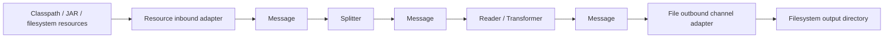

# Resource outbound adapter: đưa dữ liệu Resource ra hệ thống đích

## 1. Đặt vấn đề: “Resource outbound adapter” có thực sự là một component độc lập?

Một dịch vụ quản lý đơn hàng có các quy tắc `.properties` trong classpath. Luồng Spring Integration tìm thấy chúng dưới dạng `Resource` rồi cần **xuất bản** bản sao sang thư mục cấu hình được giám sát, hoặc ghi một báo cáo đã tổng hợp ra filesystem. Khi thiết kế, lập trình viên có thể suy luận rằng vì Spring Integration có **Resource inbound channel adapter**, chắc hẳn phải có một component đối xứng tên `ResourceOutboundChannelAdapter`.

**Suy luận đó không đúng với Spring Integration hiện hành.** Bảng **Integration Endpoints** của tài liệu chính thức ghi:

| Module | Inbound adapter | Outbound adapter | Inbound gateway | Outbound gateway |
| --- | --- | --- | --- | --- |
| **Resource** | **Resource Inbound Channel Adapter** | **N — không có adapter chuyên biệt** | N | N |
| File | File inbound adapter | **File outbound channel adapter** | N | File outbound gateway |
| SFTP | SFTP inbound adapter | **SFTP outbound channel adapter** | N | SFTP outbound gateway |

Vì thế, **“Resource outbound adapter” trong đề bài nên được hiểu là một *mẫu thiết kế outbound* cho dữ liệu/tài nguyên Spring `Resource`**, không phải tên một class, annotation hay XML namespace có sẵn trong module Resource. Bài học sẽ chỉ ra những đường triển khai **thật**, có thể kiểm tra trong API:

1. Chuyển `Resource` thành `byte[]`, `String`, `InputStream` hoặc `File` hợp lệ rồi dùng **File outbound channel adapter** để ghi ra filesystem.
2. Viết **generic outbound channel adapter** bằng một phương thức POJO `@ServiceActivator` nhận dữ liệu rồi ghi tới `WritableResource` hoặc API I/O thích hợp.
3. Nếu đích là SFTP/HTTP/object store, chọn **adapter/gateway của chính transport đó** thay vì cố gửi một `Resource` raw tới một “Resource outbound adapter” không tồn tại.

Đây là một bài học thuộc chương **Adapter Resource**, module **SPRING_INTEGRATION_ADAPTERS**: kết nối hệ thống ngoài bằng inbound/outbound adapter, gateway, poller và `MessageChannel`; quản lý hợp đồng message, lỗi và vòng đời. Phần này tập trung vào **hướng outbound** và cách chọn endpoint sau khi đã có `Resource` hoặc nội dung của Resource.

### Mục tiêu học tập

Sau bài học, bạn có thể:

1. Nêu chính xác phạm vi hỗ trợ **Resource inbound** và lý do không tự tưởng tượng một API outbound chuyên biệt.
2. Phân biệt `Resource` dùng để **đọc**, `WritableResource` dùng để **ghi** và **File outbound handler** ghi filesystem.
3. Chọn một hợp đồng Spring message phù hợp: `Message<Resource>`, `Message<byte[]>`, `Message<String>`, `Message<File>` hay DTO.
4. Triển khai File outbound bằng `FileWritingMessageHandler` và `FileHeaders.FILENAME`; quản lý `FileExistsMode`.
5. Tạo outbound POJO `@ServiceActivator` ghi vào `WritableResource`, và giải thích vì sao cách này không mặc định atomic.
6. Chuyển Resource inbound batch `Resource[]` thành từng payload hợp lệ trước khi đi ra ngoài.
7. Thiết kế error flow, retries, idempotency, an toàn đường dẫn, quyền ghi, kiểm thử và giám sát.

## 2. Khái niệm inbound và outbound không đối xứng theo tên

**Inbound channel adapter** là điểm nhận dữ liệu từ hệ thống ngoài vào `MessageChannel`. **Outbound channel adapter** tiêu thụ message từ channel để gọi ra một đích ngoài, không mặc định có reply.



Quan sát đường đi:

- `ResourceRetrievingMessageSource` giúp khám phá tập resource từ các pattern như `classpath*:rules/*.properties`. **Payload đầu ra là `Resource[]`** trong một Spring message.
- Khi muốn mỗi resource được xử lý riêng, dùng splitter để có `Message<Resource>`.
- Ghi file không phải trách nhiệm của `ResourceRetrievingMessageSource`. Nó thực hiện **đọc/khám phá đầu vào**, không viết đích.
- `FileWritingMessageHandler` nhận các payload **`File`, `String`, `byte[]`, `InputStream`**; **không nên đưa raw `Resource` hay `Resource[]` vào rồi mặc định handler hiểu cách ghi**.

### Phân biệt hai câu hỏi

| Câu hỏi | Phần tử đúng |
| --- | --- |
| “Tôi tìm tất cả `*.properties` ở nhiều JAR bằng cách nào?” | `ResourcePatternResolver` và Resource inbound |
| “Tôi đưa những file đó ra thư mục local bằng cách nào?” | Đọc nội dung Resource, sau đó **File outbound** |
| “Tôi muốn ghi vào một `WritableResource` tùy biến?” | Generic outbound POJO + I/O implementation riêng |
| “Tôi muốn đẩy file lên máy SFTP?” | **SFTP outbound adapter/gateway** và payload thích hợp |
| “Tôi muốn đẩy dữ liệu lên HTTP API?” | HTTP/WebFlux outbound adapter/gateway, DTO/request body |
| “Tôi cần biết file output cụ thể để xử lý tiếp?” | Cân nhắc **File outbound gateway**, không chỉ one-way adapter |

## 3. Resource đọc được không nhất thiết ghi được

Spring Framework có hai abstraction khác nhau:

```java
org.springframework.core.io.Resource;
org.springframework.core.io.WritableResource;
```

`Resource` cung cấp API quan sát và đọc như `getInputStream()`. `WritableResource` **mở rộng Resource** và bổ sung `getOutputStream()`:

```java
WritableResource target = ...;

if (!target.isWritable()) {
    throw new IllegalStateException("Target is not writable");
}

try (OutputStream output = target.getOutputStream()) {
    output.write(contentBytes);
}
```

`isWritable()` là một tín hiệu khả năng ghi, **không bảo đảm lần mở stream sau sẽ thành công**. Quyền truy cập, đường dẫn, quota và trạng thái đích có thể thay đổi giữa kiểm tra và hành động.

### Bảng các implementation

| Resource implementation | Thường dùng làm nguồn đọc | Có thể ghi trực tiếp? | Lưu ý |
| --- | --- | --- | --- |
| `ClassPathResource` | Có | **Không mặc định** | Classpath/JAR là nguồn đọc; không coi entry trong JAR là output file |
| `FileSystemResource` | Có | Có, khi filesystem/permissions cho phép | Có thể ghi/ghi đè file vật lý |
| `PathResource` | Có | Có, khi path writable | Triển khai `WritableResource` |
| `FileUrlResource` | Có | Khi file URL writable | Không đồng nghĩa mọi HTTP URL writable |
| `UrlResource` | Có tùy URL | Không mặc định | `getInputStream()` không hàm ý có PUT/POST |
| `ByteArrayResource` | Có | Không qua API `WritableResource` | Bytes trong RAM; muốn lưu phải chuyển sang đích |
| `InputStreamResource` | Có, thường một lần | Không | Không biến InputStream đọc thành OutputStream ghi |

**Quy tắc:** muốn ghi thì phải có **đích hỗ trợ ghi** và API phù hợp. `Resource` chỉ mô tả một nguồn; không được gọi `resource.getOutputStream()` vì method này **không thuộc giao diện `Resource`**.

### Classpath không phải output directory

```text
Classpath resource:
  jar:file:/app/service.jar!/BOOT-INF/classes/rules/discount.properties

Filesystem target:
  file:/var/app/export/discount.properties
```

Để xuất bản một file trong JAR, **đọc** source bằng `getInputStream()` rồi **ghi** nội dung vào đích filesystem hoặc một API external. Không cố sửa `ClassPathResource` trong executable JAR đang chạy.

## 4. Chọn payload outbound phù hợp

Không phải mọi outbound handler chấp nhận mọi Java type. Đối với **FileWritingMessageHandler**, tài liệu chính thức công bố:

| Payload | FileWritingMessageHandler hỗ trợ trực tiếp? | Ý nghĩa |
| --- | --- | --- |
| `java.io.File` | **Có** | Copy file nguồn tới thư mục đích |
| `String` | **Có** | Viết text theo encoding đã cấu hình |
| `byte[]` | **Có** | Viết bytes trực tiếp |
| `InputStream` | **Có** | Copy bytes từ stream vào file đích |
| `Resource` | **Không thuộc danh sách payload hỗ trợ trực tiếp** | Cần transform hoặc custom handler |
| `Resource[]` | **Không** | Cần split và transform trước |
| DTO nghiệp vụ | Không mặc định | Cần serialize theo hợp đồng rõ ràng |

### Vì sao `byte[]` là lựa chọn tốt cho ví dụ?

Nếu resource nhỏ (ví dụ file cấu hình không vượt 64 KiB), `byte[]` là **snapshot bytes**. Nó không còn phụ thuộc vào việc file trong classpath/JAR có bị đóng stream hay thay đổi sau khi được phát hiện.

```text
Resource handle
   -> getInputStream()
   -> đọc bytes có giới hạn
   -> Message<byte[]>
   -> File outbound
```

Với file nhiều GB, `byte[]` không phù hợp. Khi đó cân nhắc `InputStream` theo hợp đồng lifecycle, `File`, streaming/remote adapter, hoặc một kho object store có thể truy xuất theo object key/version.

### Vì sao không dùng `toString()`?

`resource.toString()` và `resource.getDescription()` thường cho **mô tả vị trí**, không phải nội dung file. Việc chuyển `Resource` thành `String` bằng `toString()` có thể khiến outbound ghi một chuỗi đường dẫn, thay vì dữ liệu mong muốn, thậm chí để lộ vị trí hoặc token trong URL.

## 5. Thiết kế hoàn chỉnh A: Resource → bytes → File outbound adapter

Ta triển khai use case: phát hiện `classpath*:rules/*.properties`, tách thành từng `Resource`, đọc bytes có giới hạn và ghi file vào thư mục output. Phần này dùng **File outbound chuyên dụng**; đây là giải pháp thông dụng nhất khi đích thực là filesystem.


### 5.1. Dependencies

Ví dụ dự án Maven dùng Spring Boot BOM để quản lý các version tương thích:

```xml
<dependencies>
    <dependency>
        <groupId>org.springframework.boot</groupId>
        <artifactId>spring-boot-starter-integration</artifactId>
    </dependency>
    <dependency>
        <groupId>org.springframework.integration</groupId>
        <artifactId>spring-integration-file</artifactId>
    </dependency>
</dependencies>
```

**Lưu ý theo phiên bản:** Spring Integration **7.0+** chuyển `FileWritingMessageHandler` chính sang package `org.springframework.integration.file.outbound`; class cũ ở `org.springframework.integration.file` bị đánh dấu deprecated. Nếu dùng Spring Integration 6.x, tra Javadoc phiên bản đó và dùng import tương ứng. Các ví dụ Java dưới đây dùng package **7.x**; không tự trộn các package giữa version khác nhau.

### 5.2. Cấu hình output directory

Thư mục output do ứng dụng quản lý, ví dụ cấu hình:

```properties
app.export-dir=/var/app/exports
```

Trên Windows hoặc khi chạy local, thay bằng path hợp lệ của môi trường. Với ví dụ bên dưới, thư mục phải **tồn tại trước** và tài khoản chạy app có quyền ghi. Không trỏ tới classpath hoặc JAR của ứng dụng.

### 5.3. Java configuration cho File outbound

```java
package com.example.resourceexport;

import java.io.File;

import org.springframework.beans.factory.annotation.Value;
import org.springframework.context.annotation.Bean;
import org.springframework.context.annotation.Configuration;
import org.springframework.integration.annotation.ServiceActivator;
import org.springframework.integration.channel.DirectChannel;
import org.springframework.integration.config.EnableIntegration;
import org.springframework.integration.file.outbound.FileWritingMessageHandler;
import org.springframework.integration.file.support.FileExistsMode;
import org.springframework.messaging.MessageChannel;
import org.springframework.messaging.MessageHandler;

@Configuration
@EnableIntegration
public class ExportFileConfiguration {

    @Bean
    public MessageChannel fileOutboundInput() {
        return new DirectChannel();
    }

    @Bean
    @ServiceActivator(inputChannel = "fileOutboundInput")
    public MessageHandler fileOutboundHandler(
            @Value("${app.export-dir}") String directory) {

        FileWritingMessageHandler handler =
            new FileWritingMessageHandler(new File(directory));

        handler.setExpectReply(false); // One-way outbound adapter.
        handler.setFileExistsMode(FileExistsMode.FAIL);
        handler.setAutoCreateDirectory(false);
        return handler;
    }
}
```

**Giải thích:**

1. `fileOutboundInput` là `DirectChannel` được outbound handler subscribe.
2. `@ServiceActivator` gắn `MessageHandler` vào channel; không yêu cầu inbound poller cho channel dạng subscribable này.
3. `FileWritingMessageHandler` chuyên trách ghi file vật lý, không phải `ResourceRetrievingMessageSource`.
4. `setExpectReply(false)` thể hiện one-way output, thay vì request-reply.
5. `FileExistsMode.FAIL` từ chối khi đích đã tồn tại, phù hợp demo cần phát hiện conflict.
6. `setAutoCreateDirectory(false)` yêu cầu directory được provisioning rõ ràng.

Code chỉ minh họa endpoint; bản thân nó chưa tự tạo message. Ở ví dụ tiếp theo, producer gửi `byte[]` kèm filename đã kiểm soát vào `fileOutboundInput`.

### 5.4. Publisher gửi bytes và filename

```java
package com.example.resourceexport;

import org.springframework.beans.factory.annotation.Qualifier;
import org.springframework.integration.file.FileHeaders;
import org.springframework.messaging.MessageChannel;
import org.springframework.messaging.support.MessageBuilder;
import org.springframework.stereotype.Service;

@Service
public class ExportPublisher {

    private final MessageChannel output;

    public ExportPublisher(
            @Qualifier("fileOutboundInput") MessageChannel output) {
        this.output = output;
    }

    public void publish(
            String trustedFileName,
            byte[] validatedContent) {

        if (trustedFileName == null ||
                !trustedFileName.matches(
                    "[A-Za-z0-9][A-Za-z0-9._-]{0,127}"
                )) {
            throw new IllegalArgumentException(
                "Unsafe output filename"
            );
        }
        if (validatedContent == null || validatedContent.length == 0) {
            throw new IllegalArgumentException("Empty output content");
        }

        boolean accepted = output.send(
            MessageBuilder.withPayload(validatedContent.clone())
                .setHeader(FileHeaders.FILENAME, trustedFileName)
                .build()
        );
        if (!accepted) {
            throw new IllegalStateException(
                "File outbound channel rejected message"
            );
        }
    }
}
```

`FileHeaders.FILENAME` cung cấp tên file cho `DefaultFileNameGenerator` của File outbound adapter. Nếu thiếu header và payload không phải `File`, framework có thể fallback sang tên dựa trên Spring message ID với đuôi `.msg`. Đối với xuất bản có hợp đồng, **không nên trông cậy vào fallback này**.

**Quan trọng:** regex trong demo chỉ cho phép **basename đơn giản** và ngăn đường dẫn chứa dấu gạch chéo, nhưng nó không phải một giải pháp bảo mật file path đầy đủ. Production cần directory do backend cấu hình, quyền hệ điều hành, kiểm tra symbolic links, và xác minh không có thành phần nào khác biến header thành đường dẫn tùy ý.

### 5.5. File outbound có tự chuyển Resource thành bytes không?

Không. Cách sau là **sai contract**:

```java
// SAI: FileWritingMessageHandler không công bố payload Resource.
// output.send(MessageBuilder.withPayload(resource).build());

// SAI: Resource inbound source phát Resource[]; writer không
// tự ghi mỗi phần tử như một File riêng.
// output.send(MessageBuilder.withPayload(resources).build());
```

Hãy **đọc và chuyển thành `byte[]`/`String`/`InputStream`/`File`** đúng cách trước khi đưa vào File outbound. Với nguồn là classpath/JAR, thường không dùng `resource.getFile()`.

## 6. Chuyển Resource thành Message<byte[]> với @Transformer

Trong một flow đọc từ classpath, có thể nhận `Resource` từ splitter và chuyển sang bytes.

### 6.1. Transformer có giới hạn 64 KiB

```java
package com.example.resourceexport;

import java.io.IOException;
import java.io.InputStream;

import org.springframework.core.io.Resource;
import org.springframework.integration.annotation.Transformer;
import org.springframework.integration.file.FileHeaders;
import org.springframework.messaging.Message;
import org.springframework.messaging.support.MessageBuilder;
import org.springframework.stereotype.Component;

@Component
public class ResourceToFilePayload {

    private static final int MAX_BYTES = 64 * 1024;

    @Transformer(
        inputChannel = "resourceItems",
        outputChannel = "fileOutboundInput"
    )
    public Message<byte[]> toBytes(Resource resource)
            throws IOException {

        String name = resource.getFilename();
        if (name == null ||
                !name.matches("[A-Za-z0-9][A-Za-z0-9._-]{0,127}")) {
            throw new IllegalArgumentException(
                "Resource filename is not safe for export"
            );
        }

        byte[] bytes;
        try (InputStream input = resource.getInputStream()) {
            bytes = input.readNBytes(MAX_BYTES + 1);
        }

        if (bytes.length > MAX_BYTES) {
            throw new IOException("Resource exceeds 64 KiB");
        }

        return MessageBuilder.withPayload(bytes)
            .setHeader(FileHeaders.FILENAME, name)
            .build();
    }
}
```

Phương thức trả **`Message<byte[]>`** để mang đồng thời bytes và header filename. `@Transformer` thuộc Spring Integration, không phải outbound handler; nó chỉ chuyển đổi hợp đồng trước khi File outbound ghi.

**Những điều transformer chưa tự làm:** kiểm tra schema nội dung `.properties`, hash/checksum, chính sách duplicate logical IDs, xác minh file output có đủ quyền, giao dịch DB và retry sau crash.

### 6.2. Bổ sung một splitter từ Resource[] sang Resource

Giả sử nguồn inbound đã phát `Message<Resource[]>` vào `resourceBatches`:

```java
package com.example.resourceexport;

import org.springframework.core.io.Resource;
import org.springframework.integration.annotation.Splitter;
import org.springframework.stereotype.Component;

@Component
public class ResourceBatchSplitter {

    @Splitter(
        inputChannel = "resourceBatches",
        outputChannel = "resourceItems"
    )
    public Resource[] split(Resource[] payload) {
        return payload;
    }
}
```

Nếu dùng explicit channels:

```java
@Bean
public MessageChannel resourceBatches() {
    return new DirectChannel();
}

@Bean
public MessageChannel resourceItems() {
    return new DirectChannel();
}
```

Hai `@Bean` này cần đặt trong một class `@Configuration`, với imports `org.springframework.context.annotation.Bean`, `org.springframework.messaging.MessageChannel` và `org.springframework.integration.channel.DirectChannel`. Đây là **bổ sung** cho ví dụ trước; không đặt hai beans trùng tên trong context.

### 6.3. Nếu lấy source từ Resource inbound adapter

Cấu hình nguồn dạng annotation:

```java
@Bean
@InboundChannelAdapter(
    channel = "resourceBatches",
    poller = @Poller(
        fixedDelay = "10000",
        maxMessagesPerPoll = "1"
    )
)
public MessageSource<Resource[]> resourceSource() {
    ResourceRetrievingMessageSource source =
        new ResourceRetrievingMessageSource(
            "classpath*:rules/*.properties"
        );
    source.setFilter(new AcceptOnceCollectionFilter<>());
    return source;
}
```

Đoạn bổ sung trên sử dụng `@Bean`, `@InboundChannelAdapter`, `@Poller`, `MessageSource`, `ResourceRetrievingMessageSource`, `AcceptOnceCollectionFilter`, `Resource` và cần imports tương ứng. Đây là một ví dụ **ghép flow**; code ứng dụng phải bảo đảm chỉ có **một** inbound poller cho cùng source khi thử nghiệm.

### Dòng chảy cuối cùng

```text
classpath*:rules/*.properties
  -> ResourceRetrievingMessageSource
  -> Message<Resource[]>               (resourceBatches)
  -> @Splitter
  -> Message<Resource>                 (resourceItems)
  -> @Transformer, bounded getInputStream()
  -> Message<byte[]>                   (fileOutboundInput)
       header file_name = "discount.properties"
  -> FileWritingMessageHandler
  -> /var/app/exports/discount.properties
```

**Bước ghi chỉ xảy ra sau khi Resource được đọc thành payload được hỗ trợ.** Nếu filter đã chấp nhận resource rồi transformer ném lỗi, `AcceptOnceCollectionFilter` không tự rollback và đảm bảo gửi lại.

## 7. Thiết kế B: generic outbound channel adapter ghi vào WritableResource

Nếu đích **không phù hợp với FileWritingMessageHandler** hoặc ứng dụng cần sử dụng abstraction `WritableResource` trực tiếp, Spring Integration có **generic outbound channel adapter**: một channel nối với method POJO `void` qua `@ServiceActivator` hoặc XML `<int:outbound-channel-adapter>`.

Đây là **outbound POJO của ứng dụng**, không phải một implementation có sẵn tên `ResourceOutboundChannelAdapter`.

### 7.1. Contract cho lệnh xuất bản

```java
package com.example.resourceexport;

import java.util.Objects;

public record ExportCommand(String filename, byte[] contents) {

    public ExportCommand {
        Objects.requireNonNull(filename, "filename");
        Objects.requireNonNull(contents, "contents");
        contents = contents.clone();
    }

    @Override
    public byte[] contents() {
        return contents.clone();
    }
}
```

Record copy mảng để hạn chế sửa bytes ngoài ý muốn từ caller; `byte[]` vốn mutable, không nên coi nó bất biến chỉ vì được chứa trong record.

### 7.2. POJO ghi qua PathResource

```java
package com.example.resourceexport;

import java.io.IOException;
import java.io.OutputStream;
import java.nio.file.Files;
import java.nio.file.LinkOption;
import java.nio.file.Path;

import org.springframework.beans.factory.annotation.Value;
import org.springframework.core.io.PathResource;
import org.springframework.core.io.WritableResource;
import org.springframework.integration.annotation.ServiceActivator;
import org.springframework.stereotype.Component;

@Component
public class WritableResourceSink {

    private final Path directory;

    public WritableResourceSink(
            @Value("${app.export-dir}") String directory) {
        this.directory = Path.of(directory).toAbsolutePath().normalize();
    }

    @ServiceActivator(inputChannel = "writableResourceRequests")
    public void write(ExportCommand command) throws IOException {
        String filename = command.filename();
        if (!filename.matches(
                "[A-Za-z0-9][A-Za-z0-9._-]{0,127}")) {
            throw new IllegalArgumentException(
                "Unsafe output filename"
            );
        }

        if (!Files.isDirectory(
                directory, LinkOption.NOFOLLOW_LINKS)) {
            throw new IOException("Output directory not available");
        }

        Path destination = directory.resolve(filename).normalize();
        if (!directory.equals(destination.getParent())) {
            throw new IllegalArgumentException(
                "Output path escapes configured directory"
            );
        }

        WritableResource target = new PathResource(destination);
        try (OutputStream output = target.getOutputStream()) {
            output.write(command.contents());
        }
    }
}
```

Và cấu hình channel:

```java
@Configuration
@EnableIntegration
public class WritableResourceChannelConfiguration {

    @Bean
    public MessageChannel writableResourceRequests() {
        return new DirectChannel();
    }
}
```

Imports: `org.springframework.context.annotation.Bean`, `Configuration`, `org.springframework.integration.config.EnableIntegration`, `org.springframework.integration.channel.DirectChannel` và `org.springframework.messaging.MessageChannel`.

**Giới hạn quan trọng của demo:** `PathResource#getOutputStream()` có thể **ghi đè trực tiếp file hiện có**, không có `FileExistsMode.FAIL`, temporary suffix/atomic move, durability fsync hoặc cơ chế chống symlink race giống một giải pháp output production được harden. Regex và `normalize()` ngăn trường hợp path traversal cơ bản nhưng **không đủ** trước một thư mục có attacker-controlled symlink. Chỉ chạy ví dụ trên directory riêng do ứng dụng kiểm soát; production nên chọn File outbound adapter với chính sách file existence phù hợp hoặc tự dùng `Files.newOutputStream`/`CREATE_NEW`/`NOFOLLOW_LINKS` và cơ chế atomic publication đã kiểm thử theo filesystem.

### 7.3. Gửi lệnh vào outbound POJO

```java
MessageChannel channel = ...; // inject bean writableResourceRequests

ExportCommand command = new ExportCommand(
    "rules-export.properties",
    "rule.id=demo\n".getBytes(StandardCharsets.UTF_8)
);

channel.send(MessageBuilder.withPayload(command).build());
```

Như vậy:

```text
Message<ExportCommand>
  -> DirectChannel
  -> @ServiceActivator WritableResourceSink.write(...)
  -> PathResource.getOutputStream()
  -> filesystem
```

**Không cần một Resource outbound package đặc biệt.** Outbound POJO gắn với channel là một khả năng của Spring Integration Core.

## 8. Khi nào dùng File outbound, khi nào dùng WritableResource POJO?

| Tiêu chí | File outbound channel adapter | Generic POJO với WritableResource |
| --- | --- | --- |
| Có endpoint chuyên dụng? | **Có**: `FileWritingMessageHandler` | Không, do ứng dụng triển khai `@ServiceActivator` |
| Target | Filesystem directory | Bất kỳ đích có `WritableResource` thật sự và được cấp quyền |
| Input chuẩn | `File`, `String`, `byte[]`, `InputStream` | Theo method signature của POJO/DTO |
| Filename generator | Có, gồm `FileHeaders.FILENAME` | Tự thiết kế |
| Existing-file policy | `FileExistsMode` | Tự thiết kế |
| Temporary suffix khi ghi | Có cho các mode thích hợp | Tự thiết kế |
| Ghi file vật lý với ít code | Rất phù hợp | Dễ viết sai atomicity và bảo mật |
| Ghi API không phải filesystem | Không đúng mục tiêu | Tùy custom implementation; thường chọn adapter transport |
| Reply sau ghi | Chọn File outbound gateway nếu cần | Tự trả kết quả qua gateway/service nếu thiết kế |

**Khuyến nghị theo bản chất đích:** nếu ghi filesystem, ưu tiên **File outbound** đã được framework cung cấp. Chỉ dùng POJO với `WritableResource` khi cần trừu tượng I/O riêng và chấp nhận trách nhiệm thiết kế error, durability, concurrency, security.

## 9. XML: generic outbound adapter và file outbound là hai loại khác nhau

### 9.1. Generic POJO outbound

Với một bean `writableResourceSink` có method `write(ExportCommand)`:

```xml
<int:channel id="writableResourceRequests"/>

<bean id="writableResourceSink"
      class="com.example.resourceexport.WritableResourceSink"/>

<int:outbound-channel-adapter
        channel="writableResourceRequests"
        ref="writableResourceSink"
        method="write"/>
```

Đây là ví dụ **XML thay thế** Java `@ServiceActivator` đã gắn trên class, không bật **cả hai endpoint** cho cùng channel nếu muốn một lần ghi cho một message. Với POJO được Spring tạo bằng XML, constructor `@Value` cần property resolution/injection phù hợp; bạn cũng có thể khai báo constructor-arg tường minh. Không nên copy đoạn XML rời rạc rồi giả định mọi bean/namespace đã được thiết lập.

Nếu channel là `QueueChannel`/`PollableChannel`, outbound consumer cần **poller**; `DirectChannel` dạng subscribable không cần poller. Đây là khác biệt giữa lấy resource định kỳ ở inbound và gửi message đã có sẵn ra external target.

### 9.2. File outbound namespace

```xml
<?xml version="1.0" encoding="UTF-8"?>
<beans xmlns="http://www.springframework.org/schema/beans"
       xmlns:xsi="http://www.w3.org/2001/XMLSchema-instance"
       xmlns:int="http://www.springframework.org/schema/integration"
       xmlns:int-file="http://www.springframework.org/schema/integration/file"
       xsi:schemaLocation="
         http://www.springframework.org/schema/beans
         https://www.springframework.org/schema/beans/spring-beans.xsd
         http://www.springframework.org/schema/integration
         https://www.springframework.org/schema/integration/spring-integration.xsd
         http://www.springframework.org/schema/integration/file
         https://www.springframework.org/schema/integration/file/spring-integration-file.xsd">

    <int:channel id="fileOutboundInput"/>

    <int-file:outbound-channel-adapter
            id="resourceExportFiles"
            channel="fileOutboundInput"
            directory="${app.export-dir}"
            auto-create-directory="false"
            mode="FAIL"/>
</beans>
```

**Đây là File outbound channel adapter**, không phải `<int-resource:outbound-channel-adapter>`. Nó nhận payload hợp lệ từ transformer hoặc publisher; namespace `int-file` thuộc module `spring-integration-file`.

### 9.3. Đừng tự phát minh XML namespace

```xml
<!-- SAI: không có Resource outbound namespace chính thức như sau. -->
<!-- <int-resource:outbound-channel-adapter ... /> -->
```

Nếu cần dùng resource path/payload riêng, tận dụng generic outbound POJO và viết implementation/test đúng hợp đồng của ứng dụng.

## 10. FileExistsMode và semantics ghi file

`FileWritingMessageHandler` hỗ trợ `FileExistsMode` với nhiều chính sách:

| Mode | Hành vi | Rủi ro |
| --- | --- | --- |
| `REPLACE` | Ghi đè file đã tồn tại; là default | Có thể làm mất version trước |
| `FAIL` | Ném exception nếu file đích đã tồn tại | Retry sau lần ghi thành công nhưng mất ACK có thể gặp conflict |
| `IGNORE` | Bỏ qua ghi khi file đích tồn tại | Có thể che giấu stale/corrupt data nếu không xác minh |
| `APPEND` | Nối thêm nội dung và đóng file sau mỗi message | Interleaving/duplicate lines nếu retry hoặc nhiều writers |
| `APPEND_NO_FLUSH` | Nối thêm nhưng chưa flush/close ngay | Rủi ro mất dữ liệu lớn hơn khi crash; cần flush policy |
| `REPLACE_IF_MODIFIED` | So sánh timestamp theo contract | Không phải content hash, có thể sai nếu metadata không đầy đủ |

### File temporary suffix

Với nhiều mode, File outbound dùng suffix tạm thời (mặc định `.writing`) trong khi viết, sau đó xuất bản tên cuối khi thao tác hoàn tất. Đây là cơ chế **giảm khả năng consumer đọc file còn dở**, nhưng không tự tạo một distributed transaction giữa ghi file, DB, và một broker khác.

**Chú ý:** `APPEND` không dùng temporary suffix theo cách này. Nếu consumer cần biết file đã hoàn tất, có thể dùng marker file/manifest theo hợp đồng và chỉ coi file là ready khi marker hợp lệ.

### Tại sao FAIL không đồng nghĩa exactly-once?

Giả sử worker đã ghi thành công `event-501.json` rồi crash trước khi update DB outbox. Sau restart, retry file với `FileExistsMode.FAIL` sẽ nhận exception vì file đã có. Không được mặc định coi đó là thất bại nghiệp vụ hoàn toàn mới: cần so sánh checksum/event ID, đối chiếu trạng thái và đánh dấu idempotent success khi đúng.

```text
BEGIN DB -> lưu export job PENDING -> COMMIT
          |
          v
  File outbound ghi event-501.json
          |
       JVM crash
          |
          v
  Retry cùng export job
          |
          +-- file tồn tại, checksum đúng => reconcile success
          +-- file tồn tại, checksum khác => conflict/quarantine
```

## 11. Ghi từ Resource[]: tránh nhầm batch với nhiều file

`ResourceRetrievingMessageSource` thường phát **một Spring Message mang `Resource[]`**. Đừng gửi thẳng batch đó vào File outbound:

```text
SAI:
  ResourceRetrievingMessageSource
  -> Message<Resource[]>
  -> FileWritingMessageHandler
```

Luồng đúng:

```text
ĐÚNG:
  Message<Resource[]>
  -> Splitter
  -> Message<Resource>
  -> Transformer (bounded getInputStream)
  -> Message<byte[]> + FileHeaders.FILENAME
  -> FileWritingMessageHandler
```

### Batch atomicity có được bảo đảm không?

Không. Nếu batch chứa A, B, C, file A/B đã ghi còn C lỗi, các file A/B không tự rollback. Với yêu cầu xuất bản đồng bộ toàn bộ tập cấu hình:

1. Resolve và validate toàn bộ batch trước khi viết.
2. Ghi vào một thư mục/staging version mới, đặt tên không xung đột.
3. Chỉ publish manifest/marker hoặc đổi pointer phiên bản khi **tất cả file** đã ghi/kiểm chứng.
4. Nếu có reader đồng thời, thiết kế cách chuyển version atomically theo tính năng filesystem/object store thực tế.

**Không xem ba lần ghi file là một transaction JDBC**, và không giả định `@Transactional` có thể xóa các file đã xuất ra khi DB rollback.

## 12. Ranh giới async: Resource handle không phải snapshot

`Message<Resource>` có thể được gửi vào `ExecutorChannel` hoặc `QueueChannel`, sau đó worker mới mở stream. Trong thời gian chờ:

- File nguồn bị xóa hoặc thay thế.
- Token/credential của remote URL hết hạn.
- Class loader hoặc plugin bị unload.
- `InputStreamResource` đã bị đọc/đóng bởi subscriber khác.
- Ứng dụng restart, queue in-memory mất message.

Nếu source được bảo đảm **immutable versioned** thì có thể truyền source ID + version/URI đáng tin cậy. Nếu không, nên **đọc và snapshot bytes trước async handoff** cho payload nhỏ, hoặc ghi tạm vào kho bền vững có version/ETag.

| Topology | `send()` có nghĩa gì? | Đã ghi file xong chưa? |
| --- | --- | --- |
| `DirectChannel` → FileWritingMessageHandler đồng bộ | Handler đã được gọi và trả về, nếu không exception | Có thể coi bước ghi handler kết thúc, nhưng chưa đồng nghĩa fsync/durable commit |
| `ExecutorChannel` → FileWritingMessageHandler | Task được executor nhận | **Chưa chắc** |
| `QueueChannel` in-memory → poller outbound | Message đã enqueue | **Chưa chắc** |
| Generic POJO `@ServiceActivator` đồng bộ | Method được gọi và trả về | Theo contract của method, không phải tự động bền vững |
| SFTP/HTTP outbound | Operation được adapter thực hiện theo contract | Không tự chứng minh consumer cuối đã xử lý nghiệp vụ |

**Cần quan sát kết quả ở đúng tầng.** Đừng ghi trạng thái `EXPORTED` trong DB chỉ dựa trên một `QueueChannel.send() == true`.

## 13. Transaction, retry và idempotency

### 13.1. Không có transaction chung tự động

```text
BEGIN JDBC transaction
  UPDATE orders
  SEND message ra File outbound
COMMIT JDBC transaction
```

JDBC rollback **không tự xóa hoặc hoàn tác file đã ghi**. Tương tự, lỗi I/O không tự rollback những commit DB đã xảy ra trước đó.

### 13.2. Outbox cho export quan trọng

Với export không được bỏ sót:

1. Transaction DB lưu business update và một `export_job` có `jobId`, `targetName`, `checksum`, `status=PENDING`.
2. Worker đọc `PENDING`, dựng nội dung/version xác định, gọi outbound.
3. Sau khi ghi xong, **kiểm tra tồn tại/checksum hoặc đối soát** theo contract.
4. Mark `COMPLETED` trong DB; khi crash giữa ghi file và cập nhật DB, retry cùng `jobId` và reconcile.
5. Với lỗi vĩnh viễn (path sai, permission, payload invalid), chuyển `FAILED`/quarantine thay vì retry nóng vô hạn.

### 13.3. Khóa định danh

| Khóa | Dùng cho | Không dùng thay |
| --- | --- | --- |
| `jobId` / `eventId` | Dedupe và retry nghiệp vụ | Spring message UUID |
| `targetName` | Tên đích đã validate | Raw user-provided path |
| `contentChecksum` | Xác minh nội dung file sau ghi | Last modified timestamp đơn độc |
| `MessageHeaders.ID` | Trace trong integration flow | Export job ID bền vững |
| `Resource.getFilename()` | Gợi ý basename | Khóa duy nhất qua nhiều JAR/modules |

### 13.4. Duplicate do nhiều replicas

Hai pod có thể cùng nhận `Message<Resource>` và cùng muốn ghi một file. `FileExistsMode.FAIL` cho bạn thấy conflict tại đích, nhưng không phải distributed lock. Cần DB claim/lock/outbox leases, object versioning hoặc quy trình writer duy nhất. Nếu dùng `APPEND` và hai pod ghi cùng file, có rủi ro interleaving hoặc duplicate dữ liệu.

## 14. Security: destination path và Resource đều có thể không tin cậy

Một outbound writer có quyền ghi filesystem là capability nhạy cảm.

### Các kiểm soát tối thiểu

1. **Output directory cố định theo cấu hình server**, không lấy raw root directory từ HTTP header.
2. Filename do backend tạo hoặc qua allowlist, không chứa `../`, `..\\`, đường dẫn tuyệt đối hoặc ký tự điều khiển.
3. Resolve/normalize và kiểm tra target vẫn dưới allowed root; đồng thời bảo vệ khỏi symlink traversal/TOCTOU bằng API và filesystem permissions.
4. Tài khoản chạy ứng dụng chỉ được ghi đúng directory cần thiết.
5. Không cho overwrite/append dữ liệu nhạy cảm ngoài business policy.
6. Giới hạn kích thước và số lượng resource trước khi đọc/ghi.
7. Không sử dụng `resource.getDescription()`/URL thô làm filename hoặc log công khai.
8. Remote Resource cần allowlist host/protocol để chống SSRF, kiểm soát redirect, timeout và TLS.
9. Không nhận `WritableResource` tùy ý được tạo từ request của client nếu method chạy với quyền backend cao hơn.
10. Với data nhiều tenant, xác minh tenant ownership/permission trước khi xuất file hoặc gửi tới remote adapter.

### Một regex đơn giản chưa đủ

`[A-Za-z0-9][A-Za-z0-9._-]{0,127}` ngăn slash và basename rỗng trong ví dụ. Nhưng vẫn cần kiểm tra:

- Symlink/file đã tồn tại trong directory.
- Race giữa validate và open.
- Quyền filesystem của parent directory.
- Tên đặc biệt trên Windows và các giới hạn platform.
- Unicode normalization nếu application cho phép tên đa ngôn ngữ.

Với yêu cầu bảo mật cao, dùng một tên file **do backend tạo từ UUID/event ID** và lưu tên hiển thị của người dùng **chỉ như metadata**, không dùng nó làm path.

## 15. Output không nhất thiết là filesystem

`WritableResource` chỉ có ý nghĩa nếu có implementation cho phép mở `OutputStream`. Một HTTP API, SFTP server hoặc object store thường có protocol API riêng và không mặc nhiên là `WritableResource`.

| Đích | Lựa chọn ưu tiên | Payload khuyến nghị |
| --- | --- | --- |
| Filesystem local | File outbound adapter | `File`, `byte[]`, `String`, `InputStream` |
| SFTP | SFTP outbound adapter/gateway | Theo contract SFTP adapter, sau biến đổi |
| HTTP REST endpoint | HTTP/WebFlux outbound adapter/gateway | JSON DTO/`byte[]`/body đã serialize |
| Kafka/JMS/AMQP | Outbound adapter của broker | Event/DTO được serialize, có idempotency |
| Object store S3/Azure/GCS | SDK/adapter hỗ trợ cụ thể | Bytes/stream, object key, checksum/version |
| Một WritableResource của ứng dụng | Generic outbound POJO | DTO/bytes được validate |

Không truyền raw `ClassPathResource` qua message broker giữa hai JVM và kỳ vọng consumer ở host khác mở được JAR entry. Nên gửi **nội dung đã serialize** hoặc một object key/version có quyền truy cập độc lập.

### Adapter hay gateway?

- **Outbound adapter:** one-way, không định nghĩa reply message.
- **Outbound gateway:** sau thao tác có thể phát reply chứa kết quả theo contract endpoint.
- **POJO service:** có thể là handler one-way hoặc request-reply tùy signature/flow.

Nếu cần xác nhận kết quả file vật lý để tiếp tục một flow, File outbound **gateway** phù hợp hơn adapter. Nhưng reply “đã ghi file” cũng không tự xác nhận hệ thống bên ngoài đã đọc/áp dụng nội dung.

## 16. Kiểm thử với JUnit: hợp đồng payload và an toàn ghi

### 16.1. Test Resource → byte[] với @TempDir

Test không cần khởi động poller, chỉ xác minh transformer:

```java
import static org.junit.jupiter.api.Assertions.*;

import java.nio.charset.StandardCharsets;
import java.nio.file.Files;
import java.nio.file.Path;

import org.junit.jupiter.api.Test;
import org.junit.jupiter.api.io.TempDir;
import org.springframework.core.io.FileSystemResource;
import org.springframework.integration.file.FileHeaders;
import org.springframework.messaging.Message;

class ResourceToFilePayloadTest {

    @TempDir
    Path tempDir;

    @Test
    void transformsReadableResourceIntoBytesAndFileName()
            throws Exception {
        Path source = tempDir.resolve("rule.properties");
        Files.writeString(source, "rule.id=demo\n",
            StandardCharsets.UTF_8);

        ResourceToFilePayload transformer =
            new ResourceToFilePayload();

        Message<byte[]> result =
            transformer.toBytes(new FileSystemResource(source));

        assertEquals("rule.properties",
            result.getHeaders().get(FileHeaders.FILENAME));
        assertArrayEquals(
            "rule.id=demo\n".getBytes(StandardCharsets.UTF_8),
            result.getPayload()
        );
    }
}
```

Test này chỉ kiểm tra **transformer**. Nó chưa khởi tạo `FileWritingMessageHandler`, không bảo đảm ghi thành công lên đĩa, và không kiểm tra source nằm trong JAR.

### 16.2. Test POJO WritableResourceSink

```java
import static org.junit.jupiter.api.Assertions.*;

import java.nio.charset.StandardCharsets;
import java.nio.file.Files;
import java.nio.file.Path;
import org.junit.jupiter.api.Test;
import org.junit.jupiter.api.io.TempDir;

class WritableResourceSinkTest {

    @TempDir
    Path tempDir;

    @Test
    void writesBytesIntoApprovedDirectory() throws Exception {
        var sink = new WritableResourceSink(tempDir.toString());
        var command = new ExportCommand(
            "report.txt",
            "hello".getBytes(StandardCharsets.UTF_8)
        );

        sink.write(command);

        assertEquals(
            "hello",
            Files.readString(
                tempDir.resolve("report.txt"),
                StandardCharsets.UTF_8
            )
        );
    }

    @Test
    void rejectsTraversalLikeName() {
        var sink = new WritableResourceSink(tempDir.toString());

        assertThrows(IllegalArgumentException.class,
            () -> sink.write(new ExportCommand(
                "../escape.txt", new byte[] { 1 }
            )));
    }
}
```

**Lưu ý:** `WritableResourceSink` ở phần trước dùng API ghi trực tiếp và có thể overwrite file. Unit test chứng minh behavior cơ bản, **không chứng minh** atomic write, chống symlink race hoặc crash durability.

### 16.3. Integration test với File outbound

Dùng Spring test context riêng có:

- `fileOutboundInput` là `DirectChannel`.
- `FileWritingMessageHandler` gắn bằng `@ServiceActivator`.
- `app.export-dir` trỏ `@TempDir` đã chuẩn bị.
- Publisher gửi `Message<byte[]>` có `FileHeaders.FILENAME`.

Xác minh file được tạo và nội dung khớp. Gửi lại cùng tên với `FileExistsMode.FAIL` và kiểm tra exception xuất hiện. Nếu chuyển sang `ExecutorChannel`, test cần chờ completion và kiểm tra error flow; không kiểm tra file ngay khi `send()` trả về rồi mặc định worker đã hoàn tất.

### 16.4. Trường hợp nên test thêm

1. Resource trong classpath/JAR được mở bằng `getInputStream()`, không dùng `getFile()`.
2. Resource source trả `Resource[]`; splitter phát riêng từng `Resource`.
3. File output có UTF-8/bytes đúng, checksum đúng.
4. Payload vượt 64 KiB bị transformer từ chối trước khi ghi.
5. Filename chứa `../`, slash, backslash hoặc ký tự điều khiển bị từ chối.
6. Output directory không tồn tại/không writable khi `autoCreateDirectory=false`.
7. `FAIL` khi file tồn tại và quy trình xử lý conflict.
8. Mất điện/crash sau ghi file trước update DB: retry/reconcile theo event ID.
9. Hai writers song song: chiến lược claim/lock/unique tên hoạt động.
10. Với remote adapter, xác nhận retry timeout không tự tạo duplicate business effects.

## 17. Giám sát và troubleshooting

| Triệu chứng | Nguyên nhân thường gặp | Cách khắc phục |
| --- | --- | --- |
| Không tìm thấy `ResourceOutboundChannelAdapter` | **Không có adapter Resource outbound chuyên biệt** | Dùng File outbound, outbound POJO hoặc adapter theo transport |
| `MessageHandlingException` khi gửi `Resource` | `FileWritingMessageHandler` không hỗ trợ raw `Resource` | Transform sang `File`/`String`/`byte[]`/`InputStream` |
| `ClassCastException` với `Resource[]` | Bỏ qua bước splitter | Split batch trước khi gọi transformer từng resource |
| File ghi tên UUID với đuôi `.msg` | Thiếu `FileHeaders.FILENAME` | Gắn header filename đã validate |
| `getFile()` lỗi trong executable JAR | Classpath resource không có physical file | Đọc `getInputStream()`, chuyển bytes |
| File đích tồn tại gây lỗi | `FileExistsMode.FAIL` | Reconcile/checksum hoặc chọn mode đúng contract |
| File bị ghi đè âm thầm | Default `REPLACE` | Cấu hình `FAIL`/versioned filenames |
| Output nằm sai directory | Header/path không được kiểm soát | Cố định root, sanitize basename, kiểm tra symlink |
| File còn dở bị consumer đọc | Không có publish protocol an toàn | Temporary suffix/marker/staging khi phù hợp |
| Gửi channel thành công nhưng không có file | Async worker chưa chạy hoặc lỗi | Theo dõi worker completion/error channel |
| Resource hỏng sau thời gian queue | Handle stale, stream one-shot | Snapshot hoặc versioned storage |
| Restart gây xuất bản lại | Source filter hoặc queue không bền | Outbox/idempotency/ledger |
| `WritableResource.isWritable()==true` nhưng ghi lỗi | Permission/quota/TOCTOU | Bắt `IOException`, kiểm tra hạ tầng và giới hạn retry |
| Nhiều pod ghi cùng tên file | Thiếu coordination | Dùng unique job ID, distributed claim và versioned naming |

### Metrics nên thu thập

Theo dõi số message nhận từ channel, số Resource đọc thành công, tổng bytes đã chuyển đổi, thời gian transformer, số file write thành công/thất bại, conflict `FAIL`, queue depth, độ trễ từ outbox đến export, checksum mismatches, số retry/duplicate và số lỗi permission/quota. Phân biệt rõ **đã nhận message**, **đã ghi file**, **đã cập nhật outbox** và **consumer bên ngoài đã áp dụng file**.

## 18. Bài tập thực hành có đáp án

**Bài 1 — API.** Spring Integration có sẵn `ResourceOutboundChannelAdapter` không?

**Đáp án:** Không. Tài liệu Integration Endpoints liệt kê Resource chỉ có inbound adapter; outbound cần File adapter, generic POJO hoặc adapter theo đích.

**Bài 2 — Abstraction.** `Resource` có method `getOutputStream()` không?

**Đáp án:** Không. `WritableResource` mới bổ sung API ghi.

**Bài 3 — Classpath.** Có nên ghi thẳng vào `ClassPathResource` nằm trong executable JAR không?

**Đáp án:** Không. Đọc qua stream và ghi ra một writable target hợp lệ, thường là filesystem riêng hoặc API external.

**Bài 4 — File outbound payload.** `FileWritingMessageHandler` hỗ trợ bốn loại payload cơ bản nào?

**Đáp án:** `File`, `String`, `byte[]` và `InputStream`.

**Bài 5 — Resource[] batch.** Resource inbound source phát một `Resource[]` chứa 10 phần tử. Có thể đưa thẳng mảng này vào File outbound để tạo 10 files không?

**Đáp án:** Không. Phải split và transform từng phần tử thành payload được File outbound hỗ trợ.

**Bài 6 — Tên file.** File outbound lấy tên file từ header chuẩn nào?

**Đáp án:** `FileHeaders.FILENAME`, khi dùng default filename generator.

**Bài 7 — Thiếu header.** Payload `byte[]` không có filename header thì có thể xuất file với tên gì?

**Đáp án:** Default file name generator có thể fallback dùng Spring message ID cùng đuôi `.msg`; không nên dựa vào đó cho hợp đồng nghiệp vụ.

**Bài 8 — Existing file.** Mode nào ném lỗi nếu file đích đã có?

**Đáp án:** `FileExistsMode.FAIL`.

**Bài 9 — Ghi đè.** `FileExistsMode.REPLACE` có phải cơ chế version control không?

**Đáp án:** Không. Nó ghi đè file đích; muốn versioning phải thiết kế tên/version hoặc lưu lịch sử.

**Bài 10 — Append.** Vì sao `APPEND_NO_FLUSH` rủi ro hơn `APPEND` khi mất điện?

**Đáp án:** Dữ liệu có thể còn trong buffer chưa flush/close; cần flush strategy và đánh giá durability.

**Bài 11 — Outbound generic.** Annotation nào dùng để gọi method POJO khi message đến channel?

**Đáp án:** `@ServiceActivator(inputChannel = "...")` hoặc XML `<int:outbound-channel-adapter>`.

**Bài 12 — Poller.** `DirectChannel` outbound consumer có bắt buộc một poller riêng không?

**Đáp án:** Không. `DirectChannel` là subscribable; poller cần cho `PollableChannel` như `QueueChannel`.

**Bài 13 — WritableResource.** `isWritable()==true` có bảo đảm `getOutputStream()` không ném `IOException`?

**Đáp án:** Không. Quyền/FS/quota/đích có thể thay đổi; vẫn phải xử lý lỗi lúc ghi.

**Bài 14 — Đích remote.** Có thể gửi `Resource` raw trực tiếp vào SFTP/HTTP và mặc định mọi adapter hiểu không?

**Đáp án:** Không. Cần tuân thủ payload/header contract của adapter thực tế, thường transform nội dung trước.

**Bài 15 — Giao dịch.** DB rollback có tự gỡ file đã ghi bởi File outbound không?

**Đáp án:** Không. JDBC và filesystem là những transaction boundary khác nhau.

**Bài 16 — Duplicate.** Sau crash giữa ghi file và cập nhật outbox, retry gặp `FAIL`. Có thể mặc định job chưa từng ghi file không?

**Đáp án:** Không. Cần đối soát checksum/eventId để biết đã có đúng file hay conflict.

**Bài 17 — Async.** `ExecutorChannel.send()` trả `true` chứng minh file được ghi hoàn tất?

**Đáp án:** Không. Nó có thể chỉ xác nhận task được nhận để chạy async.

**Bài 18 — Bảo mật.** Cho client gửi `../secret.txt` làm filename có an toàn không?

**Đáp án:** Không. Cần allowlist basename, giới hạn root, kiểm soát symlink và quyền filesystem.

**Bài 19 — Atomic write.** `WritableResource#getOutputStream()` có tự cung cấp atomic publish và temporary suffix không?

**Đáp án:** Không. Đó là API mở output stream; atomic/temp policy phải do implementation/ứng dụng thiết kế.

**Bài 20 — Khi cần reply.** Sau khi ghi file, flow cần biết `File` đã tạo để tiếp tục. Nên cân nhắc endpoint nào?

**Đáp án:** File outbound **gateway**, thay vì chỉ dùng one-way adapter.

**Bài 21 — Chọn phương án.** Một hệ thống chỉ cần xuất các rule nhỏ từ classpath sang thư mục local; hướng triển khai hợp lý nhất?

**Đáp án:** Resource inbound → splitter → bounded read thành `byte[]` + `FileHeaders.FILENAME` → File outbound handler.

**Bài 22 — Kiểm thử.** Unit test một `WritableResourceSink` với `@TempDir` có chứng minh production chống symlink và crash-safe không?

**Đáp án:** Không. Cần kiểm thử security/concurrency/atomicity trên filesystem và quyền thực tế, cộng với retry/reconciliation.

## 19. Ghi nhớ

**Không có Resource outbound channel adapter chuyên biệt trong Spring Integration theo bảng endpoint chính thức.** “Resource outbound adapter” là bài toán đưa nội dung từ `Resource`/**`Resource[]`** ra một hệ thống đích. Khi ghi filesystem, dùng **`FileWritingMessageHandler`** hoặc `int-file:outbound-channel-adapter`; chúng hỗ trợ `File`, `String`, `byte[]` và `InputStream`, **không tự ghi raw `Resource`**. Nếu nguồn là `Resource[]`, hãy **split**, đọc bằng `getInputStream()` có giới hạn và transform trước khi gửi. Khi cần một đích writable riêng, dùng **`WritableResource`** thông qua một **generic outbound POJO `@ServiceActivator`**, tự chịu trách nhiệm kiểm soát paths, overwrite, atomicity và retry. Đối với SFTP, HTTP hoặc broker, chọn adapter theo transport thật. Luôn tách rõ message delivery, file write, DB commit và việc hệ thống bên ngoài đã tiêu thụ output; bổ sung idempotency/outbox khi cần độ tin cậy cao.

## Tài liệu tham khảo

- [Spring Integration — Integration Endpoints (bảng module Resource: outbound N)](https://docs.spring.io/spring-integration/reference/endpoint-summary.html)
- [Spring Integration — Resource Support](https://docs.spring.io/spring-integration/reference/resource.html)
- [Spring Integration — Channel Adapter, generic outbound](https://docs.spring.io/spring-integration/reference/channel-adapter.html)
- [Spring Integration — File Support](https://docs.spring.io/spring-integration/reference/file.html)
- [Spring Integration — Writing Files](https://docs.spring.io/spring-integration/reference/file/writing.html)
- [Spring Integration API — FileWritingMessageHandler, 7.x](https://docs.spring.io/spring-integration/docs/current/api/org/springframework/integration/file/outbound/FileWritingMessageHandler.html)
- [Spring Integration API — FileExistsMode](https://docs.spring.io/spring-integration/docs/current/api/org/springframework/integration/file/support/FileExistsMode.html)
- [Spring Framework API — Resource](https://docs.spring.io/spring-framework/docs/current/javadoc-api/org/springframework/core/io/Resource.html)
- [Spring Framework API — WritableResource](https://docs.spring.io/spring-framework/docs/current/javadoc-api/org/springframework/core/io/WritableResource.html)
