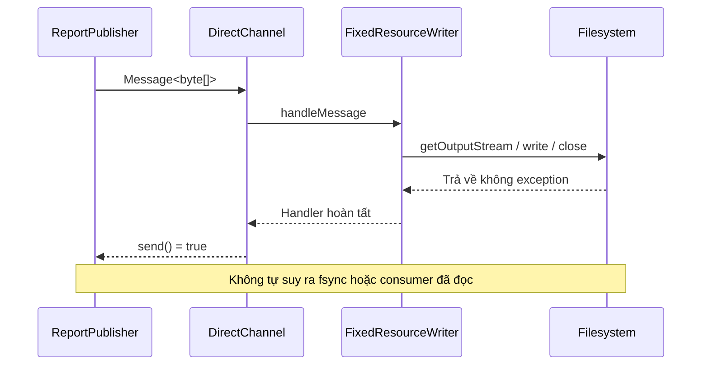
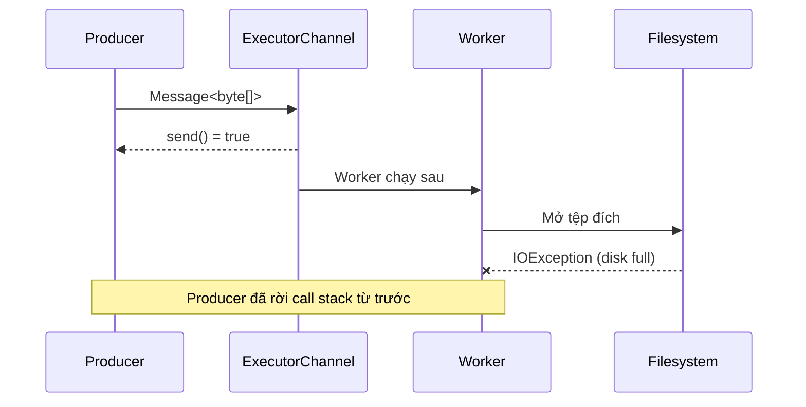
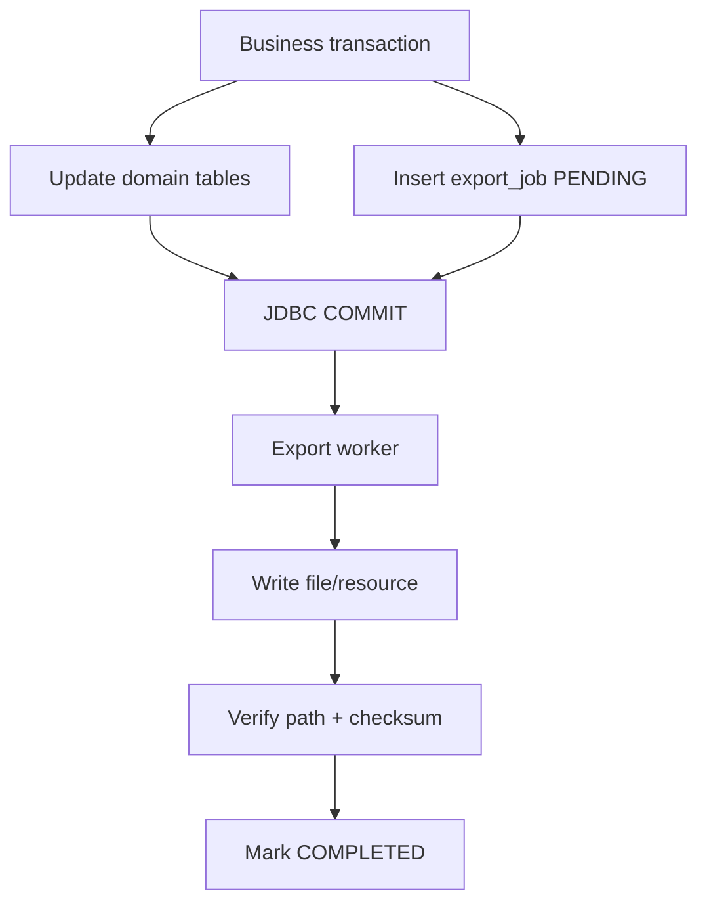

# Đẩy nội dung message vào resource trong Spring Integration

## 1. Bài toán: từ MessageChannel đến một tài nguyên có thể ghi

Một ứng dụng xử lý đơn hàng tạo báo cáo đối soát từ database. Sau khi kiểm tra và tạo nội dung CSV, ứng dụng gửi dữ liệu dưới dạng Spring `Message<byte[]>` vào một `MessageChannel`. Yêu cầu tiếp theo là **ghi chính xác nội dung payload** vào một tệp do ứng dụng quản lý, chẳng hạn `/var/app/exports/orders-2026-11.csv`, để hệ thống khác đọc.

Người học có thể đặt câu hỏi: “Có thể gọi `resource.getOutputStream()` để ghi không?” hoặc “Spring Integration có Resource outbound channel adapter giống Resource inbound không?”. Câu trả lời cần phân biệt hai lớp:

- Spring Framework cung cấp **`Resource` để đọc** và **`WritableResource` để ghi** qua `OutputStream`. `FileSystemResource` là một implementation có thể ghi khi filesystem cho phép.
- Spring Integration cung cấp **generic outbound channel adapter** thông qua `@ServiceActivator`/`<int:outbound-channel-adapter>` và **File outbound channel adapter** chuyên dụng. **Không có Resource outbound channel adapter chuyên biệt** trong bảng endpoints chính thức của Spring Integration hiện hành.

Vì vậy, **“Đẩy nội dung message vào resource”** là một **mẫu tích hợp outbound**, không phải lời mời tự sáng tạo class `ResourceOutboundChannelAdapter`. Ta sẽ thực hiện đúng giao thức `MessageChannel → handler → WritableResource`, sau đó so sánh với `FileWritingMessageHandler` để chọn công cụ phù hợp.

Bài học thuộc chương **Adapter Resource** của module **SPRING_INTEGRATION_ADAPTERS**. Module thực hành kết nối hệ thống ngoài qua inbound/outbound adapter, gateway, poller và `MessageChannel`, đồng thời xử lý hợp đồng message, lỗi và vòng đời kết nối. Phần này đi sâu vào **hướng xuất dữ liệu**: chuyển payload thành bytes/text, ghi resource, kiểm soát ghi đè, nhất quán, lỗi I/O, retry và idempotency.

### Mục tiêu học tập

Sau khi hoàn thành, bạn có thể:

1. Giải thích vì sao `Resource` không đồng nghĩa `WritableResource`.
2. Viết một outbound POJO/`MessageHandler` tiêu thụ `Message<byte[]>`, ghi qua `WritableResource#getOutputStream()` và đóng stream an toàn.
3. Chuyển `String`/DTO/`Resource`/`Resource[]` thành payload ghi được, xử lý encoding và giới hạn kích thước.
4. Sử dụng `FileWritingMessageHandler`, `FileHeaders.FILENAME`, `FileExistsMode` và cấu hình File outbound bằng Java/XML.
5. Phân biệt overwrite trực tiếp, temporary file, atomic move và độ bền sau crash.
6. Thiết kế error flow cho `DirectChannel` và kênh bất đồng bộ, phân loại lỗi tạm thời/vĩnh viễn.
7. Áp dụng kiểm soát path, quyền ghi, giới hạn payload, idempotency và outbox.
8. Viết test JUnit cho ghi content, tên file, ghi đè, rollback logic và việc phân loại lỗi.

## 2. Mô hình tổng quan: payload là dữ liệu, resource là đích


| Lớp | Ví dụ | Trách nhiệm |
| --- | --- | --- |
| **Payload** | `byte[]`, `String`, DTO | Nội dung ứng dụng muốn ghi; phải có hợp đồng encoding/schema. |
| **Spring Message** | `Message<byte[]>` | Đóng gói payload và headers như correlation ID, tên xuất bản. |
| **MessageChannel** | `DirectChannel` | Đưa message từ producer đến outbound consumer theo topology. |
| **Outbound endpoint** | `MessageHandler`/`@ServiceActivator` | Thực thi thao tác I/O khi nhận message. |
| **Writable target** | `FileSystemResource` | Cung cấp một `OutputStream` để ghi dữ liệu. |
| **External system** | Filesystem, remote API, broker | Nơi thực sự lưu hoặc xử lý kết quả. |

**Không nhầm:** `MessageChannel.send(...)` thành công và việc **tệp đã durable** là hai khẳng định khác nhau. Với `DirectChannel` và handler đồng bộ, `send()` chỉ trở về sau khi handler trả về; tuy nhiên `OutputStream.close()` không mặc định đồng nghĩa dữ liệu đã được `fsync` xuống thiết bị lưu trữ hoặc hệ thống khác đã đọc nó.

### Resource inbound và hướng ghi không đối xứng

Spring Integration `ResourceRetrievingMessageSource` nhận một location pattern, giải thành **`Resource[]`** và phát một Spring message chứa **nhiều resource handles** theo poller. Đây là **đường inbound**.

Ở chiều xuất, bạn có thể:

- Ghi payload vào một `WritableResource` bằng outbound POJO.
- Dùng **File outbound adapter** cho filesystem, đã có filename generator, file existence policy và temporary suffix.
- Dùng **SFTP/HTTP/JMS/Kafka outbound** khi đích thực sự là một hệ thống ngoài thuộc giao thức đó.

Không nên dùng `ResourceRetrievingMessageSource` làm một “writer”; nó chỉ khám phá **đầu vào**.

## 3. Resource và WritableResource: đọc khác ghi

Spring Framework có:

```java
org.springframework.core.io.Resource;
org.springframework.core.io.WritableResource;
```

`WritableResource` **extends `Resource`** và thêm:

```java
OutputStream getOutputStream() throws IOException;
boolean isWritable();
```

Ví dụ ghi một mảng byte vào một resource:

```java
import java.io.IOException;
import java.io.OutputStream;
import org.springframework.core.io.WritableResource;

public void save(WritableResource target, byte[] content)
        throws IOException {
    if (!target.isWritable()) {
        throw new IOException("Target reports not writable");
    }
    try (OutputStream output = target.getOutputStream()) {
        output.write(content);
    }
}
```

**`isWritable()` không thay thế `try/catch`.** Nó có thể trả true nhưng việc mở hoặc ghi stream vẫn lỗi vì permission, quota, disk full hoặc race. Trên target chưa tồn tại, implementation có thể có behavior `isWritable()` riêng; đừng coi một phép kiểm tra metadata là kết luận tuyệt đối.

### Những implementation phổ biến

| Resource | Có thể đọc? | Ghi qua `WritableResource`? | Lưu ý |
| --- | --- | --- | --- |
| `FileSystemResource` | Có | **Có**, khi path/permission cho phép | Tạo từ `Path` hoặc `File`; phù hợp làm ví dụ ghi đích. |
| `FileUrlResource` | Có | Có với file URL thích hợp | Không đồng nghĩa `https://` URL là writable. |
| `ClassPathResource` | Có | **Không** theo `WritableResource` | Entry trong JAR không phải file đầu ra có thể sửa tùy ý. |
| `UrlResource` | Tùy URL | Không mặc định | Muốn HTTP PUT/POST nên dùng HTTP client/adapter. |
| `ByteArrayResource` | Có | Không qua `WritableResource` | Dữ liệu snapshot trong RAM, thích hợp cho input/test. |
| `InputStreamResource` | Có, thường một lần | Không | Không thể coi InputStream nguồn là OutputStream đích. |

Trong Spring Framework 7.x, `PathResource` đã bị đánh dấu deprecated để thay bằng `FileSystemResource` khi dùng `Path`. Các ví dụ mới trong bài dùng `FileSystemResource(Path)` để tránh phụ thuộc class sắp bị loại bỏ.

### Tại sao không ghi vào classpath resource?

```text
application.jar
  BOOT-INF/classes/rules/discount.properties
```

Một `ClassPathResource` đến từ file trong JAR có thể đọc bằng `getInputStream()` nhưng **không được mặc định mở để ghi ngược vào JAR**. Nếu cần xuất bản một phiên bản cấu hình mới, hãy tạo tệp ở một **thư mục output riêng** hoặc ghi qua API của kho dữ liệu được phép.

## 4. Hợp đồng payload: String, byte[], InputStream, DTO

Không có một encoder tự động cho mọi Java object đi vào một `WritableResource`; một outbound handler phải chọn **chính xác cách biến payload thành bytes**.

| Payload | Cách ghi phù hợp | Điểm cần kiểm tra |
| --- | --- | --- |
| `byte[]` | `output.write(bytes)` | Kích thước, content-type ngoài băng, không tự thêm newline. |
| `String` | `text.getBytes(StandardCharsets.UTF_8)` | Charset/normalization/newline và kích thước sau encode. |
| DTO | JSON/CSV/XML serializer được chọn rồi ghi bytes | Schema, escaping, version, codec và charset. |
| `InputStream` | `input.transferTo(output)` với policy phù hợp | Vòng đời và byte limit, stream có thể chỉ đọc một lần. |
| `Resource` | `resource.getInputStream()`, đọc/stream rồi ghi | Handle có thể stale, source khác đích, close streams. |
| `Resource[]` | Split/iterate rồi tạo lệnh ghi từng resource | Một array không mặc định là một tệp hợp lệ. |

### Cùng một nội dung, khác cách mã hóa

```java
String csv = "orderId,total\n501,1000\n";
byte[] utf8 = csv.getBytes(StandardCharsets.UTF_8);
```

`csv.length()` **không phải** số byte thực tế trên mọi ngôn ngữ/ký tự. Với tiếng Việt hoặc Unicode, kích thước file phải đo **`utf8.length`**. Trong ví dụ Java bên dưới, ta quy ước payload outbound là `byte[]` để tách rõ nội dung khỏi bước I/O.

### Đừng viết `resource.toString()` vào output

`resource.toString()` và `getDescription()` thường phản ánh **mô tả location**, không phải bytes của resource. Nếu muốn sao chép **nội dung**, phải mở `getInputStream()` và chuyển bytes hợp lệ.

## 5. Thực hành A — một Message<byte[]> ghi vào một WritableResource cố định

Use case nhỏ nhất: mỗi message chứa bản báo cáo hiện tại, và backend **cho phép ghi đè** cùng một tệp `latest-report.csv`. Đây là một trường hợp hợp lệ cho `WritableResource` trực tiếp, nhưng không thích hợp nếu muốn lưu lịch sử từng bản xuất.

### 5.1. Maven dependencies

Với Spring Boot và BOM đồng bộ phiên bản:

```xml
<dependencies>
    <dependency>
        <groupId>org.springframework.boot</groupId>
        <artifactId>spring-boot-starter-integration</artifactId>
    </dependency>
</dependencies>
```

Luồng này chỉ dùng Spring Integration Core và Spring Framework Resource. Không cần `spring-integration-file` nếu tự ghi qua `WritableResource` bằng POJO, nhưng từ mục 9 trở đi, **File outbound adapter chuyên dụng** sẽ cần module File.

### 5.2. Cấu hình đích

Ví dụ `application.properties`:

```properties
app.export.latest-path=/var/app/exports/latest-report.csv
```

Đây là **đường dẫn minh họa**. Trong môi trường thực phải cấu hình path đúng OS và bảo đảm parent directory đã được tạo với quyền ghi thích hợp. Không để người dùng ngoài hệ thống tùy ý gán giá trị `app.export.latest-path`.

### 5.3. Lớp writer thuần Java dễ kiểm thử

```java
package com.example.resourcewrite;

import java.io.IOException;
import java.io.OutputStream;
import java.util.Objects;
import org.springframework.core.io.WritableResource;

public final class FixedResourceWriter {

    private final WritableResource target;

    public FixedResourceWriter(WritableResource target) {
        this.target = Objects.requireNonNull(target, "target");
    }

    public void write(byte[] bytes) throws IOException {
        Objects.requireNonNull(bytes, "bytes");
        if (bytes.length == 0) {
            throw new IllegalArgumentException("Empty payload");
        }

        try (OutputStream output = target.getOutputStream()) {
            output.write(bytes);
        }
    }
}
```

**Ý nghĩa:** writer nhận nội dung đã encode, mở stream cho **đích** rồi ghi bytes. Try-with-resources đóng stream cả khi thành công lẫn khi I/O ném exception. Đây là một class ứng dụng, không phải class do Spring Integration tạo sẵn.

**Giới hạn:** với `FileSystemResource`, mở stream ghi thông thường có thể **truncate/overwrite file cũ**. Nếu hai threads gọi `write` đồng thời, có thể gây race hoặc dữ liệu không nhất quán. Đây chưa phải một writer bảo đảm atomic publication hay exactly-once.

### 5.4. Nối writer với MessageChannel bằng outbound endpoint

```java
package com.example.resourcewrite;

import java.nio.file.Path;

import org.springframework.beans.factory.annotation.Value;
import org.springframework.context.annotation.Bean;
import org.springframework.context.annotation.Configuration;
import org.springframework.core.io.FileSystemResource;
import org.springframework.integration.annotation.ServiceActivator;
import org.springframework.integration.channel.DirectChannel;
import org.springframework.integration.config.EnableIntegration;
import org.springframework.messaging.MessageChannel;
import org.springframework.messaging.MessageHandler;
import org.springframework.messaging.MessageHandlingException;

@Configuration
@EnableIntegration
public class ResourceWriteConfiguration {

    @Bean
    public MessageChannel resourceWriteRequests() {
        return new DirectChannel();
    }

    @Bean
    public FixedResourceWriter latestReportWriter(
            @Value("${app.export.latest-path}") String configuredPath) {
        return new FixedResourceWriter(
            new FileSystemResource(Path.of(configuredPath))
        );
    }

    @Bean
    @ServiceActivator(inputChannel = "resourceWriteRequests")
    public MessageHandler resourceWriteHandler(
            FixedResourceWriter latestReportWriter) {
        return message -> {
            Object payload = message.getPayload();
            if (!(payload instanceof byte[] bytes)) {
                throw new MessageHandlingException(
                    message, "Expected byte[] payload"
                );
            }
            try {
                latestReportWriter.write(bytes);
            } catch (java.io.IOException exception) {
                throw new MessageHandlingException(
                    message, "Failed to write output resource", exception
                );
            }
        };
    }
}
```

**Tại sao dùng `MessageHandlingException`?** `MessageHandler#handleMessage` nhận Spring message; khi I/O lỗi checked `IOException`, adapter cần chuyển nó thành một runtime messaging exception gắn với failed message, để upstream/error flow có thể quan sát. `@ServiceActivator` trên bean `MessageHandler` đăng ký outbound consumer cho channel.

**Không cần poller** cho `DirectChannel`: đây là subscribable channel, handler được gọi khi có producer `send()`. Nếu đổi sang `QueueChannel`, một polling consumer phải nhận các message từ queue; đó là topology khác.

### 5.5. Producer gửi Message<byte[]>

```java
package com.example.resourcewrite;

import java.nio.charset.StandardCharsets;

import org.springframework.beans.factory.annotation.Qualifier;
import org.springframework.messaging.MessageChannel;
import org.springframework.messaging.support.MessageBuilder;
import org.springframework.stereotype.Service;

@Service
public class ReportPublisher {

    private final MessageChannel channel;

    public ReportPublisher(
            @Qualifier("resourceWriteRequests") MessageChannel channel) {
        this.channel = channel;
    }

    public void publishCsv(String validatedCsv) {
        if (validatedCsv == null || validatedCsv.isBlank()) {
            throw new IllegalArgumentException("CSV must not be blank");
        }
        byte[] bytes = validatedCsv.getBytes(StandardCharsets.UTF_8);

        boolean accepted = channel.send(
            MessageBuilder.withPayload(bytes)
                .setHeader("contentType", "text/csv; charset=utf-8")
                .build()
        );
        if (!accepted) {
            throw new IllegalStateException(
                "Output channel rejected message"
            );
        }
    }
}
```

Đây là ví dụ một **snapshot file duy nhất**, không phải export job nhiều file. `contentType` chỉ là **header ứng dụng đặt**, `FixedResourceWriter` hiện tại không đọc header này. Muốn phát thêm filename/version hoặc đổi đích theo từng message, hãy thiết kế contract riêng thay vì hardcode output path.

### 5.6. Các mốc thành công



Với `DirectChannel` và handler sync, `send()` trả về sau khi handler hoàn tất. Nhưng nếu thêm `ExecutorChannel`, `QueueChannel` hoặc một queue khác, thời điểm trở về thay đổi; `send() == true` lúc đó **không bảo đảm ghi file đã xong**.

## 6. Thực hành B — chọn resource đích theo message

Trong nhiều hệ thống, mỗi message cần xuất ra **một file riêng**, chẳng hạn:

```text
exports/order-501.json
exports/order-502.json
exports/order-503.json
```

Lúc này không nên inject một `WritableResource` cố định. Hãy gửi **lệnh xuất bản** chứa filename đã kiểm soát, business ID và bytes.

### 6.1. Một DTO outbound có defensive copy

```java
package com.example.resourcewrite;

import java.util.Objects;

public record ResourceWriteCommand(
        String fileName,
        String eventId,
        byte[] content) {

    public ResourceWriteCommand {
        Objects.requireNonNull(fileName, "fileName");
        Objects.requireNonNull(eventId, "eventId");
        Objects.requireNonNull(content, "content");
        content = content.clone();
    }

    @Override
    public byte[] content() {
        return content.clone();
    }
}
```

`byte[]` là kiểu mutable. Record không tự làm mảng trở thành immutable; constructor và accessor cần clone để tránh caller thay bytes giữa lúc enqueue và lúc handler ghi. Với payload lớn, clone là một lựa chọn có chi phí bộ nhớ; có thể thay bằng blob key/version trong object store.

### 6.2. WritableResourceSink tạo FileSystemResource đúng đích

```java
package com.example.resourcewrite;

import java.io.IOException;
import java.io.OutputStream;
import java.nio.file.Files;
import java.nio.file.LinkOption;
import java.nio.file.Path;

import org.springframework.beans.factory.annotation.Value;
import org.springframework.core.io.FileSystemResource;
import org.springframework.core.io.WritableResource;
import org.springframework.integration.annotation.ServiceActivator;
import org.springframework.stereotype.Component;

@Component
public class PerMessageResourceSink {

    private final Path rootDirectory;

    public PerMessageResourceSink(
            @Value("${app.export.directory}") String directory) {
        this.rootDirectory =
            Path.of(directory).toAbsolutePath().normalize();
    }

    @ServiceActivator(inputChannel = "perMessageWriteRequests")
    public void write(ResourceWriteCommand command) throws IOException {
        String name = command.fileName();
        if (!name.matches("[A-Za-z0-9][A-Za-z0-9._-]{0,127}")) {
            throw new IllegalArgumentException(
                "Output name is not an approved basename"
            );
        }
        if (command.eventId().isBlank()) {
            throw new IllegalArgumentException("Missing eventId");
        }

        if (!Files.isDirectory(
                rootDirectory, LinkOption.NOFOLLOW_LINKS)) {
            throw new IOException(
                "Output directory must exist and not be a symlink"
            );
        }

        Path destination = rootDirectory.resolve(name).normalize();
        if (!rootDirectory.equals(destination.getParent())) {
            throw new IllegalArgumentException("Output path escapes root");
        }

        WritableResource target = new FileSystemResource(destination);
        try (OutputStream output = target.getOutputStream()) {
            output.write(command.content());
        }
    }
}
```

Khai báo channel:

```java
@Bean
public MessageChannel perMessageWriteRequests() {
    return new DirectChannel();
}
```

Method `@Bean` cần nằm trong class `@Configuration` có `@EnableIntegration` và các imports phù hợp (`Bean`, `MessageChannel`, `DirectChannel`). `PerMessageResourceSink` được đăng ký riêng bởi `@Component`, không cần tạo một `@Bean` thứ hai cùng tên.

**Giới hạn của ví dụ:** đây là bản tối giản để hiểu `Message → WritableResource`, **không** phải implementation chống symlink race, atomic write hoặc bảo đảm ghi đúng một lần trong production. Việc kiểm tra parent và `NOFOLLOW_LINKS` của directory là cần nhưng **chưa đủ** nếu kẻ tấn công có thể tạo/đổi symlink con cùng lúc writer mở file. Chỉ dùng output root riêng, permission nghiêm ngặt, và với bài toán thực cần chọn File outbound adapter hoặc một quy trình xuất bản an toàn được kiểm thử.

### 6.3. Gửi lệnh xuất bản

```java
import java.nio.charset.StandardCharsets;
import org.springframework.messaging.MessageChannel;
import org.springframework.messaging.support.MessageBuilder;

ResourceWriteCommand request = new ResourceWriteCommand(
    "order-501.json",
    "evt-501",
    """
    {"eventId":"evt-501","orderId":501}
    """.getBytes(StandardCharsets.UTF_8)
);

MessageChannel channel = ...; // Inject perMessageWriteRequests.
channel.send(MessageBuilder.withPayload(request).build());
```

`eventId` là khóa nghiệp vụ phục vụ retry/idempotency, **không** phải tên file thô đến từ user input. JSON trong snippet là dữ liệu demo, không phải lời khuyên tự dựng JSON string bằng nối chuỗi; với DTO thật hãy dùng serializer (Jackson hoặc tương đương) và validate schema.

## 7. Ghi String, InputStream và DTO: biến đổi trước outbound

### 7.1. String với charset rõ ràng

```java
String text = "Mã đơn,Tổng\nĐH-501,1000\n";
byte[] payload = text.getBytes(StandardCharsets.UTF_8);
```

Đưa bytes này vào writer tạo ra file UTF-8 theo hợp đồng. Tránh dùng `String.getBytes()` không có charset khi production yêu cầu bytes ổn định qua các máy hoặc môi trường khác nhau.

### 7.2. InputStream: chỉ mở tại điểm ghi và đóng đúng nơi

Nếu source đã là `Resource`:

```java
import java.io.IOException;
import java.io.InputStream;
import java.io.OutputStream;
import org.springframework.core.io.Resource;
import org.springframework.core.io.WritableResource;

public void copy(
        Resource source, WritableResource target) throws IOException {
    if (source == target) {
        throw new IllegalArgumentException(
            "Source and target must be distinct"
        );
    }
    try (InputStream input = source.getInputStream();
         OutputStream output = target.getOutputStream()) {
        input.transferTo(output);
    }
}
```

Đoạn code chỉ phù hợp với **nguồn và đích đã được backend kiểm soát**, không phải mọi resource/URL tùy ý. `source == target` chỉ bắt được **cùng một instance**, không bắt được hai Resource objects khác nhau trỏ tới cùng file; nếu trùng path, mở output trước khi đọc có thể truncate dữ liệu nguồn. Production phải kiểm tra identity/path thực sự trước khi copy.

`InputStream.transferTo()` có thể chuyển lượng dữ liệu rất lớn; nếu nguồn không đáng tin, cần **bounded copy** thay vì chỉ dựa vào method này. Với remote resource, cần timeout và điều khiển kết nối riêng.

### 7.3. Bounded copy theo số byte

```java
import java.io.IOException;
import java.io.InputStream;
import java.io.OutputStream;

public final class BoundedResourceCopy {

    private static final long MAX_BYTES = 10L * 1024 * 1024;

    public static void transfer(InputStream input, OutputStream output)
            throws IOException {
        byte[] buffer = new byte[8192];
        long total = 0;
        int n;
        while ((n = input.read(buffer)) != -1) {
            total += n;
            if (total > MAX_BYTES) {
                throw new IOException("Resource exceeds 10 MiB");
            }
            output.write(buffer, 0, n);
        }
    }
}
```

**Điểm cần lưu ý:** nếu vượt giới hạn sau khi đã ghi một phần thì **file đích có thể bị ghi dở**. Vì vậy cách an toàn hơn là copy vào **temporary file/staging**, kiểm tra toàn bộ rồi mới publish tên cuối. Bounded copy hạn chế tài nguyên nhưng không tự tạo atomicity.

### 7.4. DTO thành bytes, rồi ghi Resource

Một sự kiện có contract:

```java
public record ExportedOrder(String eventId, long orderId) {}
```

Nếu dùng Jackson `ObjectMapper`:

```java
import com.fasterxml.jackson.databind.ObjectMapper;

ExportedOrder order = new ExportedOrder("evt-501", 501L);
byte[] jsonBytes = objectMapper.writeValueAsBytes(order);
```

`objectMapper` phải là bean/object được cấu hình trong ứng dụng; dependency JSON/Jackson phải có mặt và tương thích phiên bản. Đây là **bước serialize DTO**, không phải behavior tự có của `WritableResource`.

## 8. Dùng File outbound channel adapter cho đích filesystem

Viết POJO qua `WritableResource` giúp hiểu nguyên lý, nhưng nếu đích là **thư mục filesystem**, Spring Integration đã cung cấp **`FileWritingMessageHandler`**. Đây thường là lựa chọn thực tế tốt hơn, vì có filename generator, chế độ xử lý file tồn tại và hỗ trợ temporary file suffix.

**Nhắc lại:** bảng endpoints chính thức hiện hành liệt kê module Resource chỉ có inbound, không có outbound chuyên biệt. `FileWritingMessageHandler` thuộc **module File**, không thuộc một “Resource outbound” package giả định.

### 8.1. File outbound hỗ trợ payload nào?

| Payload vào FileWritingMessageHandler | Hỗ trợ? |
| --- | --- |
| `File` | Có, copy file sang destination |
| `String` | Có, ghi text theo charset đã cấu hình |
| `byte[]` | Có |
| `InputStream` | Có |
| Raw `Resource` | **Không** phải một trong các loại hỗ trợ chuẩn |
| `Resource[]` | **Không** |
| DTO tùy ý | Cần transformer/serializer trước |

Một `Resource` trong classpath/JAR cần được **đọc** rồi chuyển thành `byte[]` hoặc `InputStream` theo đúng contract; một `Resource[]` phải **split** hoặc hợp nhất theo business rule trước khi đưa vào writer.

### 8.2. Maven dependency

```xml
<dependencies>
    <dependency>
        <groupId>org.springframework.boot</groupId>
        <artifactId>spring-boot-starter-integration</artifactId>
    </dependency>
    <dependency>
        <groupId>org.springframework.integration</groupId>
        <artifactId>spring-integration-file</artifactId>
    </dependency>
</dependencies>
```

Spring Integration **7.x** dùng class `org.springframework.integration.file.outbound.FileWritingMessageHandler`. Trong **6.x**, class nằm tại `org.springframework.integration.file.FileWritingMessageHandler`. Kiểm tra Javadoc chính xác theo BOM của dự án thay vì trộn imports giữa hai major versions.

### 8.3. Java configuration (Spring Integration 7.x)

```java
package com.example.resourcewrite;

import java.io.File;

import org.springframework.beans.factory.annotation.Value;
import org.springframework.context.annotation.Bean;
import org.springframework.context.annotation.Configuration;
import org.springframework.integration.annotation.ServiceActivator;
import org.springframework.integration.channel.DirectChannel;
import org.springframework.integration.config.EnableIntegration;
import org.springframework.integration.file.outbound.FileWritingMessageHandler;
import org.springframework.integration.file.support.FileExistsMode;
import org.springframework.messaging.MessageChannel;
import org.springframework.messaging.MessageHandler;

@Configuration
@EnableIntegration
public class FileOutboundConfiguration {

    @Bean
    public MessageChannel fileExportRequests() {
        return new DirectChannel();
    }

    @Bean
    @ServiceActivator(inputChannel = "fileExportRequests")
    public MessageHandler fileExportHandler(
            @Value("${app.export.directory}") String directory) {

        FileWritingMessageHandler handler =
            new FileWritingMessageHandler(new File(directory));

        handler.setExpectReply(false);             // one-way adapter
        handler.setFileExistsMode(FileExistsMode.FAIL);
        handler.setAutoCreateDirectory(false);
        handler.setTemporaryFileSuffix(".writing");
        return handler;
    }
}
```

Thư mục `app.export.directory` phải tồn tại từ lúc khởi tạo endpoint khi `setAutoCreateDirectory(false)`. Nếu app không có quyền ghi, gửi message có thể ném exception. Đây là một **phương án thay thế** cho writer `WritableResource` ở mục 5–6, không nên cấu hình cả hai cho cùng channel và mong một lần gửi chỉ tạo một file.

### 8.4. Gửi bytes với FileHeaders.FILENAME

```java
package com.example.resourcewrite;

import java.nio.charset.StandardCharsets;

import org.springframework.beans.factory.annotation.Qualifier;
import org.springframework.integration.file.FileHeaders;
import org.springframework.messaging.MessageChannel;
import org.springframework.messaging.support.MessageBuilder;
import org.springframework.stereotype.Service;

@Service
public class FileExportPublisher {

    private final MessageChannel channel;

    public FileExportPublisher(
            @Qualifier("fileExportRequests") MessageChannel channel) {
        this.channel = channel;
    }

    public void export(String eventId, String text) {
        if (!eventId.matches("[A-Za-z0-9_-]{1,64}")) {
            throw new IllegalArgumentException("Invalid eventId");
        }
        byte[] bytes = text.getBytes(StandardCharsets.UTF_8);

        boolean accepted = channel.send(
            MessageBuilder.withPayload(bytes)
                .setHeader(
                    FileHeaders.FILENAME,
                    "event-" + eventId + ".txt"
                )
                .build()
        );
        if (!accepted) {
            throw new IllegalStateException("File channel rejected data");
        }
    }
}
```

File outbound handler mặc định tìm `FileHeaders.FILENAME`; nếu không có filename và payload không phải `File`, nó có thể dùng Spring message ID với hậu tố `.msg`. Với export cần audit, luôn tạo tên file theo **business event ID đáng tin**, đừng dùng fallback ngẫu nhiên như định danh lâu dài.

**Trong production** phải kiểm tra `eventId != null` và `text != null` trước khi gọi method, giới hạn bytes, tránh tên đặc biệt trên hệ điều hành, bảo vệ output directory và liên kết export job với nội dung/version bền vững.

### 8.5. XML namespace tương đương

```xml
<?xml version="1.0" encoding="UTF-8"?>
<beans xmlns="http://www.springframework.org/schema/beans"
       xmlns:xsi="http://www.w3.org/2001/XMLSchema-instance"
       xmlns:int="http://www.springframework.org/schema/integration"
       xmlns:int-file="http://www.springframework.org/schema/integration/file"
       xsi:schemaLocation="
           http://www.springframework.org/schema/beans
           https://www.springframework.org/schema/beans/spring-beans.xsd
           http://www.springframework.org/schema/integration
           https://www.springframework.org/schema/integration/spring-integration.xsd
           http://www.springframework.org/schema/integration/file
           https://www.springframework.org/schema/integration/file/spring-integration-file.xsd">

    <int:channel id="fileExportRequests"/>

    <int-file:outbound-channel-adapter
            id="fileWriter"
            channel="fileExportRequests"
            directory="${app.export.directory}"
            auto-create-directory="false"
            mode="FAIL"
            temporary-file-suffix=".writing"/>
</beans>
```

Đây là **File outbound namespace** đúng module. Không có XML namespace `<int-resource:outbound-channel-adapter>` chính thức tương ứng trong module Resource.

## 9. Khi nào ghi đè, nối thêm, từ chối hoặc bỏ qua file?

`FileWritingMessageHandler` hỗ trợ `FileExistsMode`:

| Mode | Hành vi | Rủi ro và tình huống |
| --- | --- | --- |
| `REPLACE` (mặc định) | Ghi đè file đã tồn tại | Mất nội dung trước nếu chưa có versioned naming. |
| `FAIL` | Ném `MessageHandlingException` nếu file đã tồn tại | Retry sau lần ghi đã thành công có thể cần reconcile. |
| `IGNORE` | Bỏ qua content nếu file tồn tại | Có thể giữ nội dung cũ sai mà không báo lỗi nghiệp vụ. |
| `APPEND` | Nối thêm content, đóng file sau mỗi message | Duplicate lines khi retry; không dùng temporary suffix. |
| `APPEND_NO_FLUSH` | Nối thêm và để buffer/file mở theo policy flush | Có thể mất dữ liệu chưa flush khi crash; yêu cầu shutdown/flush policy. |
| `REPLACE_IF_MODIFIED` | Dựa trên timestamp nguồn/header theo contract | Không so checksum; nếu metadata thiếu có thể luôn replace. |

### Temporary suffix

Khi tạo file theo các chế độ được hỗ trợ, File outbound dùng hậu tố tạm, mặc định **`.writing`**, trong lúc ghi rồi mới đưa về tên cuối khi hoàn thành. Cơ chế đó giảm nguy cơ hệ thống khác nhìn thấy một file còn đang ghi dở. Tuy nhiên:

- **`APPEND`** ghi trực tiếp vào file đã tồn tại, không sử dụng temporary suffix.
- Temporary suffix **không phải** transaction chung với database hoặc distributed lock.
- Nếu process crash, file tạm có thể cần cleanup/recovery.
- Một tệp đã đổi sang tên cuối **không đồng nghĩa** dữ liệu đã được fsync tới thiết bị lưu trữ hoặc reader ngoài đã xử lý xong.

### Trường hợp nào dùng gateway?

Nếu luồng cần tiếp tục xử lý dựa trên **`File` vừa được tạo**, hãy cân nhắc **File outbound gateway** (request/reply). Outbound adapter one-way không tự phát reply để downstream biết file result. Nhưng reply gateway cũng không tự chứng minh external consumer đã đọc file.

## 10. Ghi Resource theo cách publish an toàn hơn: staging + atomic move

Việc gọi `FileSystemResource#getOutputStream()` trực tiếp lên **tên file cuối** có thể khiến reader nhìn thấy nội dung mới **chưa hoàn chỉnh** hoặc khiến file cũ bị truncate trước khi ghi xong. Nếu ứng dụng tự xây writer, một mẫu thiết kế tốt hơn:

```text
Message<byte[]>
    -> validate filename + content
    -> ghi vào temp file cùng directory/filesystem
    -> close temp stream
    -> kiểm tra checksum/schema/size
    -> atomic move từ temp sang tên cuối (nếu filesystem hỗ trợ)
    -> cập nhật trạng thái export job
```

### 10.1. Ví dụ minh họa atomic replacement

```java
package com.example.resourcewrite;

import java.io.IOException;
import java.io.OutputStream;
import java.nio.file.AtomicMoveNotSupportedException;
import java.nio.file.Files;
import java.nio.file.Path;
import java.nio.file.StandardCopyOption;

import org.springframework.core.io.FileSystemResource;
import org.springframework.core.io.WritableResource;

public final class StagedResourceWriter {

    private final Path directory;

    public StagedResourceWriter(Path directory) {
        this.directory = directory.toAbsolutePath().normalize();
    }

    public void replace(String approvedName, byte[] content)
            throws IOException {

        if (approvedName == null ||
                !approvedName.matches(
                    "[A-Za-z0-9][A-Za-z0-9._-]{0,127}"
                )) {
            throw new IllegalArgumentException("Unsafe basename");
        }
        if (content == null || content.length == 0) {
            throw new IllegalArgumentException("Empty content");
        }
        if (!Files.isDirectory(directory)) {
            throw new IOException("Export directory unavailable");
        }

        Path finalPath = directory.resolve(approvedName).normalize();
        if (!finalPath.getParent().equals(directory)) {
            throw new IOException("Target path escaped export root");
        }

        Path temporary = Files.createTempFile(
            directory, ".export-", ".writing"
        );
        try {
            WritableResource staging =
                new FileSystemResource(temporary);
            try (OutputStream output = staging.getOutputStream()) {
                output.write(content);
            }

            try {
                Files.move(
                    temporary,
                    finalPath,
                    StandardCopyOption.ATOMIC_MOVE,
                    StandardCopyOption.REPLACE_EXISTING
                );
            } catch (AtomicMoveNotSupportedException ex) {
                throw new IOException(
                    "Atomic move required for this target", ex
                );
            }
        } finally {
            Files.deleteIfExists(temporary);
        }
    }
}
```

**Đây là mẫu logic minh họa, chưa phải một thư viện filesystem hardened.** `ATOMIC_MOVE` chỉ bảo đảm thao tác đổi tên nguyên tử **nếu filesystem hỗ trợ**. Khi dùng cùng `REPLACE_EXISTING`, hành vi với target đã tồn tại có thể phụ thuộc implementation/filesystem theo Java NIO contract; phải kiểm thử trên đích thực tế. Nếu atomic move không hỗ trợ, code chủ động từ chối thay vì âm thầm fallback sang copy có thể lộ file chưa hoàn chỉnh.

Mẫu này vẫn có các vấn đề cần thiết kế thêm trong production:

- Kẻ tấn công có quyền sửa directory có thể tạo symlink/race; đừng để output root bị attacker kiểm soát.
- Đóng stream chưa đồng nghĩa fsync; muốn crash durability phải đánh giá `FileChannel.force`, flush directory metadata và loại filesystem.
- Không có unique job ID/checksum/lock cho hai writers cùng target.
- Nếu `Files.move` thành công nhưng việc cập nhật DB lỗi, retry phải đối soát thay vì ghi trùng vô hạn.
- Việc xóa temporary file trong `finally` có thể gây thêm exception; cần logs và cleanup policy thích hợp.
- Với `APPEND` hoặc file rất lớn, staging toàn bộ content là một thiết kế khác với ghi nối dòng.

### 10.2. Khi nào dùng File outbound thay cho tự viết staging?

Với use case filesystem thông thường, **File outbound handler đã có temporary suffix và existing-file policy**, nên thường ít lỗi hơn tự viết. Chỉ làm writer riêng nếu ứng dụng có contract đặc biệt (checksum manifest, version directory swap, snapshot output, custom storage) và có kiểm thử/monitoring tương xứng.

## 11. Resource[] từ inbound sang resource ghi được

Một pipeline thường bắt đầu bằng Resource inbound:

```text
ResourceRetrievingMessageSource
 -> Message<Resource[]>  (nhiều handles trong một message)
 -> Splitter
 -> Message<Resource>
 -> Transformer mở source.getInputStream()
 -> Message<byte[]> + fileName
 -> File outbound hoặc WritableResource sink
```

### 11.1. Ví dụ transformer Resource → byte[]

```java
package com.example.resourcewrite;

import java.io.IOException;
import java.io.InputStream;

import org.springframework.core.io.Resource;
import org.springframework.integration.annotation.Transformer;
import org.springframework.integration.file.FileHeaders;
import org.springframework.messaging.Message;
import org.springframework.messaging.support.MessageBuilder;
import org.springframework.stereotype.Component;

@Component
public class ResourceToBytesTransformer {

    private static final int MAX_RESOURCE_BYTES = 64 * 1024;

    @Transformer(
        inputChannel = "oneResourceAtATime",
        outputChannel = "fileExportRequests"
    )
    public Message<byte[]> convert(Resource source)
            throws IOException {

        String name = source.getFilename();
        if (name == null ||
                !name.matches("[A-Za-z0-9][A-Za-z0-9._-]{0,127}")) {
            throw new IllegalArgumentException(
                "Resource filename not approved"
            );
        }

        byte[] content;
        try (InputStream input = source.getInputStream()) {
            content = input.readNBytes(MAX_RESOURCE_BYTES + 1);
        }
        if (content.length > MAX_RESOURCE_BYTES) {
            throw new IOException("Resource too large");
        }

        return MessageBuilder.withPayload(content)
            .setHeader(FileHeaders.FILENAME, name)
            .build();
    }
}
```

**Lưu ý:** đoạn này dùng `FileHeaders.FILENAME` và module File (vì output là File outbound), dù **input** là `Resource`. Trong một hệ thống nhiều module/JAR, hai resources có cùng filename; transformer demo không tự giải quyết conflict hoặc business priority. Hãy xây tên file đích từ identity/version được backend xác thực.

### 11.2. Splitter

```java
import org.springframework.core.io.Resource;
import org.springframework.integration.annotation.Splitter;
import org.springframework.stereotype.Component;

@Component
public class ResourceArraySplitter {

    @Splitter(
        inputChannel = "resourceBatches",
        outputChannel = "oneResourceAtATime"
    )
    public Resource[] split(Resource[] resources) {
        return resources;
    }
}
```

Các channel `resourceBatches` và `oneResourceAtATime` phải có bean/flow tương ứng. Đây là một **bổ sung** cho luồng Resource inbound ở bài trước; không tự mặc định mọi `ResourceRetrievingMessageSource` có thể truyền thẳng `Resource[]` tới file writer.

### 11.3. Một batch không có rollback tự động

Nếu batch A, B, C được split thành ba message và việc ghi C thất bại sau khi A/B đã ghi thành công, **A/B không tự bị xóa**. Muốn xuất bản cả tập configuration atomically theo phiên bản, cần staging directory/manifest, validate toàn bộ trước publish và một checkpoint ở cấp **batch version**.

## 12. Error handling: nơi lỗi phát sinh và cách đưa vào flow

| Vị trí | Ví dụ lỗi | Hành động phù hợp |
| --- | --- | --- |
| Payload | Sai kiểu, thiếu filename, thiếu eventId | Reject nhanh bằng validation exception. |
| Encoding/serialization | DTO không serializable, JSON schema sai | Sửa producer hoặc quarantine dữ liệu. |
| Resolver/read input | `Resource.getInputStream()` thất bại | Phân loại I/O, retry có giới hạn nếu nguồn mutable. |
| Open writable target | Permission denied, directory thiếu | Alert và sửa cấu hình/ACL; không retry nóng vô hạn. |
| Write bytes | Disk full, quota, I/O timeout | Giữ job chưa hoàn tất; retry sau backoff và kiểm tra partial file. |
| File name conflict | `FileExistsMode.FAIL` | Reconcile bằng jobId/checksum; không mặc định overwrite. |
| Atomic move | Filesystem không hỗ trợ hoặc target conflict | Policy fallback rõ ràng hoặc yêu cầu filesystem hỗ trợ. |
| Outbox update | File đã ghi nhưng DB update thất bại | Idempotent reconciliation ở lần retry. |
| Async worker | Worker lỗi sau khi source channel đã trả true | Bắt tại worker error flow, không coi enqueue thành commit. |

### 12.1. DirectChannel: exception thường quay về caller

Nếu `resourceWriteRequests` là `DirectChannel` và handler đồng bộ ném exception, lời gọi `channel.send(...)` có thể thất bại ngay. Một `try/catch` có thể bắt `MessagingException`:

```java
try {
    channel.send(
        MessageBuilder.withPayload(reportBytes).build()
    );
} catch (org.springframework.messaging.MessagingException error) {
    // Log category/jobId, không log raw reportBytes.
    throw error;
}
```

Nếu producer trực tiếp gọi `channel.send`, một exception đồng bộ **không mặc định được chuyển thành ErrorMessage trong global errorChannel**. Cách phân phối lỗi phụ thuộc poller, `ErrorMessagePublisher`, advice chain và topology. Thiết kế error channel rõ ràng khi đưa luồng sang bất đồng bộ.

### 12.2. ExecutorChannel/QueueChannel: không ACK nghiệp vụ quá sớm



Với queue/worker async, phải có **completion event**, outbox state hoặc error flow ở phía worker. Không đánh dấu `EXPORTED` ngay khi enqueue.

### 12.3. Retry tạm thời và lỗi vĩnh viễn

- **Tạm thời:** disk quota vừa đầy nhưng có thể giải phóng, network-mounted filesystem timeout, storage service unavailable. Dùng retry giới hạn và backoff.
- **Vĩnh viễn cho message hiện tại:** filename không hợp lệ, không có quyền target, nội dung không đúng schema, payload vượt giới hạn. Cần sửa input/configuration, quarantine và cảnh báo.
- **Kết quả chưa rõ:** writer đã ghi đủ nhưng process crash trước cập nhật job status. Hãy kiểm tra file/checksum rồi quyết định có cần ghi lại.

Một retry policy chỉ dựa trên exception class `IOException` là chưa đủ. Ví dụ permission denied thường không tự hồi phục sau vài mili giây; không nên cứ retry vô hạn làm tăng tải.

## 13. Transaction và idempotency khi ghi resource

### 13.1. JDBC transaction không bao trùm filesystem

```text
BEGIN JDBC
  -> UPDATE orders
  -> ghi /var/app/exports/orders.csv
  -> lỗi JDBC
ROLLBACK JDBC
```

File đã ghi **không tự rollback** khi DB rollback. Ngược lại, DB đã commit nhưng file write lỗi làm hệ thống có dữ liệu nghiệp vụ mới mà chưa xuất được báo cáo.

### 13.2. Transactional outbox là một lựa chọn



Một bảng `export_job` do ứng dụng thiết kế có thể có:

| Trường | Vai trò |
| --- | --- |
| `jobId` | Khóa ổn định khi retry. |
| `eventId` | Liên kết với nghiệp vụ nguồn. |
| `targetName` | Tên file đã duyệt/được sinh từ backend. |
| `contentHash` | Kiểm tra output đúng bản nội dung. |
| `status` | `PENDING`, `IN_PROGRESS`, `COMPLETED`, `FAILED`. |
| `retryCount` | Giới hạn nỗ lực và hỗ trợ vận hành. |
| `updatedAt` | Đối soát job kẹt lâu. |

Worker có thể lấy job với lease/claim theo DB. Khi crash sau khi file đã được ghi nhưng trước khi mark `COMPLETED`, worker sau dùng **cùng job ID, targetName và checksum** để đối soát.

### 13.3. Exactly-once không đến từ FileExistsMode.FAIL

`FileExistsMode.FAIL` chỉ phát hiện file đã tồn tại. Nó không thể tự phân biệt:

- File do **chính job này** tạo ra trước khi crash (retry idempotent có thể công nhận).
- File do job khác cùng tên tạo ra (conflict thật).
- File có cùng tên nhưng checksum sai hoặc chỉ ghi được một phần.

Do đó cần **ổn định tên/phiên bản**, đối chiếu checksum hoặc manifest, unique constraint và business policy. Không tự chuyển `FAIL` thành `IGNORE` để che mọi conflict.

### 13.4. Nhiều replicas

Hai pods dùng chung thư mục có thể cùng ghi một tên file. `DirectChannel` của một JVM hoặc `synchronized` trong một instance **không phải distributed lock**. Cần DB claim, leader election, lock provider hoặc object-store conditional write nếu hệ thống yêu cầu một writer toàn cục.

## 14. Bảo mật: ghi file là một quyền nhạy cảm

Vì writer có thể tạo/ghi đè file, một input không đáng tin có thể biến thành **path traversal hoặc overwrite dữ liệu hệ thống**.

### Checklist

1. Output root được cấu hình bởi backend, không từ HTTP request tự do.
2. Không dùng raw `resource.getDescription()` hoặc URL chứa token làm filename.
3. Tên file phải là basename được allowlist hoặc server-generated UUID/eventId.
4. Ngăn các thành phần path như `../`, absolute path, null byte, slash/backslash và ký tự điều khiển.
5. Root directory do ứng dụng kiểm soát, tài khoản chạy có quyền ghi tối thiểu.
6. Nếu directory có thể bị kẻ tấn công sửa, cần xử lý symlink/hardlink/TOCTOU bằng cách thiết kế storage chặt chẽ hơn; kiểm tra `normalize()` đơn độc không đủ.
7. Giới hạn số bytes trong một message và tổng số export jobs đang xử lý.
8. Với `InputStream`/remote Resource, giới hạn bytes/timeouts, kiểm soát URL/redirect để tránh SSRF.
9. Không log raw bytes, secrets, báo cáo chứa PII hoặc exception path nhạy cảm.
10. Với nhiều tenant, xác thực quyền tạo output trong namespace/tenant trước khi ghi.
11. Kiểm soát việc **ghi đè** và **append** theo business contract.
12. Khi cần phản hồi tới client, chỉ trả job ID/status, không phơi cấu trúc thư mục nội bộ.

### Regex không thay thế kiểm thử OS/filesystem

Một pattern như `[A-Za-z0-9][A-Za-z0-9._-]{0,127}` loại bỏ nhiều filename nguy hiểm, nhưng vẫn phải xử lý tên dành riêng cho Windows, Unicode normalization, symlink và giới hạn filesystem. Nếu có thể, đặt tên output bằng **UUID/job ID do backend tạo** thay vì dùng trực tiếp tên từ người dùng.

## 15. Hiệu năng, backpressure và vòng đời streams

| Vấn đề | Hậu quả | Cách xử lý |
| --- | --- | --- |
| Đọc hết file lớn thành `byte[]` | Tăng heap/GC | Streaming có giới hạn, chunking hoặc object storage. |
| Giữ `InputStreamResource` qua async queue | Stream có thể đã đóng/đọc một lần | Snapshot hoặc mở stream ngay ở worker, quản lý lifecycle. |
| `DirectChannel` handler ghi chậm | Producer bị block | Bounded worker pool/queue nếu async, đo latency. |
| Queue không giới hạn | Memory pressure khi đích chậm | Bounded queue, backpressure/reject policy. |
| `APPEND_NO_FLUSH` | Dữ liệu chưa flush có thể mất | Flush interval/trigger, shutdown và durability policy. |
| Tên file trùng | Overwrite, conflict hoặc append trùng | Unique job ID, checksum và `FileExistsMode`. |
| Retry nóng khi disk full | Log storm, storage pressure | Backoff, alert và circuit breaker. |
| Quá nhiều tệp staging | Hết dung lượng hoặc stale artifacts | Cleanup job và métrics về tuổi/số lượng temp files. |

### Đóng stream là bắt buộc

`WritableResource#getOutputStream()` trả stream do caller sở hữu. Dùng `try-with-resources` để đóng khi cả success và error, nhưng **không mặc định đóng == fsync**. Khi dùng InputStream source, đóng **cả nguồn và đích** để tránh rò rỉ file handle hoặc network connection.

## 16. Monitoring và runbook

### Các metric nên có

| Metric | Ý nghĩa |
| --- | --- |
| `resource_write_requests_total` | Số message được đưa vào write flow. |
| `resource_write_success_total` | Số lần write handler hoàn thành không exception. |
| `resource_write_failure_total{category}` | Số lỗi payload/path/I/O/permission/conflict. |
| `resource_write_bytes_total` | Tổng số bytes writer đã cố ghi thành công. |
| `resource_write_latency` | Độ trễ từ gọi handler đến đóng stream/move. |
| `export_job_pending_age` | Tuổi job chưa xuất bản. |
| `export_job_retry_total` | Retry/đối soát, giúp phát hiện lặp lỗi. |
| `staged_files_count` | Số file tạm chưa được cleanup. |
| `checksum_mismatch_total` | Output có nội dung khác kỳ vọng. |
| `writer_queue_depth` | Backpressure nếu có tầng async. |

Các tên metric ở trên là **đề xuất do ứng dụng tự đặt**, không phải một danh sách meter được Spring Integration tự xuất ra nguyên vẹn.

### Runbook theo triệu chứng

| Triệu chứng | Nguyên nhân thường gặp | Kiểm tra |
| --- | --- | --- |
| `WritableResource.getOutputStream` không tồn tại trên biến | Biến có type `Resource` | Dùng target là `WritableResource` có implementation hợp lệ. |
| Cố ghi ngược file trong JAR | Dùng `ClassPathResource` làm đích | Ghi sang `FileSystemResource`/File outbound ngoài JAR. |
| ClassCast khi send Resource[] | Bỏ qua splitter/transformer | Chuyển batch Resource[] thành bytes/File/String đúng handler. |
| File outbound từ chối payload | Raw Resource/DTO không được hỗ trợ | Thêm transformer/serializer trước writer. |
| File bị ghi đè bất ngờ | Mặc định FileExistsMode.REPLACE | Đổi sang FAIL/versioned naming theo policy. |
| Gặp `FAIL` sau khi retry | File đã tồn tại từ attempt trước | So checksum/job ID trước khi đánh dấu conflict. |
| Thư mục output không tồn tại | `autoCreateDirectory=false` | Provision directory trước startup. |
| Output chỉ có một phần dữ liệu | Ghi thẳng final file rồi xảy ra lỗi | Staging/temp suffix/atomic publication phù hợp. |
| DB rollback nhưng file vẫn tồn tại | JDBC và filesystem không chung transaction | Outbox/reconciliation/compensation. |
| Handler trả true nhưng không có file | Async queue/worker chưa hoàn tất | Theo dõi worker completion/error flow. |
| Trùng bản export giữa hai pods | Thiếu coordination | Claim job/unique target+version/distributed policy. |
| Permission denied | OS ACL, user, read-only volume | Kiểm tra quyền/config, không retry nóng mãi. |

## 17. Kiểm thử với JUnit 5 và @TempDir

### 17.1. Writer ghi đúng bytes

```java
package com.example.resourcewrite;

import static org.junit.jupiter.api.Assertions.*;

import java.nio.charset.StandardCharsets;
import java.nio.file.Files;
import java.nio.file.Path;

import org.junit.jupiter.api.Test;
import org.junit.jupiter.api.io.TempDir;
import org.springframework.core.io.FileSystemResource;

class FixedResourceWriterTest {

    @TempDir
    Path tempDir;

    @Test
    void writesExactBytes() throws Exception {
        Path output = tempDir.resolve("report.csv");
        FixedResourceWriter writer = new FixedResourceWriter(
            new FileSystemResource(output)
        );

        byte[] expected =
            "Mã đơn,Tổng\nĐH-501,1000\n"
                .getBytes(StandardCharsets.UTF_8);

        writer.write(expected);

        assertArrayEquals(
            expected,
            Files.readAllBytes(output)
        );
    }

    @Test
    void rejectsEmptyPayload() {
        FixedResourceWriter writer = new FixedResourceWriter(
            new FileSystemResource(tempDir.resolve("empty.csv"))
        );

        assertThrows(
            IllegalArgumentException.class,
            () -> writer.write(new byte[0])
        );
    }
}
```

Test trên chỉ chứng minh writer thuần Java, **chưa chạy `MessageChannel`**, không thử filesystem read-only, symlink race hoặc crash durability.

### 17.2. Test hành vi ghi đè trực tiếp

```java
@Test
void directWriterOverwritesExistingFile() throws Exception {
    Path output = tempDir.resolve("latest.csv");
    Files.writeString(output, "old", StandardCharsets.UTF_8);

    FixedResourceWriter writer = new FixedResourceWriter(
        new FileSystemResource(output)
    );
    writer.write("new".getBytes(StandardCharsets.UTF_8));

    assertEquals(
        "new", Files.readString(output, StandardCharsets.UTF_8)
    );
}
```

Đoạn test này phải đặt trong class `FixedResourceWriterTest` có `@TempDir Path tempDir` và các imports ở mục 17.1. Nó chứng minh **ghi đè của implementation thông thường**, không phải feature “REPLACE” có thể cấu hình của generic `WritableResource`.

### 17.3. Test staged writer

```java
@Test
void stagedWriterPublishesCompleteFile() throws Exception {
    StagedResourceWriter writer = new StagedResourceWriter(tempDir);
    byte[] content =
        "event=evt-501\n".getBytes(StandardCharsets.UTF_8);

    writer.replace("evt-501.txt", content);

    assertArrayEquals(
        content,
        Files.readAllBytes(tempDir.resolve("evt-501.txt"))
    );
}
```

Vì `ATOMIC_MOVE` không được mọi filesystem/provider hỗ trợ, test này chỉ thành công trên môi trường hỗ trợ thao tác. Nếu provider không hỗ trợ, ứng dụng phải xử lý exception theo **policy**, không âm thầm giả định test luôn chạy trên cùng filesystem với production.

### 17.4. Test integration flow end-to-end

Một integration test với Spring context nên:

1. Khởi tạo `DirectChannel` và `@ServiceActivator` writer.
2. Cấu hình output path vào `@TempDir`.
3. Gửi `Message<byte[]>` rồi xác minh bytes đúng.
4. Gửi payload sai kiểu và xác minh exception hợp lý.
5. Kiểm tra một message lỗi **không** được đánh dấu `export_job.COMPLETED`.
6. Nếu dùng File outbound, kiểm tra `FileHeaders.FILENAME` và `FileExistsMode.FAIL`.
7. Nếu dùng `ExecutorChannel`, phải chờ worker completion và quan sát error flow thay vì assert ngay sau `send()`.
8. Với retry, giả lập ghi xong nhưng DB status chưa cập nhật, xác minh quá trình reconcile đúng checksum.

Không dùng unit test writer để kết luận toàn hệ thống đạt exactly-once hoặc atomic commit giữa DB và filesystem.

## 18. Bài tập thực hành có đáp án

**Bài 1 — Phân biệt abstraction.** Vì sao `Resource` không có `getOutputStream()` nhưng `WritableResource` có?

**Đáp án:** `Resource` là abstraction đọc/metadata; `WritableResource` mở rộng hợp đồng cho các đích có thể ghi.

**Bài 2 — Classpath.** Một `ClassPathResource` nằm trong JAR có phải target hợp lệ để ghi nội dung mới vào ứng dụng đang chạy?

**Đáp án:** Không mặc định. Nên xuất ra thư mục ngoài JAR hoặc storage/transport được cấp quyền.

**Bài 3 — Endpoint.** Spring Integration có Resource outbound channel adapter chuyên biệt không?

**Đáp án:** Không theo bảng endpoints chính thức; dùng generic outbound POJO, File outbound hoặc adapter theo giao thức đích.

**Bài 4 — Hợp đồng.** Khi `Message<byte[]>` tới writer, caller phải đóng stream nào?

**Đáp án:** `OutputStream` từ `WritableResource#getOutputStream()`; nên dùng try-with-resources.

**Bài 5 — String.** Vì sao `text.getBytes(StandardCharsets.UTF_8)` tốt hơn mặc định charset khi file format yêu cầu UTF-8?

**Đáp án:** Tránh lệ thuộc encoding môi trường; số byte/kết quả ổn định theo contract.

**Bài 6 — Resource source.** Có thể gửi `Resource[]` thẳng vào FileWritingMessageHandler để tự tạo N files không?

**Đáp án:** Không. Phải split và chuyển từng phần tử thành `File`, `String`, `byte[]` hoặc `InputStream` phù hợp.

**Bài 7 — File outbound payload.** Bốn kiểu payload FileWritingMessageHandler hỗ trợ chuẩn là gì?

**Đáp án:** `File`, `String`, `byte[]` và `InputStream`.

**Bài 8 — Filename.** Header chuẩn giúp File outbound chọn tên file là gì?

**Đáp án:** `FileHeaders.FILENAME`.

**Bài 9 — Ghi đè.** Dùng `FileSystemResource#getOutputStream()` trực tiếp có bảo đảm file cũ chỉ bị thay khi file mới đã hoàn tất không?

**Đáp án:** Không. Nó có thể truncate/overwrite khi mở stream; muốn tránh partial visibility cần staging/temporary publish.

**Bài 10 — isWritable.** `target.isWritable() == true` bảo đảm không có `IOException` khi ghi?

**Đáp án:** Không. Permission/quota và trạng thái filesystem có thể thay đổi.

**Bài 11 — One-way.** `@ServiceActivator` method `void` nhận payload từ `DirectChannel` có cần poller mặc định không?

**Đáp án:** Không. DirectChannel là subscribable và gọi handler khi message được gửi.

**Bài 12 — Async.** `ExecutorChannel.send() == true` có chứng minh file xuất bản hoàn chỉnh?

**Đáp án:** Không. Worker có thể chưa chạy hoặc sẽ lỗi sau khi producer rời call stack.

**Bài 13 — FAIL mode.** `FileExistsMode.FAIL` có luôn chứng minh lần export này là duplicate sai?

**Đáp án:** Không. Có thể lần gửi trước ghi xong nhưng process crash trước cập nhật trạng thái; cần đối soát jobId/checksum.

**Bài 14 — APPEND.** Vì sao retry với `APPEND` có thể làm hỏng logic báo cáo?

**Đáp án:** Nội dung có thể bị nối thêm nhiều lần, tạo dòng/bản ghi trùng; cần offset/event ID và idempotency policy.

**Bài 15 — Temporary suffix.** `.writing` có bảo đảm DB transaction và filesystem atomic với nhau?

**Đáp án:** Không. Nó giảm hiển thị file đang ghi, không tạo transaction chung.

**Bài 16 — Atomic move.** Nếu filesystem không hỗ trợ `ATOMIC_MOVE`, có thể âm thầm fallback sang copy và vẫn khẳng định atomic publication?

**Đáp án:** Không. Phải công bố policy, test độ an toàn hoặc từ chối khi yêu cầu atomicity nghiêm ngặt.

**Bài 17 — Crash.** Ghi file hoàn tất, crash trước cập nhật `export_job`. Khi retry nên làm gì?

**Đáp án:** Đối soát tên file/checksum và cùng job ID; nếu đúng thì đánh dấu idempotent success, nếu sai thì conflict/quarantine.

**Bài 18 — Security.** Có nên dùng chuỗi `../../etc/hosts` từ HTTP request làm output filename không?

**Đáp án:** Không. Cần tên do backend kiểm soát, allowlist, root cố định và cơ chế chống traversal/symlink.

**Bài 19 — Filesystem quota.** Disk full làm writer ném `IOException`. Có nên retry liên tục không nghỉ?

**Đáp án:** Không. Dùng retry có giới hạn/backoff, alert và xác minh partial output trước retry.

**Bài 20 — Source equals target.** Khi copy `Resource` sang `WritableResource`, kiểm tra `source == target` có bảo đảm hai bên khác physical file không?

**Đáp án:** Không. Hai wrapper objects khác nhau vẫn có thể trỏ cùng path; cần xác minh identity/path thực.

**Bài 21 — Version.** Resource trong JAR được đọc rồi ghi file cùng tên từ hai modules. Làm sao tránh ghi đè nhầm?

**Đáp án:** Dùng source module/logical ID/version, conflict policy và tên output do backend tạo, không chỉ dựa vào `getFilename()`.

**Bài 22 — Giới hạn.** Bounded copy phát hiện vượt 10 MiB sau khi ghi vài MB vào final file. File cuối có thể bị dở không?

**Đáp án:** Có. Cần staging trước publish hoặc prevalidation/snapshot phù hợp với dữ liệu.

**Bài 23 — Transaction.** `@Transactional` JDBC có tự xóa file đã tạo khi DB rollback không?

**Đáp án:** Không. Dùng outbox/reconcile/compensation theo business contract.

**Bài 24 — Test.** JUnit `@TempDir` kiểm tra writer ghi bytes đúng có chứng minh production an toàn trước symlink race và crash không?

**Đáp án:** Không. Cần test theo OS/filesystem thật, quyền, concurrency, fsync/crash policy và end-to-end integration.

## 19. Ghi nhớ

**Đẩy nội dung message vào resource** nghĩa là nhận payload từ Spring `MessageChannel`, chuyển thành bytes/text theo contract, rồi ghi qua một **đích có quyền ghi**. Spring Framework `WritableResource#getOutputStream()` là abstraction chính cho thao tác này; `FileSystemResource` hỗ trợ ghi filesystem, còn `ClassPathResource`/`Resource` nói chung không mặc định là writable. Spring Integration không có Resource outbound adapter chuyên biệt: có thể dùng **generic outbound `@ServiceActivator`/`MessageHandler`** để ghi `WritableResource`, hoặc ưu tiên **`FileWritingMessageHandler`** khi đích là thư mục local. File outbound chấp nhận `File`, `String`, `byte[]` và `InputStream`, không tự hiểu raw `Resource[]`. Với một nguồn Resource inbound, hãy tách batch, mở `getInputStream()` có giới hạn, chuyển payload rồi mới ghi. **Ghi thành công không đồng nghĩa durable fsync, không có atomic transaction chung với DB, và retry có thể gây duplicate**. Hãy kiểm soát tên file, quyền ghi, temporary publish, backpressure, outbox, checksum và idempotency trước khi dùng trong hệ thống quan trọng.

## Tài liệu tham khảo

- [Spring Framework — WritableResource API](https://docs.spring.io/spring-framework/docs/current/javadoc-api/org/springframework/core/io/WritableResource.html)
- [Spring Framework — FileSystemResource API](https://docs.spring.io/spring-framework/docs/current/javadoc-api/org/springframework/core/io/FileSystemResource.html)
- [Spring Framework — Resources Reference](https://docs.spring.io/spring-framework/reference/core/resources.html)
- [Spring Integration — Integration Endpoints, Resource outbound = N](https://docs.spring.io/spring-integration/reference/endpoint-summary.html)
- [Spring Integration — Resource Support](https://docs.spring.io/spring-integration/reference/resource.html)
- [Spring Integration — Generic Outbound Channel Adapter](https://docs.spring.io/spring-integration/reference/channel-adapter.html)
- [Spring Integration — Writing Files](https://docs.spring.io/spring-integration/reference/file/writing.html)
- [Spring Integration — FileWritingMessageHandler API (7.x)](https://docs.spring.io/spring-integration/docs/current/api/org/springframework/integration/file/outbound/FileWritingMessageHandler.html)
- [Spring Integration — FileWritingMessageHandler API (6.x)](https://docs.spring.io/spring-integration/docs/6.4.2/api/org/springframework/integration/file/FileWritingMessageHandler.html)
