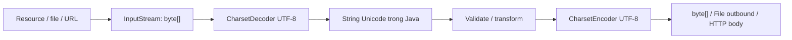
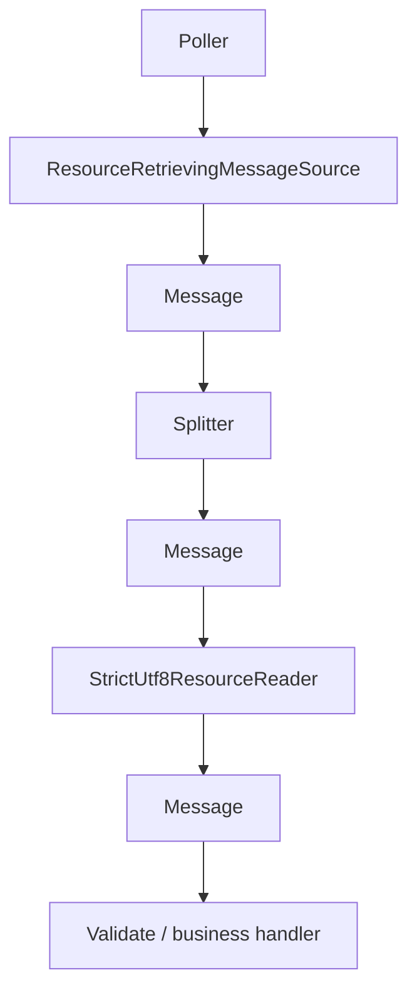
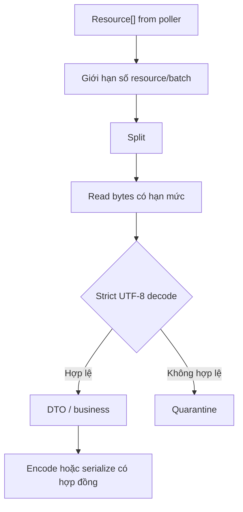

# Encoding và charset khi xử lý Resource trong Spring Integration

## 1. Bài toán: cùng một Resource, hai cách đọc cho hai kết quả khác nhau

Một dịch vụ xử lý đơn hàng định kỳ nạp các tệp `.properties` hoặc `.csv` từ classpath/JAR qua Spring Integration. Các tệp chứa tên khách hàng, địa chỉ giao hàng và quy tắc tiếng Việt như `“Đơn hàng”, “Miễn phí vận chuyển”`. Khi chạy trên môi trường khác, một số dòng xuất hiện thành ký tự `�` hoặc chuỗi khó đọc như `“Ä�Æ¡n hàng”`; vài trường hợp còn làm hỏng khóa đối soát hoặc chữ ký dữ liệu.

Nguyên nhân thường không nằm ở `MessageChannel` hay poller: **dữ liệu byte đã được giải mã hoặc mã hóa bằng charset không khớp với hợp đồng**. Resource inbound adapter không tự biến byte thành text; nó chỉ đưa **các đối tượng `Resource`** vào Spring Message. Chính bước đọc/transformer và outbound writer quyết định bytes được chuyển thành ký tự như thế nào.

Trong module **SPRING_INTEGRATION_ADAPTERS**, các adapter, gateway, poller và `MessageChannel` kết nối hệ thống bên ngoài với luồng xử lý Spring Integration. Chương **Adapter Resource** giới thiệu cách khám phá classpath, file, URL hoặc JAR resource; bài **“Encoding và charset”** tập trung vào ranh giới giữa **byte stream, Java String và nội dung file/message** trên cả inbound lẫn outbound.

### Sau bài học, bạn có thể

1. Phân biệt **encoding/charset**, **byte**, **Unicode code point**, Java `String` và `Content-Type`.
2. Giải thích vì sao `Resource#getInputStream()` không có tham số charset và vì sao `Resource[]` không tự được giải mã.
3. Đọc tài nguyên UTF-8 rõ ràng, giới hạn kích thước và **báo lỗi** khi byte không hợp lệ thay vì âm thầm thay ký tự.
4. Nhận biết và xử lý **UTF-8 BOM** theo chính sách của ứng dụng.
5. So sánh `Properties.load(InputStream)` với `Properties.load(Reader)` và các tình huống đọc CSV/JSON/XML.
6. Biến `Message<Resource[]>` thành `Message<Resource>`, rồi thành `Message<DecodedTextResource>` trong Spring Integration.
7. Ghi payload `String` bằng File outbound với `setCharset("UTF-8")`, phân biệt trường hợp payload `byte[]` không bị chuyển mã.
8. Thiết kế kiểm thử với tiếng Việt, BOM, byte UTF-8 hỏng, charset cũ và lỗi trong luồng bất đồng bộ.

## 2. Mô hình: byte → decode → String → encode → byte



| Khái niệm | Giải thích | Ví dụ |
| --- | --- | --- |
| **Byte** | Đơn vị dữ liệu được lưu/truyền qua file, stream, broker | `0xC4 0x90` |
| **Charset** | Quy tắc ánh xạ giữa byte sequences và ký tự | `UTF-8`, `UTF-16LE`, `ISO-8859-1` |
| **Decode** | Biến bytes thành chuỗi ký tự Java | `new InputStreamReader(in, UTF_8)` |
| **Encode** | Biến String thành bytes để lưu/truyền | `text.getBytes(UTF_8)` |
| **Java String** | Chuỗi ký tự Unicode lưu bằng các đơn vị UTF-16 | `"Đơn hàng"` |
| **Content-Type** | Metadata mô tả media type và có thể kèm charset | `text/plain; charset=UTF-8` |
| **Content-Encoding** | Cách biến đổi representation như nén | `gzip` — **không phải charset** |

**Encoding** đôi khi bị dùng mơ hồ để chỉ nén, mã hóa bí mật hoặc charset. Trong bài này, khi nói **character encoding** ta chỉ nói phép ánh xạ **ký tự ↔ byte**. Gzip là compression, Base64 là biểu diễn bytes bằng text, AES là encryption; chúng không thay thế việc chỉ định UTF-8.

### Một ví dụ tiếng Việt

```java
import java.nio.charset.StandardCharsets;

String text = "Đơn hàng";
byte[] utf8 = text.getBytes(StandardCharsets.UTF_8);

System.out.println(text.length());
System.out.println(utf8.length);
```

Hai số có thể khác nhau: **`String.length()` đếm UTF-16 code units**, còn `utf8.length` đếm bytes. Với ký tự ngoài Basic Multilingual Plane (ví dụ emoji), một Unicode code point có thể chiếm **hai** đơn vị UTF-16 và **bốn** byte UTF-8.

**Không dùng `String.length()` để suy ra content-length hoặc giới hạn kích thước file**. Giới hạn I/O cần đo bytes thực tế.

## 3. Resource không giữ charset như một thuộc tính bắt buộc

Spring Framework định nghĩa:

```java
org.springframework.core.io.Resource;
org.springframework.core.io.InputStreamSource;
```

`Resource` cung cấp:

```java
InputStream getInputStream() throws IOException;
```

`InputStream` trả **bytes**, không phải Java characters. Việc một `ClassPathResource` có tên `rules-vi.properties` hay một `UrlResource` có URL kết thúc `.csv` **không chứng minh charset thực tế**.

```java
Resource resource = ...;
try (InputStream input = resource.getInputStream()) {
    // Đây vẫn là byte stream, chưa phải text.
}
```

### Những nguồn Resource phổ biến

| Implementation | Nội dung từ đâu? | Rủi ro charset |
| --- | --- | --- |
| `ClassPathResource` | Thư mục classes hoặc entry trong JAR | Tệp có thể được build tool copy nguyên bytes; đừng đoán charset theo OS runtime |
| `FileSystemResource` | Filesystem | Có thể do ứng dụng/tool khác ghi bằng charset riêng |
| `UrlResource` | URL | Cần hợp đồng HTTP content-type/charset, kiểm soát redirect và kích thước |
| `ByteArrayResource` | Mảng bytes trong RAM | Bytes do caller truyền vào; không tự biết UTF-8 |
| `InputStreamResource` | Stream đã mở | Thường chỉ đọc một lần; cần xử lý lifecycle và byte limit |

**Không dùng `getFile()` để đọc JAR resource**, vì entry trong JAR không nhất thiết có `java.io.File` vật lý. `getInputStream()` phù hợp hơn, nhưng caller phải **đóng stream** bằng try-with-resources.

### Encoding được quyết định ở đâu?

Một hợp đồng dữ liệu tốt chỉ rõ:

```text
Source pattern: classpath*:rules/*.properties
Content format: Java .properties
Charset: UTF-8
BOM policy: UTF-8 BOM được chấp nhận và loại bỏ đúng một lần
Malformed bytes: REJECT / quarantine
Max input size: 256 KiB/resource
Line ending: LF ưu tiên, CRLF chấp nhận
Required fields: rule.id, rule.version
```

Đây là **hợp đồng của ứng dụng**. Resource inbound không tự cung cấp những chính sách này.

## 4. Chọn charset: không phải cái nào cũng tương đương

| Charset | Đặc điểm | Lưu ý |
| --- | --- | --- |
| **UTF-8** | Biến độ dài, tương thích ASCII cho các ký tự ASCII | Thường là lựa chọn mặc định **nên quy định rõ** cho dữ liệu text mới |
| `UTF-16LE` | Hai byte/UTF-16 code unit theo little-endian | Có thể kèm BOM `FF FE`; cần xác nhận hợp đồng |
| `UTF-16BE` | Big-endian | Không thể đọc đúng bằng UTF-8 |
| `ISO-8859-1` | Ánh xạ một byte với mỗi ký tự Latin-1 | Không hỗ trợ trực tiếp đầy đủ tiếng Việt; overload `Properties.load(InputStream)` dùng charset này |
| `US-ASCII` | Tập 7-bit | Không phù hợp lưu trực tiếp tiếng Việt ngoài escapes |
| `windows-1258` | Legacy code page liên quan tiếng Việt | Chỉ dùng khi nhà cung cấp xác nhận format và Java provider hỗ trợ |

`StandardCharsets` của JDK công bố hằng `UTF_8`, `UTF_16`, `UTF_16BE`, `UTF_16LE`, `ISO_8859_1` và `US_ASCII`.

```java
import java.nio.charset.Charset;
import java.nio.charset.StandardCharsets;

Charset chosen = StandardCharsets.UTF_8;
// Chỉ dùng legacy khi hợp đồng bên ngoài yêu cầu:
Charset legacy = Charset.forName("windows-1258");
```

**Không tự động thử lần lượt hàng chục charset rồi chọn text “nhìn có vẻ đúng”.** Một charset như ISO-8859-1 có thể decode mọi giá trị byte mà không ném lỗi, dù text thu được không đúng. Nếu nhà cung cấp không có hợp đồng rõ ràng, phải xác minh bytes gốc với họ thay vì đoán rồi làm hỏng tên/ID trong database.

### UTF-8 là một lựa chọn hợp đồng, không phải thuộc tính tự nhiên của mọi file

Một tệp cũ có thể được tạo bằng Windows-1258 hoặc một bộ mã riêng, trong khi tài liệu mới đã chuyển sang UTF-8. Không được âm thầm coi file legacy là UTF-8 chỉ vì tên có đuôi `.csv`. Với nguồn legacy, nên đặt **input adapter/parser riêng** có charset rõ, chuyển về dữ liệu Unicode/DTO rồi xuất ra UTF-8 theo contract mới.

## 5. Encoding lỗi biểu hiện ra sao?

### 5.1. Mojibake

Mojibake là khi bytes của charset A được giải mã theo charset B. Dấu hiệu là text trở thành `Ã`, `Â`, `Ä` hoặc chuỗi khó đọc.

```text
Producer:
  String "Đơn hàng"
  -> bytes UTF-8

Consumer (SAI):
  decode bytes bằng charset khác
  -> text sai nhưng không nhất thiết ném exception
```

**Đừng áp dụng `replace("Ã", ...)` lên mọi chuỗi.** Một cách “sửa” dựa trên text có thể làm hỏng dữ liệu đã đúng hoặc dữ liệu vốn có các ký tự đó. Cần tìm **byte gốc + charset nguồn** và decode đúng ngay tại biên.

### 5.2. Ký tự thay thế U+FFFD

JDK có những API decode tiện dụng có thể thay chuỗi byte sai bằng ký tự **`�` (U+FFFD)**:

```java
byte[] badUtf8 = {
    (byte) 0xC3,
    (byte) 0x28
};

String possiblyReplaced = new String(
    badUtf8,
    java.nio.charset.StandardCharsets.UTF_8
);
```

Nếu ứng dụng dùng cách decode **thay thế lỗi**, dữ liệu gốc có thể bị mất mà business handler không biết. Với tên người, mã khách hàng, chữ ký hoặc dữ liệu pháp lý, nên dùng **`CharsetDecoder` ở chế độ `REPORT`** để đưa resource vào quarantine khi encoding sai.

### 5.3. Chữ đúng nhưng hash sai

Hai chuỗi hiển thị tương tự có thể dùng **Unicode normalization** khác nhau (ví dụ ký tự có dấu dựng sẵn so với base letter + combining marks). Chúng có thể có bytes khác dù nhìn giống nhau.

Nếu muốn chuẩn hóa:

```java
import java.text.Normalizer;

String normalized = Normalizer.normalize(
    text, Normalizer.Form.NFC
);
```

Chỉ normalize khi contract nghiệp vụ yêu cầu và phải quyết định **hash trên bytes gốc** hay **trên nội dung đã normalize**. Không normalize ngầm khi kiểm tra chữ ký số, checksum của payload hoặc các định danh có semantic case/format riêng.

## 6. Cách đọc Resource UTF-8 đơn giản

Với file nhỏ, đã biết chắc UTF-8 và không có yêu cầu strict validation:

```java
import java.io.InputStream;
import java.io.InputStreamReader;
import java.io.Reader;
import java.nio.charset.StandardCharsets;
import org.springframework.core.io.Resource;

public void readText(Resource resource) throws Exception {
    try (InputStream in = resource.getInputStream();
         Reader reader = new InputStreamReader(
             in, StandardCharsets.UTF_8
         )) {
        char[] buffer = new char[4096];
        int count;
        while ((count = reader.read(buffer)) != -1) {
            // Xử lý các ký tự đã decode.
        }
    }
}
```

**Lưu ý:** đoạn này nêu cách dùng Reader nhưng chưa giới hạn tổng bytes; `InputStreamReader` tạo decoder theo charset đã chỉ định, không phải một lời cam kết tự động từ chối tất cả malformed UTF-8. Với dữ liệu đòi hỏi tính chính xác, dùng **`CharsetDecoder` có `CodingErrorAction.REPORT`** như mục 7.

Nếu chỉ cần đọc nhanh toàn bộ nội dung từ một resource nhỏ đã được validate ở nơi khác, có thể dùng `StreamUtils` hoặc `InputStream.readAllBytes()`, nhưng **không nên đọc không giới hạn** từ URL hoặc file không đáng tin. Luôn chốt max bytes hoặc dùng streaming parser.

## 7. Ví dụ chính: StrictUtf8ResourceReader với kích thước, BOM và lỗi nghiêm ngặt

Ta xây một reader nhận `Resource`, mở stream, đọc không quá **256 KiB**, tùy chính sách cho phép **UTF-8 BOM**, rồi dùng decoder nghiêm ngặt:

- `onMalformedInput(CodingErrorAction.REPORT)`: byte sequence UTF-8 không hợp lệ gây exception.
- `onUnmappableCharacter(CodingErrorAction.REPORT)`: ký tự không ánh xạ được gây exception theo contract decoder.
- Mỗi lần đọc tạo một `CharsetDecoder` mới: instance decoder không an toàn để dùng đồng thời giữa threads.
- Trả kết quả chứa text, byte count, filename và cờ BOM; **không** giữ `InputStream` sống trong Spring message.

### 7.1. DTO đã decode

```java
package com.example.resourcecharset;

public record DecodedTextResource(
    String sourceName,
    String text,
    int originalBytes,
    boolean hadUtf8Bom
) {}
```

`sourceName` là metadata hiển thị, không phải resource identity duy nhất. Hai JAR có thể cùng có file `rules.properties`. Trong production cần thêm logical source ID/version/checksum khi dùng DTO cho nghiệp vụ.

### 7.2. Reader hoàn chỉnh

```java
package com.example.resourcecharset;

import java.io.IOException;
import java.io.InputStream;
import java.nio.ByteBuffer;
import java.nio.charset.CharsetDecoder;
import java.nio.charset.CodingErrorAction;
import java.nio.charset.StandardCharsets;
import org.springframework.core.io.Resource;

public final class StrictUtf8ResourceReader {

    private static final int MAX_BYTES = 256 * 1024;

    public DecodedTextResource read(Resource resource)
            throws IOException {

        if (resource == null) {
            throw new IllegalArgumentException("Missing Resource");
        }

        byte[] raw;
        try (InputStream input = resource.getInputStream()) {
            raw = input.readNBytes(MAX_BYTES + 1);
        }

        if (raw.length > MAX_BYTES) {
            throw new IOException("Resource exceeds 256 KiB");
        }

        boolean hasBom = raw.length >= 3
            && (raw[0] & 0xff) == 0xef
            && (raw[1] & 0xff) == 0xbb
            && (raw[2] & 0xff) == 0xbf;
        int offset = hasBom ? 3 : 0;

        CharsetDecoder decoder = StandardCharsets.UTF_8
            .newDecoder()
            .onMalformedInput(CodingErrorAction.REPORT)
            .onUnmappableCharacter(CodingErrorAction.REPORT);

        String text = decoder.decode(
            ByteBuffer.wrap(raw, offset, raw.length - offset)
        ).toString();

        String name = resource.getFilename();
        if (name == null || name.isBlank()) {
            name = "unnamed-resource";
        }

        return new DecodedTextResource(
            name, text, raw.length, hasBom
        );
    }
}
```

**Lựa chọn ở đây:** chấp nhận **UTF-8 BOM ở đầu file** và loại bỏ đúng ba byte `EF BB BF` trước khi decode. BOM không được tự loại ở giữa file. Nếu dữ liệu của bạn cấm BOM, thay nhánh trên bằng **throw** khi phát hiện; **đừng** để mỗi parser trong hệ thống xử lý BOM một kiểu.

`CharsetDecoder#decode(ByteBuffer)` có thể ném `CharacterCodingException` (một `IOException`) khi gặp bytes hỏng. Lớp caller có thể phân loại riêng thành **encoding error**, quarantine file, báo tên resource đã sanitize và không ghi dữ liệu sai vào DB.

### 7.3. Vì sao dùng readNBytes(MAX + 1)?

`MAX_BYTES + 1` cho phép biết file **đã vượt ngưỡng** mà không cần đọc hết một file khổng lồ vào RAM. Vẫn có thể có nhiều resource trong một batch nên cần thêm giới hạn **batch size**, concurrency, tổng bytes và timeout nếu nguồn là URL/network.

`MAX_BYTES` tính theo bytes **trước khi bỏ BOM**. Việc decode không thay đổi quyết định vượt ngưỡng.

### 7.4. Đây chưa phải bộ nhận dạng charset tổng quát

Reader **chỉ chấp nhận UTF-8**. Nếu gặp UTF-16 BOM, nó có thể ném lỗi hoặc tạo ký tự không hợp lệ với schema; chúng ta **không** đoán rằng đó là UTF-16 rồi đọc thử. Nếu contract yêu cầu UTF-16LE/BE, hãy xây parser riêng hoặc mở rộng thành **allowlist các charset**, kiểm tra BOM/header một cách có chính sách.

## 8. BOM: ba byte đầu có thể làm sai cả khóa dữ liệu

**Byte Order Mark (BOM)** thường gặp:

| Định dạng | Byte đầu | Ý nghĩa |
| --- | --- | --- |
| UTF-8 BOM | `EF BB BF` | Dấu hiệu tùy chọn ở đầu text UTF-8; không cần thiết cho byte order |
| UTF-16LE BOM | `FF FE` | Little-endian |
| UTF-16BE BOM | `FE FF` | Big-endian |
| UTF-32LE BOM | `FF FE 00 00` | Little-endian (phải xét thứ tự/độ dài khi detect) |
| UTF-32BE BOM | `00 00 FE FF` | Big-endian |

BOM không phải một “bộ đoán charset” toàn năng. Không có BOM **không chứng minh** UTF-8, và có BOM cũng không bảo đảm mọi bytes sau nó hợp lệ.

### Lỗi kinh điển của Properties

File bytes:

```text
EF BB BF 72 75 6C 65 2E 69 64 3D 64 65 6D 6F
```

Tương ứng UTF-8 BOM rồi text `rule.id=demo`. Nếu decoder giữ lại BOM dưới dạng ký tự `U+FEFF`, `Properties` có thể đọc khóa thành `\uFEFFrule.id`; khi gọi `getProperty("rule.id")` thì `null`.

Reader mục 7 bỏ BOM **trước khi** giao text cho parser, giúp key `rule.id` hợp lệ. Đừng dùng `String.trim()` hay `strip()` như một giải pháp chắc chắn cho BOM trong khóa: Java whitespace rules không đồng nghĩa BOM handling.

### BOM với CSV

Một CSV có BOM có thể khiến tên cột đầu là `\uFEFForderId` thay vì `orderId`. Hãy thống nhất “BOM được phép hay bị từ chối?” và chỉ loại BOM ở **đầu luồng dữ liệu** trước CSV parser; không xóa mọi ký tự `U+FEFF` trên toàn bộ nội dung một cách mù quáng.

## 9. Properties.load(InputStream) và Properties.load(Reader)

Đây là **điểm rất quan trọng với Resource adapter** vì bài thực hành thường đọc `*.properties`.

Theo Java API:

- `Properties.load(InputStream)` hiểu byte stream theo **ISO-8859-1**, và các ký tự khác thường được biểu diễn bằng **Unicode escape** như `\u0110`.
- `Properties.load(Reader)` nhận **các ký tự đã được decoder chuyển đổi**, do đó charset được chọn ở bước tạo Reader.
- `Properties.store(OutputStream, ...)` và `store(Writer, ...)` cũng có quy tắc output encoding khác nhau.

### 9.1. Một ví dụ sai với file UTF-8

```java
import java.util.Properties;

Properties props = new Properties();
try (var input = resource.getInputStream()) {
    props.load(input);  // ISO-8859-1, KHÔNG mặc định UTF-8.
}
```

Nếu file chứa `rule.label=Đơn hàng` ở dạng UTF-8 bytes, kết quả có thể bị mojibake. Nó còn nguy hiểm vì parse vẫn có thể “thành công” về mặt cú pháp.

### 9.2. Phương án đúng khi hợp đồng là UTF-8

Sau khi đọc nghiêm ngặt bằng `StrictUtf8ResourceReader`:

```java
import java.io.StringReader;
import java.util.Properties;

StrictUtf8ResourceReader reader =
    new StrictUtf8ResourceReader();
DecodedTextResource decoded = reader.read(resource);

Properties props = new Properties();
try (StringReader chars = new StringReader(decoded.text())) {
    props.load(chars);
}

String label = props.getProperty("rule.label");
```

`StringReader` chứa các ký tự đã decode nghiêm ngặt, nên parser không cần tự đoán charset. Nếu file có BOM đầu và reader chính sách cho phép BOM, nó đã được xử lý đúng trước khi parse.

### 9.3. Một cách stream trực tiếp khi không cần BOM logic

```java
import java.io.InputStreamReader;
import java.nio.charset.StandardCharsets;
import java.util.Properties;

Properties props = new Properties();
try (var input = resource.getInputStream();
     var reader = new InputStreamReader(
         input, StandardCharsets.UTF_8
     )) {
    props.load(reader);
}
```

Đoạn này hợp lý cho nguồn đã được bảo đảm charset/không BOM, nhưng nếu cần **strict decode**, hãy tạo `InputStreamReader` bằng một `CharsetDecoder` đặt `REPORT` và xử lý BOM riêng. Không nhầm việc chỉ định charset với việc reject mọi malformed byte.

### 9.4. Khi nào ISO-8859-1 mới là đúng?

Nếu nhà cung cấp thực sự phát hành **Java properties truyền thống** theo ISO-8859-1 và dùng `\uXXXX` escapes cho ký tự ngoài tập này, `Properties.load(InputStream)` là đúng contract. **Không bắt buộc chuyển tất cả `*.properties` thành UTF-8**, mà phải dựa trên nguồn và phiên bản format đã xác định.

## 10. JSON, XML, CSV: charset là một phần của hợp đồng format

### JSON

Trong phần lớn hệ thống hiện đại, JSON trao đổi giữa các hệ thống dùng UTF-8. Với `byte[]` từ Resource, có thể:

1. Decode UTF-8 nghiêm ngặt trước rồi đưa `String` vào Jackson.
2. Đưa bytes trực tiếp vào Jackson parser có hỗ trợ phát hiện encoding/BOM theo JSON contract.

**Chọn một cách nhất quán và kiểm thử**, không decode bytes thành String bằng charset A rồi lại encode lại theo charset B trước khi parse.

```java
import com.fasterxml.jackson.databind.ObjectMapper;

ObjectMapper mapper = new ObjectMapper();
DecodedTextResource decoded =
    new StrictUtf8ResourceReader().read(resource);

OrderRuleDto dto = mapper.readValue(
    decoded.text(), OrderRuleDto.class
);
```

`OrderRuleDto` là DTO do ứng dụng định nghĩa; cần dependency Jackson và schema/validation phù hợp. Code minh họa bước parser, không thay thế kiểm tra business rules.

### XML

XML có khai báo encoding ở đầu document, ví dụ:

```xml
<?xml version="1.0" encoding="UTF-8"?>
<rules>
  <rule id="shipping">Miễn phí vận chuyển</rule>
</rules>
```

Nếu dùng parser XML trực tiếp trên **byte stream**, parser có thể xử lý BOM/declaration theo tiêu chuẩn XML. Nếu đã tự decode thành String, ứng dụng phải bảo đảm không mâu thuẫn với declaration. Đối với XML không tin cậy, cấu hình parser phòng **XXE/external entity**, giới hạn kích thước và tài nguyên.

### CSV

CSV **không** có một charset mặc định mang tính phổ quát cho mọi chương trình xuất bảng tính. Hãy quy định encoding, delimiter, quote/escape và newline:

```text
Format: CSV
Charset: UTF-8
BOM: absent (hoặc required nếu consumer yêu cầu)
Delimiter: comma
Quote: double-quote
Line ending: LF
Header: orderId,customerName,total
```

Không tự xử lý CSV bằng `String.split(",")` nếu dữ liệu có dấu phẩy hoặc dấu ngoặc kép trong giá trị; dùng thư viện CSV phù hợp. Charset chỉ giải quyết **byte ↔ text**, không giải quyết CSV quoting.

## 11. Spring Integration Resource inbound: một batch Resource[], không phải text

Tài liệu Spring Integration xác nhận resource inbound channel adapter là **polling adapter**, resolve pattern qua `ResourcePatternResolver`, và phát một **Message chứa tập Resource**. `ResourceRetrievingMessageSource` có payload cụ thể `Resource[]`.



Nếu `classpath*:rules/*.properties` khớp ba files:

```text
Poll #1:
  Message<Resource[]>  // payload.length = 3

Sau Splitter:
  Message<Resource> tax.properties
  Message<Resource> shipping.properties
  Message<Resource> discount.properties

Sau Transformer:
  Message<DecodedTextResource>
    text = "rule.label=Miễn phí vận chuyển..."
```

**`maxMessagesPerPoll="1"` không đồng nghĩa một Resource mỗi poll.** Nó giới hạn số message nhận từ source trong chu kỳ poll, không giới hạn số resource chứa trong mảng của một message. Nếu batch cực lớn, cần hẹp pattern hoặc thiết kế partition/limit riêng.

## 12. Java configuration: Resource inbound với poller

### 12.1. Dependencies

Ứng dụng Spring Boot sử dụng BOM đồng bộ các phiên bản:

```xml
<dependencies>
    <dependency>
        <groupId>org.springframework.boot</groupId>
        <artifactId>spring-boot-starter-integration</artifactId>
    </dependency>
</dependencies>
```

Đây là Resource inbound của **Spring Integration Core**, không cần `spring-integration-file` chỉ để khám phá `Resource`. Nếu sau đó dùng File outbound handler, bổ sung module File ở mục 16.

### 12.2. Beans tạo MessageSource<Resource[]>

```java
package com.example.resourcecharset;

import org.springframework.context.annotation.Bean;
import org.springframework.context.annotation.Configuration;
import org.springframework.core.io.Resource;
import org.springframework.integration.annotation.InboundChannelAdapter;
import org.springframework.integration.annotation.Poller;
import org.springframework.integration.channel.DirectChannel;
import org.springframework.integration.config.EnableIntegration;
import org.springframework.integration.core.MessageSource;
import org.springframework.integration.resource.ResourceRetrievingMessageSource;
import org.springframework.integration.util.AcceptOnceCollectionFilter;
import org.springframework.messaging.MessageChannel;

@Configuration
@EnableIntegration
public class ResourceCharsetConfiguration {

    @Bean
    public MessageChannel resourceBatches() {
        return new DirectChannel();
    }

    @Bean
    public MessageChannel resourceItems() {
        return new DirectChannel();
    }

    @Bean
    public MessageChannel decodedText() {
        return new DirectChannel();
    }

    @Bean
    public StrictUtf8ResourceReader strictUtf8ResourceReader() {
        return new StrictUtf8ResourceReader();
    }

    @Bean
    @InboundChannelAdapter(
        channel = "resourceBatches",
        poller = @Poller(
            fixedDelay = "5000",
            maxMessagesPerPoll = "1"
        )
    )
    public MessageSource<Resource[]> resourceSource() {
        ResourceRetrievingMessageSource source =
            new ResourceRetrievingMessageSource(
                "classpath*:rules/*.properties"
            );
        source.setFilter(new AcceptOnceCollectionFilter<>());
        return source;
    }
}
```

`@InboundChannelAdapter` tạo polling endpoint. `@Poller` điều khiển lịch. `AcceptOnceCollectionFilter` giảm phát lại cùng resource trong vòng đời bean; nó **không kiểm tra phiên bản nội dung** và không rollback khi parser phía sau lỗi. Java configuration ở đây khai báo filter tường minh.

### 12.3. Vì sao classpath*?

`classpath*:rules/*.properties` phù hợp khi nhiều classpath roots/JAR cùng đóng góp resource dưới `rules/`. Nếu dữ liệu luôn là một file cụ thể, `classpath:rules/default.properties` có thể đơn giản hơn. Wildcard trong JAR phụ thuộc class loader/packaging; cần kiểm thử trên executable JAR thật.

## 13. Splitter, Transformer và handler: đổi từ Resource sang text

### 13.1. Tách mảng thành từng Resource

```java
package com.example.resourcecharset;

import org.springframework.core.io.Resource;
import org.springframework.integration.annotation.Splitter;
import org.springframework.stereotype.Component;

@Component
public class ResourceArraySplitter {

    @Splitter(
        inputChannel = "resourceBatches",
        outputChannel = "resourceItems"
    )
    public Resource[] split(Resource[] resources) {
        return resources;
    }
}
```

### 13.2. Transformer kiểm tra UTF-8

```java
package com.example.resourcecharset;

import java.io.IOException;
import org.springframework.core.io.Resource;
import org.springframework.integration.annotation.Transformer;
import org.springframework.stereotype.Component;

@Component
public class Utf8ResourceTransformer {

    private final StrictUtf8ResourceReader reader;

    public Utf8ResourceTransformer(StrictUtf8ResourceReader reader) {
        this.reader = reader;
    }

    @Transformer(
        inputChannel = "resourceItems",
        outputChannel = "decodedText"
    )
    public DecodedTextResource transform(Resource resource)
            throws IOException {
        return reader.read(resource);
    }
}
```

### 13.3. Business handler nhận Unicode text

```java
package com.example.resourcecharset;

import java.io.StringReader;
import java.util.Properties;
import org.springframework.integration.annotation.ServiceActivator;
import org.springframework.stereotype.Component;

@Component
public class RuleTextHandler {

    @ServiceActivator(inputChannel = "decodedText")
    public void process(DecodedTextResource document)
            throws Exception {

        Properties props = new Properties();
        try (StringReader chars =
                 new StringReader(document.text())) {
            props.load(chars);
        }

        String id = props.getProperty("rule.id");
        String label = props.getProperty("rule.label");
        if (id == null || id.isBlank()) {
            throw new IllegalArgumentException("Missing rule.id");
        }
        if (label == null || label.isBlank()) {
            throw new IllegalArgumentException(
                "Missing rule.label"
            );
        }

        System.out.printf(
            "Accepted rule=%s (bytes=%d, bom=%s)%n",
            id, document.originalBytes(), document.hadUtf8Bom()
        );
        // TODO: persist an idempotent rule version in a transaction.
    }
}
```

**Trong một context thực tế, chỉ đăng ký các beans một lần**, không thêm một transformer/handler khác cùng subscribable `DirectChannel` rồi giả định message được broadcast cho mọi subscriber. Nếu cần fan-out, dùng `PublishSubscribeChannel` hoặc thiết kế flow tương ứng.

### Trách nhiệm được phân tách

| Lớp | Nhận | Phát / Tác động |
| --- | --- | --- |
| `ResourceRetrievingMessageSource` | Location pattern | `Resource[]` |
| `ResourceArraySplitter` | `Resource[]` | Một message cho mỗi `Resource` |
| `Utf8ResourceTransformer` | `Resource` | `DecodedTextResource` đã decode hoặc exception |
| `RuleTextHandler` | `DecodedTextResource` | Parse `Properties`, validate và gọi nghiệp vụ |

Khi transformer ném `CharacterCodingException`, đó là **lỗi encoding**, không phải “broker không giao message”. Error flow cần phân loại tại đúng bước.

## 14. XML namespace: Resource inbound không có thuộc tính charset chung

Spring Integration hỗ trợ Resource inbound qua namespace `int`:

```xml
<?xml version="1.0" encoding="UTF-8"?>
<beans xmlns="http://www.springframework.org/schema/beans"
       xmlns:xsi="http://www.w3.org/2001/XMLSchema-instance"
       xmlns:int="http://www.springframework.org/schema/integration"
       xsi:schemaLocation="
          http://www.springframework.org/schema/beans
          https://www.springframework.org/schema/beans/spring-beans.xsd
          http://www.springframework.org/schema/integration
          https://www.springframework.org/schema/integration/spring-integration.xsd">

    <int:channel id="resourceBatches"/>

    <int:resource-inbound-channel-adapter
        id="resourceInbound"
        channel="resourceBatches"
        pattern="classpath*:rules/*.properties">
        <int:poller fixed-delay="5000"
                    max-messages-per-poll="1"/>
    </int:resource-inbound-channel-adapter>
</beans>
```

**Không tự đặt thuộc tính `charset="UTF-8"` lên Resource inbound adapter rồi mong nó decode file.** Resource inbound payload là `Resource[]`; các ký tự chỉ xuất hiện khi một component mở stream và decode. Nếu cần XML flow, đưa message qua một splitter + POJO/transformer thực hiện `UTF-8`, chứ không thay contract của source bằng một thuộc tính không được tài liệu hỗ trợ.

Theo tài liệu, XML Resource inbound nếu không chỉ định filter dùng `AcceptOnceCollectionFilter` mặc định, có thể thay bằng `CollectionFilter<Resource>` khác hoặc đặt `filter=""` để bỏ lọc. Bộ lọc quyết định **resource nào được phát**, không quyết định **charset của resource**.

## 15. Outbound: String và byte[] là hai con đường khác nhau

Sau khi có `DecodedTextResource`, ứng dụng có thể ghi ra một file UTF-8. Có hai chiến lược:

**A. Chuyển trước thành bytes:**

```java
String text = document.text();
byte[] payload = text.getBytes(StandardCharsets.UTF_8);
```

`Message<byte[]>` chứa bytes đã chọn; writer sẽ ghi **chính những bytes đó**. Cần kiểm tra lỗi encoding không biểu diễn được nếu ứng dụng có những chuỗi UTF-16 không hợp lệ, hoặc dùng strict encoder ở mục 17.

**B. Giữ `Message<String>`:** outbound handler được cấu hình `setCharset("UTF-8")` và tự encode String khi ghi.

```text
Message<String> -> FileWritingMessageHandler.setCharset("UTF-8")
    -> UTF-8 bytes

Message<byte[]> -> FileWritingMessageHandler
    -> ghi nguyên byte[] (không tự chuyển mã)
```

**Không kỳ vọng header `Content-Type: ...; charset=...` tự chuyển mã `byte[]`** khi File outbound ghi. Charset của một binary payload đã được xác định bởi producer; cần thay đổi bytes thì phải decode/encode tường minh trong transformer có hợp đồng rõ.

## 16. FileWritingMessageHandler và charset cho String payload

Tài liệu Spring Integration File support nêu `FileWritingMessageHandler` hỗ trợ `File`, `String`, `byte[]` và `InputStream`. **Với `String`, có thể cấu hình charset**.

### 16.1. Dependency

```xml
<dependency>
    <groupId>org.springframework.integration</groupId>
    <artifactId>spring-integration-file</artifactId>
</dependency>
```

Sử dụng dependency management/BOM tương thích với bản Spring Boot của dự án. **Spring Integration 7.x** đặt class tại `org.springframework.integration.file.outbound.FileWritingMessageHandler`; với **6.x**, import `org.springframework.integration.file.FileWritingMessageHandler`. Không trộn package giữa hai major versions.

### 16.2. Java configuration cho một File outbound channel adapter

```java
package com.example.resourcecharset;

import java.io.File;
import org.springframework.beans.factory.annotation.Value;
import org.springframework.context.annotation.Bean;
import org.springframework.context.annotation.Configuration;
import org.springframework.integration.annotation.ServiceActivator;
import org.springframework.integration.channel.DirectChannel;
import org.springframework.integration.config.EnableIntegration;
import org.springframework.integration.file.outbound.FileWritingMessageHandler;
import org.springframework.integration.file.support.FileExistsMode;
import org.springframework.messaging.MessageChannel;
import org.springframework.messaging.MessageHandler;

@Configuration
@EnableIntegration
public class Utf8FileOutboundConfiguration {

    @Bean
    public MessageChannel writeUtf8Text() {
        return new DirectChannel();
    }

    @Bean
    @ServiceActivator(inputChannel = "writeUtf8Text")
    public MessageHandler utf8FileWriter(
            @Value("${app.export.directory}") String directory) {

        FileWritingMessageHandler handler =
            new FileWritingMessageHandler(new File(directory));

        handler.setExpectReply(false);
        handler.setCharset("UTF-8");
        handler.setAppendNewLine(false);
        handler.setFileExistsMode(FileExistsMode.FAIL);
        handler.setAutoCreateDirectory(false);
        return handler;
    }
}
```

Với `setAutoCreateDirectory(false)`, output directory phải tồn tại và tài khoản ứng dụng cần quyền ghi. `FileExistsMode.FAIL` chỉ là ví dụ phát hiện conflict khi tên file đã tồn tại, không phải cơ chế exactly-once.

### 16.3. Producer ghi tên file an toàn

```java
package com.example.resourcecharset;

import org.springframework.beans.factory.annotation.Qualifier;
import org.springframework.integration.file.FileHeaders;
import org.springframework.messaging.MessageChannel;
import org.springframework.messaging.support.MessageBuilder;
import org.springframework.stereotype.Service;

@Service
public class Utf8FilePublisher {

    private final MessageChannel channel;

    public Utf8FilePublisher(
            @Qualifier("writeUtf8Text") MessageChannel channel) {
        this.channel = channel;
    }

    public void publish(String safeName, String text) {
        if (safeName == null || !safeName.matches(
                "[A-Za-z0-9][A-Za-z0-9._-]{0,127}")) {
            throw new IllegalArgumentException(
                "Output filename not approved"
            );
        }
        if (text == null) {
            throw new IllegalArgumentException("Missing text");
        }

        boolean accepted = channel.send(
            MessageBuilder.withPayload(text)
                .setHeader(FileHeaders.FILENAME, safeName)
                .build()
        );
        if (!accepted) {
            throw new IllegalStateException(
                "File outbound channel rejected message"
            );
        }
    }
}
```

`setCharset("UTF-8")` bảo đảm **String payload** được ghi theo charset đã cấu hình. Với `byte[]`, writer sẽ không decode rồi encode lại, nên đầu ra có đúng UTF-8 hay không phụ thuộc producer.

**Không dùng `FileHeaders.FILENAME` chứa raw user path**. Regex chỉ là bước lọc basename minh họa; production cần output root do backend quản lý, kiểm soát symlink/path traversal và áp dụng policy tên file theo OS.

### 16.4. XML File outbound

```xml
<?xml version="1.0" encoding="UTF-8"?>
<beans xmlns="http://www.springframework.org/schema/beans"
       xmlns:xsi="http://www.w3.org/2001/XMLSchema-instance"
       xmlns:int="http://www.springframework.org/schema/integration"
       xmlns:int-file="http://www.springframework.org/schema/integration/file"
       xsi:schemaLocation="
          http://www.springframework.org/schema/beans
          https://www.springframework.org/schema/beans/spring-beans.xsd
          http://www.springframework.org/schema/integration
          https://www.springframework.org/schema/integration/spring-integration.xsd
          http://www.springframework.org/schema/integration/file
          https://www.springframework.org/schema/integration/file/spring-integration-file.xsd">

    <int:channel id="writeUtf8Text"/>

    <int-file:outbound-channel-adapter
        id="utf8FileWriter"
        channel="writeUtf8Text"
        directory="${app.export.directory}"
        charset="UTF-8"
        mode="FAIL"
        auto-create-directory="false"/>
</beans>
```

Đây là **phương án XML thay thế** Java configuration ở trên, không khai báo cả hai endpoint cho cùng channel nếu chỉ muốn mỗi message được ghi một lần. Namespace `int-file` thuộc module File, **không có Resource outbound channel adapter chuyên biệt** chỉ vì input trước đó là Resource.

## 17. Strict UTF-8 encoding khi ghi String

Giống decoding, việc encode `String` thành bytes bằng API tiện dụng có thể dùng **replacement** với dữ liệu ký tự UTF-16 không hợp lệ (ví dụ một surrogate bị tách đơn lẻ). Khi cần reject thay vì thay thế, dùng `CharsetEncoder` với `REPORT`.

```java
package com.example.resourcecharset;

import java.nio.ByteBuffer;
import java.nio.CharBuffer;
import java.nio.charset.CharacterCodingException;
import java.nio.charset.CodingErrorAction;
import java.nio.charset.StandardCharsets;

public final class StrictUtf8Encoder {

    private StrictUtf8Encoder() {}

    public static byte[] encode(String text)
            throws CharacterCodingException {
        if (text == null) {
            throw new IllegalArgumentException("Missing text");
        }

        ByteBuffer encoded = StandardCharsets.UTF_8
            .newEncoder()
            .onMalformedInput(CodingErrorAction.REPORT)
            .onUnmappableCharacter(CodingErrorAction.REPORT)
            .encode(CharBuffer.wrap(text));

        byte[] bytes = new byte[encoded.remaining()];
        encoded.get(bytes);
        return bytes;
    }
}
```

**Không chia sẻ một `CharsetEncoder` hoặc `CharsetDecoder` mutable qua nhiều threads**. Ví dụ tạo encoder/decoder mới cho mỗi call, an toàn hơn cho Spring Integration async consumers.

Nếu muốn giới hạn kích thước output, kiểm tra **`bytes.length` sau encode** trước khi gửi. Một `String` rất dài vẫn có thể tiêu tốn bộ nhớ trước khi encode; production cần giới hạn payload ngay từ phía producer/parser.

### String payload qua File outbound hay byte[] strict?

| Yêu cầu | Lựa chọn |
| --- | --- |
| Text hợp lệ từ service và muốn file UTF-8 thông thường | `Message<String>` + `setCharset("UTF-8")` |
| Phải reject malformed UTF-16 thay vì thay thế | `StrictUtf8Encoder.encode(...)` → `Message<byte[]>` |
| Cần byte-for-byte preservation | Giữ bytes, không decode/encode |
| Cần chuyển từ legacy charset | Decode nguồn theo charset đã xác nhận, validate, rồi encode đích |
| Cần ký số/checksum | Quy định hash dựa trên bytes cụ thể và thời điểm normalize/encode |

## 18. HTTP, SFTP, JMS và Kafka: charset phải rõ ở ranh giới transport

Module **SPRING_INTEGRATION_ADAPTERS** còn kết nối với HTTP, SFTP, JMS, AMQP và Kafka. Nguyên tắc chung: **charset xử lý text** phải được quy định ở nơi bytes thành String hoặc String thành bytes; các adapter transport không mặc nhiên biết dữ liệu nghiệp vụ của bạn.

### HTTP

Một HTTP response có thể công bố:

```text
Content-Type: text/csv; charset=UTF-8
Content-Encoding: gzip
```

Ở đây:

1. HTTP client xử lý `gzip` theo content-encoding khi được cấu hình.
2. Dữ liệu sau giải nén là **bytes CSV**.
3. Decoder dùng `UTF-8` để tạo text.
4. CSV parser hiểu delimiter, quoting và header theo format.

Nếu thiếu charset hoặc server khai báo sai, cần dựa trên **API contract** chứ không đoán từ tên tệp hoặc charset của máy local. Chỉ chấp nhận một tập charset đã allowlist.

### SFTP/File

SFTP và filesystem về cơ bản mang **bytes**; một file `orders.csv` không tự kèm metadata charset đáng tin cậy. Producer và consumer phải thỏa thuận UTF-8/BOM/newline. Ghi bằng file writer với charset A rồi bên nhận đọc bằng B sẽ gây lỗi ngay cả khi transfer SFTP thành công.

### JMS/AMQP/Kafka

Một `TextMessage` (JMS) hoặc JSON converter có thể có abstraction chuỗi, nhưng khi chuyển sang byte payload hoặc giao tiếp giữa các client/framework khác nhau, cần kiểm tra converter/schema/encoding. **Không lấy tên topic/queue làm bằng chứng charset**, cũng không áp dụng `String(bytes)` không có charset rồi kỳ vọng portable.

### STOMP

STOMP frame `content-type` có thể chứa `charset`; `content-length` theo **số byte**, không phải `String.length()`. Với binary payload và frame codec, cần tôn trọng framing, không tự tính byte length bằng số ký tự Java. Broker receipt/ACK không xác nhận rằng downstream đã decode text đúng.

## 19. Encoding và lifecycle: snapshot, async, retry

Một `Message<Resource>` có thể nằm trong queue trước khi handler mở stream:

```text
T1: Poller resolve Resource A
T2: Message<Resource> được enqueue
T3: File A bị sửa thành bản khác hoặc bị xóa
T4: Worker mới gọi getInputStream()
```

Khi đó bytes ở `T4` có thể **khác nội dung tại `T1`**. Nếu yêu cầu audit, nên đọc/snapshot/version trước khi handoff hoặc ghi vào kho bền vững, sau đó gửi **DTO đã decode** hoặc **object key + content hash**.

### Resource[] và filter có thể làm mất cơ hội retry

`AcceptOnceCollectionFilter` ghi nhớ resource đã được chấp nhận ở source. Nếu transformer phát hiện UTF-8 hỏng và ném exception, **filter không tự rollback**. Vì thế sau khi producer/handler đã thất bại, poll tiếp theo có thể **không phát lại resource đó**.

Thiết kế xử lý đáng tin cậy:

1. Tách resource detection khỏi business commit.
2. Tạo `sourceId + contentVersion` bằng metadata/hash đáng tin.
3. Lưu trạng thái `PENDING/QUARANTINED/PROCESSED` trong DB/ledger khi cần.
4. Nếu lỗi encoding cố định, quarantine + alert; không retry nóng vô hạn.
5. Nếu lỗi I/O tạm thời, retry có giới hạn/backoff với cùng idempotency key.
6. Nếu worker async, phải theo dõi completion/error flow của worker, không coi enqueue là commit.

**Không có transaction nguyên tử mặc định** giữa memory filter, file/JAR/URL, Spring Channel và JDBC transaction. `@Transactional` ở handler không tự đảo ngược việc filter đã nhìn thấy resource.

## 20. Phân loại lỗi encoding, I/O, parser và nghiệp vụ

| Tầng lỗi | Exception/tín hiệu thường gặp | Cách xử lý |
| --- | --- | --- |
| **I/O input** | `FileNotFoundException`, `IOException`, URL timeout | Kiểm tra source/ACL/timeout; retry nếu có thể hồi phục |
| **Byte limit** | `IOException("Resource exceeds ...")` do reader | Reject/quarantine, không đọc tiếp vô hạn |
| **Charset decode** | `MalformedInputException`, `UnmappableCharacterException`, `CharacterCodingException` | Quarantine bytes gốc có kiểm soát; điều tra charset |
| **BOM policy** | UTF-16 BOM trên luồng chỉ cho UTF-8 | Reject hoặc route parser đã allowlist |
| **Format parse** | `IllegalArgumentException`, lỗi properties/CSV/JSON | Sửa dữ liệu hoặc chuyển dead-letter/quarantine |
| **Business validate** | Thiếu `rule.id`, version trùng, tenant sai | Từ chối ở tầng domain, không coi là lỗi charset |
| **Output encode** | `CharacterCodingException` của strict encoder | Từ chối text không hợp lệ; kiểm tra source upstream |
| **File outbound** | Directory không writable, `FileExistsMode.FAIL`, disk full | Fix ACL/quota hoặc reconcile; retry có giới hạn |
| **Async handler** | Worker exception sau `send()` thành công | Error flow/metrics phía worker |

### Không được ghi log raw payload bừa bãi

Để debug encoding, không nhất thiết log toàn bộ nội dung chứa PII. Có thể log:

```text
category=MALFORMED_UTF8
resourceId=rule-bundle:pricing-v3
bytes=1430
hadUtf8Bom=false
sourceKind=classpath
action=QUARANTINED
```

Những field trên là **metadata do ứng dụng tự tạo**. Đừng log `Resource.getDescription()` thô nếu URL có query token/credentials. Với bytes hỏng, chỉ lưu artifact gốc trong khu vực quarantine có encryption, ACL và retention phù hợp nếu cần điều tra.

### Vì sao không catch mọi exception rồi return String rỗng?

Nếu converter bắt `CharacterCodingException` rồi trả `""`, downstream có thể coi dữ liệu trống là hợp lệ hoặc ghi đè dữ liệu tốt. Với thông tin quan trọng, **fail fast + quarantine** thường an toàn hơn silently replacing or dropping bytes.

## 21. Unicode normalization, line endings và checksum

Charset và dữ liệu nghiệp vụ liên quan nhưng không phải một:

| Vấn đề | Ví dụ | Quyết định cần có |
| --- | --- | --- |
| Charset | UTF-8 vs UTF-16LE | Decode/encode bytes theo format |
| BOM | UTF-8 `EF BB BF` | Cho phép/bỏ hoặc reject |
| Line ending | LF `\n` vs CRLF `\r\n` | Preserve hoặc normalize cho output |
| Unicode normalization | NFC vs NFD | Có chuẩn hóa text trước so sánh/hash không? |
| Case folding | `Order` vs `order` | Định nghĩa riêng cho business key |
| Whitespace | Space, NBSP, tab | Không trim tùy tiện dữ liệu có ý nghĩa |
| Checksum | SHA-256 | Hash raw bytes hay canonical text/bytes? |

### Ví dụ thay line ending có chủ đích

```java
String normalizedLf = text
    .replace("\r\n", "\n")
    .replace("\r", "\n");
```

**Chỉ làm vậy nếu contract cho phép.** Đổi newline làm thay bytes và có thể ảnh hưởng chữ ký số, audit, diff hoặc định dạng file yêu cầu CRLF. Không normalize toàn bộ binary message như text.

### Hash tính ở bước nào?

Một hệ thống có thể giữ **hai hash**:

- `rawSha256` của bytes input để audit/đối soát file gốc.
- `canonicalSha256` của text sau khi decode, chuẩn hóa theo quy tắc rồi encode UTF-8.

Hai hash phục vụ mục đích khác nhau. Việc `AcceptOnceCollectionFilter` không thấy thay đổi nội dung không thay thế hash/checkpoint của bạn.

## 22. Hiệu năng: decode bao giờ, giới hạn ra sao?



| Rủi ro | Hệ quả | Biện pháp |
| --- | --- | --- |
| Nhiều resource trong một `Resource[]` | Một poll tạo batch lớn | Hẹp pattern, giới hạn batch/partition nguồn |
| `readAllBytes()` từ URL không kiểm soát | Heap/GC hoặc OOM | `readNBytes(MAX+1)`, streaming parser, timeouts |
| Dùng `String` trung gian quá lớn | Nhân đôi/nhân ba memory footprint | Chuyển bytes trực tiếp nếu không cần sửa text |
| Đọc cùng resource nhiều lần | Extra I/O, dữ liệu có thể thay đổi | Snapshot hoặc versioned source |
| Decoder chia sẻ giữa workers | Data race, output sai | Mỗi call dùng decoder mới |
| Retry malformed data vô hạn | CPU/log storm | Quarantine, fix source, retry budget |
| Files ghi rất lớn | Partial file và latency cao | Staging/temporary suffix và bounded streaming |
| Gửi raw Resource qua message broker | Không portable qua process | DTO/bytes/object key đã kiểm soát |

**Tối ưu đúng** không phải bỏ UTF-8 validation để nhanh hơn, mà là xử lý ở đúng nơi: chỉ decode khi cần text; với file nhị phân hoặc transfer byte-for-byte, **không decode** và giữ checksum trên bytes gốc.

## 23. Kiểm thử JUnit 5: tiếng Việt, BOM và invalid UTF-8

### 23.1. Test strict decode từ FileSystemResource

```java
package com.example.resourcecharset;

import static org.junit.jupiter.api.Assertions.*;

import java.nio.charset.StandardCharsets;
import java.nio.file.Files;
import java.nio.file.Path;
import org.junit.jupiter.api.Test;
import org.junit.jupiter.api.io.TempDir;
import org.springframework.core.io.FileSystemResource;

class StrictUtf8ResourceReaderTest {

    @TempDir
    Path tempDir;

    private final StrictUtf8ResourceReader reader =
        new StrictUtf8ResourceReader();

    @Test
    void decodesVietnameseTextExactly() throws Exception {
        Path path = tempDir.resolve("rule.properties");
        String original =
            "rule.id=shipping\nrule.label=Miễn phí vận chuyển\n";
        Files.write(path, original.getBytes(StandardCharsets.UTF_8));

        DecodedTextResource decoded = reader.read(
            new FileSystemResource(path)
        );

        assertEquals(original, decoded.text());
        assertEquals(
            original.getBytes(StandardCharsets.UTF_8).length,
            decoded.originalBytes()
        );
        assertFalse(decoded.hadUtf8Bom());
    }

    @Test
    void stripsUtf8BomOnlyAtTheBeginning() throws Exception {
        byte[] content =
            "rule.id=demo\n".getBytes(StandardCharsets.UTF_8);
        byte[] raw = new byte[content.length + 3];
        raw[0] = (byte) 0xef;
        raw[1] = (byte) 0xbb;
        raw[2] = (byte) 0xbf;
        System.arraycopy(content, 0, raw, 3, content.length);

        Path path = tempDir.resolve("with-bom.properties");
        Files.write(path, raw);

        DecodedTextResource decoded = reader.read(
            new FileSystemResource(path)
        );

        assertEquals("rule.id=demo\n", decoded.text());
        assertTrue(decoded.hadUtf8Bom());
        assertEquals(raw.length, decoded.originalBytes());
    }
}
```

### 23.2. Test byte UTF-8 sai phải bị từ chối

```java
import static org.junit.jupiter.api.Assertions.assertThrows;

import java.nio.charset.MalformedInputException;
import java.nio.file.Files;
import java.nio.file.Path;
import org.junit.jupiter.api.Test;
import org.junit.jupiter.api.io.TempDir;
import org.springframework.core.io.FileSystemResource;

class InvalidUtf8Test {

    @TempDir
    Path tempDir;

    @Test
    void rejectsMalformedUtf8() throws Exception {
        Path path = tempDir.resolve("broken.txt");
        Files.write(path, new byte[] {
            (byte) 0xc3, (byte) 0x28
        });

        assertThrows(
            MalformedInputException.class,
            () -> new StrictUtf8ResourceReader().read(
                new FileSystemResource(path)
            )
        );
    }
}
```

`MalformedInputException` là subtype của `CharacterCodingException` và `IOException`. Test giúp bảo đảm luồng **không âm thầm thay byte hỏng bằng U+FFFD**.

### 23.3. Test Properties.load(InputStream) khác Reader

```java
import static org.junit.jupiter.api.Assertions.*;

import java.io.ByteArrayInputStream;
import java.io.StringReader;
import java.nio.charset.StandardCharsets;
import java.util.Properties;
import org.junit.jupiter.api.Test;

class PropertiesEncodingTest {

    @Test
    void latin1OverloadDoesNotDecodeRawUtf8Correctly()
            throws Exception {
        String original = "rule.label=Đơn hàng\n";
        byte[] utf8 =
            original.getBytes(StandardCharsets.UTF_8);

        Properties wrong = new Properties();
        wrong.load(new ByteArrayInputStream(utf8));

        Properties correct = new Properties();
        correct.load(new StringReader(
            new String(utf8, StandardCharsets.UTF_8)
        ));

        assertEquals("Đơn hàng", correct.getProperty("rule.label"));
        assertNotEquals(
            correct.getProperty("rule.label"),
            wrong.getProperty("rule.label")
        );
    }
}
```

Test này minh họa sự khác biệt **ISO-8859-1** và **UTF-8** cho dữ liệu Unicode. Nó không thay thế `StrictUtf8ResourceReader` trong production, vì `new String(byte[], UTF_8)` có thể thay thế malformed input thay vì báo lỗi.

### 23.4. Test strict encoder

```java
import static org.junit.jupiter.api.Assertions.*;

import java.nio.charset.MalformedInputException;
import java.nio.charset.StandardCharsets;
import org.junit.jupiter.api.Test;

class Utf8EncoderTest {

    @Test
    void encodesVietnameseRoundTrip() throws Exception {
        String original = "Miễn phí vận chuyển";
        byte[] bytes = StrictUtf8Encoder.encode(original);
        assertEquals(
            original, new String(bytes, StandardCharsets.UTF_8)
        );
    }

    @Test
    void rejectsUnpairedSurrogate() {
        String invalidUtf16 = "\uD800";
        assertThrows(
            MalformedInputException.class,
            () -> StrictUtf8Encoder.encode(invalidUtf16)
        );
    }
}
```

**Chú ý:** Đây là các test độc lập cho reader/encoder, chưa chạy toàn bộ Spring Integration context. Nếu build có BOM/plugin khác, phải kiểm tra compatibility với Java 17+ và Spring Integration version của dự án khi bước QA chuyên môn chạy.

## 24. Kiểm thử tích hợp: đúng byte trước và sau File outbound

Một integration test nên chạy luồng:

```text
classpath resource UTF-8
  -> ResourceRetrievingMessageSource
  -> Resource[] batch
  -> splitter
  -> strict UTF-8 transformer
  -> business handler / String publisher
  -> FileWritingMessageHandler setCharset("UTF-8")
  -> output file bytes
```

**Các ca bắt buộc kiểm tra:**

1. Resource UTF-8 có tiếng Việt và emoji được roundtrip.
2. Resource UTF-8 có BOM được chấp nhận/bỏ theo đúng policy.
3. Byte UTF-8 malformed bị quarantine, **không** tạo rule trong DB.
4. File UTF-16 có BOM không bị vô tình xem là UTF-8 thành công.
5. File legacy ISO-8859-1 chỉ được nhận qua parser legacy đã cấu hình riêng.
6. `Properties.load(InputStream)` và `load(Reader)` được kiểm tra trên cùng fixture tiếng Việt.
7. Khi dùng File outbound với `Message<String>`, file output có bytes **UTF-8**.
8. Khi dùng `Message<byte[]>`, output file giữ **nguyên bytes**, không tự transcoding.
9. `String.length()` khác UTF-8 byte count; giới hạn file tính bằng bytes.
10. Bản in trong JAR mở bằng `getInputStream()`, không phụ thuộc `getFile()`.
11. Hai resources cùng filename nhưng khác classpath roots không bị coi là cùng logical rule ID.
12. Transformer lỗi sau khi source filter accept: retry/checkpoint không mất item.
13. Đổi sang `ExecutorChannel`: lỗi worker đi vào error flow downstream, không chỉ chờ producer `send()`.
14. Gửi dữ liệu ngoài giới hạn bytes bị từ chối trước khi parser tạo object lớn.
15. Output file trùng tên được xử lý theo `FileExistsMode` và idempotency policy.
16. Không có raw credentials/PII trong log khi encoding lỗi.

### Một test output đơn giản với @TempDir

Nếu muốn test riêng bytes khi encode text trước khi gửi ra File outbound:

```java
import static org.junit.jupiter.api.Assertions.assertArrayEquals;

import java.nio.charset.StandardCharsets;
import java.nio.file.Files;
import java.nio.file.Path;
import org.junit.jupiter.api.Test;
import org.junit.jupiter.api.io.TempDir;

class Utf8OutputBytesTest {

    @TempDir
    Path tempDir;

    @Test
    void writesExactUtf8Bytes() throws Exception {
        String text = "Mã đơn,Tổng tiền\nĐH-501,1000\n";
        byte[] bytes = StrictUtf8Encoder.encode(text);
        Path output = tempDir.resolve("report.csv");
        Files.write(output, bytes);

        assertArrayEquals(
            text.getBytes(StandardCharsets.UTF_8),
            Files.readAllBytes(output)
        );
    }
}
```

Đây là **unit test encoder + Files.write**, chưa phải File outbound adapter integration test. Để chứng minh `FileWritingMessageHandler#setCharset("UTF-8")` hoạt động theo cấu hình thực, cần khởi tạo Spring context/handler, gửi `Message<String>` qua channel và assert bytes file sau khi handler hoàn thành.

## 25. Bảng chẩn đoán lỗi encoding/charset

| Triệu chứng | Nguyên nhân có thể | Hướng giải quyết |
| --- | --- | --- |
| `Đơn hàng` thành `Ä�Æ¡n hàng` | UTF-8 bytes bị decode bằng charset khác | Kiểm tra charset thực của nguồn, decode đúng từ bytes gốc |
| Text chứa `�` | Decoder ở chế độ replacement đã gặp byte sai | Dùng strict decoder `REPORT`, quarantine raw bytes |
| `rule.id` không tìm thấy chỉ ở file đầu | UTF-8 BOM giữ thành `U+FEFF` trong key | Xử lý BOM ở đầu stream trước `Properties.load` |
| `Properties.load(InputStream)` đọc sai tiếng Việt | Overload này giả định ISO-8859-1 | Decode UTF-8 rồi `Properties.load(Reader)` |
| Data đúng ở inbound nhưng file output sai | Writer chọn charset khác | Cấu hình `setCharset("UTF-8")` cho String; hoặc encode bytes rõ ràng |
| File byte[] không đổi dù setCharset | File writer không transcoding byte[] | Transform byte[] trước khi gửi nếu contract cần |
| BOM UTF-16 gây lỗi UTF-8 | File source không theo hợp đồng | Dùng parser UTF-16 được allowlist hoặc reject |
| Output có số bytes khác `String.length()` | UTF-8 là variable-length | Dùng `byte[].length` hoặc byte buffer remaining |
| Nhìn giống nhau nhưng checksum khác | Unicode normalization/newline/BOM khác | Xác định raw/canonical checksum policy |
| Reader đọc ra text khác sau khi queue delay | Resource handle tham chiếu nguồn mutable | Snapshot/version trước async handoff |
| Reprocess thất bại sau lỗi encoding | Accept-once filter đã giữ state | Durable checkpoint, quarantine và replay policy |
| CPU cao khi quét classpath mỗi giây | JAR resources thường bất biến | Hẹp pattern, giảm poll frequency hoặc load-once |
| URL Resource đọc rất chậm | Network timeout/redirect/size không giới hạn | Client config, allowlist, bounded reads |
| Output file viết dở | Ghi trực tiếp rồi exception | Staging/temporary suffix và recovery |
| Kafka/HTTP consumer đọc sai | Không thống nhất charset/schema ở hai hệ | Hợp đồng Content-Type/serializer/encoder chính xác |

## 26. Bài tập thực hành có đáp án

**Bài 1 — Bản chất Resource.** `Resource#getInputStream()` trả về text hay bytes?

**Đáp án:** Trả về `InputStream` chứa **bytes**. Charset chỉ tham gia khi ứng dụng giải mã bytes thành characters.

**Bài 2 — Payload inbound.** `ResourceRetrievingMessageSource` phát một `Resource` riêng hay `Resource[]`?

**Đáp án:** Phát `Message<Resource[]>`; dùng splitter nếu muốn từng `Message<Resource>`.

**Bài 3 — maxMessagesPerPoll.** Đặt `maxMessagesPerPoll=1`, resolver tìm 50 resources. Có phải chỉ một resource được decode?

**Đáp án:** Không. Một batch có thể chứa 50 `Resource`; giới hạn nói về số message từ source trong một chu kỳ poll.

**Bài 4 — Charset.** Vì sao `new InputStreamReader(in, StandardCharsets.UTF_8)` rõ ràng hơn constructor không truyền charset?

**Đáp án:** Vì encoding được quy định trong code và contract, không phụ thuộc lựa chọn default của runtime.

**Bài 5 — Lỗi im lặng.** Nguy cơ của `new String(bytes, UTF_8)` khi bytes không hợp lệ là gì?

**Đáp án:** Nó có thể thay dữ liệu hỏng bằng ký tự `�`, làm mất thông tin mà không ném exception.

**Bài 6 — Decoder.** Hai phương thức nào đặt `CharsetDecoder` ở chế độ báo lỗi?

**Đáp án:** `onMalformedInput(CodingErrorAction.REPORT)` và `onUnmappableCharacter(CodingErrorAction.REPORT)`.

**Bài 7 — Concurrency.** Có nên dùng chung một `CharsetDecoder` instance cho 20 workers?

**Đáp án:** Không. Decoder có mutable state, không thread-safe; tạo instance mới hoặc quản lý riêng cho từng worker.

**Bài 8 — BOM.** Byte đầu `EF BB BF` có nghĩa gì?

**Đáp án:** UTF-8 BOM. Ứng dụng phải có policy: cho phép bỏ BOM đúng một lần ở đầu file, hoặc từ chối.

**Bài 9 — Properties.** `Properties.load(InputStream)` dùng charset nào?

**Đáp án:** ISO-8859-1 với Unicode escapes; không phải UTF-8 mặc định.

**Bài 10 — Properties UTF-8.** Đọc file `rule.label=Miễn phí` đúng cách ra sao?

**Đáp án:** Decode bytes bằng UTF-8 theo policy rồi `Properties.load(Reader)` hoặc `StringReader`.

**Bài 11 — UTF-16.** File có BOM `FF FE` nên được đọc luôn bằng UTF-8 không?

**Đáp án:** Không. Nếu hợp đồng chỉ nhận UTF-8, reject; nếu cho UTF-16LE, dùng decoder tương ứng và kiểm tra format.

**Bài 12 — Legacy.** Một nhà cung cấp xuất CSV theo Windows-1258. Có nên im lặng decode UTF-8 vì app mới dùng UTF-8?

**Đáp án:** Không. Dùng charset đã xác nhận ở riêng input boundary, convert/validate rồi xuất UTF-8 nếu cần.

**Bài 13 — File outbound.** `setCharset("UTF-8")` ảnh hưởng payload nào?

**Đáp án:** `String` payload khi FileWritingMessageHandler encode ra bytes; không tự transcoding `byte[]`.

**Bài 14 — Binary.** Payload `byte[]` là JPEG. Có cần decode UTF-8 trước khi File outbound ghi không?

**Đáp án:** Không. Đây là dữ liệu nhị phân, cần giữ nguyên bytes.

**Bài 15 — Size.** Vì sao `String.length()` không phải content-length?

**Đáp án:** Nó đếm UTF-16 code units, còn bytes UTF-8 có độ dài thay đổi theo ký tự.

**Bài 16 — BOM & Properties.** Vì sao key đầu tiên có thể thành `\uFEFFrule.id`?

**Đáp án:** UTF-8 BOM đã được decode thành ký tự `U+FEFF` nhưng chưa bị loại trước khi parse file.

**Bài 17 — Invalid bytes.** Reader mục 7 ném exception khi nào?

**Đáp án:** Khi vượt byte limit hoặc chuỗi byte không hợp lệ cho UTF-8 theo decoder `REPORT` (hay I/O nguồn thất bại).

**Bài 18 — Normalization.** Có nên chuẩn hóa NFC trên mọi payload trước khi kiểm tra chữ ký số?

**Đáp án:** Không. Normalization thay đổi bytes; cần contract canonicalization được hai bên thỏa thuận.

**Bài 19 — Retry.** Transformer phát hiện malformed UTF-8 sau khi AcceptOnce filter đã chấp nhận resource. Poll sau chắc chắn retry được không?

**Đáp án:** Không. Filter state không rollback khi handler lỗi; cần replay/checkpoint/quarantine riêng.

**Bài 20 — Async.** `ExecutorChannel.send()==true` bảo đảm file đã ghi với đúng charset chưa?

**Đáp án:** Không. Worker có thể chưa chạy hoặc chưa hoàn thành; theo dõi completion/error flow.

**Bài 21 — HTTP.** `Content-Encoding:gzip` có thay thế `charset=UTF-8` không?

**Đáp án:** Không. Gzip là compression; charset chỉ định cách diễn giải bytes văn bản.

**Bài 22 — Logging.** Có nên log nguyên resource body nếu UTF-8 invalid?

**Đáp án:** Không mặc định. Có thể chứa PII/secrets; log metadata an toàn và bảo quản bytes trong quarantine có kiểm soát.

**Bài 23 — JAR.** Vì sao `ClassPathResource#getFile()` có thể lỗi dù resource đọc được?

**Đáp án:** Entry trong JAR không phải physical `File`; dùng `getInputStream()`.

**Bài 24 — Kiểm thử.** Một test chỉ kiểm tra parser tiếng Việt bằng String có chứng minh luồng File outbound encoding đúng không?

**Đáp án:** Không. Cần assert bytes file output sau khi gửi `Message<String>` qua handler cấu hình charset thực.

## 27. Ghi nhớ

**Resource là handle chứa bytes, không phải một văn bản mang sẵn charset.** Trong Spring Integration, Resource inbound tạo **`Message<Resource[]>`** theo poller; chỉ khi splitter/transformer mở `Resource#getInputStream()` thì dữ liệu mới được giải mã thành text. Để tránh mất tiếng Việt hoặc lỗi âm thầm, hãy **quy định charset ở mỗi biên**, dùng UTF-8 rõ ràng cho dữ liệu mới khi phù hợp, **`CharsetDecoder` với `REPORT`** nếu cần reject malformed input, và có policy cho BOM. Với `*.properties`, nhớ **`Properties.load(InputStream)` hiểu ISO-8859-1**, còn `Properties.load(Reader)` xử lý các ký tự bạn đã decode. Khi ghi File outbound, **`setCharset("UTF-8")` áp dụng cho `String` payload; `byte[]` được ghi dưới dạng bytes**, không tự chuyển mã. Giới hạn payload theo **bytes**, phân biệt charset với compression/Content-Type, bảo vệ lifecycle của Resource, quản lý filter/retry và kiểm thử **byte-for-byte** trước khi coi dữ liệu đã đúng.

## Tài liệu tham khảo

- [Spring Integration Reference — Resource Support](https://docs.spring.io/spring-integration/reference/resource.html)
- [Spring Integration Reference — File Support](https://docs.spring.io/spring-integration/reference/file.html)
- [Spring Integration Reference — Writing Files](https://docs.spring.io/spring-integration/reference/file/writing.html)
- [Spring Integration API — ResourceRetrievingMessageSource](https://docs.spring.io/spring-integration/docs/current/api/org/springframework/integration/resource/ResourceRetrievingMessageSource.html)
- [Spring Integration API — FileWritingMessageHandler (7.x)](https://docs.spring.io/spring-integration/docs/current/api/org/springframework/integration/file/outbound/FileWritingMessageHandler.html)
- [Spring Framework Reference — Resources](https://docs.spring.io/spring-framework/reference/core/resources.html)
- [Java SE 17 API — CharsetDecoder](https://docs.oracle.com/en/java/javase/17/docs/api/java.base/java/nio/charset/CharsetDecoder.html)
- [Java SE 17 API — CharsetEncoder](https://docs.oracle.com/en/java/javase/17/docs/api/java.base/java/nio/charset/CharsetEncoder.html)
- [Java SE 17 API — Properties.load(Reader/InputStream)](https://docs.oracle.com/en/java/javase/17/docs/api/java.base/java/util/Properties.html)
- [Unicode Standard — FAQ: UTF & BOM](https://www.unicode.org/faq/utf_bom.html)
