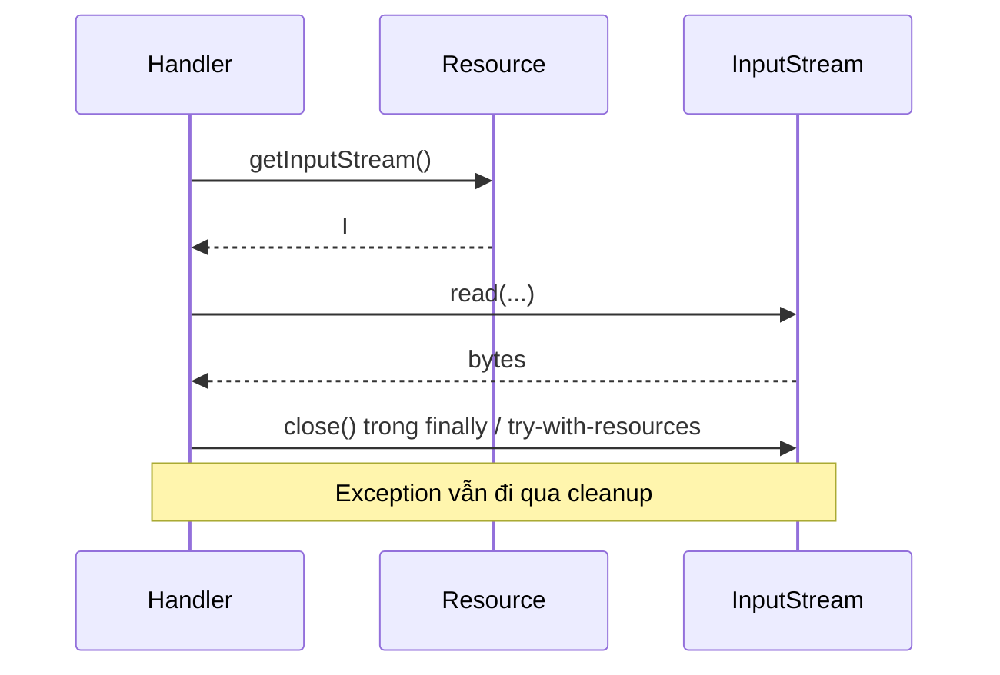
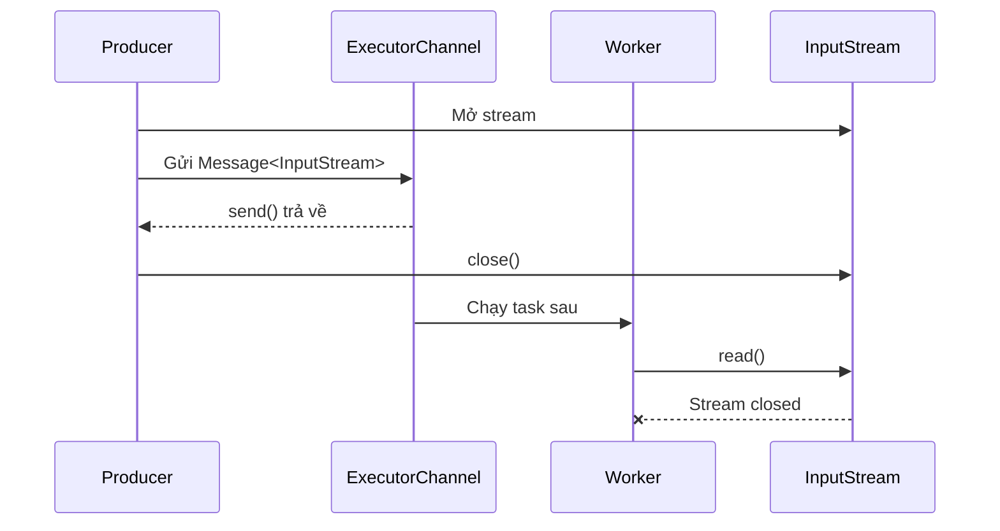
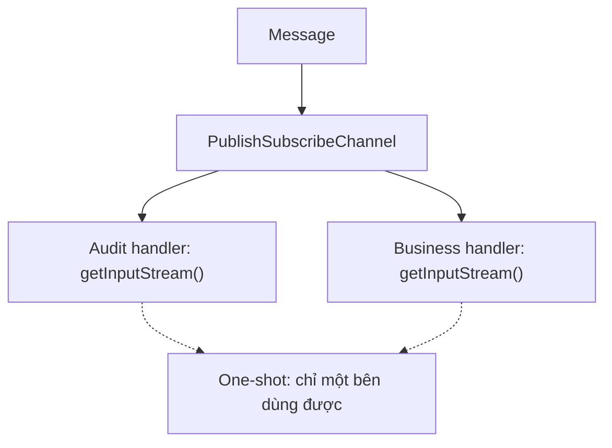

# Đọc stream một lần và đóng resource trong Spring Integration

## 1. Vấn đề thực tế: Resource được tìm thấy nhưng stream không đọc được lần hai

Một dịch vụ Spring Integration định kỳ quét các tệp cấu hình `.properties` từ classpath/JAR, đọc chúng để cập nhật quy tắc xử lý đơn hàng. Luồng ban đầu:

```text
Resource inbound adapter
    → Message<Resource[]>
    → Splitter
    → Message<Resource>
    → handler đọc nội dung
```

Một ngày, lập trình viên thêm bước log `contentLength()` và một bước parse độc lập. Một số resource vẫn chạy được; một số khác ném `IllegalStateException` khi mở lần hai hoặc báo “stream closed”. Khi có async consumer, tài nguyên còn có thể bị đóng quá sớm trước lúc worker thực sự đọc.

Không phải mọi `Resource` đều có cùng **khả năng đọc lại**:

- `ClassPathResource`, `FileSystemResource`, `ByteArrayResource` thông thường có thể **mở một `InputStream` mới cho mỗi lần gọi**.
- `InputStreamResource` là descriptor cho **một stream chỉ được truy cập một lần**, kể cả biến thể được cấp `InputStreamSource` để mở trễ (Spring Framework 6.1.7+).
- Dù resource cho phép mở lại, dữ liệu trên filesystem/URL vẫn **có thể thay đổi** giữa hai lần đọc; “repeatable” không có nghĩa “snapshot bất biến”.

Đây là bài **“Đọc stream một lần và đóng resource”** thuộc chương **Adapter Resource** của module **SPRING_INTEGRATION_ADAPTERS**. Module học cách kết nối hệ thống ngoài qua inbound/outbound adapter, gateway, poller và `MessageChannel`; đồng thời kiểm soát hợp đồng message, lỗi và vòng đời. Chủ đề này đi sâu vào **vòng đời `InputStream`**, cách bảo đảm đọc/đóng đúng trong handler và ranh giới giữa Resource inbound, splitter, transformer và consumer.

### Mục tiêu học tập

Sau bài học, bạn có thể:

1. Giải thích `Resource`, `InputStreamSource`, `InputStreamResource` và `Resource#isOpen()`.
2. Phân biệt **one-shot stream**, **re-openable Resource** và **immutable snapshot**.
3. Xác định trách nhiệm đóng stream bằng `try-with-resources` và tránh đóng trước khi downstream dùng.
4. Hiểu vì sao `InputStreamResource#contentLength()` và việc đọc metadata thiếu thận trọng có thể **tiêu thụ stream**.
5. Chuyển `Message<Resource[]>` thành `Message<Resource>` rồi thành DTO/`byte[]` với ownership rõ ràng.
6. Viết bounded reader, xử lý lỗi I/O, retry, async boundaries, fan-out và giao dịch.
7. Kiểm thử đóng stream đúng một lần, phát hiện double-read và đánh giá các lỗi lifecycle thực tế.

## 2. Nguyên tắc trước tiên: đóng stream, không phải đóng đối tượng Resource

`Resource` là một **handle** mô tả nguồn dữ liệu, không phải `InputStream`. Giao diện `Resource` mở rộng `InputStreamSource`:

```java
public interface InputStreamSource {
    InputStream getInputStream() throws IOException;
}
```

Để đọc nội dung:

```java
Resource resource = ...;

try (InputStream input = resource.getInputStream()) {
    byte[] firstBytes = input.readNBytes(1024);
    // Xử lý bytes...
} // Đóng InputStream, kể cả khi ném exception.
```

**Không có câu lệnh `resource.close()` trong hợp đồng `Resource` thông thường.** Resource không phải `AutoCloseable`. Cụm “đóng resource” trong tiêu đề thực tế nghĩa là **đóng stream và các tài nguyên I/O mà handler đã mở**, ví dụ file descriptors, network connections hoặc decoder wrappers.

### Quy tắc ownership

> Thành phần **mở** stream thường phải xác định rõ **ai chịu trách nhiệm đóng**. Trong luồng đọc đồng bộ, handler thường mở và đóng trong cùng phạm vi `try-with-resources`; không đẩy stream còn sống sang component khác nếu chưa có giao ước sở hữu.

Ví dụ handler đúng:

```java
public byte[] read(Resource resource) throws IOException {
    try (InputStream input = resource.getInputStream()) {
        return input.readNBytes(128);
    }
}
```

Ví dụ sai:

```java
public InputStream unsafe(Resource resource) throws IOException {
    try (InputStream input = resource.getInputStream()) {
        return input; // SAI: stream đã đóng trước lúc caller đọc.
    }
}
```

Ví dụ sai khác:

```java
public byte[] leaking(Resource resource) throws IOException {
    InputStream input = resource.getInputStream();
    return input.readNBytes(128); // SAI: thiếu close khi hoàn tất/lỗi.
}
```

Điểm quan trọng không phải cứ gọi `close()` càng nhiều càng tốt. **Đúng** là đóng vào **thời điểm ownership kết thúc**, đúng thành phần, kể cả khi code thất bại.

## 3. Resource#getInputStream() và ba khái niệm thường bị đánh đồng

### 3.1. Re-openable: có thể mở stream mới

Theo Spring Framework Reference, các `Resource` thông thường được kỳ vọng trả về **một `InputStream` mới** cho mỗi lần gọi `getInputStream()`; caller phải đóng stream nhận được.

```java
Resource fileResource = new FileSystemResource(
    Path.of("/opt/app/rules/default.properties")
);

try (InputStream first = fileResource.getInputStream()) {
    // Lần đọc 1.
}

try (InputStream second = fileResource.getInputStream()) {
    // Lần đọc 2, một stream mới.
}
```

Tuy nhiên, nếu file bị thay giữa hai lần gọi, `first` và `second` **không bắt buộc chứa cùng bytes**.

### 3.2. One-shot: chỉ có thể lấy stream một lần

`InputStreamResource` giữ một stream đã mở hoặc một nguồn tạo stream **cho một lần dùng**. Spring Framework nêu rõ không dùng `InputStreamResource` khi cần giữ descriptor lâu hoặc đọc nhiều lần.

```java
byte[] content = "hello".getBytes(StandardCharsets.UTF_8);
Resource oneShot = new InputStreamResource(
    new ByteArrayInputStream(content)
);

try (InputStream input = oneShot.getInputStream()) {
    System.out.println(new String(
        input.readAllBytes(),
        StandardCharsets.UTF_8
    ));
}

// oneShot.getInputStream() lần nữa:
// thường ném IllegalStateException theo hợp đồng InputStreamResource.
```

Với `InputStreamResource`, **`isOpen() == true`** và `getInputStream()` không dành cho việc đọc lặp. Spring Framework còn khuyến nghị ưu tiên `ByteArrayResource` hoặc các implementation file-based khi có thể.

### 3.3. Snapshot: nội dung đã được chốt thành bytes

`ByteArrayResource` chứa bytes trong RAM và thường tạo một `ByteArrayInputStream` mới mỗi lần mở. Nó phù hợp cho **snapshot nhỏ** và kiểm thử:

```java
byte[] bytes =
    "rule.id=shipping\n".getBytes(StandardCharsets.UTF_8);
Resource snapshot = new ByteArrayResource(bytes);

try (InputStream a = snapshot.getInputStream();
     InputStream b = snapshot.getInputStream()) {
    assert Arrays.equals(a.readAllBytes(), b.readAllBytes());
}
```

Đây là ví dụ dùng `assert` của Java để minh họa; trong unit test hãy dùng JUnit assertions. `ByteArrayResource` giữ một tham chiếu tới bytes được cung cấp, vì vậy **đừng sửa mảng `bytes` sau khi tạo** nếu muốn snapshot thực sự bất biến ở mức ứng dụng. Có thể dùng `byte[] copy = bytes.clone()` trước khi tạo Resource và không chia sẻ mảng đó cho code có quyền sửa.

### So sánh

| Resource | `isOpen()` thông thường | Mở lại stream? | Nội dung chắc chắn bất biến? |
| --- | --- | --- | --- |
| `InputStreamResource` | **true** | **Không**, one-shot | Không tự bảo đảm |
| `ByteArrayResource` | false | Thường **có** | Chỉ khi bytes không bị sửa sau đó |
| `ClassPathResource` | false | Thường **có** | JAR thường bất biến trong vòng đời app, nhưng không phải lời hứa của interface |
| `FileSystemResource` | false | Thường **có** | **Không**; file có thể thay đổi/xóa |
| `UrlResource` | false | Có thể mở request/connection mới | **Không**; response/URL có thể đổi |
| Custom `Resource` | Do implementation | Theo contract implementation | Phải xác minh |

**`isOpen()==false` không chứng minh chắc chắn “replay đúng cùng bytes”.** Nó chỉ phản ánh resource hiện không đại diện cho một stream đã mở; khả năng mở lại, độ ổn định nội dung và thời hạn tồn tại còn phụ thuộc implementation và external source.

## 4. Vòng đời một lần đọc



Quy trình đúng thường là:

1. Handler nhận `Resource`.
2. Handler xác định hợp đồng đọc: max bytes, charset/format, timeout, source identity.
3. Handler gọi `getInputStream()` **đúng thời điểm** cần đọc.
4. Reader xử lý stream trong cùng phạm vi sở hữu.
5. Stream được đóng khi đọc xong hoặc khi có lỗi.
6. Handler chuyển **bytes/DTO/snapshot** cho downstream; không lưu stream đã đóng làm payload.

### Cần đóng stream ngay cả khi chỉ đọc một phần

```java
try (InputStream input = resource.getInputStream()) {
    byte[] header = input.readNBytes(16);
    if (!looksValid(header)) {
        throw new IllegalArgumentException("Invalid header");
    }
    // ...
} // Mở một lần, đóng dù chỉ đọc 16 bytes.
```

`looksValid` là phương thức kiểm tra do ứng dụng tự định nghĩa. Từ chối ngay sau khi đọc header là một lựa chọn hợp lý, nhưng với HTTP/SFTP/resource remote cần xét tác động của việc đóng connection khi chưa đọc hết response và connection pooling theo client library tương ứng.

## 5. InputStreamResource: trường hợp đặc biệt phải nhớ

Spring Framework Javadoc mô tả `InputStreamResource` là một `Resource` dành cho **`InputStream` đã mở**. Từ Spring Framework 6.1.7 có thêm constructor nhận `InputStreamSource` để mở stream trễ, **nhưng descriptor vẫn one-shot**.

### 5.1. Tạo từ InputStream đã mở

```java
InputStream opened = Files.newInputStream(
    Path.of("/opt/app/exports/large.txt")
);
Resource oneShot = new InputStreamResource(
    opened, "one-shot-export"
);

// Chỉ nên dùng trong một phạm vi đồng bộ có owner rõ.
try (InputStream input = oneShot.getInputStream()) {
    byte[] prefix = input.readNBytes(64);
}
```

**Lỗ hổng vòng đời ở đây:** stream `opened` đã mở **trước** khi downstream thực sự nhận resource. Nếu flow bị huỷ, không có subscriber, exception xảy ra trước `getInputStream()` hoặc message bị bỏ, stream có thể không được đóng. Vì thế **không tạo hàng loạt `InputStreamResource(opened)` để enqueue rồi quên chúng**.

### 5.2. Lazy InputStreamSource vẫn chỉ một lần (Spring 6.1.7+)

```java
Resource lazyOneShot = new InputStreamResource(
    () -> Files.newInputStream(Path.of("/opt/app/exports/large.txt")),
    "lazy-one-shot-export"
);
```

Code lazy chỉ mở stream ở lần gọi `getInputStream()` đầu tiên. Điều đó **giảm thời gian giữ file descriptor** khi resource nằm chờ, nhưng:

- Không biến nó thành Resource có thể đọc lại.
- Vẫn có race: file có thể biến mất trước khi stream được mở.
- Vẫn phải đóng stream đã nhận.
- Không nên đưa one-shot handle qua durable message store/broker và kỳ vọng receiver mở được.
- Đoạn constructor này **không có** trong một số phiên bản Spring Framework cũ; cần so khớp dependency/BOM khi áp dụng.

Nếu cần **đọc lại nhiều lần**, dùng `FileSystemResource`, `ClassPathResource`, `ByteArrayResource` hoặc một `AbstractResource` custom có `getInputStream()` mở stream mới mỗi lần, **không dùng `InputStreamResource` với kỳ vọng replay**.

## 6. Tránh contentLength() vô tình tiêu thụ stream

Đây là bẫy quan trọng nhất với `InputStreamResource`.

```java
Resource oneShot = new InputStreamResource(
    new ByteArrayInputStream(new byte[] { 1, 2, 3 })
);

long n = oneShot.contentLength(); // NGUY HIỂM cho one-shot.

// Lần gọi getInputStream sau đó không còn hợp lệ.
// oneShot.getInputStream() -> IllegalStateException.
```

Javadoc Spring Framework cảnh báo `InputStreamResource` **không có implementation `contentLength()` độc lập**; `AbstractResource#contentLength()` có thể **đọc hết** `InputStream` để đếm bytes. Vì thế một bước tưởng như “đọc metadata trước rồi mới đọc nội dung” thực tế đã tiêu thụ nguồn.

### Không thực hiện các thao tác có thể đọc trước một lượt

Trước khi truyền one-shot Resource tới parser, tránh gọi tùy tiện:

- `resource.contentLength()` khi implementation có thể đọc stream để đo kích thước.
- `resource.getContentAsByteArray()` hoặc `getContentAsString(...)` rồi lại gọi `getInputStream()`.
- `resource.getInputStream().readAllBytes()` để log/debug rồi đưa lại same resource cho handler.
- Nhiều `@Transformer`/`@ServiceActivator`/subscribers cùng mở một `InputStreamResource`.
- Một bước tính checksum mở stream, sau đó parser **mở tiếp cùng one-shot**.

`exists()` cũng **không bảo đảm** nội dung sẽ đọc được, còn `isReadable()` không phải xác nhận dữ liệu hợp lệ. Với `InputStreamResource`, `exists()` có thể luôn trả true theo implementation mà không kiểm tra toàn bộ bytes hoặc remote origin.

### Cách đo kích thước thật không làm mất cơ hội parse

Đọc **một lần**, giới hạn số bytes, rồi vừa có snapshot vừa biết độ dài:

```java
int maxBytes = 128 * 1024;
byte[] raw;

try (InputStream input = resource.getInputStream()) {
    raw = input.readNBytes(maxBytes + 1);
}
if (raw.length > maxBytes) {
    throw new IOException("Resource exceeds 128 KiB");
}

int actualLength = raw.length; // Không cần contentLength().
// Parse từ raw ở bước tiếp theo.
```

Ví dụ cố tình lưu bytes vào RAM vì giới hạn 128 KiB. Với tài nguyên lớn, dùng **streaming parser có byte budget** hoặc copy sang staging file/object store rồi parse từ staging theo contract, không dùng `readAllBytes()` vô hạn.

## 7. Try-with-resources cho Reader và stream bọc nhiều lớp

Một Resource chứa văn bản UTF-8:

```java
try (Reader reader = new InputStreamReader(
        resource.getInputStream(),
        StandardCharsets.UTF_8)) {
    Properties props = new Properties();
    props.load(reader);
}
```

Khi đóng `InputStreamReader`, underlying `InputStream` cũng được đóng. Vì thế chỉ cần một owner của chuỗi wrapper; không phải đặt `try-with-resources` trên mọi wrapper bằng mọi giá.

Một ví dụ có cả `BufferedReader`:

```java
try (BufferedReader reader = new BufferedReader(
        new InputStreamReader(
            resource.getInputStream(), StandardCharsets.UTF_8
        ))) {
    for (String line; (line = reader.readLine()) != null; ) {
        // Xử lý từng dòng, không nhất thiết giữ cả file.
    }
}
```

`BufferedReader.close()` đóng `InputStreamReader`, từ đó đóng `InputStream`. Tuy nhiên code này chỉ đúng khi đã **hoàn thành xử lý trong cùng try block**; không được trả `reader` ra ngoài.

### Khi dùng GZIPInputStream

```java
try (InputStream decompressed = new GZIPInputStream(
        resource.getInputStream())) {
    // Đọc dữ liệu đã giải nén với giới hạn output bytes.
}
```

`GZIPInputStream.close()` đóng stream nguồn. **Lưu ý an toàn:** giới hạn **kích thước sau giải nén**, không chỉ kích thước raw file, để tránh decompression bombs.

### Xử lý exception trong close

Với `try-with-resources`, nếu xử lý ném exception và `close()` cũng ném exception, Java giữ exception chính và đưa lỗi close vào `suppressed exceptions`. Đừng bỏ qua toàn bộ lỗi I/O để “bảo đảm luôn đóng được”: close có thể phát hiện lỗi flush/connection và ảnh hưởng kết quả.

```java
try (InputStream input = resource.getInputStream()) {
    parse(input);
} catch (IOException error) {
    for (Throwable suppressed : error.getSuppressed()) {
        // Quan sát/ghi nhận lỗi đóng stream nếu cần.
    }
    throw error;
}
```

`parse(InputStream)` là method do ứng dụng định nghĩa và **không tự đóng stream** trong mô hình ownership này; block `try` là owner duy nhất. Đừng log toàn bộ nội dung file hoặc secrets khi phân tích exception.

## 8. Mở một lần nhưng có thể dùng cho nhiều bước nghiệp vụ

Sai:

```java
// One-shot resource:
String checksum = sha256(resource.getInputStream()); // đọc lần 1
Rule rule = parse(resource.getInputStream());         // đọc lần 2
```

Đoạn sai còn không đóng stream. Đúng là **một lượt đọc → tạo nội dung an toàn → nhiều thao tác từ snapshot**:

```java
byte[] snapshot;
try (InputStream input = resource.getInputStream()) {
    snapshot = input.readNBytes(64 * 1024 + 1);
}
if (snapshot.length > 64 * 1024) {
    throw new IOException("Oversized rule");
}

String checksum = sha256(snapshot);
Rule rule = parse(snapshot);
```

`sha256(byte[])` và `parse(byte[])` là methods ứng dụng tự định nghĩa; cả hai làm việc trên snapshot, **không mở lại nguồn**. Với input file lớn, có thể vừa hash vừa parse theo streaming contract hoặc spool vào storage tạm rồi đọc lại storage đó.

### Một-pass streaming và checksum

Với file lớn, nếu cần tính hash cùng lúc parse, một lựa chọn là `DigestInputStream`:

```java
MessageDigest digest = MessageDigest.getInstance("SHA-256");
try (InputStream input = new DigestInputStream(
        resource.getInputStream(), digest)) {
    parseStreamUntilEof(input);
}
byte[] sha256 = digest.digest();
```

**Cảnh báo quan trọng:** chỉ khi `parseStreamUntilEof` **thực sự đọc đến EOF** thì digest đại diện cho **toàn bộ resource**. Nếu parser dừng sớm vì tìm thấy phần tử cần thiết, digest mới phản ánh bytes đã đọc. Với checksum toàn file, phải tiêu thụ hết stream hoặc ghi vào staging theo một thiết kế có giới hạn/đối soát.

## 9. Resource inbound adapter và message payload

Spring Integration Resource support cung cấp một **polling inbound channel adapter** dùng `ResourceRetrievingMessageSource` để giải location pattern, ví dụ `classpath*:rules/*.properties`. Nó phát **một Spring message có payload là `Resource[]`**.


### Resource[] không đồng nghĩa một file mỗi message

```text
Poll #1:
  resolver tìm 3 resource
  filter chấp nhận 3
  source phát 1 Message<Resource[3]>

Sau splitter:
  Message<Resource>(A)
  Message<Resource>(B)
  Message<Resource>(C)
```

`maxMessagesPerPoll="1"` chỉ giới hạn số lần nhận **message** từ source trong một chu kỳ; **không** giới hạn payload `Resource[]` một phần tử.

### Adapter không tự mở hay đóng stream nội dung

`ResourceRetrievingMessageSource` tạo message chứa **resource handles**. Việc `receive()` tạo `Message<Resource[]>` không chứng minh file đã được mở, parse, ghi DB hay đóng stream; trách nhiệm thực tế nằm ở transformer/handler **khi gọi `getInputStream()`**.

Với `AcceptOnceCollectionFilter`, nguồn có thể không phát lại resource sau lần đã được chấp nhận, dù downstream handler đọc lỗi. **Filter state không rollback cùng I/O hoặc DB transaction.** Với nội dung quan trọng, thiết kế ledger/checkpoint và retry riêng.

## 10. Java configuration: poller → Resource[] → Resource

### 10.1. Dependencies

Với Spring Boot BOM tương thích Spring Integration:

```xml
<dependencies>
    <dependency>
        <groupId>org.springframework.boot</groupId>
        <artifactId>spring-boot-starter-integration</artifactId>
    </dependency>
</dependencies>
```

Ví dụ dùng Java 17+, Spring Integration Core. Nó không cần File adapter riêng chỉ để khám phá `Resource`.

Đặt các file:

```text
src/main/resources/rules/
  shipping.properties
  discount.properties
```

Nội dung:

```properties
rule.id=shipping-express
rule.version=1
rule.label=Miễn phí vận chuyển
```

Quy ước input: mỗi file `.properties` có UTF-8, max 128 KiB, các trường `rule.id`/`rule.version` bắt buộc. Đây là contract do ứng dụng định nghĩa, **không** phải format Spring Integration tự parse.

### 10.2. Tạo ResourceRetrievingMessageSource và các channel

```java
package com.example.resourcestream;

import org.springframework.context.annotation.Bean;
import org.springframework.context.annotation.Configuration;
import org.springframework.core.io.Resource;
import org.springframework.integration.annotation.InboundChannelAdapter;
import org.springframework.integration.annotation.Poller;
import org.springframework.integration.channel.DirectChannel;
import org.springframework.integration.config.EnableIntegration;
import org.springframework.integration.core.MessageSource;
import org.springframework.integration.resource.ResourceRetrievingMessageSource;
import org.springframework.integration.util.AcceptOnceCollectionFilter;
import org.springframework.messaging.MessageChannel;

@Configuration
@EnableIntegration
public class ResourceStreamConfiguration {

    @Bean
    public MessageChannel resourceBatches() {
        return new DirectChannel();
    }

    @Bean
    public MessageChannel individualResources() {
        return new DirectChannel();
    }

    @Bean
    public MessageChannel ruleSnapshots() {
        return new DirectChannel();
    }

    @Bean
    @InboundChannelAdapter(
        channel = "resourceBatches",
        poller = @Poller(
            fixedDelay = "5000",
            maxMessagesPerPoll = "1"
        )
    )
    public MessageSource<Resource[]> ruleResourceSource() {
        ResourceRetrievingMessageSource source =
            new ResourceRetrievingMessageSource(
                "classpath*:rules/*.properties"
            );
        source.setFilter(new AcceptOnceCollectionFilter<>());
        return source;
    }
}
```

`@EnableIntegration` kích hoạt Spring Integration infrastructure. `@InboundChannelAdapter` tạo polling endpoint, không phải stream reader. `ResourceRetrievingMessageSource` trả `Resource[]`, sau đó downstream phải chọn cách đọc và đóng từng stream.

### 10.3. Tách batch

```java
package com.example.resourcestream;

import org.springframework.core.io.Resource;
import org.springframework.integration.annotation.Splitter;
import org.springframework.stereotype.Component;

@Component
public class ResourceArraySplitter {

    @Splitter(
        inputChannel = "resourceBatches",
        outputChannel = "individualResources"
    )
    public Resource[] split(Resource[] batch) {
        return batch;
    }
}
```

Sau splitter, consumer kế tiếp nhận **`Resource`**, không phải `Resource[]`. Nếu có một source trả hàng trăm resources, splitter xử lý hàng trăm items; batching/ordering/backpressure cần thiết kế riêng.

## 11. BoundedResourceReader: đọc một lần, đóng stream và tạo snapshot

Để tránh đọc hai lần, ta xây component đảm nhận **toàn bộ I/O**:

1. Mở `InputStream` **một lần**.
2. Giới hạn 128 KiB (đọc tối đa 128 KiB + 1 byte).
3. Đóng stream kể cả khi lỗi.
4. Decode UTF-8 nghiêm ngặt để không mất dữ liệu khi byte hỏng.
5. Tính SHA-256 **trên chính bytes đã đọc**.
6. Trả DTO bất biến chứa metadata dùng được ở downstream.

### 11.1. DTO đầu ra

```java
package com.example.resourcestream;

public record RuleSnapshot(
    String sourceName,
    String text,
    int byteCount,
    String sha256
) {}
```

`sourceName` chỉ để hiển thị, không phải unique business key. Hai JAR có thể có resource cùng filename. Nếu cần idempotency, nên lấy logical rule ID/version từ nội dung và source identity được backend xác định.

### 11.2. Reader implementation

```java
package com.example.resourcestream;

import java.io.IOException;
import java.io.InputStream;
import java.nio.ByteBuffer;
import java.nio.charset.CodingErrorAction;
import java.nio.charset.StandardCharsets;
import java.security.MessageDigest;
import java.security.NoSuchAlgorithmException;
import java.util.HexFormat;

import org.springframework.core.io.Resource;
import org.springframework.stereotype.Component;

@Component
public class BoundedResourceReader {

    public static final int MAX_BYTES = 128 * 1024;

    public RuleSnapshot read(Resource resource) throws IOException {
        if (resource == null) {
            throw new IllegalArgumentException("Resource is null");
        }

        byte[] bytes;
        try (InputStream input = resource.getInputStream()) {
            bytes = input.readNBytes(MAX_BYTES + 1);
        }
        if (bytes.length > MAX_BYTES) {
            throw new IOException("Resource exceeds 128 KiB");
        }

        var decoder = StandardCharsets.UTF_8
            .newDecoder()
            .onMalformedInput(CodingErrorAction.REPORT)
            .onUnmappableCharacter(CodingErrorAction.REPORT);

        String text =
            decoder.decode(ByteBuffer.wrap(bytes)).toString();

        byte[] hash;
        try {
            hash = MessageDigest
                .getInstance("SHA-256").digest(bytes);
        } catch (NoSuchAlgorithmException ex) {
            throw new IllegalStateException("SHA-256 unavailable", ex);
        }

        String displayName = resource.getFilename();
        if (displayName == null || displayName.isBlank()) {
            displayName = "unnamed-resource";
        }

        return new RuleSnapshot(
            displayName,
            text,
            bytes.length,
            HexFormat.of().formatHex(hash)
        );
    }
}
```

**Điểm quan trọng:**

- `getInputStream()` chỉ xuất hiện **một lần** trong luồng đọc.
- `try-with-resources` đóng stream trước khi trả DTO.
- Downstream làm việc trên `RuleSnapshot.text()` và `sha256()`, không phải trên stream đang mở.
- `CharsetDecoder` được tạo theo từng call, không dùng chung giữa threads.
- `readNBytes(MAX_BYTES + 1)` tránh nạp toàn bộ file lớn vào heap, nhưng cần thêm timeout và giới hạn số resource/batch.
- `sha256` phản ánh bytes gốc, không phải text đã normalize; đây là lựa chọn phù hợp để audit **đúng bản dữ liệu đã đọc**.
- Nếu source có UTF-8 BOM và contract yêu cầu bỏ BOM, cần xử lý BOM tường minh trước decode/parse. Reader ở đây **không tự loại BOM**, giúp ví dụ tập trung vào stream lifecycle; với `.properties` có BOM, key đầu tiên có thể không khớp.

### 11.3. Khi cần tránh giữ toàn bộ bytes trong RAM

Một input file 10 GiB không phù hợp với `readNBytes(MAX+1)` vào một DTO, dù MAX được tăng. Khi đó hãy chọn streaming:

```text
Resource (one-shot hoặc reopenable)
    → InputStream (open once)
    → giới hạn bytes, parse theo chunk
    → checksum/validation
    → commit kết quả theo unit-of-work
    → close
```

Nếu parser cần **quay lại** để đọc từ đầu, có thể spool vào file tạm/object store **có quyền và quota rõ**, rồi mở lại **nguồn staging mới**, không cố mở lại `InputStreamResource` ban đầu.

## 12. Transformer và handler: downstream không cần giữ stream

### 12.1. Biến Resource thành RuleSnapshot

```java
package com.example.resourcestream;

import java.io.IOException;

import org.springframework.core.io.Resource;
import org.springframework.integration.annotation.Transformer;
import org.springframework.stereotype.Component;

@Component
public class ResourceSnapshotTransformer {

    private final BoundedResourceReader reader;

    public ResourceSnapshotTransformer(BoundedResourceReader reader) {
        this.reader = reader;
    }

    @Transformer(
        inputChannel = "individualResources",
        outputChannel = "ruleSnapshots"
    )
    public RuleSnapshot transform(Resource resource)
            throws IOException {
        return reader.read(resource);
    }
}
```

Trong mô hình này, mỗi `Resource` được **mở và đóng trong transformer**. Sau khi `transform(...)` trả về `RuleSnapshot`, downstream không còn phụ thuộc vào file handle hay `InputStreamResource`; nó có text và checksum ứng với cùng bytes.

### 12.2. Handler parse nghiệp vụ

```java
package com.example.resourcestream;

import java.io.StringReader;
import java.util.Properties;

import org.springframework.integration.annotation.ServiceActivator;
import org.springframework.stereotype.Component;

@Component
public class RuleSnapshotHandler {

    @ServiceActivator(inputChannel = "ruleSnapshots")
    public void apply(RuleSnapshot snapshot) throws Exception {
        Properties props = new Properties();
        try (StringReader characters =
                new StringReader(snapshot.text())) {
            props.load(characters);
        }

        String id = props.getProperty("rule.id");
        String versionText =
            props.getProperty("rule.version", "0");

        if (id == null || id.isBlank()) {
            throw new IllegalArgumentException("Missing rule.id");
        }
        int version = Integer.parseInt(versionText);
        if (version <= 0) {
            throw new IllegalArgumentException(
                "rule.version must be positive"
            );
        }

        // Trong production: apply rule với transaction và
        // idempotency key (logical rule ID + version/checksum).
        System.out.printf(
            "Validated rule %s v%d, bytes=%d%n",
            id, version, snapshot.byteCount()
        );
    }
}
```

`StringReader` là Reader trên dữ liệu trong RAM, không mở lại stream nguồn. Tuy nhiên `RuleSnapshotHandler` mới validate ví dụ; nó **chưa** ghi DB và không tạo transaction/ledger bền vững.

### Vì sao tách reader với business handler?

| Thành phần | Trách nhiệm | Không nên làm |
| --- | --- | --- |
| `BoundedResourceReader` | Mở stream, giới hạn byte, decode, tính hash, đóng | Ghi business DB, đưa raw stream ra ngoài |
| `ResourceSnapshotTransformer` | Chuyển `Resource` sang snapshot trong message | Gọi `getInputStream()` lần hai để log |
| `RuleSnapshotHandler` | Parse schema, validate nghiệp vụ, commit | Tùy tiện mở lại source hoặc dựa vào `Resource#getFilename` làm unique key |

Nếu parser/validation lỗi **sau khi stream đã đóng**, có thể retry xử lý **`RuleSnapshot`** mà không cần truy cập resource gốc, miễn snapshot/command đã được lưu bền và business effect idempotent. Nhưng nếu app crash khi snapshot vẫn chỉ ở `DirectChannel`/RAM, không có guarantee tự phục hồi.

## 13. Một lỗi tinh vi: parse xong, truyền stream đã đóng sang downstream

Ví dụ sai:

```java
@Transformer(
    inputChannel = "individualResources",
    outputChannel = "resourceStreams"
)
public InputStream transformWrong(Resource resource)
        throws IOException {
    try (InputStream stream = resource.getInputStream()) {
        return stream; // Đã đóng trước khi downstream nhận.
    }
}
```

Đây là lỗi **ownership**. `InputStream` là dữ liệu có trạng thái, không phải một value bất biến.

### Cách đúng 1: trả bytes với size limit

```java
@Transformer(
    inputChannel = "individualResources",
    outputChannel = "resourceBytes"
)
public byte[] transformToBytes(Resource resource)
        throws IOException {
    final int limit = 64 * 1024;
    try (InputStream stream = resource.getInputStream()) {
        byte[] bytes = stream.readNBytes(limit + 1);
        if (bytes.length > limit) {
            throw new IOException("Resource too large");
        }
        return bytes;
    }
}
```

`resourceBytes` là channel cần được khai báo cùng consumer khi sử dụng ví dụ này. Nó là **phương án thay thế** transformer `RuleSnapshot` ở mục 12, không phải đoạn code cần bật song song nếu cùng input channel `DirectChannel` mà mong mỗi message đều chạy cả hai.

### Cách đúng 2: chuyển kết quả parse

Nếu downstream chỉ cần vài trường, biến stream thành DTO/bản ghi nghiệp vụ rồi trả DTO. Đây thường là giải pháp tốt nhất vì giảm memory, tránh lộ resource handle và giúp code dễ kiểm thử.

### Cách có điều kiện 3: chuyển quyền sở hữu stream tường minh

Một số API streaming thực sự chấp nhận `InputStream` và **cam kết** sẽ đóng sau khi đọc. Chỉ dùng khi hợp đồng receiver nói rõ:

- Ai đóng stream và khi nào.
- Sender có được tiếp tục dùng stream không (thường **không**).
- Cách xử lý khi receiver không bắt đầu đọc hoặc bị hủy.
- Có kiểm soát timeout/byte limit và cancellation không.
- Stream có bị chia sẻ giữa nhiều consumers không.

Với luồng Spring Integration qua queue hoặc broker, **đừng ngầm chuyển quyền sở hữu `InputStream`** nếu không có protocol rõ; ưu tiên `byte[]`/DTO hoặc object key có version.

## 14. Async boundary: stream mở sớm có thể hết hạn trước khi được đọc



Không thể sửa bằng cách “không đóng bao giờ”, vì có thể rò rỉ file descriptors và network connections nếu worker không chạy.

### Thiết kế an toàn hơn

```text
Source Resource
  -> bounded read + close (sync)
  -> Message<byte[]> hoặc Message<RuleSnapshot>
  -> ExecutorChannel / bounded queue
  -> downstream async
```

Khi cần xử lý file lớn:

```text
Source Resource
  -> copy vào versioned staging / object store
  -> close source stream
  -> Message<StagedObjectReference>
  -> queue / durable transport
  -> worker mở stream mới từ staging
  -> close worker stream
```

`StagedObjectReference` nên chứa object key, checksum/version, size, expiry và quyền truy cập theo ứng dụng. Không chỉ gửi raw URL nhạy cảm hoặc đường dẫn local mà worker khác không truy cập được.

### DirectChannel, ExecutorChannel, QueueChannel

| Channel | Khi nào send hoàn tất? | Ai đóng stream nguồn? |
| --- | --- | --- |
| `DirectChannel` đồng bộ | Sau khi handler trả về hoặc ném exception | Handler mở và đóng trong call stack sync |
| `ExecutorChannel` | Có thể sau khi executor nhận task, **trước khi worker xử lý** | Worker nếu worker mở; không để producer mở rồi đóng sớm |
| `QueueChannel` | Sau khi message enqueue, không đồng nghĩa đã xử lý | Polling consumer khi thực sự mở; cần expiry/failure cleanup |
| Durable broker | Theo semantics producer ACK của broker, không phải hoàn tất business | Không gửi raw stream; gửi bytes/object key theo schema |

**Quan trọng:** `Message<Resource>` đưa qua `QueueChannel` chưa mở stream, nhưng khi worker mở stream thì nội dung có thể **khác** lúc source được resolve. Với `InputStreamResource` đã mở sẵn, tồn tại cả rủi ro stale connection/rò rỉ I/O trong lúc chờ.

## 15. Fan-out, log/checksum và nguy cơ đọc cùng stream hai lần

Một `PublishSubscribeChannel` hoặc nhiều handlers có thể cùng nhận **cùng đối tượng payload Resource**:



Nếu payload là `InputStreamResource`:

- Handler đầu có thể tiêu thụ stream.
- Handler sau có thể gặp `IllegalStateException`.
- Nếu hai handlers chạy song song trên **một `InputStream`**, chúng có thể tranh nhau đọc và làm mất tính toàn vẹn dữ liệu.
- Ngay cả trên `FileSystemResource`, hai lần mở có thể thấy **hai phiên bản file** khác nhau nếu file thay đổi.

### Sửa topology

**Đọc một lần trước khi fan-out**:

```text
Resource
  -> BoundedResourceReader
  -> RuleSnapshot (immutable business data)
  -> PublishSubscribeChannel
      -> Audit(snapshot.sha256, id)
      -> Business(snapshot.text)
```

Không sử dụng một instance `CharsetDecoder`, `InputStream` hay `MessageDigest` mutable chia sẻ giữa multiple workers nếu không có synchronization. Trong ví dụ `BoundedResourceReader`, mỗi call tạo decoder và hash instance mới.

## 16. Error handling: một lần đọc thất bại có tự được đọc lại?

### Các giai đoạn có thể lỗi

| Giai đoạn | Ví dụ lỗi | Hệ quả |
| --- | --- | --- |
| Resolve resource | Class loader không thấy JAR, pattern sai | Không tạo batch hoặc thiếu dữ liệu bắt buộc |
| Open stream | `FileNotFoundException`, permission, remote timeout | Chưa đọc được bytes |
| Read stream | `IOException` giữa chừng, byte limit | Snapshot chưa đầy đủ hoặc bị từ chối |
| Decode | `MalformedInputException` với UTF-8 sai | Bytes hợp lệ về I/O nhưng sai contract text |
| Close | Network close/flush exception | Cần ghi nhận suppressed/close failure |
| Parse schema | Thiếu `rule.id`, version không hợp lệ | Không được coi là business commit |
| Commit DB | Timeout/unique conflict/deadlock | Có thể rollback DB, không rollback source filter |
| Async worker | Exception sau khi producer send thành công | Cần error flow/completion riêng |

### One-shot stream không thể tự replay

`InputStreamResource` đã tiêu thụ **không thể mở lại để retry trên cùng instance**. Nếu I/O lỗi giữa chừng, phải:

- Tạo **nguồn mới** từ hệ thống ngoài nếu nguồn hỗ trợ (ví dụ request/file mới).
- Hoặc retry từ **snapshot/staging đầy đủ đã lưu trước đó**.
- Hoặc chấp nhận thất bại, ghi checkpoint và nhờ upstream phát lại.

**Không retry vô hạn trên cùng một `InputStreamResource` đã dùng.** Ngay cả khi code catches `IOException` và gọi `getInputStream()` lại, nó vẫn có thể ném `IllegalStateException`.

### Resource có thể mở lại nhưng không bảo đảm retry cùng dữ liệu

Với `FileSystemResource` hoặc `UrlResource`, mở stream mới lần hai thường có thể, nhưng bytes có thể đổi. Nếu yêu cầu đúng phiên bản, hãy kiểm tra checksum/ETag/version trước khi chấp nhận kết quả retry; đừng chỉ dựa vào filename.

### AcceptOnceCollectionFilter và tác động sau lỗi

Trong Resource inbound, một `AcceptOnceCollectionFilter<Resource>` có thể đánh dấu resource **đã thấy** trước khi transformer bắt đầu đọc. Nếu transformer lỗi:

```text
Poll #1:
  filter chấp nhận A
  Source gửi Resource A
  Transformer đọc A → IOException

Poll #2:
  filter có thể loại A vì đã thấy
  => A không tự động được retry
```

Filter không phải transaction manager. Muốn bảo đảm xử lý, phải thiết kế **checkpoint/replay/idempotency** theo logical source ID và content version; trạng thái source filter không đại diện cho `BUSINESS_COMMITTED`.

## 17. Transaction, checkpoint và đúng một hiệu ứng nghiệp vụ

Khi stream được đọc xong, còn ít nhất hai mốc:

```text
RESOURCE_OPENED
  -> BYTES_READ
  -> SNAPSHOT_VALIDATED
  -> BUSINESS_COMMITTED
```

Đọc thành công và stream đã đóng **không đồng nghĩa** dữ liệu đã được ghi DB.

### Khóa nghiệp vụ

Một ledger/inbox có thể lưu:

| Trường | Ý nghĩa |
| --- | --- |
| `sourceId` | Nguồn được nhận diện ổn định (không chỉ filename) |
| `logicalRuleId` | ID lấy từ payload sau validate |
| `contentVersion` / `checksum` | Bản nội dung được xử lý |
| `status` | `PENDING`, `PROCESSED`, `FAILED`, `QUARANTINED` |
| `lastErrorCategory` | I/O, encoding, parse, DB |
| `processedAt` | Thời điểm commit nghiệp vụ |

Với DB:

```text
BEGIN TRANSACTION
  claim UNIQUE(sourceId, logicalRuleId, version)
  update domain records
  mark PROCESSED
COMMIT
```

Đây là **mô hình gợi ý**, không phải chức năng tự bật khi dùng `@Transactional`. JDBC transaction không thể “mở lại” `InputStreamResource` đã tiêu thụ hay rollback `AcceptOnceCollectionFilter` trong RAM.

### Retry cần bản dữ liệu xác định

- Với nguồn **immutable classpath JAR**, có thể xử lý lại bằng `ClassPathResource` sau restart, nhưng idempotency vẫn cần nếu effect không được lặp.
- Với nguồn **file/URL mutable**, dùng versioned snapshot/staging để tái lập cùng bytes.
- Với nguồn **one-shot HTTP upload**, nên nhận và lưu tạm đầy đủ có checksum **trước** khi xác nhận tầng nghiệp vụ, nếu hệ thống cần replay.
- Với input chứa PII, lưu staging/quarantine phải có encryption, ACL và retention policy.

## 18. An toàn khi mở stream: file, JAR, HTTP và giới hạn dữ liệu

| Nguồn | Cần lưu ý |
| --- | --- |
| `ClassPathResource` trong JAR | Dùng `getInputStream()`; `getFile()` có thể không hoạt động |
| `FileSystemResource` | File có thể đổi/xóa giữa `exists()` và `getInputStream()` |
| `UrlResource` | Network timeout, DNS, redirect, SSRF và response size |
| `InputStreamResource` | Stream đã mở/one-shot; không gọi `contentLength()` tùy tiện |
| `ByteArrayResource` | Snapshot nhỏ phù hợp; phải quản lý số lượng và RAM |
| File gzip/binary | Tránh decode như UTF-8 nếu không phải text; giới hạn bytes sau giải nén |

### Security checklist

1. Không cho HTTP client truyền raw location như `file:/**` hoặc URL tùy ý cho resolver.
2. Dùng location pattern có root cụ thể, không quét toàn bộ classpath để tìm một file.
3. Với URL/network, allowlist protocol/host, kiểm soát redirect và private IP theo security model.
4. Cấu hình connection/read timeout tại HTTP/SFTP client thật, **không** kỳ vọng `Resource` tự đặt timeout chung.
5. Giới hạn số resource mỗi batch, bytes mỗi resource, tổng bytes và concurrency.
6. Không log toàn bộ `Resource#getDescription()` nếu nó chứa token/path nhạy cảm.
7. Với one-shot upload, chủ động quyết định ai là owner và ai đóng stream khi request bị hủy.
8. Không deserialize tùy ý Java object từ input không tin cậy; parse theo schema.
9. Không giữ raw payload chứa secret/PII trong log hoặc error messages.
10. Nếu staging file cần cleanup, ghi nhận ownership, expiry và quota.

## 19. XML: Resource inbound không tự quản lý stream của handler

Resource inbound có thể cấu hình bằng XML namespace:

```xml
<?xml version="1.0" encoding="UTF-8"?>
<beans xmlns="http://www.springframework.org/schema/beans"
       xmlns:xsi="http://www.w3.org/2001/XMLSchema-instance"
       xmlns:int="http://www.springframework.org/schema/integration"
       xsi:schemaLocation="
           http://www.springframework.org/schema/beans
           https://www.springframework.org/schema/beans/spring-beans.xsd
           http://www.springframework.org/schema/integration
           https://www.springframework.org/schema/integration/spring-integration.xsd">

    <int:channel id="resourceBatches"/>

    <int:resource-inbound-channel-adapter
            id="resourceInbound"
            channel="resourceBatches"
            pattern="classpath*:rules/*.properties">
        <int:poller
                fixed-delay="5000"
                max-messages-per-poll="1"/>
    </int:resource-inbound-channel-adapter>
</beans>
```

Đây là **phương án thay thế** nguồn annotation ở mục 10; không chạy đồng thời hai nguồn cùng pattern nếu không có chủ đích đọc hai lần. XML Resource inbound thường dùng `AcceptOnceCollectionFilter` mặc định nếu không chỉ định filter. Dù chọn XML hay Java:

- Payload vẫn là **collection `Resource` / kiểu `Resource[]`**.
- Nơi gọi `getInputStream()` vẫn phải đóng stream.
- XML `<int:poller>` không tự rollback `InputStream`/filter khi parser lỗi.
- Cần một splitter/handler hoặc transformer riêng để thực hiện đúng ownership.

## 20. Kiểm thử JUnit 5: đóng stream đúng một lần

Test đóng stream là phương pháp thực tế để bảo vệ hợp đồng.

### 20.1. CountingInputStream để theo dõi close()

```java
package com.example.resourcestream;

import java.io.FilterInputStream;
import java.io.IOException;
import java.io.InputStream;
import java.util.concurrent.atomic.AtomicInteger;

final class CountingInputStream extends FilterInputStream {

    private final AtomicInteger closes = new AtomicInteger();

    CountingInputStream(InputStream input) {
        super(input);
    }

    @Override
    public void close() throws IOException {
        closes.incrementAndGet();
        super.close();
    }

    int closeCount() {
        return closes.get();
    }
}
```

Đây là test double. Trong thực tế, một số streams cho phép gọi `close()` nhiều lần, nhưng **không nên xây contract dựa trên giả định mọi stream chịu được close lặp**.

### 20.2. Test InputStreamResource chỉ đọc một lần

```java
package com.example.resourcestream;

import static org.junit.jupiter.api.Assertions.*;

import java.io.ByteArrayInputStream;
import java.nio.charset.StandardCharsets;

import org.junit.jupiter.api.Test;
import org.springframework.core.io.InputStreamResource;

class OneShotResourceTest {

    @Test
    void closesAfterReadAndCannotOpenAgain() throws Exception {
        byte[] data = "rule.id=test\n".getBytes(
            StandardCharsets.UTF_8
        );
        CountingInputStream stream =
            new CountingInputStream(new ByteArrayInputStream(data));
        InputStreamResource oneShot = new InputStreamResource(stream);

        RuleSnapshot snapshot =
            new BoundedResourceReader().read(oneShot);

        assertEquals("rule.id=test\n", snapshot.text());
        assertEquals(data.length, snapshot.byteCount());
        assertEquals(1, stream.closeCount());
        assertTrue(oneShot.isOpen());
        assertThrows(
            IllegalStateException.class,
            oneShot::getInputStream
        );
    }
}
```

Test này **không** gọi `contentLength()` trước khi đọc; nó chứng minh reader đã mở một lần, đọc thành công và đóng stream. `getInputStream()` lần hai là lỗi hợp đồng đúng kỳ vọng của `InputStreamResource`.

### 20.3. Test stream vẫn đóng khi UTF-8 hỏng

```java
package com.example.resourcestream;

import static org.junit.jupiter.api.Assertions.*;

import java.io.ByteArrayInputStream;
import java.nio.charset.MalformedInputException;

import org.junit.jupiter.api.Test;
import org.springframework.core.io.InputStreamResource;

class ResourceReadFailureTest {

    @Test
    void closesInputWhenDecodeFails() {
        CountingInputStream stream = new CountingInputStream(
            new ByteArrayInputStream(new byte[] {
                (byte) 0xc3, (byte) 0x28
            })
        );
        InputStreamResource oneShot = new InputStreamResource(stream);

        assertThrows(
            MalformedInputException.class,
            () -> new BoundedResourceReader().read(oneShot)
        );

        assertEquals(1, stream.closeCount());
    }

    @Test
    void closesInputWhenSizeLimitIsExceeded() {
        CountingInputStream stream = new CountingInputStream(
            new ByteArrayInputStream(
                new byte[BoundedResourceReader.MAX_BYTES + 1]
            )
        );
        InputStreamResource oneShot = new InputStreamResource(stream);

        assertThrows(
            java.io.IOException.class,
            () -> new BoundedResourceReader().read(oneShot)
        );

        assertEquals(1, stream.closeCount());
    }
}
```

Test chứng minh try-with-resources vẫn đóng stream khi decoder ném exception hoặc khi dữ liệu vượt byte limit. Nó không chứng minh mạng đã release connection đúng cách cho mọi HTTP client — cần integration test với transport thật khi có network Resource.

## 21. Kiểm thử đọc lại được và tính nhất quán của nội dung

### 21.1. ByteArrayResource cho phép mở lại

```java
import static org.junit.jupiter.api.Assertions.*;

import java.nio.charset.StandardCharsets;
import org.junit.jupiter.api.Test;
import org.springframework.core.io.ByteArrayResource;

class RepeatableResourceTest {

    @Test
    void opensFreshStreamsForSmallSnapshot() throws Exception {
        byte[] snapshot = "hello".getBytes(StandardCharsets.UTF_8);
        ByteArrayResource resource =
            new ByteArrayResource(snapshot.clone());

        byte[] first;
        byte[] second;
        try (var a = resource.getInputStream()) {
            first = a.readAllBytes();
        }
        try (var b = resource.getInputStream()) {
            second = b.readAllBytes();
        }
        assertArrayEquals(first, second);
        assertFalse(resource.isOpen());
    }
}
```

Đừng suy ra `ByteArrayResource` tự tạo deep-copy của mọi dữ liệu gốc trong constructor. Khi cần ngăn dữ liệu bị sửa, hãy **tự clone bytes và không chia sẻ mảng nội bộ** với code có thể mutate.

### 21.2. FileSystemResource mở lại được nhưng file có thể đổi

```java
import static org.junit.jupiter.api.Assertions.*;

import java.nio.charset.StandardCharsets;
import java.nio.file.Files;
import java.nio.file.Path;
import org.junit.jupiter.api.Test;
import org.junit.jupiter.api.io.TempDir;
import org.springframework.core.io.FileSystemResource;

class MutableFileResourceTest {

    @TempDir
    Path tempDir;

    @Test
    void secondOpenCanReadNewFileVersion() throws Exception {
        Path path = tempDir.resolve("current.txt");
        Files.writeString(path, "old", StandardCharsets.UTF_8);
        FileSystemResource resource = new FileSystemResource(path);

        String first;
        try (var in = resource.getInputStream()) {
            first = new String(
                in.readAllBytes(), StandardCharsets.UTF_8
            );
        }

        Files.writeString(path, "new", StandardCharsets.UTF_8);

        String second;
        try (var in = resource.getInputStream()) {
            second = new String(
                in.readAllBytes(), StandardCharsets.UTF_8
            );
        }

        assertEquals("old", first);
        assertEquals("new", second);
    }
}
```

Test phân biệt **reopenable handle** với **immutable snapshot**. Một ứng dụng cần bảo đảm cùng bytes qua retry phải tạo version/hash hoặc lưu bản dữ liệu riêng, không tin hai lần mở file là cùng phiên bản.

## 22. Integration test: những ranh giới cần xác minh

Ngoài unit test reader, cần kiểm thử topology Spring Integration:

1. Tạo fixture dưới `src/test/resources/rules/`; chạy SourcePollingChannelAdapter với pattern riêng để tránh lẫn files ngoài project.
2. Xác minh nguồn phát `Message<Resource[]>`, không phải một `Message<Resource>` trực tiếp.
3. Splitter tạo từng `Message<Resource>` và transformer gọi `getInputStream()` một lần.
4. Handler nhận `RuleSnapshot`, stream nguồn đã được đóng.
5. Bật một `InputStreamResource` one-shot trong test **không dùng Resource inbound resolver** để cô lập behavior one-shot.
6. Dùng `ByteArrayResource` và `FileSystemResource` chứng minh mở lại được, nhưng không đồng nhất với snapshot bất biến.
7. Với source accept-once, giả lập parse error và quan sát resource có thể không được phát lại.
8. Đổi `DirectChannel` sang `ExecutorChannel` sau **snapshot transformer**, kiểm tra downstream không phụ thuộc stream đã đóng.
9. Nếu dùng `PublishSubscribeChannel`, fan-out **DTO/snapshot**, không fan-out one-shot stream.
10. Kiểm tra file trong **packaged executable JAR** mở bằng `getInputStream()`, không phụ thuộc `getFile()`.
11. Kiểm tra timeout/cancel của nguồn HTTP/network và xác nhận connection được release qua HTTP client thực.
12. Kiểm tra giới hạn bytes, tổng batch size, queue depth và error metrics.
13. Restart application, xác nhận ledger/checkpoint chặn duplicate business effects.
14. Nếu dùng staged file, test crash/recovery và cleanup file tạm.

Với polling/async tests, không assert scheduler phải chạy đúng tại mili giây thứ N; dùng await có timeout và đo outcome. **Không chạy một Spring context có hai adapters quét cùng pattern** khi mục tiêu chỉ kiểm chứng một pipeline.

## 23. Giám sát và troubleshooting

| Triệu chứng | Nguyên nhân khả dĩ | Cách kiểm tra |
| --- | --- | --- |
| `IllegalStateException` ở lần `getInputStream()` thứ hai | `InputStreamResource` one-shot đã dùng | Xem có metadata/log/parser nào mở stream trước không |
| “Stream closed” khi worker đọc | Upstream mở và đóng trước async handoff | Chuyển bytes/DTO trước queue hoặc để worker tự mở |
| `contentLength()` xong thì parser lỗi | InputStreamResource dùng default contentLength tiêu thụ stream | Không hỏi length kiểu đó; bounded read một lần |
| FD hoặc HTTP connections tăng mãi | Handler thiếu close khi success/error | Try-with-resources, close-count test, connection metrics |
| Một subscriber đọc được, subscriber khác lỗi | Fan-out cùng one-shot Resource | Snapshot trước fan-out |
| Poll thứ hai không phát lại dù handler lỗi | AcceptOnceCollectionFilter đã nhận resource | Ledger/replay policy thay vì coi filter là ACK |
| Tệp đổi bytes giữa hai lần đọc | FileSystemResource/URL là handle tới nguồn mutable | Tính checksum/snapshot/version |
| File trong JAR không mở được qua `getFile()` | Entry không phải physical file | Dùng `getInputStream()` |
| Checksum khác giữa parser và audit | Hai component mở hai streams hoặc parser đọc thiếu EOF | Một lượt đọc/snapshot; hash trên raw bytes |
| Hash chỉ phản ánh prefix | Streaming parser dừng sớm | Tiêu thụ hết EOF hoặc tách checksum source |
| Stream bị đóng hai lần | Nhiều owners đóng cùng một object | Xác định owner duy nhất, không chuyển raw stream tùy tiện |
| Async send thành công, DB chưa commit | Executor/QueueChannel chưa xử lý | Completion/error flow và outbox |
| OOM khi dùng `readAllBytes()` | Input lớn không giới hạn | Bounded read, staging, streaming parser |
| Error log có URL token | Log raw `Resource.getDescription()` | Sanitize metadata, không lộ credentials |

### Metrics gợi ý

| Metric do ứng dụng tạo | Ý nghĩa |
| --- | --- |
| `resource_stream_open_total` | Số lần thực sự mở `InputStream` |
| `resource_stream_close_total` | Số lần đóng thành công/được gọi |
| `resource_read_bytes_total` | Tổng bytes đọc |
| `resource_read_duration` | Độ trễ đọc |
| `resource_read_failure_total{category}` | Lỗi open/read/decode/size |
| `resource_snapshot_created_total` | Số snapshot có thể chuyển downstream |
| `resource_business_committed_total` | Số version đã commit nghiệp vụ |
| `resource_one_shot_reuse_total` | Số lần cố đọc lại one-shot stream (nếu instrument) |
| `resource_batch_size` | Phân phối số resources một lần poll |
| `resource_async_queue_depth` | Backpressure phía worker |

Những tên metric chỉ là **đề xuất**, không phải metric mặc định được Spring Integration xuất ra nguyên vẹn. Không đánh đồng `stream_close_total` với `business_committed_total`.

## 24. Bài tập thực hành có đáp án

**Bài 1 — Resource.close().** Giao diện `Resource` có bắt buộc method `close()` không?

**Đáp án:** Không. Caller cần đóng `InputStream` hoặc wrapper do mình mở.

**Bài 2 — Ownership.** Method trả `InputStream` từ bên trong `try-with-resources` có an toàn không?

**Đáp án:** Không, stream đã đóng trước khi caller nhận. Cần xử lý trong try hoặc có hợp đồng chuyển quyền sở hữu rõ ràng.

**Bài 3 — One-shot.** `InputStreamResource` có thể đọc lại nhiều lần không?

**Đáp án:** Không. Theo Javadoc, `getInputStream()` chỉ dùng một lần và có thể ném `IllegalStateException` khi gọi lại.

**Bài 4 — isOpen.** `InputStreamResource#isOpen()` thường trả gì?

**Đáp án:** `true`, báo nó biểu diễn một stream đã mở hoặc descriptor dùng một lần.

**Bài 5 — contentLength.** Vì sao gọi `contentLength()` trước parser có thể làm hỏng one-shot resource?

**Đáp án:** Default `AbstractResource#contentLength()` có thể đọc hết stream để đếm bytes.

**Bài 6 — ByteArrayResource.** Với snapshot nhỏ cần mở stream hai lần, nên chọn Resource gì?

**Đáp án:** `ByteArrayResource` hoặc file-based Resource có thể mở lại; snapshot cần giữ bytes không bị mutate.

**Bài 7 — Immutable?** `FileSystemResource` mở lại được nghĩa là luôn cùng nội dung?

**Đáp án:** Không. File nguồn có thể đổi hoặc bị xóa giữa hai lần mở.

**Bài 8 — Reader.** Đóng `BufferedReader` bọc `InputStreamReader` có đóng stream nguồn không?

**Đáp án:** Có, các wrapper `close()` đóng lớp dưới theo contract.

**Bài 9 — Parser exception.** Try-with-resources có đóng input khi parser ném `IOException`?

**Đáp án:** Có, Java gọi `close()` khi rời block; lỗi close có thể thành suppressed exception.

**Bài 10 — Stream closed.** Producer mở stream, gửi vào ExecutorChannel rồi đóng ngay. Worker gặp lỗi gì?

**Đáp án:** Có thể gặp stream closed vì worker chạy sau; snapshot trước queue hoặc chuyển quyền sở hữu chính thức.

**Bài 11 — Fan-out.** Có an toàn cho hai subscribers cùng mở một `InputStreamResource`?

**Đáp án:** Không. Nó là one-shot và stream có trạng thái, gây đọc thiếu/đụng nhau.

**Bài 12 — Resource inbound.** `ResourceRetrievingMessageSource` phát payload kiểu nào?

**Đáp án:** `Resource[]` trong một Spring message.

**Bài 13 — Poller.** `maxMessagesPerPoll="1"` bảo đảm chỉ một resource mỗi poll?

**Đáp án:** Không. Một message có thể chứa rất nhiều resource.

**Bài 14 — Filter.** Handler đọc lỗi sau khi AcceptOnce đã nhận resource. Lần poll sau chắc chắn retry?

**Đáp án:** Không. Filter state không rollback với downstream error.

**Bài 15 — getFile.** Resource nằm trong executable JAR có nên dùng `getFile()` để đọc không?

**Đáp án:** Không mặc định. `getInputStream()` hoạt động phù hợp với JAR entries hơn.

**Bài 16 — Bounded read.** Vì sao gọi `readNBytes(MAX+1)` thay vì `readAllBytes()`?

**Đáp án:** Để phát hiện vượt hạn mức mà không đọc toàn bộ tài nguyên lớn vào RAM.

**Bài 17 — Digest.** Hash tính trên `DigestInputStream` có đại diện file đầy đủ nếu parser đọc 100 bytes đầu rồi dừng?

**Đáp án:** Không. Digest chỉ gồm bytes đã đi qua stream; muốn hash toàn file phải đọc hết hoặc dùng snapshot/staging.

**Bài 18 — Lazy InputStreamResource.** Constructor nhận `InputStreamSource` (Spring 6.1.7+) có làm resource đọc lại được?

**Đáp án:** Không. Nó chỉ hoãn mở, vẫn one-shot.

**Bài 19 — Đọc metadata.** `exists() == true` có bảo đảm `getInputStream()` sau đó đọc được không?

**Đáp án:** Không, quyền/file/network có thể thay đổi; với InputStreamResource, `exists()` không chứng minh bytes tồn tại.

**Bài 20 — HTTP resource.** Khi stream remote chưa đọc hết rồi đóng, có thể cần kiểm tra gì?

**Đáp án:** Connection release/reuse behavior theo HTTP client, timeout và chính sách hủy response.

**Bài 21 — Close & commit.** Stream đóng thành công có nghĩa transaction DB commit?

**Đáp án:** Không. Đây là hai mốc độc lập; dùng transaction và checkpoint riêng.

**Bài 22 — Retry one-shot.** Một `InputStreamResource` đã đọc lỗi có thể retry bằng chính instance đó?

**Đáp án:** Không theo contract. Phải tạo nguồn mới hoặc replay từ snapshot/staging bền vững.

**Bài 23 — Test.** Dùng wrapper nào để đếm số lần `close()` trong JUnit?

**Đáp án:** Có thể tạo `CountingInputStream extends FilterInputStream` và tăng counter trong `close()`.

**Bài 24 — Size.** Resource lớn sau khi giải nén có an toàn nếu chỉ giới hạn file gzip đầu vào?

**Đáp án:** Không. Cần giới hạn bytes **sau giải nén** và số tài nguyên.

**Bài 25 — Security.** Có nên cho client truyền raw location `file:/**` vào resolver?

**Đáp án:** Không. Phải giới hạn prefix/root và quyền để tránh quét/lộ dữ liệu.

**Bài 26 — Multi-JVM.** Có nên gửi raw `InputStreamResource` qua Kafka và kỳ vọng consumer khác mở được?

**Đáp án:** Không. Gửi DTO/bytes đã encode hoặc object key/version có quyền và checksum.

**Bài 27 — Snapshot & identity.** Một `RuleSnapshot` có `sourceName` và `sha256` có tự bảo đảm không xử lý trùng nghiệp vụ?

**Đáp án:** Không. Cần logical rule ID/source ID/version, unique constraint và transaction/ledger.

**Bài 28 — Thiết kế.** Cần nạp 3 file từ classpath và dùng chúng cho 2 downstream services. Hãy chọn topology.

**Đáp án:** Resource inbound → `Resource[]` → splitter → bounded reader mở/đóng từng Resource → DTO/snapshot → publish-subscribe cho hai dịch vụ. Không fan-out one-shot stream.

## 25. Ghi nhớ

**`Resource` là descriptor; đối tượng thực sự cần đóng là `InputStream`/Reader được mở từ Resource.** Spring Framework kỳ vọng `getInputStream()` thường tạo stream mới cho các Resource thông dụng, nhưng **`InputStreamResource` là ngoại lệ chỉ đọc một lần**, có `isOpen()==true` và có thể bị **tiêu thụ khi gọi `contentLength()`**. Để tránh lỗi, hãy xác định owner và đóng stream bằng **`try-with-resources` trong cùng phạm vi đọc**, không trả ra stream đã đóng, không đọc trước để log/hash rồi mở lại one-shot. Với Spring Integration, Resource inbound phát **`Message<Resource[]>`** theo poller; dùng splitter để nhận từng Resource, sau đó **đọc một lần có giới hạn, đóng stream và trả DTO/byte snapshot** trước async queue hoặc fan-out. Stream đóng không đồng nghĩa DB commit; `AcceptOnceCollectionFilter` không thay thế retry/checkpoint. Khi cần replay, hãy dùng nguồn mở lại được với version phù hợp hoặc **staging bền vững**, cộng với idempotency và error flow rõ ràng.

## Tài liệu tham khảo

- [Spring Framework — Resources: Resource interface, getInputStream và isOpen](https://docs.spring.io/spring-framework/reference/core/resources.html)
- [Spring Framework API — Resource](https://docs.spring.io/spring-framework/docs/current/javadoc-api/org/springframework/core/io/Resource.html)
- [Spring Framework API — InputStreamSource](https://docs.spring.io/spring-framework/docs/current/javadoc-api/org/springframework/core/io/InputStreamSource.html)
- [Spring Framework API — InputStreamResource: single-use, contentLength và lazy source](https://docs.spring.io/spring-framework/docs/current/javadoc-api/org/springframework/core/io/InputStreamResource.html)
- [Spring Framework API — ByteArrayResource](https://docs.spring.io/spring-framework/docs/current/javadoc-api/org/springframework/core/io/ByteArrayResource.html)
- [Spring Framework API — ClassPathResource](https://docs.spring.io/spring-framework/docs/current/javadoc-api/org/springframework/core/io/ClassPathResource.html)
- [Spring Framework API — FileSystemResource](https://docs.spring.io/spring-framework/docs/current/javadoc-api/org/springframework/core/io/FileSystemResource.html)
- [Spring Integration Reference — Resource Support](https://docs.spring.io/spring-integration/reference/resource.html)
- [Spring Integration API — ResourceRetrievingMessageSource](https://docs.spring.io/spring-integration/api/org/springframework/integration/resource/ResourceRetrievingMessageSource.html)
- [Spring Integration Reference — Polling Consumer](https://docs.spring.io/spring-integration/reference/endpoint/polling-consumer.html)
- [Java SE 17 — InputStream](https://docs.oracle.com/en/java/javase/17/docs/api/java.base/java/io/InputStream.html)
- [Java SE 17 — try-with-resources](https://docs.oracle.com/javase/tutorial/essential/exceptions/tryResourceClose.html)
