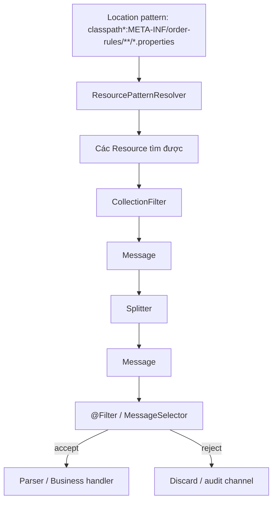
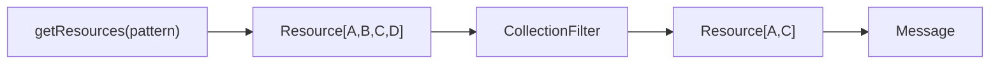
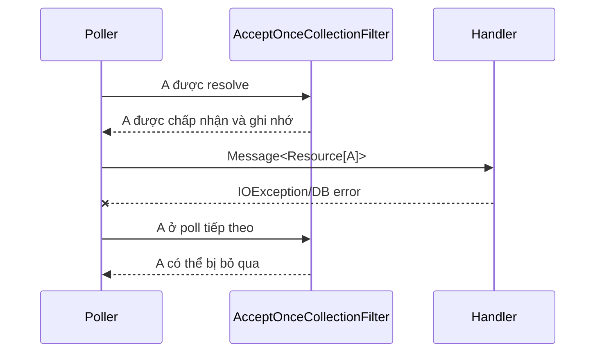
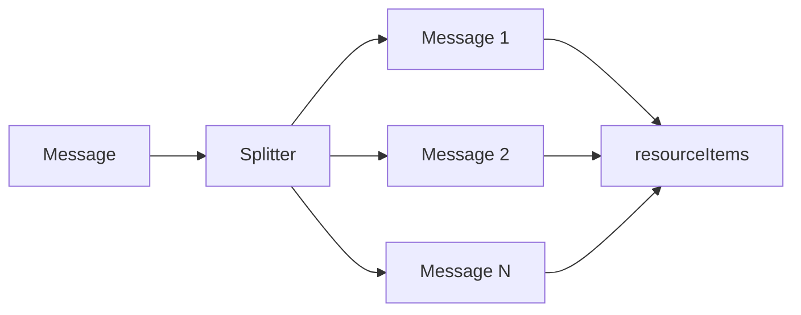
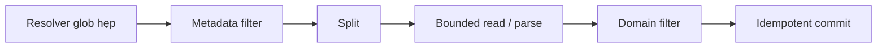
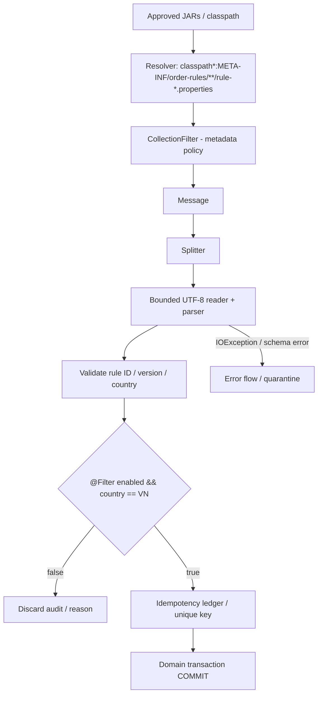

# Filter resource theo mẫu trong Spring Integration

## 1. Bài toán: chỉ đưa những tài nguyên cần thiết vào luồng xử lý

Một hệ thống xử lý đơn hàng cần định kỳ tìm các quy tắc tính phí vận chuyển, chiết khấu và thuế được đóng gói trong classpath/JAR. Thư viện của nhiều đội cùng đóng góp file:

```text
order-app.jar
  META-INF/order-rules/common/rule-tax.properties
  META-INF/order-rules/common/rule-shipping.properties

pricing-extension.jar
  META-INF/order-rules/vi/rule-discount.properties
  META-INF/order-rules/vi/rule-summer.properties
  META-INF/order-rules/vi/readme.txt

shipping-extension.jar
  META-INF/order-rules/us/rule-express.properties
  META-INF/order-rules/us/rule-legacy.bak
```

Ứng dụng cần **chỉ chọn file `rule-*.properties`**, có thể giới hạn khu vực, bỏ file không hợp lệ và tránh xử lý lại bản đã hoàn tất. Nếu chỉ quét `classpath*:META-INF/order-rules/**/*`, hệ thống vừa tốn I/O vừa có nguy cơ đưa `readme.txt`, file backup hoặc rule không thuộc phạm vi vào cùng batch.

Trong chương **Adapter Resource** thuộc module **SPRING_INTEGRATION_ADAPTERS**, hệ thống kết nối nguồn ngoài qua inbound/outbound adapter, gateway, poller và `MessageChannel`. Chủ đề **“Filter resource theo mẫu”** tập trung vào thiết kế **đúng ranh giới chọn tài nguyên**, gồm pattern của Spring Framework, filter collection của Resource inbound adapter và filter message ở downstream. Những thao tác này tác động tới độ tin cậy, hiệu năng, bảo mật và khả năng replay, không chỉ việc so khớp tên file.

### Mục tiêu

Sau bài học, bạn có thể:

1. Dùng `ResourcePatternResolver#getResources` với `classpath:`, `classpath*:`, `file:` và Ant-style patterns.
2. Phân biệt `*`, `?`, `**`; hiểu điều kiện root cố định khi quét bên trong JAR.
3. Phân biệt **pattern filtering**, **`CollectionFilter<Resource>`** và **Spring Integration `@Filter`**.
4. Cấu hình `ResourceRetrievingMessageSource`, `@InboundChannelAdapter`, `@Poller` và filter tùy chỉnh.
5. Dùng `AcceptOnceCollectionFilter`, kết hợp filter có trạng thái và filter không trạng thái đúng thứ tự.
6. Hiểu payload là **`Message<Resource[]>`** sau source, khác **`Message<Resource>`** sau splitter.
7. Chọn chính sách tên file, metadata, identity/version, xử lý trùng tên, replay và checkpoint.
8. Kiểm thử nhiều classpath roots/JAR, filter rỗng, lặp poll, nguồn biến đổi và lỗi handler.

## 2. Ba tầng lọc khác nhau: đừng gộp làm một



| Tầng | Đầu vào | Đầu ra | Quy tắc điển hình |
| --- | --- | --- | --- |
| **1. Location pattern** | Chuỗi location, ví dụ `classpath*:.../*.properties` | `Resource[]` tìm được | Loại/đường dẫn, tên file, thư mục, wildcard |
| **2. `CollectionFilter<Resource>`** | `Collection<Resource>` đã resolve | Subset `Collection<Resource>` | Prefix/suffix tên, policy metadata, accept-once |
| **3. Message filter** | Một `Message<?>` tại vị trí flow | Giữ hoặc loại **message** | Header, payload đã parse, tenant, rule version |

**Điểm quan trọng:** đặt `@Filter` trực tiếp sau Resource inbound adapter có nghĩa filter đang nhìn thấy **cả batch `Resource[]`**, không phải từng resource. Nếu muốn loại riêng từng file sau adapter, hãy **split trước**, hoặc dùng `CollectionFilter<Resource>` ở source.

### Filter theo mẫu khác filter theo nội dung

- Pattern `rule-*.properties` kiểm tra **vị trí/tên**, không giải mã bytes.
- `Resource#getFilename()` chỉ cho filename; không tự kiểm tra `rule.enabled` hoặc `tenantId` bên trong.
- Nếu muốn chọn dựa trên `rule.enabled=true`, phải **mở stream, parse và validate** theo charset/schema; sau đó dùng domain filter hoặc router.
- Nếu muốn chọn “chỉ version mới chưa commit”, phải có **identity/version store**, không chỉ `AcceptOnceCollectionFilter` trong RAM.

## 3. ResourcePatternResolver: bắt đầu từ pattern hẹp nhất

Spring Framework định nghĩa:

```java
public interface ResourcePatternResolver extends ResourceLoader {
    String CLASSPATH_ALL_URL_PREFIX = "classpath*:";

    Resource[] getResources(String locationPattern)
            throws IOException;
}
```

`PathMatchingResourcePatternResolver` là implementation thông dụng hỗ trợ location có Ant-style wildcard. `ApplicationContext` chuẩn cũng implement `ResourcePatternResolver`, vì vậy có thể gọi `applicationContext.getResources(...)`.

### 3.1. So sánh classpath và filesystem

| Location | Mục đích | Điều cần nhớ |
| --- | --- | --- |
| `classpath:META-INF/order-rules/base.properties` | Một resource cụ thể theo classpath | Không phải “lấy mọi bản sao” |
| `classpath*:META-INF/order-rules/base.properties` | Tìm mọi bản sao cùng relative path qua classpath roots/JAR thấy được | Có thể trả nhiều Resource trùng filename |
| `classpath:META-INF/order-rules/*.properties` | Wildcard từ một classpath root được resolver tìm | Có thể bỏ sót nguồn ở JAR khác cùng root |
| `classpath*:META-INF/order-rules/*.properties` | Nhiều classpath roots + wildcard | Thường hợp lý cho thư viện góp chung rules |
| `classpath*:META-INF/order-rules/**/*.properties` | Recursive scan dưới root cố định | Quét sâu hơn, chi phí lớn hơn |
| `file:/opt/app/rules/*.properties` | Quét filesystem directory ngoài classpath | Phù hợp nguồn file mutable |

`classpath*:` dùng cơ chế của class loader/module path để tìm **nhiều** nguồn. Nó không có nghĩa mọi library trên máy đều được tìm thấy: resolver chỉ nhìn thấy resource mà class loader/module layer hiện hành có thể truy cập.

### 3.2. Mẫu Ant-style

| Pattern | Ý nghĩa | Ví dụ |
| --- | --- | --- |
| `*.properties` | Tên file một cấp thư mục | `rule-tax.properties` |
| `rule-*.properties` | Tên bắt đầu `rule-`, kết thúc `.properties` | `rule-shipping.properties` |
| `rule-?.yml` | `?` khớp đúng một ký tự | `rule-a.yml` |
| `**/*.properties` | Nhiều cấp thư mục | `vi/rule-tax.properties` và `common/rule-x.properties` |
| `**/rule-*.properties` | Recursive + giới hạn filename | `us/rule-express.properties` |

Đây là **Ant-style path matching**, không phải Java regular expression. `*` thường giới hạn trong một path segment; `**` dùng cho nhiều thư mục. Không viết regex như `rule-.*\\.properties` rồi kỳ vọng resolver hiểu như `Pattern.compile(...)`.

### 3.3. Cẩn thận với wildcard ngay tại JAR root

Spring Framework cảnh báo:

```text
KHÔNG NÊN PHỤ THUỘC:
classpath*:*.xml
classpath*:**/*.properties

NÊN DÙNG:
classpath*:META-INF/order-rules/*.properties
classpath*:META-INF/order-rules/**/*.properties
```

Khi kết hợp `classpath*:` và wildcard, **có một root directory cụ thể trước wildcard** giúp việc quét JAR đáng tin cậy hơn. Class loader không buộc phải enumerate root rỗng của mọi JAR, nên pattern bắt đầu bằng wildcard có thể hoạt động trong IDE nhưng không thấy tài nguyên trong packaged JAR.

Nếu file thuộc nhiều JAR cùng một base directory, nên dùng `classpath*:` thay vì `classpath:`; nếu dùng nested JAR/container class loader, **kiểm thử trên đúng packaging runtime**.

## 4. Ví dụ khám phá Resource bằng Java, chưa có poller

Trước khi cấu hình Spring Integration, kiểm thử resolver độc lập:

```java
package com.example.resourcefilters;

import java.io.IOException;
import java.util.Arrays;

import org.springframework.core.io.Resource;
import org.springframework.core.io.support.PathMatchingResourcePatternResolver;
import org.springframework.core.io.support.ResourcePatternResolver;

public final class RuleDiscovery {

    private RuleDiscovery() {}

    public static Resource[] discover() throws IOException {
        ResourcePatternResolver resolver =
            new PathMatchingResourcePatternResolver();

        return resolver.getResources(
            "classpath*:META-INF/order-rules/**/*.properties"
        );
    }

    public static void main(String[] args) throws IOException {
        Resource[] matches = discover();

        // Chỉ để quan sát; thứ tự trả về không phải business priority.
        Arrays.stream(matches)
            .map(Resource::getFilename)
            .forEach(System.out::println);
    }
}
```

### Điều cần quan sát

1. Nếu không có resource phù hợp, resolver có thể trả mảng rỗng; nếu một rule là bắt buộc, **ứng dụng phải kiểm tra**.
2. `Resource#getFilename()` có thể `null` với một số Resource implementation.
3. Hai thư viện có thể chứa cùng `rule-default.properties` ở hai JAR khác nhau; **filename không phải identity duy nhất**.
4. `getResources` trả Resource handles, **chưa có bytes đã được đọc**. Việc `exists()` hoặc `isReadable()` báo true không bảo đảm thao tác `getInputStream()` sau đó thành công.
5. Không dùng `getFile()` để đọc entry JAR; dùng `getInputStream()` với try-with-resources khi thực sự parse.
6. Không phụ thuộc vào thứ tự mảng để chọn file có priority cao nhất.

### Pattern càng rộng, áp lực runtime càng lớn

`classpath*:META-INF/order-rules/**/*` có thể khiến resolver quét rất nhiều entries rồi filter sau. Nếu đã biết chỉ cần `rule-*.properties`, chọn `classpath*:META-INF/order-rules/**/rule-*.properties`. **Đẩy điều kiện về pattern sớm** thường giúp hạn chế phạm vi tìm kiếm, nhưng wildcard recursion vẫn cần quan sát chi phí thực trong JAR.

## 5. Không phải mẫu nào cũng dùng được để đọc nội dung

Một pattern location có tác dụng **discovery**, không phải search nội dung:

```text
classpath*:META-INF/order-rules/**/*.properties
```

Không thể biểu diễn chính xác trong pattern này:

```properties
rule.enabled=true
rule.country=VN
rule.priority=100
```

Để chọn theo ba thuộc tính đó, phải parse resource ở bước downstream hoặc xây **filter đọc nội dung** có lifecycle, byte limit và error policy minh bạch. Với Resource inbound adapter, `CollectionFilter<Resource>` thường nên ưu tiên **metadata rẻ** (filename/location/allowlist); việc mở và parse bytes để quyết định business nên được tổ chức thành transformer + domain filter sau khi đã tạo snapshot.

### Vì sao không tự thêm nội dung vào filename filter?

- `Resource` có thể nằm trên URL/network; mỗi lần đọc gây I/O.
- `InputStreamResource` có thể là **one-shot**; nếu filter đọc trước, handler sau không còn stream.
- Input có thể đổi giữa thời điểm filter đọc và handler đọc.
- Filter chạy ở đường poller; đọc hàng trăm file ngay tại filter dễ làm poller chậm.
- Lỗi parse cần chính sách quarantine/retry chứ không nên âm thầm coi là “không khớp”.

## 6. CollectionFilter<Resource>: lọc sau resolver, trước message

Spring Integration định nghĩa contract:

```java
public interface CollectionFilter<T> {
    Collection<T> filter(Collection<T> unfilteredElements);
}
```

Trong Resource inbound, `T` là `Resource`. Sau khi resolver tìm candidates, filter nhận **collection** và trả **collection các Resource được giữ lại**.



**Filter này xử lý nhiều phần tử trong một collection**, không phải `MessageSelector` nhận một `Message<?>`.

### 6.1. Một filter đơn giản theo filename

Yêu cầu: tên file phải bắt đầu bằng `rule-`, kết thúc `.properties` và không có marker `-backup`.

```java
package com.example.resourcefilters;

import java.util.ArrayList;
import java.util.Collection;
import java.util.List;

import org.springframework.core.io.Resource;
import org.springframework.integration.util.CollectionFilter;

public final class RuleFilenameFilter
        implements CollectionFilter<Resource> {

    @Override
    public Collection<Resource> filter(
            Collection<Resource> candidates) {

        List<Resource> accepted = new ArrayList<>();

        for (Resource resource : candidates) {
            String name = resource.getFilename();
            if (name == null) {
                continue;
            }
            boolean match = name.startsWith("rule-")
                && name.endsWith(".properties")
                && !name.contains("-backup");
            if (match) {
                accepted.add(resource);
            }
        }
        return accepted;
    }
}
```

Filter này **không mở stream** và **không giữ trạng thái**. Cùng một resource sẽ tiếp tục được chấp nhận ở mỗi lần filter chạy. Nó cũng không tự biết rule dành cho tenant nào hoặc thuộc phiên bản bao nhiêu: chỉ áp dụng tên file theo chính sách đã nói.

**Phân biệt hai kiểu mẫu:** `RuleFilenameFilter` dùng các điều kiện Java trên filename, còn `ResourcePatternResolver` dùng path pattern để quyết định candidates trước đó. Trong phần lớn trường hợp, có thể viết luôn `**/rule-*.properties` ở pattern và chỉ dùng filter bổ sung cho chính sách không biểu diễn gọn trong glob.

### 6.2. Sử dụng Pattern regex khi thật sự cần

```java
import java.util.regex.Pattern;

Pattern approved = Pattern.compile(
    "rule-(tax|shipping|discount)-[a-z0-9-]+\\.properties"
);

String filename = "rule-shipping-v2.properties";
boolean allowed = approved.matcher(filename).matches();
```

Regex Java và Ant-style wildcard **khác nhau**. Khi dùng regex, phải giới hạn độ dài tên/file pattern nếu nhận input bên ngoài; không nên nhận raw untrusted regex vì có thể dẫn đến ReDoS. Với một tập tên cố định, allowlist/equality thường đơn giản hơn.

## 7. AcceptOnceCollectionFilter: tránh phát lại nhưng không phải checkpoint

Spring Integration cung cấp `org.springframework.integration.util.AcceptOnceCollectionFilter<T>`, một `CollectionFilter` có trạng thái. Nó nhớ các phần tử đã qua filter ở lần trước, tránh trả lại chúng trong những lần kế tiếp theo semantics so sánh của các phần tử.

```java
import org.springframework.core.io.Resource;
import org.springframework.integration.util.AcceptOnceCollectionFilter;
import org.springframework.integration.util.CollectionFilter;

CollectionFilter<Resource> once =
    new AcceptOnceCollectionFilter<>();
```

### Minh họa theo chu kỳ poll

| Poll | Resolver trả | Filter accept-once giữ (minh họa) |
| --- | --- | --- |
| 1 | A, B, C | A, B, C |
| 2 | A, B, C | Không có phần tử mới |
| 3 | A, B, C, D | D |
| 4 | A, B, C, D nhưng bytes của B thay đổi | **Không mặc nhiên phát lại B** |

**AcceptOnce không có nghĩa “once per content version”.** Nó không tự tính SHA-256, theo dõi ETag/lastModified hay xác minh DB đã commit.

### 7.1. Điều gì được ghi nhớ?

Filter dựa trên **những phần tử T theo semantics so sánh/identity của chúng**, không phải một key nghiệp vụ do bạn tự định nghĩa. Với các implementation của `Resource`, việc so sánh/`equals()` có thể phụ thuộc location/implementation; **đừng giả định filter biết rằng nội dung một Resource đã đổi bytes**.

Nếu bạn cần policy “cùng file, version mới phải được xử lý lại”, hãy tính `sourceId + version/checksum` ở bước nhận dữ liệu, rồi quản lý trạng thái bằng một ledger bền vững. Không biến `AcceptOnceCollectionFilter` thành một transaction manager mà nó không phải.

### 7.2. Lỗi handler không hoàn tác filter



Do đó, **nguồn chấp nhận resource ≠ handler xử lý xong**. `@Transactional` ở handler không tự rollback state của `AcceptOnceCollectionFilter`. Nếu business cần retry đến khi thành công, chọn checkpoint/replay/outbox/ledger đúng yêu cầu.

## 8. Composition: lọc tên rồi mới accept-once

`ResourceRetrievingMessageSource#setFilter(...)` nhận **một** `CollectionFilter<Resource>`. Mỗi lần gọi setter sẽ đặt chiến lược filter cho source, không có nghĩa framework tự động nối nhiều filters khi bạn gọi setter hai lần.

Sai:

```java
source.setFilter(new RuleFilenameFilter());
source.setFilter(new AcceptOnceCollectionFilter<>());
// Filter cuối thay thế filter trước; điều kiện tên có thể không còn.
```

Đúng: hợp nhất điều kiện vào một composite filter tường minh:

```java
import java.util.Collection;
import org.springframework.core.io.Resource;
import org.springframework.integration.util.CollectionFilter;
import org.springframework.integration.util.AcceptOnceCollectionFilter;

CollectionFilter<Resource> byName = new RuleFilenameFilter();
CollectionFilter<Resource> once = new AcceptOnceCollectionFilter<>();

CollectionFilter<Resource> combined =
    candidates -> once.filter(byName.filter(candidates));

source.setFilter(combined);
```

**Thứ tự có ý nghĩa:**

1. `byName.filter(...)` loại trước những file không thuộc phạm vi.
2. `once.filter(...)` chỉ ghi nhớ những candidates đã qua điều kiện tên.

Nếu đảo thứ tự, accept-once có thể ghi nhớ cả file không hợp lệ trước khi chính sách tên chặn nó. Sau này khi đổi chính sách hoặc nâng cấp ứng dụng, trạng thái đã nhớ có thể làm kết quả khó giải thích.

**Trong app thực**, tạo **một instance composite filter cho từng source** ở bước cấu hình bean, không tạo instance `AcceptOnceCollectionFilter` mới cho **mỗi lần poll**. Nếu tạo filter mới mỗi lần nhận, trạng thái accept-once sẽ bị reset và không còn tác dụng.

## 9. Bộ lọc metadata, filter business và ranh giới I/O

Có ba trường hợp lọc theo “mẫu”:

| Điều kiện | Tầng nên đặt | Lý do |
| --- | --- | --- |
| Đường dẫn `META-INF/order-rules/vi/...` | `ResourcePatternResolver` | Loại từ lúc khám phá |
| Filename `rule-*.properties` | Pattern hoặc `CollectionFilter<Resource>` | Metadata rẻ, không cần đọc nội dung |
| `rule.enabled=true` | Transformer parse + `@Filter` downstream | Cần giải mã nội dung theo schema |
| `rule.country=VN` | Domain filter sau parse | Không thể xác định chắc từ filename nếu contract không quy định |
| `resource.size < 64 KiB` | Bounded reader/size policy | `contentLength()` có thể gây I/O hoặc tiêu thụ one-shot Resource |
| Chỉ xử lý khi checksum chưa commit | Ledger/idempotency sau đọc | Cần version/transaction bền vững |
| Chỉ nguồn từ module được phê duyệt | Resolver allowlist + provenance validation | Filename có thể bị trùng trong JAR khác |

### Không dùng contentLength() như một filename filter an toàn

Với `InputStreamResource`, `contentLength()` có thể đọc hết stream để đếm bytes, khiến handler sau **không thể đọc lần hai**. Đối với resource có stream một lần hoặc URL, nên áp dụng byte limit **trong lúc đọc** hoặc dùng metadata của một storage API có contract rõ.

Với nguồn nguy cơ cao, lọc theo `Resource#getDescription()` thô cũng không đủ: description có thể chứa URL token, path nhạy cảm hoặc được provider cung cấp dưới dạng không chuẩn hóa.

## 10. Java config: lọc Resource ngay tại inbound source

Ví dụ sử dụng Java 17+, Spring Boot + Spring Integration Core. Thư mục tài nguyên:

```text
src/main/resources/META-INF/order-rules/vi/
  rule-tax.properties
  rule-shipping.properties
  rule-shipping-backup.properties
  readme.txt
```

### 10.1. Dependency

Với phiên bản được Spring Boot BOM quản lý:

```xml
<dependencies>
    <dependency>
        <groupId>org.springframework.boot</groupId>
        <artifactId>spring-boot-starter-integration</artifactId>
    </dependency>
</dependencies>
```

**Resource inbound nằm trong Spring Integration Core**; không cần module SFTP, JMS hoặc File chuyên biệt chỉ để resolve `Resource`. Nếu downstream thật sự ghi file hoặc gửi Kafka, thêm dependency của adapter tương ứng.

### 10.2. Cấu hình có filter name + accept-once

```java
package com.example.resourcefilters;

import org.springframework.context.ApplicationContext;
import org.springframework.context.annotation.Bean;
import org.springframework.context.annotation.Configuration;
import org.springframework.core.io.Resource;
import org.springframework.integration.annotation.InboundChannelAdapter;
import org.springframework.integration.annotation.Poller;
import org.springframework.integration.channel.DirectChannel;
import org.springframework.integration.config.EnableIntegration;
import org.springframework.integration.core.MessageSource;
import org.springframework.integration.resource.ResourceRetrievingMessageSource;
import org.springframework.integration.util.AcceptOnceCollectionFilter;
import org.springframework.integration.util.CollectionFilter;
import org.springframework.messaging.MessageChannel;

@Configuration
@EnableIntegration
public class RuleResourceInboundConfiguration {

    @Bean
    public MessageChannel resourceBatches() {
        return new DirectChannel();
    }

    @Bean
    public MessageChannel resourceItems() {
        return new DirectChannel();
    }

    @Bean
    @InboundChannelAdapter(
        channel = "resourceBatches",
        poller = @Poller(
            fixedDelay = "10000",
            initialDelay = "1000",
            maxMessagesPerPoll = "1"
        )
    )
    public MessageSource<Resource[]> resourceSource(
            ApplicationContext applicationContext) {

        ResourceRetrievingMessageSource source =
            new ResourceRetrievingMessageSource(
                "classpath*:META-INF/order-rules/**/*.properties"
            );

        // ApplicationContext implements ResourcePatternResolver.
        source.setPatternResolver(applicationContext);

        CollectionFilter<Resource> byName =
            new RuleFilenameFilter();
        CollectionFilter<Resource> once =
            new AcceptOnceCollectionFilter<>();
        source.setFilter(
            candidates -> once.filter(byName.filter(candidates))
        );
        return source;
    }
}
```

**Giải thích:**

1. `@EnableIntegration` bật Spring Integration infrastructure.
2. `ResourceRetrievingMessageSource` nhận **một pattern location** để tìm candidates.
3. `setPatternResolver(...)` chỉ định resolver tường minh; context hiện hành có thể thực hiện giao diện này.
4. `setFilter(...)` nhận composite `CollectionFilter<Resource>`.
5. `@InboundChannelAdapter` kết nối source với `resourceBatches`.
6. `@Poller` điều khiển lịch poll; `maxMessagesPerPoll=1` giới hạn **số messages** từ source trong một lần poll, không phải số resource trong payload.
7. `DirectChannel` chuyển message đồng bộ đến subscriber; không tạo durable queue hoặc transaction DB tự động.

**Đừng cấu hình cùng một `ResourceRetrievingMessageSource` qua hai endpoint pollers nếu không chủ đích có hai luồng tiêu thụ độc lập.** Có thể cần phân tách nguồn hoặc dùng một inbound rồi fan-out DTO đã parse.

### 10.3. Một poll có thể tạo message chứa nhiều resource

```text
Resolver:        [rule-tax, rule-shipping, rule-shipping-backup]
Filter name:     [rule-tax, rule-shipping]
Accept-once:     [rule-tax, rule-shipping]
Source payload:  Resource[2]
Channel:         1 Message<Resource[2]>
```

Lưu ý `readme.txt` **không nằm trong resolver output** của pattern `*.properties`; đây là ví dụ loại sớm ở lớp pattern trước khi đến collection filter. Dữ liệu thực cần quan sát theo classpath fixture và phiên bản triển khai.

## 11. Nếu muốn mỗi resource là một message: dùng Splitter

`ResourceRetrievingMessageSource` công bố kiểu payload `Resource[]`. Nếu một `@ServiceActivator` trực tiếp nhận `Resource` từ `resourceBatches` mà không có splitter thì sẽ sai contract.



```java
package com.example.resourcefilters;

import org.springframework.core.io.Resource;
import org.springframework.integration.annotation.Splitter;
import org.springframework.stereotype.Component;

@Component
public class ResourceBatchSplitter {

    @Splitter(
        inputChannel = "resourceBatches",
        outputChannel = "resourceItems"
    )
    public Resource[] split(Resource[] resources) {
        return resources;
    }
}
```

Sau splitter, bạn có thể đặt `@Filter` để quyết định **từng message chứa Resource** hoặc dùng transformer đọc thành DTO rồi filter theo dữ liệu bên trong.

## 12. @Filter trong Spring Integration không phải CollectionFilter

Trong Spring Integration, **message filter** nhận một `Message<?>` và quyết định message đó **được truyền tiếp hay bị loại**, theo `MessageSelector` hoặc method trả `boolean`.

### 12.1. @Filter theo tên Resource sau splitter

```java
package com.example.resourcefilters;

import org.springframework.core.io.Resource;
import org.springframework.integration.annotation.Filter;
import org.springframework.stereotype.Component;

@Component
public class ResourceMessageSelector {

    @Filter(
        inputChannel = "resourceItems",
        outputChannel = "approvedResources"
    )
    public boolean accept(Resource resource) {
        String name = resource.getFilename();
        return name != null
            && name.startsWith("rule-")
            && name.endsWith(".properties");
    }
}
```

Để chạy ví dụ này, cần khai báo channel `approvedResources` và một consumer. Nếu vừa dùng `RuleFilenameFilter` ở source, filter sau splitter có thể **lặp lại cùng điều kiện** mà không thêm nhiều giá trị. Nó vẫn hữu ích khi downstream cần policy động hoặc ví dụ giảng giải sự khác nhau.

### 12.2. @Filter theo nội dung đã parse

Đúng hơn cho business policy:

```java
package com.example.resourcefilters;

public record ParsedRule(
    String ruleId,
    String country,
    boolean enabled,
    int version
) {}
```

Giả sử upstream transformer đã đọc Resource, parse và phát `Message<ParsedRule>` vào `parsedRules`:

```java
import org.springframework.integration.annotation.Filter;
import org.springframework.stereotype.Component;

@Component
public class EnabledVietnamRuleFilter {

    @Filter(
        inputChannel = "parsedRules",
        outputChannel = "approvedRules",
        discardChannel = "rejectedRules"
    )
    public boolean accept(ParsedRule rule) {
        return rule.enabled()
            && "VN".equals(rule.country())
            && rule.version() > 0;
    }
}
```

**Quan trọng:** `@Filter` trên message không tự parse `Resource`. `ParsedRule` là DTO do ứng dụng tự tạo; phải có các channels/transformer/handler phù hợp. `discardChannel` nhận message bị loại theo flow của filter để audit/observability nếu có subscriber, nhưng không tự tạo một durable dead-letter queue.

### So sánh nhanh

| Câu hỏi | `CollectionFilter<Resource>` | Spring Integration `@Filter` |
| --- | --- | --- |
| Chạy khi nào? | Trong `ResourceRetrievingMessageSource`, **trước** khi tạo message | Khi message đến endpoint filter |
| Nhận gì? | `Collection<Resource>` | Payload hoặc một `Message<?>` |
| Có thể bỏ một phần tử trong Resource[]? | **Có** | Chỉ sau splitter hoặc custom transformation |
| Có thể dùng header hoặc parsed DTO? | Không có Spring Message ở bước này | **Có**, tùy method |
| Default XML Resource inbound? | `AcceptOnceCollectionFilter` nếu không khai báo | Không có filter endpoint nếu bạn không cấu hình |
| Thích hợp content-based rule selection? | Không lý tưởng nếu phải đọc stream | Thường **có**, sau parse/validation |

## 13. XML namespace: pattern, custom filter và không lọc

Spring Integration Resource inbound channel adapter có XML namespace thuộc `int`. Với Spring context dùng các beans và schema tương ứng:

```xml
<?xml version="1.0" encoding="UTF-8"?>
<beans xmlns="http://www.springframework.org/schema/beans"
       xmlns:xsi="http://www.w3.org/2001/XMLSchema-instance"
       xmlns:int="http://www.springframework.org/schema/integration"
       xsi:schemaLocation="
          http://www.springframework.org/schema/beans
          https://www.springframework.org/schema/beans/spring-beans.xsd
          http://www.springframework.org/schema/integration
          https://www.springframework.org/schema/integration/spring-integration.xsd">

    <int:channel id="resourceBatches"/>

    <bean id="ruleFilenameFilter"
          class="com.example.resourcefilters.RuleFilenameFilter"/>

    <int:resource-inbound-channel-adapter
            id="ruleResourceInbound"
            channel="resourceBatches"
            pattern="classpath*:META-INF/order-rules/**/*.properties"
            filter="ruleFilenameFilter">
        <int:poller fixed-delay="10000"
                    max-messages-per-poll="1"/>
    </int:resource-inbound-channel-adapter>
</beans>
```

Trong đoạn XML trên:

- `pattern` quyết định tập candidate resources được resolver tìm.
- `filter="ruleFilenameFilter"` tham chiếu bean implement `CollectionFilter<Resource>`.
- Vì filter được chỉ định, đây là **custom filter**; **không tự cộng thêm `AcceptOnceCollectionFilter`** chỉ vì XML adapter có default trong trường hợp không chỉ định.
- `fixed-delay` điều khiển chu kỳ poller; khi pattern quét nhiều JAR, cần đo chi phí resolve.

### 13.1. XML mặc định: AcceptOnceCollectionFilter

Nếu **bỏ thuộc tính `filter`**:

```xml
<int:resource-inbound-channel-adapter
        id="ruleResourceInbound"
        channel="resourceBatches"
        pattern="classpath*:META-INF/order-rules/**/rule-*.properties">
    <int:poller fixed-delay="10000"/>
</int:resource-inbound-channel-adapter>
```

Tài liệu Spring Integration quy định XML Resource inbound adapter **dùng `AcceptOnceCollectionFilter` mặc định** nếu không khai báo filter riêng.

### 13.2. Tắt filter hoàn toàn

Nếu muốn mỗi lần poll đều có thể phát resource đang khớp pattern, cấu hình:

```xml
<int:resource-inbound-channel-adapter
        id="unfilteredResources"
        channel="resourceBatches"
        pattern="classpath*:META-INF/order-rules/**/rule-*.properties"
        filter="">
    <int:poller fixed-delay="10000"/>
</int:resource-inbound-channel-adapter>
```

`filter=""` có nghĩa **tắt default CollectionFilter**, **không phải** “chỉ lấy resource có tên rỗng” và cũng không ảnh hưởng quy tắc wildcard của `pattern`.

**Ba đoạn XML là ba phương án thay thế**, không chạy cả ba với cùng pattern/channel nếu bạn không chủ ý có nhiều nguồn poll song song. Khi tắt filter, các resource còn xuất hiện ở poll sau có thể được xử lý lại; downstream phải có version check/idempotency nếu việc nạp lại gây side effect.

### 13.3. Custom ResourcePatternResolver

Nếu cần một resolver riêng, có thể đặt:

```xml
<bean id="approvedPatternResolver"
      class="org.springframework.core.io.support.PathMatchingResourcePatternResolver"/>

<int:resource-inbound-channel-adapter
        id="resourcesWithExplicitResolver"
        channel="resourceBatches"
        pattern="classpath*:META-INF/order-rules/**/*.properties"
        pattern-resolver="approvedPatternResolver">
    <int:poller fixed-delay="10000"/>
</int:resource-inbound-channel-adapter>
```

Spring Integration **mặc định** có thể dùng `ApplicationContext` làm `ResourcePatternResolver` trong XML adapter. Chỉ tạo bean resolver riêng khi có yêu cầu cụ thể (class loader, policy, instrumentation). `pattern-resolver` **không thay thế `filter`**: resolver quyết định tập candidates, filter quyết định subset sau đó.

## 14. Java DSL: lọc sau khi tách Resource[]

Java DSL hữu ích khi muốn thấy toàn bộ chuỗi xử lý trong một chỗ. Đây là **phương án thay thế** cấu hình `@InboundChannelAdapter` ở mục 10:

```java
package com.example.resourcefilters;

import org.springframework.context.annotation.Bean;
import org.springframework.context.annotation.Configuration;
import org.springframework.core.io.Resource;
import org.springframework.integration.dsl.IntegrationFlow;
import org.springframework.integration.dsl.Pollers;
import org.springframework.integration.resource.ResourceRetrievingMessageSource;
import org.springframework.integration.util.AcceptOnceCollectionFilter;
import org.springframework.integration.util.CollectionFilter;

@Configuration
public class ResourceFilterDslConfiguration {

    @Bean
    public ResourceRetrievingMessageSource dslResourceSource() {
        ResourceRetrievingMessageSource source =
            new ResourceRetrievingMessageSource(
                "classpath*:META-INF/order-rules/**/*.properties"
            );

        CollectionFilter<Resource> named =
            new RuleFilenameFilter();
        CollectionFilter<Resource> once =
            new AcceptOnceCollectionFilter<>();

        source.setFilter(
            candidates -> once.filter(named.filter(candidates))
        );
        return source;
    }

    @Bean
    public IntegrationFlow resourceFilterFlow(
            ResourceRetrievingMessageSource dslResourceSource,
            ResourceRuleService resourceRuleService) {

        return IntegrationFlow
            .from(
                dslResourceSource,
                spec -> spec.poller(
                    Pollers.fixedDelay(10000)
                        .maxMessagesPerPoll(1)
                )
            )
            .split()
            .filter(
                Resource.class,
                resource -> resource.getFilename() != null
            )
            .handle((payload, headers) -> {
                resourceRuleService.process((Resource) payload);
                return null; // One-way handler.
            })
            .get();
    }
}
```

`ResourceRuleService` là interface/service **do ứng dụng triển khai**, ví dụ:

```java
import java.io.IOException;
import org.springframework.core.io.Resource;

public interface ResourceRuleService {
    void process(Resource resource) throws IOException;
}
```

Flow này dùng hai tầng lọc:

1. `ResourceRetrievingMessageSource#setFilter` giữ candidates theo name + accept-once.
2. Sau `.split()`, DSL `.filter(...)` chọn **từng `Message<Resource>`** theo điều kiện đã định.

Điều kiện DSL trên chỉ mang tính ví dụ (`getFilename()!=null`), bởi nguồn đã có name filter. Trong hệ thống thật, nên đặt thêm policy **có giá trị mới** ở đây, chẳng hạn source classification đã xác minh hoặc một DTO đã parse ở transformer.

**Không bật đồng thời** Java DSL `IntegrationFlow.from(source, ...)` và annotation `@InboundChannelAdapter` cho cùng một source trong cùng context rồi giả định chỉ một polling endpoint.

## 15. Bài toán lọc theo nội dung: thêm parser trước business filter

Giả sử `rule-tax.properties` có:

```properties
rule.id=tax-vn
rule.country=VN
rule.version=2
rule.enabled=true
```

Muốn chỉ nhận rule `enabled=true` và `country=VN`, phải **decode và parse**. Có thể thêm transformer sau splitter, rồi dùng `@Filter` trên DTO.

### 15.1. Reader có giới hạn 64 KiB

```java
package com.example.resourcefilters;

import java.io.IOException;
import java.io.InputStream;
import java.nio.charset.CodingErrorAction;
import java.nio.charset.StandardCharsets;
import java.util.Properties;

import org.springframework.core.io.Resource;
import org.springframework.stereotype.Component;

@Component
public class ParsedRuleReader {

    private static final int MAX_BYTES = 64 * 1024;

    public ParsedRule read(Resource resource) throws IOException {
        byte[] bytes;
        try (InputStream stream = resource.getInputStream()) {
            bytes = stream.readNBytes(MAX_BYTES + 1);
        }
        if (bytes.length > MAX_BYTES) {
            throw new IOException("Rule file exceeds 64 KiB");
        }

        var decoder = StandardCharsets.UTF_8
            .newDecoder()
            .onMalformedInput(CodingErrorAction.REPORT)
            .onUnmappableCharacter(CodingErrorAction.REPORT);

        String content = decoder.decode(
            java.nio.ByteBuffer.wrap(bytes)
        ).toString();

        Properties properties = new Properties();
        try (java.io.StringReader reader =
                new java.io.StringReader(content)) {
            properties.load(reader);
        }

        String id = properties.getProperty("rule.id");
        String country = properties.getProperty("rule.country");
        String versionText =
            properties.getProperty("rule.version", "0");
        String enabledText =
            properties.getProperty("rule.enabled");

        if (id == null || id.isBlank()) {
            throw new IllegalArgumentException("Missing rule.id");
        }
        if (country == null || country.isBlank()) {
            throw new IllegalArgumentException(
                "Missing rule.country"
            );
        }
        if (!"true".equals(enabledText)
                && !"false".equals(enabledText)) {
            throw new IllegalArgumentException(
                "Invalid rule.enabled"
            );
        }

        int version = Integer.parseInt(versionText);
        if (version < 1) {
            throw new IllegalArgumentException(
                "Invalid rule.version"
            );
        }

        return new ParsedRule(
            id, country, Boolean.parseBoolean(enabledText), version
        );
    }
}
```

**Lưu ý phạm vi ví dụ:** đoạn parser không dùng `contentLength()` của Resource, không dùng `getFile()` và đóng `InputStream` ngay sau khi đọc. Nó quy định UTF-8 **không có BOM**; nếu data contract cho BOM, phải phát hiện và xử lý BOM trước khi parse. Không parse bằng `Properties.load(InputStream)` với giả định UTF-8, vì overload đó theo Java API dùng ISO-8859-1.

### 15.2. Biến Resource thành ParsedRule

```java
package com.example.resourcefilters;

import java.io.IOException;
import org.springframework.core.io.Resource;
import org.springframework.integration.annotation.Transformer;
import org.springframework.stereotype.Component;

@Component
public class ParsedRuleTransformer {

    private final ParsedRuleReader reader;

    public ParsedRuleTransformer(ParsedRuleReader reader) {
        this.reader = reader;
    }

    @Transformer(
        inputChannel = "approvedResources",
        outputChannel = "parsedRules"
    )
    public ParsedRule transform(Resource resource)
            throws IOException {
        return reader.read(resource);
    }
}
```

Với kiến trúc này:

```text
Source: Message<Resource[]>
    -> Splitter
    -> Message<Resource>
    -> @Filter filename (hoặc CollectionFilter ở source)
    -> @Transformer parser
    -> Message<ParsedRule>
    -> @Filter enabled && country == VN
    -> Message<ParsedRule> được xử lý
```

Để ghép chạy thực tế, khai báo các channels `approvedResources`, `parsedRules`, `approvedRules` và `rejectedRules`; gắn consumer tại đầu ra. Các đoạn code riêng trong bài minh họa **các lựa chọn có thể kết hợp**, không phải một ứng dụng đã boot/test hoàn chỉnh.

### 15.3. Vì sao phải parse trước khi loại theo country?

- Nếu `rule.country` không tồn tại, đó là **lỗi schema**, không nên im lặng xử lý như “không phải VN”.
- Nếu UTF-8 sai, dữ liệu phải đi vào **encoding-error flow** thay vì “không khớp pattern”.
- Nếu nguồn remote bị lỗi I/O, cần retry hoặc cảnh báo hạ tầng, không kết luận file bị loại theo nghiệp vụ.
- Sau parse, logic `enabled/country` hoạt động trên DTO bất biến, dễ unit test và không mở lại stream.

## 16. Không có một pattern tự động xử lý nhiều pattern strings

Constructor:

```java
new ResourceRetrievingMessageSource(
    "classpath*:META-INF/order-rules/**/*.properties"
);
```

Nhận **một location pattern**. Không tự giả định chuỗi `"patternA;patternB"` hay `"patternA,patternB"` là cú pháp chuẩn cho hai patterns nếu không có tài liệu phiên bản xác nhận.

Nếu cần chọn đồng thời:

```text
classpath*:META-INF/order-rules/vi/*.properties
file:/opt/app/rule-overrides/*.properties
```

Có thể:

1. Dùng **hai `ResourceRetrievingMessageSource`/hai inbound endpoints**, đổ vào một channel/flow có thông tin provenance, rồi xử lý merge và retry riêng.
2. Viết một custom `MessageSource<Resource[]>` gọi resolver trên từng approved pattern, tạo một batch theo policy rõ.
3. Dùng một custom `ResourcePatternResolver` có cú pháp application riêng, nhưng phải bảo đảm toàn bộ contract `ResourceLoader` và kiểm thử.

Một custom helper minh họa discovery nhiều patterns (chưa phải MessageSource):

```java
import java.io.IOException;
import java.util.ArrayList;
import java.util.List;
import org.springframework.core.io.Resource;
import org.springframework.core.io.support.ResourcePatternResolver;

public static List<Resource> discoverMany(
        ResourcePatternResolver resolver,
        List<String> approvedPatterns) throws IOException {

    List<Resource> results = new ArrayList<>();
    for (String pattern : approvedPatterns) {
        for (Resource resource : resolver.getResources(pattern)) {
            results.add(resource);
        }
    }
    return results;
}
```

Đây là **method minh họa nằm trong một utility class**; khi copy vào ứng dụng phải đặt trong class phù hợp. Nếu hai patterns chồng lấn, một resource có thể xuất hiện hai lần. Không tự dedupe theo filename khi hai JAR có cùng filename mà khác nội dung/source.

## 17. Trùng filename, thứ tự resource và ưu tiên nghiệp vụ

Khi nhiều JAR đóng góp quy tắc:

```text
pricing.jar!/META-INF/order-rules/vi/rule-tax.properties
shipping.jar!/META-INF/order-rules/vi/rule-tax.properties
```

Cả hai có thể cho `getFilename()=="rule-tax.properties"`. Nếu lọc bằng:

```java
Map<String, Resource> byName = new HashMap<>();
for (Resource resource : resources) {
    byName.put(resource.getFilename(), resource);
}
```

Thì một bản có thể **ghi đè bản kia không có cảnh báo**. Thứ tự mảng do resolver trả không được coi là thứ tự ưu tiên business.

### Những chính sách có thể chọn

| Nhu cầu | Chính sách |
| --- | --- |
| Không cho phép trùng logical rule ID | Parse rule ID rồi **fail-fast** nếu trùng, nêu nguồn |
| Cho phép module override rule mặc định | Priority/version rõ trong contract, resolve conflict tường minh |
| Nhiều module đóng góp độc lập | Nhóm theo `moduleId + logicalId` |
| Dedup nội dung giống nhau | Hash bytes + logical context theo policy |
| Process lại nếu nội dung đổi | Version-aware ledger, không chỉ AcceptOnce |

**Không dựa vào `Resource#getDescription()` như một khóa nghiệp vụ lâu dài**: URL có thể đổi theo launcher, container hoặc phiên bản build; description đôi khi chứa path/credential. Để audit, giữ source ID được xác thực, logical rule ID và content version/checksum.

## 18. Khi nào tắt AcceptOnce?

Đối với resources nằm trong packaged JAR bất biến, cấu hình accept-once thường đủ cho bài toán nạp một lần sau startup. Nếu cần cấu hình động ngoài filesystem hoặc lấy rule liên tục theo phiên bản, có các lựa chọn:

| Use case | Lựa chọn | Điều kiện bắt buộc |
| --- | --- | --- |
| Chỉ nạp classpath rules khi startup | Load-once hoặc Resource inbound với accept-once | Validate đầu vào và fail-fast nếu thiếu rule |
| Quét thư mục mutable nhưng xử lý một lần cho mỗi bản | Version-aware scanner/ledger | Identity + checksum/version ổn định |
| Reconcile toàn bộ state mỗi 10 phút | Tắt accept-once hoặc custom policy | Handler **idempotent**, so state trước khi ghi |
| Re-read sau config change | Event/file adapter phù hợp, content hash | Bảo đảm replay/retry và không mất update |
| Chỉ cần scan một folder local, một File mỗi message | File inbound adapter có thể hợp lý hơn | FileListFilter và semantics File adapter |

### Tắt filter không hề loại bỏ pattern

Ví dụ XML `filter=""` vẫn thực hiện `pattern="classpath*:.../*.properties"`. “Không filter” ở đây chỉ bỏ **`CollectionFilter<Resource>`**, không biến nguồn thành “đọc mọi file trên máy”.

### Filter luôn cho qua có tác động gì?

Một Java source có thể dùng:

```java
source.setFilter(candidates -> candidates);
```

Đây là **identity collection filter**: mỗi lần resolve, nó trả lại toàn bộ candidates theo pattern. Nếu downstream ghi database theo kiểu “insert mới” thay vì upsert/idempotent commit, mỗi poll có thể tạo duplicate.

## 19. Phân biệt CollectionFilter và FileListFilter

Nhiều người chuyển từ File inbound adapter sang Resource inbound rồi dùng nhầm kiểu filter:

| Đặc điểm | Resource inbound | File inbound |
| --- | --- | --- |
| Nguồn chính | `ResourcePatternResolver` | Filesystem scanner / `FileReadingMessageSource` |
| Kết quả source | `Message<Resource[]>` | Thường `Message<File>` |
| Filter collection | `CollectionFilter<Resource>` | `FileListFilter<File>` (trong các thành phần scanner) |
| Cơ chế accept-once điển hình | `AcceptOnceCollectionFilter<Resource>` | `AcceptOnceFileListFilter` hoặc persistent file filters theo adapter |
| Xử lý mỗi file một message | Cần splitter | Thường là mặc định |
| JAR/classpath glob | Resource resolver phù hợp | File adapter không hướng tới JAR entry |

**Không truyền `FileListFilter<File>` trực tiếp vào `ResourceRetrievingMessageSource#setFilter(...)`**; đó là contract khác. Khi cần shared checkpoint giữa nhiều instances, chọn persistent storage/ledger cho identity của Resource theo business policy, không chỉ sao chép một API filter từ module File sang.

## 20. Lỗi, retries và thứ tự chấp nhận resource

Để chẩn đoán, phải phân biệt **4 mốc**:

```text
DISCOVERED
  → ACCEPTED_BY_COLLECTION_FILTER
  → MESSAGE_DELIVERED
  → BUSINESS_COMMITTED
```

Một resource được filter chấp nhận có thể **chưa** được parse hoặc commit. Với một batch chứa nhiều resources, việc xử lý có thể thành công một phần.

### 20.1. Bảng lỗi theo tầng

| Tầng | Lỗi ví dụ | Nên làm gì? |
| --- | --- | --- |
| Resolver/pattern | Pattern sai, class loader không thấy JAR, `IOException` | Kiểm tra deployment, root/wildcard, fail-fast nếu dữ liệu bắt buộc |
| CollectionFilter | Policy sai, mất phần tử hoặc trùng tên | Unit test contract và instrumentation trước/sau filter |
| Filter metadata | `getFilename()==null`, nguồn không rõ | Reject/quarantine theo schema, không tạo filename giả cho security key |
| Splitter | Batch quá lớn, xử lý thiếu item | Đo batch size, giới hạn nguồn, per-item metrics |
| Read/parse | `getInputStream()` lỗi, charset hỏng, JSON/Properties sai | Retry I/O có giới hạn hoặc quarantine dữ liệu cố định |
| Message `@Filter` | Rule business không hợp lệ hoặc không thuộc VN | Dùng discard/audit channel đúng nhu cầu, không biến mọi false thành exception |
| Business DB | Deadlock, unique conflict, rollback | Transaction + idempotency, retry theo loại lỗi |
| Async worker | Handler ném exception sau khi source gửi thành công | Error flow/worker completion, không chỉ quan sát poller |

### 20.2. false khác exception

Với `@Filter`:

```java
return false;
```

nghĩa là **message không được giữ theo policy**, thường được drop hoặc chuyển tới `discardChannel` nếu cấu hình. Trong khi:

```java
throw new IllegalArgumentException("Invalid rule schema");
```

nghĩa là bước xử lý **thất bại**, có thể dẫn tới `MessagingException`/error flow. Không catch mọi lỗi parser rồi `return false`, vì như thế biến lỗi dữ liệu hoặc hạ tầng thành một quyết định filter hợp lệ và có nguy cơ mất khả năng điều tra.

### 20.3. Retry phải tính tới filter state

```text
Poll #1:
    resolver -> A, B
    accept-once -> A, B
    parser A -> OK
    parser B -> IOException

Poll #2:
    resolver -> A, B
    accept-once -> có thể trả collection rỗng

Kết quả:
    B không tự được phát lại chỉ vì lần trước lỗi.
```

Nếu cần retry đáng tin cậy, hãy tạo ledger xử lý từng **sourceId + logicalId + contentVersion**, giữ trạng thái `PENDING/PROCESSED/FAILED` và thiết kế cách re-drive những item chưa commit. `AcceptOnceCollectionFilter` là giảm trùng ở **lớp khám phá**, không phải ACK/NACK hoặc durable inbox.

### 20.4. Transaction không rollback filter

`@Transactional` phía handler có thể rollback **transaction DB tham gia**, nhưng không làm Java collection filter “quên” Resource đã chấp nhận. Một file có thể bị xem là đã thấy dù DB chưa lưu được. Với side effect quan trọng như tạo lệnh thanh toán, áp dụng idempotent processor/outbox, không coi accept-once là exactly-once.

## 21. Nguồn immutable, nguồn mutable và chiến lược phát hiện thay đổi

### 21.1. Classpath/JAR thường không phải live configuration store

Classpath/JAR đã đóng gói thường **ổn định trong vòng đời ứng dụng**. Poll mỗi 100 ms không làm JAR tự nạp rule mới từ source repository. Nếu cần hot reload từ filesystem, hãy cân nhắc File inbound, watch/event integration hoặc nguồn cấu hình có API dành cho versioning.

### 21.2. Metadata lastModified chưa đủ

`Resource#lastModified()` có thể hữu ích ở một số filesystem resources, nhưng không phải mọi resource đều hỗ trợ semantics tương đương. Timestamp có thể:

- Không có hoặc không đáng tin đối với URL/JAR.
- Có độ phân giải thấp; hai lần thay đổi nhanh tạo timestamp giống nhau.
- Được cập nhật mà bytes không đổi, hoặc giữ nguyên dù bytes đổi.
- Bị ảnh hưởng bởi copy/deploy hoặc clock.

Vì vậy **nếu version chính xác là yêu cầu nghiệp vụ**, dùng nguồn cung cấp ETag/version đáng tin hoặc hash bytes sau khi đọc. Đừng mở `InputStreamResource` chỉ để gọi `contentLength()` trước parser: một số implementation sẽ **tiêu thụ stream** khi tính độ dài.

### 21.3. Một policy dễ kiểm thử

```text
1. Resolve candidates theo approved location pattern.
2. Lọc metadata (filename/path allowlist).
3. Đọc có giới hạn + parse/validate, tính checksum.
4. Tạo stable business key:
      (sourceModule, logicalRuleId, checksum/version)
5. BEGIN DB
      claim key với UNIQUE constraint
      apply business update
      mark PROCESSED
   COMMIT
6. Nếu lỗi I/O/parse, lưu FAILED/QUARANTINED và cơ chế retry phù hợp.
```

Nếu hai pods cùng xử lý một resource, chỉ `existsByKey()` trước `save()` là không đủ chống race. Một **unique constraint/transaction/claim** chung mới tạo cơ sở phối hợp.

## 22. Hiệu năng: đặt điều kiện rẻ ở trước điều kiện đắt

Một flow hiệu quả thường dùng thứ tự:



| Kỹ thuật | Lợi ích | Rủi ro nếu áp dụng sai |
| --- | --- | --- |
| Prefix directory cụ thể trong glob | Giảm phạm vi quét, tăng tính portable khi đọc JAR | Pattern quá hẹp có thể bỏ resource cần thiết |
| `**/rule-*.properties` | Bỏ sớm file khác tên/đuôi | Recursive glob vẫn cần đo I/O |
| CollectionFilter chỉ xem filename | Rẻ, không tiêu thụ InputStream | Không biết contents, version hay tenant |
| AcceptOnce | Ít phát lại cùng resource trong một instance | Không retry được item thất bại theo mặc định |
| Splitter | Xử lý từng item riêng, log chi tiết | Batch lớn có thể tạo nhiều messages |
| Bounded reader | Chống file quá lớn gây memory pressure | Phải xử lý partial read/quarantine đúng |
| DTO trước async | Tránh stale Resource handle/one-shot stream | DTO/bytes lớn vẫn cần queue/backpressure limit |
| Load-once classpath | Không lãng phí scan JAR định kỳ | Không phù hợp nguồn cập nhật thường xuyên |

### maxMessagesPerPoll không giới hạn số resources

```java
@Poller(maxMessagesPerPoll = "1", fixedDelay = "10000")
```

chỉ giới hạn số lần poller nhận **message** từ source trong một chu kỳ. Vì `ResourceRetrievingMessageSource` phát `Resource[]`, một message có thể chứa **hàng nghìn elements** nếu resolver/filter trả nhiều resource. Nếu cần hard cap, thiết kế segmentation/partition hoặc custom source thay vì kỳ vọng tham số poller tự làm chunking.

### Cần theo dõi bao nhiêu lần quét?

Classpath trong packaged JAR thường bất biến. Nếu cần nạp cấu hình khi startup, `ApplicationContext.getResources(...)` một lần có thể dễ kiểm soát hơn poller chạy liên tục. Nếu cần quét theo lịch, cân nhắc tăng `fixedDelay`, cache phù hợp, và đo **resolver duration** trên executable JAR của production.

## 23. Bảo mật: glob cũng có thể trở thành bề mặt tấn công

**Không cho một request HTTP không đáng tin tự điền vào `pattern`** rồi được resolver chạy dưới quyền backend.

### Các rủi ro

| Input nguy hiểm | Rủi ro |
| --- | --- |
| `file:/**` hoặc đường dẫn tuyệt đối tùy ý | Quét/đọc khu vực nhạy cảm của filesystem |
| `classpath*:**/*` không giới hạn | Tốn CPU/I/O, metadata exposure, làm chậm startup |
| `https://internal-host/...` từ user | SSRF khi mở URL, truy cập dịch vụ nội bộ |
| Regex tùy ý từ untrusted input | Regex denial-of-service nếu pattern phức tạp |
| Dựa vào filename để xác thực module | Thư viện khác có thể đóng góp file cùng tên |
| Log toàn bộ Resource description | Rò rỉ path, hostname nội bộ, token trên URL |

### Nguyên tắc phòng vệ

1. Location prefix/base directory do backend cấu hình, không lấy raw từ client.
2. Pattern có allowlist, loại/bảo vệ wildcard quét root không xác định.
3. Tránh áp dụng arbitrary `ResourcePatternResolver` tới URL endpoint không có API listing; HTTP URL không có nghĩa thư mục HTTP hỗ trợ glob.
4. Xác minh source module/provenance bằng cơ chế packaging hoặc metadata được xác thực; không coi tên file là chứng thư.
5. Đặt giới hạn số files, bytes, độ sâu thư mục và thời gian xử lý thực tế.
6. Đọc nội dung bằng `getInputStream()` đúng một lần, đóng stream, kiểm tra charset/schema và không dùng Java deserialization tùy ý.
7. Với nhiều tenant, scope rule phải được xác minh sau parse và trước khi ghi business DB.
8. Log ID/metadata đã sanitize; không log raw resource content, credentials hoặc PII.
9. Với `file:` và thư mục mutable, xét symlink/path traversal và quyền đọc tối thiểu.
10. Tài liệu hóa behavior khi resource bị thêm/sửa/xóa giữa resolver và reader (TOCTOU).

## 24. Quan sát: đếm trước và sau mỗi tầng

Một flow khó chẩn đoán nếu chỉ log “không có rules”. Nên thu thập:

| Metric ứng dụng đề xuất | Ý nghĩa |
| --- | --- |
| `resource_resolver_candidates_total` | Số candidates do resolver tìm |
| `resource_collection_filter_accepted_total` | Số resources sau CollectionFilter |
| `resource_collection_filter_rejected_total` | Số resources bị loại tại collection layer |
| `resource_batches_emitted_total` | Số messages chứa Resource[] đã phát |
| `resource_batch_size` | Distribution số resources/message |
| `resource_split_items_total` | Số Resource items sau splitter |
| `resource_message_filter_accepted_total` | Số messages được `@Filter` giữ |
| `resource_message_filter_discarded_total` | Số messages bị loại |
| `resource_read_failure_total{reason}` | Lỗi I/O, charset, oversize, schema |
| `resource_rule_commit_total` | Số quy tắc đã commit nghiệp vụ |
| `resource_rule_duplicate_total` | Số version/ID trùng đã nhận diện |
| `resource_poll_duration` | Độ trễ resolve/filter |

**Các tên metrics là gợi ý do ứng dụng tự instrument**, không phải danh sách meter mặc định của Spring Integration. Phải tách **resolved**, **accepted**, **delivered**, **committed** thay vì dùng một counter duy nhất cho mọi mốc.

### Diagnostics đúng mức

Ví dụ log audit gọn:

```text
component=rule-resource-poller
locationKind=classpath
patternId=order-rules-vn
candidates=18
accepted=12
emittedBatchSize=12
pollDurationMs=48
```

Không log `Resource.getDescription()` thô khi nó chứa URL có credentials; không ghi payload chứa dữ liệu cá nhân vào INFO logs.

## 25. Kiểm thử Unit: pattern và filter là hai hợp đồng độc lập

Ví dụ dùng **JUnit Jupiter**, Java 17+ và Spring Framework/Spring Integration dependencies tương thích. Kiểm thử đúng tầng giúp không phải khởi động scheduler cho mọi trường hợp.

### 25.1. Test RuleFilenameFilter bằng FileSystemResource

```java
package com.example.resourcefilters;

import static org.junit.jupiter.api.Assertions.assertEquals;

import java.nio.file.Path;
import java.util.List;
import java.util.Set;
import java.util.stream.Collectors;

import org.junit.jupiter.api.Test;
import org.junit.jupiter.api.io.TempDir;
import org.springframework.core.io.FileSystemResource;
import org.springframework.core.io.Resource;

class RuleFilenameFilterTest {

    @TempDir
    Path tempDir;

    @Test
    void acceptsOnlyApprovedRuleFilenames() {
        Resource tax = new FileSystemResource(
            tempDir.resolve("rule-tax.properties")
        );
        Resource shipping = new FileSystemResource(
            tempDir.resolve("rule-shipping.properties")
        );
        Resource backup = new FileSystemResource(
            tempDir.resolve("rule-tax-backup.properties")
        );
        Resource readme = new FileSystemResource(
            tempDir.resolve("readme.txt")
        );

        var accepted = new RuleFilenameFilter().filter(
            List.of(tax, shipping, backup, readme)
        );
        Set<String> filenames = accepted.stream()
            .map(Resource::getFilename)
            .collect(Collectors.toSet());

        assertEquals(
            Set.of("rule-tax.properties", "rule-shipping.properties"),
            filenames
        );
    }
}
```

Vì filter chỉ đọc filename, các files không cần thực sự tồn tại. `@TempDir` giúp tạo đường dẫn có cấu trúc đúng trên OS hiện tại; test **không** chứng minh resolver tìm được các files trong JAR.

### 25.2. Test AcceptOnceCollectionFilter dùng cùng Resource instance

```java
package com.example.resourcefilters;

import static org.junit.jupiter.api.Assertions.*;

import java.nio.file.Path;
import java.util.List;

import org.junit.jupiter.api.Test;
import org.junit.jupiter.api.io.TempDir;
import org.springframework.core.io.FileSystemResource;
import org.springframework.core.io.Resource;
import org.springframework.integration.util.AcceptOnceCollectionFilter;

class AcceptOnceResourceFilterTest {

    @TempDir
    Path tempDir;

    @Test
    void remembersPreviouslyAcceptedElements() {
        Resource tax = new FileSystemResource(
            tempDir.resolve("rule-tax.properties")
        );
        AcceptOnceCollectionFilter<Resource> once =
            new AcceptOnceCollectionFilter<>();

        assertEquals(1, once.filter(List.of(tax)).size());
        assertTrue(once.filter(List.of(tax)).isEmpty());
    }
}
```

Test này chỉ kiểm tra state **trong một instance filter** và cùng một `Resource`; chưa chứng minh reload sau restart, metadata/version tracking hoặc business commit.

### 25.3. Test composite filter áp dụng đúng thứ tự

```java
package com.example.resourcefilters;

import static org.junit.jupiter.api.Assertions.*;

import java.nio.file.Path;
import java.util.List;

import org.junit.jupiter.api.Test;
import org.junit.jupiter.api.io.TempDir;
import org.springframework.core.io.FileSystemResource;
import org.springframework.core.io.Resource;
import org.springframework.integration.util.AcceptOnceCollectionFilter;
import org.springframework.integration.util.CollectionFilter;

class CompositeResourceFilterTest {

    @TempDir
    Path tempDir;

    @Test
    void filtersByFilenameThenOnlyOnce() {
        Resource valid = new FileSystemResource(
            tempDir.resolve("rule-tax.properties")
        );
        Resource rejected = new FileSystemResource(
            tempDir.resolve("rule-tax-backup.properties")
        );
        var candidates = List.of(valid, rejected);

        CollectionFilter<Resource> name = new RuleFilenameFilter();
        CollectionFilter<Resource> once =
            new AcceptOnceCollectionFilter<>();
        CollectionFilter<Resource> composite =
            resources -> once.filter(name.filter(resources));

        var first = composite.filter(candidates);
        var second = composite.filter(candidates);

        assertEquals(1, first.size());
        assertEquals("rule-tax.properties",
            first.iterator().next().getFilename());
        assertTrue(second.isEmpty());
    }
}
```

**Ý nghĩa:** một source giữ **một instance composite** thì poll đầu chấp nhận file hợp lệ, poll sau không phát lại cùng object đã thấy. Nếu bạn vô tình dựng `new AcceptOnceCollectionFilter<>()` ngay trong callback chạy mỗi poll, test trên sẽ chỉ ra không còn trạng thái.

## 26. Kiểm thử Unit cho downstream message filter

`EnabledVietnamRuleFilter` có thể được kiểm thử trực tiếp, không cần Spring context:

```java
package com.example.resourcefilters;

import static org.junit.jupiter.api.Assertions.*;

import org.junit.jupiter.api.Test;

class EnabledVietnamRuleFilterTest {

    private final EnabledVietnamRuleFilter selector =
        new EnabledVietnamRuleFilter();

    @Test
    void acceptsEnabledVietnameseRule() {
        assertTrue(selector.accept(
            new ParsedRule("tax-vn", "VN", true, 2)
        ));
    }

    @Test
    void rejectsOtherCountryOrDisabledRule() {
        assertFalse(selector.accept(
            new ParsedRule("tax-us", "US", true, 2)
        ));
        assertFalse(selector.accept(
            new ParsedRule("tax-vn", "VN", false, 2)
        ));
        assertFalse(selector.accept(
            new ParsedRule("tax-vn", "VN", true, 0)
        ));
    }
}
```

Phương thức `accept(ParsedRule)` trên class có `@Filter` là **method Java thông thường**, nên dễ test business policy. Integration test vẫn cần kiểm tra message routing/discard/error channels, vì unit test không chứng minh endpoint đã được wire vào flow đúng cách.

### Test parser dữ liệu sai phải báo lỗi, không silently drop

```java
import static org.junit.jupiter.api.Assertions.*;

import java.nio.charset.StandardCharsets;
import org.junit.jupiter.api.Test;
import org.springframework.core.io.ByteArrayResource;

class ParsedRuleReaderTest {

    private final ParsedRuleReader reader = new ParsedRuleReader();

    @Test
    void rejectsMalformedRuleSchema() {
        byte[] bad = "rule.country=VN\n".getBytes(
            StandardCharsets.UTF_8
        );

        assertThrows(
            IllegalArgumentException.class,
            () -> reader.read(new ByteArrayResource(bad))
        );
    }

    @Test
    void parsesRuleBeforeBusinessFilter() throws Exception {
        byte[] data = (
            "rule.id=discount-vn\n"
            + "rule.country=VN\n"
            + "rule.version=1\n"
            + "rule.enabled=true\n"
        ).getBytes(StandardCharsets.UTF_8);

        ParsedRule rule = reader.read(new ByteArrayResource(data));
        assertEquals("discount-vn", rule.ruleId());
        assertTrue(new EnabledVietnamRuleFilter().accept(rule));
    }
}
```

`ByteArrayResource` phù hợp vì reader chỉ dùng `getInputStream()`. Nếu logic cần filename, `ByteArrayResource#getFilename()` có thể `null`; khi đó dùng file test ở `@TempDir` hoặc custom Resource có metadata xác định.

## 27. Integration tests: packaged JAR, poller và replay

Các unit tests không đủ chứng minh toàn bộ Spring Integration flow. Một bài kiểm thử tích hợp nên bao gồm:

| Thử nghiệm | Điều cần xác minh |
| --- | --- |
| Resolver với `classpath*:META-INF/order-rules/**/rule-*.properties` | Nhận đủ các tài nguyên từ root/JAR phù hợp |
| Resolver với `classpath:` cùng pattern | Có thể thiếu nguồn ở classpath roots khác; không dựa vào đó để tìm mọi JAR |
| `classpath*:*.properties` ở JAR root | Không coi là portable; test phát hiện phụ thuộc sai |
| Pattern không khớp | Không tạo business update; nếu dữ liệu bắt buộc, có alert/fail-fast |
| CollectionFilter loại backup | Payload `Resource[]` không chứa `-backup` |
| AcceptOnce sau poll đầu | Không phát lại cùng resources theo state hiện tại |
| Filter tắt `filter=""` | Có thể phát lại resources ở poll tiếp |
| Custom filter + AcceptOnce | Composition đúng thứ tự và giữ trạng thái |
| Splitter | Một `Message<Resource[]>` thành từng `Message<Resource>` |
| `@Filter` sau parse | Rules `enabled=false` đi discard, không coi là parser error |
| Parser ném exception | Error flow ghi nhận lỗi, không coi là filter false |
| Handler lỗi sau filter accept | Retry policy/ledger không mất resource chưa commit |
| Filename trùng từ hai JAR | Không overwrite âm thầm khi merge theo logical rule ID |
| Restart context | Hiểu state reset của in-memory filter và idempotency ledger |
| Nhiều pods | DB unique/claim chặn tác động nghiệp vụ trùng |
| Resource mutable đổi bytes | Version-aware processing phân biệt bản mới |
| Resource trong executable JAR | Có thể mở `getInputStream()` với đúng launcher |
| Async message channel | Completion/error tracking không dựa chỉ vào `send() == true` |

Trong test poller, dùng await/timeout cho kết quả, không assert thời điểm scheduler chạy chính xác từng mili giây. Hãy đặt fixture dưới một **root riêng** để tránh file có tên giống nhau từ test dependencies vô tình khớp pattern.

## 28. Chẩn đoán nhanh khi filter không ra kết quả mong muốn

| Triệu chứng | Nguyên nhân phổ biến | Hướng khắc phục |
| --- | --- | --- |
| Chỉ thấy resource từ một JAR | Dùng `classpath:` thay vì `classpath*:` | Chọn prefix nhiều roots và kiểm tra class loader |
| IDE thấy file, packaged JAR không thấy | Wildcard root rỗng, nested JAR/launcher khác | Dùng root cụ thể, test executable JAR |
| Pattern không loại được nội dung `enabled=false` | Glob chỉ kiểm tra path/tên | Parse rồi `@Filter` trên DTO |
| Backup file vẫn lọt | Pattern rộng; thiếu RuleFilenameFilter | Dùng `**/rule-*.properties` và exclusion policy |
| Sau đổi filter Java vẫn không thấy file cũ | AcceptOnce đã ghi nhớ resource trước đó | Khởi tạo policy/replay/ledger phù hợp |
| Sau restart file lại được xử lý | Filter state chỉ trong một instance/RAM | Durable idempotency key/transaction |
| `maxMessagesPerPoll=1` nhưng batch có nhiều file | Source payload là `Resource[]` | Split hoặc custom batch limit |
| Dùng `@Filter` trước splitter làm rơi cả batch | Filter nhìn thấy một `Message<Resource[]>` | Split trước hoặc dùng CollectionFilter tại source |
| `FileListFilter<File>` không nhận được | Nhầm API File adapter với Resource adapter | Dùng `CollectionFilter<Resource>` |
| Lọc theo `getFilename()` mất một bản | Hai JAR có cùng filename, dedupe sai | Logical ID + source provenance + conflict policy |
| Filter đọc content khiến handler lỗi stream | `InputStreamResource` one-shot đã tiêu thụ | Dời I/O tới một transformer duy nhất |
| Handler lỗi nhưng poll không retry | AcceptOnce chấp nhận trước business commit | Checkpoint/ledger và re-drive |
| Cấu hình `filter=""` nhưng vẫn có loại file | Pattern resolver đã loại trước | Phân biệt pattern filter và collection filter |
| Dùng URL HTTP với wildcard không thấy kết quả | HTTP không có directory listing chuẩn | Dùng API listing/adapter thích hợp |
| Filter tạo duplicate sau khi scale pods | State mỗi JVM riêng | Centralized ledger/claim/unique constraint |

## 29. Case study tổng hợp: nạp rule theo khu vực và trạng thái

### Yêu cầu

Một dịch vụ đơn hàng đa quốc gia muốn:

- Nhận rule từ các extension JAR hợp lệ tại `META-INF/order-rules/`.
- Chỉ nhận file có tên `rule-*.properties`.
- Rule phải `enabled=true` và `country=VN`.
- Không xử lý lại một `(sourceId, ruleId, version/hash)` đã commit.
- Không mất rule khi parser/DB lỗi, dù source đang dùng accept-once.
- Không tải toàn bộ nội dung của những file `readme.txt`/`*.bak`.
- Có thể trace vì sao một rule bị loại.

### Kiến trúc đề xuất



### Trách nhiệm theo từng lớp

| Lớp | Quy tắc của case study | Lưu ý |
| --- | --- | --- |
| Resolver | `classpath*:META-INF/order-rules/**/rule-*.properties` | Giảm phạm vi, vẫn test JAR launcher |
| CollectionFilter | Exclusion theo filename/approved source metadata | Không đọc/parse bytes tại đây |
| Splitter | Một `Resource[]` thành từng `Resource` | Cho phép checkpoint theo item |
| Parser | UTF-8 nghiêm ngặt, max 64 KiB, schema đầy đủ | Trả DTO, đóng stream |
| `@Filter` | `enabled && country.equals("VN")` | Một rule sai schema phải báo lỗi trước khi filter |
| Ledger | Unique `(sourceId, ruleId, contentVersion)` | Cùng content xử lý lặp phải an toàn |
| Error/quarantine | Giữ nguyên nhân, attempt, bản dữ liệu cần thiết | Không coi mọi lỗi là “không khớp” |
| Metrics | Candidate/accepted/parsed/committed riêng | Giúp phân biệt lỗi resolver với filter |

### Vì sao có thể không dùng AcceptOnce ở production?

Trong case study yêu cầu **retry tới khi commit**, accept-once ở đầu nguồn chỉ ghi nhớ rằng **đã tìm thấy** resource, không đồng bộ với trạng thái `COMMITTED` trong DB. Có hai hướng:

1. **Giữ AcceptOnce** để tránh quét lại trong cùng process, nhưng đảm bảo một durable job/ledger đã lưu **trước khi** chấp nhận coi item hoàn tất, đồng thời có một re-drive worker cho item `PENDING/FAILED`.
2. **Tắt AcceptOnce** cho nguồn mutable và để every poll có thể phát lại resource, nhưng downstream kiểm tra version/ledger **trước side effect**; cần giới hạn polling và tải.

Lựa chọn nào đúng phụ thuộc SLA, nguồn dữ liệu, policy thay đổi phiên bản, số replicas và yêu cầu “at least once”/idempotent effect. **Không tự khẳng định exactly-once** chỉ vì đã dùng một filter và một transaction riêng rẽ.

### Quy trình chẩn đoán khi thiếu rule

1. Resolver có nhìn thấy resource trong đúng packaged JAR không?
2. Pattern có đúng `classpath*:`, root cố định và đuôi file không?
3. Resource có filename theo contract hoặc bị loại bởi collection filter?
4. Source đã accept-once từ lần trước chưa?
5. Sau splitter có đủ số messages không?
6. Parser có gặp encoding/schema/I/O error không?
7. `@Filter` loại rule vì `enabled=false` hay `country != VN`?
8. Ledger có nhận ra version đã commit và bỏ side effect không?
9. Nếu là retry, có item `PENDING/FAILED` đang kẹt trong worker/outbox không?
10. Có nhiều pods đang dùng state filter riêng hoặc đụng unique key không?

Việc giải thích đủ mười câu hỏi **quan trọng hơn** việc chỉ đếm số file có đuôi `.properties` trong một thư mục.

## 30. Bài tập thực hành và đáp án

**Bài 1 — Vị trí filter.** `ResourcePatternResolver#getResources` quyết định điều gì?

**Đáp án:** Tìm `Resource[]` khớp location/path pattern, chưa đọc nội dung của từng Resource.

**Bài 2 — Phân biệt API.** `ResourceLoader#getResource` và `ResourcePatternResolver#getResources` khác nhau ra sao?

**Đáp án:** `getResource` trả một Resource handle theo location; `getResources` có thể trả nhiều Resource handles theo pattern.

**Bài 3 — classpath nhiều thư viện.** Hai JAR cùng có `META-INF/order-rules/rule-tax.properties`. Prefix nào thích hợp để tìm các bản sao?

**Đáp án:** `classpath*:META-INF/order-rules/rule-tax.properties`, với class loader/packaging thực sự nhìn thấy cả hai.

**Bài 4 — Wildcard JAR root.** Vì sao `classpath*:*.properties` không nên là nền tảng quan trọng trên mọi executable JAR?

**Đáp án:** Wildcard khi không có root cố định trước nó gặp giới hạn enumeration của class loader/JAR; cần prefix directory tường minh.

**Bài 5 — Ant pattern.** `**/rule-*.properties` và `rule-.*\\.properties` có cùng cú pháp không?

**Đáp án:** Không. Cái đầu là Ant-style path pattern, cái sau giống Java regex; resolver không tự hiểu regex Java theo cách đó.

**Bài 6 — Root.** Vì sao `classpath*:META-INF/order-rules/**/*.properties` đáng tin cậy hơn `classpath*:**/*.properties` khi quét JAR?

**Đáp án:** Nó có root không wildcard `META-INF/order-rules/` và giảm phạm vi tìm.

**Bài 7 — Filename.** `Resource#getFilename()` có luôn khác `null` không?

**Đáp án:** Không. Một số Resource implementations không có filename, filter phải xử lý trường hợp này.

**Bài 8 — Content.** Một glob `rule-*.properties` có tự bảo đảm `rule.enabled=true` không?

**Đáp án:** Không. Phải đọc/parse dữ liệu theo schema rồi lọc bằng domain condition.

**Bài 9 — CollectionFilter.** `CollectionFilter<Resource>` nhận `Message<Resource>` hay một collection?

**Đáp án:** Nhận `Collection<Resource>` và trả một subset `Collection<Resource>` trước khi source phát message.

**Bài 10 — @Filter.** `@Filter` đặt ngay sau `ResourceRetrievingMessageSource` sẽ lọc từng file hay một `Resource[]` batch?

**Đáp án:** Nó nhận message mang cả batch; muốn filter từng file phải split trước hoặc dùng CollectionFilter tại source.

**Bài 11 — Splitter.** Sau khi split `Message<Resource[]>`, payload từng output message thường là gì?

**Đáp án:** Một `Resource` cho mỗi phần tử.

**Bài 12 — XML default.** Nếu XML Resource inbound không có thuộc tính `filter` thì mặc định dùng gì?

**Đáp án:** `AcceptOnceCollectionFilter` theo reference Spring Integration.

**Bài 13 — Tắt filter.** `filter=""` trong XML có nghĩa tắt cả resolver pattern không?

**Đáp án:** Không. Nó chỉ tắt CollectionFilter mặc định; resolver vẫn tìm theo `pattern`.

**Bài 14 — Custom filter.** Khi XML đặt `filter="ruleFilenameFilter"`, có tự cộng thêm AcceptOnce mặc định không?

**Đáp án:** Không nên giả định. Đây là custom CollectionFilter; nếu cần accept-once, hãy compose rõ ràng.

**Bài 15 — setFilter hai lần.** Gọi `source.setFilter(nameFilter)` rồi `source.setFilter(onceFilter)` có tự tạo pipeline cả hai filters không?

**Đáp án:** Không. Setter sau thay chiến lược trước; phải cung cấp một composite filter.

**Bài 16 — Thứ tự composition.** Vì sao nên lọc tên trước rồi mới accept-once?

**Đáp án:** Để accept-once chỉ ghi nhớ resources thực sự thuộc phạm vi chọn, tránh giữ state cho file đã bị loại.

**Bài 17 — Poll.** `maxMessagesPerPoll=1` và resolver tìm 100 resources, message đầu có thể chứa 100 phần tử không?

**Đáp án:** Có. Một Spring message có thể mang `Resource[]` nhiều phần tử.

**Bài 18 — Byte update.** Content của Resource đổi nhưng filename/location giữ nguyên. AcceptOnce có bảo đảm phát bản mới không?

**Đáp án:** Không. Nó không phải content hash/version tracker; cần policy version-aware.

**Bài 19 — Handler lỗi.** Resource đã accept-once, handler ném `IOException`. Poll tiếp theo chắc chắn retry không?

**Đáp án:** Không. Filter state không tự rollback theo downstream exception.

**Bài 20 — DB transaction.** `@Transactional` ở handler có làm `AcceptOnceCollectionFilter` quên Resource khi DB rollback không?

**Đáp án:** Không. Đó là hai trạng thái/transaction boundaries riêng.

**Bài 21 — File adapter.** Vì sao không truyền `FileListFilter<File>` thẳng vào `ResourceRetrievingMessageSource#setFilter(...)`?

**Đáp án:** Resource source cần `CollectionFilter<Resource>`, khác `FileListFilter<File>` dành cho File adapter/scanner.

**Bài 22 — Trùng tên.** Hai JAR có `rule-tax.properties`. Dedupe theo `getFilename()` có an toàn không?

**Đáp án:** Không. Có thể là hai resource và hai logical rules khác nhau; cần source/ID/version policy.

**Bài 23 — Priority.** Có thể dùng `resources[0]` làm rule có độ ưu tiên cao nhất không?

**Đáp án:** Không. Thứ tự kết quả resolver không mang semantic business priority.

**Bài 24 — Metadata I/O.** Có nên gọi `contentLength()` trên mọi Resource trước khi filter và assume không có side effects?

**Đáp án:** Không. Một số implementations, nhất là `InputStreamResource`, có thể tiêu thụ stream khi tính length.

**Bài 25 — Parse failure.** Nên xử lý malformed UTF-8 bằng `@Filter` trả false hay bằng exception/quarantine?

**Đáp án:** Exception/quarantine theo error policy. Đây là lỗi dữ liệu, không phải một business predicate false bình thường.

**Bài 26 — Regex.** Vì sao không nhận raw regex không giới hạn từ người dùng để lọc filename?

**Đáp án:** Có nguy cơ ReDoS và lạm dụng phạm vi lọc; dùng allowlist/policy backend kiểm soát.

**Bài 27 — Phạm vi file.** Một API HTTP trả URL thư mục có tự hỗ trợ `*.properties` như filesystem không?

**Đáp án:** Không. HTTP URL không bắt buộc cung cấp directory listing; cần API liệt kê hoặc adapter chuyên dụng.

**Bài 28 — Source mutable.** Khi rule file thay đổi thường xuyên, nên dựa vào timestamp đơn lẻ để quyết định version không?

**Đáp án:** Không nếu yêu cầu chính xác cao. Timestamp có thể thiếu/sai độ phân giải; dùng version/ETag có hợp đồng hoặc checksum bytes.

**Bài 29 — Exactly-once.** Accept-once filter và JDBC unique constraint có cùng vai trò không?

**Đáp án:** Không. Filter hạn chế candidates phát lặp tại một instance; unique constraint/transaction hỗ trợ chống duplicate business effect bền vững.

**Bài 30 — Không tìm thấy.** Resolver trả collection rỗng khi hệ thống cần một rule bắt buộc. Đó nên luôn là “không có việc để làm” không?

**Đáp án:** Không. Nếu rule bắt buộc, phải fail-fast/readiness error hoặc alert để tránh hệ thống chạy thiếu chính sách.

**Bài 31 — Async.** `ExecutorChannel.send()==true` có chứng minh rule đã được DB commit không?

**Đáp án:** Không. Nó có thể chỉ xác nhận task được nhận; cần completion/ledger/error flow.

**Bài 32 — Chọn topology.** Cần chọn rule `enabled=true` thuộc VN từ nhiều JAR, tránh phát lại version đã commit. Hãy nêu thứ tự đề xuất.

**Đáp án:** Approved `classpath*:` pattern → metadata `CollectionFilter<Resource>` → `Resource[]` batch → splitter → bounded parser/validation → DTO `@Filter` theo `enabled/country` → ledger unique key/version → transaction commit; có quarantine/re-drive cho lỗi.

## 31. Ghi nhớ

**Filter resource theo mẫu có ba tầng cần phân biệt.** (1) **`ResourcePatternResolver`** chọn candidates theo `classpath:`/`classpath*:`/`file:` và Ant-style wildcard; với nhiều JAR, thường chọn `classpath*:` và **root directory cố định trước wildcard**. (2) **`CollectionFilter<Resource>`** sàng lọc một tập Resource trước khi `ResourceRetrievingMessageSource` phát **`Message<Resource[]>`**; XML Resource inbound mặc định dùng **`AcceptOnceCollectionFilter`** khi không chỉ định filter, có thể tùy chỉnh hoặc tắt bằng `filter=""`. (3) **Spring Integration `@Filter`** giữ/loại **message**; muốn lọc từng file hãy **split `Resource[]` thành `Resource`**, còn muốn lọc theo `enabled/country` phải **parse thành DTO** rồi mới áp dụng điều kiện nghiệp vụ.

**Không coi accept-once là version tracker, ACK hay DB transaction.** Nó không tự retry resource sau handler error, không cam kết dữ liệu bất biến và có thể reset sau restart. Để an toàn trong production, hãy dùng pattern hẹp, metadata filter nhẹ, reader có giới hạn và đóng stream, policy source/duplicate/priority rõ ràng, error/quarantine, idempotency key/version và kiểm thử packaged JAR + multi-instance thực tế.

## Tài liệu tham khảo

- [Spring Integration Reference — Resource Support (pattern, CollectionFilter, AcceptOnce, filter="")](https://docs.spring.io/spring-integration/reference/resource.html)
- [Spring Integration Reference — Message Filter (MessageSelector, discard channel)](https://docs.spring.io/spring-integration/reference/filter.html)
- [Spring Integration API — ResourceRetrievingMessageSource](https://docs.spring.io/spring-integration/api/org/springframework/integration/resource/ResourceRetrievingMessageSource.html)
- [Spring Integration API — AcceptOnceCollectionFilter](https://docs.spring.io/spring-integration/api/org/springframework/integration/util/AcceptOnceCollectionFilter.html)
- [Spring Integration API — CollectionFilter](https://docs.spring.io/spring-integration/api/org/springframework/integration/util/CollectionFilter.html)
- [Spring Integration Reference — Polling Consumer](https://docs.spring.io/spring-integration/reference/endpoint/polling-consumer.html)
- [Spring Integration Reference — Splitter](https://docs.spring.io/spring-integration/reference/splitter.html)
- [Spring Framework Reference — Resources (classpath:, classpath*:, Ant patterns)](https://docs.spring.io/spring-framework/reference/core/resources.html)
- [Spring Framework API — ResourcePatternResolver](https://docs.spring.io/spring-framework/docs/current/javadoc-api/org/springframework/core/io/support/ResourcePatternResolver.html)
- [Spring Framework API — PathMatchingResourcePatternResolver](https://docs.spring.io/spring-framework/docs/current/javadoc-api/org/springframework/core/io/support/PathMatchingResourcePatternResolver.html)
- [Spring Framework API — Resource](https://docs.spring.io/spring-framework/docs/current/javadoc-api/org/springframework/core/io/Resource.html)
- [Java SE 17 API — Properties](https://docs.oracle.com/en/java/javase/17/docs/api/java.base/java/util/Properties.html)


