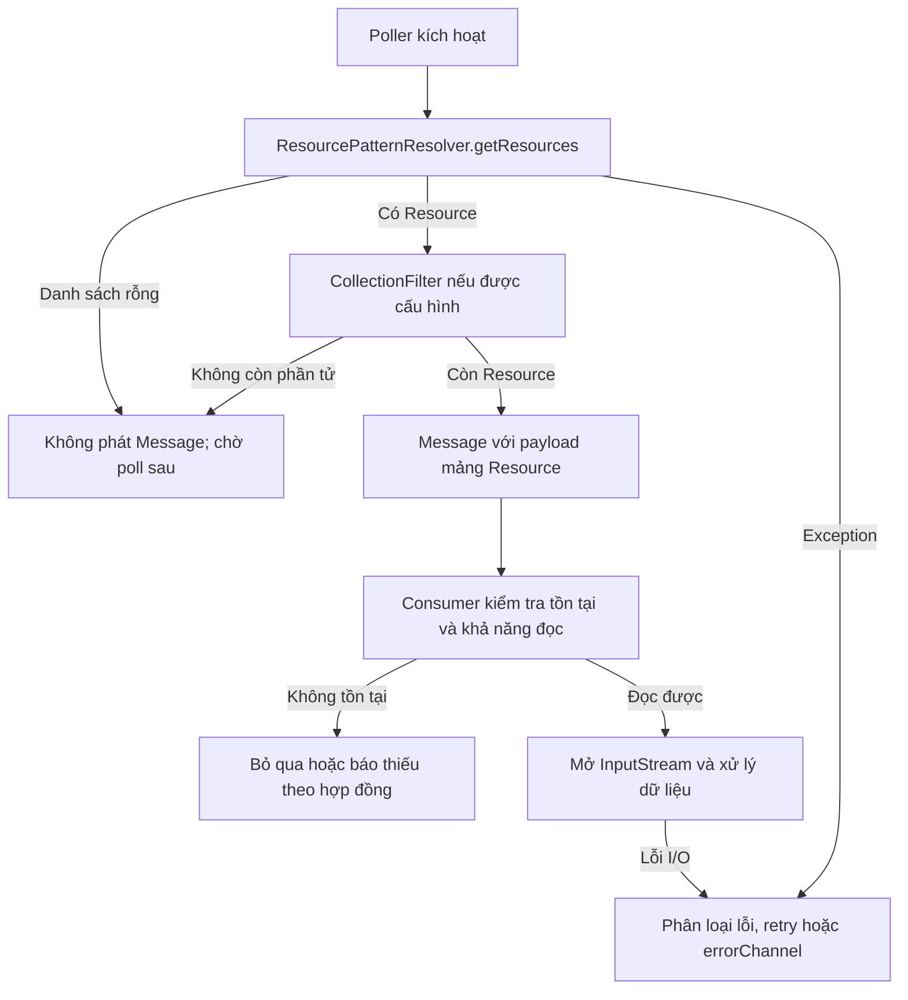

# Xử lý resource không tồn tại

## 1. Bối cảnh và mục tiêu

Trong **Spring Integration Adapters**, `Resource Inbound Channel Adapter` cho phép poll định kỳ các tài nguyên được mô tả bằng `org.springframework.core.io.Resource`: file trên đĩa, tài nguyên trong classpath, URL hoặc loại `Resource` khác. Adapter dùng `ResourcePatternResolver` để phân giải một `pattern`, sau đó phát `Message` có payload là **mảng `Resource[]`** lên `MessageChannel`. Khác với File Inbound Adapter thường phát từng `File`, Resource Adapter làm việc với tập tài nguyên trong một lần poll.

Một bài toán phổ biến là ứng dụng khởi động trước khi file xuất hiện, cấu hình trỏ sai classpath, thư mục đầu vào đang trống, hoặc file bị xóa sau khi adapter phát hiện. Không nên xử lý tất cả tình huống đó như cùng một lỗi “file not found”.

Sau bài này, người học có thể:

- Phân biệt **không tìm thấy tài nguyên phù hợp** với **đã có đối tượng `Resource` nhưng đích không tồn tại**.
- Kiểm tra `exists()`, `isReadable()` và xử lý việc tài nguyên biến mất giữa lúc kiểm tra và đọc.
- Thiết kế cách bỏ qua, chờ lần poll kế tiếp, báo lỗi hoặc dừng khởi động tùy theo hợp đồng dữ liệu.
- Hiểu ảnh hưởng của `AcceptOnceCollectionFilter`, `errorChannel`, retry và giám sát vận hành.

## 2. Resource không tồn tại nghĩa là gì?

`Resource` là **đối tượng mô tả vị trí truy cập**, không bảo đảm có nội dung thật tại thời điểm khởi tạo. Ví dụ, `ResourceLoader.getResource("classpath:config/missing.properties")` vẫn có thể trả về một đối tượng `Resource`; ứng dụng phải gọi `exists()` để biết đích hiện có hay không.

Resource Inbound Adapter dựa vào `ResourcePatternResolver.getResources(pattern)`, vì vậy cần tách ba lớp kết quả:

| Hiện tượng | Ví dụ | Ý nghĩa và cách xử lý |
| --- | --- | --- |
| Pattern không khớp tài nguyên nào | `file:/data/import/*.csv` khi chưa có file CSV | Resolver thường trả về mảng rỗng; source không có payload để phát, poller tiếp tục theo lịch. Đây có thể là trạng thái bình thường. |
| Có `Resource` handle nhưng `exists() == false` | `classpath:config/missing.properties` không chứa wildcard | Resolver cho đường dẫn cố định có thể trả về handle dù file chưa tồn tại; phải kiểm tra trước khi sử dụng. |
| Resource có lúc kiểm tra, nhưng không đọc được | File bị xóa, mất quyền đọc, mount bị ngắt, URL trả 404 | `getInputStream()` có thể ném `IOException` dù `exists()` trước đó trả `true`. |
| Có lỗi khi phân giải pattern | Không truy cập được nguồn từ xa, lỗi I/O, pattern hoặc resolver cấu hình không hợp lệ | Có thể phát sinh exception ở bước lấy danh sách; phân loại nguyên nhân và đưa vào luồng xử lý lỗi. |
| Tài nguyên tồn tại nhưng dữ liệu sai | File rỗng, sai cấu trúc JSON/properties | Đây là **lỗi nội dung**, cần validate riêng, không được đồng nhất với “không tồn tại”. |

> **Lưu ý:** Với pattern có wildcard, kết quả rỗng là tình huống thường gặp, nhưng không nên suy luận rằng *mọi* pattern hoặc *mọi* `ResourcePatternResolver` đều trả mảng rỗng khi tài nguyên đích không có. Đặc biệt, pattern không có wildcard có thể tạo ra một handle chưa tồn tại, còn lỗi khi truy cập thư mục gốc có thể khiến resolver ném exception.

Có thể quan sát trực tiếp sự khác biệt qua Spring Framework:

```java
import org.springframework.core.io.Resource;
import org.springframework.core.io.support.PathMatchingResourcePatternResolver;
import org.springframework.core.io.support.ResourcePatternResolver;

import java.io.IOException;

public class ResourceLookupDemo {
    public static void main(String[] args) throws IOException {
        ResourcePatternResolver resolver =
                new PathMatchingResourcePatternResolver();

        // Đường dẫn cố định: nhận Resource handle chưa chắc tồn tại.
        Resource single =
                resolver.getResource("classpath:config/not-found.properties");
        System.out.println("exists = " + single.exists());

        // Wildcard: lấy các Resource thực sự khớp pattern.
        Resource[] matches =
                resolver.getResources("classpath*:config/*.properties");
        System.out.println("matched resources = " + matches.length);
    }
}
```

Giá trị `exists` trong ví dụ phụ thuộc nội dung classpath thực tế. `matched resources = 0` chỉ xảy ra nếu không có tài nguyên nào khớp, không phải kết quả bắt buộc của mọi lần chạy.

## 3. Luồng xử lý của Resource Inbound Adapter khi không có kết quả



Với `ResourceRetrievingMessageSource`, danh sách kết quả rỗng hoặc bị filter loại hết dẫn tới lần `receive()` không tạo `Message`. Do đó một `@ServiceActivator` ở phía sau **không nhận được “message rỗng” chỉ để báo rằng chưa có file**. Nếu nghiệp vụ yêu cầu báo động khi thiếu tài nguyên quá thời hạn, phải có cơ chế giám sát riêng (ví dụ kiểm tra trạng thái theo lịch và đo thời gian kể từ lần xử lý thành công cuối cùng).

## 4. Cấu hình adapter để chờ tài nguyên xuất hiện

Giả sử hệ thống nhận các file cấu hình `.properties` từ thư mục `/data/import`. File mới được đặt vào thư mục sau khi ứng dụng đã chạy. Cấu hình XML của Spring Integration có thể viết:

```xml
<!-- Đặt trong cấu hình Spring đã khai báo namespace "int". -->
<int:channel id="configResources"/>

<int:resource-inbound-channel-adapter
        id="configResourceAdapter"
        channel="configResources"
        pattern="file:/data/import/*.properties">
    <int:poller fixed-delay="5000"
                max-messages-per-poll="1"/>
</int:resource-inbound-channel-adapter>
```

Diễn tiến mong đợi:

1. `/data/import` chưa có file khớp: lần poll đó không có message để xử lý.
2. Một file `app.properties` được tạo và đã sẵn sàng đọc: lần poll sau có thể phát một `Message<Resource[]>` chứa resource phù hợp.
3. Handler đọc tài nguyên, kiểm tra hợp lệ và áp dụng nghiệp vụ.
4. Nếu file bị xóa ngay trước bước mở stream, handler phải xử lý lỗi phát sinh tại thời điểm đọc.

Chú ý `fixed-delay="5000"` biểu thị độ trễ tính bằng mili giây giữa các lần thực hiện theo cấu hình poller; không bảo đảm file sẽ được xử lý ngay đúng thời điểm xuất hiện. Với file được ghi theo nhiều bước, phía ghi nên sử dụng tên tạm và **đổi tên nguyên tử sau khi ghi xong** (khi hệ thống file hỗ trợ), hoặc dùng quy ước “ready marker”, để phía đọc không gặp dữ liệu dở dang.

### Vì sao tránh dùng đường dẫn cố định cho nguồn đến muộn?

Nếu thay pattern trên bằng `file:/data/import/app.properties` (không có wildcard), resolver có thể liên tục trả về handle của đường dẫn này dù file chưa có. Khi khai báo Resource Inbound Adapter bằng XML mà không chỉ định filter, adapter dùng `AcceptOnceCollectionFilter` mặc định để tránh phát lặp những resource đã thấy. Do đó handle của file chưa tồn tại có thể bị tính là “đã thấy” trong lần poll đầu; khi file xuất hiện sau đó, nó có thể không được phát lại.

Với nguồn file xuất hiện động, cách đơn giản là dùng wildcard trỏ đến các file đang tồn tại. Nếu nghiệp vụ **cần quét lại cùng một resource ở mỗi lần poll**, cấu hình `filter=""` trong XML để vô hiệu hóa filter mặc định, đồng thời phải tự kiểm soát lặp/idempotency ở tầng xử lý. Với bài toán cần xử lý lại khi nội dung file thay đổi, hãy chọn chiến lược filter dựa trên version, thời gian sửa đổi hoặc dấu vết xử lý theo nghiệp vụ, thay vì dựa vào tên file đơn thuần.

## 5. Kiểm tra trước khi đọc và chống race condition

Handler sau đây chấp nhận payload `Resource[]` của adapter, bỏ qua tài nguyên đã biến mất, đóng `InputStream` đúng cách và đưa lỗi I/O khác ra ngoài để cơ chế xử lý lỗi của integration flow có thể nhận:

```java
import java.io.FileNotFoundException;
import java.io.IOException;
import java.io.InputStream;
import java.io.UncheckedIOException;
import java.nio.file.NoSuchFileException;
import java.util.Properties;

import org.slf4j.Logger;
import org.slf4j.LoggerFactory;
import org.springframework.core.io.Resource;
import org.springframework.integration.annotation.ServiceActivator;
import org.springframework.stereotype.Component;

@Component
public class ResourceConfigConsumer {
    private static final Logger log =
            LoggerFactory.getLogger(ResourceConfigConsumer.class);

    @ServiceActivator(inputChannel = "configResources")
    public void consume(Resource[] resources) {
        for (Resource resource : resources) {
            String location = resource.getDescription();

            // Resource là handle; cần kiểm tra đích hiện tại.
            if (!resource.exists()) {
                log.info("Bỏ qua resource chưa tồn tại: {}", location);
                continue;
            }
            if (!resource.isReadable()) {
                log.warn("Resource tồn tại nhưng chưa đọc được: {}", location);
                continue;
            }

            try (InputStream input = resource.getInputStream()) {
                Properties properties = new Properties();
                properties.load(input);

                // Thay bằng bước validate và áp dụng cấu hình nghiệp vụ.
                log.info("Đã nạp {} thuộc tính từ {}",
                        properties.size(), location);
            }
            catch (FileNotFoundException | NoSuchFileException missing) {
                // File có thể biến mất giữa exists()/isReadable() và open().
                log.info("Resource biến mất trước khi đọc: {}", location);
            }
            catch (IOException io) {
                // Không biến một lỗi đọc khác thành trạng thái "không có file".
                throw new UncheckedIOException("Không thể đọc " + location, io);
            }
        }
    }
}
```

Ở đây, việc `continue` khi thiếu resource là **quyết định nghiệp vụ** cho tình huống file tùy chọn. Nếu file bắt buộc cho tính đúng đắn của hệ thống, thay nhánh đó bằng exception phù hợp hoặc một cơ chế báo lỗi rõ ràng. Cũng không nên tự động bỏ qua mọi trường hợp `isReadable() == false`: một file có nhưng sai quyền đọc khác về bản chất so với thư mục đầu vào rỗng.

Kiểm tra `exists()` rồi `getInputStream()` không phải một thao tác nguyên tử; file vẫn có thể bị xóa, thay thế hoặc mất quyền truy cập ở khoảng giữa. Vì vậy **bắt exception tại thao tác đọc là bắt buộc**, kể cả khi đã kiểm tra tồn tại. Với resource là URL, phép kiểm tra còn có thể tốn thêm một lần gọi mạng và kết quả mang tính thời điểm; cân nhắc chính sách timeout và số lần truy cập.

> **Điểm cần chú ý về retry:** Adapter có thể đã ghi nhận resource vào bộ lọc “accept once” trước khi handler xử lý thành công. Nếu handler thất bại, việc đợi poll tiếp theo **không đảm bảo** resource đó tự được phát lại. Khi cần bảo đảm xử lý, hãy quản lý retry/recovery và dấu vết idempotency theo nghiệp vụ; không dựa vào lịch poll như một hàng đợi đảm bảo giao hàng.

## 6. Chọn hành vi khi tài nguyên vắng mặt

| Hợp đồng dữ liệu | Chính sách phù hợp | Ví dụ |
| --- | --- | --- |
| **Tùy chọn**: có dữ liệu thì xử lý | Không phát message khi không khớp; ghi metric phù hợp, không báo lỗi mỗi lần poll | Thư mục import tài liệu theo đợt |
| **Đến muộn**: có thể chưa tồn tại trong một khoảng thời gian | Poll theo lịch; cảnh báo nếu quá SLA, tránh spam log | Tập tin do đối tác chuyển vào mỗi sáng |
| **Bắt buộc lúc khởi động** | Kiểm tra `exists()` và `isReadable()` trước khi nhận traffic; fail fast với thông báo nêu rõ vị trí | Schema hoặc bảng ánh xạ bắt buộc trong classpath |
| **Bắt buộc trong một giao dịch** | Báo lỗi có ngữ cảnh, không ghi nhận hoàn thành; retry có giới hạn nếu lỗi tạm thời | Phải lấy đúng template để kết xuất hóa đơn |
| **Đích tồn tại nhưng không truy cập được** | Phân loại quyền truy cập/I/O, kiểm tra mount và credentials; đưa sự cố vào kênh lỗi | Volume bị gỡ hoặc object store trả lỗi |

Ví dụ kiểm tra tài nguyên bắt buộc lúc khởi động bằng Spring Boot:

```java
import org.springframework.boot.ApplicationArguments;
import org.springframework.boot.ApplicationRunner;
import org.springframework.core.io.Resource;
import org.springframework.core.io.ResourceLoader;
import org.springframework.stereotype.Component;

@Component
public class RequiredConfigCheck implements ApplicationRunner {
    private final ResourceLoader resourceLoader;

    public RequiredConfigCheck(ResourceLoader resourceLoader) {
        this.resourceLoader = resourceLoader;
    }

    @Override
    public void run(ApplicationArguments args) {
        Resource required =
                resourceLoader.getResource("classpath:config/schema.json");

        if (!required.exists() || !required.isReadable()) {
            throw new IllegalStateException(
                    "Thiếu tài nguyên bắt buộc: classpath:config/schema.json");
        }
    }
}
```

Chỉ dùng fail fast như trên cho cấu hình thực sự bắt buộc và được kỳ vọng có ngay khi ứng dụng khởi động. Nếu resource là dữ liệu theo lịch và có thể tới muộn, hãy gắn giới hạn chờ và cảnh báo thay vì làm toàn bộ dịch vụ không thể khởi động.

## 7. Phân biệt “không có message” với lỗi đi qua errorChannel

Trong Spring Integration, xử lý lỗi dựa trên message và `errorChannel` phụ thuộc vị trí, luồng thực thi của exception:

- **Không có tài nguyên khớp**: `MessageSource.receive()` không trả message cho lần poll đó; đây không phải exception và không tự tạo `ErrorMessage`.
- **Resolver lỗi khi poll**: exception phát sinh trong tác vụ poll được scheduler/error handler phù hợp chuyển thành `ErrorMessage` trên `errorChannel` (mặc định trong các cấu hình poller chuẩn). Kiểm tra cả cause để phân loại `IOException`, vấn đề quyền, cấu hình hoặc sự cố mạng.
- **Handler lỗi khi đọc**: nếu exception xảy ra trong tác vụ poll và được đẩy lên, cơ chế xử lý lỗi của poller có thể công bố `ErrorMessage`; kết quả còn phụ thuộc kiểu channel, executor và cách cấu hình error handler. Đừng mặc định mọi exception ở mọi luồng đồng bộ đều tự đi vào `errorChannel`.
- **Handler tự bắt và bỏ qua**: hệ thống sẽ không tự biết một resource đã bị bỏ qua. Muốn đo lường sự kiện này, cần log/metric hoặc phát thông báo trạng thái riêng.

Không nên bật retry vô hạn cho lỗi “đường dẫn sai” hoặc “classpath không có file”. Retry chỉ hữu ích cho nguyên nhân có khả năng hồi phục như mạng gián đoạn, mount phục hồi hoặc file chưa hoàn tất ghi. Với lỗi cố định, cần báo rõ pattern, nguồn tài nguyên và nguyên nhân để người vận hành sửa cấu hình.

Một cách kiểm soát vận hành là đo các tín hiệu:

- `resource_poll_empty_total`: số lần tìm kiếm không có kết quả; nên theo dõi theo cửa sổ thời gian, tránh coi từng lần là một sự cố.
- `resource_missing_at_read_total`: số lần handle đã nhận nhưng file biến mất trước khi mở stream.
- `resource_read_failure_total`: số lỗi I/O/parse cần xử lý; gắn nhãn nguyên nhân.
- `last_resource_processed_timestamp`: thời điểm xử lý thành công gần nhất để đánh giá SLA dữ liệu đến muộn.

Tên metric trên chỉ là **gợi ý tự định nghĩa**, không phải tên metric mặc định của Spring Integration. Tránh đưa token hoặc thông tin xác thực trong URL vào log và nhãn metric.

## 8. Các kịch bản cần kiểm thử

| Kịch bản | Thao tác | Kỳ vọng |
| --- | --- | --- |
| Thư mục rỗng | Khởi động adapter với pattern `file:/data/import/*.properties` và chưa có file | Không có message hợp lệ gửi đến consumer; poller tiếp tục chạy. |
| File đến muộn | Tạo file khớp pattern sau một vài chu kỳ poll | Lần poll phù hợp tiếp theo có thể phát payload chứa resource mới. |
| Đường dẫn cố định sai | Gọi `getResource("classpath:config/absent.properties")` | Có thể nhận `Resource` handle, nhưng `exists()` trả `false`. |
| File bị xóa trước lúc đọc | Tạo file, cho resolver nhận diện, sau đó xóa trước `getInputStream()` | Handler ghi nhận “biến mất” bằng nhánh bắt `FileNotFoundException`/`NoSuchFileException` khi loại exception tương ứng được ném. |
| File không có quyền đọc | Đặt quyền đọc không đủ (tùy hệ điều hành) | Không đồng nhất lỗi quyền với tình trạng không có file; có log/metric và chính sách xử lý. |
| File sai định dạng | Đưa file khớp pattern nhưng nội dung không hợp lệ | Báo lỗi validation/parse; không coi là resource không tồn tại. |
| Đã xử lý rồi | Giữ nguyên file qua nhiều chu kỳ poll | Kiểm tra filter có ngăn phát lặp theo đúng hợp đồng hay không. |
| Đọc lỗi rồi hồi phục | Gây lỗi I/O, sau đó sửa nguồn | Kiểm tra chiến lược retry/recovery thực sự có xử lý lại; không giả định poll tiếp tự động giao lại. |

Trong kiểm thử tích hợp, thay thời gian chờ `Thread.sleep()` cố định bằng cơ chế đợi có timeout theo điều kiện (ví dụ đếm message nhận được trên channel kiểm thử). Điều đó giúp kiểm tra rõ cả trường hợp “không có message” và tránh test phụ thuộc tốc độ của máy chạy.

## 9. Những lỗi triển khai thường gặp

1. **Xem `getResource() != null` là “file tồn tại”.** `Resource` là handle; cần `exists()`, `isReadable()` và bắt lỗi khi mở stream.
2. **Xem mảng không khớp là lỗi hệ thống.** Nếu nguồn được phép trống, đó là trạng thái vận hành bình thường; chỉ cảnh báo khi vi phạm SLA.
3. **Dùng tên file cố định với `AcceptOnceCollectionFilter` cho nguồn đến muộn.** Handle chưa tồn tại có thể bị đánh dấu đã thấy, khiến file xuất hiện sau không được phát lại.
4. **Coi `exists()` là bảo đảm đọc thành công.** Giữa kiểm tra và truy cập luôn có thể xảy ra race condition.
5. **Bắt mọi `IOException` rồi bỏ qua.** Điều này che lỗi mount, quyền và mạng; phải phân loại hoặc đưa vào luồng lỗi.
6. **Retry mà không có idempotency.** Sau lỗi một phần, xử lý lại có thể tạo dữ liệu trùng. Cần dấu vết xử lý thành công hoặc cơ chế loại trùng phù hợp.
7. **Chỉ dựa vào `errorChannel` để báo thiếu file.** Không có kết quả poll không tạo exception; giám sát thiếu dữ liệu phải có logic riêng.

## 10. Câu hỏi tự kiểm tra

1. Vì sao `getResources("file:/data/import/*.csv")` có thể không trả phần tử nào, nhưng `getResource("file:/data/import/a.csv")` vẫn trả đối tượng? Với hai kết quả đó, nhánh xử lý nào sẽ chạy?
2. Một file chỉ xuất hiện sau 10 phút, nhưng adapter dùng pattern cố định và filter mặc định. Hãy giải thích vì sao hệ thống có thể bỏ lỡ file và đề xuất cấu hình thích hợp.
3. Nếu `exists()` trả `true` nhưng `getInputStream()` ném `FileNotFoundException`, handler nên làm gì khi file là dữ liệu tùy chọn? Chính sách đó thay đổi thế nào nếu file là bắt buộc?
4. Vì sao việc tăng tần suất poll không giải quyết được một message đã bị filter loại hoặc một handler đã xử lý dở dang rồi thất bại?

## Tài liệu tham khảo

- [Spring Integration Reference — Resource Support](https://docs.spring.io/spring-integration/reference/resource.html): cách Resource Inbound Channel Adapter phân giải pattern, phát `Resource[]` và dùng `CollectionFilter`.
- [Spring Framework Reference — Resources](https://docs.spring.io/spring-framework/reference/core/resources.html): hợp đồng của `Resource.exists()`, `isReadable()` và `getInputStream()`.
- [Spring Framework — PathMatchingResourcePatternResolver API](https://docs.spring.io/spring-framework/docs/current/javadoc-api/org/springframework/core/io/support/PathMatchingResourcePatternResolver.html): sự khác biệt giữa location cố định và pattern wildcard.
- [Spring Integration Reference — Error Handling](https://docs.spring.io/spring-integration/reference/error-handling.html): hành vi của `ErrorMessage` và `errorChannel` trong tác vụ polling.
