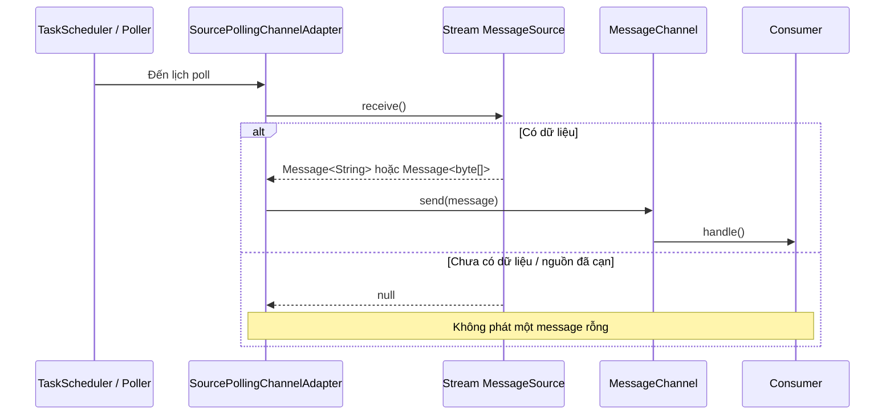
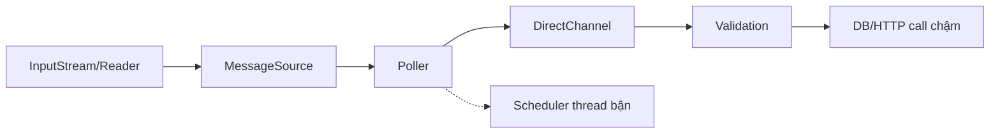

# Stream inbound channel adapter

## 1. Bối cảnh: nhận dữ liệu từ một luồng đang mở

Trong module **SPRING_INTEGRATION_ADAPTERS**, Spring Integration giúp kết nối các hệ thống bên ngoài bằng **inbound/outbound adapter, gateway, poller và `MessageChannel`**; thực hành trao đổi qua file, SFTP, HTTP, JMS, AMQP, Kafka, database cũng như xử lý hợp đồng message, lỗi và vòng đời kết nối. Chương **Adapter Stream** tập trung vào các nguồn/đích dữ liệu theo giao diện I/O của Java: `InputStream`, `OutputStream`, `Reader` và `Writer`.

Giả sử một công cụ xử lý sự kiện được chạy từ terminal và nhận từng dòng dữ liệu chuẩn đầu vào:

```bash
printf 'ORDER,1001,CREATED\nORDER,1002,PAID\n' | java -jar integration-app.jar
```

Ứng dụng cần chuyển mỗi dòng thành một Spring `Message<String>`, sau đó validate, transform và đưa vào `MessageChannel` để một service hoặc adapter khác xử lý. Không nên gửi **chính đối tượng `InputStream`/`Reader`** làm payload rồi bắt consumer đọc chung một nguồn: stream có con trỏ đọc, trạng thái đóng và thường không an toàn khi nhiều consumer cùng truy cập.

```text
  Terminal / pipe / Reader / InputStream
                  |
                  v
  Stream reading MessageSource
                  |
          poller gọi receive()
                  |
                  v
      SourcePollingChannelAdapter
                  |
                  v
         MessageChannel
                  |
          +-------+--------+
          |                |
     Validator         Transformer
          |                |
          +-------+--------+
                  |
         Business consumer
```

**Stream inbound channel adapter** là điểm bắt đầu của flow: lấy dữ liệu đã đọc từ stream, đóng gói thành Spring message, rồi chuyển qua channel. Nó **không** tự biến byte thành JSON nghiệp vụ, tạo ACK, quản lý offset bền vững hoặc bảo đảm xử lý đúng một lần.

Sau bài học, bạn có thể:

1. Phân biệt `ByteStreamReadingMessageSource` và `CharacterStreamReadingMessageSource`.
2. Hiểu payload `byte[]` và `String`, cách chia thông điệp, encoding và giới hạn kích thước.
3. Cấu hình poller qua Java DSL và XML; phân biệt `null` khi chưa có dữ liệu với EOF.
4. Dùng `stdin()`/`stdinPipe()`, xử lý `StreamClosedEvent` khi stream kết thúc.
5. Kiểm soát blocking I/O, thread pool, backpressure, error handling và shutdown.
6. Thiết kế test không phụ thuộc terminal bằng `ByteArrayInputStream`/`StringReader`.
7. Biết khi nào nên chuyển sang File, SFTP, TCP, HTTP, JMS/AMQP/Kafka thay vì dùng stream adapter.

## 2. Kiến trúc: MessageSource + poller + channel

Spring Integration định nghĩa `MessageSource<T>` với thao tác `receive()`. Cả hai stream reading source đều thực hiện contract này:



| Thành phần | Trách nhiệm | Không tự làm |
| --- | --- | --- |
| `InputStream` / `Reader` | Cung cấp byte/ký tự và trạng thái đọc | Xác định transaction, ACK, event ID |
| `MessageSource` | Đọc dữ liệu và tạo Spring message | Lập lịch gọi chính nó |
| `SourcePollingChannelAdapter` | Gọi source theo lịch, gửi vào channel | Phục hồi dữ liệu đã đọc sau crash |
| `PollerMetadata` / `Pollers` | Chọn fixed delay/rate, số message mỗi poll | Tạo dữ liệu mới nếu stream không có |
| `MessageChannel` | Vận chuyển message đến consumer | Tự bền vững khi JVM dừng |
| Consumer/transformer | Validate, parse, lọc và thực hiện nghiệp vụ | Đảm bảo đầu vào luôn hợp lệ |

### Inbound khác outbound

- **Inbound**: `InputStream`/`Reader` → Spring `Message<?>` → `MessageChannel`.
- **Outbound**: Spring `Message<?>` → `ByteStreamWritingMessageHandler`/`CharacterStreamWritingMessageHandler` → `OutputStream`/`Writer`.

Đây là các hướng dữ liệu **một chiều**, không có reply channel mang nghĩa xác nhận nguồn dữ liệu đã được commit. Nếu một nghiệp vụ cần request–reply, cân nhắc gateway hoặc thiết kế ACK riêng.

### Stream không phải một queue

Một luồng byte thông thường có trạng thái **đã đọc tới đâu thì con trỏ dịch tới đó**. Không mặc định có seek, rewind, partition, group consumer hoặc replay. Khi consumer xử lý lỗi sau khi source đã đọc, byte hoặc dòng đó có thể đã bị tiêu thụ ở nguồn.

| Mục tiêu | Stream inbound có sẵn? | Cần thêm gì? |
| --- | --- | --- |
| Đọc từ standard input | Có | Charset, poller, consumer |
| Nhận từng dòng text | Có với character source | Quy ước newline, validation |
| Đọc chunk byte | Có với byte source | Framing và parser thích hợp |
| Theo dõi thư mục có nhiều file | Không | File inbound adapter |
| Đồng bộ file từ SFTP | Không | SFTP inbound adapter |
| Đọc message có offset/ACK | Không | JMS/AMQP/Kafka tùy yêu cầu |
| Phục hồi ở byte offset sau restart | Không tự có | Checkpoint/seek được thiết kế riêng |

## 3. Hai MessageSource quan trọng

Spring Integration Stream đưa ra hai nguồn chính:

| Lớp | Đầu vào Java | Payload Spring | Đơn vị đọc |
| --- | --- | --- | --- |
| `CharacterStreamReadingMessageSource` | `java.io.Reader` | `String` | Dòng text theo cách xử lý của buffered reader |
| `ByteStreamReadingMessageSource` | `java.io.InputStream` | `byte[]` | Khối byte, giới hạn bằng `bytesPerMessage` |

**Lưu ý về phiên bản:** bài sử dụng **Spring Integration 6.5.x** và import từ package `org.springframework.integration.stream`. Ở tài liệu **7.x**, hai reading source được chuyển sang package `org.springframework.integration.stream.inbound`. Không lấy import của 7.x ghép với dependency 6.5.x rồi kết luận framework thiếu class.

### 3.1. Character stream: khi dữ liệu là text

`CharacterStreamReadingMessageSource` nhận `Reader`, tự bọc bằng `BufferedReader` nếu chưa được bọc. Nó đọc text theo dòng, nên phù hợp với:

- Terminal input: mỗi dòng là một lệnh hoặc sự kiện.
- Pipe đưa các dòng CSV/NDJSON nhỏ tới ứng dụng.
- Nguồn text đã chuẩn hóa encoding và phân cách bản ghi bằng newline.

Ví dụ:

```text
ORDER,1001,CREATED\n
ORDER,1002,PAID\n
```

Với newline đúng quy ước, consumer nhận **hai payload `String` riêng**, không cần tự giải mã byte. Không nên dùng nguồn này khi giao thức có dữ liệu nhị phân tùy ý hoặc bản ghi chứa newline chưa escape.

### 3.2. Byte stream: khi dữ liệu là binary

`ByteStreamReadingMessageSource` nhận `InputStream` và tạo payload `byte[]`. Thuộc tính `bytesPerMessage` quyết định **số byte tối đa mà mỗi lần đọc cố lấy vào một message**, mặc định là **1024**.

```java
ByteStreamReadingMessageSource source =
        new ByteStreamReadingMessageSource(inputStream);
source.setBytesPerMessage(2048);
```

Biến `inputStream` là một `InputStream` đã được mở và cấp đúng quyền truy cập. Ví dụ này mới cấu hình **source**, chưa tạo poller và chưa nối channel.

**Cảnh báo quan trọng:** `bytesPerMessage=2048` không có nghĩa mỗi payload luôn đúng 2048 byte và **không tự tạo ranh giới record**. Một lần đọc có thể trả về ít byte hơn vì ở cuối nguồn hoặc chỉ có một phần dữ liệu sẵn sàng.

### 3.3. shouldTruncate

Byte source còn có `setShouldTruncate(boolean)`. Khi muốn message chỉ chứa **đúng số byte thực sự đọc được**, nhất là ở khối cuối hoặc luồng có các lần đọc ngắn, nên bật:

```java
source.setShouldTruncate(true);
```

Nếu không cắt bớt theo số byte thực đọc, phần còn lại của buffer có thể được đệm bằng giá trị byte mặc định. Điều đó nguy hiểm nếu downstream coi toàn bộ chiều dài mảng là payload hợp lệ. Hãy kiểm chứng hành vi cụ thể trên phiên bản đang dùng và có test với khối cuối ngắn hơn `bytesPerMessage`.

## 4. Poller có bắt buộc không?

**Có** đối với stream reading `MessageSource` dùng làm inbound adapter chuẩn: framework cần một poller định kỳ gọi `receive()`. Nó khác các **event-driven inbound adapters** như một số JMS/AMQP listener hay XMPP listener.

```text
fixedDelay = 250 ms
maxMessagesPerPoll = 1

t=0        receive() -> data #1
t=250 ms   receive() -> data #2
t=500 ms   receive() -> null
t=750 ms   receive() -> data #3
```

Timeline chỉ minh họa; với `fixedDelay`, thời gian thực tế còn phụ thuộc thời gian chạy của lần poll trước, scheduler và tải của consumer.

### Các thuộc tính cần hiểu

| Thiết lập | Vai trò | Rủi ro nếu chọn sai |
| --- | --- | --- |
| `fixedDelay` | Khoảng nghỉ sau khi kết thúc lượt poll | Quá ngắn gây poll rỗng nhiều lần |
| `fixedRate` | Lịch bắt đầu poll theo nhịp định kỳ | Công việc chậm có thể gây trễ/chồng lịch tùy scheduler |
| `maxMessagesPerPoll` | Giới hạn số lần source được gọi trong một lượt poll | Quá lớn có thể chiếm thread, nhất là nguồn blocking |
| `TaskScheduler` | Thực thi poller | Ít thread có thể gây nghẽn các poller khác |
| `errorChannel`/error handling | Xử lý ngoại lệ khi source/consumer lỗi | Nuốt lỗi không kiểm soát gây mất dữ liệu |

`receive()` trả `null` là tín hiệu **không phát message trong lượt đó**, không phải một message có payload null. Nó cũng **không đủ để kết luận EOF** trong cấu hình character source không bật detect EOF.

### Một poller có thể bị chặn

Với `blockToDetectEOF=true`, `CharacterStreamReadingMessageSource.receive()` có thể **chặn thread poller** cho tới khi có dữ liệu hoặc EOF. Poller vẫn được lập lịch, nhưng thread đang thực thi không quay về scheduler ngay khi chưa có input. Cần cân nhắc task scheduler riêng, quota thread và đường shutdown nếu chạy nhiều adapter.

## 5. Reader.ready() và vấn đề “không có dữ liệu” so với EOF

Đây là khác biệt quan trọng nhất khi làm việc với stream character.

### 5.1. Chế độ mặc định: không chặn để phát hiện EOF

`CharacterStreamReadingMessageSource(reader)` hoặc constructor hai tham số dùng mặc định **`blockToDetectEOF=false`**. Trước khi đọc, source kiểm tra `BufferedReader.ready()`:

- Nếu `ready()==false`, `receive()` trả `null`.
- Nó không nhất thiết đọc tới EOF để nhận biết nguồn đã đóng.
- `ready()==false` **không đồng nghĩa** “stream đã kết thúc”.

Chế độ này hợp với terminal tương tác, nơi người dùng có thể chưa nhập gì mà ứng dụng vẫn muốn scheduler tiếp tục phục vụ các công việc khác.

### 5.2. Bật phát hiện EOF

Constructor ba tham số:

```java
import java.io.Reader;
import org.springframework.integration.stream.CharacterStreamReadingMessageSource;

Reader reader = /* Reader do ứng dụng cung cấp */;
CharacterStreamReadingMessageSource source =
        new CharacterStreamReadingMessageSource(
                reader,
                8192,
                true
        );
```

`true` là `blockToDetectEOF`. Khi đó `receive()` **chặn** cho tới khi có dữ liệu hoặc reader báo EOF. Khi EOF được phát hiện, Spring Integration công bố **`StreamClosedEvent`** trong ApplicationContext.

### 5.3. StreamClosedEvent là ApplicationEvent, không phải Message payload

| Cơ chế | Hình thức | Consumer |
| --- | --- | --- |
| Dòng text đã đọc | Spring `Message<String>` trên channel | `@ServiceActivator`/DSL handler |
| EOF được phát hiện | Spring `StreamClosedEvent` | `ApplicationListener<StreamClosedEvent>` hoặc `@EventListener` |

**Đừng chờ một `Message<String>` mang chuỗi `EOF`.** Bản thân EOF là trạng thái của nguồn, không phải một dòng trong stream.

### 5.4. Nguy cơ phát event EOF lặp

Reference mô tả: nếu adapter vẫn chạy sau khi đã phát hiện EOF, poller có thể **tiếp tục công bố `StreamClosedEvent` ở các lượt poll tiếp theo**. Cần dừng adapter hoặc đóng ứng dụng theo chính sách.

Không nên gọi đồng bộ `stop()` rồi làm tiếp một thao tác blocking/interruptible trên **cùng thread poller** đang phát event; stop có thể interrupt chính thread đó. Nếu cần xử lý thêm sau EOF, thực hiện phần phải gửi trước, hoặc điều phối stop/cleanup sang worker riêng đã được quản lý và bảo đảm không sinh race.

## 6. Các factory method dành cho stdin

Spring Integration cung cấp bốn method tiện dụng trên `CharacterStreamReadingMessageSource`:

| Factory method | Charset | EOF |
| --- | --- | --- |
| `stdin()` | Charset mặc định của phương án factory | Không chủ động detect EOF |
| `stdin("UTF-8")` | UTF-8 | Không chủ động detect EOF |
| `stdinPipe()` | Charset mặc định của phương án factory | Detect EOF, hỗ trợ đóng context |
| `stdinPipe("UTF-8")` | UTF-8 | Detect EOF, hỗ trợ đóng context |

`stdinPipe(...)` được thiết kế cho tình huống **pipe hoặc redirect stdin**, có cơ chế nhận EOF và đóng application context khi pipe kết thúc theo tài liệu API. Nó hữu ích với batch CLI. Với terminal tương tác dài hạn, hãy cân nhắc `stdin(...)` để không tự đóng chương trình khi không có input.

Ví dụ dùng trên shell Unix/Linux:

```bash
cat events.txt | java -jar integration-app.jar
java -jar integration-app.jar < events.txt
```

Trong **Windows PowerShell 5.1**, toán tử redirect stdin `<` không được hỗ trợ như shell POSIX. Có thể dùng `cmd /c "java -jar integration-app.jar < events.txt"` hoặc chuẩn bị một pipe tương thích. Đừng kết luận lỗi ứng dụng Java nếu shell không hỗ trợ redirect.

### Charset phải được thống nhất

Nếu nguồn phát UTF-8 mà reader giải mã bằng charset khác, payload tiếng Việt có thể bị sai ký tự. Với đường ống text, đặt charset tường minh:

```java
CharacterStreamReadingMessageSource source =
        CharacterStreamReadingMessageSource.stdinPipe("UTF-8");
```

Trường hợp byte stream **không giải mã**: payload là `byte[]`. Nếu downstream chuyển sang `String`, phải chọn `Charset` tường minh và cẩn thận với ký tự đa byte bị chia giữa hai chunk.

## 7. Java DSL: ví dụ Spring Boot đọc từng dòng từ stdin

### 7.1. Dependency

Với Java 17+, Spring Boot và Spring Integration 6.5.x tương thích, Maven:

```xml
<dependencies>
    <dependency>
        <groupId>org.springframework.boot</groupId>
        <artifactId>spring-boot-starter-integration</artifactId>
    </dependency>
    <dependency>
        <groupId>org.springframework.integration</groupId>
        <artifactId>spring-integration-stream</artifactId>
    </dependency>
</dependencies>
```

Version của `spring-integration-stream` có thể để BOM Spring Boot quản lý nếu BOM tương thích. Nếu không có BOM, cần khai báo version đồng bộ với Spring Integration core. **Không đưa thẳng version `7.1.x` từ trang Reference hiện tại vào dự án đang dùng Spring Integration `6.5.x`** mà không nâng cấp đồng bộ.

### 7.2. Chương trình Java

Ví dụ sau có một inbound adapter poll `System.in`, gửi `Message<String>` qua `stdinLinesChannel` và service activator in kết quả parse. Mỗi dòng có dạng `ORDER,<id>,<status>`.

```java
import java.util.Set;

import org.springframework.boot.SpringApplication;
import org.springframework.boot.autoconfigure.SpringBootApplication;
import org.springframework.context.annotation.Bean;
import org.springframework.context.annotation.Configuration;
import org.springframework.integration.annotation.ServiceActivator;
import org.springframework.integration.channel.DirectChannel;
import org.springframework.integration.config.EnableIntegration;
import org.springframework.integration.dsl.IntegrationFlow;
import org.springframework.integration.dsl.Pollers;
import org.springframework.integration.stream.CharacterStreamReadingMessageSource;
import org.springframework.messaging.Message;
import org.springframework.messaging.MessageChannel;

@SpringBootApplication
public class StreamInboundApplication {

    public static void main(String[] args) {
        SpringApplication.run(StreamInboundApplication.class, args);
    }
}

@Configuration
@EnableIntegration
class StreamInboundConfig {

    @Bean
    MessageChannel stdinLinesChannel() {
        return new DirectChannel();
    }

    @Bean
    IntegrationFlow stdinInboundFlow() {
        return IntegrationFlow
                .from(
                    CharacterStreamReadingMessageSource.stdinPipe("UTF-8"),
                    endpoint -> endpoint
                        .id("stdinStreamAdapter")
                        .poller(Pollers
                            .fixedDelay(250)
                            .maxMessagesPerPoll(1))
                )
                .channel("stdinLinesChannel")
                .get();
    }

    @ServiceActivator(inputChannel = "stdinLinesChannel")
    public void consumeOrderLine(Message<String> message) {
        String line = message.getPayload();
        if (line.isBlank()) {
            return;
        }

        String[] parts = line.split(",", -1);
        Set<String> allowed = Set.of("CREATED", "PAID", "CANCELLED");

        if (parts.length != 3
                || !parts[0].equals("ORDER")
                || !parts[1].matches("[0-9]{1,12}")
                || !allowed.contains(parts[2])) {
            // Bài demo: in ra stderr và bỏ bản ghi không hợp lệ.
            // Production: đưa vào quarantine có audit.
            System.err.println("Rejected input line");
            return;
        }

        System.out.printf(
                "Accepted orderId=%s status=%s%n",
                parts[1],
                parts[2]
        );
    }
}
```

**Điều kiện thực thi:** Spring Boot project có đầy đủ cấu hình dependency, build plugin và Java 17 trở lên; ví dụ chỉ là hai class minh họa có thể đặt trong cùng một package. Khi chạy, dùng đúng file JAR được build từ ứng dụng. Ví dụ không được test trên môi trường runtime trong bước viết Knowledge này.

### 7.3. Chạy với stdin redirect

File đầu vào UTF-8:

```text
ORDER,1001,CREATED
ORDER,1002,PAID
ORDER,999,UNKNOWN
```

Ví dụ lệnh POSIX:

```bash
java -jar integration-app.jar < events.txt
```

Log đầu ra dự kiến:

```text
Accepted orderId=1001 status=CREATED
Accepted orderId=1002 status=PAID
Rejected input line
```

Đây là **kỳ vọng từ logic ví dụ**, không phải output đã được thực thi. File có newline cuối cùng, cách biểu diễn ký tự và thời điểm nhận event tùy shell/OS. Khi pipe báo EOF, `stdinPipe("UTF-8")` hỗ trợ đóng context; việc thoát process còn phụ thuộc các thread/non-daemon resources khác.

### 7.4. Giải thích những dòng chính

| Thành phần | Tác dụng |
| --- | --- |
| `stdinPipe("UTF-8")` | Tạo character message source từ `System.in` với chế độ detect EOF |
| `IntegrationFlow.from(source, endpoint -> ...)` | Tạo `SourcePollingChannelAdapter` cho source |
| `Pollers.fixedDelay(250)` | Đặt lịch poll, đơn vị millisecond |
| `maxMessagesPerPoll(1)` | Mỗi lượt poll xử lý nhiều nhất một lần đọc thành công |
| `.channel("stdinLinesChannel")` | Chuyển Spring message vào channel |
| `@ServiceActivator` | Consumer nhận `Message<String>` và validate nội dung |
| `DirectChannel` | Gọi consumer đồng bộ theo luồng dispatch, chưa có persistence |

**Lưu ý quan trọng:** `stdinPipe` có thể **block thread poller** khi chờ một dòng/EOF. Hãy dành tài nguyên scheduler thích hợp và không cấu hình một poller của stream như một tác vụ non-blocking thuần túy.

## 8. Java DSL: ví dụ byte stream độc lập

Với dữ liệu nhị phân, sử dụng `ByteStreamReadingMessageSource` và `byte[]` thay vì cố giả định từng chunk là một dòng UTF-8.

Đây là một **flow thay thế** có đầu vào `ByteArrayInputStream` xác định; không cần người dùng nhập terminal. Có thể đặt nó trong cấu hình thử nghiệm riêng, tránh bật đồng thời với flow `stdinPipe` nếu không có chủ đích.

```java
import java.io.ByteArrayInputStream;
import java.util.HexFormat;

import org.springframework.context.annotation.Bean;
import org.springframework.context.annotation.Configuration;
import org.springframework.integration.config.EnableIntegration;
import org.springframework.integration.dsl.IntegrationFlow;
import org.springframework.integration.dsl.Pollers;
import org.springframework.integration.stream.ByteStreamReadingMessageSource;

@Configuration
@EnableIntegration
public class BinaryStreamInboundConfig {

    @Bean
    public IntegrationFlow binaryInboundFlow() {
        byte[] fixture = new byte[] {
                0x01, 0x02, 0x03, 0x04, 0x05, 0x06, 0x07
        };

        ByteStreamReadingMessageSource source =
                new ByteStreamReadingMessageSource(
                    new ByteArrayInputStream(fixture)
                );
        source.setBytesPerMessage(4);
        source.setShouldTruncate(true);

        return IntegrationFlow
                .from(source, endpoint -> endpoint
                        .id("binaryStreamAdapter")
                        .poller(Pollers
                            .fixedDelay(300)
                            .maxMessagesPerPoll(1)))
                .handle(message -> {
                    byte[] chunk = (byte[]) message.getPayload();
                    System.out.printf(
                        "chunkLength=%d hex=%s%n",
                        chunk.length,
                        HexFormat.of().formatHex(chunk)
                    );
                })
                .get();
    }
}
```

### Kết quả mong đợi

Với một nguồn `ByteArrayInputStream` có sẵn toàn bộ 7 byte và chunk size 4, các lượt đọc thường cho:

```text
chunkLength=4 hex=01020304
chunkLength=3 hex=050607
```

Đây là kết quả **minh họa với fixture in-memory**. Với `InputStream` do socket/pipe thực cung cấp, số byte nhận trong từng lượt phụ thuộc vào dữ liệu đã sẵn sàng và đặc tính `read()`; không thể luôn coi payload đầu là đúng 4 byte.

### Điều gì xảy ra khi byte stream đã hết?

Với nguồn byte `MessageSource`, những lần poll không có dữ liệu thường trả `null`; **không mặc định có `StreamClosedEvent` như character source bật `blockToDetectEOF`**. Một poller trên nguồn `ByteArrayInputStream` có thể tiếp tục chạy và nhận null sau khi hết dữ liệu, nếu ứng dụng không quản lý việc dừng endpoint.

Để dùng cho batch, cần điều phối lifecycle hoặc chuyển sang một cơ chế nguồn có khái niệm hoàn tất rõ ràng, không chỉ dựa vào `null` để tự động đóng context.

## 9. XML configuration: namespace stream và adapter tổng quát

Spring Integration cung cấp namespace `int-stream` cho stdin/stdout/stderr và có thể cấu hình source thông qua namespace `int` tổng quát.

### 9.1. stdin-channel-adapter

Ví dụ XML cho ứng dụng nhận text UTF-8 từ stdin:

```xml
<beans:beans
    xmlns:beans="http://www.springframework.org/schema/beans"
    xmlns:xsi="http://www.w3.org/2001/XMLSchema-instance"
    xmlns:int="http://www.springframework.org/schema/integration"
    xmlns:int-stream="http://www.springframework.org/schema/integration/stream"
    xsi:schemaLocation="
        http://www.springframework.org/schema/beans
        https://www.springframework.org/schema/beans/spring-beans.xsd
        http://www.springframework.org/schema/integration
        https://www.springframework.org/schema/integration/spring-integration.xsd
        http://www.springframework.org/schema/integration/stream
        https://www.springframework.org/schema/integration/stream/spring-integration-stream.xsd">

    <int:channel id="stdinMessages"/>

    <int-stream:stdin-channel-adapter
            id="stdinAdapter"
            channel="stdinMessages"
            charset="UTF-8"
            detect-eof="true">
        <int:poller fixed-delay="250" max-messages-per-poll="1"/>
    </int-stream:stdin-channel-adapter>

    <!-- Khai báo Service Activator/Consumer cho stdinMessages tại đây. -->
</beans:beans>
```

Thuộc tính `detect-eof` có từ Spring Integration **5.0**, áp dụng cho `blockToDetectEOF` của character source. Khi XML parser/phiên bản cụ thể có ràng buộc khác, kiểm tra XSD đúng với thư viện thực tế.

**Không bật cả Java `stdinPipe` flow lẫn XML `stdin-channel-adapter` cùng đọc `System.in`** trong một ứng dụng, trừ khi bạn có cơ chế phối hợp rõ ràng. Hai reader cạnh tranh trên cùng stdin có thể chia dữ liệu không dự đoán được.

### 9.2. Tạo source byte và đưa vào inbound-channel-adapter

`int:inbound-channel-adapter` có thể tham chiếu một bean là `MessageSource`:

Để cấp một nguồn nhị phân thực, tạo `InputStream` bằng bean Java có lifecycle rõ ràng rồi dùng XML tham chiếu:

```xml
<!-- binaryInputStream được cấp từ một @Bean Java trả InputStream. -->
<beans:bean id="binarySource"
            class="org.springframework.integration.stream.ByteStreamReadingMessageSource">
    <beans:constructor-arg ref="binaryInputStream"/>
    <beans:property name="bytesPerMessage" value="2048"/>
    <beans:property name="shouldTruncate" value="true"/>
</beans:bean>

<int:channel id="binaryMessages"/>

<int:inbound-channel-adapter id="binaryInbound"
                             ref="binarySource"
                             channel="binaryMessages">
    <int:poller fixed-delay="500" max-messages-per-poll="1"/>
</int:inbound-channel-adapter>
```

Đoạn XML này **chưa phải một cấu hình hoàn chỉnh để chạy nguyên xi** vì `binaryInputStream` và consumer của `binaryMessages` cần được cung cấp từ context ứng dụng. Với đầu vào nhị phân, Java DSL ở mục 8 là ví dụ tự chứa, dễ kiểm tra hơn.

### Quy tắc chọn cấu hình

| Nhu cầu | Cách cấu hình |
| --- | --- |
| Đọc text từ stdin nhanh | `int-stream:stdin-channel-adapter` |
| Điều khiển reader/EOF/charset theo code | Java DSL + `CharacterStreamReadingMessageSource` |
| Đọc InputStream riêng có nguồn quản lý | Java bean/DSL hoặc `int:inbound-channel-adapter` |
| Lắng nghe socket TCP với frame chuyên biệt | Spring Integration TCP adapter, không dùng stdin adapter |
| Nhận file an toàn từ thư mục | File inbound adapter, có filter/accept-once |

## 10. Ranh giới thông điệp: newline khác byte chunk

Một stream là **chuỗi byte/ký tự**, còn một message là **đơn vị logic nghiệp vụ**. Ranh giới của message không tự xuất hiện trong byte stream.

### Character stream

`CharacterStreamReadingMessageSource` thuận tiện với dữ liệu **line-oriented**. Nếu body là NDJSON, mỗi dòng có thể là một JSON object:

```text
{"eventId":"evt-1","type":"PAID"}
{"eventId":"evt-2","type":"CANCELLED"}
```

Nhưng nếu một JSON record trải qua nhiều dòng mà không có quy tắc framing rõ, adapter có thể đưa từng dòng tới consumer riêng, khiến JSON parser báo lỗi. Cần một protocol quy định dòng, escaping và max line length.

### Byte stream

`ByteStreamReadingMessageSource` cắt theo **số byte đọc**, không hiểu record. Ví dụ frame gồm 2 byte length và body:

```text
00 05 48 45 4C 4C 4F  00 03 42 59 45
|len| H  E  L  L  O  |len| B  Y  E
```

Nếu `bytesPerMessage=4`, một lần `receive()` có thể dừng giữa header hoặc giữa body. **Không đưa mỗi chunk thẳng tới JSON/UTF-8 parser như một record hoàn chỉnh**. Phải có một **reassembler/decoder có trạng thái**, với giới hạn frame length, timeout, EOF và backpressure.

### Ký tự UTF-8 cũng có thể bị cắt giữa hai chunk

Ví dụ ký tự “đ” mã hóa thành nhiều byte. Một chunk có thể kết thúc ở byte đầu của ký tự này, chunk sau chứa phần còn lại. Giải mã từng `byte[]` riêng bằng `new String(chunk, UTF_8)` có thể tạo ký tự thay thế `�`.

Khi cần text, chọn `Reader` hoặc `CharsetDecoder` có khả năng giữ trạng thái giữa các chunk. Không chỉ thay `bytesPerMessage` thành số lớn rồi hy vọng không có ký tự bị chia.

## 11. Blocking I/O, scheduler và backpressure

Stream inbound dùng poller, nên thời gian đọc ảnh hưởng trực tiếp tới lịch xử lý.

### Sự khác nhau giữa “chưa ready” và “đang chờ newline”

- `ready()==false` không phải EOF.
- `ready()==true` cũng không hứa chắc một record hoàn chỉnh đã có newline.
- Khi bật detect EOF, `receive()` có thể block cho tới dữ liệu hoặc EOF.
- Một consumer `DirectChannel` chậm có thể kéo dài lượt poll sau khi source đã đọc dữ liệu.



### Nếu consumer xử lý chậm

| Chiến lược | Ưu điểm | Hạn chế |
| --- | --- | --- |
| `DirectChannel` | Đơn giản, backpressure đồng bộ tự nhiên | Thời gian consumer cộng vào poll |
| `ExecutorChannel` | Tách thread | Queue nội bộ có thể đầy, không bền vững |
| `QueueChannel` | Buffer giữa source và consumer | Trong RAM không tự bền vững; phải có consumer poller |
| Durable JMS/AMQP/Kafka | Có cơ chế lưu/bộ đọc riêng | Tăng phức tạp, ACK/transaction khác nhau |

Không cấu hình queue vô hạn cho dữ liệu không tin cậy. Khi nguồn phát nhanh hơn khả năng xử lý, cần **bounded buffer, rate limit, admission control, retry policy và quan sát độ trễ**.

Nếu message sau khi đọc được từ stream rồi bị consumer từ chối, **không có cơ chế rewind tự động**. Với dữ liệu quan trọng, nên lưu message vào durable inbox/broker trước bước xử lý nghiệp vụ phức tạp.

## 12. Xử lý lỗi và errorChannel

Lỗi stream có thể xảy ra tại nhiều điểm:

| Điểm lỗi | Ví dụ | Cách xử lý |
| --- | --- | --- |
| Đọc nguồn | `IOException`, stream đóng bất ngờ | Monitor nguồn, phân loại lỗi tạm/vĩnh viễn |
| Decode | Charset sai, malformed input | Reject/quarantine hoặc decoder policy rõ |
| Validate | CSV thiếu trường, JSON sai schema | Không đưa thẳng vào DB, lưu audit |
| Channel send | Không có subscriber, queue đầy | Alert/backpressure, không mặc định replay |
| Consumer | DB timeout, HTTP lỗi | Retry với idempotency hoặc outbox |
| EOF | Reader kết thúc | `StreamClosedEvent`, cleanup/lifecycle |

Spring Integration có **`errorChannel`** và `ErrorMessage` khi lỗi trong một số đường xử lý được framework bắt và chuyển phát. Tuy nhiên, **không được giả định mọi `IOException` hay `MessagingException` tự biến thành một message trên global error channel** trong mọi cấu hình: phụ thuộc vào poller, endpoint, kênh và thread.

### Phân biệt ba trạng thái

```text
receive() -> null                 Chưa có message (không tự là lỗi)
receive() -> Message<String>      Đã tạo message
receive() -> throws exception     Có lỗi ở source hoặc xử lý theo flow
```

Với `CharacterStreamReadingMessageSource` bật detect EOF, event đóng stream xuất hiện qua **Spring ApplicationEvent**, không phải Java exception mặc định. Đừng đưa mọi EOF vào DLQ như một bản ghi lỗi.

### Thông tin lỗi nên giữ

```text
sourceName       = stdin-orders
ingestEpoch      = 2026-11-23-run-01
receivedAt       = 2026-11-23T09:00:00Z
recordNumber     = 123
errorCategory    = VALIDATION
errorCode        = INVALID_STATUS
payloadHash      = ...
```

Các field này là **metadata ứng dụng tự định nghĩa**, không phải header được stream adapter cấp sẵn. Nếu cần replay, hash và số dòng một mình **không khôi phục** payload đã mất; phải giữ bản gốc trong kho có quyền, giới hạn retention và bảo mật.

## 13. Vòng đời và quản lý tài nguyên I/O

`Reader`/`InputStream` có thể đại diện cho một file, pipe, socket hay nguồn được ứng dụng tạo. **Ai mở thì phải xác định rõ ai chịu trách nhiệm đóng**, đặc biệt với `System.in`:

1. Với `System.in`, không để một bean khác đóng sớm khi các reader vẫn đang dùng.
2. Với stream mở từ file, cần đóng khi application context dừng hoặc source kết thúc.
3. Không tạo nhiều source cùng đọc một `InputStream` trừ khi đã thiết kế một cơ chế chia sẻ/fan-out riêng.
4. Sau EOF, tránh để poller chạy vô hạn tạo event lặp hoặc poll rỗng.
5. Nếu task poller đang block, shutdown cần được kiểm chứng với chính kiểu `InputStream`/`Reader` đang dùng.

### Không mở file mới trong mỗi lần poll nếu muốn tiếp tục đọc một stream

Ví dụ tạo một nguồn file **một lần**:

```java
// Tao stream mot lan trong cau hinh, khong lap lai moi lan poll.
InputStream input = new java.io.FileInputStream("events.txt");
ByteStreamReadingMessageSource source =
        new ByteStreamReadingMessageSource(input);
```

Đoạn này đúng khi nguồn được tạo một lần và ứng dụng quản lý việc đóng file; nó không phải một class hoàn chỉnh vì cần xử lý `IOException` và đăng ký source với poller/channel. **Điều sai là lặp lại toàn bộ đoạn mở file trên mỗi lượt poll**, khiến file luôn được đọc từ đầu. Với flow inbound, tạo nguồn một lần theo lifecycle và để poller gọi `receive()` trên cùng source. Nếu cần quét thư mục/file mới, dùng **File inbound adapter**.

### Tài nguyên test

`ByteArrayInputStream` và `StringReader` là những nguồn in-memory hữu ích cho test, không có file descriptor mạng. Một `PipedInputStream/PipedOutputStream` hoặc `PipedReader/PipedWriter` có thể mô phỏng pipe, nhưng cần bảo vệ thread writer và cơ chế EOF/close để test không deadlock.

## 14. Kiểm thử không phụ thuộc terminal

### 14.1. Unit test nguồn character

Có thể tạo source từ `StringReader`:

```java
import java.io.StringReader;
import org.springframework.integration.stream.CharacterStreamReadingMessageSource;
import org.springframework.messaging.Message;

StringReader reader = new StringReader(
        "ORDER,1,CREATED\nORDER,2,PAID\n"
);

CharacterStreamReadingMessageSource source =
        new CharacterStreamReadingMessageSource(reader);

Message<String> first = source.receive();
Message<String> second = source.receive();

System.out.println(first == null ? null : first.getPayload());
System.out.println(second == null ? null : second.getPayload());
```

Đây là đoạn test **minh họa**; có thể đặt vào method JUnit với assertions phù hợp. Đầu vào `StringReader` có sẵn dữ liệu, nên có thể đọc các dòng theo cơ chế source; không thay test thực tế với pipe/blocking và EOF event.

### 14.2. Unit test nguồn byte

```java
import java.io.ByteArrayInputStream;
import org.springframework.integration.stream.ByteStreamReadingMessageSource;
import org.springframework.messaging.Message;

ByteStreamReadingMessageSource source =
        new ByteStreamReadingMessageSource(
            new ByteArrayInputStream(new byte[] {1, 2, 3, 4, 5})
        );
source.setBytesPerMessage(4);
source.setShouldTruncate(true);

Message<byte[]> first = source.receive();
Message<byte[]> second = source.receive();

System.out.println(first.getPayload().length);
System.out.println(second.getPayload().length);
```

Với fixture có sẵn toàn bộ byte, kỳ vọng chiều dài payload lần đầu là 4, lần thứ hai là 1. Với nguồn network thực, hãy test thêm các lần đọc thiếu byte và không dựa vào việc một `read()` trả đủ `bytesPerMessage`.

### 14.3. Integration test poller

Kiểm tra các tình huống sau:

- Source trả `null`: channel **không** có message mới.
- Source đọc được một dòng: message có payload text đúng.
- Consumer ném exception: kiểm chứng lỗi có đi qua error channel/log như đã cấu hình hay không.
- EOF khi `blockToDetectEOF=true`: có `StreamClosedEvent` và xử lý lifecycle đúng.
- Đầu vào UTF-8 có tiếng Việt: dữ liệu không bị lỗi charset.
- Consumer chậm: poller delay và lượng backlog đo được, không tràn RAM.
- Shutdown khi `read()` đang block: ứng dụng dừng theo chính sách timeout, không còn thread treo.

Không cần sử dụng server SFTP/JMS/Kafka thật để test một stream inbound source đơn thuần; test tích hợp với hệ thống khác chỉ thực hiện khi flow thực sự có endpoint tương ứng.

## 15. So sánh các phương án nhập dữ liệu trong module

| Yêu cầu | Adapter phù hợp hơn | Lý do |
| --- | --- | --- |
| Đọc từng dòng từ CLI hoặc pipe | **Stream inbound** | Có sẵn `stdin` và character source |
| Đọc `InputStream` tùy biến đã mở | **Stream inbound byte** | Tạo `Message<byte[]>` theo chunk |
| Theo dõi thư mục có file mới | **File inbound** | Scanner/filter/accept-once |
| Đồng bộ file trên server SSH | **SFTP inbound** | Session, remote file filter, local sync |
| Nhận HTTP request | **HTTP inbound gateway** | Request/response, status, timeout |
| Nhận TCP với framing/connection | **TCP inbound adapter/gateway** | Connection factory, serializer/deserializer |
| Nhận JMS/AMQP | **Broker inbound** | ACK, redelivery, queue semantics |
| Nhận Kafka record | **Kafka inbound** | Topic/partition/offset |
| Nghe thay đổi trong database | **JDBC inbound** hoặc CDC pipeline | Polling/cursor/transaction tùy công cụ |

Stream adapter không phải tên khác của **Kafka Streams** hay **Java Stream API** (`java.util.stream.Stream`). Đây là adapter cho các **I/O stream**, thường có ít thông tin về nguồn, vị trí và độ tin cậy hơn các adapter chuyên dụng.

### Khi cần “đọc một file”

- Nếu file được truyền vào **stdin** bởi shell và chỉ xử lý một lượt, stream inbound là lựa chọn hợp lý.
- Nếu app cần phát hiện nhiều file mới, bỏ qua file chưa ghi xong hoặc chống đọc lặp, dùng File inbound adapter.
- Nếu cần đọc lại sau restart ở đúng vị trí, phải thiết kế checkpoint/seek, hoặc chọn công cụ có offset/cursor rõ hơn.

## 16. Bảo mật và khả năng vận hành

Stream có thể được cấp từ terminal, pipe, file hoặc một thư viện bên ngoài. Dữ liệu trong đó vẫn là **input không tin cậy**:

1. **Giới hạn kích thước:** đặt max line length hoặc max record size trong parser/nguồn; đừng nhận chuỗi vô hạn vào memory.
2. **Validate schema:** số trường CSV, enum, kiểu số và độ dài; không xem một dòng text là lệnh đã được xác thực.
3. **Không chạy shell từ payload:** input `DELETE`, URL hoặc đường dẫn là dữ liệu, không phải lệnh có quyền.
4. **Charset tường minh:** UTF-8 hoặc charset theo hợp đồng, tránh lỗi giải mã gây mất dữ liệu.
5. **Không log secrets:** stdin có thể chứa token/password; log metadata/hàm băm theo chính sách.
6. **Không hiển thị dữ liệu nhạy cảm** trên stdout/stderr trong production; stdout là một kênh có thể bị tập trung log.
7. **Resource ownership:** không để nhiều thread/adapter đọc chung một stream không an toàn.
8. **Backpressure:** giữ buffer hữu hạn, timeout và phương án đóng/giảm tải khi downstream bận.
9. **Durability:** nếu event quan trọng, tạo durable inbox/outbox và idempotent consumer trước khi ACK nghiệp vụ.
10. **Observability:** số dòng/chunk nhận, byte count, null polls, error count, EOF, latency và backlog.

### Metric đề xuất

| Metric | Ý nghĩa | Lưu ý |
| --- | --- | --- |
| `stream_inbound_messages_total` | Tổng message đã đọc | Phân biệt source/channel |
| `stream_inbound_bytes_total` | Tổng byte payload | Không đủ suy ra số record nghiệp vụ |
| `stream_inbound_null_polls_total` | Lượt poll không có message | Có thể cao với nguồn tương tác |
| `stream_inbound_read_errors_total` | Lỗi đọc/giải mã | Gắn nhóm lỗi ít cardinality |
| `stream_inbound_eof_total` | Số event EOF quan sát | Có thể lặp nếu adapter chưa dừng |
| `stream_inbound_processing_seconds` | Độ trễ downstream | So sánh với polling interval |
| `stream_inbound_queue_depth` | Backlog của handoff | Chỉ có ý nghĩa khi dùng queue |

Đây là **tên metric ví dụ do ứng dụng đề xuất**, không phải bộ metric mặc định của Spring Integration. Tránh dùng payload, event ID hoặc đường dẫn nhạy cảm làm label metric.

## 17. Troubleshooting

| Triệu chứng | Nguyên nhân có thể | Hướng kiểm tra |
| --- | --- | --- |
| Không có message từ stdin | Không có input/pipe, poller chưa chạy | Kiểm tra `stdin`, channel, endpoint running |
| Java DSL không compile import stream source | Dùng import `.stream.inbound` trên SI 6.5 hoặc ngược lại | Đối chiếu version/package |
| CLI chạy nhưng không nhận dòng | Input chưa có newline, reader đang chờ | Kiểm tra line framing, flush của producer |
| Nhiều poll trả `null` | `Reader.ready()==false` | Không kết luận EOF nếu chưa detect |
| Không có `StreamClosedEvent` | `blockToDetectEOF=false` hoặc dùng byte source | Bật detect EOF cho character source |
| `StreamClosedEvent` lặp | Adapter vẫn tiếp tục poll sau EOF | Stop adapter/context có kiểm soát |
| Ứng dụng treo khi không có stdin | `stdinPipe` đang block thread poller | Dùng đúng mode hoặc tách scheduler |
| App đóng ngay khi hết file | `stdinPipe` phát hiện EOF và đóng context | Đây có thể là hành vi thiết kế; đổi mode nếu muốn chạy dài hạn |
| Payload text lỗi dấu tiếng Việt | Charset đầu vào không khớp | UTF-8 end-to-end, kiểm tra shell |
| Byte chunk cuối có byte 0 thừa | Buffer không được truncate | `setShouldTruncate(true)` và test |
| Mỗi chunk làm JSON parser lỗi | Chunk không trùng ranh giới record | Reassembler/framing |
| Dữ liệu bị xử lý trùng sau restart | Mở lại stream từ đầu | Durable checkpoint hoặc idempotency |
| Không nhận lại message sau lỗi consumer | Stream đã advance offset | Durable inbox hoặc replay từ nguồn gốc |
| Consumer chậm, poller lag | DirectChannel ghi DB/HTTP lâu | Bounded handoff hoặc broker |
| Lỗi nguồn không thấy trong errorChannel | Cấu hình poller/error flow khác kỳ vọng | Test thực tế đường exception |
| Có hai reader nhận dữ liệu thiếu dòng | Cùng đọc một `System.in` | Chỉ một owner/ingress reader |
| PowerShell báo lỗi toán tử `<` | Windows PowerShell 5.1 không hỗ trợ redirect này | Dùng `cmd /c` hoặc pipe phù hợp |

## 18. Bài tập thực hành

1. **Character source:** chạy `StringReader` hai dòng và xác nhận payload kiểu `String`.
2. **Byte source:** chạy `ByteArrayInputStream` với 7 byte và `bytesPerMessage=4`; quan sát các chunk.
3. **Truncate:** bật/tắt `setShouldTruncate`, đối chiếu chiều dài payload ở chunk cuối.
4. **stdinPipe:** chạy ứng dụng bằng redirect file, kiểm tra các dòng được nhận trước khi EOF đóng context.
5. **Interactive stdin:** thay `stdinPipe()` bằng `stdin()`; giải thích hành vi khác khi chưa có dữ liệu.
6. **EOF event:** tạo listener `StreamClosedEvent`, kiểm tra event chỉ được xử lý một lần ở tầng nghiệp vụ.
7. **Poller:** thay `fixedDelay` 250 ms bằng 1000 ms; đo throughput và độ trễ.
8. **maxMessagesPerPoll:** tăng từ 1 lên 10, đo số dòng xử lý mỗi lượt khi nguồn đã có sẵn nhiều dữ liệu.
9. **Charset:** truyền dòng tiếng Việt qua UTF-8 rồi thử charset khác; ghi nhận lỗi giải mã.
10. **Framing:** gửi NDJSON có một object trải qua hai dòng; đề xuất cách thiết kế lại định dạng.
11. **Binary framing:** tự viết decoder length-prefixed từ nhiều `byte[]` chunk mà không đánh mất byte.
12. **Backpressure:** cho consumer ngủ 500 ms, đo thời gian poller và so sánh `DirectChannel` với queue hữu hạn.
13. **Source failure:** tạo `InputStream` test ném `IOException` giữa chừng, kiểm chứng error handling.
14. **Shutdown:** ngắt reader/pipe khi poller đang block, quan sát event và thread lifecycle.
15. **Idempotency:** chạy lại cùng file stdin hai lần, sử dụng `eventId` để tránh ghi database trùng.
16. **Adapter choice:** giải thích tại sao không nên dùng stdin adapter để giám sát thư mục SFTP có nhiều file.

### Câu hỏi tự kiểm tra

**Q1. Hai lớp inbound stream reading là gì?**  
`CharacterStreamReadingMessageSource` cho `Reader` và `ByteStreamReadingMessageSource` cho `InputStream`.

**Q2. Payload của character source và byte source khác nhau thế nào?**  
Character source cung cấp `String`; byte source cung cấp `byte[]`.

**Q3. Vì sao cần poller?**  
Vì đây là `MessageSource` được `SourcePollingChannelAdapter` gọi định kỳ; nó không phải listener event-driven.

**Q4. `Reader.ready()==false` có đồng nghĩa EOF không?**  
Không. Chỉ có nghĩa reader chưa sẵn sàng cho lượt đọc không chặn; nguồn có thể còn dữ liệu trong tương lai.

**Q5. Khác biệt giữa `stdin()` và `stdinPipe()` là gì?**  
`stdin()` không chủ động detect EOF; `stdinPipe()` hỗ trợ detect EOF và đóng context cho luồng pipe/redirect.

**Q6. Khi nào có `StreamClosedEvent`?**  
Khi character source được cấu hình detect EOF và reader thực sự tới cuối stream.

**Q7. Mặc định `bytesPerMessage` của byte source là bao nhiêu?**  
1024 byte; giới hạn này không bảo đảm mỗi lượt đọc đủ 1024 byte.

**Q8. Có thể deserialize mỗi chunk byte thành một JSON record riêng không?**  
Chỉ khi giao thức đã bảo đảm ranh giới record trùng chunk; mặc định **không**.

**Q9. Reconnect hoặc poll lại stream có tự khôi phục message đã xử lý lỗi không?**  
Không. Cần cơ chế replay/checkpoint hoặc kho bền vững riêng.

**Q10. Import `org.springframework.integration.stream.inbound.*` có chạy trên SI 6.5.x không?**  
Không theo package API 6.5: dùng `org.springframework.integration.stream.*`. Hãy đọc Javadoc của phiên bản thực.

**Q11. `null` từ `receive()` có được gửi thành payload message không?**  
Không; poller không phát message cho lần không có dữ liệu.

**Q12. Stream inbound adapter có thay thế File/SFTP/JMS/Kafka adapter không?**  
Không. Những adapter đó bổ sung các semantics về nguồn, session, ack, offset và xử lý lỗi riêng.

## 19. Ghi nhớ

**Stream inbound channel adapter** biến nội dung từ `Reader` hoặc `InputStream` thành các Spring `Message` thay vì chuyển đối tượng stream cho consumer tự đọc. **`CharacterStreamReadingMessageSource`** phục vụ text theo dòng với payload `String`; **`ByteStreamReadingMessageSource`** phục vụ dữ liệu nhị phân với payload `byte[]`, có cấu hình `bytesPerMessage` và `shouldTruncate`. Cả hai hoạt động qua **`MessageSource` + poller + `MessageChannel`**.

Điểm cần nhớ là **`null` không tự đồng nghĩa EOF**, đặc biệt khi `Reader.ready()==false`. Chế độ `blockToDetectEOF=true` hoặc `stdinPipe()` giúp nhận biết EOF qua `StreamClosedEvent`, nhưng có thể **chặn thread poller** và cần quản lý shutdown đúng. Byte chunk cũng **không tự là record nghiệp vụ**; cần framing/decoder, schema, bảo mật và idempotency nếu dữ liệu quan trọng.

Stream adapter phù hợp cho **stdin, pipe hoặc các Java I/O stream đã được quản lý**. Khi cần directory scanning, SFTP session, TCP framing, HTTP request/response hoặc broker ACK/offset, hãy dùng adapter chuyên dụng của module **SPRING_INTEGRATION_ADAPTERS** thay vì tự giả định stream mang đủ độ tin cậy đó.

### Tài liệu tham khảo

- [Spring Integration Reference 6.5 — Stream Support](https://docs.spring.io/spring-integration/reference/6.5/stream.html)
- [Spring Integration API 6.5 — CharacterStreamReadingMessageSource](https://docs.spring.io/spring-integration/docs/6.5.0/api/org/springframework/integration/stream/CharacterStreamReadingMessageSource.html)
- [Spring Integration API 6.5 — ByteStreamReadingMessageSource](https://docs.spring.io/spring-integration/docs/6.5.0/api/org/springframework/integration/stream/ByteStreamReadingMessageSource.html)
- [Spring Integration API 6.5 — StreamClosedEvent](https://docs.spring.io/spring-integration/docs/6.5.0/api/org/springframework/integration/stream/StreamClosedEvent.html)
- [Spring Integration Reference — Inbound Channel Adapters (Java DSL)](https://docs.spring.io/spring-integration/reference/dsl/java-inbound-adapters.html)
- [Spring Integration Reference — Channel Adapter](https://docs.spring.io/spring-integration/reference/channel-adapter.html)
- [Java SE API — Reader](https://docs.oracle.com/en/java/javase/17/docs/api/java.base/java/io/Reader.html)
- [Java SE API — InputStream](https://docs.oracle.com/en/java/javase/17/docs/api/java.base/java/io/InputStream.html)
