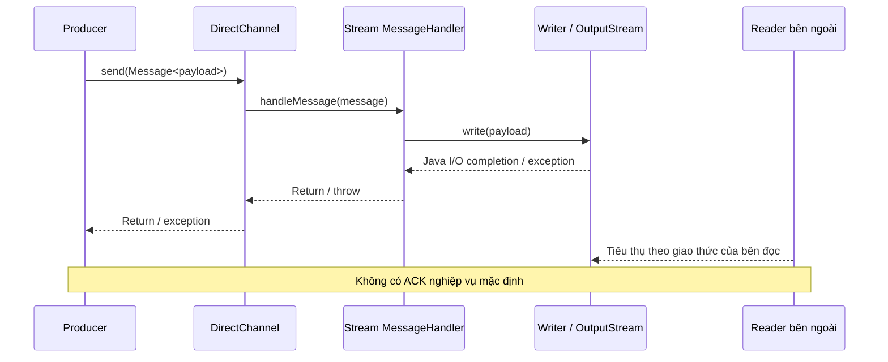

# Stream outbound channel adapter

## 1. Bối cảnh: đưa Spring Message ra một luồng I/O

Trong module **SPRING_INTEGRATION_ADAPTERS**, Spring Integration kết nối các hệ thống ngoài bằng inbound/outbound adapter, gateway, poller và `MessageChannel`. Người học thực hành trao đổi dữ liệu qua file, SFTP, HTTP, JMS, AMQP, Kafka, cơ sở dữ liệu, đồng thời phải hiểu hợp đồng message, lỗi và vòng đời kết nối. Chương **Adapter Stream** cung cấp một lựa chọn đơn giản hơn: chuyển payload của Spring message thành nội dung ghi vào `OutputStream` hoặc `Writer` của Java.

Ví dụ dịch vụ nhập dữ liệu nhận một sự kiện từ JMS, chuẩn hóa thành dòng NDJSON và ghi ra **standard output** để một tiến trình khác tiêu thụ:

```text
JMS / HTTP / SFTP / Database
                |
                v
       Business event
                |
          Transformer
                |
      Spring Message<String>
                |
                v
       outboundChannel
                |
                v
 CharacterStreamWritingMessageHandler
                |
                v
          System.out
                |
        shell pipe / log collector
```

Một luồng khác có thể gửi bytes đã mã hóa vào `ByteArrayOutputStream` trong bài test hoặc một `OutputStream` do ứng dụng sở hữu. **Outbound stream adapter** là endpoint một chiều ở cuối flow: nó nhận message từ channel và ghi payload sang stream đích, **không tự tạo phản hồi xác nhận của phía đọc**.

### Mục tiêu học tập

Sau bài học, bạn có thể:

1. Phân biệt `CharacterStreamWritingMessageHandler` và `ByteStreamWritingMessageHandler`.
2. Chọn đúng payload `String`/`char[]` hoặc `byte[]`, và chuyển mã hóa một cách tường minh.
3. Dùng `stdout()`, `stderr()`, `appendNewLine(true)` và XML stream namespace.
4. Cấu hình Java/Spring Boot với `DirectChannel`, `@ServiceActivator`, hoặc Integration DSL.
5. Giải thích vì sao **outbound handler không cần poller** khi consumer nhận trực tiếp từ channel.
6. Quản lý `Writer`/`OutputStream`, buffering, flush, close, stream ownership và concurrency.
7. Phân biệt **gửi vào channel**, **ghi ở tầng Java**, **được bên đọc tiêu thụ** và **commit nghiệp vụ**.
8. Thiết kế kiểm thử in-memory, xử lý lỗi, retry/idempotency, bảo mật và observability.

## 2. Outbound khác inbound: đảo chiều dữ liệu

| Tiêu chí | Stream inbound adapter | Stream outbound adapter |
| --- | --- | --- |
| Vai trò | **Source** đầu flow | **Handler** cuối flow |
| Nguồn/đích | `InputStream` hoặc `Reader` | `OutputStream` hoặc `Writer` |
| API thường dùng | `ByteStreamReadingMessageSource`, `CharacterStreamReadingMessageSource` | `ByteStreamWritingMessageHandler`, `CharacterStreamWritingMessageHandler` |
| Payload đi qua channel | `byte[]` hoặc `String` | `byte[]`, `String` hoặc các kiểu được handler hỗ trợ |
| Cách kích hoạt | Poller gọi `receive()` | Channel dispatch gọi `handleMessage()` |
| EOF | Có thể cần `StreamClosedEvent` ở character inbound | EOF không phải điều kiện kích hoạt outbound |
| Reply | Không mặc định | Không mặc định |

**Không cấu hình poller chỉ vì tên thành phần có chữ stream.** Với `DirectChannel`, outbound handler được gọi ngay khi producer gửi message. Nếu producer gửi vào `QueueChannel`, một **consumer poller** hoặc flow nhận từ queue mới cần thiết để lấy message chờ; poller không thuộc bản thân `ByteStreamWritingMessageHandler` hoặc `CharacterStreamWritingMessageHandler`.



Sơ đồ thể hiện chiều dữ liệu và ranh giới trách nhiệm. Bên đọc có thể là shell pipe, một chương trình Java khác, hệ thống log hoặc một thiết bị; **không có bước cuối nào được Spring Integration tự xác nhận**.

## 3. Hai handler outbound và kiểu payload

Spring Integration Stream cung cấp hai implementation chính của `MessageHandler`:

| Handler | Đối tượng đích | Hợp đồng payload an toàn | Mục đích |
| --- | --- | --- | --- |
| `CharacterStreamWritingMessageHandler` | `java.io.Writer` | `String` hoặc `char[]` | Text, console, NDJSON/CSV line |
| `ByteStreamWritingMessageHandler` | `java.io.OutputStream` | `byte[]` | Byte nhị phân, dữ liệu đã encode, binary protocol |

Với **Spring Integration 6.5.x**, cả hai class thuộc package **`org.springframework.integration.stream`**. Sang **Spring Integration 7.x**, handler ghi stream được chuyển sang package **`org.springframework.integration.stream.outbound`**. **Không trộn import 7.x với dependency 6.5.x** khi copy ví dụ.

### 3.1. CharacterStreamWritingMessageHandler

Constructor:

```java
import java.io.Writer;
import org.springframework.integration.stream.CharacterStreamWritingMessageHandler;

Writer target = /* Writer do ung dung cap */;
CharacterStreamWritingMessageHandler handler =
        new CharacterStreamWritingMessageHandler(target);
handler.setShouldAppendNewLine(true);
```

`Writer` có thể là `StringWriter`, `OutputStreamWriter`, `FileWriter` hoặc một writer khác do ứng dụng quản lý. Tham số tùy chọn `bufferSize` của constructor hai tham số được dùng cho buffering.

Theo Javadoc, handler có thể xử lý `String`, `char[]` và `byte[]`; với các object khác, nó dựa vào biểu diễn chuỗi. Tuy nhiên **không nên gửi DTO/JSON object tùy ý rồi dựa vào `toString()`**: biểu diễn có thể thay đổi, lộ thông tin nhạy cảm hoặc không đúng schema. Hãy dùng transformer để tạo `String` theo một hợp đồng cụ thể trước khi gửi.

### 3.2. ByteStreamWritingMessageHandler

Constructor:

```java
import java.io.OutputStream;
import org.springframework.integration.stream.ByteStreamWritingMessageHandler;

OutputStream target = /* OutputStream do ung dung cap */;
ByteStreamWritingMessageHandler handler =
        new ByteStreamWritingMessageHandler(target, 1024);
```

Handler này ghi **`byte[]`** vào `OutputStream`. Nếu nguồn là `String`, chuyển đổi mã hóa trước bằng `getBytes(StandardCharsets.UTF_8)` hoặc một transformer có charset rõ. **Không mong ByteStreamWritingMessageHandler tự serialize một POJO, JSON hay đối tượng `File`**.

`bufferSize=1024` trong constructor không có nghĩa mỗi message luôn 1024 byte, không quy định framing và **không biến luồng thành một hàng đợi bền vững**. Payload `byte[]` có thể dài hoặc ngắn khác nhau; byte được ghi theo các lần gọi handler.

### 3.3. Chọn handler nào?

| Yêu cầu | Nên chọn |
| --- | --- |
| Mỗi event thành một dòng UTF-8 trên stdout | `CharacterStreamWritingMessageHandler.stdout("UTF-8")` |
| Ghi thông báo lỗi dạng text ra stderr | `CharacterStreamWritingMessageHandler.stderr("UTF-8")` |
| Ghi một `StringWriter` trong unit test | Character handler với `StringWriter` |
| Ghi chunk nhị phân đã encode | Byte handler với `OutputStream` |
| Ghi protobuf/CBOR/ảnh | Serializer → `byte[]` → Byte handler |
| Đọc stdin, pipe hoặc file | **Inbound** adapter, không phải outbound |
| Ghi file kèm tên, suffix, rename atomically | File outbound adapter |
| Gửi dữ liệu qua socket và muốn framing/reconnect | TCP outbound adapter/gateway |

## 4. Newline: một message chưa chắc là một dòng

Mặc định, `CharacterStreamWritingMessageHandler` **không thêm ký tự xuống dòng** sau mỗi write. Nếu producer gửi:

```text
{"id":"evt-1","state":"CREATED"}
{"id":"evt-2","state":"PAID"}
```

thì bạn chỉ có được hai dòng đúng nghĩa khi payload đã có delimiter hoặc handler được cấu hình:

```java
CharacterStreamWritingMessageHandler handler =
        CharacterStreamWritingMessageHandler
                .stdout("UTF-8")
                .appendNewLine(true);
```

`appendNewLine(true)` là fluent API tương đương `setShouldAppendNewLine(true)` (có từ Spring Integration 5.4).

### Sai lầm khi không có delimiter

```text
payload 1 = "ORDER,1001,CREATED"
payload 2 = "ORDER,1002,PAID"

appendNewLine=false
  -> ORDER,1001,CREATEDORDER,1002,PAID

appendNewLine=true
  -> ORDER,1001,CREATED\n
     ORDER,1002,PAID\n
```

Đây là **minh họa về framing**, không phải output của một lần chạy thật. Nếu producer đã thêm `\n` vào payload rồi bật `appendNewLine(true)`, luồng có thể có **dòng trống**. Hãy chọn **một nơi duy nhất chịu trách nhiệm tạo delimiter**.

### Newline theo môi trường

Ký tự xuống dòng của `Writer` có thể phụ thuộc nền tảng; trong nhiều hệ thống line-oriented, Unix dùng LF còn Windows thường dùng CRLF. Nếu một bên đọc yêu cầu **chính xác LF** bất kể OS, hãy xây payload có `\n` tường minh và tắt `appendNewLine`, hoặc dùng byte handler với quy ước framing cụ thể.

### Một dòng không tự là một JSON record

Với NDJSON, mỗi record phải serialize thành **một JSON object trên một dòng**; escape các newline nằm trong giá trị chuỗi. Không dùng `Object.toString()` của DTO làm JSON. Nếu dữ liệu binary chứa `0x0A`, không thể lấy newline làm delimiter chung mà chưa có escaping/framing.

## 5. Stdout và stderr là hai đích khác nhau

`CharacterStreamWritingMessageHandler` có các factory method:

| API | Đích | Charset |
| --- | --- | --- |
| `stdout()` | `System.out` | Mặc định của môi trường/factory |
| `stdout("UTF-8")` | `System.out` | UTF-8 |
| `stderr()` | `System.err` | Mặc định |
| `stderr("UTF-8")` | `System.err` | UTF-8 |

Hai stream có cách dùng khác nhau:

- **stdout**: dữ liệu thành phẩm cho shell pipeline hoặc chương trình đọc tiếp.
- **stderr**: chẩn đoán hoặc lỗi vận hành; quy tắc log/mask riêng.

Ví dụ Unix/Linux:

```bash
java -jar integration-app.jar > orders.ndjson 2> errors.log
```

Khi stdout là kênh **dữ liệu có cấu trúc**, tránh cho Spring Boot banner, `System.out.println` debug hoặc logger ghi chung ra stdout; chúng có thể chèn text giữa các bản ghi NDJSON và làm hỏng parser bên đọc. Cấu hình logger ra stderr hoặc kênh riêng, và cân nhắc tắt banner ở tiến trình thực hiện data piping.

### stdout/stderr không phải queue có ACK

Hệ điều hành có thể redirect một standard stream ra file hoặc pipe; handler không biết một chương trình downstream đã parse và commit dữ liệu chưa. `System.out` có thể bị đóng từ phía reader, hoặc stream có thể hỏng ở quá trình xuất; chính sách xử lý lỗi còn phụ thuộc lớp Java writer/print stream.

**Không tự đóng `System.out` hay `System.err` trong một handler chạy cùng JVM**, vì nhiều component khác còn sử dụng. Với file/network stream do ứng dụng mở, phải quy định vòng đời/ownership riêng.

## 6. Ví dụ Spring Boot hoàn chỉnh: xuất hai kênh text

Ví dụ sau dùng **Java 17+**, Spring Boot và Spring Integration 6.5.x. Một Spring flow gửi sự kiện nghiệp vụ sang stdout và dòng lỗi sang stderr. Cả hai đều dùng `DirectChannel` và **không dùng poller**.

### 6.1. Maven dependencies

```xml
<dependencies>
    <dependency>
        <groupId>org.springframework.boot</groupId>
        <artifactId>spring-boot-starter-integration</artifactId>
    </dependency>
    <dependency>
        <groupId>org.springframework.integration</groupId>
        <artifactId>spring-integration-stream</artifactId>
    </dependency>
</dependencies>
```

Khi dùng BOM Spring Boot, dependency versions phải được quản lý đồng bộ. Nếu không có BOM, chọn Spring Integration Core/Stream có version tương thích. Không chỉ thay package import thành 7.x trong một ứng dụng còn dùng 6.5.x.

### 6.2. Java configuration và producer

```java
import org.springframework.beans.factory.annotation.Qualifier;
import org.springframework.boot.ApplicationRunner;
import org.springframework.boot.SpringApplication;
import org.springframework.boot.autoconfigure.SpringBootApplication;
import org.springframework.context.annotation.Bean;
import org.springframework.integration.annotation.ServiceActivator;
import org.springframework.integration.channel.DirectChannel;
import org.springframework.integration.config.EnableIntegration;
import org.springframework.integration.stream.CharacterStreamWritingMessageHandler;
import org.springframework.messaging.MessageChannel;
import org.springframework.messaging.support.MessageBuilder;

@SpringBootApplication
@EnableIntegration
public class StreamOutboundApplication {

    public static void main(String[] args) {
        SpringApplication.run(StreamOutboundApplication.class, args);
    }

    @Bean
    public MessageChannel businessOutputChannel() {
        return new DirectChannel();
    }

    @Bean
    public MessageChannel diagnosticsOutputChannel() {
        return new DirectChannel();
    }

    @Bean
    @ServiceActivator(inputChannel = "businessOutputChannel")
    public CharacterStreamWritingMessageHandler writeToStdout() {
        return CharacterStreamWritingMessageHandler
                .stdout("UTF-8")
                .appendNewLine(true);
    }

    @Bean
    @ServiceActivator(inputChannel = "diagnosticsOutputChannel")
    public CharacterStreamWritingMessageHandler writeToStderr() {
        return CharacterStreamWritingMessageHandler
                .stderr("UTF-8")
                .appendNewLine(true);
    }

    @Bean
    public ApplicationRunner publishDemo(
            @Qualifier("businessOutputChannel") MessageChannel business,
            @Qualifier("diagnosticsOutputChannel") MessageChannel diagnostics) {

        return args -> {
            boolean first = business.send(
                    MessageBuilder.withPayload(
                        "{\"eventId\":\"evt-1\",\"state\":\"CREATED\"}"
                    ).build()
            );
            boolean second = business.send(
                    MessageBuilder.withPayload(
                        "{\"eventId\":\"evt-2\",\"state\":\"PAID\"}"
                    ).build()
            );
            boolean error = diagnostics.send(
                    MessageBuilder.withPayload(
                        "WARN: input record has invalid status"
                    ).build()
            );

            if (!(first && second && error)) {
                throw new IllegalStateException(
                        "One outbound channel rejected a message"
                );
            }
        };
    }
}
```

### 6.3. Giải thích luồng

1. `ApplicationRunner` tạo các `Message<String>` với `MessageBuilder`.
2. `businessOutputChannel` chuyển text sang `writeToStdout()`.
3. `diagnosticsOutputChannel` chuyển thông điệp chẩn đoán sang `writeToStderr()`.
4. `CharacterStreamWritingMessageHandler` ghi payload bằng encoding đã chọn.
5. `appendNewLine(true)` thêm delimiter sau mỗi message.
6. `DirectChannel` dispatch đồng bộ; handler có thể ném exception khi ghi gặp lỗi, nhưng điều đó **không tạo ACK downstream**.

**Chỉ có một component Java `@SpringBootApplication` trong ví dụ chính.** File Java đặt trong package phù hợp, đã cài Java 17+ và có thư viện Spring Boot/Spring Integration. Phải tự build ứng dụng và dùng đúng JAR; bài Knowledge này **chưa chạy chương trình**.

### 6.4. Kết quả kỳ vọng

Trên stdout, ngoài các log/banner nếu chưa cấu hình tách riêng, payload **NDJSON** kỳ vọng là:

```text
{"eventId":"evt-1","state":"CREATED"}
{"eventId":"evt-2","state":"PAID"}
```

Trên stderr:

```text
WARN: input record has invalid status
```

**Đây là output dự kiến**, không phải log đã chạy. Nếu muốn file stdout chỉ có hai dòng JSON, phải cấu hình logging/banner/diagnostics không phát vào stdout và không sử dụng `System.out.println` từ các bean khác.

## 7. Không phụ thuộc terminal: ghi vào một Writer tùy chỉnh

Trong các bài test, `StringWriter` giúp quan sát dữ liệu text mà không đụng đến `System.out`:

```java
import java.io.StringWriter;

import org.springframework.integration.stream.CharacterStreamWritingMessageHandler;
import org.springframework.messaging.support.MessageBuilder;

StringWriter buffer = new StringWriter();
CharacterStreamWritingMessageHandler writer =
        new CharacterStreamWritingMessageHandler(buffer);
writer.setShouldAppendNewLine(true);

writer.handleMessage(
        MessageBuilder.withPayload("ALPHA").build()
);
writer.handleMessage(
        MessageBuilder.withPayload("BETA").build()
);

String result = buffer.toString();
```

Đây là **đoạn test minh họa** sử dụng handler trực tiếp; khi đặt vào JUnit/Spring test, cần khởi tạo lifecycle theo contract của `AbstractMessageHandler` và assert kết quả **sau khi writer đã được flush**. Không nên test raw `System.out` bằng cách thay stream JVM toàn cục khi các test khác chạy song song.

### Nếu cần nối với channel thay vì gọi handler trực tiếp

```java
@Bean
public MessageChannel textOut() {
    return new DirectChannel();
}

@Bean
@ServiceActivator(inputChannel = "textOut")
public CharacterStreamWritingMessageHandler sink(StringWriter target) {
    return new CharacterStreamWritingMessageHandler(target)
            .appendNewLine(true);
}
```

Đoạn trên là **mảnh cấu hình**, giả định bean `StringWriter target` đã được cung cấp. Đặt nó trong `@Configuration` riêng để không tạo thêm consumer cạnh tranh với handler stdout của ví dụ chính.

## 8. Ví dụ byte[]: không biến binary thành text

Nếu nguồn đã có `byte[]` từ một serializer, có thể xuất thẳng qua `ByteStreamWritingMessageHandler`.

### 8.1. Cấu hình Java riêng cho dữ liệu byte

Đây là **một phương án thay thế** độc lập với stdout text. Trong Spring Boot test, dùng `ByteArrayOutputStream`:

```java
import java.io.ByteArrayOutputStream;
import org.springframework.beans.factory.annotation.Qualifier;
import org.springframework.context.annotation.Bean;
import org.springframework.context.annotation.Configuration;
import org.springframework.integration.annotation.ServiceActivator;
import org.springframework.integration.channel.DirectChannel;
import org.springframework.integration.config.EnableIntegration;
import org.springframework.integration.stream.ByteStreamWritingMessageHandler;
import org.springframework.messaging.MessageChannel;

@Configuration
@EnableIntegration
public class BinaryStreamOutboundConfig {

    @Bean
    public MessageChannel binaryOutputChannel() {
        return new DirectChannel();
    }

    @Bean
    public ByteArrayOutputStream binaryCaptureStream() {
        return new ByteArrayOutputStream();
    }

    @Bean
    @ServiceActivator(inputChannel = "binaryOutputChannel")
    public ByteStreamWritingMessageHandler binaryWriter(
            @Qualifier("binaryCaptureStream")
            ByteArrayOutputStream target) {
        return new ByteStreamWritingMessageHandler(target, 1024);
    }
}
```

### 8.2. Producer gửi bytes

```java
import org.springframework.messaging.support.MessageBuilder;

byte[] first = new byte[] {0x01, 0x02, 0x03};
byte[] second = new byte[] {0x04, 0x05};

binaryOutputChannel.send(
        MessageBuilder.withPayload(first).build()
);
binaryOutputChannel.send(
        MessageBuilder.withPayload(second).build()
);
```

Đây là **mảnh producer**: biến `binaryOutputChannel` là bean `MessageChannel` của cấu hình ở trên. Khi dữ liệu đã ghi/flush đầy đủ vào `ByteArrayOutputStream` và không có thao tác xen kẽ, byte kỳ vọng là `01 02 03 04 05`, **không tự có delimiter**, prefix length hoặc ký tự xuống dòng.

### 8.3. Phân tích nhị phân

| Vấn đề | Cần hiểu |
| --- | --- |
| Payload `byte[]` | Giữ nguyên nội dung byte theo hợp đồng encoder |
| Hai lần send | Không tạo hai “record” ở stream nếu bên đọc không biết framing |
| `bufferSize` | Buffer ghi I/O, không phải số byte mỗi message |
| `OutputStream.flush()` | Có thể quan trọng để dữ liệu qua các lớp buffer; không bảo đảm disk fsync |
| `ByteArrayOutputStream` | In-memory test sink, không có tính bền vững sau JVM stop |
| Consumer đồng thời | Phải kiểm soát thứ tự và ranh giới giữa các lần ghi |

**Không biến nhị phân sang String để gọi CharacterStreamWritingMessageHandler** trừ khi giao thức đã quy định text encoding như Base64/hex. Việc dùng charset tùy tiện có thể thay đổi byte hoặc làm hỏng dữ liệu.

## 9. Charset và chuyển đổi payload

`CharacterStreamWritingMessageHandler.stdout("UTF-8")` chọn charset khi tạo writer trên standard output. Nếu đích là một `Writer` được cấp từ ngoài, charset (nếu có) đã được quyết định **lúc tạo writer**, không thể sửa bằng một Spring header `charset` tùy ý.

### Text → bytes

```java
import java.nio.charset.StandardCharsets;
import org.springframework.messaging.support.MessageBuilder;

String line = "{\"eventId\":\"evt-42\",\"status\":\"PAID\"}\n";
byte[] utf8 = line.getBytes(StandardCharsets.UTF_8);

binaryOutputChannel.send(
        MessageBuilder.withPayload(utf8).build()
);
```

Đoạn này hợp lệ cho byte handler vì producer đã encode UTF-8 tường minh. Nó không yêu cầu handler tự hiểu JSON.

### Bytes → text

Nếu producer đang có một byte array mà đích yêu cầu text, cần giải mã bằng charset đúng:

```java
import java.nio.charset.StandardCharsets;

byte[] payload = /* bytes da xac minh la UTF-8 */;
String text = new String(payload, StandardCharsets.UTF_8);
```

Đây là mảnh code minh họa, phải kiểm tra dữ liệu đầu vào và cách xử lý malformed encoding. Không giải mã từng chunk khi một ký tự UTF-8 có thể bị chia giữa các chunk; dùng decoder giữ trạng thái hoặc reassembler.

### Vì sao không dùng default charset?

| Môi trường | Rủi ro |
| --- | --- |
| Laptop developer | Terminal và JVM có thể dùng cấu hình khác |
| Container Linux | Locale/JVM options khác máy local |
| Windows PowerShell | Encoding của console, redirection và pipe có thể khác |
| Kết nối process-to-process | Đầu đọc có thể quy định UTF-8 hoặc định dạng binary riêng |

Trong giao tiếp máy–máy, ghi rõ **charset trong hợp đồng**, ví dụ UTF-8 + LF + NDJSON + schema version, để các bên parse thống nhất.

## 10. XML namespace: stdout và stderr channel adapter

Spring Integration hỗ trợ namespace `int-stream` để tạo stdout/stderr outbound adapter:

```xml
<?xml version="1.0" encoding="UTF-8"?>
<beans:beans
    xmlns:beans="http://www.springframework.org/schema/beans"
    xmlns:xsi="http://www.w3.org/2001/XMLSchema-instance"
    xmlns:int="http://www.springframework.org/schema/integration"
    xmlns:int-stream="http://www.springframework.org/schema/integration/stream"
    xsi:schemaLocation="
        http://www.springframework.org/schema/beans
        https://www.springframework.org/schema/beans/spring-beans.xsd
        http://www.springframework.org/schema/integration
        https://www.springframework.org/schema/integration/spring-integration.xsd
        http://www.springframework.org/schema/integration/stream
        https://www.springframework.org/schema/integration/stream/spring-integration-stream.xsd">

    <int:channel id="stdoutEvents"/>
    <int:channel id="stderrEvents"/>

    <int-stream:stdout-channel-adapter
        id="stdoutWriter"
        channel="stdoutEvents"
        charset="UTF-8"
        append-newline="true"/>

    <int-stream:stderr-channel-adapter
        id="stderrWriter"
        channel="stderrEvents"
        charset="UTF-8"/>

    <!-- Producers/routers send String payloads to these channels. -->
</beans:beans>
```

Đây là **phương án XML thay cho cấu hình Java** ở mục 6. XML chưa có producer thực; một `MessageHandler` hoặc gateway phía trước phải gửi vào hai channel. Nếu dùng cả Java và XML cùng một context mà có hai consumer đọc cùng channel, hãy kiểm tra semantics phân phối; đừng để dữ liệu xuất không nhất quán.

### Các thuộc tính thường dùng

| Thuộc tính | Ý nghĩa |
| --- | --- |
| `channel` | Spring channel mà outbound adapter subscribe |
| `charset` | Charset của writer stdout/stderr |
| `append-newline` | Có thêm newline sau mỗi message hay không |
| `id` | Bean/endpoint id phục vụ lifecycle và quan sát |

Reference Spring Integration 6.5 có ví dụ rõ cho `stdout-channel-adapter` với `charset` và `append-newline`, và `stderr-channel-adapter` cho stderr.

### XML với một OutputStream tùy chỉnh

Nếu đích không phải stdout/stderr, có thể khai báo handler bean và một `int:outbound-channel-adapter` tham chiếu tới nó:

```xml
<!-- outputStream la bean OutputStream duoc quan ly boi ung dung. -->
<beans:bean id="binaryWritingHandler"
            class="org.springframework.integration.stream.ByteStreamWritingMessageHandler">
    <beans:constructor-arg ref="outputStream"/>
    <beans:constructor-arg value="1024"/>
</beans:bean>

<int:channel id="binaryEvents"/>

<int:outbound-channel-adapter
    id="binaryStreamAdapter"
    channel="binaryEvents"
    ref="binaryWritingHandler"/>
```

Đoạn thứ hai là **mảnh cấu hình**, không phải XML standalone: cần khai báo bean `outputStream` và nguồn phát `byte[]` riêng. Với đích có lifecycle phức tạp, Java configuration thường dễ thể hiện resource ownership và cleanup hơn.

## 11. Integration Java DSL: cấu hình thay thế ngắn gọn

Không bắt buộc dùng `@ServiceActivator`; vì handler triển khai `MessageHandler`, có thể đưa nó vào Integration DSL:

```java
import org.springframework.context.annotation.Bean;
import org.springframework.context.annotation.Configuration;
import org.springframework.integration.config.EnableIntegration;
import org.springframework.integration.dsl.IntegrationFlow;
import org.springframework.integration.stream.CharacterStreamWritingMessageHandler;

@Configuration
@EnableIntegration
public class StdoutDslConfig {

    @Bean
    public IntegrationFlow stdoutFlow() {
        return IntegrationFlow
                .from("textOutboundInput")
                .handle(
                    CharacterStreamWritingMessageHandler
                        .stdout("UTF-8")
                        .appendNewLine(true)
                )
                .get();
    }
}
```

Đây là **cách cấu hình thay thế** Java ở mục 6; chỉ nên triển khai một handler chịu trách nhiệm ghi stdout cho cùng flow. Nếu channel `textOutboundInput` chưa tồn tại, Java DSL có thể đăng ký một kênh mặc định tùy ngữ cảnh, nhưng nên quản lý tên channel/producer rõ ràng trong ứng dụng lớn.

**Không khai báo poller trong flow chỉ dùng `DirectChannel` để đưa message vào outbound handler**. Nếu đầu vào là `PollableChannel` thì nơi tiêu thụ cần poller theo cơ chế của DSL/framework.

## 12. Buffering, flush và khả năng quan sát nội dung

Ghi stream có thể qua nhiều tầng:

```text
Message payload
      |
      v
WritingMessageHandler
      |
 Java BufferedWriter / BufferedOutputStream
      |
 OS kernel buffer / pipe / filesystem
      |
 Reader process hoặc device
```

### Buffer size không phải batch size

Constructor `(Writer, int bufferSize)` hoặc `(OutputStream, int bufferSize)` là cấu hình buffer ở tầng I/O. Nó không có nghĩa:

- Handler đợi đủ `N` Spring messages trước khi ghi.
- Mỗi message được tự cắt thành record dài đúng `N` byte.
- Một message được commit atomically khi đủ buffer.
- Flush đồng nghĩa đã ghi bền ra ổ đĩa.

Đặc tính flush có thể phụ thuộc **các lớp stream/writer bên dưới và cách handler ghi trong phiên bản đang chạy**. Hãy test với một sink thật của môi trường; đừng dùng việc `channel.send()` trả `true` làm bằng chứng reader bên kia đã nhận dữ liệu.

### Flush và durability khác nhau

| Sự kiện | Ý nghĩa tối đa có thể suy ra |
| --- | --- |
| Producer tạo `Message<?>` | Event tồn tại trong memory |
| `DirectChannel.send()` được chấp nhận | Message đã được dispatch theo channel semantics |
| Handler gọi `write(...)` không lỗi | Lệnh ghi Java đã hoàn thành trong phạm vi wrapper |
| `flush()` thành công | Dữ liệu đã được đẩy qua một số lớp đệm của writer |
| Reader đọc được bytes | Phía đọc đã nhận bytes |
| Reader gửi ACK nghiệp vụ | Có thể xác nhận đã xử lý theo hợp đồng |
| Database fsync/transaction commit | Độ bền theo hệ thống lưu trữ, không tự đến từ stream handler |

Với file có yêu cầu **atomic visibility**, chọn File outbound adapter + temporary suffix/rename hoặc `Files.move(ATOMIC_MOVE)` khi filesystem hỗ trợ. Stream outbound không tự đóng gói cả record thành một file được publish nguyên tử.

### Broken pipe và các tình huống đóng stream

Nếu tiến trình nhận pipe kết thúc trước, thao tác ghi có thể:

- Ném `IOException` (trong lớp writer/stream tương ứng).
- Bị buffer lại và chỉ phát hiện lỗi ở bước flush/close.
- Bị che/đánh dấu lỗi theo hành vi của một `PrintStream`.

**Hãy kiểm thử thực tế với sink đã đóng hoặc reader ngắt giữa chừng**. Không được khẳng định rằng mọi lỗi stdout/stderr sẽ luôn thành Spring `MessagingException` hoặc luôn hiện ngay trong producer.

## 13. Concurrency: nhiều producer ghi chung một stream

`DirectChannel` gọi handler trên thread gửi message. Nếu nhiều thread cùng gửi vào channel, cần xác định **tính tuần tự**, nhất là nếu có nhiều channel/handler cùng ghi một `Writer`:

```text
Thread A -> Message "BEGIN-A\n"
Thread B -> Message "BEGIN-B\n"
Thread A -> Message "END-A\n"
Thread B -> Message "END-B\n"
```

Ngay cả khi không làm hỏng từng ký tự, **thứ tự record** có thể không trùng thứ tự sự kiện nghiệp vụ. Nếu hai component sở hữu hai writer khác nhau cùng bọc `System.out`, output có thể bị xen kẽ.

### Quy tắc đề xuất

1. Dùng **một chủ sở hữu ghi** cho mỗi đích stream hoặc có cơ chế đồng bộ/serialize rõ ràng.
2. Nếu cần thứ tự theo `orderId`/`tenantId`, dùng dispatcher/partition key phù hợp; `ExecutorChannel` có thể đổi thứ tự.
3. Chọn giới hạn buffer/queue và cách phản ứng khi downstream chậm.
4. Không ghi một giao dịch nhiều message rồi tưởng nó là một record atomically.
5. Dừng producer trước, cho handler hoàn tất, rồi mới flush/close nguồn đích do ứng dụng sở hữu.

### Ghi nhiều message không tạo transaction

Hai lần gọi `send()` có thể khiến downstream thấy một message dù lần thứ hai lỗi. Nếu hai event phải commit cùng nhau, dùng một protocol/transaction ở tầng đích có xác nhận, không chỉ dùng Stream outbound adapter.

## 14. Error handling: phân biệt đường đồng bộ và bất đồng bộ

Lỗi ghi stream có thể phát sinh từ payload không hợp lệ, writer/stream đã đóng, lỗi pipe, filesystem đầy hoặc consumer không có năng lực nhận.

| Tình huống | Dấu hiệu | Hướng xử lý |
| --- | --- | --- |
| Gửi `String` vào byte handler | Sai contract payload | Transformer thành `byte[]` |
| Charset không tương thích | Ký tự sai/thay thế | UTF-8 thống nhất, validation encoding |
| Stream đích đã đóng | IOException hoặc lỗi khi flush | Tái tạo tài nguyên theo lifecycle |
| Pipe bên nhận kết thúc | Broken pipe/IO error | Dừng producer hoặc fallback có kiểm soát |
| Disk đầy/quota | Write/flush fail | Health/alert, không retry vô hạn |
| Consumer ghi chậm | Thread send bị chặn/backlog | Bounded queue, backpressure |
| Hai handler ghi một stream | Nội dung bị xen kẽ | Một owner, serialize |
| Retry sau lỗi giữa record | Có thể tạo byte/text trùng một phần | Framing + idempotency bên nhận |
| stdout lẫn log | NDJSON invalid | Tách logging khỏi data stream |

### Với DirectChannel

Khi producer gửi vào `DirectChannel`, việc xử lý thường diễn ra **đồng bộ trên thread producer**. Exception từ handler có thể quay về sender qua cơ chế Spring Messaging; xử lý tại caller hoặc bằng advice/error strategy đã cấu hình. **Không mặc định toàn bộ lỗi đồng bộ được gửi vào global `errorChannel`**.

### Với ExecutorChannel/QueueChannel

Nếu chuyển việc ghi sang thread khác hoặc queue, lỗi có thể đi qua **`ErrorMessage`/`errorChannel` tùy endpoint, scheduler và cách framework cấu hình**. Producer có thể đã nhận `send=true` trước khi handler thật sự gọi `write(...)`. Cần integration test để khẳng định semantics.

### Error channel không phải ACK bên đọc

Một `ErrorMessage` biểu thị exception ở đường xử lý Spring; nó không bao gồm việc reader đã parse thành công hoặc đã ghi database. Muốn xác nhận việc đã xử lý, cần **ACK nghiệp vụ riêng** với event ID và correlation.

## 15. Retry, mất dữ liệu và xử lý trùng một phần

Stream writer là điểm cuối **có hiệu ứng phụ**: khi ghi đã tiến triển đến một số byte rồi lỗi, không chắc có thể “undo”.

```text
eventId=evt-42
  -> write 20 bytes
  -> pipe breaks / exception
  -> retry same event

Reader có thể đã nhận:
  prefix(evt-42) + full(evt-42)
```

Do vậy:

- Không tự động retry vô hạn một `write()` khi không biết phần nào đã ra stream.
- Với text, thiết kế **framing rõ ràng** (ví dụ một NDJSON object mỗi dòng).
- Với binary, dùng length-prefix, checksum và event ID hoặc một giao thức tương ứng.
- Giữ **event ID ổn định qua retry**, consumer xử lý idempotent.
- Với dữ liệu quan trọng, lưu nguồn event trong durable outbox/broker trước khi gửi ra stream.
- Khi reader có khả năng trả ACK, dùng kênh xác nhận riêng; standard output một chiều **không cung cấp ACK**.
- Nếu stdout chỉ phục vụ telemetry best-effort, có thể chọn drop theo chính sách rõ ràng thay vì xây một hệ thống ACK phức tạp.

### File đặc biệt khác file outbound adapter

Có thể bọc một file trong `FileOutputStream` và gửi bytes qua Stream outbound. Nhưng khi ứng dụng cần:

- Tạo file mới theo tên từ `FileHeaders.FILENAME`.
- Ghi vào thư mục theo chính sách `FileExistsMode`.
- Dùng temporary suffix và rename/publish atomically.
- Quản lý từng file như một đơn vị nghiệp vụ.

thì **File outbound channel adapter/gateway** phù hợp hơn. Stream adapter chỉ biết **một OutputStream/Writer đã được cấp**.

## 16. Vòng đời tài nguyên: ai đóng OutputStream?

Một `Writer`/`OutputStream` có thể là:

- `System.out` / `System.err`: tài nguyên toàn JVM.
- `ByteArrayOutputStream` / `StringWriter`: buffer in-memory.
- `FileOutputStream`: file descriptor.
- Pipe/socket output do thư viện hoặc hạ tầng cung cấp.

### Quy tắc ownership

| Tài nguyên | Chủ sở hữu nên là ai? | Lưu ý |
| --- | --- | --- |
| `System.out`/`System.err` | JVM/runtime | Không đóng từ một handler |
| Stream được `@Bean` mở | Application context/bean lifecycle | Có kế hoạch flush/close khi stop |
| `ByteArrayOutputStream`/`StringWriter` | Test hoặc ứng dụng | Không bền vững, dễ snapshot |
| Socket output | Connection manager | Cần timeout/reconnect, tránh tái sử dụng stream stale |
| Output file | Resource manager của ứng dụng | Flush/close, xử lý crash/atomic publication |

Không nhất thiết handler chịu trách nhiệm đóng mọi stream; hãy kiểm tra Javadoc/lifecycle của phiên bản đang dùng, constructor và lớp stream được bọc. **Không gọi `close()` nhiều lần từ nhiều bean** không phối hợp.

### Thứ tự shutdown đề xuất

```text
1. Ngừng nhận event mới
2. Dừng producer/dispatcher
3. Drain các message còn chờ có giới hạn thời gian
4. Chờ handler ghi/flush hoàn tất theo chính sách
5. Close resource do ứng dụng sở hữu
6. Ghi metric lỗi/quá hạn và kết thúc
```

Nếu process bị kill đột ngột hoặc mất điện, không thể bảo đảm mọi bước trên chạy. Với yêu cầu chống mất dữ liệu, cần **bộ nhớ bền vững ở tầng trước stream writer**.

## 17. Kiểm thử: trường hợp in-memory, console và nguồn lỗi

Không cần kết nối JMS/SFTP/Kafka thật để kiểm thử riêng handler stream. Có thể dùng `StringWriter` và `ByteArrayOutputStream` ở mức unit/integration.

### 17.1. Test ký tự và newline

Tạo `StringWriter`, gửi hai `Message<String>` qua character handler đã bật `appendNewLine(true)`, kiểm tra chuỗi sau khi xử lý/flush có **hai record tách nhau**. Lặp lại với `appendNewLine(false)` để thấy hai payload nối liền.

### 17.2. Test binary payload

Với `ByteArrayOutputStream`:

```java
byte[] bytes = new byte[] {0x10, 0x11, 0x12};
ByteStreamWritingMessageHandler handler =
        new ByteStreamWritingMessageHandler(output);

handler.handleMessage(
        MessageBuilder.withPayload(bytes).build()
);
```

`output` là một `ByteArrayOutputStream` đã được tạo trong test. Đặt đoạn code trong test class có imports và lifecycle phù hợp; đọc `output.toByteArray()` **sau khi handler hoàn tất và mọi buffer cần thiết được flush**. Kỳ vọng byte nhận tương ứng với `10 11 12` theo hex. Không phải một test đã được chạy trong bài này.

### 17.3. Test lỗi ghi

Tạo một `OutputStream` test ném `IOException` sau khi nhận vài byte:

```java
import java.io.IOException;
import java.io.OutputStream;

public class FailingOutputStream extends OutputStream {

    private int remaining = 2;

    @Override
    public void write(int value) throws IOException {
        if (remaining-- <= 0) {
            throw new IOException("Simulated sink failure");
        }
    }
}
```

`FailingOutputStream` là một fixture test có thể lưu thành file riêng khi bạn triển khai JUnit. Nó giả lập **partial write**: hai byte đầu có thể được nhận trước khi ngoại lệ được ném.

Khi đưa fixture này vào byte handler, xác minh loại exception Spring Messaging mà producer thấy trong **đúng cấu hình channel**. Không hard-code một exception duy nhất theo suy luận; framework và các wrapper có thể thay đổi kiểu.

### 17.4. Test concurrency và ordering

- Gửi đồng thời 100 message từ nhiều thread vào cùng channel; kiểm tra output có đủ record, thứ tự thế nào.
- Bật `ExecutorChannel`, so sánh với `DirectChannel` về ordering và lỗi xuất hiện ở thread nào.
- Thêm bounded queue và consumer chậm; ghi lại thời gian `send` hoặc queue-depth.
- Dừng ứng dụng khi còn 10 message chờ, xác minh chính sách drain/drop.

### 17.5. Test pipe stdout/stderr

- Chạy một phiên bản test trên Unix/Linux bằng redirect ra file; kiểm tra stdout chỉ chứa NDJSON hợp lệ.
- Đóng pipe bên đọc sớm; quan sát hành vi broken pipe/flush của runtime.
- So sánh UTF-8 và các charset khác; dùng text tiếng Việt và emoji.
- Không thử gửi secret thật lên stdout/stderr.

## 18. Observability và bảo mật

### Metric nên quan sát

| Metric gợi ý | Ý nghĩa | Giới hạn |
| --- | --- | --- |
| `stream_outbound_messages_total` | Số Spring message đi qua handler | Không đồng nghĩa reader đã xử lý |
| `stream_outbound_bytes_total` | Ước lượng byte thực tế đã yêu cầu ghi | Cần thống nhất cách tính và retry |
| `stream_outbound_write_errors_total` | Lỗi lúc ghi/flush | Một số lỗi PrintStream có cách báo khác |
| `stream_outbound_queue_depth` | Backlog khi dùng bounded queue | Không có nếu chỉ DirectChannel |
| `stream_outbound_processing_seconds` | Độ trễ từ dispatch đến handler hoàn tất | Chưa đo được ACK bên nhận |
| `stream_outbound_retries_total` | Retry sau lỗi | Cần phân loại retry-safe/uncertain |
| `stream_outbound_dropped_total` | Message bị bỏ theo chính sách | Phải có audit/cảnh báo |

Đây là **tên metric do ứng dụng tự đề xuất**, không phải tất cả được Spring Integration sinh mặc định.

### Bảo mật đầu ra

1. **Không log secrets:** payload có thể chứa token, thông tin khách hàng hoặc đường dẫn nội bộ.
2. **Giữ ranh giới dữ liệu/log:** stdout dùng cho giao thức máy–máy phải sạch, stderr chứa log được kiểm soát.
3. **Validate dữ liệu trước khi ghi:** JSON/CSV/schema, size, newline injection và nội dung không phù hợp.
4. **Escape theo ngữ cảnh:** terminal control codes/ANSI escape từ input không tin cậy có thể thao túng hiển thị/log.
5. **Giới hạn rate và kích thước:** một producer có thể làm đầy pipe, disk hoặc RAM.
6. **Quản lý quyền file/pipe:** đừng ghi dữ liệu riêng tư vào destination công khai.
7. **Không tự thực thi command:** stream payload luôn là dữ liệu, không phải lệnh shell.
8. **Không dump toàn bộ byte binary** vào log trừ khi thật sự cần và có retention/phân quyền.
9. **Dùng TLS ở giao thức mạng thích hợp:** Stream adapter không tự thêm TLS lên một `OutputStream`.
10. **Audit trạng thái lỗi:** phân biệt đã nhận vào channel, đã ghi Java, đã ACK và đã commit.

## 19. Khi nào không nên dùng stream outbound?

| Yêu cầu | Adapter/công cụ thích hợp hơn |
| --- | --- |
| Ghi file theo tên/tạm suffix/rename | File outbound adapter |
| Upload file lên SFTP/FTP/SMB | Remote file outbound adapter |
| Gửi HTTP request và cần response/status | HTTP outbound gateway |
| Gửi đến hàng đợi có ACK/transaction | JMS hoặc AMQP outbound |
| Phát event đến topic có partition/offset | Kafka outbound |
| Giao tiếp TCP và cần framing/reconnect | TCP adapter/gateway |
| Ghi dữ liệu tới database | JDBC outbound adapter/gateway |
| Ghi log có cấu trúc, rotation, retention | Logging framework/appender phù hợp |
| Pipe text cho CLI và script | **Stream outbound** |
| Ghi bytes vào stream do Java SDK khác cung cấp | **Stream outbound byte** |

Stream outbound là lựa chọn tốt khi điểm đích thực sự được biểu diễn dưới dạng **`OutputStream` hoặc `Writer`**, không phải khi bạn chỉ muốn một tên chung cho Kafka Streams, Java `Stream<T>` hay streaming API của hệ thống khác.

## 20. Troubleshooting

| Hiện tượng | Nguyên nhân có thể | Hướng khắc phục |
| --- | --- | --- |
| `ByteStreamWritingMessageHandler` báo lỗi kiểu | Gửi `String`/POJO thay vì `byte[]` | Encode bằng charset/serializer |
| Java import không compile | Dùng package `.stream.outbound` của SI 7.x với SI 6.5 | Đổi import đúng phiên bản |
| Hai message xuất liền nhau | `appendNewLine=false` hoặc payload không có delimiter | Bật newline hoặc tạo delimiter một nơi |
| Thừa dòng trống | Payload có `\n` và handler cũng append newline | Chỉ tạo delimiter một lần |
| Emoji/tiếng Việt lỗi | Charset writer khác consumer | Dùng UTF-8 end-to-end |
| stdout NDJSON parse lỗi | Log/banner xen vào stream dữ liệu | Chuyển log sang stderr, tắt banner |
| stderr không có xuống dòng | Chưa bật append newline / payload không có newline | Cấu hình delimiter |
| Không có dữ liệu ra file/pipe ngay | Buffer chưa flush, sink chậm/đóng | Kiểm tra writer, flush/lifecycle, reader |
| `channel.send()` trả true nhưng bên nhận không thấy | Không có ACK; async buffering hoặc reader chưa đọc | Đo end-to-end, correlation |
| Có duplicate sau retry | Partial write, send lại cùng message | Framing/event ID/idempotency |
| Consumer đang block | Pipe hoặc writer chậm, DirectChannel đồng bộ | Backpressure/queue hữu hạn/timeout |
| Data bị xen kẽ | Nhiều thread/handler cùng ghi stream | Chỉ định một writer owner, serialize |
| Không thấy exception trong `errorChannel` | Lỗi trên đường sync caller hoặc bị PrintStream che | Kiểm tra routing/error strategy/runtime |
| App đóng stdout bất ngờ | Một bean tự close standard stream | Không đóng `System.out`/`System.err` |
| File có dữ liệu không hoàn chỉnh khi crash | Stream không có atomic publication | File outbound temporary suffix/rename |
| Bị quá tải bộ nhớ | Queue không giới hạn, writer chậm | Bounded buffer và admission control |

### Quy trình chẩn đoán nhanh

1. Kiểm tra channel có consumer handler và producer đang gửi đúng channel.
2. Kiểm tra payload type có đúng hợp đồng handler.
3. Kiểm tra newline, charset và framing.
4. Kiểm tra stream đích có mở/được quản lý đúng lifecycle, liệu reader đã đóng chưa.
5. Kiểm tra thread, DirectChannel/ExecutorChannel/QueueChannel và vị trí exception phát sinh.
6. Kiểm tra dữ liệu có bị logger/banner hoặc writer khác chen vào không.
7. Nếu cần độ tin cậy, kiểm tra event ID, retry state, queue và ACK nghiệp vụ.

## 21. Bài tập thực hành

1. **Stdout:** viết ứng dụng tạo hai Spring `Message<String>` và đưa qua `stdout("UTF-8")`.
2. **Newline:** đo output khi `appendNewLine(false)` và `appendNewLine(true)`.
3. **Stderr:** định tuyến lỗi validation vào channel stderr riêng, tránh lẫn NDJSON với dữ liệu.
4. **Charset:** xuất một dòng tiếng Việt có dấu và emoji dưới UTF-8, đọc lại bằng UTF-8.
5. **StringWriter:** thay stdout bằng `StringWriter`, kiểm tra hai message được viết theo hợp đồng.
6. **ByteArrayOutputStream:** gửi 3 byte rồi 2 byte qua byte handler; kiểm tra bytes sau flush.
7. **Payload sai:** gửi một `String` vào byte handler; xác minh lỗi trong flow test.
8. **Serializer:** biến một DTO thành JSON text trước character handler.
9. **NDJSON:** xuất mười event mỗi event một dòng, không có log/banner xen vào.
10. **Binary framing:** thiết kế header length-prefix trước mỗi `byte[]` để reader phân biệt record.
11. **Partial write:** dùng `FailingOutputStream` và xác định byte đã thoát ra trước exception.
12. **Retry:** gửi lại event có cùng `eventId` sau lỗi; thiết kế consumer idempotent.
13. **Concurrency:** hai producer cùng gửi stdout, đo thứ tự và mức xen kẽ.
14. **Backpressure:** thay DirectChannel bằng bounded queue rồi làm writer chậm.
15. **ErrorChannel:** so sánh exception caller thấy trên DirectChannel với ErrorMessage ở flow async.
16. **Shutdown:** gửi nhiều message rồi dừng ứng dụng; kiểm tra thứ tự drain/flush/close.
17. **Security:** chèn một payload chứa ANSI escape/control characters và thiết kế sanitizer.
18. **Adapter choice:** giải thích vì sao upload SFTP phải dùng SFTP outbound adapter thay vì stream writer đơn thuần.

### Câu hỏi tự kiểm tra

**Q1. Hai handler outbound stream chính của Spring Integration là gì?**  
`ByteStreamWritingMessageHandler` và `CharacterStreamWritingMessageHandler`.

**Q2. Payload an toàn cho ByteStreamWritingMessageHandler là kiểu gì?**  
`byte[]` đã được encode/serialize theo hợp đồng.

**Q3. Handler ghi vào stdout text có factory method nào?**  
`CharacterStreamWritingMessageHandler.stdout()` hoặc `stdout("UTF-8")`.

**Q4. `appendNewLine` mặc định là gì?**  
`false`; muốn mỗi message thành một dòng cần tạo delimiter tường minh.

**Q5. Outbound stream handler có bắt buộc cần poller không?**  
Không. Với `DirectChannel` nó được gọi khi producer gửi message; poller chỉ có ý nghĩa khi flow phía trước dùng một `PollableChannel` hoặc nguồn polling.

**Q6. `bufferSize=1024` có nghĩa mỗi message là 1024 byte không?**  
Không. Đây là cấu hình buffer I/O, không phải message framing.

**Q7. Vì sao một byte payload có thể không phải một record?**  
Vì stream là chuỗi byte liên tục; phải có framing/delimiter/length-prefix.

**Q8. Có nên gửi POJO vào character handler rồi dựa vào `toString()` không?**  
Không nên nếu yêu cầu schema, tương thích và bảo mật; hãy serialize rõ ràng.

**Q9. `channel.send()` trả `true` có phải người đọc đã commit database?**  
Không. Không có ACK nghiệp vụ mặc định.

**Q10. Khi nào nên dùng File outbound adapter thay cho stream outbound?**  
Khi cần file name, kiểm soát file tồn tại, temporary suffix và publish nguyên tử.

**Q11. Cần làm gì khi retry có nguy cơ ghi trùng một phần?**  
Dùng framing, event ID, lưu trạng thái và consumer idempotent; phân biệt kết quả không rõ.

**Q12. Có nên đóng `System.out` từ stream handler không?**  
Không. Đây là stream toàn JVM, có thể đang được các component khác dùng.

## 22. Ghi nhớ

**Stream outbound channel adapter** chuyển **payload của Spring `Message<?>`** thành dữ liệu ghi lên `Writer` hoặc `OutputStream`. `CharacterStreamWritingMessageHandler` phù hợp text/stdout/stderr và có `appendNewLine(true)`, còn `ByteStreamWritingMessageHandler` dành cho `byte[]`. Trong Spring Integration **6.5**, hai class nằm ở `org.springframework.integration.stream`; hãy dùng đúng package của phiên bản dependency.

Khác với inbound `MessageSource`, outbound handler **không cần poller** khi nhận từ `DirectChannel`. Tuy nhiên nó vẫn phải quản lý **charset, delimiter/framing, buffering/flush, concurrency, lifecycle và lỗi ghi**. Thành công của một lần gửi vào channel hoặc ghi Java không phải xác nhận phía đọc đã xử lý; khi dữ liệu quan trọng, cần hợp đồng ACK, event ID, retry có kiểm soát và idempotency. Khi đích đòi hỏi quản lý file, SFTP, TCP, HTTP hay broker, hãy chọn adapter chuyên dụng thay vì cố dựng đầy đủ semantics lên một stream một chiều.

### Tài liệu tham khảo

- [Spring Integration Reference 6.5 — Stream Support](https://docs.spring.io/spring-integration/reference/6.5/stream.html)
- [Spring Integration API 6.5 — CharacterStreamWritingMessageHandler](https://docs.spring.io/spring-integration/docs/6.5.0/api/org/springframework/integration/stream/CharacterStreamWritingMessageHandler.html)
- [Spring Integration API 6.5 — ByteStreamWritingMessageHandler](https://docs.spring.io/spring-integration/docs/6.5.0/api/org/springframework/integration/stream/ByteStreamWritingMessageHandler.html)
- [Spring Integration Reference — Channel Adapter](https://docs.spring.io/spring-integration/reference/channel-adapter.html)
- [Spring Integration Reference — Java DSL](https://docs.spring.io/spring-integration/reference/dsl.html)
- [Spring Integration API 6.5 — Stream Package](https://docs.spring.io/spring-integration/docs/6.5.0/api/org/springframework/integration/stream/package-summary.html)
- [Java SE 17 — OutputStream](https://docs.oracle.com/en/java/javase/17/docs/api/java.base/java/io/OutputStream.html)
- [Java SE 17 — Writer](https://docs.oracle.com/en/java/javase/17/docs/api/java.base/java/io/Writer.html)
