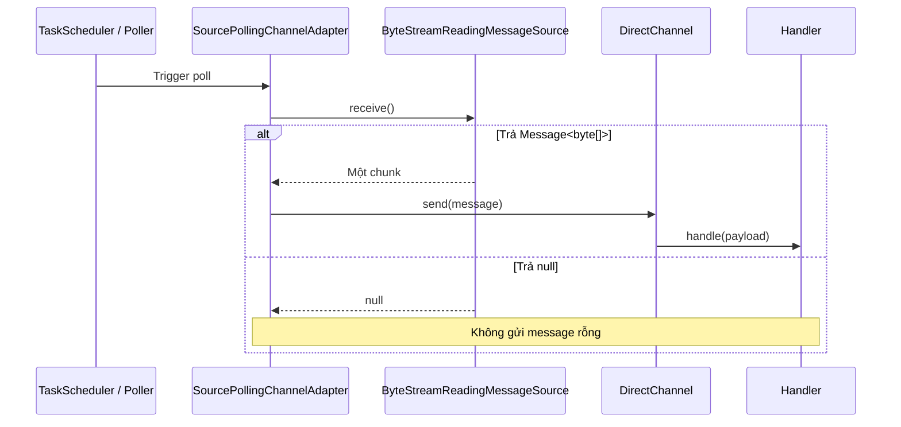
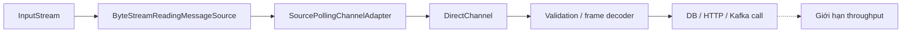

# InputStream làm message source

## 1. Bài toán: từ một luồng byte đến Spring Message

Trong module **SPRING_INTEGRATION_ADAPTERS**, Spring Integration kết nối các hệ thống bên ngoài bằng inbound/outbound adapter, gateway, poller và `MessageChannel`. Các flow có thể trao đổi dữ liệu với file, SFTP, HTTP, JMS, AMQP, Kafka và cơ sở dữ liệu; khi thiết kế cần xét cả **hợp đồng message, lỗi, độ tin cậy và vòng đời kết nối**. Trong chương **Adapter Stream**, bài này đi sâu vào một ý tưởng cụ thể: dùng **`java.io.InputStream` làm nguồn tạo Spring message**.

Giả sử một Java SDK trao cho ứng dụng một `InputStream` chứa dữ liệu nhị phân của một bản ghi xuất từ thiết bị. Ứng dụng muốn đọc dần các byte, đưa chúng vào Spring Integration, sau đó nhận diện frame, validate và ghi sự kiện ra database hoặc broker:

```text
        Java SDK / file / pipe / InputStream
                       |
                       v
             ByteStreamReadingMessageSource
                       |
              receive(): Message<byte[]>
                       ^
                       |
                 Spring poller
                       |
                       v
            SourcePollingChannelAdapter
                       |
                       v
                 MessageChannel
                       |
             Decoder / validator
                       |
             Durable inbox / broker
                       |
                Business consumer
```

Điểm quan trọng là **`InputStream` không phải payload nghiệp vụ**. Nó là một nguồn I/O **có trạng thái**: một lần đọc làm dịch vị trí trong chuỗi byte. Spring Integration khuyến nghị tạo `Message` từ **dữ liệu đã đọc**, thay vì gửi tham chiếu stream cho consumer rồi để nhiều handler tranh nhau đọc.

Sau bài học, bạn có thể:

1. Giải thích hợp đồng `MessageSource<T>` và vai trò của `ByteStreamReadingMessageSource`.
2. Chuyển dữ liệu từ `InputStream` thành `Message<byte[]>` bằng poller và `MessageChannel`.
3. Chọn `bytesPerMessage`, `bufferSize` và `shouldTruncate`; hiểu byte chunk không phải record.
4. Phân biệt `receive()==null`, nguồn chưa có dữ liệu, EOF và lỗi `IOException`.
5. Thiết kế một **source tùy chỉnh có trạng thái EOF** khi ứng dụng cần biết thời điểm hoàn tất.
6. Sử dụng Java DSL, XML và kiểm thử in-memory với `ByteArrayInputStream`.
7. Quản lý quyền sở hữu/đóng `InputStream`, thread poller, backpressure, retry và idempotency.
8. Chọn adapter khác khi cần quét file, session SFTP, TCP framing hoặc offset/ACK bền vững.

## 2. `InputStream` và `MessageSource<byte[]>` khác nhau thế nào?

Java `InputStream` cung cấp những thao tác nền tảng như:

- `read()`: đọc một byte, trả giá trị từ 0 tới 255 hoặc `-1` tại EOF.
- `read(byte[], offset, length)`: đọc một số byte vào buffer và trả **số byte thực đọc**, không nhất thiết bằng độ dài yêu cầu.
- `available()`: ước lượng số byte có thể đọc mà không bị block theo contract của stream; **không phải EOF flag**.
- `close()`: giải phóng tài nguyên theo lớp triển khai.

Trong Spring Integration, `MessageSource<T>` định nghĩa thao tác `receive()` trả về một Spring `Message<T>` hoặc `null` nếu không có message được tạo trong lượt đó.

| API | Đối tượng trả về | Ý nghĩa |
| --- | --- | --- |
| `InputStream.read(buffer)` | `int` số byte | Một thao tác I/O; có thể đọc chưa đủ |
| `InputStream.read()` | Một byte hoặc `-1` | Không có cấu trúc message |
| `MessageSource<byte[]>.receive()` | `Message<byte[]>` hoặc `null` | Nguồn Spring Integration sinh một message |
| `MessageChannel.send(message)` | `boolean` hoặc lỗi | Vận chuyển message đến endpoint tiếp theo |

**Đừng nhầm các giá trị trả về**:

- `InputStream.read()==-1`: Java stream đã đi đến EOF.
- `MessageSource.receive()==null`: lượt đó **không sinh message**. Nó **không tự chứng minh** nguồn đã đạt EOF.
- `Message<byte[]>`: có payload là một mảng byte, không có sẵn ý nghĩa “đây là một record hoàn chỉnh”.

### Vì sao không gửi InputStream làm payload?

```java
// Khong nen dua InputStream truc tiep vao business channel:
Message<InputStream> bad =
        MessageBuilder.withPayload(inputStream).build();
```

Nếu consumer A đọc 100 byte và consumer B đọc tiếp, B không còn thấy 100 byte trước đó. Nếu một handler đóng stream thì handler khác có thể lỗi; nếu kết nối cần tái tạo, consumer phải biết quá nhiều chi tiết I/O. Cách phù hợp hơn:

```java
Message<byte[]> good =
        MessageBuilder.withPayload(
            new byte[] {0x01, 0x02, 0x03}
        ).build();
```

Hai đoạn trên là **snippet minh họa**, với `inputStream` là biến `InputStream` đã có và `Message`/`MessageBuilder` là API của Spring Messaging. Trong ứng dụng thật, `ByteStreamReadingMessageSource` đảm nhận bước đọc dữ liệu và tạo message giúp bạn.

## 3. `ByteStreamReadingMessageSource` là adapter nguồn mặc định

Với **Spring Integration 6.5.x**, lớp `org.springframework.integration.stream.ByteStreamReadingMessageSource` kế thừa `AbstractMessageSource<byte[]>` và nhận `InputStream` qua constructor:

```java
import java.io.InputStream;
import org.springframework.integration.stream.ByteStreamReadingMessageSource;

InputStream stream = /* luong duoc cung cap boi ung dung */;

ByteStreamReadingMessageSource source =
        new ByteStreamReadingMessageSource(stream);
source.setBytesPerMessage(4096);
source.setShouldTruncate(true);
```

`ByteStreamReadingMessageSource` cũng có constructor `(InputStream, int bufferSize)`. Dưới đây là ý nghĩa của các tham số:

| Thiết lập | Ý nghĩa | Không nên hiểu là |
| --- | --- | --- |
| `InputStream stream` | Nguồn byte đã được mở | Một tệp mới được tạo ở mỗi poll |
| `bufferSize` | Kích thước buffering của bộ đọc nội bộ | Kích thước bản ghi nghiệp vụ |
| `bytesPerMessage` | Số byte tối đa source cố đọc cho một message, **mặc định 1024** | Mỗi message chắc chắn đúng N byte |
| `shouldTruncate` | Cắt payload theo số byte thực đọc khi ngắn hơn buffer mong muốn | Tự sửa lỗi framing hoặc decode |

**Cách làm khuyến nghị cho dữ liệu nhị phân:** đặt `shouldTruncate(true)` tường minh và test cả lần đọc ngắn. Nếu không truncate, phần không được ghi vào của mảng đích có thể chứa byte đệm mặc định, khiến downstream tưởng là dữ liệu hợp lệ.

### 3.1. Ví dụ chunk cuối

Với nguồn in-memory:

```text
Byte input:      01 02 03 04 05 06 07
bytesPerMessage: 4
shouldTruncate:  true

Message 1:       01 02 03 04  (4 byte)
Message 2:       05 06 07     (3 byte)
```

Đây là **kết quả dự kiến với `ByteArrayInputStream` có sẵn 7 byte**. Với pipe/socket, `InputStream.read(...)` có thể đọc ít byte hơn dù chưa đến EOF, nên số chunk và điểm cắt thực tế có thể khác.

### 3.2. Buffer không phải ranh giới message

Nếu một file chứa nhiều record, source **không tự parse** record. Thí dụ một event dài 500 byte và `bytesPerMessage=1024` có thể cùng nằm với event kế tiếp trong một payload, hoặc một event dài 5000 byte có thể bị chia ra nhiều payload. Khi đó consumer cần **framing/reassembler** thay vì xử lý mỗi `byte[]` như một đơn vị nghiệp vụ.

### 3.3. Khác biệt package API theo phiên bản

| Dòng Spring Integration | Package reading source |
| --- | --- |
| 6.5.x | `org.springframework.integration.stream.ByteStreamReadingMessageSource` |
| 7.x | `org.springframework.integration.stream.inbound.ByteStreamReadingMessageSource` |

Tài liệu Reference hiện hành có thể dùng package 7.x. Khi project đang dùng BOM của Spring Boot với Spring Integration 6.5.x, **import theo đúng Javadoc của 6.5.x**, không ghép code 7.x với dependency cũ.

## 4. Vì sao phải có poller?

`ByteStreamReadingMessageSource` là **pollable source**, không phải event listener tự phát thông báo khi có byte mới. Để nó hoạt động trong Spring Integration, cần:

1. Một `InputStream` và `ByteStreamReadingMessageSource` đọc stream đó.
2. Một `SourcePollingChannelAdapter` gọi `source.receive()` theo lịch.
3. Một `MessageChannel` nhận mỗi message được tạo.
4. Một consumer (service activator, transformer hoặc endpoint khác).



### Các cấu hình poller cần hiểu

| Thiết lập | Tác động | Lưu ý |
| --- | --- | --- |
| `fixedDelay` | Nghỉ một khoảng sau lượt poll trước | Không phải cam kết tần suất chính xác |
| `fixedRate` | Lập lịch theo chu kỳ từ thời điểm bắt đầu | Không sửa được nguồn blocking |
| `maxMessagesPerPoll` | Giới hạn số lần nhận message trong một lượt | Quá lớn có thể chiếm thread |
| `TaskScheduler` | Thread chạy các lượt poll | Nguồn block có thể chiếm tài nguyên |
| `DirectChannel` | Consumer được gọi đồng bộ | Consumer chậm kéo dài lượt poll |

Poller **không tạo độ bền**: nếu đã đọc byte khỏi stream rồi consumer gặp lỗi, source không tự rewind, không có ACK/redelivery như JMS/AMQP/Kafka.

### `available()` và nguy cơ không có dữ liệu

Một số `InputStream` (ví dụ file hoặc `ByteArrayInputStream`) cung cấp số byte sẵn có tương đối hữu ích. Ngược lại, với socket/pipe hoặc stream tùy chỉnh, `available()==0` **không chứng minh EOF**. Bản thân `read(...)` có thể block nếu chưa có dữ liệu, tùy lớp `InputStream` và cách source đọc.

Vì thế không nên viết logic kiểu:

```java
// Sai: available() == 0 KHONG co nghia la EOF.
if (stream.available() == 0) {
    closeSourceAndMarkCompleted();
}
```

Đây là một **phản ví dụ về suy luận sai**, không phải một method hoàn chỉnh. Khi nguồn là network stream, cần timeout, lifecycle của connection và cơ chế báo hoàn tất từ protocol; với file/pipe, cần biết hành vi cụ thể của nguồn đang dùng.

## 5. Dependencies và một ví dụ Spring Boot đầy đủ

Ví dụ dùng **Java 17+**, Spring Boot với BOM quản lý các dependency Spring Integration tương thích **6.5.x**. Nếu dùng phiên bản khác, đối chiếu package/API trước khi copy.

### 5.1. Maven

```xml
<dependencies>
    <dependency>
        <groupId>org.springframework.boot</groupId>
        <artifactId>spring-boot-starter-integration</artifactId>
    </dependency>
    <dependency>
        <groupId>org.springframework.integration</groupId>
        <artifactId>spring-integration-stream</artifactId>
    </dependency>
</dependencies>
```

### 5.2. Cấu hình ứng dụng

Ứng dụng đọc một tệp binary đã tồn tại theo đường dẫn cấu hình. **Đây là một ví dụ về một `InputStream` được mở một lần**, không phải một File inbound adapter phát hiện file mới.

```yaml
app:
  stream:
    input-path: ${STREAM_INPUT_PATH:./sample-input.bin}
    bytes-per-message: ${STREAM_BYTES_PER_MESSAGE:4096}
```

Đặt tệp `sample-input.bin` tại working directory của tiến trình khi chạy, hoặc cấp `STREAM_INPUT_PATH` đến tệp thử nghiệm. Dùng đường dẫn thuộc allowlist khi nhận cấu hình từ môi trường không tin cậy; không cho HTTP request tự chọn đường dẫn bí mật bất kỳ.

### 5.3. Java configuration

```java
import java.io.IOException;
import java.io.InputStream;
import java.nio.file.Files;
import java.nio.file.Path;
import java.time.Duration;
import java.util.HexFormat;

import org.springframework.beans.factory.annotation.Qualifier;
import org.springframework.beans.factory.annotation.Value;
import org.springframework.boot.SpringApplication;
import org.springframework.boot.autoconfigure.SpringBootApplication;
import org.springframework.context.annotation.Bean;
import org.springframework.integration.annotation.ServiceActivator;
import org.springframework.integration.channel.DirectChannel;
import org.springframework.integration.config.EnableIntegration;
import org.springframework.integration.dsl.IntegrationFlow;
import org.springframework.integration.dsl.Pollers;
import org.springframework.integration.stream.ByteStreamReadingMessageSource;
import org.springframework.messaging.Message;
import org.springframework.messaging.MessageChannel;

@SpringBootApplication
@EnableIntegration
public class InputStreamSourceApplication {

    public static void main(String[] args) {
        SpringApplication.run(InputStreamSourceApplication.class, args);
    }

    @Bean(name = "sourceInputStream", destroyMethod = "close")
    public InputStream sourceInputStream(
            @Value("${app.stream.input-path}") String configuredPath)
            throws IOException {

        Path path = Path.of(configuredPath)
                .toAbsolutePath()
                .normalize();
        // Production: gioi han root path, kiem tra permissions va symlink.
        return Files.newInputStream(path);
    }

    @Bean
    public MessageChannel rawByteChunksChannel() {
        return new DirectChannel();
    }

    @Bean
    public IntegrationFlow byteStreamInboundFlow(
            @Qualifier("sourceInputStream") InputStream input,
            @Value("${app.stream.bytes-per-message:4096}") int chunkSize) {

        if (chunkSize < 1 || chunkSize > 1024 * 1024) {
            throw new IllegalArgumentException("Invalid chunk size");
        }

        ByteStreamReadingMessageSource source =
                new ByteStreamReadingMessageSource(input);
        source.setBytesPerMessage(chunkSize);
        source.setShouldTruncate(true);

        return IntegrationFlow
                .from(source, endpoint -> endpoint
                        .id("byteStreamInputAdapter")
                        .poller(Pollers
                                .fixedDelay(Duration.ofMillis(200))
                                .maxMessagesPerPoll(1)))
                .channel("rawByteChunksChannel")
                .get();
    }

    @ServiceActivator(inputChannel = "rawByteChunksChannel")
    public void inspectByteChunk(Message<byte[]> message) {
        byte[] bytes = message.getPayload();

        System.out.printf(
                "chunk size=%d preview=%s%n",
                bytes.length,
                HexFormat.of().formatHex(
                    bytes, 0, Math.min(bytes.length, 16)
                )
        );

        // Production: decoder/framing, schema, eventId,
        // authorization va durable inbox truoc business side effects.
    }
}
```

### 5.4. Những gì ví dụ thực sự làm

1. Spring tạo **một bean `InputStream`** từ tệp cấu hình.
2. `ByteStreamReadingMessageSource` dùng chính instance đó qua các lần `receive()`.
3. Poller gọi source theo lịch; mỗi message có payload kiểu `byte[]`.
4. `DirectChannel` chuyển message đồng bộ tới `inspectByteChunk(...)`.
5. Consumer in **tối đa 16 byte đầu** của mỗi chunk để dễ kiểm tra trong test, không in toàn bộ file.
6. Khi ApplicationContext đóng, bean `sourceInputStream` được đóng qua `destroyMethod="close"`.

**Giới hạn quan trọng:** đoạn cấu hình trên không tự đóng ApplicationContext khi nguồn byte đạt EOF. Khi `receive()` không còn message, poller có thể tiếp tục hoạt động và trả `null`. Ứng dụng production cần điều phối stop/lifecycle hoặc dùng source có signal EOF rõ. Nội dung `System.out` chỉ là minh họa, không dùng để log raw dữ liệu nhạy cảm trong production.

Đây là ví dụ tự chứa ở mức cấu hình Spring Boot, nhưng không bao gồm file nhị phân thực, parent build configuration hoặc chạy test; người học cần cung cấp tệp và build project phù hợp.

### 5.5. Vì sao không gọi `Files.newInputStream(...)` ở mỗi lượt poll?

```text
ĐÚNG:
  Bean InputStream tạo một lần
        -> poll 1: đọc bytes 0..4095
        -> poll 2: đọc bytes kế tiếp
        -> poll 3: tiếp tục tới EOF

SAI:
  Mỗi lần poll tạo FileInputStream mới
        -> luôn quay về byte 0
        -> đọc lặp nội dung đầu file
```

`ByteStreamReadingMessageSource` phải được dùng với một nguồn có **ownership rõ**; nếu muốn xử lý nhiều file mới xuất hiện trong thư mục, hãy dùng **File inbound adapter**, không biến mỗi poll thành “mở file từ đầu”.

## 6. Cấu hình XML: InputStream bean + inbound-channel-adapter

Spring Integration cho phép khai báo `MessageSource` như một bean rồi tham chiếu bằng `<int:inbound-channel-adapter>`:

```xml
<beans:beans
    xmlns:beans="http://www.springframework.org/schema/beans"
    xmlns:xsi="http://www.w3.org/2001/XMLSchema-instance"
    xmlns:int="http://www.springframework.org/schema/integration"
    xsi:schemaLocation="
        http://www.springframework.org/schema/beans
        https://www.springframework.org/schema/beans/spring-beans.xsd
        http://www.springframework.org/schema/integration
        https://www.springframework.org/schema/integration/spring-integration.xsd">

    <!-- InputStream bean nay do Java @Bean hoac context cung cap. -->
    <beans:bean id="byteSource"
                class="org.springframework.integration.stream.ByteStreamReadingMessageSource">
        <beans:constructor-arg ref="sourceInputStream"/>
        <beans:property name="bytesPerMessage" value="4096"/>
        <beans:property name="shouldTruncate" value="true"/>
    </beans:bean>

    <int:channel id="rawChunks"/>

    <int:inbound-channel-adapter
        id="byteInputAdapterXml"
        ref="byteSource"
        channel="rawChunks">
        <int:poller fixed-delay="200" max-messages-per-poll="1"/>
    </int:inbound-channel-adapter>

    <!-- Khai bao consumer cua rawChunks trong context ung dung. -->
</beans:beans>
```

Đây là **mảnh cấu hình XML có chủ đích**: Spring context còn phải cung cấp bean `sourceInputStream` kiểu `InputStream` và consumer nhận `rawChunks`. Không khai báo cả Java flow mục 5 và XML flow này để **cùng đọc một InputStream** trừ khi bạn đã thiết kế ownership riêng. Hai adapter cạnh tranh nguồn có thể chia byte một cách khó dự đoán.

### Đọc các thành phần XML

| Thuộc tính/bean | Chức năng |
| --- | --- |
| `ref="sourceInputStream"` | Đúng nguồn Java I/O được quản lý |
| `ByteStreamReadingMessageSource` | Đọc byte và tạo message |
| `bytesPerMessage` | Giới hạn chunk mong muốn |
| `shouldTruncate` | Giữ mảng đúng độ dài thực đọc |
| `int:inbound-channel-adapter` | Biến source thành endpoint polling |
| `int:poller` | Lập lịch `receive()` |
| `rawChunks` | Kênh bàn giao payload byte cho downstream |

## 7. Những kiểu `InputStream` thường được cấp cho source

Không phải stream nào cũng có cùng đặc tính I/O, EOF hoặc khả năng đọc lại:

| InputStream | Ví dụ nguồn | Đặc điểm |
| --- | --- | --- |
| `ByteArrayInputStream` | Fixture test trong RAM | Dữ liệu sẵn có, dễ kiểm chứng |
| `FileInputStream` / `Files.newInputStream` | File binary đã tồn tại | EOF hữu hạn; có thể mở lại nhưng không tự checkpoint |
| `BufferedInputStream` | Wrapper tăng hiệu quả đọc | Buffering, không thay framing |
| `PipedInputStream` | Producer và consumer thread cùng JVM | Có thể block, cần lifecycle đóng pipe |
| `Socket.getInputStream()` | TCP connection | Có thể block; phụ thuộc connection/timeout/reconnect |
| `SequenceInputStream` | Ghép nhiều luồng | EOF của nguồn con không tự thành message |
| InputStream từ Java SDK | HTTP object store, zip entry, thiết bị | Lifecycle, retry/seek tùy SDK |

### File và nguồn có thể seek

Một file có thể mở lại từ đầu hoặc kết hợp `FileChannel.position(...)` để tạo checkpoint theo byte offset, nhưng **`ByteStreamReadingMessageSource` không tự duy trì offset bền vững**. Nếu cần khôi phục sau crash:

- Lưu vị trí đã **commit nghiệp vụ** trong một kho bền.
- Chỉ đổi checkpoint sau khi dữ liệu liên quan được xử lý thành công.
- Kiểm tra file identity/version/size để không áp dụng offset cũ cho file đã bị thay đổi.
- Tái mở/seek đúng vị trí ở một source được thiết kế riêng; không coi việc restart Spring bean tự làm được điều đó.

### Socket và nguồn reconnect

Khi socket bị ngắt, `InputStream` của socket cũ không tự trở thành stream của socket mới. Với TCP protocol thật, dùng **Spring Integration TCP adapter/gateway** có connection factory và serializer/deserializer thường thích hợp hơn việc tự ghép InputStream + poller + reconnect.

### Dữ liệu nén

`GZIPInputStream` và `ZipInputStream` có thể dùng làm nguồn byte, nhưng nội dung được giải nén/trích entry theo semantics của wrapper; cần kiểm soát **zip bomb**, kích thước giải nén, số entry và dữ liệu path nếu giải nén ra filesystem. Một byte chunk từ `ZipInputStream` không tự tương ứng với một entry ZIP.

## 8. Byte chunk không phải một record

Giả sử protocol có hai bản ghi:

```text
Record A = 00 03 41 42 43
           |len| A  B  C

Record B = 00 04 44 45 46 47
           |len| D  E  F  G
```

Với `bytesPerMessage=4`, stream có thể được chia:

```text
Chunk 1 = 00 03 41 42
Chunk 2 = 43 00 04 44
Chunk 3 = 45 46 47
```

Một record bị cắt giữa nhiều chunk, đồng thời chunk 2 chứa **phần cuối A và phần đầu B**. Vì vậy **không thể gọi handler nghiệp vụ với mỗi chunk rồi coi đó là một event hoàn chỉnh**.

### 8.1. Framing phổ biến

| Framing | Phân tích | Giới hạn |
| --- | --- | --- |
| Delimiter LF | Tìm newline ngoài nội dung đã escape | Binary có thể chứa LF tùy ý |
| Length-prefix | Đọc số byte độ dài rồi body | Cần giới hạn max frame |
| Fixed-length | Mỗi record đúng N byte | Hợp đồng không đổi theo version |
| Protocol-specific | Protobuf delimited, HTTP/TCP codec | Cần decoder theo đúng protocol |

### 8.2. Ví dụ decoder có trạng thái, nhận chunk tùy độ dài

Giả sử mỗi frame có **2 byte unsigned big-endian length**, sau đó là payload. Decoder dưới đây giữ byte chưa đủ frame trong RAM và chỉ phát ra payload khi đã nhận đủ:

```java
import java.io.ByteArrayOutputStream;
import java.util.ArrayList;
import java.util.Arrays;
import java.util.List;

public final class LengthPrefixedDecoder {

    private static final int MAX_FRAME = 65535;
    private final ByteArrayOutputStream pending =
            new ByteArrayOutputStream();

    public synchronized List<byte[]> accept(byte[] chunk) {
        if (chunk == null || chunk.length == 0) {
            return List.of();
        }

        pending.write(chunk, 0, chunk.length);
        byte[] bytes = pending.toByteArray();
        int cursor = 0;
        List<byte[]> ready = new ArrayList<>();

        while (bytes.length - cursor >= 2) {
            int length =
                    ((bytes[cursor] & 0xFF) << 8)
                    | (bytes[cursor + 1] & 0xFF);

            if (length < 1 || length > MAX_FRAME) {
                throw new IllegalArgumentException(
                        "Invalid frame size: " + length
                );
            }
            if (bytes.length - cursor - 2 < length) {
                break;
            }

            ready.add(Arrays.copyOfRange(
                    bytes, cursor + 2, cursor + 2 + length
            ));
            cursor += 2 + length;
        }

        pending.reset();
        pending.write(bytes, cursor, bytes.length - cursor);

        if (pending.size() > MAX_FRAME + 2) {
            throw new IllegalStateException("Frame buffer exceeded");
        }
        return ready;
    }

    public synchronized int pendingBytes() {
        return pending.size();
    }
}
```

Đây là **decoder minh họa cho protocol đơn giản**. Nó phân biệt chunk với frame và giữ dữ liệu chưa đủ, nhưng chưa có các tính năng production như stream epoch, header checksum, recovery khi frame hỏng, deadline per frame, backpressure hay lưu bền; nếu protocol có thể nhận input độc hại, cần giới hạn ngay **trước khi copy chunk** vào buffer và áp dụng quota tổng.

### 8.3. Kết hợp với Spring Integration

Consumer của `rawByteChunksChannel` có thể gọi `decoder.accept(message.getPayload())`, rồi phát **từng frame hoàn chỉnh** sang một `MessageChannel` khác:

```java
for (byte[] frame : decoder.accept(message.getPayload())) {
    boolean delivered = decodedFramesChannel.send(
            MessageBuilder.withPayload(frame).build()
    );
    if (!delivered) {
        throw new IllegalStateException(
                "Decoded frame was not accepted"
        );
    }
}
```

Đoạn này là **mảnh logic consumer**, giả định `decoder` là instance của `LengthPrefixedDecoder`, `decodedFramesChannel` là bean `MessageChannel`, `message` có kiểu `Message<byte[]>`. Cần một decoder riêng cho mỗi **nguồn/phiên độc lập**; không dùng chung một decoder cho các socket hoặc file có chuỗi byte riêng.

**Chú ý:** các frame được phát ra sau khi source đã đọc bytes; nếu consumer xử lý thất bại, việc gửi lại frame cần hợp đồng riêng. Bộ nhớ `pending` không tồn tại sau restart.

## 9. Text và UTF-8: đừng giải mã từng chunk một cách tùy tiện

Khi `InputStream` chứa text, payload nguồn vẫn là `byte[]`. Nếu mỗi chunk được giải mã độc lập bằng:

```java
String text = new String(chunk, java.nio.charset.StandardCharsets.UTF_8);
```

thì ký tự nhiều byte như “đ”, “ệ”, emoji có thể bị cắt giữa hai chunk và bị chuyển thành replacement character. Với luồng text theo dòng, nên chọn **`CharacterStreamReadingMessageSource` + `InputStreamReader` với UTF-8** thay vì tự ráp từng mảnh:

```java
import java.io.InputStream;
import java.io.InputStreamReader;
import java.nio.charset.StandardCharsets;
import org.springframework.integration.stream.CharacterStreamReadingMessageSource;

InputStream input = /* source stream */;
CharacterStreamReadingMessageSource textSource =
        new CharacterStreamReadingMessageSource(
                new InputStreamReader(input, StandardCharsets.UTF_8)
        );
```

Đây là **giải pháp khác** dùng cùng `InputStream` với mục tiêu text; không khai báo đồng thời byte source và character source cùng đọc một stream. Với nguồn text chứa newline trong record hoặc NDJSON có escape phức tạp, vẫn cần validate/framing phù hợp.

Nếu protocol đòi giải mã streaming UTF-8 nhưng không phải line-oriented, dùng `CharsetDecoder` có **trạng thái** và xử lý byte thiếu giữa các lần receive, không chỉ gọi `new String` cho từng chunk.

## 10. `null`, EOF, `available()` và khởi động/dừng

Một điều dễ nhầm là: “lần poll trả `null` tức là nguồn đã đóng”. Với `InputStream`, điều này không đúng trong mọi trường hợp.

| Tình trạng | `InputStream` | Spring source có thể làm gì? |
| --- | --- | --- |
| Có byte đọc được | `read(...)` trả `n>0` | Trả `Message<byte[]>` |
| Chưa có byte sẵn ngay | `available()` có thể bằng 0 | Trả `null` hoặc chờ, tùy source |
| Đến EOF thực | `read(...)` trả `-1` | Trả `null`; cần signal EOF riêng nếu muốn biết chắc |
| Lỗi I/O | `read(...)` ném `IOException` | Ném/wrap exception để error handling |
| Stream bị đóng bởi bean khác | Đọc có thể lỗi hoặc EOF | Cần sửa ownership/lifecycle |

**Không coi `available()` là heartbeat, điều kiện EOF hay số byte còn lại của toàn bộ stream.** API Java chỉ cung cấp ước lượng số byte có thể đọc ngay mà không block theo semantics lớp triển khai; giá trị 0 vẫn có thể xuất hiện trên nguồn chưa hoàn tất.

### `StreamClosedEvent` có phải của byte source không?

Spring Integration document mô tả `StreamClosedEvent` khi **`CharacterStreamReadingMessageSource` bật `blockToDetectEOF=true`** phát hiện EOF. Đừng tự động suy ra `ByteStreamReadingMessageSource` phát **cùng event** khi byte source đến EOF. Nếu hoàn tất batch là một sự kiện nghiệp vụ, cần một phương án rõ:

- Biết tổng độ dài file/nguồn và đếm bytes đã đọc, có kiểm tra file identity/version.
- Dùng giao thức có end-of-stream hoặc length-prefix hoàn chỉnh.
- Dùng một `MessageSource` tùy chỉnh nhận biết EOF và phát tín hiệu riêng.
- Đặt lifecycle theo scheduler/Job đã quản lý với điều kiện hoàn tất đáng tin.

### Tránh poll vô hạn sau EOF

Nếu nguồn là `ByteArrayInputStream` hoặc file hữu hạn, source có thể tiếp tục trả `null` sau khi đã đọc hết trong các lượt poll tiếp theo. Trong batch ngắn hạn, phải thiết kế điều kiện **dừng adapter và đóng context** theo nhu cầu. Trường hợp nguồn là pipe mở lâu, null có thể chỉ là chưa có dữ liệu nên **không được tự đóng**.

## 11. Source tùy chỉnh khi cần biết EOF tường minh

Khi ứng dụng thật sự phải biết lúc `read(...)==-1`, có thể viết một `AbstractMessageSource<byte[]>` riêng. Ví dụ nhỏ sau giữ trạng thái EOF và chỉ làm việc trên **một InputStream có một chủ sở hữu**:

```java
import java.io.IOException;
import java.io.InputStream;
import java.util.Arrays;
import java.util.Objects;

import org.springframework.integration.endpoint.AbstractMessageSource;
import org.springframework.messaging.MessagingException;

public final class EofAwareInputStreamSource
        extends AbstractMessageSource<byte[]> implements AutoCloseable {

    private final InputStream input;
    private final byte[] buffer;
    private volatile boolean eof;

    public EofAwareInputStreamSource(InputStream input, int chunkSize) {
        this.input = Objects.requireNonNull(input);
        if (chunkSize < 1 || chunkSize > 1024 * 1024) {
            throw new IllegalArgumentException("chunkSize");
        }
        this.buffer = new byte[chunkSize];
    }

    @Override
    protected synchronized byte[] doReceive() {
        if (eof) {
            return null;
        }
        try {
            int n = input.read(buffer, 0, buffer.length);
            if (n == -1) {
                eof = true;
                return null;
            }
            return n == 0 ? null : Arrays.copyOf(buffer, n);
        }
        catch (IOException ex) {
            throw new MessagingException("InputStream read failed", ex);
        }
    }

    public boolean isEof() {
        return eof;
    }

    @Override
    public String getComponentType() {
        return "custom:eof-aware-input-stream";
    }

    @Override
    public void close() throws IOException {
        input.close();
    }
}
```

### 11.1. Điểm khác biệt với source có sẵn

- `doReceive()` gọi `InputStream.read(...)` và kiểm tra trực tiếp `-1`.
- Khi đã thấy EOF, `isEof()==true`; các lượt poll sau trả `null` nhanh.
- `Arrays.copyOf(...)` chỉ giữ **số byte thực đọc**.
- `synchronized` tránh đồng thời gọi `doReceive()` trên cùng instance nhưng **không làm nguồn trở thành một queue có replay**.
- `AutoCloseable` giao cho ứng dụng/bean lifecycle trách nhiệm đóng stream.

### 11.2. Đánh đổi quan trọng

**Source này có thể block trong `read(...)`**, kể cả khi chưa có data. Với socket/pipe, thread poller có thể giữ lâu; đặt timeout ở tầng socket hoặc sử dụng thread riêng và cơ chế interrupt/close phù hợp. Không dùng custom source này cho input không thể interrupt/close mà lại mong shutdown tức thì.

Source tùy chỉnh cũng **chưa tự phát Spring `StreamClosedEvent`, chưa tự dừng `SourcePollingChannelAdapter`** và chưa có durable checkpoint. Một coordinator/Job cần theo dõi `isEof()` rồi ngừng endpoint **ngoài đường xử lý poll bị block**; tránh gọi `stop()` trực tiếp từ chính callback gây ra deadlock/race.

Nếu mục tiêu chỉ là đọc một tệp hoàn chỉnh một lần, hãy xem liệu **File inbound adapter/gateway** với xử lý file rõ ràng phù hợp hơn hay không.

## 12. Quản lý một InputStream đúng lifecycle

Khi dùng một stream làm source, các quyết định về ownership phải được ghi rõ trong thiết kế.

### Quy tắc vận hành

1. **Chỉ một reader owner** cho mỗi InputStream, trừ khi chính bạn xây cơ chế phối hợp/fan-out.
2. Stream được **mở một lần** theo bean/job/connection lifecycle và được đóng đúng lúc.
3. Nếu một SDK quản lý stream, không tự đóng khi hợp đồng SDK yêu cầu nó tiếp tục sống.
4. Với `System.in`, không cho bean phụ đóng standard input của JVM một cách ngoài ý muốn.
5. Không tạo hai `SourcePollingChannelAdapter` đọc cùng stream nếu không muốn byte bị chia giữa chúng.
6. Với nguồn có EOF hữu hạn, thiết kế một **completion signal** rõ.
7. Khi shutdown, ngừng nhận job mới, cho phép xử lý message đang chờ, đóng stream do mình sở hữu.

| Nguồn | Chủ sở hữu khuyến nghị | Điểm cần lưu ý |
| --- | --- | --- |
| `Files.newInputStream(...)` trong `@Bean` | Spring context/bean lifecycle | Dùng `destroyMethod="close"` |
| `ByteArrayInputStream` test | Test fixture | Không có tài nguyên OS cần giải phóng |
| `System.in` | JVM / tiến trình nhập liệu | Tránh đóng từ một module |
| `Socket.getInputStream()` | Connection manager | Khi reconnect, cần stream mới |
| InputStream từ object store SDK | SDK/client request object | Theo đúng tài liệu SDK và thời hạn URL/session |

### Kịch bản shutdown đang block

```text
Poller thread -> source.read(...) [blocked]
Spring context stop()
                    |
                    v
          Request adapter stop
                    |
         Can read() be interrupted?
               /          \\
             YES          NO
              |            |
        Finish safely   Close stream / timeout
```

Một số triển khai `InputStream` không phản hồi ngay với `Thread.interrupt()`. Với network I/O, nên dùng read timeout; với pipe và custom source, có thể phải đóng stream từ thread quản lý để giải phóng reader. Luôn thử shutdown trên đúng loại nguồn production.

## 13. Blocking I/O và backpressure

Poller đọc một chunk rồi chuyển vào `MessageChannel`. Nếu dùng `DirectChannel` và consumer xử lý database chậm, thread poller phải đợi downstream hoàn tất trước lượt tiếp theo.



| Kiến trúc | Lợi ích | Vấn đề cần xử lý |
| --- | --- | --- |
| `DirectChannel` | Backpressure đồng bộ đơn giản | Consumer chậm làm chậm poller |
| `ExecutorChannel` | Tách thread xử lý | Queue có thể đầy, order thay đổi |
| `QueueChannel` | Buffer giữa source và consumer | Trong RAM không tự bền vững, cần consumer poller |
| Durable JMS/AMQP/Kafka | Lưu message bền hơn khi cấu hình phù hợp | ACK/offset/retry/transaction riêng |

**Không đặt queue không giới hạn** cho nguồn nhị phân có thể phát nhanh. Nếu một InputStream đã bị đọc trước khi message được lưu bền, việc queue đầy hoặc consumer lỗi có thể khiến dữ liệu không thể replay.

### `maxMessagesPerPoll` và fairness

Một poller cấu hình `maxMessagesPerPoll(1000)` có thể đọc liên tục nhiều chunk trong một lượt, làm tăng throughput của stream hữu hạn nhưng chiếm thread scheduler lâu. Chọn giá trị cân bằng giữa latency, fairness và tài nguyên của các poller khác.

### Một nguồn blocking không tự trở nên non-blocking

`fixedDelay(200)` chỉ điều khiển **khi nào gọi** `receive()`; nó không đặt timeout cho `InputStream.read(...)`. Nếu read block năm phút, lần poll đó vẫn có thể block năm phút. Timeout/close cần được cấu hình ở tầng nguồn và lifecycle.

## 14. Lỗi, retry, idempotency và nguồn bền vững

### Các lớp lỗi cần tách biệt

| Tình huống | Biểu hiện | Cách ứng phó |
| --- | --- | --- |
| File không tồn tại/thiếu quyền | Lỗi khi tạo stream bean | Fail startup/job, sửa path/ACL |
| `IOException` khi đọc | Exception trong `receive()` | Phân loại tạm/vĩnh viễn, cleanup |
| `receive()==null` | Không có message | Không tự retry nghiệp vụ hay coi là EOF |
| Chunk thiếu dữ liệu | Framing chưa đủ | Reassembler giữ phần còn lại |
| Schema/event sai | Decoder/validator reject | Quarantine/audit |
| Channel không có subscriber | Dispatch lỗi | Sửa wiring, không giả định byte replay |
| Downstream timeout | DB/HTTP/broker lỗi | Durable inbox, retry/idempotent consumer |
| JVM crash sau khi đọc | Vị trí nguồn đã thay đổi | Cần checkpoint hoặc replay từ nguồn bền |

### Đường xử lý lỗi Spring Integration

Một polling endpoint có thể dùng error handler/`errorChannel` do Spring Integration cấu hình; tùy đường thực thi, `MessagingException` có thể được phát thành `ErrorMessage`. Nhưng **không mặc định mọi IOException hoặc exception đồng bộ đều tự đi tới một global error channel trong mọi cấu hình**. Hãy kiểm thử flow với `InputStream` giả lập lỗi, xác nhận một exception xuất hiện ở đâu.

### Không có transaction giữa stream và database

```text
read 4096 bytes  ->  create Message<byte[]>
                         |
                         v
                 decoder + DB write
                         |
                 DB transaction fails
                         |
          InputStream da advance con tro doc
```

Ngay cả khi database rollback, **InputStream đã tiêu thụ byte**. Muốn chống mất dữ liệu:

1. Đảm bảo dữ liệu gốc có thể replay hoặc lưu vào một **durable inbox** trước bước gây side effect.
2. Thiết kế **eventId** ổn định theo contract sau bước framing.
3. Trong database, dùng unique constraint/transaction để tránh xử lý cùng một event hai lần.
4. Duy trì checkpoint theo **vị trí đã commit**, không theo vị trí stream vừa đọc vào RAM.
5. Nếu không có khả năng replay, công bố rõ chỉ hỗ trợ **best-effort ingestion**.

Không dùng `MessageHeaders.ID` của Spring làm khóa idempotency bền vững: mỗi lần tạo message mới nó có thể thay đổi. Một chunk cũng có thể chứa **nửa event** nên không phù hợp làm đơn vị commit.

## 15. Security: giới hạn nguồn và dữ liệu nhị phân

Đối với InputStream lấy từ file, pipe, SDK hoặc network, luôn coi byte nhận được là **dữ liệu chưa được tin cậy**:

- **Path validation:** nếu nguồn file lấy từ cấu hình, chuẩn hóa/allowlist root directory; không cho HTTP request đọc `/etc`, khóa riêng hoặc secrets.
- **Size limits:** giới hạn `bytesPerMessage`, max frame, max pending bytes và tổng dữ liệu một job.
- **Framing:** kiểm tra length-prefix trước khi cấp phát buffer; không tin con số độ dài do input tự khai.
- **Decompression:** nếu dùng `GZIPInputStream`/`ZipInputStream`, chống zip bomb và giới hạn dữ liệu sau giải nén.
- **Serialization:** nếu payload là JSON/protobuf/CBOR, validate schema/version/enum và độ dài trường.
- **No command execution:** bytes không được đưa thẳng thành shell command, SQL, path hoặc URL callback.
- **Charset:** với text phải thống nhất UTF-8/decoder, không biến malformed bytes thành input hợp lệ ngoài ý muốn.
- **Error handling:** giới hạn số lần retry/quarantine; không dump toàn bộ binary payload vào logs.
- **Access control:** xác thực/ủy quyền danh tính của nguồn dữ liệu trước khi cho phép ghi database.
- **Resources:** hạn chế thread/blocking, file descriptors và bộ nhớ để tránh denial-of-service.

### Metadata có thể cần, nhưng không tự có

`ByteStreamReadingMessageSource` tạo message từ bytes; nó **không tự biết tên tệp nghiệp vụ, tenant, độ dài bản ghi hay eventId** trừ khi bạn cung cấp metadata đó qua pipeline.

Ví dụ gắn thông tin **do ứng dụng thiết lập** sau khi nhận chunk:

```java
Message<byte[]> enriched = MessageBuilder
        .withPayload(message.getPayload())
        .copyHeaders(message.getHeaders())
        .setHeader("streamSource", "daily-device-export")
        .setHeader("ingestRunId", "run-20261123-01")
        .build();
```

Đây là **mảnh code minh họa**, `message` có kiểu `Message<byte[]>`. Header `streamSource`, `ingestRunId` do ứng dụng định nghĩa, **không phải các hằng số `FileHeaders`**. Không đặt token hoặc đường dẫn bí mật vào header khi chúng có thể được propagate sang hệ thống khác.

## 16. Kiểm thử trực tiếp không cần server ngoài

Với `ByteArrayInputStream`, có thể test source bằng dữ liệu cố định trước khi tích hợp Spring Context.

### 16.1. JUnit 5: chunk 4 byte, truncate

```java
import static org.junit.jupiter.api.Assertions.*;

import java.io.ByteArrayInputStream;

import org.junit.jupiter.api.Test;
import org.springframework.integration.stream.ByteStreamReadingMessageSource;
import org.springframework.messaging.Message;

class ByteStreamSourceTest {

    @Test
    void splitsInputIntoByteMessages() {
        byte[] fixture = new byte[] {
                1, 2, 3, 4, 5, 6, 7
        };
        ByteStreamReadingMessageSource source =
                new ByteStreamReadingMessageSource(
                        new ByteArrayInputStream(fixture)
                );
        source.setBytesPerMessage(4);
        source.setShouldTruncate(true);

        Message<byte[]> first = source.receive();
        Message<byte[]> second = source.receive();

        assertNotNull(first);
        assertNotNull(second);
        assertArrayEquals(new byte[] {1, 2, 3, 4},
                first.getPayload());
        assertArrayEquals(new byte[] {5, 6, 7},
                second.getPayload());
        assertNull(source.receive());
    }
}
```

Ví dụ dùng JUnit 5. Đây là **test đề xuất, chưa chạy trong STEP 4**. Kết quả với `ByteArrayInputStream` in-memory là có thể dự đoán; nếu thay bằng socket, không được giả định mọi lần `read` đủ số byte yêu cầu.

### 16.2. Kiểm thử InputStream chỉ đọc từng phần

Tạo một `InputStream` test cố ý trả rất ít byte trên mỗi lần `read(byte[],off,len)`. Sau đó kiểm tra:

- Source không coi một chunk ngắn là EOF.
- `shouldTruncate(true)` cho độ dài payload đúng phần đã đọc.
- Reassembler ghép các fragment thành frame đúng.
- Khi stream thực sự trả `-1`, completion logic của ứng dụng kích hoạt đúng một lần.

Không hard-code rằng **mỗi lần source.receive() đúng một lần InputStream.read(...)**: lớp buffering có thể gọi read bên dưới theo cách khác. Test nên kiểm tra **chuỗi byte tổng hợp và contract**, không phụ thuộc từng lần đọc chi tiết của wrapper.

### 16.3. Kiểm thử lỗi nguồn

Fixture:

```java
import java.io.IOException;
import java.io.InputStream;

public final class FailingInputStream extends InputStream {

    private int bytesLeft = 2;

    @Override
    public int read() throws IOException {
        if (bytesLeft-- <= 0) {
            throw new IOException("Simulated read failure");
        }
        return 0x41;
    }
}
```

Đây là lớp test độc lập mô phỏng lỗi I/O sau khi một phần byte đã được đọc. Khi đưa vào source, exception có thể được wrap bởi framework. Test **vị trí quan sát exception** trong flow Java DSL, không giả định sẵn một `errorChannel` sẽ nhận tất cả.

### 16.4. Test tích hợp poller và lifecycle

| Kịch bản | Quan sát |
| --- | --- |
| Source có 7 byte và chunkSize 4 | Tổng bytes của payload bằng 7 |
| Source trả `null` | Không phát một `Message` có payload null |
| Consumer chậm 500 ms | Lượt poll kế tiếp bị trễ nếu dùng DirectChannel |
| Byte stream đã hết | Poller vẫn có thể chạy; cần tín hiệu hoàn tất riêng |
| Lỗi I/O giữa chừng | Đúng error strategy, không âm thầm coi là EOF |
| Context shutdown | Stream do app mở được đóng và poller dừng |
| Hai adapter cùng đọc một stream | Không chấp nhận cấu hình này nếu chưa có phối hợp |
| Input là UTF-8 chia chunk | Không mất ký tự sau decoder có trạng thái |
| Restart giữa một event | Checkpoint và idempotency không xử lý trùng |

## 17. Quan sát hệ thống và troubleshooting

### Các metric đề xuất

| Metric | Ý nghĩa | Chú ý |
| --- | --- | --- |
| `stream_input_bytes_total` | Tổng byte đã lấy từ source | Không đồng nghĩa event nghiệp vụ hoàn tất |
| `stream_input_chunks_total` | Tổng số `Message<byte[]>` | Chunk không phải frame |
| `stream_input_null_polls_total` | Lượt poll không có message | Không có nghĩa EOF |
| `stream_input_read_errors_total` | Lỗi lúc đọc | Phân nhóm nguyên nhân |
| `stream_input_processing_seconds` | Thời gian xử lý downstream | Có thể làm chậm poller |
| `stream_input_reassembly_bytes` | Byte chưa đủ frame trong decoder | Giới hạn capacity |
| `stream_input_committed_events_total` | Event đã xử lý nghiệp vụ | Cần kết hợp database/ACK |
| `stream_input_eof_total` | Số lần app nhận biết EOF | Chỉ có nếu thiết kế tín hiệu riêng |

Đây là **metric gợi ý**, không phải toàn bộ metric mặc định của Spring Integration. Không đưa payload, raw path nhạy cảm hoặc event ID có cardinality lớn làm labels.

### Bảng lỗi thường gặp

| Triệu chứng | Nguyên nhân có thể | Cách kiểm tra |
| --- | --- | --- |
| Không thấy message | Poller chưa chạy, stream không có data | Endpoint running, channel, input path |
| `ClassNotFoundException` trên reading source | Dùng import 7.x với SI 6.5.x | Đối chiếu version/package |
| Message có nhiều byte 0 ở cuối | Không truncate khi lần đọc ngắn | `setShouldTruncate(true)` |
| Chunk cuối không đủ `bytesPerMessage` | Hết dữ liệu hoặc short read | Đây có thể là hành vi hợp lệ |
| JSON/protobuf decoder lỗi ngẫu nhiên | Chunk bị cắt giữa frame | Dùng decoder có trạng thái |
| Tiếng Việt hiển thị `�` | UTF-8 bị chia hoặc charset sai | Reader/CharsetDecoder có trạng thái |
| `receive()==null` nhưng socket vẫn sống | Chưa có byte khả dụng | Không suy ra EOF từ null |
| Poller treo | `read()` blocking hoặc downstream chậm | Timeout/scheduler/lifecycle |
| Restart đọc lại từ byte đầu | Mở lại file mà không checkpoint | Dùng event ID và checkpoint bền |
| Sau consumer lỗi không đọc lại được byte | InputStream đã advance | Durable inbox/replay |
| Source đọc được nhưng channel không có consumer | Wiring thiếu `@ServiceActivator` | Kiểm tra tên channel và flow |
| Hai flow thấy dữ liệu thiếu ngẫu nhiên | Hai reader cùng dùng một stream | Chỉ một owner |
| `IOException` liên tục | Stream bị đóng hoặc nguồn lỗi | Phân loại lỗi, không retry nóng |
| JVM không thoát sau đọc file | Poller còn đang chạy sau EOF | Completion/coordinator rõ ràng |
| Đọc nhầm file ngoài vùng cho phép | Path tùy ý hoặc symlink | Allowlist root/permission |

### Thứ tự chẩn đoán

1. Xác định **nguồn `InputStream` thật**: file, pipe, socket hay SDK.
2. Kiểm tra nguồn mở thành công, path/ACL và ownership.
3. Kiểm tra Spring version, package import và source bean.
4. Kiểm tra poller `fixedDelay`/`maxMessagesPerPoll` và channel có consumer.
5. Đo kích thước payload byte thực nhận, có truncate không.
6. Kiểm tra framing, charset và giới hạn max record.
7. Kiểm tra exception, backpressure và thời điểm nguồn đóng.
8. Nếu cần reliability, đối chiếu checkpoint, durable inbox và event ID.

## 18. So sánh với các adapter khác

| Nhu cầu | Lựa chọn nên cân nhắc |
| --- | --- |
| Một InputStream đã được ứng dụng mở, đọc chunk binary | **ByteStreamReadingMessageSource** |
| Reader text theo dòng | `CharacterStreamReadingMessageSource` |
| CLI stdin có EOF | `CharacterStreamReadingMessageSource.stdinPipe(...)` |
| Thư mục có nhiều file mới | File inbound adapter |
| Remote SFTP và metadata file | SFTP inbound adapter |
| HTTP request body / status | HTTP inbound gateway |
| TCP connection, frame, reconnect | TCP inbound adapter/gateway |
| JMS/AMQP queue, ACK và redelivery | JMS/AMQP inbound |
| Kafka topic, partition/offset | Kafka inbound |
| Database poll/cursor | JDBC inbound hoặc CDC giải pháp chuyên biệt |

Một `InputStream` là trừu tượng **I/O thấp tầng**. Nó thường không biết file name, ACK, offset commit, partition, tenant hoặc business ID. Adapter chuyên dụng cung cấp nhiều semantics hơn; không dùng stream adapter rồi mặc định nó tương đương Kafka consumer group hoặc SFTP file synchronizer.

## 19. Bài tập thực hành

1. **ByteArrayInputStream:** tạo 7 byte, `bytesPerMessage=4`, kiểm tra hai payload sau truncate.
2. **Default chunk:** không đặt `bytesPerMessage`, giải thích giá trị mặc định 1024.
3. **Buffer:** thay `bufferSize` constructor và chứng minh nó không phải kích thước event nghiệp vụ.
4. **Short read:** dùng InputStream trả ít byte, xem tại sao chunk ngắn không phải EOF.
5. **Null poll:** kiểm tra `receive()==null` sau khi hết `ByteArrayInputStream`; giải thích vì sao không suy ra chắc EOF đối với socket.
6. **Java DSL:** chạy ứng dụng với tệp nhỏ, quan sát `Message<byte[]>` qua `rawByteChunksChannel`.
7. **XML:** tạo source bean và `int:inbound-channel-adapter` có poller, không khai báo consumer trùng.
8. **File ownership:** tạo một bean `InputStream` có `destroyMethod="close"` và kiểm tra cleanup khi context đóng.
9. **Framing:** tạo hai frame length-prefix bị chia giữa ba chunk; decoder phải ghép thành hai event.
10. **UTF-8:** đưa ký tự nhiều byte qua chunk boundary; dùng Reader hoặc CharsetDecoder có trạng thái.
11. **EOF tùy chỉnh:** dùng `EofAwareInputStreamSource`, kiểm tra `isEof()` chỉ true sau `read==-1`.
12. **Blocking:** mô phỏng `PipedInputStream` hoặc socket timeout; đo thread poller khi chưa có dữ liệu.
13. **Consumer chậm:** thêm DB/HTTP giả lập 500 ms, đo tác động với DirectChannel.
14. **Backpressure:** thử QueueChannel có giới hạn, kiểm tra hành vi khi queue đầy.
15. **I/O failure:** dùng `FailingInputStream`, xác định error path thực tế.
16. **Crash/restart:** giả lập consumer xử lý lỗi sau đọc, mô tả durable checkpoint và replay.
17. **Security:** thử đường dẫn file không thuộc root cho phép, xác nhận validation.
18. **Adapter choice:** giải thích vì sao nhiều file từ SFTP nên dùng SFTP adapter chứ không dùng một stream đọc mãi.

### Câu hỏi tự kiểm tra

**Q1. Vì sao không gửi chính `InputStream` làm payload?**  
Vì nó có con trỏ đọc, lifecycle và khả năng bị nhiều consumer tranh chấp. Nên gửi **dữ liệu đã đọc** dưới dạng Spring message.

**Q2. Lớp Spring Integration 6.5 nào làm InputStream message source?**  
`org.springframework.integration.stream.ByteStreamReadingMessageSource`.

**Q3. Payload của source là gì?**  
`byte[]` được đóng gói trong `Message<byte[]>`.

**Q4. `bytesPerMessage` mặc định là bao nhiêu?**  
1024 byte, là số byte nguồn cố đọc tối đa cho một message.

**Q5. Tại sao đặt `shouldTruncate(true)`?**  
Để payload chỉ chứa các byte thực đọc khi lượt đọc ngắn, không có byte padding ngoài ý muốn.

**Q6. Source inbound này có cần poller không?**  
Có. Đây là một `MessageSource` được `SourcePollingChannelAdapter` gọi theo lịch.

**Q7. `receive()==null` chắc chắn nghĩa là EOF?**  
Không. Nó chỉ nói lượt poll không tạo message.

**Q8. Vì sao không giải mã từng `byte[]` thành UTF-8 String ngay?**  
Vì một ký tự nhiều byte hoặc một frame có thể bị chia giữa các chunk.

**Q9. Một InputStream có thể được hai adapter cùng đọc mà không cần phối hợp không?**  
Không nên; byte có thể bị chia giữa chúng và không có broadcast tự động.

**Q10. Sau khi đọc stream rồi DB rollback, byte có quay lại stream không?**  
Không. Cần nguồn replay/checkpoint hoặc durable inbox.

**Q11. `InputStream.available()==0` có chắc stream đã đóng không?**  
Không. Đó không phải API xác định EOF.

**Q12. Khi nào nên viết source tùy chỉnh?**  
Khi cần signal EOF, timeout, checkpoint hoặc semantics mà source có sẵn không cung cấp, và chấp nhận trách nhiệm lifecycle/blocking I/O.

## 20. Ghi nhớ

**InputStream làm message source** là việc biến một chuỗi byte I/O thành các Spring `Message<byte[]>` bằng `ByteStreamReadingMessageSource`. Một **`SourcePollingChannelAdapter`** với poller gọi `receive()`, sau đó chuyển payload vào `MessageChannel`. Trong Spring Integration **6.5.x**, lớp này thuộc `org.springframework.integration.stream`; nó có `bytesPerMessage` mặc định 1024 và cấu hình `shouldTruncate(true)` để giữ đúng byte thực đọc.

Hãy luôn phân biệt **byte chunk** và **bản ghi nghiệp vụ**, **`receive()==null`** và **EOF**, **buffering** và **framing**, **đọc được bytes** và **commit nghiệp vụ**. `InputStream` có lifecycle, có thể block và không mặc định hỗ trợ replay. Với dữ liệu quan trọng, cần decoder có trạng thái, giới hạn tài nguyên, cleanup, durable inbox/checkpoint, retry/idempotency và kiểm thử lỗi/EOF thực tế. Khi nguồn cần quản lý file, SFTP session, TCP connection hay broker ACK/offset, nên dùng adapter chuyên dụng của module thay vì trông chờ những semantics đó từ một stream một chiều.

### Tài liệu tham khảo

- [Spring Integration Reference 6.5 — Stream Support](https://docs.spring.io/spring-integration/reference/6.5/stream.html)
- [Spring Integration API 6.5 — ByteStreamReadingMessageSource](https://docs.spring.io/spring-integration/docs/6.5.0/api/org/springframework/integration/stream/ByteStreamReadingMessageSource.html)
- [Spring Integration API 6.5 — CharacterStreamReadingMessageSource](https://docs.spring.io/spring-integration/docs/6.5.0/api/org/springframework/integration/stream/CharacterStreamReadingMessageSource.html)
- [Spring Integration API 6.5 — AbstractMessageSource](https://docs.spring.io/spring-integration/docs/6.5.0/api/org/springframework/integration/endpoint/AbstractMessageSource.html)
- [Spring Integration Reference — Polling Consumer](https://docs.spring.io/spring-integration/reference/endpoint.html#polling-consumer)
- [Spring Integration Reference — Java DSL Inbound Adapters](https://docs.spring.io/spring-integration/reference/dsl/java-inbound-adapters.html)
- [Java SE 17 — InputStream](https://docs.oracle.com/en/java/javase/17/docs/api/java.base/java/io/InputStream.html)
- [Java SE 17 — BufferedInputStream](https://docs.oracle.com/en/java/javase/17/docs/api/java.base/java/io/BufferedInputStream.html)
- [Java SE 17 — CharsetDecoder](https://docs.oracle.com/en/java/javase/17/docs/api/java.base/java/nio/charset/CharsetDecoder.html)
