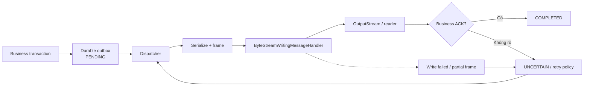
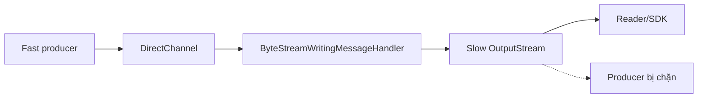

# OutputStream làm message destination

## 1. Bài toán: ghi payload từ Spring Integration ra luồng byte

Trong module **SPRING_INTEGRATION_ADAPTERS**, ứng dụng kết nối các hệ thống ngoài bằng inbound/outbound adapter, gateway, poller và `MessageChannel`, thực hành dữ liệu qua file, SFTP, HTTP, JMS, AMQP, Kafka, database cũng như hợp đồng message, lỗi và vòng đời kết nối. Ở chương **Adapter Stream**, bài **OutputStream làm message destination** đi sâu vào một trường hợp quan trọng: **một `java.io.OutputStream` đã được ứng dụng cung cấp là đích nhận dữ liệu của outbound flow**.

Giả sử một hệ thống nhận sự kiện từ JMS, serialize thành một frame nhị phân và ghi vào một `OutputStream` do Java SDK thiết bị cung cấp. Spring Integration chịu trách nhiệm điều phối message; còn đối tượng stream chịu trách nhiệm đưa byte tới đích ở mức I/O.

```text
 JMS / AMQP / Kafka / HTTP / Database
                  |
                  v
           Business event
                  |
         Validate + Serialize
                  |
          Spring Message<byte[]>
                  |
                  v
        binaryOutboundChannel
                  |
                  v
     ByteStreamWritingMessageHandler
                  |
                  v
    OutputStream (file / pipe / SDK)
                  |
                  v
            External reader
```

**Không gửi một `OutputStream` làm payload để handler phía sau tùy ý ghi.** Luồng đích là **tài nguyên có trạng thái và vòng đời**; nội dung cần chuyển qua Spring Messaging là **dữ liệu `byte[]` đã được serialize**. Đây cũng là ý nghĩa của stream outbound channel adapter trong Spring Integration: nhận các payload lần lượt rồi ghi vào stream đích.

Sau bài học, bạn có thể:

1. Giải thích vai trò `MessageHandler` của `ByteStreamWritingMessageHandler` và sự khác biệt với `InputStream` message source.
2. Cấu hình `OutputStream` do ứng dụng sở hữu, gắn nó với một outbound `MessageChannel` và gửi payload `byte[]`.
3. Xây dựng Java/Spring Boot, Java DSL và XML configuration đúng API Spring Integration 6.5.
4. Thiết kế **length-prefix**, delimiter, checksum, charset và quy tắc đọc lại: **một lần `send()` không tự tạo một record** trên stream.
5. Phân biệt **write, buffering, flush, close, fsync, ACK nghiệp vụ**.
6. Xử lý stream hỏng, ghi dở, lỗi không rõ kết quả, retry/idempotency và backpressure.
7. Quản lý tài nguyên có một owner, trật tự ghi, concurrency, restart và shutdown.
8. Viết test với `ByteArrayOutputStream` và sink giả lập lỗi, chọn adapter chuyên dụng khi cần file/SFTP/TCP/JMS/Kafka semantics.

## 2. Destination là stream, payload là byte

Từ “stream” dễ gây nhầm lẫn giữa **Java I/O stream**, **Spring Integration message flow**, **Kafka Streams** và **Java `Stream<T>`**. Trong bài này, stream là **`OutputStream` của Java**, tức abstraction có các thao tác:

```java
// Hinh thuc rut gon cua API java.io.OutputStream.
import java.io.Closeable;
import java.io.Flushable;
import java.io.IOException;

public abstract class OutputStream implements Closeable, Flushable {
    public abstract void write(int b) throws IOException;
    public void write(byte[] b) throws IOException;
    public void write(byte[] b, int off, int len)
            throws IOException;
    public void flush() throws IOException;
    public void close() throws IOException;
}
```

Đoạn trên chỉ là **mô tả rút gọn API chuẩn của Java**, không phải mã để tạo một lớp `OutputStream` mới. `OutputStream` không biết Spring message, tên file, JSON schema, event ID hoặc transaction trong database.

### Ba tầng cần tách

| Tầng | Thành phần | Trách nhiệm |
| --- | --- | --- |
| Business | `OrderEvent` hoặc DTO | Semantics nghiệp vụ, event ID, schema version |
| Spring Integration | `Message<byte[]>`, `MessageChannel`, `ByteStreamWritingMessageHandler` | Điều phối, chuyển message đến handler |
| Java I/O | `OutputStream` và các wrapper | Ghi byte, buffer, flush, close |

Một `Message<?>` có thể có headers `id`, `timestamp`, `traceId`. Những headers này **không tự được serialize** thành byte bởi byte handler. Nếu đích cần `eventId` hay `tenantId`, ứng dụng phải đưa chúng **vào payload/frame theo hợp đồng**.

### Inbound và outbound không đối xứng về poller

| Phần | Inbound stream | Outbound stream |
| --- | --- | --- |
| API | `ByteStreamReadingMessageSource` | `ByteStreamWritingMessageHandler` |
| I/O | `InputStream.read(...)` | `OutputStream.write(...)` |
| Kích hoạt | `SourcePollingChannelAdapter` + poller | Channel dispatch đến `MessageHandler` |
| Payload | `byte[]` sau khi đọc | `byte[]` cần ghi |
| EOF | Nguồn có thể đến cuối stream | Không có EOF event do write bình thường |
| Hợp đồng reply | Không mặc định | Không mặc định |

Với `DirectChannel`, outbound handler được gọi **đồng bộ** khi producer gửi message; **không cần poller**. Nếu dùng `QueueChannel`, consumer phía sau queue cần một cơ chế poll; đó không phải yêu cầu nội tại của `OutputStream`.

## 3. API Spring Integration 6.5: ByteStreamWritingMessageHandler

Theo Spring Integration Stream Reference 6.5:

- Class chính: `org.springframework.integration.stream.ByteStreamWritingMessageHandler`.
- Tạo bằng constructor nhận `OutputStream` hoặc `(OutputStream, int bufferSize)`.
- Kế thừa `AbstractMessageHandler` và thực thi contract `MessageHandler`.
- Được gắn vào `@ServiceActivator`, `IntegrationFlow.handle(...)` hoặc XML `outbound-channel-adapter`.
- Chuyên ghi **byte array** vào một `OutputStream`.

```java
import java.io.OutputStream;
import org.springframework.integration.stream.ByteStreamWritingMessageHandler;

OutputStream destination = /* stream cua ung dung */;

ByteStreamWritingMessageHandler handler =
        new ByteStreamWritingMessageHandler(destination, 8192);
```

Đây là **snippet khởi tạo handler**, chưa khai báo `destination`, message channel hay vòng đời. `bufferSize=8192` là cấu hình tầng buffering, **không** có nghĩa mỗi Spring message có đúng 8192 byte, cũng **không** tạo một frame 8192 byte.

### Import thay đổi theo phiên bản

| Dòng framework | Package của byte writing handler |
| --- | --- |
| Spring Integration 6.5.x | `org.springframework.integration.stream.ByteStreamWritingMessageHandler` |
| Spring Integration 7.x | `org.springframework.integration.stream.outbound.ByteStreamWritingMessageHandler` |

Hãy để Spring Boot BOM quản lý các phiên bản tương thích hoặc khai báo đồng bộ khi không có BOM; tránh trộn class package của 7.x vào dependency 6.5.x.

### CharacterStreamWritingMessageHandler có liên quan ra sao?

`CharacterStreamWritingMessageHandler` nhận `Writer`, thích hợp với `String`/`char[]` hoặc console text. `ByteStreamWritingMessageHandler` nhận `OutputStream` và cần payload `byte[]`. Nếu dữ liệu là text UTF-8 và đích thực sự yêu cầu byte, bạn có thể serialize thành `byte[]` **trước khi đưa vào channel**. Nếu đích chỉ cần dòng text trên stdout, character handler có factory `stdout("UTF-8")` và `appendNewLine(true)` tiện hơn.

Không dùng `OutputStream.toString()` làm nội dung gửi. Nó thường chỉ mô tả object, không chứa dữ liệu đã ghi.

## 4. Ba kiểu OutputStream phổ biến

`OutputStream` là abstraction; ý nghĩa vận hành khác nhau theo sink.

| Triển khai | Ví dụ sử dụng | Ownership và rủi ro |
| --- | --- | --- |
| `ByteArrayOutputStream` | Unit/integration test, buffer RAM | Dữ liệu biến mất khi JVM kết thúc, dễ kiểm tra bytes |
| `Files.newOutputStream(...)` / `FileOutputStream` | Xuất ra một file cụ thể | File descriptor, quyền ghi, đóng/flush, crash, truncate/append |
| `BufferedOutputStream` | Giảm số syscall khi ghi nhiều message nhỏ | Byte có thể ở RAM trước khi được flush |
| `PipedOutputStream` | Pipe đến reader trong JVM | Blocking, reader chết, giới hạn buffer |
| `Socket.getOutputStream()` | Ghi vào connection TCP | Timeout, disconnect, reconnect và framing |
| Stream từ Java SDK | Ghi sang thiết bị, object store hoặc remote API | Phải tuân theo hợp đồng close/commit của SDK |
| `System.out` | stdout thường là PrintStream | Có thể trộn logging, charset và lỗi không phải lúc nào cũng ném exception như sink thường |

**Chỉ có một chủ sở hữu ghi** cho mỗi stream trừ khi ứng dụng đã thiết kế đồng bộ và điều phối rõ ràng. Hai handler cùng dùng một `OutputStream` có thể ghi xen kẽ, làm hỏng thứ tự record hoặc giao thức bên đọc.

### Không mở lại file mỗi lần gửi

```text
ĐÚNG:
  application startup
      -> open OutputStream một lần
      -> message #1: write bytes
      -> message #2: write bytes tiếp vào cùng stream
      -> application shutdown: flush/close theo chính sách

SAI:
  mỗi message:
      -> open file với TRUNCATE_EXISTING
      -> write bytes
      -> close
  ==> message trước bị ghi đè
```

Trong chương này, destination là **stream đang mở**. Khi cần **mỗi event một file**, filename từ message header, suffix tạm/rename atomically hoặc kiểm soát file đã tồn tại, hãy dùng **File outbound channel adapter/gateway**.

## 5. Payload: gửi bytes đã serialize, không gửi DTO tùy ý

Byte handler chỉ biết **ghi byte array**. Nó không tự serialize một `OrderEvent`, không hiểu `ObjectMapper`, protobuf schema hay `FileHeaders`.

Ví dụ một event nghiệp vụ:

```java
public record OrderEvent(String eventId, long orderId, String state) {
}
```

Để gửi JSON UTF-8, producer/transformer phải tạo bytes:

```java
import java.nio.charset.StandardCharsets;
import org.springframework.messaging.Message;
import org.springframework.messaging.support.MessageBuilder;

String json =
        "{\"eventId\":\"evt-1001\",\"orderId\":1001,\"state\":\"PAID\"}";

byte[] utf8 = json.getBytes(StandardCharsets.UTF_8);

Message<byte[]> outbound =
        MessageBuilder.withPayload(utf8)
                .setHeader("businessEventId", "evt-1001")
                .build();
```

**Header `businessEventId` chỉ tồn tại ở Spring message.** Nếu bên nhận qua pipe/SDK cần biết ID, nội dung bytes đã phải chứa nó. Với JSON, ví dụ trên có `eventId` ngay trong body; với binary protocol có thể đặt ID trong frame header.

Không làm:

```java
// Sai hop dong cua ByteStreamWritingMessageHandler:
Message<OrderEvent> invalid =
        MessageBuilder.withPayload(
                new OrderEvent("evt-1001", 1001, "PAID")
        ).build();
```

Việc gửi một `OrderEvent` không tự khiến byte handler biết encode UTF-8, protobuf hay JSON. Nếu Spring có converter/transformer trong flow, hãy **khai báo nó tường minh**, test kết quả `byte[]` trước handler.

### Charset không thuộc OutputStream

`OutputStream` nhận **bytes**; charset chỉ xuất hiện khi bạn biến `String` thành `byte[]`. Đặt `StandardCharsets.UTF_8` ở producer/serializer để không phụ thuộc locale JVM/container:

```java
byte[] data = "Xin chào".getBytes(StandardCharsets.UTF_8);
```

Nếu đầu đọc dùng UTF-8, nó phải giải mã **cùng charset**. Không mong một Spring header tên `charset` tự đổi cách ByteStreamWritingMessageHandler ghi byte.

### JSON record khác stream chunk

Hai lần `MessageChannel.send(Message<byte[]>)` **không tạo hai record tự định danh** trong byte stream: bên đọc chỉ thấy **chuỗi byte liên tiếp**. Nếu bạn muốn NDJSON, phải có newline delimiter; nếu muốn binary, cần một framing protocol có thể parse được.

## 6. Framing: một message phải có cách được tách lại từ stream

Ví dụ gửi hai chuỗi:

```text
Spring message #1 payload: 41 42 43       ("ABC")
Spring message #2 payload: 44 45          ("DE")

OutputStream bytes:          41 42 43 44 45

Reader thấy:                "ABCDE"
```

Reader không biết ranh giới giữa `ABC` và `DE` nếu giao thức không quy định.

| Giao thức | Ví dụ | Khi phù hợp |
| --- | --- | --- |
| Dòng LF | `record1\\nrecord2\\n` | Text/NDJSON; phải escape newline bên trong |
| Fixed length | Mỗi frame 128 byte | Record có kích thước cố định |
| Length-prefix | 4 byte độ dài + payload | Binary nhiều độ dài |
| Delimiter + escaping | Ký tự phân cách và escape rules | Protocol text cụ thể |
| SDK protocol | Header/checksum/sequence | Thiết bị hoặc thư viện đã định nghĩa |

### 6.1. Length-prefix 4 byte, big-endian

Giả sử mỗi record dùng **4-byte signed length ở dạng big-endian**, theo sau là bytes của payload. Quy ước chỉ chấp nhận độ dài từ 1 đến 1 MiB:

```text
Payload "ABC": 41 42 43

Frame:
00 00 00 03  41 42 43
|  length |  | payload |

Payload "DE": 44 45
Frame:
00 00 00 02  44 45
```

Hàm đóng frame:

```java
import java.nio.ByteBuffer;
import java.nio.ByteOrder;
import java.util.Objects;

public final class FrameEncoder {

    public static final int MAX_PAYLOAD_BYTES = 1024 * 1024;

    private FrameEncoder() {
    }

    public static byte[] encode(byte[] payload) {
        Objects.requireNonNull(payload, "payload");
        if (payload.length == 0
                || payload.length > MAX_PAYLOAD_BYTES) {
            throw new IllegalArgumentException(
                    "Invalid payload length: " + payload.length);
        }

        return ByteBuffer.allocate(4 + payload.length)
                .order(ByteOrder.BIG_ENDIAN)
                .putInt(payload.length)
                .put(payload)
                .array();
    }
}
```

Đây là **một lớp Java độc lập** có thể đặt trong `FrameEncoder.java`. Nó tạo một `byte[]` hoàn chỉnh, nên handler chỉ cần ghi **một payload đã được đóng frame**. Bên nhận phải có decoder theo cùng hợp đồng, hỗ trợ nhiều frame nối tiếp, short read và dữ liệu frame bị chia giữa các chunk.

### 6.2. Bên đọc phải dùng readFully hoặc decoder có trạng thái

**`InputStream.read(byte[])` không đảm bảo trả đủ số byte bạn yêu cầu**. Nếu bên đọc dùng:

```java
byte[] header = new byte[4];
input.read(header);  // KHONG du bao dam header 4 byte!
```

thì nó có thể chỉ nhận một phần. Với stream đồng bộ hữu hạn, có thể dùng `DataInputStream.readFully(...)`:

```java
import java.io.DataInputStream;
import java.io.InputStream;

public final class FrameDecoder {

    private FrameDecoder() {
    }

    public static byte[] readOne(InputStream input)
            throws java.io.IOException {
        DataInputStream data = new DataInputStream(input);
        int length = data.readInt(); // 4 byte, big-endian

        if (length < 1 || length > FrameEncoder.MAX_PAYLOAD_BYTES) {
            throw new java.io.IOException(
                    "Invalid frame length: " + length);
        }

        byte[] payload = new byte[length];
        data.readFully(payload);
        return payload;
    }
}
```

`FrameDecoder` cần có `FrameEncoder` cùng package và **không tự tạo ACK**. Ví dụ phù hợp với một InputStream đang mở ở môi trường test/đích; nếu nguồn kết thúc, `readInt()` có thể ném `EOFException`. Với dữ liệu network, cần timeout, kiểm tra kích thước trước cấp phát và xử lý ngắt quãng trong protocol.

**Lỗi khi một record đã được ghi một phần** không tự được giải quyết bằng length-prefix. Decoder có thể biết thiếu byte nhưng vẫn cần chiến lược bỏ frame dở, tái đồng bộ, retry và event ID.

## 7. Spring Boot: một OutputStream do ứng dụng sở hữu

Ví dụ dùng **Java 17+**, Spring Boot tương thích Spring Integration 6.5.x. Nó tạo một `OutputStream` cho **một tệp binary**, gắn với `ByteStreamWritingMessageHandler` và gửi hai frame đã serialize. Đây là ví dụ một **destination cố định**, không phải một outbound File adapter chọn tên file theo message.

### 7.1. Maven dependencies

```xml
<dependencies>
    <dependency>
        <groupId>org.springframework.boot</groupId>
        <artifactId>spring-boot-starter-integration</artifactId>
    </dependency>
    <dependency>
        <groupId>org.springframework.integration</groupId>
        <artifactId>spring-integration-stream</artifactId>
    </dependency>
</dependencies>
```

Sử dụng Spring Boot BOM để quản lý phiên bản hoặc đồng bộ các artifact Spring Integration nếu không có BOM. Tránh kết hợp core của một phiên bản với stream của phiên bản khác.

### 7.2. Cấu hình

```yaml
app:
  stream:
    output-path: ${STREAM_OUTPUT_PATH:./build/output/events.bin}
    io-buffer-size: ${STREAM_IO_BUFFER_SIZE:8192}
```

`STREAM_OUTPUT_PATH` trong ví dụ là đường dẫn **được operator tin cậy**. Production cần giới hạn root directory, kiểm soát symlink/permission, quota và không cho request người dùng tự chọn đường dẫn hệ thống tùy ý.

### 7.3. Java configuration + producer

```java
import java.io.IOException;
import java.io.OutputStream;
import java.nio.charset.StandardCharsets;
import java.nio.file.Files;
import java.nio.file.Path;
import java.nio.file.StandardOpenOption;

import org.springframework.beans.factory.annotation.Qualifier;
import org.springframework.beans.factory.annotation.Value;
import org.springframework.boot.ApplicationRunner;
import org.springframework.boot.SpringApplication;
import org.springframework.boot.autoconfigure.SpringBootApplication;
import org.springframework.context.annotation.Bean;
import org.springframework.integration.annotation.ServiceActivator;
import org.springframework.integration.channel.DirectChannel;
import org.springframework.integration.config.EnableIntegration;
import org.springframework.integration.stream.ByteStreamWritingMessageHandler;
import org.springframework.messaging.MessageChannel;
import org.springframework.messaging.support.MessageBuilder;

@SpringBootApplication
@EnableIntegration
public class OutputStreamDestinationApplication {

    public static void main(String[] args) {
        SpringApplication.run(
                OutputStreamDestinationApplication.class, args);
    }

    @Bean(name = "destinationOutputStream", destroyMethod = "close")
    public OutputStream destinationOutputStream(
            @Value("${app.stream.output-path}") String configuredPath)
            throws IOException {

        Path output = Path.of(configuredPath)
                .toAbsolutePath()
                .normalize();
        Path parent = output.getParent();
        if (parent != null) {
            Files.createDirectories(parent);
        }

        // Demo: moi startup tao lai noi dung file.
        return Files.newOutputStream(
                output,
                StandardOpenOption.CREATE,
                StandardOpenOption.TRUNCATE_EXISTING,
                StandardOpenOption.WRITE
        );
    }

    @Bean
    public MessageChannel deviceBinaryOutboundChannel() {
        return new DirectChannel();
    }

    @Bean
    @ServiceActivator(inputChannel = "deviceBinaryOutboundChannel")
    public ByteStreamWritingMessageHandler destinationWriter(
            @Qualifier("destinationOutputStream")
            OutputStream destination,
            @Value("${app.stream.io-buffer-size:8192}") int bufferSize) {

        if (bufferSize < 1 || bufferSize > 1024 * 1024) {
            throw new IllegalArgumentException(
                    "Invalid OutputStream buffer size");
        }
        return new ByteStreamWritingMessageHandler(
                destination, bufferSize);
    }

    @Bean
    public ApplicationRunner sendDemoFrames(
            @Qualifier("deviceBinaryOutboundChannel")
            MessageChannel channel) {

        return args -> {
            send(channel, "evt-1001", "ORDER:1001:CREATED");
            send(channel, "evt-1002", "ORDER:1002:PAID");
        };
    }

    private static void send(
            MessageChannel channel, String eventId, String content) {

        byte[] payload = content.getBytes(StandardCharsets.UTF_8);
        byte[] frame = FrameEncoder.encode(payload);

        boolean accepted = channel.send(
                MessageBuilder.withPayload(frame)
                        .setHeader("businessEventId", eventId)
                        .build()
        );

        if (!accepted) {
            throw new IllegalStateException(
                    "Outbound channel rejected " + eventId);
        }
    }
}
```

`FrameEncoder` ở mục 6 phải được đặt trong cùng package, hoặc import từ package nơi đã định nghĩa. Ví dụ còn cần cấu hình build Spring Boot thông thường và JVM 17+.

### 7.4. Đọc từng bước

1. Spring tạo **một bean `OutputStream`** trỏ đến file đích.
2. `destroyMethod="close"` giao trách nhiệm đóng stream khi bean bị hủy.
3. `ByteStreamWritingMessageHandler` nhận chính bean đó qua constructor.
4. `@ServiceActivator(inputChannel = "...")` biến handler thành consumer của channel.
5. `ApplicationRunner` tạo dữ liệu UTF-8, đóng frame length-prefix và gửi hai `Message<byte[]>`.
6. `DirectChannel` gọi consumer đồng bộ trên đường gửi.
7. File nhận các frame **liên tiếp**, không có sự phân tách nào khác ngoài length-prefix được `FrameEncoder` tạo.

Trong ví dụ, mỗi lần **khởi động lại** dùng `TRUNCATE_EXISTING` và có thể làm mất dữ liệu cũ. Điều này chỉ thích hợp cho file test/batch chủ động ghi đè; **không** phải một outbox bền vững.

### 7.5. Kết quả mong đợi

Payload thứ nhất có nội dung `ORDER:1001:CREATED`, payload thứ hai là `ORDER:1002:PAID`. File sẽ chứa:

```text
00 00 00 12 | 4F 52 44 45 52 3A 31 30 30 31 3A 43 52 45 41 54 45 44
00 00 00 0F | 4F 52 44 45 52 3A 31 30 30 32 3A 50 41 49 44
```

Đây là **biểu diễn hex dự kiến**, không phải kết quả đã chạy. Hai frame có độ dài lần lượt **18 và 15 byte**. Trên file thật, các byte được nối liền, không có ký tự `|` hay dấu cách. Để kiểm chứng, dùng `FrameDecoder` đọc lần lượt rồi so sánh chuỗi sau khi decode UTF-8.

**Đừng đồng nhất ví dụ với file publish an toàn:** ứng dụng chưa thiết kế temporary file, atomic rename, CRC, resume, fsync hay xử lý khi tiến trình chết giữa frame. Cần chọn File outbound adapter hoặc thiết kế protocol lưu trữ khác nếu các ràng buộc đó bắt buộc.

## 8. Java DSL: cấu hình khi không dùng @ServiceActivator

Một `ByteStreamWritingMessageHandler` là `MessageHandler` nên có thể được gắn trực tiếp vào `IntegrationFlow.handle(...)`.

```java
import java.io.OutputStream;
import org.springframework.beans.factory.annotation.Qualifier;
import org.springframework.context.annotation.Bean;
import org.springframework.context.annotation.Configuration;
import org.springframework.integration.config.EnableIntegration;
import org.springframework.integration.dsl.IntegrationFlow;
import org.springframework.integration.stream.ByteStreamWritingMessageHandler;

@Configuration
@EnableIntegration
public class ByteDestinationDslConfig {

    @Bean
    public IntegrationFlow deviceByteFlow(
            @Qualifier("destinationOutputStream") OutputStream destination) {

        return IntegrationFlow
                .from("deviceFramesInput")
                .handle(new ByteStreamWritingMessageHandler(
                        destination, 8192))
                .get();
    }
}
```

Đây là **phương án cấu hình thay thế** cách dùng `@ServiceActivator` ở mục 7. Nếu triển khai cùng context, nên chọn **một** flow/handler sở hữu stream, tránh hai consumer ghi cạnh tranh. Producer cần gửi `Message<byte[]>` vào channel `deviceFramesInput`.

`IntegrationFlow.from("deviceFramesInput")` nhận thông điệp từ channel theo cấu hình của DSL. Không cần poller nếu đây là `SubscribableChannel` như `DirectChannel`. Nếu đầu nguồn dùng `PollableChannel`, chính đoạn tiêu thụ kênh đó có thể cần poller.

## 9. XML: cấu hình bean OutputStream rồi khai báo outbound-channel-adapter

XML có thể tham chiếu một handler Bean. Ví dụ minh họa **cần một bean `destinationOutputStream` có sẵn** được tạo trong Java configuration hoặc bean factory phù hợp:

```xml
<beans:beans
    xmlns:beans="http://www.springframework.org/schema/beans"
    xmlns:xsi="http://www.w3.org/2001/XMLSchema-instance"
    xmlns:int="http://www.springframework.org/schema/integration"
    xsi:schemaLocation="
        http://www.springframework.org/schema/beans
        https://www.springframework.org/schema/beans/spring-beans.xsd
        http://www.springframework.org/schema/integration
        https://www.springframework.org/schema/integration/spring-integration.xsd">

    <!-- destinationOutputStream: bean OutputStream do app quan ly. -->
    <beans:bean
        id="binaryStreamHandler"
        class="org.springframework.integration.stream.ByteStreamWritingMessageHandler">
        <beans:constructor-arg ref="destinationOutputStream"/>
        <beans:constructor-arg value="8192"/>
    </beans:bean>

    <int:channel id="deviceFrames"/>

    <int:outbound-channel-adapter
        id="binaryOutboundAdapter"
        channel="deviceFrames"
        ref="binaryStreamHandler"/>

</beans:beans>
```

Đây là **mảnh XML minh họa**, không phải file hoàn chỉnh độc lập vì `destinationOutputStream` và producer của `deviceFrames` phải được cung cấp. Đừng vừa đăng ký Java `@ServiceActivator` ở mục 7 vừa cấu hình handler XML này để ghi cùng stream nếu chưa có một cơ chế serialize chung.

### Nếu đích là stdout/stderr

`ByteStreamWritingMessageHandler` không có cùng các factory `stdout("UTF-8")`/`stderr("UTF-8")` như character handler. Nếu muốn **text** trên console với newline theo message, dùng namespace:

```xml
<int-stream:stdout-channel-adapter
    id="stdoutLines"
    channel="textOutputChannel"
    charset="UTF-8"
    append-newline="true"/>
```

Đoạn trên cần namespace `int-stream` và XSD trong root XML thích hợp. Nó tạo **character stream** adapter, **không phải** một byte handler có framing binary. Giữ riêng stdout dữ liệu và stdout log để parser downstream không bị nhiễu.

## 10. Test OutputStream bằng ByteArrayOutputStream

`ByteArrayOutputStream` là destination thuận tiện khi muốn kiểm tra **byte thật**, không cần mở file hay kết nối thiết bị. Nó cho phép so sánh chính xác frame, thứ tự bytes và xử lý nhiều message.

### 10.1. JUnit 5: hai frame liên tiếp

Ví dụ dưới đây dùng cùng `FrameEncoder` ở mục 6 và `FrameDecoder` cùng package. Handler được tạo và sử dụng trực tiếp; không cần một `ApplicationContext` đầy đủ:

```java
import static org.junit.jupiter.api.Assertions.assertArrayEquals;
import static org.junit.jupiter.api.Assertions.assertEquals;

import java.io.ByteArrayInputStream;
import java.io.ByteArrayOutputStream;
import java.nio.charset.StandardCharsets;

import org.junit.jupiter.api.Test;
import org.springframework.integration.stream.ByteStreamWritingMessageHandler;
import org.springframework.messaging.support.MessageBuilder;

class OutputStreamDestinationTest {

    @Test
    void writesTwoLengthPrefixedMessages() throws Exception {
        ByteArrayOutputStream destination =
                new ByteArrayOutputStream();
        ByteStreamWritingMessageHandler handler =
                new ByteStreamWritingMessageHandler(destination, 16);

        handler.afterPropertiesSet();

        byte[] first = "ABC".getBytes(StandardCharsets.UTF_8);
        byte[] second = "DE".getBytes(StandardCharsets.UTF_8);

        handler.handleMessage(MessageBuilder
                .withPayload(FrameEncoder.encode(first)).build());
        handler.handleMessage(MessageBuilder
                .withPayload(FrameEncoder.encode(second)).build());

        byte[] actual = destination.toByteArray();

        byte[] expected = new byte[] {
                0, 0, 0, 3, 65, 66, 67,
                0, 0, 0, 2, 68, 69
        };
        assertArrayEquals(expected, actual);

        ByteArrayInputStream source =
                new ByteArrayInputStream(actual);
        assertEquals("ABC", new String(
                FrameDecoder.readOne(source), StandardCharsets.UTF_8));
        assertEquals("DE", new String(
                FrameDecoder.readOne(source), StandardCharsets.UTF_8));
        assertEquals(0, source.available());
    }
}
```

**Kỳ vọng:** tổng cộng **13 byte**: frame `ABC` dài `4+3=7` byte và frame `DE` dài `4+2=6` byte. Mảng `expected` có đúng 13 phần tử; test đối chiếu trực tiếp các byte và đọc lại hai frame bằng decoder. Ví dụ **chưa được chạy trong STEP 4**.

Với cấu hình buffering cụ thể, cần xác minh hành vi flush của handler trên phiên bản runtime. Nếu dữ liệu chưa quan sát được ngay trên target vì còn nằm ở một wrapper, test phải điều phối flush/lifecycle thích hợp thay vì giả định rằng mọi `write(...)` đã vượt mọi tầng buffer.

### 10.2. Test không lạm dụng System.out

Đừng thay `System.out` trên toàn JVM trong các test chạy song song chỉ để chụp output: Spring Boot banner, logging và test khác có thể gây nhiễu. `ByteArrayOutputStream` là một nguồn riêng, deterministic, dễ assert binary. Với mục đích kiểm thử logging/console, dùng test facility phù hợp với logger hoặc capture stream có isolation.

### 10.3. Kiểm tra decoder khi stream kết thúc

Với `ByteArrayInputStream` hoàn tất, decoder đã đọc đủ hai frame. Nếu file hoặc pipe chỉ có **nửa frame**, `DataInputStream.readFully(...)` sẽ ném `EOFException` thay vì trả một record hoàn chỉnh. Đây là phát hiện lỗi framing; không biến nửa frame thành một event nghiệp vụ.

## 11. Write, buffer, flush, close và độ bền dữ liệu

Đây là phần quan trọng nhất khi dùng `OutputStream` làm destination. Những động từ sau có ý nghĩa **khác nhau**:

| Hành động | Ý nghĩa | Không đảm bảo |
| --- | --- | --- |
| `channel.send(message)` | Gửi Spring message vào channel theo semantics của channel | Người đọc đã nhận hay đã commit |
| `OutputStream.write(bytes)` | Yêu cầu stream/wrapper ghi dữ liệu | Byte đã được fsync xuống đĩa |
| `OutputStream.flush()` | Đẩy bytes từ buffer Java xuống tầng bên dưới (nếu có) | Remote consumer đã xử lý; file bền qua mất điện |
| `OutputStream.close()` | Kết thúc stream, có thể flush và giải phóng tài nguyên | Một giao dịch distributed đã commit |
| `FileChannel.force(true)` | Yêu cầu đồng bộ metadata/dữ liệu trên file channel theo semantics OS/filesystem | Tự có atomic rename hoặc ACK nghiệp vụ |
| Application ACK | Bên nhận xác nhận theo protocol riêng | Bên nhận đã fsync, trừ khi hợp đồng quy định |

### 11.1. Flush không bằng fsync

`BufferedOutputStream` có thể giữ bytes trong bộ nhớ ứng dụng; `flush()` đẩy xuống `OutputStream` bên dưới. Khi destination là file, kernel có thể tiếp tục cache trên OS. Khi destination là pipe/socket, dữ liệu có thể ở kernel buffer nhưng **reader vẫn chưa xử lý**.

Không nên tự quảng cáo durability bằng cách chỉ gọi `flush()`. Nếu đích yêu cầu file an toàn sau crash, dùng giải pháp có chiến lược file descriptor/fsync, temporary file + atomic publication, và kiểm tra giới hạn filesystem. Spring Stream outbound adapter **không tự cung cấp toàn bộ quy trình ấy**.

### 11.2. Wrapper tạo thêm tầng đệm

```java
import java.io.BufferedOutputStream;
import java.io.OutputStream;

OutputStream raw = /* destination cua ung dung */;
BufferedOutputStream buffered =
        new BufferedOutputStream(raw, 8192);
```

Đây là snippet wrapper, **chưa đặt trong bean**. Nếu handler tự tạo buffer theo constructor, việc bọc thêm một `BufferedOutputStream` có thể tạo **hai tầng buffer**. Không nhất thiết sai, nhưng phải biết ai flush/close lớp nào, có đẩy được bytes ra đích theo latency yêu cầu không.

### 11.3. Không áp dụng auto-flush của PrintStream cho mọi stream

`System.out` thường là `PrintStream`, có hành vi xử lý lỗi và auto-flush riêng. Nhưng một `FileOutputStream`, `BufferedOutputStream` hoặc stream từ SDK **không nhất thiết giống PrintStream**. Vì vậy:

- Đừng kết luận `System.out.println(...)` chạy tốt thì ByteStreamWritingMessageHandler trên pipe sẽ có cùng semantics.
- Đừng kết luận `channel.send()` trả `true` là mọi lỗi I/O đã được quan sát.
- Test cả trường hợp writer nhận message ngắn, message lớn, close và sink bị hỏng.

### 11.4. Ghi được một phần frame là vấn đề

`OutputStream` không có lệnh `rollback()`. Nếu đã ghi một phần:

```text
frame = [length=00000012][payload 18 bytes]

write header + first 7 payload bytes
            |
        I/O failure
            |
        retry entire frame
            |
reader sees: partial frame + duplicate/retry bytes
```

Nếu reader không có cơ chế bỏ qua frame dở hoặc khôi phục transaction, nó có thể giải mã sai sau retry. **Framing là điều kiện cần, không phải điều kiện đủ** cho giao hàng an toàn.

## 12. Retry và tình huống kết quả gửi không rõ

Với outbound stream, các kết quả có thể là:

1. **Chưa ghi byte nào** và đã phát hiện lỗi: có thể thử lại khi đích đã được sửa.
2. **Đã ghi một phần** rồi lỗi: reader có thể có dữ liệu dở.
3. **Ghi thành công ở Java layer** nhưng chưa có ACK: không rõ receiver đã commit.
4. **Đích đã commit** nhưng ACK bị mất: retry có thể gây xử lý trùng.

Thiết kế retry nên dựa trên **event ID ổn định** và hợp đồng giữa hai phía, không dựa vào `MessageHeaders.ID` được tạo mới mỗi lần.

### 12.1. Durable outbox trước stream writer



| Field trạng thái | Ví dụ | Tác dụng |
| --- | --- | --- |
| `eventId` | `evt-1001` | Danh tính nghiệp vụ xuyên retry |
| `attempt` | `3` | Theo dõi số lần thử |
| `frameVersion` | `1` | Quy tắc decode |
| `destinationId` | `sdk-device-7` | Đích đúng của event |
| `status` | `UNCERTAIN` | Chưa biết bên nhận đã hoàn tất |
| `nextRetryAt` | Thời gian theo policy | Backoff |
| `lastFailure` | `BROKEN_PIPE` | Phân loại lỗi |

Các trường trên là **metadata ứng dụng tự thiết kế**, không phải Spring header tự xuất ra trên wire. Nếu reader cần event ID, serializer/frame phải mang nó.

### 12.2. Consumer idempotent

Reader phía bên kia phải:

1. Nhận **frame hoàn chỉnh**; từ chối frame dở/quá dài/không đúng version.
2. Xác thực/ủy quyền nguồn và validate nội dung.
3. Trích `eventId` ổn định.
4. Ghi một **inbox table có unique constraint trên eventId** cùng transaction nghiệp vụ.
5. Nếu event đã xử lý, không lặp side effect; có thể ACK lại theo contract.

Nếu một stream/SDK không có phản hồi từ reader, có thể chỉ cung cấp **best-effort** hoặc at-least-once với khâu chống trùng trong hệ thống đích (nếu được). **Không tuyên bố exactly-once chỉ nhờ một OutputStream**.

### 12.3. Backoff và phân loại lỗi

| Lỗi | Có nên retry ngay? | Gợi ý |
| --- | --- | --- |
| Broken pipe | Không retry nóng | Khởi tạo destination mới, kiểm tra reader và framing |
| Disk full | Không | Giải phóng dung lượng/quota, cảnh báo |
| Destination bị close | Không | Sửa lifecycle/ownership trước |
| Transient network failure | Có thể | Reconnect ở connection manager, backoff, event ID |
| Sai encoding/schema | Không | Sửa serialization và versioning |
| Timeout không rõ đã nhận | Theo chính sách | Durable state, ACK, idempotency |
| Unauthorized destination | Không | Sửa ACL/credential |

Không thực hiện vòng `while(true) write(...)` trong `@ServiceActivator` khi sink hỏng: nó có thể chặn thread gửi, gây bão retry và cạn tài nguyên.

## 13. Concurrency và ordering khi nhiều producer gửi chung OutputStream

`DirectChannel` không tự biến **mọi producer** thành một worker tuần tự. Nếu hai thread gọi `send()` đồng thời, handler có thể được gọi từ cả hai đường thực thi. Ngay cả khi một implementation dùng lock nội bộ cho một thao tác ghi, **nó không biến nhiều message thành một transaction có thứ tự nghiệp vụ**.

```text
Thread A -> event A1 -> OutputStream
Thread B -> event B1 -> OutputStream
Thread A -> event A2 -> OutputStream

Reader có thể thấy A1, B1, A2; không mặc định A1, A2, B1.
```

### Những mức thứ tự khác nhau

| Mức thứ tự | Có tự đảm bảo? |
| --- | --- |
| Thứ tự byte bên trong một `byte[]` | Phải dựa vào contract ghi của OutputStream |
| Không bị xen giữa hai lời gọi handler đồng thời | Phải kiểm tra implementation/đồng bộ |
| Thứ tự message từ một producer tuần tự | Dễ kiểm soát hơn nhưng vẫn phụ thuộc channel/flow |
| Thứ tự nhiều producer toàn hệ thống | Không; cần sequencer/owner |
| Thứ tự nghiệp vụ qua restart | Cần durable sequence, checkpoint/lease |

**Phương án an toàn khi cần thứ tự cao:** đưa tất cả frame dành cho **một destination** qua một dispatcher/writer owner duy nhất, với bounded queue và quy tắc ownership rõ.

### Nếu có nhiều instance

Hai pod không thể đồng thời ghi an toàn vào **cùng một file/pipe/SDK stream** mà không có giao thức hoặc coordination rõ. Một số filesystem chỉ bảo đảm atomicity trong điều kiện hẹp; stream API không tự đóng vai trò distributed lock.

Giải pháp có thể là:

- Partition destination theo tenant/key để mỗi stream có một owner.
- Đưa message đến broker; một consumer được chỉ định duy nhất ghi ra destination.
- Dùng lease/lock có timeout và fencing token khi nhiều worker tranh quyền.
- Nếu muốn ghi nhiều file độc lập, thiết kế filename/atomic publication bằng File adapter.

Không suy diễn `QueueChannel` tự mang lại durability: queue trong RAM vẫn mất khi JVM chết trừ khi cấu hình message store bền vững.

## 14. Backpressure: khi reader nhận dữ liệu chậm

Một `OutputStream.write(...)` có thể **block**:

- Pipe trong JVM có dung lượng hữu hạn.
- TCP socket bị nghẽn khi receive window nhỏ hoặc mạng chậm.
- File I/O chậm trên storage đầy tải.
- SDK đích áp dụng rate limit hoặc chờ network ACK riêng.



Nếu producer chạy trên một HTTP request thread hoặc message listener, việc write block có thể làm tăng latency và giữ transaction/consumer thread quá lâu.

### Lựa chọn kiến trúc

| Phương án | Lợi ích | Rủi ro/phải bổ sung |
| --- | --- | --- |
| `DirectChannel` | Dễ triển khai, feedback đồng bộ | Block producer khi output chậm |
| `ExecutorChannel` | Tách I/O ra worker | Queue và thứ tự cần kiểm soát |
| `QueueChannel` + polling consumer | Buffer có giới hạn | In-memory không tự bền; cần policy đầy queue |
| Durable JMS/AMQP/Kafka handoff | Cho phép phục hồi khi được cấu hình đúng | ACK, transaction, offset và ordering riêng |
| Dedicated writer process | Quản lý một OutputStream owner | Phải có protocol IPC và restart |

**Không dùng unbounded queue** như một “giải pháp” cho sink chậm: nó chỉ chuyển vấn đề sang tràn bộ nhớ. Cần đo `queueDepth`, latency, throughput, error rate và đưa ra chính sách block/drop/retry/dead-letter.

### Timeout phải đặt đúng tầng

`MessageChannel.send(message, timeout)` có ý nghĩa theo **kiểu channel** và semantics gửi; nó **không tự đặt timeout cho một `OutputStream.write(...)` đã bắt đầu**. Với socket, cấu hình timeout/connection management ở lớp tương ứng; nếu SDK không hỗ trợ hủy write đang block, cần thiết kế worker isolation và chính sách close/abandon.

## 15. Vòng đời và shutdown đúng cách

`OutputStream` có thể là tài nguyên dùng chung; phải xác định ai chịu trách nhiệm đóng:

| Đích | Chủ sở hữu | Gợi ý |
| --- | --- | --- |
| `ByteArrayOutputStream` | Test fixture | Có thể đọc bytes sau khi write hoàn tất |
| `Files.newOutputStream` được tạo bằng `@Bean` | Spring context | `destroyMethod="close"`; tránh bean khác đóng sớm |
| `System.out` và `System.err` | JVM/runtime | **Không đóng** từ một handler |
| `Socket.getOutputStream` | Connection manager | Đóng theo connection lifecycle; reconnect tạo stream mới |
| `PipedOutputStream` | Producer/pipe coordinator | Reader và writer phải dừng có thứ tự |
| OutputStream của SDK | SDK/client/transaction | Tham khảo contract SDK về flush, close, abort, commit |

### Trình tự stop đề xuất

```text
1. Ngừng nhận hoặc tạo business event mới.
2. Dừng dispatcher đã tiếp nhận thêm message.
3. Drain bounded queue tới deadline rõ ràng.
4. Hoàn tất write/flush theo yêu cầu destination.
5. Đóng OutputStream do ứng dụng sở hữu.
6. Lưu trạng thái UNCERTAIN của event chưa có ACK.
7. Kết thúc process và phát metrics/audit.
```

Đây là **quy trình thiết kế**, không phải thứ tự shutdown tự động của mọi Spring context. Khi JVM bị kill hoặc mất điện, các bước cleanup có thể không chạy. Vì vậy với event cần độ tin cậy cao, phải có durable outbox **trước** outbound stream.

### Stream đã bị close không thể tự hồi sinh

`ByteStreamWritingMessageHandler` được tạo với một `OutputStream` cụ thể. Khi stream đó hỏng/đóng, handler **không tự đổi sang stream mới**. Nếu một socket hoặc remote SDK session phải reconnect, cần một **destination manager** tạo session/stream mới, chuyển trạng thái owner, và quyết định cách xử lý message pending.

Không tự thay `OutputStream` nằm bên trong một handler từ một thread khác mà chưa biết synchronization/lifecycle của handler. Với giao thức mạng chuyên dụng, cân nhắc TCP outbound adapter/gateway có connection factory.

### File append và truncate: chính sách khác nhau

`StandardOpenOption.TRUNCATE_EXISTING` trong ví dụ mục 7 phù hợp với file test ghi lại từ đầu. Nếu dùng `APPEND`:

```java
OutputStream appendSink = Files.newOutputStream(
        path,
        StandardOpenOption.CREATE,
        StandardOpenOption.APPEND,
        StandardOpenOption.WRITE
);
```

đó chỉ là một **mảnh code về option file** (giả định `path` là `Path` hợp lệ), không có nghĩa frame cuối bị cắt do crash đã tự được sửa, cũng không đảm bảo nhiều process append không xen kẽ. Muốn tiếp tục sau restart cần kiểm tra file integrity/frame boundary và dedup event.

## 16. Security và quản lý dữ liệu đầu ra

Nguồn message có thể là HTTP, Kafka, JMS hoặc input người dùng. Dữ liệu đưa tới OutputStream vẫn cần kiểm soát:

1. **Chọn đích đáng tin:** chỉ cho phép cấu hình đường dẫn/stream trong danh sách hợp lệ; không cho input tùy ý ghi ra file bí mật hoặc system device.
2. **Validate schema:** kiểm tra DTO, enum, version và event ID **trước khi serialize**.
3. **Max frame length:** giới hạn bytes, depth và số field trước khi cấp phát `ByteBuffer`/mảng lớn.
4. **Charset rõ ràng:** UTF-8 khi encode text, không dựa vào default charset.
5. **Không rò rỉ secrets:** payload và headers có thể chứa credential, token, PII. Không dump raw bytes vào log hoặc stdout không kiểm soát.
6. **Integrity/authentication:** OutputStream chỉ ghi bytes, **không tự thêm TLS, MAC, chữ ký số hoặc xác thực người nhận**.
7. **Không tự thực thi nội dung:** bytes là dữ liệu, không phải shell script/SQL command được tin cậy.
8. **Quyền file và thư mục:** set permission theo nguyên tắc least privilege, quota/disk usage và kiểm soát symlink.
9. **Không dùng stream để bypass API của SDK:** nếu SDK yêu cầu explicit commit/abort, phải gọi theo contract thay vì chỉ đóng Java stream.
10. **Retention và audit:** định nghĩa ai đọc output, lưu bao lâu, cách xóa dữ liệu nhạy cảm và cách đối chiếu event.

### Binary log và nguy cơ rò rỉ

Ví dụ `System.out.write(frame)` trong service chạy container có thể đẩy **binary payload** vào hệ thống thu thập log; gây hỏng text parser và lộ dữ liệu. Nên tách data pipe khỏi logging, ưu tiên một destination rõ ràng thay vì phát bytes vào stdout nếu runtime không hỗ trợ binary transport có kiểm soát.

## 17. Observability và chỉ số cần đo

| Metric đề xuất | Ý nghĩa | Cảnh báo |
| --- | --- | --- |
| `stream_destination_messages_total` | Số message được giao đến handler | Chưa phải số event đã commit |
| `stream_destination_bytes_total` | Tổng byte yêu cầu ghi | Đếm retry một cách tường minh |
| `stream_destination_write_errors_total` | Lỗi write/flush đã quan sát | Phân loại I/O/schema/destination |
| `stream_destination_partial_write_total` | Lượt gửi không rõ đã ghi bao nhiêu | Không phải lúc nào đo chính xác được |
| `stream_destination_pending_events` | Số event outbox chưa có ACK | Cần store trạng thái |
| `stream_destination_queue_depth` | Backlog trước writer | Chỉ có nếu dùng queue |
| `stream_destination_write_duration_seconds` | Thời gian handler write | Đo cả tail latency |
| `stream_destination_retries_total` | Số lần retry | Nhóm lỗi và attempt |
| `stream_destination_uncertain_total` | Event chưa biết outcome | Cần reconcile |

Đây là **tên metric đề xuất**, không phải bộ metric mặc định của Spring Integration. Không đặt `eventId`, full filesystem path, token hay raw payload làm label để tránh cardinality cao và rò rỉ dữ liệu.

### Dashboard nên trả lời câu hỏi nào?

- Destination có còn mở và ghi được không?
- Một frame trung bình bao nhiêu byte? P99 write latency bao nhiêu?
- Bounded queue đã đầy chưa, producer đã bị block bao lâu?
- Có bao nhiêu event đang `UNCERTAIN`/`FAILED`?
- Dữ liệu đã được reader ACK hay chỉ mới gọi `write()`?
- Có event bị retry với cùng ID nhưng phía nhận đã commit một lần chưa?

## 18. So sánh với những adapter khác trong module

| Yêu cầu | Lựa chọn phù hợp hơn | Vì sao? |
| --- | --- | --- |
| Ghi vào `OutputStream` một SDK đã cấp | **ByteStreamWritingMessageHandler** | Destination thực sự là Java I/O stream |
| Ghi vào `StringWriter`, stdout text | `CharacterStreamWritingMessageHandler` | Encoding/newline và Writer |
| Xuất mỗi event thành file riêng | File outbound adapter | Filename, file-exists mode, temp suffix |
| Upload file đến SFTP/FTP/SMB | Remote file outbound adapter | Session, authentication, directory/file semantics |
| Gửi request và cần HTTP status/body | HTTP outbound gateway | Request–reply và timeout |
| Gửi TCP với framing/reconnect | TCP outbound adapter/gateway | Connection factory, serializer/deserializer |
| Gửi vào hàng đợi có ACK/transaction | JMS hoặc AMQP outbound | Broker và redelivery semantics |
| Publish event theo partition/offset | Kafka outbound adapter | Topic, partition, producer acknowledgement |
| Ghi một bản ghi trong database | JDBC outbound adapter/gateway | Transaction/query semantics |
| Quản lý rotation/logging/retention | Logging framework/appender | Không nên tự chế từ raw OutputStream |

### Khi nào stream writer là lựa chọn tốt?

Khi destination là một **`OutputStream` có sẵn**, dữ liệu đã được serialize và ứng dụng biết rõ ai sở hữu stream. Nó rất hợp cho adapter mỏng tích hợp **Java SDK**, ghi pipe binary hoặc test trong RAM. Nó không thay thế các adapter giao thức cao hơn nếu bạn cần ACK, retry từ broker, remote session hoặc nhiều file.

## 19. Checklist kiểm thử end-to-end

Sử dụng `ByteArrayOutputStream` cho unit test, sink file test hoặc `PipedOutputStream` cho integration test; không cần phá kết nối production.

| Kịch bản | Bài thử | Kết quả kỳ vọng |
| --- | --- | --- |
| Một message | `Message<byte[]>` đúng contract | Bytes xuất đúng thứ tự |
| Hai frame | Gửi `ABC` và `DE` đã đóng frame | Decoder đọc đủ hai frame |
| Payload là String | Gửi thẳng vào byte handler | Bị từ chối hoặc bắt lỗi type theo runtime; phải encode trước |
| Record lớn hơn giới hạn | Frame encoder nhận hơn 1 MiB | Reject trước khi cấp phát/gửi |
| Payload zero-length | Frame encoder nhận mảng rỗng | Reject theo protocol của ví dụ |
| Charset | Text tiếng Việt/emoji UTF-8 | Decode lại không sai ký tự |
| Ghi dở | Sink ném IOException sau N byte | Không coi event completed, record uncertain |
| Stream đã đóng | Gọi write sau close | Xử lý lỗi phù hợp loại sink |
| Buffering | Ghi nhỏ rồi flush | Xác minh bytes thực có mặt ở sink |
| Restart | File bị truncate hoặc append | Đúng chính sách và không mất dữ liệu ngoài ý muốn |
| Concurrency | Nhiều producer cùng ghi | Không vi phạm ordering/framing theo contract |
| Reader chậm | Pipe đầy hoặc sink block | Bounded queue và backpressure hoạt động |
| Shutdown | Dừng khi còn pending events | Chính sách drain/close và trạng thái uncertain |
| Reader ACK bị mất | Retry cùng event ID | Bên nhận không thực hiện side effect hai lần |

### 19.1. Fixture giả lập partial write

Một `OutputStream` test có thể cố ý ném lỗi sau vài byte:

```java
import java.io.IOException;
import java.io.OutputStream;

public final class FailingOutputStream extends OutputStream {

    private int remaining = 5;

    @Override
    public void write(int value) throws IOException {
        if (remaining-- <= 0) {
            throw new IOException("Simulated partial write");
        }
    }
}
```

Lớp này cố tình **không ghi ra sink thật**, chỉ mô phỏng việc nhận thành công năm byte đầu rồi ném `IOException`. Trong test, có thể bổ sung một `ByteArrayOutputStream` bên trong để kiểm tra chính xác prefix đã nhận. Sau lỗi, phải ghi trạng thái message là **chưa rõ kết quả**, không đơn giản gửi lại vô hạn.

### 19.2. Test nhận bằng frame decoder

Dùng `FrameDecoder.readOne(...)` ở mục 6 để giải mã đầu ra theo **cùng protocol length-prefix**. Nếu hai message được gửi vào một OutputStream, bên đọc phải tìm được hai record và phát hiện được phần bytes dư/thiếu.

Nếu đích thật là SDK hoặc network stream, hãy kiểm thử thêm:

- Flush/commit semantics của SDK.
- Lỗi sau khi đã ghi một phần.
- Close/disconnect khi write đang block.
- Reconnect tạo stream mới và cách khôi phục pending event.
- Permission, quota, timeout và giới hạn message size.

## 20. Troubleshooting

| Hiện tượng | Nguyên nhân có thể | Cách xử lý |
| --- | --- | --- |
| Không thấy file/output | Bean chưa tạo, channel sai hoặc handler không subscribe | Kiểm tra `@ServiceActivator`, channel, path |
| Handler nhận DTO/`String` và lỗi | Byte handler yêu cầu dữ liệu `byte[]` | Serialize/encode trước |
| Import ByteStreamWritingMessageHandler không compile | Dùng package `.stream.outbound` của 7.x với SI 6.5 | Đối chiếu BOM và Javadoc |
| Các frame dính vào nhau | Không có framing | Length-prefix/delimiter phù hợp |
| Decoder đọc thiếu header | Dùng một lần `read(...)` rồi tưởng đủ 4 byte | `readFully(...)` hoặc decoder stateful |
| Decoder bị treo ở frame rất lớn | Header length lỗi/độc hại | Max frame và timeout |
| Lỗi ký tự UTF-8 | Producer/reader dùng charset khác | UTF-8 end-to-end |
| Ghi xong chưa thấy dữ liệu | Buffer chưa flush hoặc reader chậm | Kiểm tra flush/layers và sink |
| File bị xóa nội dung cũ khi restart | `TRUNCATE_EXISTING` ở startup | Chọn đúng append/publish policy |
| File chứa frame cuối không hoàn chỉnh | JVM chết hoặc partial write | Integrity check và recovery |
| `channel.send()` trả true nhưng receiver chưa nhận | Không có ACK; buffer/destination khác | Correlation và ACK nếu cần |
| Lỗi IO không tới `errorChannel` | DirectChannel đồng bộ, exception trở về producer | Test đúng error path |
| App treo trong `write()` | Pipe/socket/file chậm hoặc đầy | Bounded worker, timeout/close ở tầng đích |
| Message bị xáo trộn thứ tự | Nhiều producer/async channel | Single writer owner và sequence |
| Duplicate sau retry | Outcome không rõ, reader đã commit | eventId và idempotency |
| Stream bị đóng sớm | Hai bean cùng sở hữu stream hoặc shutdown sai | Chỉ một owner, lifecycle rõ |
| Disk đầy / permission denied | Quota, ACL hoặc đường dẫn sai | Sửa đích, không retry nóng |
| Dữ liệu binary rò ra stdout log | Ghi raw bytes vào System.out | Dùng file/pipe riêng với quyền phù hợp |

### Quy trình chẩn đoán

1. **Kiểm tra wiring:** producer đã gửi `Message<byte[]>` đến channel có `ByteStreamWritingMessageHandler` chưa?
2. **Kiểm tra destination:** có tồn tại một `OutputStream` đang mở, đúng quyền và ownership không?
3. **Kiểm tra payload:** đã serialize, có frame header/delimiter và size limits chưa?
4. **Kiểm tra buffering:** bytes đang nằm ở buffer hay đã flush xuống đích?
5. **Kiểm tra concurrency:** có nhiều handler/threads cùng ghi vào stream không?
6. **Kiểm tra lỗi:** exception nằm ở producer sync, error channel async hay sink đang che lỗi?
7. **Kiểm tra end-to-end:** có ACK từ reader và trạng thái commit chưa?
8. **Kiểm tra recovery:** cùng event ID có thể retry mà không tạo side effect trùng không?

## 21. Bài tập thực hành

1. Tạo `ByteArrayOutputStream` và `ByteStreamWritingMessageHandler`; gửi một `Message<byte[]>` rồi kiểm tra bytes.
2. Đọc lại `ByteStreamWritingMessageHandler(OutputStream, int)` và giải thích `bufferSize` không phải message size.
3. Chạy `FrameEncoder.encode("ABC".getBytes(StandardCharsets.UTF_8))` và đối chiếu bytes `00 00 00 03 41 42 43`.
4. Gửi hai frame liên tiếp, dùng `FrameDecoder` đọc lại hai bản ghi.
5. Cố tình gửi `Message<String>` vào byte handler, sửa lỗi bằng `StandardCharsets.UTF_8`.
6. Thay `ByteArrayOutputStream` bằng `Files.newOutputStream` từ một đường dẫn test an toàn.
7. Khởi động lại với `TRUNCATE_EXISTING` và `APPEND`, giải thích tác động tới dữ liệu cũ.
8. Cấu hình `@ServiceActivator` trên `DirectChannel` và so sánh với Java DSL `handle(...)`.
9. Viết XML `int:outbound-channel-adapter` tham chiếu một handler Bean.
10. Dùng `FailingOutputStream` gây partial write rồi xử lý event `UNCERTAIN`.
11. Ghi vào `BufferedOutputStream` và phân biệt thời điểm dữ liệu ở RAM với thời điểm flush.
12. Thiết kế protocol hỗ trợ checksum, schema version và business `eventId`.
13. Tạo hai producer đồng thời, quan sát ordering và đề xuất single-writer dispatcher.
14. Dùng `PipedInputStream/PipedOutputStream` mô phỏng reader chậm, đo thời gian block.
15. Thêm bounded queue trước writer, mô tả hành vi khi queue đầy.
16. Mô tả cách không đóng `System.out` dù handler ngừng hoạt động.
17. Thiết kế durable outbox + inbox idempotent cho một event quan trọng.
18. Phân biệt `write()` thành công, `flush()`, fsync và ACK nghiệp vụ.
19. Liệt kê dữ liệu nhạy cảm không nên ghi thẳng vào stdout/log.
20. Chọn giữa stream outbound, File outbound, SFTP outbound, TCP outbound và JMS/Kafka theo một use case thực.

### Câu hỏi tự kiểm tra

**Q1. Lớp nào ghi `Message<byte[]>` vào `OutputStream` trong Spring Integration 6.5?**  
`org.springframework.integration.stream.ByteStreamWritingMessageHandler`.

**Q2. Có cần poller cho byte outbound handler nối `DirectChannel` không?**  
Không; handler được channel dispatch khi producer gửi.

**Q3. Có nên gửi `OutputStream` làm payload?**  
Không. Destination là `OutputStream`, payload là dữ liệu đã serialize dạng `byte[]`.

**Q4. `bufferSize` có phải số byte cố định của một record không?**  
Không. Nó là tùy chọn buffering, không phải framing.

**Q5. Hai lần `send()` có tự thành hai record trên OutputStream không?**  
Không. Cần delimiter, length-prefix hoặc protocol frame rõ ràng.

**Q6. Nếu gửi text qua byte handler, charset áp dụng ở đâu?**  
Khi encode `String` thành `byte[]` ở producer/transformer.

**Q7. `flush()` có chứng minh dữ liệu đã commit vào database bên nhận không?**  
Không. Cần ACK nghiệp vụ riêng.

**Q8. Vì sao `TRUNCATE_EXISTING` nguy hiểm khi restart?**  
Nó có thể xóa/ghi đè nội dung file cũ ngay khi mở sink.

**Q9. Nếu một frame bị ghi một phần rồi timeout, retry có an toàn tuyệt đối không?**  
Không. Cần khôi phục framing, event ID và consumer idempotent.

**Q10. Có nên đóng `System.out` từ bean handler khi shutdown không?**  
Không. Nó thuộc JVM/runtime và có thể được các thành phần khác sử dụng.

**Q11. `ByteArrayOutputStream` phù hợp để kiểm thử gì?**  
Kiểm tra bytes, frame và thứ tự ghi trong RAM mà không phụ thuộc filesystem/terminal.

**Q12. Khi nào File outbound adapter tốt hơn một `FileOutputStream`?**  
Khi mỗi message cần filename, file-exists mode, temporary suffix, publish nguyên tử và metadata file.

## 22. Ghi nhớ

**OutputStream làm message destination** nghĩa là đưa các payload `byte[]` của Spring `Message` sang một Java `OutputStream` do ứng dụng sở hữu, thông qua **`ByteStreamWritingMessageHandler`**. Với `DirectChannel`, đây là một outbound endpoint **không cần poller**. Handler nhận stream đích và tùy chọn `bufferSize`, nhưng **không tự serialize DTO, không tạo framing, không gắn Spring headers vào byte, không cung cấp ACK nghiệp vụ hay transaction**.

Để thiết kế đúng, hãy serialize và giới hạn kích thước trước khi gửi, đặt quy tắc **frame boundary**, dùng đúng charset, điều phối **một writer owner**, kiểm soát **buffer/flush/close** và lỗi khi ghi dở. **`write()` thành công không đồng nghĩa reader đã commit; retry sau partial write có thể gây trùng**. Với event quan trọng, cần durable outbox, correlation, event ID ổn định và idempotent consumer. Nếu cần file publication, SFTP session, TCP framing/reconnect, HTTP response hoặc broker ACK/offset, hãy chọn adapter chuyên dụng của module **SPRING_INTEGRATION_ADAPTERS**.

### Tài liệu tham khảo

- [Spring Integration Reference 6.5 — Stream Support](https://docs.spring.io/spring-integration/reference/6.5/stream.html)
- [Spring Integration API 6.5 — ByteStreamWritingMessageHandler](https://docs.spring.io/spring-integration/docs/6.5.0/api/org/springframework/integration/stream/ByteStreamWritingMessageHandler.html)
- [Spring Integration API 6.5 — CharacterStreamWritingMessageHandler](https://docs.spring.io/spring-integration/docs/6.5.0/api/org/springframework/integration/stream/CharacterStreamWritingMessageHandler.html)
- [Spring Integration Reference — Channel Adapter](https://docs.spring.io/spring-integration/reference/channel-adapter.html)
- [Spring Integration Reference — Java DSL](https://docs.spring.io/spring-integration/reference/dsl.html)
- [Java SE 17 — OutputStream](https://docs.oracle.com/en/java/javase/17/docs/api/java.base/java/io/OutputStream.html)
- [Java SE 17 — BufferedOutputStream](https://docs.oracle.com/en/java/javase/17/docs/api/java.base/java/io/BufferedOutputStream.html)
- [Java SE 17 — DataInputStream](https://docs.oracle.com/en/java/javase/17/docs/api/java.base/java/io/DataInputStream.html)
- [Java SE 17 — FileChannel.force](https://docs.oracle.com/en/java/javase/17/docs/api/java.base/java/nio/channels/FileChannel.html#force(boolean))

