# Reader writer và charset

## 1. Bối cảnh: dữ liệu văn bản phải đi qua ranh giới byte–ký tự

Trong module **SPRING_INTEGRATION_ADAPTERS**, chúng ta dùng inbound/outbound adapter, gateway, poller và `MessageChannel` để kết nối hệ thống ngoài. Các hệ thống file, SFTP, HTTP, JMS, AMQP, Kafka và cơ sở dữ liệu thường có hợp đồng dữ liệu, mã hóa, thời hạn chờ, lỗi và vòng đời kết nối riêng. Trong chương **Adapter Stream**, bài **Reader writer và charset** giải thích cách biến **dữ liệu byte** thành **ký tự Java**, đưa text vào Spring Integration rồi ghi text trở lại một đích bên ngoài.

Giả sử một chương trình nhận file đơn hàng có nội dung tiếng Việt qua stdin hoặc file UTF-8:

```text
orderId,status,note
1001,PAID,Đã thanh toán
1002,CREATED,Chờ xử lý
```

Nếu dùng charset khác nhau ở đầu đọc và đầu ghi, chữ “Đã” có thể thành dữ liệu lỗi dấu. Nếu đọc bằng byte chunk mà giải mã mỗi chunk độc lập, một ký tự Unicode nhiều byte có thể bị cắt đôi. Nếu không chuẩn hóa newline, hai message có thể nối liền hoặc file đầu ra chứa các dòng trống.

```text
                       Byte world
       UTF-8 bytes: C4 90 C3 A3 ... 0A
                         |
                    InputStream
                         |
            InputStreamReader + CharsetDecoder
                         |
                  Reader (characters)
                         |
       CharacterStreamReadingMessageSource
                         |
        poller -> MessageChannel -> validation
                         |
            Spring Message<String>
                         |
       CharacterStreamWritingMessageHandler
                         |
                  Writer (characters)
                         |
            OutputStreamWriter + CharsetEncoder
                         |
                    OutputStream
                         |
              UTF-8 bytes at destination
```

**Reader/Writer làm việc với ký tự; InputStream/OutputStream làm việc với byte.** Charset là hợp đồng chuyển đổi giữa hai thế giới. Spring Integration giúp vận chuyển **message**, nhưng **không tự xác định encoding đúng** cho một nguồn đang bị cấu hình sai.

### Mục tiêu học tập

Sau bài này, bạn có thể:

1. Phân biệt `InputStream`/`OutputStream` với `Reader`/`Writer`, `String` và `char[]`.
2. Dùng `InputStreamReader`, `OutputStreamWriter`, `StandardCharsets.UTF_8` và `CharsetDecoder`/`CharsetEncoder`.
3. Giải thích UTF-8, Unicode code point, UTF-16 trong Java, surrogate pair, BOM và newline.
4. Cấu hình `CharacterStreamReadingMessageSource` với poller tạo `Message<String>`.
5. Cấu hình `CharacterStreamWritingMessageHandler` qua `MessageChannel` để ghi text, charset và newline chính xác.
6. Xử lý `Reader.ready()`, EOF, `StreamClosedEvent`, blocking I/O và shutdown.
7. Tạo một flow Spring Boot gồm **Reader → validate/transform → Writer**, có Java DSL và XML minh họa.
8. Kiểm thử round-trip tiếng Việt, ký tự đa byte, malformed bytes, delimiter, backpressure và error routing.
9. Chọn adapter chuyên dụng khi cần file publication, SFTP, HTTP, TCP, JMS/AMQP hoặc Kafka semantics.

## 2. Bốn abstraction I/O và Spring Message

| Đối tượng | Đơn vị dữ liệu | API thường gặp | Thí dụ |
| --- | --- | --- | --- |
| `InputStream` | Byte | `read()`, `read(byte[])` | File, pipe, socket |
| `OutputStream` | Byte | `write(byte[])`, `flush()` | Tệp nhị phân, pipe, SDK |
| `Reader` | Ký tự Java (UTF-16 code unit) | `read()`, `read(char[])` | Text đã giải mã |
| `Writer` | Ký tự Java | `write(String)`, `append(...)` | Text trước khi mã hóa |
| `Message<String>` | Chuỗi text kèm headers | `getPayload()`, `getHeaders()` | Dòng sự kiện đã được đọc |

Một lời gọi `InputStream.read(byte[])` có thể trả **ít byte hơn** so với kích thước buffer. Tương tự, `Reader.read(char[])` không tự đồng nghĩa một dòng hoặc một record. Khi muốn một dòng text, `BufferedReader.readLine()` hoặc `CharacterStreamReadingMessageSource` là các abstraction cao hơn.

### Spring Integration đặt ở đâu?

```mermaid
flowchart LR
    A["InputStream"] --> B["InputStreamReader<br/>UTF-8 decoder"]
    B --> C["CharacterStreamReadingMessageSource"]
    C --> D["SourcePollingChannelAdapter"]
    D --> E["MessageChannel<br/>String payload"]
    E --> F["Transform/Validate"]
    F --> G["MessageChannel"]
    G --> H["CharacterStreamWritingMessageHandler"]
    H --> I["OutputStreamWriter<br/>UTF-8 encoder"]
    I --> J["OutputStream"]
```



Đừng đưa chính `Reader`/`InputStream` vào business channel với kỳ vọng nhiều consumer đọc độc lập: stream có con trỏ đọc chung và lifecycle khó phối hợp. Nên tạo `Message<String>` từ text đã đọc và gửi message đó vào channel.

### Inbound dùng poller, outbound không nhất thiết

| Cơ chế | Endpoint | Cần ai chủ động gọi? |
| --- | --- | --- |
| Inbound | `CharacterStreamReadingMessageSource` | `SourcePollingChannelAdapter` + poller gọi `receive()` |
| Outbound | `CharacterStreamWritingMessageHandler` | `SubscribableChannel` như `DirectChannel` dispatch tới `handleMessage(...)` |
| Queue ở giữa | `QueueChannel` | Consumer/poller riêng tùy flow |

Outbound handler không trở thành một “source” chỉ vì nó ghi vào stream. Với `DirectChannel`, không cấu hình poller riêng cho handler ghi text.

## 3. Charset, Unicode và biểu diễn text trong Java

**Unicode** gán code point cho ký tự; **charset/encoding** quy định cách ánh xạ ký tự sang byte. Java `String` dùng biểu diễn nội bộ UTF-16 code units (cách JVM tối ưu storage là chi tiết triển khai), còn file/pipe/socket chuyển **byte**.

### 3.1. Một ví dụ có dấu và emoji

```java
import java.nio.charset.StandardCharsets;

String value = "đệ🚀";

System.out.println(value.length());                    // 4 UTF-16 units
System.out.println(value.codePointCount(0, value.length())); // 3 code points
System.out.println(value.getBytes(StandardCharsets.UTF_8).length); // 9 bytes
```

Ở đây:

- `đ` có code point `U+0111`, UTF-8 dùng 2 byte.
- `ệ` là `U+1EC7`, UTF-8 dùng 3 byte.
- `🚀` là `U+1F680`, UTF-8 dùng 4 byte nhưng Java `String.length()` đếm **2 UTF-16 code units** cho surrogate pair.

Vì vậy `String.length()`, số code points và `byte[].length` **không phải lúc nào bằng nhau**. Không dùng `String.length()` làm kích thước gói UTF-8 hoặc giả định một `char` luôn là một ký tự có thể hiển thị độc lập.

### 3.2. UTF-8, UTF-16, ISO-8859-1 và Windows-1258

| Charset | Đặc điểm | Rủi ro |
| --- | --- | --- |
| **UTF-8** | Dùng 1–4 byte/code point; tương thích ASCII ở dải cơ bản | Có thể bị chia giữa byte chunk |
| UTF-16LE / UTF-16BE | Byte order rõ ràng, nhiều ký tự dùng 2 byte hoặc 4 byte | Sai endianness/BOM tạo text lỗi |
| ISO-8859-1 | Mã hóa 1 byte cho tập ký tự giới hạn | Không biểu diễn đầy đủ tiếng Việt/emoji |
| Windows-1258 | Legacy Vietnamese code page trong vài hệ thống | Mapping/normalization khác Unicode chuẩn hiện đại |

Với hệ thống mới, **ưu tiên UTF-8**, khai báo tường minh trong hợp đồng và ở cả đầu vào/đầu ra. Với dữ liệu legacy, dùng đúng charset đã được xác nhận bằng metadata hoặc đặc tả, **không đoán từ quốc gia/ngôn ngữ**.

### 3.3. Mojibake: lỗi “Đã” thành ký tự sai

```text
Chuỗi đúng:           Đã thanh toán
Encode:               UTF-8 bytes
Decode nhầm:          một charset khác
Kết quả:              văn bản bị sai ký tự (mojibake)
```

Nếu input đã bị giải mã sai thành `String`, bước ghi bằng UTF-8 **không sửa lại** nội dung gốc. Cần tìm đúng ranh giới bị sai và decode bytes gốc theo đúng charset; nếu bytes bị thay bằng ký tự thay thế `U+FFFD`, có thể không còn đủ thông tin để phục hồi.

### 3.4. Charset là policy của conversion, không phải Spring Message tự có

Một Spring header tự đặt `contentType=text/plain;charset=UTF-8` chỉ mô tả hợp đồng, **không khiến một `Reader` đã được tạo bằng charset khác tự đổi decoder**. Tương tự, `OutputStreamWriter` dùng encoder được chọn **khi xây writer**. Muốn chuyển mã đúng, phải cấu hình conversion ở điểm tạo bridge hoặc transformer.

## 4. Bridge giữa byte và character: InputStreamReader / OutputStreamWriter

### 4.1. Đọc bytes UTF-8 thành characters

`InputStreamReader` nhận `InputStream` và charset, giải mã từ bytes ra ký tự Java:

```java
import java.io.BufferedReader;
import java.io.InputStream;
import java.io.InputStreamReader;
import java.nio.charset.StandardCharsets;

InputStream source = /* luong bytes do ung dung cap */;
BufferedReader reader = new BufferedReader(
        new InputStreamReader(source, StandardCharsets.UTF_8),
        8192
);

String line = reader.readLine();
```

Đây là **snippet**, không phải method độc lập: `source` cần tồn tại, và phải có owner đảm nhận close. `BufferedReader` giúp đọc theo dòng; `readLine()` loại bỏ ký tự kết thúc dòng khỏi chuỗi trả về.

**Một lần read trên Reader có thể tiêu thụ nhiều byte từ InputStream bên dưới** do buffering/decoding. Không được song song vừa dùng `InputStreamReader` vừa đọc `source.read()` trên cùng stream và kỳ vọng ranh giới byte còn chính xác.

### 4.2. Ghi characters thành bytes UTF-8

`OutputStreamWriter` làm chiều ngược lại, mã hóa text thành bytes:

```java
import java.io.BufferedWriter;
import java.io.OutputStream;
import java.io.OutputStreamWriter;
import java.nio.charset.StandardCharsets;

OutputStream destination = /* luong bytes do ung dung cap */;
BufferedWriter writer = new BufferedWriter(
        new OutputStreamWriter(destination, StandardCharsets.UTF_8),
        8192
);
writer.write("Đã thanh toán");
writer.write("\n");       // LF theo hop dong vi du
writer.flush();
```

`flush()` đẩy dữ liệu khỏi buffer ở tầng Java, **không** chứng minh dữ liệu đã được bên đọc commit vào database hay fsync ra đĩa.

### 4.3. Không đóng stream mà bạn không sở hữu

| Đầu vào/đầu ra | Ai thường sở hữu? | Ghi chú |
| --- | --- | --- |
| `System.in` | JVM / CLI runtime | Không đóng nếu component khác còn cần |
| `System.out` / `System.err` | JVM / logging runtime | Không đóng trong service activator |
| `Files.newInputStream(...)` | Bean/Job tạo stream | Đóng khi job/context hoàn tất |
| `Files.newOutputStream(...)` | Bean/Job tạo stream | Flush/close theo chính sách |
| Stream do Java SDK cấp | Client/SDK contract | Kiểm tra API commit/abort/close |
| `StringReader` / `StringWriter` | Test fixture | In-memory, không có file descriptor |

Khi `BufferedReader.close()` hoặc `BufferedWriter.close()` được gọi, stream/reader/writer bên dưới thường cũng được đóng. Đừng giao cả wrapper và raw stream cho hai bean có lifecycle close độc lập mà không điều phối.

## 5. Spring Integration: CharacterStreamReadingMessageSource

Với **Spring Integration 6.5**, sử dụng:

```java
import org.springframework.integration.stream.CharacterStreamReadingMessageSource;
```

Lớp này triển khai `MessageSource<String>`, nhận `Reader`, bọc bằng `BufferedReader` nếu cần, và đưa từng dòng thành `Message<String>`. Nó không tự biết file name nghiệp vụ, schema, event ID hoặc transaction.

### 5.1. Các constructor

| Constructor | Ý nghĩa |
| --- | --- |
| `new CharacterStreamReadingMessageSource(reader)` | Dùng reader có sẵn, mặc định không block để chủ động phát hiện EOF |
| `new CharacterStreamReadingMessageSource(reader, bufferSize)` | Chỉ định buffer size cho `BufferedReader` |
| `new CharacterStreamReadingMessageSource(reader, bufferSize, blockToDetectEOF)` | Điều khiển chế độ block/detect EOF |

`bufferSize` là kích thước buffer của reader, **không** phải giới hạn bytes UTF-8 một dòng và **không** phải max record length. Nếu nhận dữ liệu không tin cậy, vẫn cần giới hạn độ dài record ở lớp parser hoặc kiểm soát input có thể gây DoS.

### 5.2. Phân biệt không có dữ liệu với EOF

- Mặc định `blockToDetectEOF=false`, source kiểm tra `BufferedReader.ready()`; nếu chưa sẵn sàng, `receive()` có thể trả `null` mà **không xác nhận EOF**.
- Với `blockToDetectEOF=true`, thread poller có thể block chờ input hoặc EOF. Khi EOF được xác định, một `StreamClosedEvent` được công bố qua Spring `ApplicationEventPublisher`.
- Theo Reference 6.5, nếu adapter tiếp tục poll sau EOF, event này có thể **lặp lại ở những lượt sau**; lifecycle coordinator phải quyết định dừng adapter.

```java
import java.io.Reader;
import org.springframework.integration.stream.CharacterStreamReadingMessageSource;

Reader inputReader = /* Reader do application quan ly */;
CharacterStreamReadingMessageSource source =
        new CharacterStreamReadingMessageSource(
                inputReader,
                8192,
                true
        );
```

Đây là snippet cho **batch/pipe cần EOF**. Nếu nguồn là `System.in` tương tác, block poller tới lúc có dòng/EOF có thể không phù hợp; cân nhắc mode mặc định hoặc scheduler riêng.

### 5.3. Bốn factory stdin

```java
CharacterStreamReadingMessageSource.stdin();
CharacterStreamReadingMessageSource.stdin("UTF-8");
CharacterStreamReadingMessageSource.stdinPipe();
CharacterStreamReadingMessageSource.stdinPipe("UTF-8");
```

| Factory | Charset | EOF |
| --- | --- | --- |
| `stdin()` | Mặc định của factory/runtime | Không chủ động detect EOF |
| `stdin("UTF-8")` | Tường minh UTF-8 | Không chủ động detect EOF |
| `stdinPipe()` | Mặc định của factory/runtime | Detect EOF và hỗ trợ đóng context |
| `stdinPipe("UTF-8")` | Tường minh UTF-8 | Detect EOF và hỗ trợ đóng context |

`stdinPipe` phù hợp chương trình nhận pipe/redirect đầu vào từ shell. Nó **không phải** một hệ thống replay; nếu source đã kết thúc và job cần chạy lại từ đầu, phải mở nguồn hoặc chạy tiến trình mới có chủ đích.

### 5.4. Chú ý thread và StreamClosedEvent

`StreamClosedEvent` là **application event**, không phải `Message<String>` chứa payload `"EOF"`. Listener có thể yêu cầu dừng adapter, nhưng event được công bố trong thread poller; không gọi thao tác blocking phức tạp trên chính thread đó sau khi đã yêu cầu `stop()`, vì stop có thể interrupt. Để xử lý completion, thực hiện phần cần thiết trước hoặc chuyển điều phối stop sang luồng riêng có lifecycle rõ ràng.

## 6. Spring Integration: CharacterStreamWritingMessageHandler

Với **Spring Integration 6.5**, dùng:

```java
import org.springframework.integration.stream.CharacterStreamWritingMessageHandler;
```

Lớp này là `MessageHandler` ghi text vào một `Writer`. Nó thường nhận `Message<String>` hoặc `Message<char[]>`, và cũng có đường xử lý với `byte[]` theo API; tuy nhiên với hợp đồng text, **hãy chuyển mọi payload thành String trước**, không dựa vào `toString()` của DTO hay chuyển đổi ngầm có thể thay đổi.

### 6.1. Constructor và newline

```java
import java.io.Writer;

Writer targetWriter = /* Writer cua application */;
CharacterStreamWritingMessageHandler handler =
        new CharacterStreamWritingMessageHandler(targetWriter, 8192);
handler.setShouldAppendNewLine(true);
```

`setShouldAppendNewLine(true)` thêm xuống dòng sau mỗi message; mặc định là `false`. Fluent API tương đương:

```java
handler.appendNewLine(true);
```

Khi payload đã chứa newline, bật appendNewLine có thể tạo **dòng trống**. Hãy chọn một nơi duy nhất tạo delimiter: **serializer** hoặc **handler**, không phải cả hai.

### 6.2. stdout/stderr và charset

```java
CharacterStreamWritingMessageHandler stdout =
        CharacterStreamWritingMessageHandler
                .stdout("UTF-8")
                .appendNewLine(true);

CharacterStreamWritingMessageHandler stderr =
        CharacterStreamWritingMessageHandler
                .stderr("UTF-8")
                .appendNewLine(true);
```

Đây là hai handler độc lập, không nên cùng subscribe một channel nếu không muốn mỗi message xuất ra cả stdout lẫn stderr. Khi stdout dùng làm NDJSON/CSV pipeline, chuyển Spring Boot banner/log sang kênh khác, tránh làm hỏng dữ liệu máy–máy.

**Charset của `Writer` được quyết định khi khởi tạo writer.** Nếu bean đã nhận một `Writer` dùng Windows-1258, việc đặt header UTF-8 lên Spring message **không thay decoder/encoder của writer**.

### 6.3. Ảnh hưởng của hệ điều hành lên newline

| Ký hiệu | Bytes trong UTF-8 | Thường dùng |
| --- | --- | --- |
| LF (`\n`) | `0A` | Unix/Linux, NDJSON |
| CR (`\r`) | `0D` | Quy ước cũ |
| CRLF (`\r\n`) | `0D 0A` | Nhiều file Windows |

`BufferedReader.readLine()` chấp nhận LF, CR, CRLF và **bỏ delimiter** khỏi payload. Khi ghi, nếu protocol yêu cầu **LF chính xác** trên mọi OS, hãy chủ động thêm `"\n"` vào payload và **tắt appendNewLine**, hoặc dùng writer/serializer chuyên dụng định nghĩa LF. Không đoán newline byte-exact từ máy phát triển.

## 7. Một hợp đồng text rõ ràng trước khi viết code

Ví dụ hệ thống cần đọc CSV đơn giản:

```text
1001,PAID,Đã thanh toán
1002,CREATED,Chờ xử lý
```

Ứng dụng chuyển mỗi dòng thành bản ghi text chuẩn hóa để đích downstream đọc được:

```text
ORDER|1001|PAID|Đã thanh toán
ORDER|1002|CREATED|Chờ xử lý
```

Hợp đồng tối thiểu nên ghi:

| Thuộc tính | Quyết định của ví dụ |
| --- | --- |
| Encoding inbound/outbound | UTF-8 |
| Inbound delimiter | LF hoặc CRLF, một record mỗi dòng |
| Outbound delimiter | LF, một record mỗi dòng |
| Schema | `orderId,status,note` |
| Status hợp lệ | `CREATED`, `PAID`, `CANCELLED` |
| Giới hạn số ký tự | Tối đa 4096 ký tự cho một dòng |
| Xử lý dòng trắng | Bỏ qua và ghi metric |
| Lỗi schema | Reject/quarantine, không ghi đích |
| Idempotency | Business `eventId` nếu ghi database/broker |

Lưu ý: parser `String.split(",")` chỉ phù hợp khi hợp đồng **cấm dấu phẩy trong trường**. CSV thực tế có dấu phẩy, dấu ngoặc kép và newline trong quoted field cần **CSV parser theo RFC 4180 hoặc hợp đồng tương đương**, chứ không tách bằng chuỗi đơn giản.

Một `Message<String>` từ stream reader tương ứng với **một dòng**, không tự tương ứng với một đơn hàng nếu format cho phép record nhiều dòng. Chọn framing trước khi lập trình flow.

## 8. Dependencies và mã Spring Boot Reader → Writer

Ví dụ dưới đây dùng **Java 17+**, Spring Boot với Spring Integration 6.5.x được quản lý phiên bản đồng bộ. Nó đọc **một file text UTF-8 đã tồn tại**, chuyển đổi dữ liệu theo hợp đồng đơn giản rồi ghi **một file text UTF-8 khác**. Mục đích là học **Reader/Writer bridge**, không phải xây File inbound/outbound có quản lý file mới/rename.

### 8.1. Maven

```xml
<dependencies>
    <dependency>
        <groupId>org.springframework.boot</groupId>
        <artifactId>spring-boot-starter-integration</artifactId>
    </dependency>
    <dependency>
        <groupId>org.springframework.integration</groupId>
        <artifactId>spring-integration-stream</artifactId>
    </dependency>
</dependencies>
```

Nếu không có Spring Boot BOM tương thích, cần quản lý version Spring Integration Core/Stream đồng bộ. Với **6.5**, import từ `org.springframework.integration.stream`; từ **7.x** các source/handler nằm ở các package con `.stream.inbound` và `.stream.outbound`. Đừng trộn import với dependency của hai major version khác nhau.

### 8.2. application.yml

```yaml
app:
  text-stream:
    input-path: ${TEXT_INPUT_PATH:./data/orders-in.csv}
    output-path: ${TEXT_OUTPUT_PATH:./data/orders-out.txt}
    charset: UTF-8
```

Ví dụ dùng charset UTF-8 cố định trong Java để không cho một biến môi trường thay đổi giao thức ngoài ý muốn. `input-path` và `output-path` chỉ nên được cấp từ **operator đáng tin**, không cho request HTTP chọn bất kỳ file hệ thống nào.

### 8.3. Mã Java hoàn chỉnh cho flow

```java
import java.io.BufferedReader;
import java.io.BufferedWriter;
import java.io.IOException;
import java.io.InputStreamReader;
import java.io.OutputStreamWriter;
import java.io.Reader;
import java.io.Writer;
import java.nio.charset.CodingErrorAction;
import java.nio.charset.StandardCharsets;
import java.nio.file.Files;
import java.nio.file.Path;
import java.nio.file.StandardOpenOption;
import java.time.Duration;
import java.util.Set;

import org.springframework.beans.factory.annotation.Qualifier;
import org.springframework.beans.factory.annotation.Value;
import org.springframework.boot.SpringApplication;
import org.springframework.boot.autoconfigure.SpringBootApplication;
import org.springframework.context.annotation.Bean;
import org.springframework.integration.annotation.ServiceActivator;
import org.springframework.integration.channel.DirectChannel;
import org.springframework.integration.config.EnableIntegration;
import org.springframework.integration.dsl.IntegrationFlow;
import org.springframework.integration.dsl.Pollers;
import org.springframework.integration.stream.CharacterStreamReadingMessageSource;
import org.springframework.integration.stream.CharacterStreamWritingMessageHandler;
import org.springframework.messaging.Message;
import org.springframework.messaging.MessageChannel;
import org.springframework.messaging.MessageHandler;
import org.springframework.messaging.support.MessageBuilder;

@SpringBootApplication
@EnableIntegration
public class ReaderWriterCharsetApplication {

    public static void main(String[] args) {
        SpringApplication.run(ReaderWriterCharsetApplication.class, args);
    }

    @Bean(name = "textInputReader", destroyMethod = "close")
    public Reader textInputReader(
            @Value("${app.text-stream.input-path}") String filename)
            throws IOException {

        Path input = Path.of(filename).toAbsolutePath().normalize();
        var decoder = StandardCharsets.UTF_8.newDecoder()
                .onMalformedInput(CodingErrorAction.REPORT)
                .onUnmappableCharacter(CodingErrorAction.REPORT);

        return new BufferedReader(
                new InputStreamReader(Files.newInputStream(input), decoder),
                8192
        );
    }

    @Bean(name = "textOutputWriter", destroyMethod = "close")
    public Writer textOutputWriter(
            @Value("${app.text-stream.output-path}") String filename)
            throws IOException {

        Path output = Path.of(filename).toAbsolutePath().normalize();
        if (output.getParent() != null) {
            Files.createDirectories(output.getParent());
        }

        var encoder = StandardCharsets.UTF_8.newEncoder()
                .onMalformedInput(CodingErrorAction.REPORT)
                .onUnmappableCharacter(CodingErrorAction.REPORT);

        return new BufferedWriter(
                new OutputStreamWriter(
                    Files.newOutputStream(
                        output,
                        StandardOpenOption.CREATE,
                        StandardOpenOption.TRUNCATE_EXISTING,
                        StandardOpenOption.WRITE),
                    encoder),
                8192
        );
    }

    @Bean
    public MessageChannel rawTextLinesChannel() {
        return new DirectChannel();
    }

    @Bean
    public MessageChannel normalizedTextLinesChannel() {
        return new DirectChannel();
    }

    @Bean
    public IntegrationFlow readTextLinesFlow(
            @Qualifier("textInputReader") Reader reader) {

        CharacterStreamReadingMessageSource source =
                new CharacterStreamReadingMessageSource(reader);

        return IntegrationFlow.from(
                source,
                spec -> spec.id("readerTextInbound")
                        .poller(Pollers.fixedDelay(Duration.ofMillis(200))
                                .maxMessagesPerPoll(1)))
                .channel("rawTextLinesChannel")
                .get();
    }

    @Bean
    @ServiceActivator(inputChannel = "normalizedTextLinesChannel")
    public CharacterStreamWritingMessageHandler textWriterHandler(
            @Qualifier("textOutputWriter") Writer writer) {

        // Chi producer tao delimiter LF, handler khong tu them newline.
        return new CharacterStreamWritingMessageHandler(writer);
    }

    @Bean
    @ServiceActivator(inputChannel = "rawTextLinesChannel")
    public MessageHandler transformLineHandler(
            @Qualifier("normalizedTextLinesChannel")
            MessageChannel outputChannel) {

        return message -> {
            String input = (String) message.getPayload();
            if (input.isBlank()) {
                return;
            }
            if (input.length() > 4096) {
                throw new IllegalArgumentException("Input line too long");
            }

            // Vi du co tinh gioi han: khong co CSV quoting.
            String[] fields = input.split(",", 3);
            Set<String> allowed = Set.of("CREATED", "PAID", "CANCELLED");

            if (fields.length != 3
                    || !fields[0].matches("[0-9]{1,12}")
                    || !allowed.contains(fields[1])) {
                throw new IllegalArgumentException(
                        "Invalid order input line");
            }

            String note = fields[2].strip();
            // Delimiter cua output la pipe va LF.
            if (note.indexOf('|') >= 0
                    || note.indexOf('\r') >= 0
                    || note.indexOf('\n') >= 0) {
                throw new IllegalArgumentException(
                        "Unexpected output delimiter in note");
            }

            String normalized = "ORDER|" + fields[0] + "|"
                    + fields[1] + "|" + note + "\n";

            boolean sent = outputChannel.send(
                    MessageBuilder.withPayload(normalized).build()
            );
            if (!sent) {
                throw new IllegalStateException(
                        "Writer channel rejected the message");
            }
        };
    }
}
```

**Lưu ý ví dụ:** ứng dụng cần một file đầu vào thật và cấu hình build Spring Boot thông thường; mã chưa được compile/run trong bước Knowledge. Đoạn `split(",", 3)` chỉ hợp với schema **không có CSV escaping**. Dòng đầu có header `orderId,status,note` phải được bỏ riêng bằng một bước preprocessor hoặc file đầu vào của demo **không có header**. Khi dùng CSV thực tế, thay bằng parser phù hợp.

### 8.4. Dòng dữ liệu test

```text
1001,PAID,Đã thanh toán
1002,CREATED,Chờ xử lý
1003,CANCELLED,Khách hủy
```

File output kỳ vọng:

```text
ORDER|1001|PAID|Đã thanh toán
ORDER|1002|CREATED|Chờ xử lý
ORDER|1003|CANCELLED|Khách hủy
```

Kết quả là **kỳ vọng theo code**, không phải kết quả đã được chạy. Mỗi payload output chứa `"\n"` tường minh để tạo LF byte-exact sau encoding UTF-8. Không bật thêm `appendNewLine(true)` trên writer handler, vì làm vậy sẽ sinh dòng trống xen kẽ.

### 8.5. Giải thích vòng đời và giới hạn

1. Spring tạo một `Reader` từ file UTF-8 và một `Writer` UTF-8; cả hai là singleton bean được đóng khi context kết thúc.
2. Decoder/encoder dùng `CodingErrorAction.REPORT` để phát hiện dữ liệu encoding không hợp lệ thay vì âm thầm thay ký tự.
3. Poller gọi `CharacterStreamReadingMessageSource.receive()` theo lịch.
4. `DirectChannel` dispatch từng dòng text tới transformer.
5. Transformer dưới dạng `MessageHandler` kiểm tra hợp đồng cơ bản, thêm tiền tố `ORDER` và delimiter LF rồi gửi một `Message<String>` mới.
6. `CharacterStreamWritingMessageHandler` ghi chuỗi vào writer.
7. Khi context dừng, bean writer/reader được close; trong thực tế cần xác minh drain/flush theo policy trước shutdown.

**Cảnh báo:** vì nguồn được tạo bằng constructor mặc định, `receive()==null` sau khi hết file **không khiến ứng dụng tự dừng**. Ví dụ này phục vụ minh họa flow, không phải một batch job production. Với batch phải có completion coordinator hoặc dùng một cơ chế nguồn có EOF/lifecycle rõ. `TRUNCATE_EXISTING` cũng làm **ghi đè nội dung output ở mỗi startup**; không áp dụng nguyên xi cho hệ thống cần lưu bền.

**Một lỗi transformer** có thể làm message mất khả năng replay vì reader đã tiến lên; nếu muốn phục hồi sau crash, dùng file inbound adapter có semantics phù hợp hoặc lưu nguồn vào durable inbox trước khi xử lý side effect.

## 9. Java DSL rút gọn: stdin → stdout bằng UTF-8

Nếu mục tiêu chỉ là nhận text từ stdin rồi in lại các dòng qua stdout, một `IntegrationFlow` có thể đơn giản hơn. Đây là **phương án thay thế** cho flow file ở mục 8, không nên bật cả hai trong cùng ứng dụng nếu không chủ động muốn hai nguồn/đích.

```java
import java.time.Duration;

import org.springframework.context.annotation.Bean;
import org.springframework.context.annotation.Configuration;
import org.springframework.integration.config.EnableIntegration;
import org.springframework.integration.dsl.IntegrationFlow;
import org.springframework.integration.dsl.Pollers;
import org.springframework.integration.stream.CharacterStreamReadingMessageSource;
import org.springframework.integration.stream.CharacterStreamWritingMessageHandler;

@Configuration
@EnableIntegration
public class StdinStdoutUtf8Config {

    @Bean
    public IntegrationFlow stdinToStdoutFlow() {
        return IntegrationFlow.from(
                    CharacterStreamReadingMessageSource.stdinPipe("UTF-8"),
                    spec -> spec.poller(
                            Pollers.fixedDelay(Duration.ofMillis(250))
                                    .maxMessagesPerPoll(1)))
                .handle(
                    CharacterStreamWritingMessageHandler
                            .stdout("UTF-8")
                            .appendNewLine(true))
                .get();
    }
}
```

Ví dụ:

```bash
printf 'Đã thanh toán\nChờ xử lý\n' | java -jar integration-app.jar
```

**Tính chất của flow:**

- `stdinPipe("UTF-8")` chọn decoding charset tường minh và có chế độ detect EOF.
- Reading source tạo message từ từng dòng, **bỏ delimiter** khi đọc.
- Writing handler ghi lại từng chuỗi và **thêm newline**.
- Poller gọi inbound source; outbound handler nhận message mà **không có poller riêng**.
- Khi pipe khép lại, `stdinPipe` hỗ trợ đóng context theo API; việc tắt toàn bộ JVM còn tùy resources/thread khác.

Nếu dùng terminal tương tác lâu dài, cân nhắc `stdin("UTF-8")` thay vì `stdinPipe`. Nếu cần output chỉ chứa dữ liệu, hãy tắt banner hoặc điều hướng log sang stderr: một logger ghi stdout có thể chèn text không thuộc protocol.

### Dữ liệu stdin/stderr trên Windows

Lệnh `printf` là ví dụ shell POSIX. Windows PowerShell và console có quy tắc encoding/pipe khác; cần test byte đầu vào thật, không chỉ nội dung nhìn thấy trên màn hình. Với môi trường Windows PowerShell 5.1, toán tử `<` cho redirect stdin không hoạt động như Bash; có thể dùng `cmd /c` hoặc một pipeline tương thích, và phải xác nhận encoding của bên phát.

## 10. XML configuration: namespace stream và Reader/Writer tùy biến

### 10.1. stdin và stdout UTF-8

Spring Integration có namespace `int-stream` cho stdin/stdout/stderr. Ví dụ XML:

```xml
<?xml version="1.0" encoding="UTF-8"?>
<beans:beans
    xmlns:beans="http://www.springframework.org/schema/beans"
    xmlns:xsi="http://www.w3.org/2001/XMLSchema-instance"
    xmlns:int="http://www.springframework.org/schema/integration"
    xmlns:int-stream="http://www.springframework.org/schema/integration/stream"
    xsi:schemaLocation="
        http://www.springframework.org/schema/beans
        https://www.springframework.org/schema/beans/spring-beans.xsd
        http://www.springframework.org/schema/integration
        https://www.springframework.org/schema/integration/spring-integration.xsd
        http://www.springframework.org/schema/integration/stream
        https://www.springframework.org/schema/integration/stream/spring-integration-stream.xsd">

    <int:channel id="inputLines"/>

    <int-stream:stdin-channel-adapter
        id="stdinUtf8Adapter"
        channel="inputLines"
        charset="UTF-8"
        detect-eof="true">
        <int:poller fixed-delay="250" max-messages-per-poll="1"/>
    </int-stream:stdin-channel-adapter>

    <int-stream:stdout-channel-adapter
        id="stdoutUtf8Adapter"
        channel="inputLines"
        charset="UTF-8"
        append-newline="true"/>

</beans:beans>
```

Đây là **cách cấu hình thay cho Java DSL**, không khai báo cùng lúc để hai adapter cùng đọc `System.in`. `detect-eof` kiểm soát hành vi EOF của character source. `append-newline` là setting phía outbound, không làm thay đổi nội dung đã đọc.

### 10.2. Reader và Writer tự cấp làm bean

Khi đã có bean `sourceReader` kiểu `Reader` và `targetWriter` kiểu `Writer` do ứng dụng quản lý:

```xml
<beans:bean id="characterSource"
            class="org.springframework.integration.stream.CharacterStreamReadingMessageSource">
    <beans:constructor-arg ref="sourceReader"/>
</beans:bean>

<int:channel id="textLines"/>

<int:inbound-channel-adapter
        id="customReaderInbound"
        ref="characterSource"
        channel="textLines">
    <int:poller fixed-delay="300" max-messages-per-poll="1"/>
</int:inbound-channel-adapter>

<beans:bean id="characterSink"
            class="org.springframework.integration.stream.CharacterStreamWritingMessageHandler">
    <beans:constructor-arg ref="targetWriter"/>
    <beans:property name="shouldAppendNewLine" value="true"/>
</beans:bean>

<int:outbound-channel-adapter
        id="customWriterOutbound"
        channel="textLines"
        ref="characterSink"/>
```

Đoạn trên là **mảnh cấu hình nằm bên trong root XML có namespace `beans` và `int`**, không phải một file độc lập. Hai bean `sourceReader` và `targetWriter` phải được tạo (thường bằng Java `@Bean`) với charset/lifecycle rõ. `CharacterStreamWritingMessageHandler` không có thuộc tính `charset` trên `Writer` được cấp sẵn: encoding đã quyết định lúc tạo `OutputStreamWriter`.

**Đừng chỉ thêm `charset="UTF-8"` vào mọi bean rồi cho rằng đã đổi encoding**. XML namespace stdin/stdout biết cách tạo bridge từ byte stream; custom Reader/Writer của bạn cần tạo đúng bridge từ trước.

## 11. Encoding lỗi: REPORT, REPLACE và IGNORE

Không phải mọi byte sequence đều hợp lệ trong UTF-8. Java `CharsetDecoder` và `CharsetEncoder` có chính sách xử lý malformed hoặc unmappable input:

| `CodingErrorAction` | Hành động | Phù hợp khi nào |
| --- | --- | --- |
| `REPORT` | Báo lỗi decode/encode | Nhập dữ liệu nghiệp vụ cần tính chính xác |
| `REPLACE` | Thay ký tự/bytes không chuyển được bằng giá trị thay thế | Hiển thị best-effort, không dùng làm khóa so sánh |
| `IGNORE` | Bỏ phần không chuyển được | Hiếm khi phù hợp; có nguy cơ mất dữ liệu âm thầm |

### 11.1. Strict UTF-8 decoder

```java
import java.io.InputStreamReader;
import java.io.Reader;
import java.nio.charset.CodingErrorAction;
import java.nio.charset.StandardCharsets;

Reader strictReader = new InputStreamReader(
        inputStream,
        StandardCharsets.UTF_8.newDecoder()
                .onMalformedInput(CodingErrorAction.REPORT)
                .onUnmappableCharacter(CodingErrorAction.REPORT)
);
```

`inputStream` là nguồn do ứng dụng cấp. Nếu byte đầu vào không hợp lệ, thao tác đọc có thể ném `MalformedInputException` hoặc `UnmappableCharacterException` (các dạng `IOException`), tùy lỗi và decoder. Đây **không** phải một Spring `Message` với text lỗi; flow cần error strategy phù hợp.

### 11.2. Strict UTF-8 encoder

```java
import java.io.OutputStreamWriter;
import java.io.Writer;
import java.nio.charset.CodingErrorAction;
import java.nio.charset.StandardCharsets;

Writer strictWriter = new OutputStreamWriter(
        outputStream,
        StandardCharsets.UTF_8.newEncoder()
                .onMalformedInput(CodingErrorAction.REPORT)
                .onUnmappableCharacter(CodingErrorAction.REPORT)
);
```

Trong UTF-8, các ký tự Unicode hợp lệ có thể mã hóa, nhưng `String` chứa **surrogate lẻ không hợp lệ** có thể gây lỗi. `REPORT` giúp phát hiện thay vì âm thầm chuyển thành dấu hỏi/chuỗi thay thế.

### 11.3. Giữ nguyên byte để điều tra

Khi decode thất bại, dữ liệu nên được xử lý theo một chính sách rõ:

1. Đánh dấu nguồn/job/event bị lỗi và **không phát dữ liệu hỏng sang downstream**.
2. Nếu hợp lệ về quyền và chính sách, lưu **bản bytes gốc** vào quarantine có giới hạn dung lượng, mã hóa và retention.
3. Ghi metadata như `sourceId`, `ingestRunId`, charset khai báo, lỗi và offset nếu nguồn có thể xác định.
4. Khi sửa charset hoặc file nguồn, chạy lại từ bytes gốc; không dựa vào `String` đã bị thay bằng `U+FFFD`.
5. Đối với nguồn không thể replay (stdin/socket), công bố rõ khả năng mất dữ liệu; không tự retry một reader đã advance.

Không dùng `CodingErrorAction.IGNORE` chỉ để làm lỗi biến mất trong đường ingest tài chính, đơn hàng hoặc phân quyền.

## 12. BOM, CRLF/LF, Unicode normalization và giới hạn text

### 12.1. BOM đầu file

Một số file UTF-8 có **byte order mark** gồm ba byte `EF BB BF` ở đầu. Sau decoding, dấu này có thể xuất hiện dưới dạng code point `U+FEFF` tùy nguồn/decoder; **đừng giả định mọi Reader tự loại bỏ nó**.

```text
Bytes:       EF BB BF 31 30 30 31 2C 50 41 49 44 0A
UTF-8 text:  [BOM]1001,PAID\n
```

Nếu file protocol quy định “BOM tùy chọn”, có thể xử lý **chính xác đầu file/đầu dòng đầu**:

```java
String firstLine = reader.readLine();
if (firstLine != null && firstLine.startsWith("\uFEFF")) {
    firstLine = firstLine.substring(1);
}
```

Đây là **mảnh logic**, biến `reader` là `BufferedReader` đã có. Không loại mọi ký tự `U+FEFF` ở bất kỳ vị trí nào nếu hợp đồng không cho phép: nó có thể có ý nghĩa dữ liệu, và việc sửa toàn bộ input làm mất dấu vết ban đầu. Nếu format cấm BOM, cách đúng là **reject** chứ không tự xóa.

### 12.2. Newline và dòng trắng

`BufferedReader.readLine()` công nhận `\n`, `\r` và `\r\n`, trả chuỗi **không có delimiter**. Với đầu vào:

```text
alpha\r\n
beta\n
\n
gamma\r
```

Reader có thể trả `"alpha"`, `"beta"`, `""`, `"gamma"` (theo số dòng thực trong file). **Dòng trắng là một payload rỗng có thể hợp lệ về I/O**, không tự là EOF; nghiệp vụ phải chọn bỏ qua, lưu hay reject. EOF trong Java Reader được báo qua `read()==-1`, không phải qua dòng trống.

Khi tạo NDJSON/CSV output với LF, nên chọn chính xác một nơi thêm `\n`. Nếu vừa tự thêm newline vào String vừa bật `appendNewLine(true)`, output sẽ có dòng trống.

### 12.3. Unicode normalization

Một số nội dung nhìn giống nhau có thể có biểu diễn code point khác:

- `é` có thể là một code point dựng sẵn `U+00E9`.
- Hoặc là `e` cộng dấu `U+0301`.

Nếu cần so sánh khóa văn bản, có thể sử dụng:

```java
import java.text.Normalizer;

String normalized =
        Normalizer.normalize(input, Normalizer.Form.NFC);
```

`input` là một `String`. **NFC không phải sửa charset sai**, và không được tự áp dụng cho password, chữ ký số, dữ liệu ký hoặc trường được yêu cầu giữ nguyên bytes mà chưa có hợp đồng. Normalize có thể làm thay đổi chuỗi/bytes sau mã hóa; cần thống nhất giữa các bên.

### 12.4. Giới hạn kích thước và nội dung nguy hiểm

`bufferSize=8192` của `BufferedReader` **không phải max line length**. Một nguồn có thể gửi một dòng dài hàng chục MB không có newline, khiến `readLine()` tạo String lớn. Cần một giới hạn **trước bước tích lũy không kiểm soát** nếu dữ liệu không tin cậy: dùng bounded line reader/parser, giới hạn bytes toàn request/file và timeout phù hợp.

Không đưa text ngoài ý muốn vào shell, SQL động, XML parser có external entities, template engine hay SpEL evaluation. Text nhập là **dữ liệu**, không phải một lệnh được quyền thực thi.

## 13. Test bằng StringReader / StringWriter

`StringReader` và `StringWriter` dùng ký tự trong RAM, phù hợp để test luồng **line-based** mà không cần filesystem hay console.

### 13.1. JUnit 5: mỗi dòng thành Message<String>

```java
import static org.junit.jupiter.api.Assertions.*;

import java.io.StringReader;
import org.junit.jupiter.api.Test;
import org.springframework.integration.stream.CharacterStreamReadingMessageSource;
import org.springframework.messaging.Message;

class CharacterSourceTest {

    @Test
    void readsVietnameseLines() {
        CharacterStreamReadingMessageSource source =
                new CharacterStreamReadingMessageSource(
                        new StringReader(
                            "Đã thanh toán\nChờ xử lý\n"));

        Message<String> first = source.receive();
        Message<String> second = source.receive();

        assertNotNull(first);
        assertNotNull(second);
        assertEquals("Đã thanh toán", first.getPayload());
        assertEquals("Chờ xử lý", second.getPayload());
        assertNull(source.receive());
    }
}
```

Đây là test **đề xuất**, chưa được chạy ở STEP 4. Vì `StringReader` cung cấp sẵn toàn bộ ký tự, kết quả có thể dự đoán. Test này **không thử byte charset** vì dữ liệu đã là `String` trước khi đi vào source; phải có test `InputStreamReader` với bytes riêng.

### 13.2. JUnit 5: Writer tạo newline theo handler

```java
import static org.junit.jupiter.api.Assertions.*;

import java.io.StringWriter;
import org.junit.jupiter.api.Test;
import org.springframework.integration.stream.CharacterStreamWritingMessageHandler;
import org.springframework.messaging.support.MessageBuilder;

class CharacterSinkTest {

    @Test
    void writesTextMessages() {
        StringWriter destination = new StringWriter();
        CharacterStreamWritingMessageHandler handler =
                new CharacterStreamWritingMessageHandler(destination);
        handler.setShouldAppendNewLine(false);
        handler.afterPropertiesSet();

        handler.handleMessage(MessageBuilder
                .withPayload("Đã thanh toán\n").build());
        handler.handleMessage(MessageBuilder
                .withPayload("Chờ xử lý\n").build());

        assertEquals(
                "Đã thanh toán\nChờ xử lý\n",
                destination.toString());
    }
}
```

Ở đây, **producer sở hữu LF delimiter** và handler không tự thêm newline. `StringWriter` không có charset/bytes; test chỉ xác minh chuỗi ký tự. Khi test `OutputStreamWriter`, phải xem bytes sau khi flush.

### 13.3. JUnit 5: round-trip UTF-8 thật

```java
import static org.junit.jupiter.api.Assertions.assertEquals;

import java.io.ByteArrayInputStream;
import java.io.ByteArrayOutputStream;
import java.io.InputStreamReader;
import java.io.OutputStreamWriter;
import java.io.Reader;
import java.io.Writer;
import java.nio.charset.StandardCharsets;
import org.junit.jupiter.api.Test;

class Utf8BridgeTest {

    @Test
    void preservesAccentsAndEmoji() throws Exception {
        String original = "Đã thanh toán 🚀\n";
        ByteArrayOutputStream destination =
                new ByteArrayOutputStream();

        try (Writer writer = new OutputStreamWriter(
                destination, StandardCharsets.UTF_8)) {
            writer.write(original);
            writer.flush();
        }

        StringBuilder actual = new StringBuilder();
        try (Reader reader = new InputStreamReader(
                new ByteArrayInputStream(destination.toByteArray()),
                StandardCharsets.UTF_8)) {
            char[] chars = new char[8];
            int n;
            while ((n = reader.read(chars)) != -1) {
                actual.append(chars, 0, n);
            }
        }
        assertEquals(original, actual.toString());
    }
}
```

Test này sử dụng **bytes thật trong RAM**: text → `OutputStreamWriter` → bytes UTF-8 → `InputStreamReader` → text. Vòng lặp giữ `StringBuilder` nên **không làm mất surrogate pair** khi ký tự Unicode bị chia giữa các lần `Reader.read(char[])`. Nếu chuyển từng `char[]` thành String để xử lý riêng, vẫn phải bảo toàn ranh giới code point của protocol.

### 13.4. JUnit 5: malformed UTF-8 phải bị phát hiện

```java
import static org.junit.jupiter.api.Assertions.assertThrows;

import java.io.ByteArrayInputStream;
import java.io.InputStreamReader;
import java.io.Reader;
import java.nio.charset.CodingErrorAction;
import java.nio.charset.MalformedInputException;
import java.nio.charset.StandardCharsets;
import org.junit.jupiter.api.Test;

class StrictUtf8Test {

    @Test
    void rejectsInvalidUtf8Byte() throws Exception {
        byte[] invalid = new byte[] {(byte) 0xFF};

        var decoder = StandardCharsets.UTF_8.newDecoder()
                .onMalformedInput(CodingErrorAction.REPORT);

        try (Reader reader = new InputStreamReader(
                new ByteArrayInputStream(invalid), decoder)) {
            assertThrows(
                    MalformedInputException.class,
                    () -> reader.read());
        }
    }
}
```

Đây là test đề xuất với byte `FF` không hợp lệ ở UTF-8. Với decoder mặc định của một constructor khác hoặc chính sách `REPLACE`, kết quả có thể là ký tự thay thế thay vì exception. Vì vậy **đừng chỉ test dữ liệu Unicode hợp lệ**; phải test cả input lỗi, BOM và kích thước lớn.

## 14. Test thực tế cần nhiều hơn hai String

### Ma trận thử nghiệm encoding

| Trường hợp | Dữ liệu thử | Cần xác minh |
| --- | --- | --- |
| ASCII | `ORDER,1,PAID` | Bytes và String khớp |
| Tiếng Việt | `Đã thanh toán` | UTF-8 round-trip |
| Emoji | `🚀` | Không rơi surrogate pair |
| Byte UTF-8 không hợp lệ | `FF` | REPORT gây lỗi đúng loại |
| UTF-8 BOM | `EF BB BF` ở đầu file | Chấp nhận/loại bỏ/reject theo policy |
| CRLF | `\r\n` | Reader đọc đúng số dòng |
| LF | `\n` | Writer tạo delimiter đúng hợp đồng |
| Dòng trắng | `\n\n` | Không nhầm EOF |
| Line rất dài | Hàng MB không có newline | Giới hạn nguồn/parsing |
| Charset legacy | Windows-1258 hoặc ISO-8859-1 | Không decode nhầm UTF-8 |
| Unicode NFC/NFD | Chuỗi nhìn giống nhưng code point khác | Normalization policy |
| Output writer bị đóng | Write sau close | Phân loại I/O/lifecycle error |
| Consumer chậm | DB/HTTP bị block | Backpressure, scheduler, queue |
| Crash trước flush | Stop khi còn buffer | Không hứa durability |

### Byte-level check

Khi kiểm tra một file output có chính xác UTF-8/LF, hãy đọc **bytes** để khẳng định:

```text
LF  = 0A
CR  = 0D
CRLF = 0D 0A
UTF-8 BOM = EF BB BF
```

Đừng chỉ mở tệp bằng editor rồi dựa vào hiển thị: một số editor tự nhận diện/ẩn BOM, chuẩn hóa newline hoặc dùng fallback charset.

## 15. Lỗi xử lý, retry và `errorChannel`

### 15.1. Các lớp lỗi khác nhau

| Lỗi | Ví dụ | Phản ứng nên có |
| --- | --- | --- |
| Decode | Input có malformed UTF-8 | Quarantine bytes gốc/reject |
| Reader | `IOException` khi đọc pipe/file | Phân loại transient/permanent |
| Parse | CSV thiếu field, JSON không hợp lệ | Validate schema |
| Business | Event ID trùng, trạng thái không hợp lệ | Idempotency và nghiệp vụ |
| Channel | Không có subscriber, bounded queue đầy | Sửa wiring/backpressure |
| Writer | Sink đóng, disk full, broken pipe | Recreate destination theo policy |
| Charset encode | String chứa surrogate lỗi/đích legacy không biểu diễn được | Report/fix schema |
| Shutdown | Poller block hoặc writer chưa flush | Lifecycle/timeout/cleanup |

`StreamClosedEvent` do reader detect EOF **không phải một lỗi encoding**; đừng đưa EOF bình thường vào dead-letter queue như message hỏng.

### 15.2. Exception đi đâu?

Một polling endpoint có thể chuyển lỗi sang Spring Integration `errorChannel` theo cấu hình error strategy, nhưng **không có bảo đảm mọi exception đều tự xuất hiện ở global error channel**. Với `DirectChannel`, exception từ downstream handler có thể quay về **thread poller/producer**; với flow async, error routing phụ thuộc endpoint/channel/scheduler.

Ví dụ error consumer theo contract Spring:

```java
import org.springframework.integration.annotation.ServiceActivator;
import org.springframework.messaging.support.ErrorMessage;

@ServiceActivator(inputChannel = "errorChannel")
public void onFlowError(ErrorMessage errorMessage) {
    Throwable failure = errorMessage.getPayload();
    System.err.println(
            "Integration error: "
                    + failure.getClass().getSimpleName());
    // Production: metric, correlation, quarantine, retry policy.
}
```

Đây là một **method minh họa**, cần đặt trong một bean `@Component` hoặc `@Configuration`. Không log raw input chứa PII hoặc toàn bộ `Throwable` stack trace không được kiểm soát. **Cần integration test thực tế** để biết exception ở flow của bạn đi tới error channel hay ném thẳng ra caller.

### 15.3. Reader đã tiêu thụ dòng rồi: replay ở đâu?

```text
Reader.readLine() -> message "1002,PAID,..."
                    |
                validate OK
                    |
                 DB write
                    |
                 DB timeout
                    |
       Reader da di qua dong 1002!
```

Một rollback database **không rewind Reader**. Nếu message quan trọng:

1. Chọn nguồn có replay được (file nguyên bản với identity/offset được quản lý, JMS/AMQP/Kafka với ACK/offset, hoặc durable staging).
2. Dùng `eventId` nghiệp vụ ổn định, không dựa vào `MessageHeaders.ID` do Spring tạo.
3. Ghi event vào durable inbox/outbox **trước khi làm side effect**.
4. Retry với backoff/budget, consumer idempotent và dead-letter/manual review.
5. Đảm bảo lỗi charset không được âm thầm biến thành dữ liệu hợp lệ rồi commit.

**Reader/Writer chỉ là I/O**; chúng không tạo transaction chung với database, Kafka hay remote service.

## 16. Blocking I/O, buffer và resource ownership

### 16.1. Blocking đọc từ Reader

`Reader.ready()==false` không chứng minh stream đã đóng. `BufferedReader.readLine()` cũng có thể chờ khi chưa có delimiter; với pipe/terminal, thread poller có thể block. `fixedDelay(200)` **không phải timeout** của `readLine()`.

Trong hệ thống nhiều inbound adapter, một reader blocking có thể chiếm task scheduler thread. Cân nhắc scheduler riêng, deadline và khả năng interrupt/close thực tế của nguồn.

### 16.2. Writer chậm làm chậm upstream

Với `DirectChannel`:

```text
Reader -> poller -> DirectChannel -> transformer
                              |
                              v
                       Writer.write()
                              |
                       disk/pipe chậm
                              |
                   poller phải chờ
```

Đó là một dạng backpressure đồng bộ. Nếu dùng `ExecutorChannel` hoặc `QueueChannel`, có thể tách thread nhưng phải áp dụng **bounded queue**, giữ thứ tự record theo protocol và có cơ chế xử lý khi queue đầy. Một queue trong RAM **không tự bền vững** qua JVM crash.

### 16.3. Buffering không phải framing

| Thuộc tính | Điều nó thực sự làm |
| --- | --- |
| `BufferedReader` buffer | Giảm số lần đọc nguồn |
| `BufferedWriter` buffer | Giảm số lần ghi đích |
| Spring handler `bufferSize` | Điều khiển buffering của handler/wrapper |
| LF delimiter | Đánh dấu kết thúc một dòng theo protocol |
| JSON/CSV schema | Định nghĩa record nghiệp vụ |
| ACK ứng dụng | Xác nhận bên nhận xử lý theo hợp đồng |

**Buffer size không giới hạn record size**. Một dòng rất lớn vẫn có thể được `readLine()` tích lũy thành `String` lớn. Một lần `Writer.write(...)` không tự là một record được publish atomically.

### 16.4. Flush, close, fsync và ACK

- `Writer.flush()`: đưa ký tự đã buffer xuống `Writer/OutputStream` bên dưới.
- `Writer.close()`: kết thúc sử dụng, có thể flush/đóng stream bên dưới.
- `OutputStreamWriter`: encode ký tự sang bytes theo charset; nó không tự xác nhận phía đọc đã thấy.
- `FileChannel.force(...)`: cơ chế durability riêng của file storage theo semantics OS/filesystem.
- ACK nghiệp vụ: được định nghĩa bởi **bên nhận**, hoàn toàn khác với flush.

Đừng tuyên bố dữ liệu đã được xử lý end-to-end chỉ vì `writer.write(...)` không ném `IOException`.

### 16.5. Không tạo hai Reader cùng đọc một InputStream

Nếu hai bean đọc chung `System.in`, dữ liệu có thể bị chia ngẫu nhiên giữa chúng. Nếu hai bean ghi chung `System.out`, text có thể xen kẽ, làm hỏng NDJSON. Hãy xác định **một owner đọc/ghi** trên mỗi stream hoặc có cơ chế điều phối/serialization rõ ràng.

## 17. Bảo mật và quan sát hệ thống

### 17.1. Bảo mật dữ liệu text

1. **Đặt charset tường minh**; không dùng dữ liệu đã bị mojibake làm khóa database hoặc danh tính.
2. **Validate cả bytes lẫn schema** khi cần: malformed UTF-8, BOM, line length, delimiter/escaping.
3. **Không coi text là lệnh**: không chuyển trực tiếp vào SQL/shell/SpEL/template engine.
4. **Chống log injection:** ký tự CR/LF, ANSI escape hoặc control characters có thể làm giả dòng log.
5. **Giới hạn dữ liệu cá nhân:** input/output có thể chứa tên, địa chỉ, số điện thoại; log tối thiểu, mask/retention.
6. **Không tự suy charset từ quốc gia:** dữ liệu legacy phải có hợp đồng và test fixtures.
7. **Nguồn file có quyền rõ:** giới hạn root directory, kiểm tra symlink và không cho user định tuyến đọc file bí mật.
8. **Đích file có quyền rõ:** không ghi text nhạy cảm vào thư mục/pipe công khai.
9. **Độ bền:** chọn durable broker/file workflow nếu không được phép mất dòng sau crash.
10. **Không tắt kiểm tra TLS** của HTTP/SFTP/TCP/SDK chỉ vì đang xử lý lỗi charset; đây là hai tầng khác nhau.

### 17.2. Metrics đề xuất

| Metric | Ý nghĩa | Chú ý |
| --- | --- | --- |
| `stream_text_lines_read_total` | Số dòng nhận | Không đồng nghĩa số event nghiệp vụ |
| `stream_text_lines_written_total` | Số message ghi text | Không phải ACK bên nhận |
| `stream_text_decoding_errors_total` | Malformed/unmappable input | Nhóm theo loại lỗi |
| `stream_text_encoding_errors_total` | Không encode được output | Xem charset/đầu vào |
| `stream_text_validation_rejects_total` | Dòng sai schema | Không đếm như EOF |
| `stream_text_eof_total` | EOF event | Có thể lặp nếu adapter còn poll |
| `stream_text_write_seconds` | Thời gian writer/handler | Quan sát tail latency |
| `stream_text_queue_depth` | Buffer backlog (nếu có) | Giới hạn dung lượng |
| `stream_text_bytes_output_total` | Bytes đã encode/gửi | Không suy từ `String.length()` |

Đây là **tên metric được ứng dụng đề xuất**, không phải metric mặc định của Spring Integration. Không dùng raw payload, tên khách hàng, full path hoặc message ID làm label có cardinality lớn.

## 18. So sánh với các adapter khác trong module

| Nhu cầu | Lựa chọn phù hợp |
| --- | --- |
| Đọc text line-oriented từ một `Reader` | **CharacterStreamReadingMessageSource** |
| Ghi text vào một `Writer` | **CharacterStreamWritingMessageHandler** |
| Đọc stdin từ terminal/pipe | `stdin()/stdinPipe("UTF-8")` |
| Ghi stdout/stderr theo charset | `stdout("UTF-8")` / `stderr("UTF-8")` |
| Truyền binary không có khái niệm text | Byte stream source/handler |
| Nhiều file mới trong thư mục | File inbound adapter với scanner/filter |
| SFTP remote file | SFTP adapter, session và file sync |
| TCP có framing/connection lifecycle | TCP adapter/gateway |
| HTTP request/response/status | HTTP inbound/outbound gateway |
| Queue có ACK/redelivery | JMS/AMQP adapter |
| Topic có offset/partition | Kafka adapter |
| Database query và transaction | JDBC adapter/gateway |

**Reader/Writer không phải Java Stream API `java.util.stream.Stream`, cũng không phải Kafka Streams.** Đây là Java I/O character streams; thích hợp khi bạn đã sở hữu nguồn/đích character, nhưng không có ACK, offset, transaction hoặc filename metadata tự động.

## 19. Troubleshooting

| Hiện tượng | Nguyên nhân có thể | Hướng xử lý |
| --- | --- | --- |
| Ký tự tiếng Việt lỗi dấu | Decoder và encoder dùng charset khác nhau | Kiểm tra byte nguồn, dùng UTF-8 hai đầu |
| `�` xuất hiện trong chuỗi | Decoder thay malformed bytes bằng U+FFFD | Dùng REPORT và kiểm tra bytes gốc |
| Không nhận được dòng nào | Reader chưa sẵn sàng, poller/channel sai | Kiểm tra `ready()`, endpoint running, poller |
| `receive()==null` dù pipe còn mở | `Reader.ready()==false` | Không coi null là EOF |
| Không có StreamClosedEvent | Không bật detect EOF | Dùng constructor 3 tham số hoặc `stdinPipe` |
| StreamClosedEvent lặp | Adapter còn poll sau EOF | Coordinator dừng đúng lifecycle |
| Thread poller treo | `readLine()` chờ newline/EOF | Scheduler, timeout/close nguồn |
| Writer không thấy dữ liệu ngay | Buffer chưa flush hoặc sink chậm | Kiểm tra flush và độ trễ |
| Đầu ra bị thêm dòng trống | Payload có LF và `appendNewLine=true` | Chỉ tạo newline một nơi |
| Đầu ra CRLF trong khi cần LF | Platform newline hoặc serializer khác | Tạo LF tường minh |
| Dòng đầu có ký tự lạ | BOM `U+FEFF` | Policy reject/strip đúng đầu file |
| File lớn gây OutOfMemoryError | `readLine()` tích lũy record quá dài | Max line length/streaming parser |
| CSV tách sai số trường | Quote, delimiter, escape trong field | CSV parser đúng schema |
| Java import không tồn tại | Lẫn package SI 6.5 và 7.x | Đối chiếu Javadoc version |
| `MalformedInputException` khi đọc | Bytes không hợp lệ cho charset | Quarantine hoặc sửa charset/source |
| Writer báo `UnmappableCharacterException` | Charset không biểu diễn được ký tự | Chọn charset đúng, không tự IGNORE |
| Restart làm output rỗng | `TRUNCATE_EXISTING` của ví dụ | Dùng file publication/recovery phù hợp |
| Gửi lại tạo duplicate | Reader đã advance, không có eventId | Durable inbox và idempotency |
| Console NDJSON có log chen vào | Banner/logger chung stdout | Tách stdout dữ liệu và stderr log |
| Hai flow đọc thiếu dòng | Cùng đọc một InputStream | Một owner/reader duy nhất |
| Lỗi không xuất hiện trên errorChannel | Exception sync hoặc endpoint routing khác | Integration test đường error thực tế |

## 20. Bài tập tự luyện

1. Giải thích `InputStream`, `Reader`, `Writer` và `OutputStream` theo hướng bytes/characters.
2. Đếm `String.length()`, số code points và số bytes UTF-8 của `"đệ🚀"`.
3. Dùng `InputStreamReader(..., UTF_8)` để đọc một dòng có dấu tiếng Việt.
4. Dùng `OutputStreamWriter(..., UTF_8)` để ghi lại dòng và assert bytes.
5. So sánh `CharacterStreamReadingMessageSource` với `ByteStreamReadingMessageSource`.
6. Chạy `StringReader` hai dòng qua source và kiểm tra `Message<String>`.
7. Dùng `StringWriter` làm sink, thử `appendNewLine(false)` và `true`.
8. Thiết kế hợp đồng NDJSON yêu cầu LF chính xác, không phụ thuộc hệ điều hành.
9. Thử input có UTF-8 BOM và xác định xử lý theo quy tắc đầu file.
10. Tạo byte `0xFF` invalid UTF-8, phân biệt `REPORT` với `REPLACE`.
11. Tạo surrogate lẻ trong String và thử strict encoder.
12. Kiểm tra UTF-8 có emoji bị chia thành nhiều byte chunks rồi giải mã qua Reader.
13. So sánh `stdin("UTF-8")` với `stdinPipe("UTF-8")` khi nhận EOF.
14. Thiết kế listener `StreamClosedEvent` và quy tắc dừng poller không chặn thread.
15. Thử input CRLF và LF lẫn nhau, xác minh record count.
16. Thay CSV đơn giản bằng một parser có xử lý dấu ngoặc kép và delimiter trong field.
17. Thử trường note có `|`, kiểm tra output validation/escaping.
18. Gây lỗi writer bằng sink đã đóng, quan sát exception đồng bộ từ `DirectChannel`.
19. Cho consumer chậm 500 ms, so sánh poller latency với bounded queue.
20. Mô tả replay/durable inbox sau khi DB rollback nhưng reader đã đọc dòng.
21. Thiết kế charset/normalization policy cho hệ thống nhập dữ liệu legacy.
22. Giải thích vì sao một File inbound adapter có thể tốt hơn Reader polling khi cần giám sát thư mục.

### Câu hỏi tự kiểm tra

**Q1. Reader và Writer xử lý byte hay ký tự?**  
Chúng xử lý ký tự Java; `InputStream` và `OutputStream` mới xử lý bytes.

**Q2. Đổi byte UTF-8 thành text trong Java bằng lớp nào?**  
`InputStreamReader` với `StandardCharsets.UTF_8` hoặc một `CharsetDecoder` phù hợp.

**Q3. Đổi text thành bytes UTF-8 bằng lớp nào?**  
`OutputStreamWriter` hoặc `String.getBytes(StandardCharsets.UTF_8)` khi cần mảng byte.

**Q4. Trong Spring Integration 6.5, lớp nào đọc Reader làm MessageSource?**  
`org.springframework.integration.stream.CharacterStreamReadingMessageSource`.

**Q5. Lớp nào ghi text vào Writer?**  
`CharacterStreamWritingMessageHandler`.

**Q6. Source nhận từ Reader có cần poller không?**  
Có, `SourcePollingChannelAdapter` gọi `receive()` theo lịch.

**Q7. Outbound character writer handler có cần poller khi dùng DirectChannel không?**  
Không. Handler nhận dispatch đồng bộ từ channel.

**Q8. `Reader.ready()==false` có chắc là EOF không?**  
Không. Chưa có dữ liệu sẵn ngay không đồng nghĩa stream đã kết thúc.

**Q9. `StreamClosedEvent` được sinh khi nào?**  
Khi character source được cấu hình detect EOF và thực sự đọc tới EOF.

**Q10. Làm sao phát hiện malformed UTF-8 thay vì thay ký tự âm thầm?**  
Dùng `CharsetDecoder` với `CodingErrorAction.REPORT`.

**Q11. Vì sao `String.length()` không phải kích thước bytes UTF-8?**  
Nó đếm UTF-16 code units; UTF-8 dùng số byte biến thiên.

**Q12. `flush()` có chứng minh database downstream đã commit không?**  
Không. Nó chỉ liên quan buffering ở tầng I/O.

**Q13. Có thể đọc một stream rồi retry business message vô hạn không?**  
Không an toàn; reader đã advance, cần nguồn có replay hoặc durable inbox và idempotency.

**Q14. Khi nào phải dùng CSV parser thay vì `String.split(",")`?**  
Khi format cho phép delimiter, quoted fields hoặc newline trong trường.

## 21. Ghi nhớ

**Reader writer và charset** là bài toán chuyển đổi **bytes ↔ characters** tại ranh giới I/O. `InputStreamReader` và `OutputStreamWriter` thực hiện decoding/encoding theo charset; với hệ thống mới nên chọn **UTF-8 tường minh**. Trong Spring Integration **6.5**, `CharacterStreamReadingMessageSource` đọc `Reader` để tạo `Message<String>` bằng **poller**, còn `CharacterStreamWritingMessageHandler` nhận message và ghi vào `Writer` qua channel **không cần poller riêng** khi dùng `DirectChannel`.

Đừng coi `Reader.ready()==false` là EOF, đừng coi `String.length()` là kích thước UTF-8, đừng nhầm **buffer size** với **max line length**, và đừng để cả serializer lẫn writer cùng tạo newline. Khi dữ liệu quan trọng, xử lý malformed bytes bằng `CodingErrorAction.REPORT`, kiểm soát BOM/CRLF/LF, schema, Unicode normalization nếu hợp đồng yêu cầu, cùng giới hạn nguồn, lifecycle, retry/idempotency và xác nhận nghiệp vụ riêng.

Nếu bài toán cần nhiều file mới, SFTP session, TCP framing/reconnect, HTTP request–reply hoặc broker ACK/offset, hãy dùng adapter chuyên dụng của **SPRING_INTEGRATION_ADAPTERS** thay vì giả định một Reader/Writer có sẵn đầy đủ các semantics đó.

### Tài liệu tham khảo

- [Spring Integration Reference 6.5 — Stream Support](https://docs.spring.io/spring-integration/reference/6.5/stream.html)
- [Spring Integration API 6.5 — CharacterStreamReadingMessageSource](https://docs.spring.io/spring-integration/docs/6.5.0/api/org/springframework/integration/stream/CharacterStreamReadingMessageSource.html)
- [Spring Integration API 6.5 — CharacterStreamWritingMessageHandler](https://docs.spring.io/spring-integration/docs/6.5.0/api/org/springframework/integration/stream/CharacterStreamWritingMessageHandler.html)
- [Spring Integration API 6.5 — StreamClosedEvent](https://docs.spring.io/spring-integration/docs/6.5.0/api/org/springframework/integration/stream/StreamClosedEvent.html)
- [Java SE 17 — InputStreamReader](https://docs.oracle.com/en/java/javase/17/docs/api/java.base/java/io/InputStreamReader.html)
- [Java SE 17 — OutputStreamWriter](https://docs.oracle.com/en/java/javase/17/docs/api/java.base/java/io/OutputStreamWriter.html)
- [Java SE 17 — CharsetDecoder](https://docs.oracle.com/en/java/javase/17/docs/api/java.base/java/nio/charset/CharsetDecoder.html)
- [Java SE 17 — CharsetEncoder](https://docs.oracle.com/en/java/javase/17/docs/api/java.base/java/nio/charset/CharsetEncoder.html)
- [Java SE 17 — CodingErrorAction](https://docs.oracle.com/en/java/javase/17/docs/api/java.base/java/nio/charset/CodingErrorAction.html)
- [Java SE 17 — BufferedReader](https://docs.oracle.com/en/java/javase/17/docs/api/java.base/java/io/BufferedReader.html)
- [Java SE 17 — BufferedWriter](https://docs.oracle.com/en/java/javase/17/docs/api/java.base/java/io/BufferedWriter.html)
- [Java SE 17 — Normalizer](https://docs.oracle.com/en/java/javase/17/docs/api/java.base/java/text/Normalizer.html)
