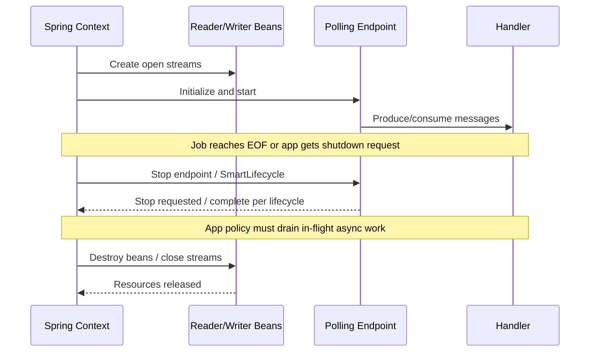
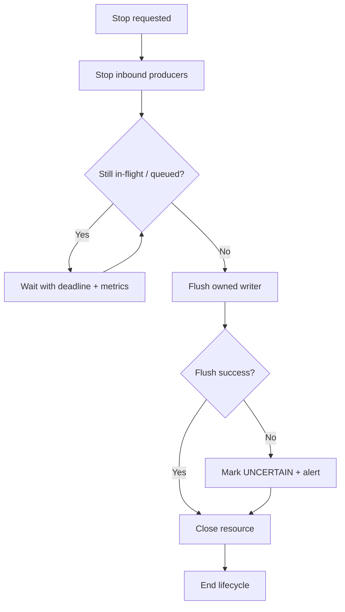
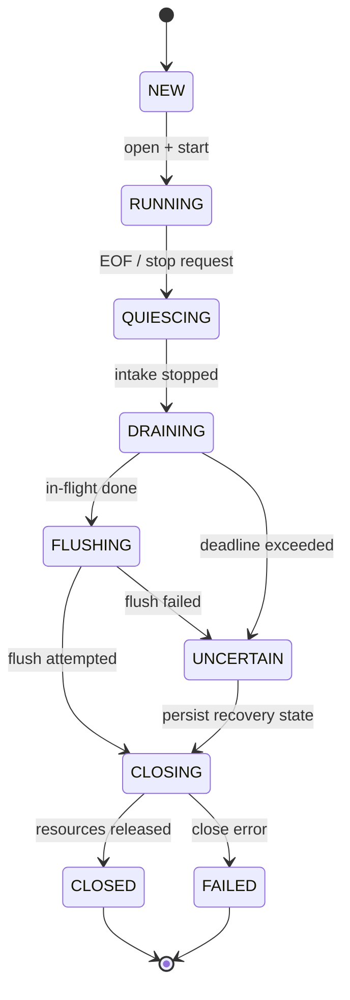

# Đóng stream theo lifecycle

## 1. Bài toán: ngừng adapter không có nghĩa dữ liệu đã an toàn

Trong module **SPRING_INTEGRATION_ADAPTERS**, Spring Integration kết nối các hệ thống ngoài thông qua inbound/outbound adapter, gateway, poller và `MessageChannel`. Hệ thống có thể nhận/gửi dữ liệu qua file, SFTP, HTTP, JMS, AMQP, Kafka, cơ sở dữ liệu và những luồng I/O có hợp đồng message, lỗi và vòng đời riêng.

Ở chương **Adapter Stream**, chủ đề **Đóng stream theo lifecycle** giải quyết câu hỏi: *Khi một flow kết thúc, ai dừng việc nhận message, ai chờ consumer xử lý xong, ai flush dữ liệu còn buffer và ai thực sự đóng `InputStream`, `OutputStream`, `Reader`, `Writer`?*

Ví dụ một job nhận các dòng đơn hàng UTF-8 từ file qua `Reader`, chuyển thành Spring `Message<String>` rồi ghi kết quả qua `Writer`:

```text
                ApplicationContext
                        |
             +----------+-----------+
             |                      |
         Input Reader           Output Writer
             |                      ^
             v                      |
    CharacterStreamReading          |
       MessageSource                |
             |                      |
        Polling Endpoint            |
             |                      |
             v                      |
         DirectChannel              |
             |                      |
             v                      |
           Consumer ----------> WritingMessageHandler
             |
        EOF / exception
             |
        Lifecycle coordinator
             |
      1. Stop intake / poller
      2. Drain in-flight / queue
      3. Flush writer
      4. Close owned resources
```

Nếu đóng Reader khi poller vẫn đang `readLine()`, task có thể ném `IOException` hoặc tiếp tục block tùy loại stream. Nếu đóng Writer trước khi consumer hoàn tất, message cuối có thể bị mất. Nếu chỉ gọi `stop()` rồi để file descriptor mở, ứng dụng vẫn rò rỉ tài nguyên. Nếu chỉ gọi `flush()`, bạn **chưa** có ACK hay cam kết durability từ bên đọc.

### Kết quả cần đạt

Sau bài học, bạn có thể:

1. Phân biệt trạng thái **endpoint running/stopped**, **stream open/closed**, **EOF** và **business processing complete**.
2. Hiểu trách nhiệm `SmartLifecycle` của Spring Integration và `DisposableBean`/`@PreDestroy`/`@Bean(destroyMethod = "close")` của Spring.
3. Phân tích vì sao `StreamClosedEvent` có thể lặp và vì sao gọi `stop()` ngay trên thread poller cần thận trọng.
4. Xây dựng flow đọc và ghi stream được quản lý resource ownership, cleanup và event listener.
5. Thiết kế graceful shutdown có **stop intake → drain → flush → close**, deadline rõ ràng và xử lý partial failure.
6. Biết khi nào **không được đóng** `System.in`, `System.out`, `System.err` hoặc stream do SDK/connection manager sở hữu.
7. Xử lý EOF, network disconnect, blocked read/write, timeout, retry, idempotency và restart.
8. Viết kiểm thử xác minh close được gọi đúng lúc, không double-close và không còn thread hoặc message dang dở.

## 2. Bốn trạng thái độc lập phải theo dõi

### 2.1. Adapter đang chạy hay đã dừng?

`SourcePollingChannelAdapter` quản lý một `MessageSource<?>`. Khi running, poller có thể gọi `receive()`. Khi bạn gọi `stop()` trên endpoint, về mặt lifecycle bạn yêu cầu **ngừng việc kích hoạt/poll**. Điều này **không mặc nhiên gọi `InputStream.close()`**, và một công việc đang thực hiện có thể chưa chấm dứt ngay nếu I/O hoặc handler không phản hồi ngắt.

### 2.2. Reader/Writer đã đóng chưa?

Một `Reader` hoặc `Writer` là tài nguyên Java. Nó có thể đang mở khi endpoint đã dừng, hoặc bị bên khác đóng trong lúc endpoint vẫn chạy — trường hợp sau dễ gây lỗi. Đóng wrapper như `BufferedReader`/`OutputStreamWriter` thường đóng tài nguyên bên dưới; vì vậy **phải có một owner đóng duy nhất**.

### 2.3. Đã tới EOF hay chỉ chưa có dữ liệu?

`EOF` là điều kiện nguồn dữ liệu đã kết thúc theo hợp đồng của stream. Với `CharacterStreamReadingMessageSource` mặc định, `Reader.ready()==false` khiến `receive()` trả `null`; nó **không phải** sự kiện EOF. Chỉ khi bật `blockToDetectEOF=true` thì nguồn character mới chủ động đọc tới EOF và phát `StreamClosedEvent`.

### 2.4. Business event đã xử lý bền vững chưa?

Một file được đọc hết không có nghĩa database đã commit; một `Writer.flush()` không chứng minh bên nhận đã ACK. Nếu downstream bất đồng bộ còn hàng đợi, chương trình có thể đạt EOF **trước khi queue được drain**.

| Tín hiệu | Nguồn tín hiệu | Đã chứng minh điều gì? | Chưa chứng minh |
| --- | --- | --- | --- |
| `adapter.isRunning()==false` | Spring `SmartLifecycle` | Endpoint không còn ở trạng thái running | Stream đã close, in-flight đã commit |
| `receive()==null` | `MessageSource` | Lượt poll không tạo message | EOF, đã hết message mãi mãi |
| `StreamClosedEvent` | Character source bật detect EOF | Reader đã nhận biết EOF | Output đã flush, downstream đã commit |
| `InputStream.read()==-1` | Java I/O | Nguồn byte tới EOF | Poller đã dừng |
| `Writer.flush()` thành công | Java I/O | Buffer Java đã được đẩy theo contract | fsync/remote ACK/transaction |
| `close()` hoàn tất | Resource owner | Tài nguyên đã trải qua thao tác close | Mọi nghiệp vụ đã hoàn tất |
| ACK nghiệp vụ | Application protocol | Điều kiện được bên nhận xác nhận | Mặc nhiên đủ nếu ACK quá yếu |

**Nguyên tắc:** kiểm tra đủ **tín hiệu hoàn tất** ở từng tầng, không lấy một tín hiệu thay thế tất cả tầng còn lại.

## 3. Lifecycle của Spring và lifecycle của Java stream

Spring quản lý lifecycle của bean và endpoint. Java quản lý tài nguyên thông qua `Closeable`, `AutoCloseable` và wrapper I/O.

### 3.1. Hai nhóm API khác nhau

| Nhóm | API | Trách nhiệm |
| --- | --- | --- |
| Endpoint | `org.springframework.context.SmartLifecycle` | `start()`, `stop()`, `isRunning()`, phase và callback stop |
| Endpoint polling | `SourcePollingChannelAdapter` | Kích hoạt lịch gọi `MessageSource.receive()` |
| Bean cleanup | `DisposableBean.destroy()` | Hook hủy bean khi container destroy |
| Bean cleanup | `@Bean(destroyMethod="close")` | Spring gọi method `close()` khi hủy bean |
| Bean cleanup | `@PreDestroy` | Hook cleanup cho bean khi container đóng |
| Java I/O | `InputStream.close()`/`Reader.close()` | Giải phóng tài nguyên đọc |
| Java I/O | `OutputStream.flush()/close()` | Đẩy buffer/giải phóng tài nguyên ghi |

`stop()` và `close()` **không đồng nghĩa**. Một bean implement `DisposableBean` cũng **không chứng minh** nó sẽ gọi `close()` cho mọi nguồn/đích I/O bạn truyền vào constructor; phải đọc contract của từng bean, hoặc giao rõ ownership cho một bean tài nguyên do ứng dụng tạo.

### 3.2. Trình tự khởi tạo/dừng thông thường



Khi đóng `ApplicationContext` đúng cách, Spring có chu trình stop lifecycle beans rồi destroy các bean. Tuy nhiên **không phải tất cả in-flight I/O tự đợi đến khi bền vững**: độ an toàn phụ thuộc thread, timeout, channel, transaction và handler thực tế. Khi tiến trình bị kill đột ngột, cleanup hooks có thể không chạy.

### 3.3. Stop một adapter nhưng vẫn giữ cả ApplicationContext

Một ứng dụng chạy lâu có thể dừng **chỉ một inbound adapter** để bảo trì:

```java
import org.springframework.context.SmartLifecycle;

SmartLifecycle inboundAdapter = /* bean endpoint dung ten */;

inboundAdapter.stop();
boolean stopped = !inboundAdapter.isRunning();
```

Đây là **mảnh code minh họa**, không phải một Spring bean đầy đủ. Dừng adapter không yêu cầu đóng toàn bộ context. Sau khi dừng, Reader có thể vẫn mở để phục vụ lần `start()` tiếp theo — trừ khi nguồn đã tới EOF hoặc bị đóng bởi chính resource owner. **Không gọi lại `start()` trên nguồn đã bị đóng rồi kỳ vọng nó tự mở lại**.

## 4. Ownership: ai mở tài nguyên thì xác định ai đóng

Không có một đáp án “Spring tự đóng hết”. Mỗi resource cần xác định **owner duy nhất**:

| Tài nguyên | Owner phù hợp | Chính sách đóng |
| --- | --- | --- |
| `Files.newInputStream(path)` trong bean | Bean resource của ứng dụng | `@Bean(destroyMethod="close")` |
| `Files.newBufferedReader(path, UTF_8)` | Bean Reader của ứng dụng | Chỉ đóng Reader wrapper, đừng đóng raw stream lần hai |
| `Files.newBufferedWriter(path, UTF_8)` | Bean Writer của ứng dụng | Flush/drain rồi close theo lifecycle |
| `ByteArrayInputStream` / `StringReader` | Test fixture | Đóng có thể không tốn OS resource, vẫn test ownership |
| `System.in` | JVM hoặc CLI runtime | Không đóng từ một feature chạy chung JVM |
| `System.out` / `System.err` | JVM/logging runtime | Không đóng từ stream handler |
| `Socket.getInputStream()` | Socket/connection manager | Đóng connection theo session lifecycle |
| `Socket.getOutputStream()` | Socket/connection manager | Hỏng stream → cần connection mới |
| Stream từ SDK/object store | SDK hoặc transaction/upload session | Theo contract commit/abort/close của SDK |
| `GZIPInputStream` bọc FileInputStream | Bean sở hữu wrapper ngoài cùng | Close wrapper sẽ close nguồn bên trong |

### 4.1. Đóng wrapper ngoài cùng

```java
import java.io.BufferedReader;
import java.io.InputStreamReader;
import java.io.Reader;
import java.nio.charset.StandardCharsets;
import java.nio.file.Files;
import java.nio.file.Path;

Reader reader = new BufferedReader(
        new InputStreamReader(
            Files.newInputStream(Path.of("data/in.txt")),
            StandardCharsets.UTF_8
        ),
        8192
);
// Khi xong: reader.close() dong ca chain do app so huu.
```

Nếu bạn cũng đăng ký `InputStream` bên trong là một bean riêng với `destroyMethod="close"`, và đăng ký Reader wrapper với `destroyMethod="close"`, container có thể gọi close **hai lần** trên cùng tài nguyên bên dưới. Nhiều stream Java chịu được lần đóng lặp, nhưng **không thể mặc định SDK/session tùy chỉnh là idempotent**.

Giải pháp rõ ràng hơn: chỉ expose bean **wrapper ngoài cùng** làm owner. Nếu cần tách tầng bean, ghi rõ một owner đóng và các bean khác **không** đóng hoặc truyền wrapper non-closing theo contract.

### 4.2. try-with-resources và @Bean là hai lifecycle khác

`try (InputStream in = ...)` phù hợp một method/job **đồng bộ** tự tạo rồi sử dụng nguồn trong cùng scope. Không dùng `try-with-resources` quanh một stream được trả về làm singleton bean rồi thoát scope trước khi Spring Integration poll:

```java
// PHAN VI DU - khong duoc lam:
@Bean
InputStream wrongInputStream() throws Exception {
    try (InputStream input = Files.newInputStream(
            Path.of("data/in.bin"))) {
        return input;  // da bi close o cuoi block try!
    }
}
```

Với bean do Spring quản lý, dùng một factory tạo **resource còn mở** và cấu hình cleanup khi context đóng:

```java
@Bean(destroyMethod = "close")
InputStream inputStream() throws Exception {
    return Files.newInputStream(Path.of("data/in.bin"));
}
```

Hai đoạn là **mảnh cấu hình** cần đặt trong `@Configuration` và có import phù hợp. Ví dụ thứ hai không tự kích hoạt poller; cần một `MessageSource` và inbound adapter khác đọc stream này.

### 4.3. Double-close và close ngoại lệ

`close()` có thể ném `IOException` hoặc exception của SDK. Không coi việc đóng là lúc nào cũng “thành công chắc chắn”. Khi cleanup nhiều tài nguyên, tránh để exception đầu tiên ngăn những tài nguyên còn lại được đóng; dùng try-with-resources trong job đồng bộ hoặc một coordinator bắt/ghi nhận từng lỗi khi shutdown.

Với resource quan trọng, đóng lặp cũng nên được kiểm soát qua trạng thái/`AtomicBoolean`, nhưng **chỉ đặt flag ở đúng owner**, không dùng flag để che một bug nhiều bên cùng sở hữu.

## 5. Stop intake → drain → flush → close

### 5.1. Quy trình chuẩn

```text
T0  Receive SIGTERM / admin stop / batch EOF
T1  Mark application NOT READY for new work
T2  Stop inbound poller / listener / producer
T3  Wait for in-flight work + bounded queue (deadline)
T4  Persist/reconcile pending or uncertain events
T5  Flush output buffers
T6  Close owned Writer/OutputStream and Reader/InputStream
T7  Destroy context / exit process
```

Đây là **thiết kế ứng dụng**, không phải một API của Spring Integration tự thực hiện tất cả bước. Trong một flow `DirectChannel` đơn giản, xử lý message thường đồng bộ; trong flow có `ExecutorChannel`/`QueueChannel`, có thể còn message đang chờ sau khi adapter đã dừng.

### 5.2. Vì sao thứ tự quan trọng?

| Đóng sai lúc | Hậu quả có thể |
| --- | --- |
| Close Reader khi poller đang block | `IOException`, ngắt job hoặc thread không dừng đúng deadline |
| Close Writer khi queue còn message | `IOException`/mất các message cuối |
| Flush trước khi producer/consumer ngừng | Có thể còn dữ liệu mới đến sau flush |
| Stop poller nhưng quên close resource | File/socket descriptor rò rỉ |
| Close stream rồi `start()` adapter cũ | `IOException`/EOF ngay hoặc trạng thái không hợp lệ |
| Tự đóng `System.out` từ một adapter | Logging và component khác không còn stdout |
| Gọi `ApplicationContext.close()` từ poller callback không kiểm soát | Interrupt/race/deadlock ở shutdown và task tiếp theo |

### 5.3. Deadline và hành vi khi không drain kịp

Không nên đợi vô hạn. Hãy chọn `shutdownDeadline`, ví dụ 30 giây, và phân biệt:

- **Hoàn tất:** mọi message cần commit đã có ACK theo hợp đồng.
- **Tạm thời chưa xong:** in-flight/queue chưa empty khi deadline đến.
- **Không rõ kết quả:** writer có thể đã ghi một phần, hoặc ACK có thể đã mất.

Với event quan trọng, trạng thái `PENDING`/`UNCERTAIN` cần được **lưu bền trước khi đóng** và phục hồi qua event ID/idempotency. Không gọi `close()` sớm rồi báo mọi event là `COMPLETED` chỉ vì process đã thoát.

## 6. EOF character stream và StreamClosedEvent

Spring Integration 6.5 có `CharacterStreamReadingMessageSource` (package `org.springframework.integration.stream`). Đây là một pollable source cho `Reader`:

```java
import java.io.Reader;
import org.springframework.integration.stream.CharacterStreamReadingMessageSource;

Reader reader = /* reader do ung dung quan ly */;
CharacterStreamReadingMessageSource source =
        new CharacterStreamReadingMessageSource(reader, 8192, true);
```

Tham số thứ ba `true` là **`blockToDetectEOF`**:

1. Poller gọi `receive()`.
2. Source có thể **block trong quá trình đọc** chờ data hoặc EOF.
3. Khi EOF được phát hiện, nó công bố **`StreamClosedEvent`** qua Spring `ApplicationEventPublisher`.
4. Handler ứng dụng có thể nhận event để điều phối stop.
5. Nếu poller vẫn chạy, nguồn có thể **tiếp tục phát event ở các lượt poll sau**.

### 6.1. Default không detect EOF

Với constructor mặc định hoặc `blockToDetectEOF=false`, source có thể kiểm tra `BufferedReader.ready()`; `receive()==null` khi chưa có dữ liệu sẵn **không đồng nghĩa EOF**. Trường hợp terminal tương tác không nên tự shutdown khi người dùng chưa gõ dòng mới.

### 6.2. Event khác một Spring Message

```text
Message<String>("ORDER,1001,PAID")
  -> qua MessageChannel -> ServiceActivator

StreamClosedEvent
  -> qua ApplicationEventPublisher -> ApplicationListener
```

`StreamClosedEvent` **không phải** một `Message<String>` có payload `"EOF"`. Không cấu hình Service Activator nhận event này từ kênh business rồi nghĩ adapter tự gửi nó.

### 6.3. Event được phát trên poller thread

Tài liệu Reference cảnh báo `StreamClosedEvent` được công bố trong **thread poller**. Nếu listener gọi `stop()` đồng bộ, endpoint stop có thể interrupt chính thread đó. Nếu cần gửi message ra `QueueChannel` sau khi stop, việc send có thể bị gián đoạn vì thao tác đó interruptible.

**An toàn hơn**: listener chỉ đánh dấu EOF **một lần**, gửi thông tin completion thật cần thiết *trước* khi stop nếu contract yêu cầu, rồi giao thao tác stop/cleanup cho một **lifecycle executor tách biệt** và có timeout.

### 6.4. Các factory stdin

| Factory | Chế độ EOF | Khi dùng |
| --- | --- | --- |
| `stdin()` / `stdin("UTF-8")` | Không chủ động detect EOF | Terminal tương tác |
| `stdinPipe()` / `stdinPipe("UTF-8")` | Detect EOF, hỗ trợ đóng application context | CLI/batch pipe và redirect |

`stdinPipe(...)` đã có cơ chế phát hiện EOF/đóng context theo Javadoc. **Đừng vừa bật stdinPipe auto-close vừa gắn một listener khác đóng cùng context hai lần** trừ khi bạn biết chính xác ownership/cách phối hợp. Đừng áp dụng `stdinPipe` cho service chạy dài hạn nếu một phiên stdin ngắn được kỳ vọng kết thúc mà toàn bộ service vẫn phải tồn tại.

## 7. Byte stream có EOF nhưng không cùng cơ chế event

`ByteStreamReadingMessageSource` nhận `InputStream`, payload `byte[]` và `bytesPerMessage` mặc định **1024**. Khi `InputStream.read(...)` trả `-1`, nguồn byte có thể không còn message để phát; **không suy ra nó phát `StreamClosedEvent` giống character source bật `blockToDetectEOF`**.

| Tình huống | Có thể quan sát | Hành động |
| --- | --- | --- |
| File byte hữu hạn đã hết | `receive()==null` | Xác nhận EOF bằng contract riêng nếu cần completion |
| TCP stream chưa có byte | `available()==0` hoặc read block | Không coi `available()==0` là EOF |
| SDK stream closed bởi server | `IOException` hoặc `read()==-1` tùy SDK | Connection/session lifecycle |
| Reader text bật detect EOF | `StreamClosedEvent` | Stop adapter có kiểm soát |
| Ứng dụng chủ động shutdown | Context lifecycle hooks | Stop intake, drain, close owned stream |

Nếu một job binary cần **EOF chính xác**, có thể viết `MessageSource` riêng nhận biết `read()==-1`, dùng count/length từ giao thức hoặc chuyển sang File adapter có khái niệm file hoàn chỉnh. Đừng dùng mỗi `receive()==null` để tự đóng một socket có thể còn nhận dữ liệu trong tương lai.

## 8. Ví dụ Spring Boot: Reader/Writer được đóng khi context kết thúc

Ứng dụng mẫu sử dụng **Java 17+** và Spring Integration **6.5.x**. Bài tập đọc một file UTF-8 hữu hạn, viết từng dòng sang một file UTF-8 khác qua Spring Integration, phát `StreamClosedEvent` khi EOF và **stop inbound endpoint bằng một executor khác**. Reader/Writer được Spring đóng khi context thực sự bị hủy.

### 8.1. Dependencies

```xml
<dependencies>
    <dependency>
        <groupId>org.springframework.boot</groupId>
        <artifactId>spring-boot-starter-integration</artifactId>
    </dependency>
    <dependency>
        <groupId>org.springframework.integration</groupId>
        <artifactId>spring-integration-stream</artifactId>
    </dependency>
</dependencies>
```

Để Spring Boot BOM quản lý version khi tương thích. Nếu quản lý version thủ công, giữ các artifact Spring Integration đồng bộ. Với 6.5, import các lớp stream từ `org.springframework.integration.stream`; ở 7.x, import của source/handler được tổ chức trong các package con. Không trộn 6.5 với 7.x.

### 8.2. application.yml

```yaml
app:
  stream-lifecycle:
    input-path: ${STREAM_INPUT_PATH:./data/batch-in.txt}
    output-path: ${STREAM_OUTPUT_PATH:./data/batch-out.txt}
```

Ví dụ chấp nhận đường dẫn từ **operator đáng tin cậy**, không lấy path tùy ý từ request HTTP. File đầu vào phải tồn tại trước khi ứng dụng start. File đầu ra được tạo/truncate khi bean khởi tạo, **không** nên áp dụng `TRUNCATE_EXISTING` cho dữ liệu production cần khôi phục sau restart.

### 8.3. Cấu hình Spring Boot hoàn chỉnh

```java
import java.io.IOException;
import java.io.Reader;
import java.io.Writer;
import java.nio.charset.StandardCharsets;
import java.nio.file.Files;
import java.nio.file.Path;
import java.nio.file.StandardOpenOption;
import java.time.Duration;
import java.util.concurrent.ExecutorService;
import java.util.concurrent.Executors;
import java.util.concurrent.atomic.AtomicBoolean;

import org.springframework.beans.factory.annotation.Qualifier;
import org.springframework.beans.factory.annotation.Value;
import org.springframework.boot.SpringApplication;
import org.springframework.boot.autoconfigure.SpringBootApplication;
import org.springframework.context.ApplicationContext;
import org.springframework.context.ApplicationListener;
import org.springframework.context.SmartLifecycle;
import org.springframework.context.annotation.Bean;
import org.springframework.integration.annotation.ServiceActivator;
import org.springframework.integration.channel.DirectChannel;
import org.springframework.integration.config.EnableIntegration;
import org.springframework.integration.dsl.IntegrationFlow;
import org.springframework.integration.dsl.Pollers;
import org.springframework.integration.stream.CharacterStreamReadingMessageSource;
import org.springframework.integration.stream.CharacterStreamWritingMessageHandler;
import org.springframework.integration.stream.StreamClosedEvent;
import org.springframework.messaging.MessageChannel;

@SpringBootApplication
@EnableIntegration
public class StreamLifecycleApplication {

    public static void main(String[] args) {
        SpringApplication.run(StreamLifecycleApplication.class, args);
    }

    @Bean(name = "batchReader", destroyMethod = "close")
    public Reader batchReader(
            @Value("${app.stream-lifecycle.input-path}") String filename)
            throws IOException {

        Path input = Path.of(filename).toAbsolutePath().normalize();
        return Files.newBufferedReader(input, StandardCharsets.UTF_8);
    }

    @Bean(name = "batchWriter", destroyMethod = "close")
    public Writer batchWriter(
            @Value("${app.stream-lifecycle.output-path}") String filename)
            throws IOException {

        Path output = Path.of(filename).toAbsolutePath().normalize();
        if (output.getParent() != null) {
            Files.createDirectories(output.getParent());
        }
        return Files.newBufferedWriter(
                output,
                StandardCharsets.UTF_8,
                StandardOpenOption.CREATE,
                StandardOpenOption.TRUNCATE_EXISTING,
                StandardOpenOption.WRITE);
    }

    @Bean(name = "batchCharacterSource")
    public CharacterStreamReadingMessageSource batchCharacterSource(
            @Qualifier("batchReader") Reader reader) {

        return new CharacterStreamReadingMessageSource(
                reader, 8192, true);
    }

    @Bean
    public MessageChannel batchLines() {
        return new DirectChannel();
    }

    @Bean
    public IntegrationFlow batchReadFlow(
            @Qualifier("batchCharacterSource")
            CharacterStreamReadingMessageSource source) {

        return IntegrationFlow
                .from(source, endpoint -> endpoint
                        .id("batchStreamInbound")
                        .poller(Pollers.fixedDelay(
                                        Duration.ofMillis(200))
                                .maxMessagesPerPoll(1)))
                .channel("batchLines")
                .get();
    }

    @Bean
    @ServiceActivator(inputChannel = "batchLines")
    public CharacterStreamWritingMessageHandler batchWriteHandler(
            @Qualifier("batchWriter") Writer writer) {

        return new CharacterStreamWritingMessageHandler(writer)
                .appendNewLine(true);
    }

    @Bean(name = "streamLifecycleExecutor",
            destroyMethod = "shutdown")
    public ExecutorService streamLifecycleExecutor() {
        // Demo: mot worker rieng cho thao tac lifecycle.
        // Production: quan ly bounded task queue va shutdown deadline.
        return Executors.newSingleThreadExecutor();
    }

    @Bean
    public ApplicationListener<StreamClosedEvent> batchEofListener(
            ApplicationContext context,
            @Qualifier("streamLifecycleExecutor")
            ExecutorService lifecycleExecutor) {

        AtomicBoolean once = new AtomicBoolean();

        return event -> {
            // Vi du chi co mot CharacterStreamReadingMessageSource.
            // Neu co nhieu source, can correlate event voi dung source.
            if (!once.compareAndSet(false, true)) {
                return;
            }

            // KHONG stop dong bo ngay trong poller thread.
            lifecycleExecutor.execute(() -> {
                SmartLifecycle endpoint =
                        context.getBean(
                                "batchStreamInbound",
                                SmartLifecycle.class);
                endpoint.stop();
                System.err.println(
                        "EOF observed: inbound poller stopped");
                // Stream chua close tai day.
                // Khi Spring context thuc su close,
                // batchReader/batchWriter se duoc destroy.
            });
        };
    }
}
```

**Phạm vi:** đây là ví dụ cấu hình/điều phối, không phải một batch engine có bảo đảm exactly-once. Nó không tự gọi `ApplicationContext.close()` tại EOF: **adapter đã dừng nhưng context và Reader/Writer có thể vẫn mở**. Hãy đóng context bằng đường quản trị/shutdown của ứng dụng sau khi kiểm chứng các công việc downstream đã hoàn thành. Nếu dùng nhiều stream source trong một context, phải lọc event theo đúng nguồn; đây là ví dụ *chỉ có một nguồn* nên dùng `AtomicBoolean` để deduplicate event.

### 8.4. Diễn giải luồng

1. Spring tạo bean `batchReader` và `batchWriter` từ file; chính bean wrapper là owner tài nguyên.
2. `CharacterStreamReadingMessageSource(reader, 8192, true)` có thể block để xác định EOF.
3. `SourcePollingChannelAdapter` tên `batchStreamInbound` gọi `receive()` theo poller.
4. `DirectChannel` chuyển mỗi `Message<String>` sang writer handler đồng bộ.
5. Handler thêm newline sau mỗi payload, ghi sang `batchWriter`.
6. Khi reader tới EOF, source phát `StreamClosedEvent`.
7. Listener dùng `AtomicBoolean` để tránh nhiều lần xử lý và gửi lệnh `stop()` sang executor riêng, **không làm công việc này ngay trong thread poller**.
8. Khi context đóng, Spring hủy `batchReader`/`batchWriter`; `close()` của writer có thể flush những bytes còn buffer.

`@Bean(destroyMethod="close")` là một ranh giới cleanup rõ ràng; nó không thay thế **trình tự drain và xác nhận nghiệp vụ**. Trong production, nếu có executor/queue bất đồng bộ khác, coordinator phải đợi chúng xong trước khi đóng writer.

### 8.5. Input/output kỳ vọng

```text
Input file:
ORDER,1001,CREATED
ORDER,1002,PAID

Output file sau khi context stop/close:
ORDER,1001,CREATED
ORDER,1002,PAID
```

Đây là **kết quả minh họa**, chưa chạy trong STEP 4. Khi xác minh, hãy đọc output **sau khi context đã đóng hoặc writer đã flush theo đúng policy**; không mở file đọc quá sớm rồi kết luận mất data nếu buffer vẫn đang chờ.

### 8.6. Vì sao không cho listener gọi context.close() ngay?

`StreamClosedEvent` phát từ thread poller. Ngay cả nếu việc `context.close()` trên thread khác có thể chạy, đóng **toàn bộ context** còn dừng các flow khác và hủy nhiều bean ngoài stream. Nếu ứng dụng phục vụ cả HTTP/JMS/Kafka, EOF của một file **không phải tín hiệu đủ** để shutdown toàn bộ service.

Trong ứng dụng nhiều nguồn, nên giao cho **job coordinator** quyết định:

```text
EOF input A ----+
                +--> Job state ---> Drain ---> Flush ---> Close job resources
EOF input B ----+                 |
                                  +--> Keep other service flows alive
```

Không để một listener của source A tự đóng connection Kafka/JMS chung hoặc toàn bộ application context khi nguồn B chưa xong.

## 9. Phân biệt dừng endpoint và đóng context

### Dừng endpoint đơn lẻ

Nếu chỉ muốn dừng nguồn nhận thêm message mà ứng dụng vẫn chạy:

```java
import org.springframework.context.ApplicationContext;
import org.springframework.context.SmartLifecycle;

ApplicationContext context = /* context cua Spring */;

SmartLifecycle inbound = context.getBean(
        "batchStreamInbound", SmartLifecycle.class);
inbound.stop();
```

Đây là **mảnh code** và có hiệu lực khi bean endpoint tồn tại với tên đã gắn trong DSL. Sau stop, `batchReader` có thể vẫn đang mở và bean output writer vẫn có thể được dùng bởi một flow khác. Nếu có tác vụ `read()` đang block, kiểm chứng thời điểm stop thực tế với loại nguồn.

### Đóng toàn bộ context

Khi thật sự muốn shutdown:

```java
import org.springframework.context.ConfigurableApplicationContext;

ConfigurableApplicationContext context =
        /* context duoc SpringApplication.run(...) tra ve */;

context.close();
```

`close()` thực hiện chu trình dừng và hủy các bean Spring theo contract. Điều đó **không bảo đảm** mọi external service đã commit nghiệp vụ hoặc mọi worker bất đồng bộ tự đợi vô hạn. Cần quy định shutdown phase/deadline và xử lý trạng thái chưa hoàn tất.

### @PreDestroy hay destroyMethod?

```java
import java.io.IOException;
import java.io.OutputStream;

public final class OwnedOutput implements AutoCloseable {
    private final OutputStream output;

    public OwnedOutput(OutputStream output) {
        this.output = output;
    }

    @Override
    public void close() throws IOException {
        output.flush();
        output.close();
    }
}
```

Một wrapper sở hữu output có thể đăng ký:

```java
@Bean(destroyMethod = "close")
OwnedOutput ownedOutput() throws IOException {
    return new OwnedOutput(
            Files.newOutputStream(Path.of("data/result.bin")));
}
```

Đặt hai đoạn trong file Java phù hợp với đầy đủ imports. Đây là **một cách** tạo bean resource riêng, không bắt buộc mọi handler stream phải có `OwnedOutput`. Nếu dùng `@PreDestroy` **và** `@Bean(destroyMethod="close")` trên **cùng bean** để đóng cùng stream, cần đặc biệt tránh double-close; tốt nhất chọn **một hook owner** cho thao tác đóng.

## 10. XML: quản lý resource và lifecycle ngoài DSL

Một cấu hình XML có thể tạo source/handler với `Reader`/`Writer` đã được ứng dụng cung cấp:

```xml
<beans:beans
    xmlns:beans="http://www.springframework.org/schema/beans"
    xmlns:xsi="http://www.w3.org/2001/XMLSchema-instance"
    xmlns:int="http://www.springframework.org/schema/integration"
    xsi:schemaLocation="
        http://www.springframework.org/schema/beans
        https://www.springframework.org/schema/beans/spring-beans.xsd
        http://www.springframework.org/schema/integration
        https://www.springframework.org/schema/integration/spring-integration.xsd">

    <!-- batchReader / batchWriter: hai bean resource
         do Java config hoac bean factory khac cung cap. -->

    <beans:bean id="batchSource"
                class="org.springframework.integration.stream.CharacterStreamReadingMessageSource">
        <beans:constructor-arg ref="batchReader"/>
        <beans:constructor-arg value="8192"/>
        <beans:constructor-arg value="true"/>
    </beans:bean>

    <int:channel id="batchInputLines"/>

    <int:inbound-channel-adapter
            id="batchStreamInboundXml"
            ref="batchSource"
            channel="batchInputLines"
            auto-startup="true">
        <int:poller fixed-delay="250"
                    max-messages-per-poll="1"/>
    </int:inbound-channel-adapter>

    <beans:bean id="batchSink"
                class="org.springframework.integration.stream.CharacterStreamWritingMessageHandler">
        <beans:constructor-arg ref="batchWriter"/>
        <beans:property name="shouldAppendNewLine"
                        value="true"/>
    </beans:bean>

    <int:outbound-channel-adapter
            id="batchStreamOutboundXml"
            channel="batchInputLines"
            ref="batchSink"/>
</beans:beans>
```

Đây là **mảnh cấu hình**, vì `batchReader`/`batchWriter` phải được định nghĩa riêng. Khuyến nghị cung cấp bằng Java `@Bean(destroyMethod="close")` hoặc một bean owner đã được kiểm soát. XML **không tự tạo cleanup method cho resource bên ngoài chỉ vì nó được truyền cho một handler**. Cần listener `StreamClosedEvent`/lifecycle coordinator tương đương nếu job cần dừng ngay sau EOF.

Không bật cả XML flow lẫn Java DSL flow ở mục 8 nếu chúng cùng đọc/ghi **một** stream: hai reader có thể chia dòng, hai writer có thể ghi xen kẽ.

## 11. Dùng stdinPipe cho CLI độc lập

Với ứng dụng **chỉ làm một CLI batch job** và muốn tự kết thúc khi pipe hết dữ liệu, `stdinPipe("UTF-8")` cung cấp cơ chế detect EOF và đóng context.

```java
import org.springframework.integration.stream.CharacterStreamReadingMessageSource;

CharacterStreamReadingMessageSource source =
        CharacterStreamReadingMessageSource.stdinPipe("UTF-8");
```

Ví dụ shell POSIX:

```bash
cat events.txt | java -jar stream-cli.jar
java -jar stream-cli.jar < events.txt
```

Đây là **đoạn CLI minh họa**, chưa chạy. Không dùng chế độ auto-close của `stdinPipe` một cách mù quáng trong service nhiều chức năng, vì EOF ở stdin không nhất thiết có nghĩa các luồng HTTP/JMS/Kafka còn lại nên dừng. Với terminal tương tác, `stdin("UTF-8")` có thể phù hợp hơn.

### Không đóng System.in/System.out tùy tiện

- `System.in` thường là stdin chung của tiến trình; đóng nó từ một feature có thể làm CLI khác không nhập được nữa.
- `System.out`/`System.err` là standard streams được logging/console và các thư viện dùng chung; đóng sớm có thể mất log.
- `stdinPipe` có thể kích hoạt **context lifecycle** tại EOF theo contract; điều này **khác** việc ứng dụng tự ý gọi `System.in.close()` trong consumer.
- Nếu bạn là một CLI process biệt lập được thiết kế sở hữu hoàn toàn stdin/stdout, quy tắc có thể khác; hãy ghi rõ ownership, không áp dụng cho mọi ứng dụng chạy chung JVM.

## 12. InputStream/Reader đang block: làm sao dừng?

Một trong những lỗi vận hành khó nhất là **đã yêu cầu stop nhưng thread không dừng**:

```text
Poller Thread
     |
     v
InputStream.read(...) / Reader.readLine()
     |
     v
BLOCKED until data / EOF / IOException
     ^
     |
SmartLifecycle.stop() ở thread khác
     |
     v
Không phải mọi InputStream đều thoát ngay khi interrupt
```

### 12.1. Interrupt, close và timeout là ba cơ chế khác

| Cơ chế | Hiệu quả có thể | Hạn chế |
| --- | --- | --- |
| `Thread.interrupt()` | Đánh dấu interrupt, một số blocking API hủy chờ | `InputStream.read()` thường phụ thuộc implementation |
| `InputStream.close()` từ thread quản lý | Một số stream giải phóng read đang block | Không phải mọi loại stream có cùng hành vi hoặc độ trễ |
| `Socket.setSoTimeout(...)` | Tạo giới hạn thời gian cho blocking socket read | Không phải `OutputStream.write()` timeout tổng quát |
| SDK/client timeout | Cắt request/connection theo contract SDK | Có thể cần abort/cancel session |
| Kết thúc producer/đóng pipe | Reader thấy EOF | Cần đảm bảo không tạo deadlock giữa producer và consumer |

`fixedDelay(200)` chỉ quy định **lịch poll**, không phải timeout 200 ms cho việc đọc. Nếu một `receive()` bị block, poller có thể không trả thread về scheduler kịp lúc.

### 12.2. Shutdown theo nguồn cụ thể

| Nguồn | Điều phối đề xuất |
| --- | --- |
| `ByteArrayInputStream` | Hữu hạn trong RAM, EOF theo dữ liệu |
| `StringReader` | Hữu hạn theo chuỗi, hỗ trợ test |
| `FileInputStream` | Stop poller, chờ in-flight, close file theo owner |
| `PipedInputStream` | Cho producer dừng, đóng đầu ghi/đọc đúng thứ tự; test deadline |
| `Socket.getInputStream()` | Connection manager xử lý timeout/disconnect, có thể cần close socket |
| SDK network input | Dùng API abort/cancel/close do SDK quy định |
| `System.in` | Không close từ một module; shutdown theo CLI runtime |

**Không tạo mới InputStream trong mỗi poll để “chữa” deadlock**: làm vậy có thể đọc lặp hoặc mất trạng thái. Nếu cần reconnect hoặc reopen, cần một **source manager** có transition rõ ràng.

## 13. OutputStream/Writer đang ghi: drain và flush đúng lúc

Một handler ghi stream có thể bị block trong `write(...)` hoặc giữ dữ liệu trong buffer. Với `DirectChannel`, consumer thường chạy đồng bộ trên đường gửi. Với `ExecutorChannel`/`QueueChannel`, producer có thể đã hoàn thành `send()` mà writer **chưa xử lý xong**.



### 13.1. Dừng producer trước khi writer

Nếu context có HTTP inbound, JMS listener và một stream writer, dừng riêng stream inbound **không ngăn** HTTP/JMS tiếp tục đẩy message vào writer. Job coordinator phải biết **tất cả producer nào** có thể dùng sink đó trước khi cho phép close.

### 13.2. Flush và close

`Writer.flush()`/`OutputStream.flush()` đẩy dữ liệu khỏi các lớp buffering theo contract; `close()` kết thúc tài nguyên và thường flush trước khi đóng. Tuy nhiên:

- `flush()` thành công **không tự đồng nghĩa fsync** xuống thiết bị lưu trữ.
- `close()` thành công **không tự đồng nghĩa bên nhận đã parse/commit**.
- `close()` có thể ném `IOException` sau một phần ghi; không nên nuốt lỗi rồi xóa pending outbox.
- Nếu writer bọc một OutputStream, **đóng wrapper ngoài cùng** là quy tắc thông thường, không đồng thời đóng raw stream từ bean khác.

### 13.3. File publish atomically khác stream close

Đóng một `FileOutputStream` không biến file đang ghi thành một **tệp được xuất bản nguyên tử**. Nếu consumer quan sát file khi writer đang ghi, nó có thể đọc tệp chưa hoàn chỉnh. Khi cần file “chỉ xuất hiện khi ghi xong”, hãy dùng File outbound adapter với temporary suffix/rename hoặc quy trình tệp tạm + fsync/atomic move theo khả năng filesystem.

### 13.4. Pipe và broken pipe

Nếu reader đóng trước, writer có thể gặp `IOException`, `Broken pipe` hoặc lỗi chỉ quan sát được khi flush/close tùy sink. Với `System.out` vốn là `PrintStream`, cách ghi nhận lỗi còn có semantics riêng; **không giả định mọi lỗi stdout đều trở thành một Spring `MessagingException` ngay khi gọi `send()`**.

## 14. Một state machine lifecycle có thể kiểm tra

Không nên xem lifecycle là một boolean duy nhất `closed=true/false`. Một job stream có các trạng thái:



### 14.1. Các invariant quan trọng

1. **Không đọc mới** sau khi đã chuyển sang `QUIESCING`.
2. **Không đóng writer** khi còn producer có thể gửi message mới.
3. **Không báo `COMPLETED`** chỉ vì endpoint đã dừng.
4. Nếu drain quá deadline, **lưu trạng thái chưa rõ** thay vì xóa event.
5. **Close idempotent** tại resource owner; nhiều callback EOF/SIGTERM cùng lúc không được đóng tranh chấp.
6. **Không start lại endpoint** với stream đã đóng hoặc đã tới EOF nếu không có bước tạo nguồn mới.
7. Metric và log phải cho biết lý do close: normal EOF, administrative stop, timeout, read/write error hay crash recovery.

### 14.2. Vì sao stop rồi start không giống reconnect?

`SmartLifecycle.start()`/`stop()` điều khiển endpoint; chúng không tự thay thế một `Socket` hoặc `OutputStream` đã hỏng. Nếu muốn reopen:

```text
RUNNING old stream
       |
 disconnect / fatal I/O
       v
QUIESCING -> DRAIN/UNCERTAIN
       |
close old stream
       |
connection manager creates NEW stream
       |
new source / handler wiring or a managed delegation layer
       |
start NEW lifecycle epoch
```

Chỉ một stream mới có cùng biến Java không đủ; cần kiểm tra thread safety, source/handler đang giữ tham chiếu nào, event correlation và pending messages của phiên cũ. Với TCP/HTTP/SFTP thật, adapter chuyên dụng và connection/session factory thường an toàn hơn tự thay raw stream.

### 14.3. Kết hợp với Spring Boot graceful shutdown

Cấu hình `server.shutdown=graceful` chủ yếu điều phối **web server** theo cơ chế của Spring Boot. Nó **không tự biến mọi custom `InputStream.read()`, `OutputStream.write()` và queue nội bộ thành một batch drain hoàn chỉnh**. Đối với flow có JMS/Kafka/AMQP/HTTP hoặc I/O dài hạn, cần shutdown policy theo từng integration endpoint và deadline của cả ứng dụng.

## 15. Graceful shutdown và idempotency cho dữ liệu quan trọng

Đặt ví dụ một service chuyển dòng file thành lệnh cập nhật kho:

```text
Reader.readLine() -> OrderEvent -> Database transaction
                         |
                 DB commit succeeds
                         |
                 ACK / checkpoint
```

Nếu Reader đã đọc dòng nhưng DB transaction rollback, **Reader không tự rewind**. Nếu flow bị đóng ngay, message có thể bị mất. Nếu mở lại file từ đầu và gửi lại toàn bộ, có thể xử lý trùng.

### 15.1. Mẫu xử lý an toàn hơn

```text
Source file / stream
        |
        v
Validate + parse complete record
        |
        v
Durable inbox with eventId
        |
        v
Business consumer + unique constraint
        |
        v
Commit / ACK nghiệp vụ
        |
        v
Update checkpoint / job status
```

| Trạng thái nghiệp vụ | Ý nghĩa | Động tác khi shutdown |
| --- | --- | --- |
| `PENDING` | Chưa xử lý | Giữ lại để replay |
| `PROCESSING` | Đang xử lý, kết quả chưa chắc | Đợi deadline hoặc đánh `UNCERTAIN` |
| `COMPLETED` | Có xác nhận đủ theo hợp đồng | Không xử lý lại |
| `FAILED` | Hết retry budget/lỗi vĩnh viễn | Quarantine/alert |
| `UNCERTAIN` | Không chắc bên nhận đã commit | Reconcile/idempotent retry |

Đây là **state của ứng dụng**, không phải trạng thái built-in của `CharacterStreamReadingMessageSource` hoặc `SmartLifecycle`.

### 15.2. Nguyên tắc checkpoint

- Checkpoint ở **vị trí dữ liệu đã commit**, không phải số byte vừa đọc vào buffer.
- Giữ nhận diện file/nguồn (name, size, version/hash) để tránh dùng offset cũ cho file mới.
- Không dùng `MessageHeaders.ID` do Spring tạo lại mỗi lần làm event ID bền vững.
- Nếu nguồn không seek/replay được (stdin/socket), phải ghi staging bền vững trước side effect nếu không thể mất event.

### 15.3. Không hứa exactly-once từ close()

`close()` chỉ giải phóng tài nguyên I/O. Nó không tạo distributed transaction giữa Reader/Writer và database/JMS/Kafka. Độ tin cậy cần broker ACK, idempotent consumer, durable inbox/outbox hoặc một protocol phản hồi thích hợp.

## 16. Lỗi cleanup và quan sát ErrorMessage

### 16.1. Phân biệt lỗi I/O và tín hiệu hoàn tất

| Tình huống | Là lỗi hay bình thường? | Nên xử lý |
| --- | --- | --- |
| Character source nhận EOF | Bình thường trong batch hữu hạn | Stop và cleanup |
| `Reader.ready()==false` | Chưa có data | Không tự shutdown |
| `IOException` khi đọc | Lỗi I/O | Phân loại nguồn, retry nếu an toàn |
| `IOException` khi flush/close | Lỗi output/cleanup | Báo trạng thái không chắc, audit |
| `NotConnectedException` của SDK khác | Lỗi connection | Connection lifecycle riêng |
| `StreamClosedEvent` lặp | Hiệu ứng poll sau EOF | Dedup, stop adapter |
| Queue chưa drain khi deadline | Incomplete shutdown | Persist pending/uncertain |
| `close()` hai lần | Bug ownership hoặc callback race | Xem lại owner/hook, idempotent guard |

### 16.2. Spring errorChannel không phải “mọi lỗi close”

`errorChannel` và `ErrorMessage` của Spring Integration thường được dùng khi framework bắt lỗi ở các đường message-processing thích hợp. Nhưng một lỗi từ `@PreDestroy`, `destroyMethod` hoặc callback lifecycle **không nhất thiết** được framework chuyển thành `ErrorMessage` trên global channel.

**Không dựa vào errorChannel để biết file đã đóng an toàn.** Cleanup coordinator cần ghi kết quả flush/close trực tiếp vào metrics, audit và job state; integration test phải xác minh exception xuất hiện ở đúng nơi.

### 16.3. Đừng che exception chính bằng exception cleanup

Với method batch đồng bộ, `try-with-resources` giúp bảo toàn exception chính và lưu lỗi close trong danh sách **suppressed exceptions**:

```java
import java.io.IOException;
import java.io.Reader;
import java.nio.charset.StandardCharsets;
import java.nio.file.Files;
import java.nio.file.Path;

public final class CharacterCountJob {

    public long countCharacters(Path input) throws IOException {
        try (Reader reader = Files.newBufferedReader(
                input, StandardCharsets.UTF_8)) {
            long count = 0;
            char[] buffer = new char[4096];
            int n;
            while ((n = reader.read(buffer)) != -1) {
                count += n;
            }
            return count;
        }
    }
}
```

Đây là **class minh họa** có thể lưu thành `CharacterCountJob.java`; `count` là số UTF-16 code units, không phải số code points. Khi cả body và `close()` ném lỗi, try-with-resources giữ lỗi chính và thêm close exception dưới `getSuppressed()`. Với stream sống lâu hơn một method, không dùng try-with-resources để đóng resource trước khi Spring bean sử dụng nó.

## 17. Kiểm thử lifecycle: đếm close và kiểm tra EOF

### 17.1. Test rằng Spring gọi close trên resource bean

Đây là một test đơn giản chỉ cần Spring Context + JUnit 5; nó **không cần chạy poller**. Bean Reader theo `destroyMethod="close"` được đóng khi context kết thúc:

```java
import static org.junit.jupiter.api.Assertions.assertEquals;

import java.io.StringReader;
import java.util.concurrent.atomic.AtomicInteger;

import org.junit.jupiter.api.Test;
import org.springframework.context.annotation.AnnotationConfigApplicationContext;
import org.springframework.context.annotation.Bean;
import org.springframework.context.annotation.Configuration;

class ManagedReaderLifecycleTest {

    @Configuration
    static class ResourceConfig {
        static final AtomicInteger closes = new AtomicInteger();

        @Bean(destroyMethod = "close")
        StringReader trackedReader() {
            return new StringReader("one\ntwo\n") {
                @Override
                public void close() {
                    closes.incrementAndGet();
                    super.close();
                }
            };
        }
    }

    @Test
    void closesReaderWhenContextEnds() {
        ResourceConfig.closes.set(0);

        try (AnnotationConfigApplicationContext context =
                new AnnotationConfigApplicationContext(
                        ResourceConfig.class)) {
            StringReader reader =
                    context.getBean(StringReader.class);
            assertEquals(0, ResourceConfig.closes.get());
        }

        assertEquals(1, ResourceConfig.closes.get());
    }
}
```

Đây là **test đề xuất, chưa chạy trong STEP 4**. Việc sử dụng `AtomicInteger` static trong ví dụ phù hợp một test chạy tuần tự; khi test song song nên tạo fixture/instance riêng để tránh chia sẻ trạng thái.

### 17.2. Test phân biệt stop và close

Một integration test cho flow có poller:

1. Start `ApplicationContext` với `Reader` fixture và endpoint có `id` cố định.
2. Kiểm tra `isRunning()==true` sau khi flow start.
3. Gọi `endpoint.stop()`, kiểm tra adapter ngừng theo deadline.
4. Kiểm tra `Reader` **chưa bị đóng bởi riêng thao tác stop** theo chính sách bean owner của test.
5. Gọi `context.close()`, kiểm tra hook `close()` của Reader/Writer được gọi.
6. Thử call `start()` khi nguồn đã đóng và xác minh ứng dụng **không coi đó là reopen thành công**.

Không nên khẳng định tất cả API `start()` luôn ném cùng một exception: hành vi phụ thuộc source/sink và có thể là EOF/null, IOException hoặc lỗi khác.

### 17.3. Test EOF listener không xử lý lặp

Tạo `StringReader("alpha\nbeta\n")` và source `blockToDetectEOF=true`, đăng ký `ApplicationEventPublisher` test rồi gọi `receive()`:

```text
receive #1 -> "alpha"
receive #2 -> "beta"
receive #3 -> null + StreamClosedEvent
receive #4 -> có thể null + thêm StreamClosedEvent
```

Kỳ vọng ứng dụng với `AtomicBoolean` chỉ ghi nhận **một completion** dù event kỹ thuật có thể được phát nhiều lần. Khi tạo publisher test, không nên gọi stop/close ngay trên chính thread giả lập poll để tránh che vấn đề lifecycle.

### 17.4. Test blocked reader

Với `PipedReader`/`PipedWriter`:

1. Tạo producer thread chậm, mở pipe và cho poller chờ read.
2. Gửi stop request từ thread khác.
3. Đóng đúng đầu pipe theo policy, có deadline và cleanup.
4. Kiểm tra thread poller có kết thúc trong thời gian chấp nhận được.
5. Lặp test với một nguồn SDK/socket giả lập không phản hồi interrupt.

**Không sử dụng `Thread.sleep()` cố định làm bằng chứng duy nhất**; test cần await điều kiện trạng thái/CountDownLatch và timeout tổng.

## 18. Kiểm thử Writer flush/close và partial failure

### 18.1. BufferedWriter chưa flush

```java
import java.io.BufferedWriter;
import java.io.ByteArrayOutputStream;
import java.io.OutputStreamWriter;
import java.nio.charset.StandardCharsets;

ByteArrayOutputStream sink = new ByteArrayOutputStream();
BufferedWriter writer = new BufferedWriter(
        new OutputStreamWriter(sink, StandardCharsets.UTF_8),
        8192);

writer.write("ORDER,1001,PAID\n");
writer.flush();
byte[] written = sink.toByteArray();
writer.close();
```

Đây là **mảnh kiểm thử**, đặt trong method JUnit và thêm assertions. Khi `writer.flush()` hoàn tất, bytes đã có trong `ByteArrayOutputStream`. Với file/socket/SDK, flush **không chứng minh remote ACK hoặc fsync**, chỉ chứng minh buffer ở các tầng liên quan đã được đẩy theo contract.

### 18.2. Tracking OutputStream

Một test double phát hiện đóng lặp hoặc ghi sau close:

```java
import java.io.ByteArrayOutputStream;
import java.io.IOException;
import java.io.OutputStream;
import java.util.concurrent.atomic.AtomicBoolean;
import java.util.concurrent.atomic.AtomicInteger;

public final class TrackingOutputStream extends OutputStream {

    private final ByteArrayOutputStream delegate =
            new ByteArrayOutputStream();
    private final AtomicBoolean closed = new AtomicBoolean();
    private final AtomicInteger closes = new AtomicInteger();

    @Override
    public synchronized void write(int value) throws IOException {
        if (closed.get()) {
            throw new IOException("write after close");
        }
        delegate.write(value);
    }

    @Override
    public synchronized void flush() throws IOException {
        if (closed.get()) {
            throw new IOException("flush after close");
        }
    }

    @Override
    public synchronized void close() {
        closes.incrementAndGet();
        closed.set(true);
    }

    public int closeCount() {
        return closes.get();
    }

    public synchronized byte[] snapshot() {
        return delegate.toByteArray();
    }
}
```

Trong test, dùng nó làm `OutputStream` của byte writer handler hoặc bọc bằng `OutputStreamWriter`. Sau khi Spring context đóng, assert `closeCount()==1` (khi bạn thiết kế một owner); thử ghi sau close để xác minh lỗi đúng. Đây là **fixture đề xuất**, không phải test đã chạy.

### 18.3. Flush thất bại khác close thất bại

Một sink có thể:

- Nhận được một phần bytes rồi ném `IOException` trong `write()`.
- Chỉ ném lỗi trong `flush()`.
- Ghi thành công nhưng `close()` thất bại.
- Đóng xong nhưng bên nhận chưa commit.

Test từng trường hợp tách biệt. Sau lỗi ghi một phần, đừng tự động gửi lại cùng frame mà chưa có **event ID**, framing recovery và idempotency ở phía đọc.

### 18.4. Khi close ném lỗi, vẫn phải thử giải phóng tài nguyên

Một owner phức tạp cần báo **cả lỗi flush và close** thay vì nuốt một lỗi:

```java
import java.io.IOException;
import java.io.OutputStream;
import java.util.concurrent.atomic.AtomicBoolean;

public final class SingleCloseOutputOwner implements AutoCloseable {

    private final OutputStream output;
    private final AtomicBoolean closeRequested = new AtomicBoolean();

    public SingleCloseOutputOwner(OutputStream output) {
        this.output = output;
    }

    @Override
    public void close() throws IOException {
        if (!closeRequested.compareAndSet(false, true)) {
            return;
        }

        IOException failure = null;
        try {
            output.flush();
        }
        catch (IOException ex) {
            failure = ex;
        }

        try {
            output.close();
        }
        catch (IOException ex) {
            if (failure == null) {
                failure = ex;
            }
            else {
                failure.addSuppressed(ex);
            }
        }

        if (failure != null) {
            throw failure;
        }
    }
}
```

Đây là **lớp Java minh họa**. `AtomicBoolean` tránh nhiều thread gọi close vật lý hai lần; nó không biến output thành thread-safe cho **write đồng thời**, cũng không chứng minh close đã thành công nếu lần đầu ném exception. Khi lỗi, owner phải ghi state `FAILED/UNCERTAIN` và operator phải kiểm tra sink; không gọi lặp `close()` vô hạn.

## 19. Runbook shutdown một ứng dụng thực tế

Giả sử một service có ba flow:

```text
SFTP inbound ---> transform ----+
                               |
HTTP inbound ---> validate ----+---> Queue/Broker ---> Writer
                               |
Stream stdin ---> parse -------+
```

EOF của stdin chỉ kết thúc **một nguồn**. Nếu Writer được chia sẻ bởi SFTP/HTTP, chưa thể close Writer ngay. Runbook:

### 19.1. Trước khi shutdown

1. Xác định **resource owners** và mọi endpoint còn có thể gửi vào Writer.
2. Đặt application readiness để không nhận thêm job không cần thiết.
3. Stop từng inbound endpoint/lifecycle group theo thứ tự chính sách.
4. Chờ nguồn đang block thoát; nếu chưa, dùng timeout/abort của chính transport.
5. Đo `inFlight`, queue depth, writer latency và số event chưa có ACK.

### 19.2. Trong lúc drain

6. Đợi consumer hoàn tất tới deadline, không đợi vô hạn.
7. Với event chưa xong, lưu `PENDING/UNCERTAIN` vào store bền.
8. Không chấp nhận message mới vào sink sau khi bắt đầu đóng.
9. Thực hiện flush theo contract, phân loại lỗi.
10. Close tài nguyên tại **owner duy nhất** và ghi nhận close status.

### 19.3. Sau shutdown

11. Kiểm tra số file descriptors/socket còn mở không tăng theo mỗi job.
12. Kiểm tra message đã commit và số event `UNCERTAIN` cần reconcile.
13. Xác minh file output đúng encoding, framing, số record và không có partial frame.
14. Khi restart, **tạo stream mới**, không tái sử dụng instance đã đóng.
15. Kiểm tra startup không truncate/overwrite dữ liệu bền ngoài ý muốn.

### 19.4. SIGTERM và container orchestrator

Khi container nhận SIGTERM, runtime thường có **grace period hữu hạn** rồi có thể SIGKILL. Một process bị SIGKILL hoặc mất điện **không chạy được `@PreDestroy` hay `destroyMethod`**. Hãy thiết kế với giả định cleanup có thể bị bỏ qua: dùng durable staging, idempotency, recovery và atomic publication khi cần.

## 20. Observability, bảo mật và resource limits

### 20.1. Metrics gợi ý

| Metric | Ý nghĩa | Lưu ý |
| --- | --- | --- |
| `stream_lifecycle_open_resources` | Số Reader/Writer/InputStream/OutputStream đang mở | Phân loại theo loại owner |
| `stream_lifecycle_close_total` | Tổng lượt close đã yêu cầu | Phân biệt thành công/thất bại |
| `stream_lifecycle_eof_events_total` | Số `StreamClosedEvent` | Có thể lặp theo poll |
| `stream_lifecycle_eof_jobs_total` | Số job hoàn tất EOF đã dedup | Khác số event kỹ thuật |
| `stream_lifecycle_inflight` | Message đang xử lý | Xác định có thể drain hay không |
| `stream_lifecycle_queue_depth` | Buffer chưa xử lý | Chỉ áp dụng khi có queue |
| `stream_lifecycle_shutdown_seconds` | Độ trễ từ stop request tới closed | Theo deadline |
| `stream_lifecycle_shutdown_timeout_total` | Lần drain/close quá hạn | Báo operator |
| `stream_lifecycle_read_errors_total` | Lỗi input | Không gộp với EOF |
| `stream_lifecycle_flush_errors_total` | Lỗi flush/output | Có thể làm kết quả không chắc |
| `stream_lifecycle_uncertain_events` | Event không rõ outcome | Đối chiếu outbox/inbox |

Đây là **metric do ứng dụng tự đề xuất**, không phải tất cả Spring Integration cung cấp mặc định. Không gắn full filename, tenant ID vô hạn, payload hoặc secret làm metric labels để tránh cardinality cao và rò rỉ thông tin.

### 20.2. Rò rỉ tài nguyên

Các dấu hiệu đáng quan sát:

- Số file descriptors/socket tăng sau mỗi lần job chạy.
- Thread poller hoặc executor không biến mất sau khi job đã báo completed.
- `System.out` mất log sau khi một stream handler dừng.
- Writer vẫn giữ buffer khi job đã được báo completed.
- ApplicationContext đóng nhưng SDK session còn sống do resource không được đăng ký cleanup.

Test load/soak phải kiểm tra **nhiều lần start–stop**; chỉ test một lần đóng không phát hiện mọi rò rỉ.

### 20.3. Quyền và dữ liệu nhạy cảm

- **Không dump raw stream** để debug nếu có PII, token, credentials hoặc thông tin hệ thống.
- **Không đóng stream của component khác**: có thể khiến dữ liệu bị mất hoặc gây denial-of-service.
- **Giới hạn kích thước** dòng/chunk/frame và thời gian block để tránh exhaustion.
- **Giới hạn path** của file input/output theo root cho phép; kiểm tra symlink/quyền.
- **Không chạy shell, SQL hoặc SpEL** từ text nhận qua stream.
- **Không tắt TLS/hostname validation** của SDK/SFTP/HTTP chỉ để tránh lỗi stream.
- **Quản lý secrets** của transport khác bằng secret manager, không in trong log cleanup.
- **Retention rõ ràng** cho error/quarantine và trạng thái business chưa hoàn tất.

## 21. Troubleshooting

| Triệu chứng | Nguyên nhân có thể | Hướng kiểm tra |
| --- | --- | --- |
| Adapter stopped nhưng file descriptor còn mở | Chỉ gọi `stop()`, chưa hủy resource bean | Kiểm tra owner/destroy hook |
| Đọc file hết nhưng app vẫn chạy | Source mặc định không detect EOF, poller còn chạy | `blockToDetectEOF`/`stdinPipe`/coordinator |
| `StreamClosedEvent` xuất hiện liên tục | Poller chưa stop sau EOF | Dedup + stop ngoài poller thread |
| Listener EOF làm thread bị interrupt | Gọi `stop()` đồng bộ trên poller thread | Lifecycle executor, thao tác sau stop theo thứ tự |
| EOF của stdin làm cả HTTP/JMS dừng | Dùng `stdinPipe` auto close trong service nhiều flow | Tách CLI hoặc coordinator theo nguồn |
| Reader bị close trong khi poller đọc | Cleanup quá sớm | Stop intake và đợi I/O hoặc abort có kiểm soát |
| Writer báo closed khi xử lý queue | Đóng writer trước khi drain | Đợi in-flight/queue |
| Sau context.close() vẫn còn SDK session | SDK stream không gắn đúng lifecycle | Resource owner gọi API SDK đúng contract |
| `System.out` không còn log | Handler vô tình đóng standard stream | Không đóng stdout/stderr do JVM sở hữu |
| `Reader.ready()==false` bị coi là EOF | Nhầm null/ready với EOF | Dùng nguồn detect EOF đúng |
| Byte source không phát `StreamClosedEvent` | Chỉ character source có cơ chế đã nêu | EOF tracking riêng cho binary |
| Poller stop rất lâu | `read()`/`write()` block không phản hồi interrupt | Timeout, close/cancel ở nguồn |
| Close hook chạy hai lần | Cả wrapper/raw bean hoặc nhiều callback cùng close | Một owner, kiểm tra hooks |
| Flush thành công nhưng mất event | Chưa có ACK/durable staging | Outbox/inbox, checkpoint |
| Restart gây dữ liệu output biến mất | `TRUNCATE_EXISTING` khi mở file | Append/publish policy phù hợp |
| Retry tạo record trùng | Không có event ID/idempotency | Business ID và dedup |
| `errorChannel` rỗng khi close lỗi | Cleanup exception không đi đường message | Audit/metric từ resource owner |
| File cuối không đầy đủ sau SIGKILL | Cleanup không được chạy | Atomic publish/recovery, không dựa vào close |
| Queue depth không về 0 | Consumer chậm, thiếu drain policy | Deadline, bounded queue, metrics |
| Memory tăng khi pipeline ngừng | Buffer/queue chưa release hoặc leak | Lifecycle ownership, heap/thread dump |

### Quy trình chẩn đoán nhanh

1. Đây là **EOF**, **stop request** hay **IOException**?
2. Endpoint `isRunning()` là gì? Poller có đang block không?
3. Ai sở hữu stream? Đã có `destroyMethod="close"` hoặc hook tương đương chưa?
4. Có nhiều wrapper/bean cùng đóng một raw stream không?
5. Queue/in-flight đã drain chưa? Writer có producer khác không?
6. `flush()`/`close()` có lỗi hoặc chưa được gọi không?
7. Có business ACK/checkpoint, hay chỉ mới gửi vào Spring channel?
8. Khi restart, nguồn/đích có được tạo mới đúng policy không?

## 22. So sánh lifecycle stream với các adapter chuyên dụng

| Bài toán | Lựa chọn | Vì sao? |
| --- | --- | --- |
| Một `Reader` hữu hạn theo dòng | Stream inbound character | Có detect EOF qua `StreamClosedEvent` |
| Một `InputStream` do SDK cung cấp | Stream inbound byte | Cần source owner và EOF/timeout riêng |
| Một `Writer`/`OutputStream` cố định | Stream outbound handler | Cần quản lý flush/close ở resource owner |
| Nhiều file mới trong thư mục | File inbound | Scanner/filter/file completion semantics |
| Ghi file với suffix tạm và rename | File outbound | Atomic publication theo khả năng filesystem |
| SFTP/FTP/SMB session | Remote file adapters | Session factory, remote file semantics |
| TCP socket, reconnect, framing | TCP adapters/gateway | Connection factory, serialization |
| HTTP request–reply | HTTP gateway | Status/response/timeout |
| JMS/AMQP message với ACK | JMS/AMQP adapter | Broker ACK/redelivery, transaction riêng |
| Kafka record/offset | Kafka inbound/outbound | Partition, consumer offset/producer ACK |
| Database transaction | JDBC adapter/gateway | Kết nối/transaction semantics |

`Reader`/`Writer` là **Java I/O character streams**, không phải Java `Stream<T>` hay Kafka Streams. Một raw stream rất hữu ích làm cầu nối đơn giản, nhưng không mang tự động các semantic ACK/offset/transaction/reconnect của adapter chuyên dụng.

## 23. Bài tập tự luyện

1. Phân biệt `SourcePollingChannelAdapter.stop()` với `InputStream.close()` bằng ví dụ.
2. Lập bảng ownership cho `System.in`, `System.out`, `FileInputStream`, `BufferedReader` và SDK stream.
3. Giải thích vì sao chỉ `Writer.flush()` không đủ để đánh dấu event `COMPLETED`.
4. Tạo một bean `Reader` với `@Bean(destroyMethod="close")` và xác minh close xảy ra khi context đóng.
5. Cố tình đặt try-with-resources quanh một bean `InputStream` được return và mô tả vì sao bean bị đóng sớm.
6. Tạo `CharacterStreamReadingMessageSource` với `blockToDetectEOF=true`, quan sát `StreamClosedEvent`.
7. Tạo listener sử dụng `AtomicBoolean` để chỉ xử lý completion một lần.
8. Di chuyển lệnh stop endpoint sang executor riêng thay vì chạy đồng bộ trên thread poller.
9. So sánh `stdin("UTF-8")` và `stdinPipe("UTF-8")` khi pipe kết thúc.
10. Thử một `ByteStreamReadingMessageSource` đi tới cuối dữ liệu và giải thích vì sao không mặc định nhận cùng `StreamClosedEvent`.
11. Mở Reader/Writer như bean được quản lý rồi chạy một flow text qua DirectChannel.
12. Gọi `stop()` trên endpoint nhưng chưa gọi context close, quan sát resource còn mở.
13. Gọi context close sau khi đã drain, kiểm tra cả Reader và Writer được đóng.
14. Thử hai bean wrapper/raw stream cùng close một resource; loại bỏ duplicate owner.
15. Thiết kế test blocked reader với `PipedReader` và shutdown deadline.
16. Mô phỏng một `OutputStream` ném lỗi tại `flush()`, khác lỗi tại `write()`.
17. Tạo partial frame rồi crash, đề xuất cách nhận diện `UNCERTAIN` và recovery.
18. Lập bản ghi `eventId`/checkpoint trong durable store trước khi close.
19. Cho producer HTTP tiếp tục gửi vào writer sau EOF stdin, giải thích vì sao chưa được close writer.
20. Đề xuất metrics cho number of open resources, close errors, EOF events và queue depth.
21. Thử SIGTERM khi còn backlog, mô tả kết quả nếu hết grace period và bị SIGKILL.
22. Phân tích vì sao File outbound adapter phù hợp hơn raw Writer khi cần temporary file rename.
23. Giải thích lifecycle khi một TCP socket reconnect phải tạo InputStream/OutputStream mới.
24. Thiết kế một coordinator có trạng thái `RUNNING→QUIESCING→DRAINING→FLUSHING→CLOSED`.

### Câu hỏi tự kiểm tra

**Q1. `SmartLifecycle.stop()` có tự đóng tất cả stream truyền vào endpoint không?**  
Không nên giả định vậy. Stop điều khiển lifecycle endpoint; resource cleanup phải theo ownership/contract của stream bean.

**Q2. `@Bean(destroyMethod="close")` có hiệu lực khi nào?**  
Khi Spring hủy bean được quản lý, thường trong quá trình đóng ApplicationContext.

**Q3. `StreamClosedEvent` là Spring Message trên business channel?**  
Không. Nó là `ApplicationEvent`, được phát khi character source bật detect EOF nhận thấy EOF.

**Q4. Tại sao `StreamClosedEvent` có thể xuất hiện lặp?**  
Vì poller có thể tiếp tục gọi `receive()` sau EOF, nên listener cần dedup và stop.

**Q5. Vì sao không gọi `stop()` trực tiếp trong event listener EOF mà vẫn tiếp tục gửi message?**  
Event được phát trên poller thread; stop có thể interrupt thread đó và làm gián đoạn các thao tác tiếp theo.

**Q6. `Reader.ready()==false` có phải EOF không?**  
Không. Nó không chứng minh nguồn đã kết thúc.

**Q7. Byte source có tự phát `StreamClosedEvent` tương tự character source không?**  
Không nên mặc định. Với binary, phải thiết kế tín hiệu EOF/completion riêng.

**Q8. Đóng `BufferedReader` có thể làm gì tới `InputStream` bên dưới?**  
Thông thường đóng wrapper cũng đóng nguồn bên dưới; cần tránh owner khác close lặp.

**Q9. Có nên đóng `System.out` từ một handler không?**  
Không trong ứng dụng dùng chung JVM; đây là standard stream của runtime.

**Q10. Context đóng có tự bảo đảm mọi message được commit không?**  
Không. Với flow async cần drain/ACK/checkpoint và xử lý pending events.

**Q11. Nếu write dở rồi retry, rủi ro là gì?**  
Reader có thể nhận frame dở/trùng; cần framing, event ID và idempotency.

**Q12. `flush()` có bằng `fsync` hoặc ACK nghiệp vụ không?**  
Không. Chúng là các mức xác nhận khác nhau.

**Q13. Vì sao không gọi `start()` trên endpoint sau khi stream đã close?**  
Vì stop/start không tạo lại stream; phải tạo session/nguồn mới hoặc reopen theo policy.

**Q14. Khi nào File/SFTP/TCP adapter phù hợp hơn stream raw?**  
Khi cần file publication, remote session, framing/reconnect hoặc các semantics vượt quá raw Java I/O.

## 24. Ghi nhớ

**Đóng stream theo lifecycle** không phải một lời gọi `close()` tùy tiện. Cần phân biệt **endpoint stop**, **EOF**, **drain message**, **flush output**, **đóng tài nguyên** và **ACK/commit nghiệp vụ**. Trong Spring Integration 6.5, `CharacterStreamReadingMessageSource` có thể phát `StreamClosedEvent` khi bật `blockToDetectEOF=true`; event chạy trên thread poller và có thể lặp nếu adapter chưa dừng. `SourcePollingChannelAdapter.stop()` chỉ điều khiển endpoint — nó **không phải hợp đồng đóng mọi `InputStream`/`Reader` đang dùng**.

Thiết kế tốt nên có **một owner cho mỗi stream**, bean cleanup rõ ràng bằng `@Bean(destroyMethod="close")` hoặc hook tương đương, và quy trình **stop intake → drain → flush → close** với deadline. Không đóng `System.in/out/err` từ một module dùng chung; không đóng Writer khi còn producer khác; không xem `flush()` hoặc `context.close()` là bằng chứng event đã commit ở bên nhận. Khi cần chống mất/trùng dữ liệu qua crash và restart, thêm durable inbox/outbox, event ID, checkpoint và idempotent consumer. Với các nguồn/đích có session hoặc ACK/offset đặc thù, hãy dùng adapter chuyên dụng của **SPRING_INTEGRATION_ADAPTERS**.

### Tài liệu tham khảo

- [Spring Integration 6.5 — Stream Support](https://docs.spring.io/spring-integration/reference/6.5/stream.html)
- [Spring Integration 6.5 API — CharacterStreamReadingMessageSource](https://docs.spring.io/spring-integration/docs/6.5.0/api/org/springframework/integration/stream/CharacterStreamReadingMessageSource.html)
- [Spring Integration 6.5 API — StreamClosedEvent](https://docs.spring.io/spring-integration/docs/6.5.0/api/org/springframework/integration/stream/StreamClosedEvent.html)
- [Spring Integration 6.5 API — ByteStreamReadingMessageSource](https://docs.spring.io/spring-integration/docs/6.5.0/api/org/springframework/integration/stream/ByteStreamReadingMessageSource.html)
- [Spring Integration 6.5 API — CharacterStreamWritingMessageHandler](https://docs.spring.io/spring-integration/docs/6.5.0/api/org/springframework/integration/stream/CharacterStreamWritingMessageHandler.html)
- [Spring Integration 6.5 API — ByteStreamWritingMessageHandler](https://docs.spring.io/spring-integration/docs/6.5.0/api/org/springframework/integration/stream/ByteStreamWritingMessageHandler.html)
- [Spring Integration 6.5 Reference — Channel Adapter](https://docs.spring.io/spring-integration/reference/6.5/channel-adapter.html)
- [Spring Integration 6.5 Reference — Java DSL Endpoint Configuration](https://docs.spring.io/spring-integration/reference/6.5/dsl/java-endpoints.html)
- [Spring Framework API — SmartLifecycle](https://docs.spring.io/spring-framework/docs/6.2.x/javadoc-api/org/springframework/context/SmartLifecycle.html)
- [Spring Framework Reference — Bean Lifecycle Callbacks](https://docs.spring.io/spring-framework/reference/core/beans/factory-nature.html)
- [Java SE 17 — InputStream](https://docs.oracle.com/en/java/javase/17/docs/api/java.base/java/io/InputStream.html)
- [Java SE 17 — OutputStream](https://docs.oracle.com/en/java/javase/17/docs/api/java.base/java/io/OutputStream.html)
- [Java SE 17 — Reader](https://docs.oracle.com/en/java/javase/17/docs/api/java.base/java/io/Reader.html)
- [Java SE 17 — Writer](https://docs.oracle.com/en/java/javase/17/docs/api/java.base/java/io/Writer.html)
- [Java SE 17 — AutoCloseable](https://docs.oracle.com/en/java/javase/17/docs/api/java.base/java/lang/AutoCloseable.html)
