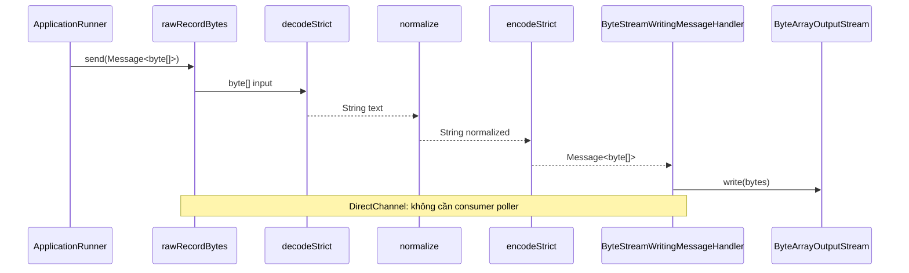

# Chuyển đổi byte array và text

## 1. Vì sao chuyển đổi `byte[]` và `String` là một ranh giới quan trọng?

Trong module **SPRING_INTEGRATION_ADAPTERS**, ứng dụng kết nối hệ thống ngoài qua **inbound/outbound adapter, gateway, poller và `MessageChannel`**, thực hành các luồng dữ liệu file, SFTP, HTTP, JMS, AMQP, Kafka và database. Để trao đổi message đúng hợp đồng, phải phân biệt **payload nhị phân**, **payload ký tự**, lỗi chuyển đổi, độ tin cậy và vòng đời kết nối.

Trong chương **Adapter Stream**, bài **Chuyển đổi byte array và text** đi vào bài toán rất thường gặp:

> Một adapter nhận `Message<byte[]>` từ luồng I/O, nhưng business handler muốn `Message<String>` để parse CSV/NDJSON; chiều ngược lại, một handler ghi vào `OutputStream` chỉ nhận bytes. Chúng ta chuyển đổi thế nào để giữ nguyên dữ liệu, không làm hỏng Unicode và không mất ranh giới bản ghi?

Ví dụ một hệ thống nhập đơn hàng nhận các bản ghi UTF-8 qua pipe:

```text
                         External bytes
                4F 52 44 45 52 2C ... 0A
                              |
                     ByteStreamReading
                        MessageSource
                              |
                         poller
                              v
                    Message<byte[]>
                              |
                    Framing / reassemble
                              |
                       UTF-8 decode
                              v
                     Message<String>
                              |
                   Validate / normalize
                              |
                     Message<String>
                              |
                       UTF-8 encode
                              v
                     Message<byte[]>
                              |
                     ByteStreamWriting
                       MessageHandler
                              |
                         OutputStream
```

Hệ thống **không tự hiểu text chỉ vì mảng byte hiển thị thành chữ trong IDE**. Một giá trị `byte[]` có thể chứa text UTF-8, JSON, protobuf, file nén, ảnh hoặc một phần nhỏ của frame. Cần biết **hợp đồng định dạng và charset** trước khi giải mã.

### Mục tiêu

Sau bài này, bạn có thể:

1. Phân biệt `byte[]`, `String`, `char[]`, `ByteBuffer` và `InputStream`.
2. Chuyển `String ↔ byte[]` với `StandardCharsets.UTF_8` và kiểm chứng Unicode round-trip.
3. Dùng `CharsetDecoder`/`CharsetEncoder` với `CodingErrorAction.REPORT` để không âm thầm thay dữ liệu lỗi.
4. Giải thích vì sao một **byte chunk không mặc nhiên là text record**, xử lý UTF-8 bị chia qua nhiều chunk.
5. Cấu hình transformer trong Spring Integration 6.5, đặc biệt `ObjectToStringTransformer`, `StreamTransformer` và custom transformer.
6. Xây dựng Java DSL, `@Transformer` và XML flow chuyển kiểu giữa các `MessageChannel`.
7. Gắn thông tin charset/content type vào hợp đồng, nhưng không nhầm header với bước chuyển mã thật.
8. Phân biệt UTF-8 với Base64, hex, JSON serialization và Java native object serialization.
9. Thiết kế giới hạn kích thước, error routing, retry/replay, idempotency và test thực tế.

## 2. Ba hợp đồng khác nhau: byte, ký tự và bản ghi

| Tầng | Ví dụ | Đơn vị thực tế | Câu hỏi phải trả lời |
| --- | --- | --- | --- |
| **Wire** | `byte[]` | Dãy byte | Byte này thuộc encoding/protocol nào? |
| **Text** | `String` | UTF-16 code units trong Java | Đã decode đúng và hợp lệ chưa? |
| **Business record** | `OrderEvent`, JSON object, CSV row | Đơn vị nghiệp vụ | Record bắt đầu/kết thúc ở đâu, schema nào? |

Một `String` được giải mã chính xác vẫn có thể là **nửa JSON**, một dòng text hợp lệ vẫn có thể là **một bản ghi nghiệp vụ không hợp lệ**. Phải tách ba công việc:

```text
1. Framing:      wire bytes -> complete byte records
2. Decoding:     byte record -> text, đúng charset
3. Parsing:      text -> business record theo schema
```

Chiều ghi:

```text
1. Serialization: business record -> text / binary body
2. Encoding:      text -> bytes (nếu text)
3. Framing:       bytes -> wire frame / delimiter
4. Write:         wire frame -> OutputStream / broker / transport
```

Đừng đảo lộn thứ tự nếu nguồn gửi byte chunk tùy ý. Việc chuyển `new String(chunk, UTF_8)` *trước khi có bản ghi hoàn chỉnh* có thể phá hỏng một ký tự bị cắt giữa hai chunk.

### `byte[]` không phải `Byte[]` hoặc `char[]`

| Java type | Mục đích | Ghi chú |
| --- | --- | --- |
| `byte[]` | Payload binary, chứa bytes `0..255` về mặt giao thức | Phần tử Java `byte` là signed `-128..127` |
| `Byte[]` | Object wrappers | Có thể null và tốn bộ nhớ; không tương đương `byte[]` |
| `char[]` | UTF-16 code units | Không phải bytes trên wire |
| `String` | Chuỗi ký tự logic | Một code point có thể chiếm 2 `char` |
| `ByteBuffer` | Truy cập vùng bytes có offset/limit | Cần tôn trọng `position()/limit()` |
| `InputStream` | Nguồn bytes có trạng thái đọc | Không nên truyền reference vào nhiều consumer tùy ý |

`byte` của Java có dấu; khi cần in số nguyên không dấu `0..255`:

```java
byte value = (byte) 0xE1;
int unsigned = value & 0xFF; // 225
```

Không dùng `byte` âm trong kiểm tra byte header rồi kết luận dữ liệu sai.

## 3. Chuyển `String → byte[]` đơn giản bằng UTF-8

Với một **record text hoàn chỉnh**, dùng charset **tường minh**:

```java
import java.nio.charset.StandardCharsets;
import java.util.Arrays;

String text = "Đã thanh toán 🚀";
byte[] payload = text.getBytes(StandardCharsets.UTF_8);

System.out.println(payload.length);
System.out.println(Arrays.toString(payload));
```

Ở đây `StandardCharsets.UTF_8` là một đối tượng `Charset` chuẩn của JDK, không phụ thuộc thiết lập charset mặc định trên hệ điều hành. Bytes được tạo có thể đưa vào `Message<byte[]>`:

```java
import org.springframework.messaging.Message;
import org.springframework.messaging.support.MessageBuilder;

Message<byte[]> message = MessageBuilder
        .withPayload(text.getBytes(StandardCharsets.UTF_8))
        .setHeader("eventId", "evt-1001")
        .build();
```

Header `eventId` do ứng dụng đặt; **byte handler không tự chèn header này vào payload trên wire**. Nếu receiver cần event ID, serializer phải đưa nó vào body/frame một cách rõ ràng.

### `String.getBytes()` không có charset: không nên dùng trong giao thức

```java
byte[] unstable = text.getBytes(); // Charset default cua runtime
byte[] stable = text.getBytes(StandardCharsets.UTF_8);
```

Tùy JDK, runtime, cấu hình khởi động hoặc môi trường legacy, việc dựa vào default charset tạo rủi ro không tương thích. Dù Java 18+ mặc định UTF-8 theo JEP 400, **vẫn cần quy định charset trong hợp đồng** thay vì dựa vào cấu hình môi trường.

## 4. Chuyển `byte[] → String` và ba cách hiển thị thường bị nhầm

Với **một payload byte hoàn chỉnh được xác nhận là UTF-8**:

```java
import java.nio.charset.StandardCharsets;

byte[] bytes = new byte[] {
        (byte) 0xC4, (byte) 0x90,
        (byte) 0xC3, (byte) 0xA3
};

String text = new String(bytes, StandardCharsets.UTF_8);
// text = "Đã"
```

### Vì sao `bytes.toString()` không đọc ra text?

```java
byte[] bytes = "OK".getBytes(StandardCharsets.UTF_8);

System.out.println(bytes.toString());                    // Kieu [B@... 
System.out.println(java.util.Arrays.toString(bytes));    // [79, 75]
System.out.println(new String(bytes, StandardCharsets.UTF_8)); // OK
```

| Cách gọi | Đầu ra | Dùng khi nào? |
| --- | --- | --- |
| `bytes.toString()` | Tên class array + identity/hash dạng `[B@...` | Không dùng để giải mã |
| `Arrays.toString(bytes)` | Danh sách số byte có dấu, ví dụ `[79, 75]` | Debug giới hạn kích thước |
| `new String(bytes, UTF_8)` | Text sau khi decode | Chỉ khi bytes là UTF-8 hợp lệ |
| `HexFormat.of().formatHex(bytes)` | Chuỗi hex, ví dụ `4f4b` | Debug payload binary |
| `Base64.getEncoder().encodeToString(bytes)` | Text Base64, ví dụ `T0s=` | Đóng gói binary vào kênh chỉ hỗ trợ text |

**Base64 và hex không phải UTF-8 decoding**: chúng diễn đạt **các bytes gốc** bằng ký tự ASCII, có thể khôi phục bytes. Trong khi đó `new String(bytes, UTF_8)` diễn giải bytes thành văn bản Unicode, có thể báo lỗi hoặc thay ký tự nếu bytes không hợp lệ.

### Tránh log toàn bộ bytes

`Arrays.toString(payload)` và hex dump giúp debug vài byte nhưng có thể tiết lộ token, thông tin cá nhân hoặc bản ghi bí mật. Trong production, chỉ log kích thước, hash an toàn cho mục đích kiểm tra và một preview đã được che/mask khi policy cho phép.

## 5. Unicode trong Java không phải số byte

Một ký tự hiển thị có thể gồm nhiều **Unicode code points**; Java `String.length()` lại đếm **UTF-16 code units**. UTF-8 có độ dài byte biến thiên.

```java
import java.nio.charset.StandardCharsets;

String value = "đệ🚀";
int utf16Units = value.length();                        // 4
int codePoints = value.codePointCount(0, value.length()); // 3
int utf8Bytes = value.getBytes(StandardCharsets.UTF_8).length; // 9
```

| Ký tự | Code point | UTF-8 bytes | UTF-16 code units |
| --- | --- | --- | --- |
| `đ` | `U+0111` | 2 | 1 |
| `ệ` | `U+1EC7` | 3 | 1 |
| `🚀` | `U+1F680` | 4 | 2 |

Không dùng `String.length()` để tính trường length-prefix **theo byte** của một protocol UTF-8. Phải encode xong rồi lấy `payload.length`. Không dùng `charAt(i)` đơn lẻ để cắt emoji/surrogate pair khi xử lý text.

### Unicode normalization

Hai chuỗi nhìn giống nhau có thể khác dãy code point:

```java
import java.text.Normalizer;

String composed = "\u00E9";       // é
String decomposed = "e\u0301";     // e + combining acute
boolean sameBefore = composed.equals(decomposed); // false
String normalized = Normalizer.normalize(
        decomposed, Normalizer.Form.NFC
);
boolean sameAfter = composed.equals(normalized); // true
```

Chỉ normalize khi **hợp đồng nghiệp vụ** yêu cầu. Không tự normalize password, chữ ký số hay payload phải giữ byte-identical; normalization thay đổi bytes khi encode lại.

## 6. Strict UTF-8: khi dữ liệu sai phải báo lỗi

Các convenience methods như `new String(bytes, UTF_8)` phù hợp dữ liệu **được tin là hợp lệ**, nhưng có thể dùng cơ chế thay thế ký tự khi bytes malformed. Với dữ liệu tài chính, đơn hàng hoặc danh tính, nên **báo lỗi thay vì thay dữ liệu âm thầm**.

JDK `CharsetDecoder` và `CharsetEncoder` cho phép chọn:

| `CodingErrorAction` | Ý nghĩa | Hệ quả |
| --- | --- | --- |
| `REPORT` | Ném lỗi khi input malformed/unmappable | An toàn khi correctness quan trọng |
| `REPLACE` | Thay bằng ký tự/byte thay thế | Có thể làm sai ID hoặc text |
| `IGNORE` | Bỏ phần không chuyển được | Mất dữ liệu không quan sát được |

### 6.1. Utility Java dùng được ở nhiều flow

```java
import java.nio.ByteBuffer;
import java.nio.CharBuffer;
import java.nio.charset.CharacterCodingException;
import java.nio.charset.CodingErrorAction;
import java.nio.charset.StandardCharsets;
import java.util.Objects;

public final class Utf8TextCodec {

    private Utf8TextCodec() {
    }

    public static String decodeStrict(byte[] bytes) {
        Objects.requireNonNull(bytes, "bytes");
        try {
            var decoder = StandardCharsets.UTF_8.newDecoder()
                    .onMalformedInput(CodingErrorAction.REPORT)
                    .onUnmappableCharacter(CodingErrorAction.REPORT);

            return decoder.decode(ByteBuffer.wrap(bytes)).toString();
        }
        catch (CharacterCodingException ex) {
            throw new IllegalArgumentException(
                    "Payload is not valid UTF-8", ex);
        }
    }

    public static byte[] encodeStrict(String text) {
        Objects.requireNonNull(text, "text");
        try {
            var encoder = StandardCharsets.UTF_8.newEncoder()
                    .onMalformedInput(CodingErrorAction.REPORT)
                    .onUnmappableCharacter(CodingErrorAction.REPORT);

            ByteBuffer result = encoder.encode(CharBuffer.wrap(text));
            byte[] output = new byte[result.remaining()];
            result.get(output);
            return output;
        }
        catch (CharacterCodingException ex) {
            throw new IllegalArgumentException(
                    "Text cannot be encoded as valid UTF-8", ex);
        }
    }
}
```

Lưu lớp trên thành `Utf8TextCodec.java`. Mỗi lần gọi tạo decoder/encoder riêng nên không chia sẻ trạng thái giữa nhiều thread. Các methods trả giá trị **không null** hoặc ném `IllegalArgumentException` với cause gốc; phù hợp làm transformer cho record hoàn chỉnh.

### 6.2. Test nhanh utility

```java
String original = "Đã thanh toán 🚀";
byte[] encoded = Utf8TextCodec.encodeStrict(original);
String decoded = Utf8TextCodec.decodeStrict(encoded);

if (!original.equals(decoded)) {
    throw new IllegalStateException("UTF-8 round-trip failed");
}
```

Với bytes malformed:

```java
byte[] invalid = new byte[] {(byte) 0xC3, 0x28};
// UTF-8: C3 phải đi với continuation byte 80..BF,
// nhưng 0x28 là '(' nên payload malformed.
String value = Utf8TextCodec.decodeStrict(invalid);
// Sẽ ném IllegalArgumentException (cause: CharacterCodingException).
```

Snippet thứ hai **cố ý ném exception**, dùng trong test `assertThrows(...)`, không dùng làm đoạn startup production.

### 6.3. Đặc biệt: `String` chứa surrogate lẻ

Java `String` có thể chứa một UTF-16 surrogate **không ghép cặp**:

```java
String invalidUnicode = "\uD800";
byte[] bytes = Utf8TextCodec.encodeStrict(invalidUnicode);
// Ném IllegalArgumentException thay vì thay bằng dấu hỏi.
```

Hãy dùng strict encoder ở điểm biên nếu không muốn dữ liệu Unicode lỗi biến thành payload “hợp lệ” sau replacement. Với môi trường best-effort (ví dụ chỉ hiển thị log), `REPLACE` có thể là lựa chọn chủ động, nhưng phải công bố chính sách.

## 7. Byte array không phải text: Base64 và hex là những việc khác

Ví dụ một ảnh PNG hoặc bytes được mã hóa/encrypted không phải text UTF-8. Nếu một JSON/HTTP API yêu cầu truyền binary trong trường chuỗi, dùng Base64:

```java
import java.util.Base64;

byte[] binary = new byte[] {0x00, (byte) 0xFF, 0x23};
String base64 = Base64.getEncoder().encodeToString(binary);
byte[] restored = Base64.getDecoder().decode(base64);
```

Đây là **biểu diễn lossless của bytes** chứ không phải charset conversion. Base64 tăng kích thước (xấp xỉ 4/3 cho dữ liệu lớn), phải kiểm tra length và source trust. Với API có native binary body, ưu tiên truyền `byte[]` trực tiếp thay vì Base64 không cần thiết.

### So sánh tác vụ

| Đầu vào | Đầu ra | Phép toán đúng | Không dùng |
| --- | --- | --- | --- |
| UTF-8 bytes | Text | `CharsetDecoder` hoặc `new String(bytes, UTF_8)` | `bytes.toString()` |
| Text | UTF-8 bytes | `CharsetEncoder` hoặc `getBytes(UTF_8)` | Java `toString()` trên array |
| Binary bytes | ASCII-safe text | Base64 hoặc hex | UTF-8 decoding tùy tiện |
| JSON text | `OrderEvent` | JSON parser/mapper có schema | Ép kiểu `(OrderEvent) String` |
| `OrderEvent` | JSON bytes | JSON serializer → UTF-8 bytes | `event.toString().getBytes()` tùy ý |
| `InputStream` | bytes/text | Đọc hữu hạn + size cap, hoặc StreamTransformer | Gửi reference stream cho consumer tùy ý |

**Đừng nhầm serialization và encoding**: serializer định nghĩa cấu trúc record; encoding định nghĩa cách ký tự được biểu diễn thành bytes. Sử dụng một serializer JSON thật nếu contract là JSON, không ghép chuỗi thủ công khi có escaping phức tạp.

## 8. Spring Integration 6.5: transformer nào phù hợp?

Spring Integration có các transformer cho từng kiểu input:

| Component | Đầu vào | Đầu ra | Lưu ý |
| --- | --- | --- | --- |
| `ObjectToStringTransformer` | `Object`, đặc biệt `byte[]`/`char[]` | `String` | `byte[]` được decode theo charset, mặc định UTF-8 |
| `StreamTransformer` | Payload `InputStream` | `byte[]` hoặc `String` nếu cấu hình charset | Đọc nội dung stream; khác với stream inbound MessageSource |
| `PayloadTypeConvertingTransformer` | Payload kiểu nguồn | Kiểu đích qua `Converter` | Quy tắc conversion phải được cấu hình |
| `@Transformer` POJO | Theo method signature | Payload hoặc Message tùy return | Kiểm tra input types và lỗi |
| Java DSL `.transform(Class, GenericTransformer)` | Kiểu theo Class đã nêu | Return của lambda/method | Rõ ràng, hợp với strict codec |

**Nguồn học:** Spring Integration 6.5 Javadoc và Reference. Với các lớp stream reading/writing của **6.5**, import từ `org.springframework.integration.stream`; trong **7.x**, các lớp được tách sang các package con `.stream.inbound`/`.stream.outbound`. Transformer core như `ObjectToStringTransformer` vẫn thuộc package `org.springframework.integration.transformer` trong 6.5.

### 8.1. `ObjectToStringTransformer` có xử lý `byte[]` đặc biệt

Khác `byte[].toString()` của Java, implementation chính thức:

- Với `byte[]`, tạo `String` dùng charset, **mặc định UTF-8**.
- Với `char[]`, tạo `String` từ ký tự.
- Với đối tượng khác, gọi `toString()` của đối tượng.

Java DSL:

```java
import org.springframework.context.annotation.Bean;
import org.springframework.integration.dsl.IntegrationFlow;
import org.springframework.integration.dsl.Transformers;

@Bean
IntegrationFlow bytesToTextBuiltin() {
    return IntegrationFlow
            .from("rawBytesForText")
            .transform(Transformers.objectToString("UTF-8"))
            .channel("decodedText")
            .get();
}
```

Đây là một **flow minh họa**, cần đặt trong `@Configuration` và có producers/consumers của hai channel. `ObjectToStringTransformer` thuận tiện khi charset đã được quy định và dữ liệu hợp lệ. Nhưng với dữ liệu critical phải **reject malformed bytes**, dùng custom `Utf8TextCodec.decodeStrict` để kiểm soát `CodingErrorAction.REPORT`; đừng chỉ giả định mọi method tạo String đều báo lỗi.

### 8.2. `StreamTransformer` xử lý một `InputStream` payload

`Transformers.fromStream("UTF-8")` nhận payload **`InputStream`** rồi tạo **`String`**. `Transformers.fromStream()` không truyền charset sẽ tạo **`byte[]`**:

```java
@Bean
IntegrationFlow inputStreamPayloadToText() {
    return IntegrationFlow
            .from("streamsAsPayload")
            .transform(Transformers.fromStream("UTF-8"))
            .channel("textFromStream")
            .get();
}
```

**Không nhầm** `StreamTransformer` với `ByteStreamReadingMessageSource`:

```text
ByteStreamReadingMessageSource:
  input Java InputStream -> poller -> nhiều Message<byte[]> chunk

StreamTransformer:
  Một Message<InputStream> -> transform -> một Message<byte[]>/Message<String>
  (đọc nội dung stream thành payload mới)
```

Với stream không giới hạn (socket, live feed) hoặc object rất lớn, cách materialize toàn bộ thành bytes/String có thể làm cạn RAM hoặc block lâu. Đặt size limits, timeout và ownership rõ; khi muốn xử lý streaming có backpressure/frame semantics, dùng adapter hoặc decoder phù hợp hơn.

### 8.3. Tránh mặc định chuyển mọi đối tượng thành text

`ObjectToStringTransformer` dùng `toString()` cho nhiều object khác. Một DTO có `toString()` sinh `OrderEvent[id=..., status=...]` không phải JSON chuẩn hoặc payload tương thích hệ thống ngoài. Nếu nguồn là business object, trước tiên dùng **serializer có schema** (Jackson, Avro, protobuf...) rồi encode theo contract.

## 9. Spring Boot Java DSL: biến byte thành text rồi trở lại byte

Ví dụ chính xử lý **các message byte đã là record hoàn chỉnh**. Input là CSV đơn giản `orderId,status,note` bằng UTF-8; output là từng dòng text đã chuẩn hóa, được **encode lại thành UTF-8 `byte[]`**, đưa tới stream handler. Ví dụ tách rõ hai phép conversion, nên có thể quan sát payload type ở từng bước.

### 9.1. Dependency

Với Java 17+, Spring Boot và Spring Integration **6.5.x** được quản lý đồng bộ bằng BOM:

```xml
<dependencies>
    <dependency>
        <groupId>org.springframework.boot</groupId>
        <artifactId>spring-boot-starter-integration</artifactId>
    </dependency>
    <dependency>
        <groupId>org.springframework.integration</groupId>
        <artifactId>spring-integration-stream</artifactId>
    </dependency>
</dependencies>
```

Không lấy import Spring Integration 7.x đưa vào dự án Spring Boot còn dùng 6.5.x. `spring-integration-stream` cung cấp các source/handler liên quan luồng I/O; `@Transformer` và Java DSL là cơ sở Spring Integration core.

### 9.2. Quy tắc nghiệp vụ

Ví dụ quy định:

| Trường | Contract |
| --- | --- |
| Input bytes | Một `byte[]` = **một CSV record hoàn chỉnh** |
| Charset | UTF-8 nghiêm ngặt; bytes lỗi bị reject |
| Input text | `1001,PAID,Đã thanh toán` |
| `orderId` | 1–12 chữ số ASCII |
| `status` | `CREATED`, `PAID` hoặc `CANCELLED` |
| `note` | Không chứa dấu `,`, `|`, CR hoặc LF; tối đa 256 ký tự UTF-16 |
| Output text | `ORDER|1001|PAID|Đã thanh toán\n` |
| Output wire bytes | UTF-8 của output text, với đúng một LF |
| Sai schema/charset | Exception/quarantine, không phát ra output |

Hợp đồng **cố ý đơn giản** để tập trung vào chuyển mã. CSV ngoài thực tế cần parser xử lý quote, escaped comma và record nhiều dòng; đừng dùng `String.split(",")` cho CSV tổng quát.

### 9.3. Lớp chuẩn hóa record

```java
import java.util.Set;

public final class OrderTextNormalizer {

    private static final Set<String> STATES =
            Set.of("CREATED", "PAID", "CANCELLED");

    private OrderTextNormalizer() {
    }

    public static String normalize(String line) {
        if (line == null || line.length() > 4096
                || line.indexOf('\r') >= 0
                || line.indexOf('\n') >= 0) {
            throw new IllegalArgumentException(
                    "Invalid input line");
        }

        // Contract demo: comma may only be a field separator.
        String[] fields = line.split(",", -1);
        if (fields.length != 3
                || !fields[0].matches("[0-9]{1,12}")
                || !STATES.contains(fields[1])
                || fields[2].isBlank()
                || fields[2].length() > 256
                || fields[2].indexOf('|') >= 0) {
            throw new IllegalArgumentException(
                    "Invalid order record");
        }

        return "ORDER|" + fields[0] + "|"
                + fields[1] + "|"
                + fields[2] + "\n";
    }
}
```

Đặt lớp này trong `OrderTextNormalizer.java`, cùng package hoặc import đúng từ lớp flow. Note chỉ dùng làm **dữ liệu**. Không đưa nó trực tiếp vào SQL query string hoặc shell command; khi cần lưu database, dùng parameterized SQL/JPA.

### 9.4. Java configuration và producer

```java
import java.io.ByteArrayOutputStream;
import java.nio.charset.StandardCharsets;

import org.springframework.beans.factory.annotation.Qualifier;
import org.springframework.boot.ApplicationRunner;
import org.springframework.boot.SpringApplication;
import org.springframework.boot.autoconfigure.SpringBootApplication;
import org.springframework.context.annotation.Bean;
import org.springframework.integration.annotation.ServiceActivator;
import org.springframework.integration.channel.DirectChannel;
import org.springframework.integration.config.EnableIntegration;
import org.springframework.integration.dsl.IntegrationFlow;
import org.springframework.integration.stream.ByteStreamWritingMessageHandler;
import org.springframework.messaging.MessageChannel;
import org.springframework.messaging.support.MessageBuilder;

@SpringBootApplication
@EnableIntegration
public class ByteTextConversionApplication {

    public static void main(String[] args) {
        SpringApplication.run(ByteTextConversionApplication.class, args);
    }

    @Bean
    public MessageChannel rawRecordBytes() {
        return new DirectChannel();
    }

    @Bean
    public MessageChannel normalizedOutputBytes() {
        return new DirectChannel();
    }

    @Bean
    public IntegrationFlow utf8ConversionFlow() {
        return IntegrationFlow
                .from("rawRecordBytes")
                .transform(byte[].class, Utf8TextCodec::decodeStrict)
                .transform(String.class,
                        OrderTextNormalizer::normalize)
                .transform(String.class, Utf8TextCodec::encodeStrict)
                .channel("normalizedOutputBytes")
                .get();
    }

    @Bean
    public ByteArrayOutputStream binaryCapture() {
        return new ByteArrayOutputStream();
    }

    @Bean
    @ServiceActivator(inputChannel = "normalizedOutputBytes")
    public ByteStreamWritingMessageHandler byteWriter(
            @Qualifier("binaryCapture")
            ByteArrayOutputStream destination) {

        return new ByteStreamWritingMessageHandler(
                destination, 4096);
    }

    @Bean
    public ApplicationRunner sendSampleRecords(
            @Qualifier("rawRecordBytes") MessageChannel input) {

        return args -> {
            send(input, "1001,PAID,Đã thanh toán");
            send(input, "1002,CREATED,Chờ xử lý");
        };
    }

    private static void send(MessageChannel input, String text) {
        boolean accepted = input.send(
                MessageBuilder
                        .withPayload(
                            text.getBytes(StandardCharsets.UTF_8))
                        .build());
        if (!accepted) {
            throw new IllegalStateException(
                    "Conversion channel rejected a record");
        }
    }
}
```

**Ba lớp của ví dụ** là `Utf8TextCodec.java`, `OrderTextNormalizer.java` và `ByteTextConversionApplication.java` trong cùng package, với Spring Boot build configuration thông thường. Bài này **chưa compile/run** vì STEP 4 chỉ viết nội dung.

### 9.5. Điều gì diễn ra tại runtime?



1. Producer gửi `Message<byte[]>`, không phải `Message<String>`.
2. Transformer thứ nhất nhận **byte[]** và strict-decode thành **String**.
3. Transformer thứ hai nhận String, validate và tạo bản ghi output.
4. Transformer thứ ba **encode String → byte[]**.
5. `ByteStreamWritingMessageHandler` nhận byte[] ở kênh cuối và ghi vào `ByteArrayOutputStream`.
6. Tất cả flow bắt đầu từ `DirectChannel` nên **không cần poller**. Nếu thay producer bằng `ByteStreamReadingMessageSource`, phía source inbound mới cần poller.

**Về output:** sau khi handler thực sự ghi/flush các buffers theo lifecycle của phiên bản runtime, bytes tương ứng hai dòng:

```text
ORDER|1001|PAID|Đã thanh toán
ORDER|1002|CREATED|Chờ xử lý
```

Mỗi dòng kết thúc bằng **LF (0x0A)** do `OrderTextNormalizer` thêm đúng một lần. Không mở `ByteArrayOutputStream` để assert ở thời điểm quá sớm nếu còn wrapper buffering; kiểm tra sau khi sink đã flush/handler hoàn tất theo contract.

### 9.6. Vì sao transformer không trả `null`?

Contract của transformer Spring Integration **không cho phép chuyển đổi thành `null`** như cách bỏ một record. Nếu muốn loại bỏ message trống hoặc sai schema theo một policy, dùng `filter`/router riêng; nếu muốn báo lỗi, ném exception và cấu hình quarantine/error flow. `null` không phải một “message rỗng” hợp lệ.

### 9.7. Không nhập nhằng payload và headers

Khi transformer nhận payload thuần, framework tạo message output và thường kế thừa các headers thích hợp theo contract transformer. Nhưng **message ID/timestamp có thể thay đổi**, không nên dùng `MessageHeaders.ID` làm business ID ổn định. Nếu cần `eventId`, đưa nó vào body hoặc header do ứng dụng đặt và kiểm tra propagation bằng integration test.

## 10. Từ ByteStreamReadingMessageSource đến transformer

Một `ByteStreamReadingMessageSource` được xây từ Java `InputStream`:

```java
import java.io.InputStream;
import org.springframework.integration.stream.ByteStreamReadingMessageSource;

InputStream input = /* stream da mo va co owner */;
ByteStreamReadingMessageSource source =
        new ByteStreamReadingMessageSource(input);
source.setBytesPerMessage(1024);
source.setShouldTruncate(true);
```

Khi đưa nguồn này vào Spring flow, cần một **poller**:

```java
import java.time.Duration;
import org.springframework.context.annotation.Bean;
import org.springframework.integration.dsl.IntegrationFlow;
import org.springframework.integration.dsl.Pollers;

@Bean
IntegrationFlow rawByteInboundFlow(
        ByteStreamReadingMessageSource source) {
    return IntegrationFlow.from(
            source,
            spec -> spec.id("rawByteInbound")
                    .poller(Pollers
                            .fixedDelay(Duration.ofMillis(300))
                            .maxMessagesPerPoll(1)))
            .channel("rawByteChunks")
            .get();
}
```

Đây là **mảnh cấu hình**: cần bean `ByteStreamReadingMessageSource`, channel và consumer của `rawByteChunks`. **Không đưa ngay từng byte chunk qua `Utf8TextCodec.decodeStrict`** nếu giao thức chưa chứng minh mỗi chunk là một record UTF-8 hoàn chỉnh. `bytesPerMessage=1024` chỉ là giới hạn byte read, **không phải boundary của JSON/UTF-8 code point**.

### Thí dụ UTF-8 bị cắt ở giữa một ký tự

Chữ `Đ` có UTF-8 bytes `C4 90`:

```text
Chunk 1: 31 30 30 31 2C C4
           1  0  0  1  ,  [byte đầu chữ Đ]

Chunk 2: 90 0A
         [byte sau chữ Đ]  newline
```

`Utf8TextCodec.decodeStrict(chunk1)` sẽ báo malformed/truncated sequence; `decodeStrict(chunk2)` cũng lỗi, **dù toàn bộ stream ban đầu hoàn toàn hợp lệ**. Với `new String(chunk, UTF_8)`, mỗi chunk có thể sinh ký tự thay thế `�` khiến dữ liệu gốc không còn nguyên vẹn.

Phải làm:

```text
Chunk 1 + Chunk 2
       |
  Reassembler nhận đủ bytes 31 30 30 31 2C C4 90
       |
  decodeStrict(completeRecordBytes)
       |
  "1001,Đ"
```

Ngoài ra, `InputStream.read(buffer)` không bắt buộc trả đủ buffer size ngay cả khi chưa EOF. Với socket/pipe, chunk size thay đổi theo tải và buffering.

## 11. Reassembler trước khi decode: protocol text theo LF

Một pattern đơn giản cho các stream line-oriented là **thu bytes cho tới LF (0x0A)**, sau đó mới UTF-8 decode. Đây là framing level 1: một record không được chứa LF không escape.

### 11.1. Lớp Java ghép dòng có giới hạn kích thước

```java
import java.io.ByteArrayOutputStream;
import java.util.ArrayList;
import java.util.Arrays;
import java.util.List;
import java.util.Objects;

public final class Utf8LineAssembler {

    private final int maxRecordBytes;
    private final ByteArrayOutputStream pending =
            new ByteArrayOutputStream();

    public Utf8LineAssembler(int maxRecordBytes) {
        if (maxRecordBytes < 1
                || maxRecordBytes > 1024 * 1024) {
            throw new IllegalArgumentException(
                    "Invalid maxRecordBytes");
        }
        this.maxRecordBytes = maxRecordBytes;
    }

    public synchronized List<String> accept(byte[] chunk) {
        Objects.requireNonNull(chunk, "chunk");
        List<String> completed = new ArrayList<>();

        for (byte value : chunk) {
            if (value == (byte) '\n') {
                byte[] record = pending.toByteArray();
                pending.reset();

                // Optional CRLF support.
                if (record.length > 0
                        && record[record.length - 1] == '\r') {
                    record = Arrays.copyOf(
                            record, record.length - 1);
                }

                if (record.length == 0) {
                    continue; // Demo: bo qua dong trong.
                }
                completed.add(
                        Utf8TextCodec.decodeStrict(record));
            }
            else {
                if (pending.size() >= maxRecordBytes) {
                    throw new IllegalArgumentException(
                            "Line exceeds maximum byte length");
                }
                pending.write(value);
            }
        }
        return completed;
    }

    public synchronized void endOfInput() {
        if (pending.size() != 0) {
            throw new IllegalStateException(
                    "Incomplete final line: no LF terminator");
        }
    }
}
```

**Chính sách của ví dụ:** từng record phải kết thúc bằng **LF**. Hỗ trợ CRLF bằng cách bỏ CR cuối trước decode; dòng trống bị bỏ qua. Khi EOF còn bytes dở, `endOfInput()` báo lỗi, không âm thầm xuất nửa record.

Lưu lớp này thành `Utf8LineAssembler.java` cùng package `Utf8TextCodec`. Nó dùng một buffer **hữu hạn** và giải mã một record sau khi đã nhận đủ bytes. Trong production có thể còn cần timeout cho record chưa hoàn tất, origin tracking, stream epoch, báo lỗi giữa stream, chính sách reset/quarantine, checksum và durable staging.

### 11.2. Ví dụ nhận chunk bị cắt giữa ký tự

```java
Utf8LineAssembler assembler = new Utf8LineAssembler(4096);

byte[] chunk1 = new byte[] {
        '1', '0', '0', '1', ',', (byte) 0xC4
};
byte[] chunk2 = new byte[] {
        (byte) 0x90, '\n'
};

List<String> first = assembler.accept(chunk1);  // []
List<String> second = assembler.accept(chunk2); // ["1001,Đ"]
assembler.endOfInput(); // PASS: khong con incomplete bytes
```

**Trạng thái assembler thuộc một stream logic.** Không dùng cùng instance ghép dữ liệu từ nhiều socket/tenant/job khác nhau. Nếu có nhiều producer và cần thứ tự byte chính xác, nên thiết kế **một writer/reader owner** cho mỗi stream, không tin rằng gọi method `synchronized` sẽ giải quyết ordering business giữa các nguồn độc lập.

### 11.3. Đưa assembler vào Spring Message flow

Consumer có thể nhận `Message<byte[]>` từ kênh `rawByteChunks`, lấy danh sách các dòng hoàn chỉnh, rồi gửi từng dòng tới `textRecords`:

```java
import org.springframework.messaging.Message;
import org.springframework.messaging.MessageChannel;
import org.springframework.messaging.support.MessageBuilder;

public final class ByteChunkToTextBridge {

    private final Utf8LineAssembler assembler =
            new Utf8LineAssembler(4096);
    private final MessageChannel textRecords;

    public ByteChunkToTextBridge(MessageChannel textRecords) {
        this.textRecords = textRecords;
    }

    public void handle(Message<byte[]> chunkMessage) {
        for (String record : assembler.accept(
                chunkMessage.getPayload())) {
            boolean accepted = textRecords.send(
                    MessageBuilder.withPayload(record).build());
            if (!accepted) {
                throw new IllegalStateException(
                        "Text channel rejected a record");
            }
        }
    }

    public void onSourceFinished() {
        assembler.endOfInput();
    }
}
```

Ví dụ là **một class bridge**, chưa đăng ký `@ServiceActivator`/`MessageHandler` trong Spring context và chưa tạo signal EOF. Người triển khai phải đăng ký nó với channel source cùng với lifecycle callback nguồn, tránh giả định `ByteStreamReadingMessageSource` phát `StreamClosedEvent` như character source bật detect EOF.

**Hệ quả quan trọng:** một chunk có thể chứa **0, 1 hoặc nhiều record**. Một transformer `byte[]→String` đơn giản chỉ trả một String **không đủ** để xử lý trường hợp một chunk mang hai dòng. Dùng aggregator/decoder + splitter hoặc một handler có thể phát nhiều message, như bridge phía trên.

## 12. Payload headers: `contentType` không tự làm phép chuyển mã

Spring `Message<?>` có payload và headers. Header có thể mô tả loại nội dung:

```java
import java.nio.charset.StandardCharsets;

import org.springframework.messaging.Message;
import org.springframework.messaging.MessageHeaders;
import org.springframework.messaging.support.MessageBuilder;
import org.springframework.util.MimeTypeUtils;

Message<byte[]> message = MessageBuilder
        .withPayload(
                "Đã thanh toán".getBytes(StandardCharsets.UTF_8))
        .setHeader(
                MessageHeaders.CONTENT_TYPE,
                MimeTypeUtils.parseMimeType(
                        "text/plain;charset=UTF-8"))
        .setHeader("sourceId", "orders-pipe-1")
        .build();
```

Header `contentType` ở đây là **thông tin do producer đưa vào**, không phải proof rằng payload đúng UTF-8. Nếu bytes thực tế được mã hóa theo Windows-1258 nhưng header nói UTF-8, consumer vẫn có thể đọc sai hoặc fail. Việc thêm header cũng **không tự động gọi converter** trừ khi endpoint/channel cụ thể được cấu hình bộ chuyển đổi.

### Phân biệt hai tình huống

```text
Case A
  bytes = UTF-8("Đã"), header says UTF-8
  -> decodeStrict succeeds -> String "Đã"

Case B
  bytes = malformed UTF-8, header says UTF-8
  -> decodeStrict rejects
  -> do NOT trust the header as validation
```

### Khi charset thay đổi theo message

Một số hệ thống legacy có message dùng nhiều charset. Khi đó cần:

1. Có **nguồn xác nhận charset đáng tin**: metadata protocol/đối tác có hợp đồng.
2. Cho phép **allowlist** (ví dụ UTF-8 và một charset legacy được hỗ trợ).
3. Không auto-detect trên bytes tùy ý rồi cam kết kết quả là đúng; việc đoán charset mang tính heuristic.
4. Log/metric tên charset đã chọn, lỗi decode, nguồn và version giao thức.
5. Cấm charset không hỗ trợ thay vì fallback lặng lẽ sang mặc định.

Không lấy một header do đối tác không tin cậy gửi rồi dùng làm quyền thực thi, đường dẫn file hoặc lựa chọn class parser tùy ý.

### Header propagation và correlation

Nếu bạn xây lại `Message` trong custom bridge, có thể giữ các headers được phép:

```java
Message<String> converted = MessageBuilder
        .withPayload(Utf8TextCodec.decodeStrict(
                originalMessage.getPayload()))
        .copyHeaders(originalMessage.getHeaders())
        .setHeader("decodedCharset", "UTF-8")
        .build();
```

`originalMessage` trong ví dụ là `Message<byte[]>` đã có. Cần lưu ý `id`/`timestamp` là headers do Spring quản lý; khi tạo message mới chúng có thể được tạo lại hoặc xử lý theo contract framework. Đừng dựa vào chúng để làm **business event ID** qua retry. Chỉ propagate headers thực sự cần và an toàn cho downstream (không sao chép token/PII tùy tiện).

## 13. Charset khác với framing, newline, BOM và JSON

### 13.1. BOM

Một số file UTF-8 có tiền tố **BOM** `EF BB BF`. `CharsetDecoder` UTF-8 của JDK không đồng nghĩa một bộ xử lý file tự loại BOM theo business contract. Sau decode, bạn có thể nhận `U+FEFF` ở đầu text:

```java
String text = Utf8TextCodec.decodeStrict(bytes);
if (text.startsWith("\uFEFF")) {
    // Chi xoa BOM neu contract file quy dinh BOM optional.
    text = text.substring(1);
}
```

Không tự xóa mọi `U+FEFF` giữa nội dung khi không có quy tắc, và không dùng BOM để đoán chính xác mọi charset ngoài hợp đồng. Với file CSV/JSON, BOM policy phải nhất quán giữa hai bên.

### 13.2. LF, CRLF và delimiter

| Delimiter | Byte ở UTF-8 | Tình huống |
| --- | --- | --- |
| LF | `0A` | NDJSON, nhiều hệ thống Unix |
| CRLF | `0D 0A` | Nhiều file Windows |
| CR | `0D` | Hệ thống legacy |

`String.replace("\r\n", "\n")` chỉ xử lý newline khi dữ liệu **đã là text hợp lệ**; nó không có tác dụng sửa một chuỗi bytes UTF-8 bị cắt giữa các chunk. Cần quyết định:

- Bên gửi đã tạo LF trong mỗi record hay handler sẽ thêm newline?
- Nếu vừa thêm LF trong producer vừa bật `appendNewLine(true)` của character outbound handler, output có thể có dòng trống.
- Khi dùng byte writer handler, nó **không tự thêm LF** vào từng `byte[]`; serializer phải làm.
- Dòng trống là một **record rỗng theo framing** nếu protocol cho phép, không phải EOF.

### 13.3. NDJSON khác JSON document

```text
{"eventId":"e1","state":"PAID"}
{"eventId":"e2","state":"CREATED"}
```

Đây là **hai JSON values theo NDJSON**, không phải một JSON document chứa cả hai object. Người gửi phải serialize từng object thành text hợp lệ, escape newline trong giá trị và đặt delimiter LF giữa record. Bên nhận ghép dòng rồi JSON parse.

`UTF-8` chỉ giải mã ký tự; nó **không kiểm chứng JSON grammar**. Việc tạo JSON bằng `String.format(...)` hoặc nối chuỗi khi text có quote, backslash hay control character là rủi ro; dùng JSON mapper phù hợp.

### 13.4. Prefix length phải tính theo bytes

Nếu protocol dùng 4 byte length-prefix:

```java
String record = "Đã";
byte[] utf8 = Utf8TextCodec.encodeStrict(record);
int wireLength = utf8.length;     // 4 bytes: C4 90 C3 A3
int stringLength = record.length(); // 2 UTF-16 units
```

Prefix là `4`, **không phải `2`**. Bên nhận phải giới hạn max frame và đọc đủ số byte, sau đó mới UTF-8 decode. Không dùng `String.length()` làm payload length cho protocol byte-oriented.

## 14. Java Annotation và XML transformer

Java DSL không phải cách cấu hình duy nhất. Spring Integration hỗ trợ bean method annotated `@Transformer` và XML `<int:transformer>`.

### 14.1. Bean methods với @Transformer

```java
import org.springframework.integration.annotation.Transformer;
import org.springframework.stereotype.Component;

@Component
public class TextConversionService {

    @Transformer(
        inputChannel = "inputWireBytes",
        outputChannel = "decodedText")
    public String bytesToText(byte[] payload) {
        return Utf8TextCodec.decodeStrict(payload);
    }

    @Transformer(
        inputChannel = "validatedText",
        outputChannel = "outputWireBytes")
    public byte[] textToBytes(String payload) {
        return Utf8TextCodec.encodeStrict(payload);
    }
}
```

Đây là **cấu hình thay thế** flow Java DSL. Trong ứng dụng thật, `inputWireBytes`, `decodedText`, `validatedText` và `outputWireBytes` phải được định tuyến tới các producer/consumer tương ứng; nếu cần validate text, đặt handler/transformer **giữa** hai channel `decodedText` và `validatedText`.

Đừng đăng ký cả bean annotation và Java DSL transform cùng subscribe một `DirectChannel` ngoài ý muốn: `DirectChannel` không mặc định nhân đôi message cho mọi subscriber; nên có một flow rõ ràng.

### 14.2. Custom POJO transformer dùng XML

Với XML, khai báo một class instance có hai methods:

```java
package com.example.integration;

public final class ByteTextConversionMethods {

    public String decode(byte[] payload) {
        return Utf8TextCodec.decodeStrict(payload);
    }

    public byte[] encode(String payload) {
        return Utf8TextCodec.encodeStrict(payload);
    }
}
```

Giả sử `Utf8TextCodec` nằm cùng package, XML cấu hình hai transformer dùng chung **POJO converter không có state**:

```xml
<beans:beans
    xmlns:beans="http://www.springframework.org/schema/beans"
    xmlns:xsi="http://www.w3.org/2001/XMLSchema-instance"
    xmlns:int="http://www.springframework.org/schema/integration"
    xsi:schemaLocation="
        http://www.springframework.org/schema/beans
        https://www.springframework.org/schema/beans/spring-beans.xsd
        http://www.springframework.org/schema/integration
        https://www.springframework.org/schema/integration/spring-integration.xsd">

    <int:channel id="inputBytes"/>
    <int:channel id="intermediateText"/>
    <int:channel id="outputBytes"/>

    <beans:bean id="byteTextOps"
                class="com.example.integration.ByteTextConversionMethods"/>

    <int:transformer
        id="decodeUtf8"
        input-channel="inputBytes"
        output-channel="intermediateText"
        ref="byteTextOps"
        method="decode"/>

    <int:transformer
        id="encodeUtf8"
        input-channel="intermediateText"
        output-channel="outputBytes"
        ref="byteTextOps"
        method="encode"/>

    <!-- Producer inputBytes và consumer outputBytes
         được cấu hình ở flow khác. -->
</beans:beans>
```

XML này **có hai bước conversion** nhưng chưa phải hệ thống hoàn chỉnh: cần producer `inputBytes` và consumer `outputBytes`. Trong production, giữa hai bước nên có validate/normalize text nếu business contract yêu cầu.

Lưu ý phân biệt **POJO converter** với `AbstractMessageProducingHandler`: một số message handler Spring có trạng thái output channel không nên chia một instance cho nhiều endpoint khác nhau. Ở đây `ByteTextConversionMethods` là một object stateless có hai methods riêng, nên việc sử dụng lại class instance là có chủ đích.

### 14.3. XML built-in ObjectToStringTransformer

Khi biết input là UTF-8 bytes và chấp nhận cơ chế mặc định của transformer:

```xml
<int:object-to-string-transformer
        id="bytesToString"
        input-channel="inputBytes"
        output-channel="decodedText"
        charset="UTF-8"/>
```

Đây là **mảnh namespace Integration**, phải có `int` namespace/XSD đầy đủ. Với dữ liệu cần strict REPORT, dùng custom converter thay vì chỉ dựa vào attribute charset.

## 15. Unit tests: conversion đúng bytes và lỗi được phát hiện

Nên kiểm tra **giá trị byte**, không chỉ hiển thị trên terminal. Mỗi test được viết theo JUnit 5, độc lập Spring Context trừ khi có mục kiểm thử flow.

### 15.1. Test round-trip tiếng Việt và emoji

```java
import static org.junit.jupiter.api.Assertions.*;

import java.nio.charset.StandardCharsets;
import org.junit.jupiter.api.Test;

class Utf8TextCodecTest {

    @Test
    void roundTripsVietnameseAndEmoji() {
        String original = "Đã thanh toán 🚀";

        byte[] actual = Utf8TextCodec.encodeStrict(original);
        String restored = Utf8TextCodec.decodeStrict(actual);

        assertEquals(original, restored);
        assertArrayEquals(
                original.getBytes(StandardCharsets.UTF_8),
                actual);
    }

    @Test
    void rejectsMalformedUtf8() {
        byte[] malformed = new byte[] {
                (byte) 0xC3, 0x28
        };
        assertThrows(IllegalArgumentException.class,
                () -> Utf8TextCodec.decodeStrict(malformed));
    }

    @Test
    void rejectsUnpairedSurrogate() {
        String invalid = "\uD800";
        assertThrows(IllegalArgumentException.class,
                () -> Utf8TextCodec.encodeStrict(invalid));
    }

    @Test
    void handlesEmptyPayloadExplicitly() {
        assertEquals("", Utf8TextCodec.decodeStrict(new byte[0]));
        assertArrayEquals(
                new byte[0], Utf8TextCodec.encodeStrict(""));
    }
}
```

**Lưu ý về record rỗng:** codec cho phép String/byte array rỗng ở mức conversion. Business contract có thể **từ chối** record rỗng ở bước validate; đừng trộn hai chính sách.

### 15.2. Test chunk bị chia giữa ký tự

```java
import static org.junit.jupiter.api.Assertions.*;

import java.util.List;
import org.junit.jupiter.api.Test;

class Utf8LineAssemblerTest {

    @Test
    void combinesSplitMultibyteCharacter() {
        Utf8LineAssembler assembler =
                new Utf8LineAssembler(64);

        List<String> noLine = assembler.accept(
                new byte[] {'1', ',', (byte) 0xC4});
        List<String> complete = assembler.accept(
                new byte[] {(byte) 0x90, '\n'});

        assertTrue(noLine.isEmpty());
        assertEquals(List.of("1,Đ"), complete);
        assertDoesNotThrow(assembler::endOfInput);
    }

    @Test
    void rejectsTooLongLine() {
        Utf8LineAssembler assembler =
                new Utf8LineAssembler(2);
        assertThrows(IllegalArgumentException.class,
                () -> assembler.accept(
                        new byte[] {'a', 'b', 'c'}));
    }

    @Test
    void rejectsTruncatedLineAtEndOfInput() {
        Utf8LineAssembler assembler =
                new Utf8LineAssembler(16);
        assembler.accept(new byte[] {'a', 'b'});
        assertThrows(IllegalStateException.class,
                assembler::endOfInput);
    }
}
```

Test dự kiến dùng `String`/JDK unicode đúng. **Chưa được chạy** trong bước viết STEP 4. Với protocol thật, cần test thêm buffer overflow, CRLF, record rỗng, nhiều record trong một chunk, dữ liệu lỗi encoding trước newline và EOF đột ngột.

### 15.3. Test header không thay đổi bytes

Khi chỉ thêm `MessageHeaders.CONTENT_TYPE`, bạn có thể assert rằng payload bytes vẫn giữ nguyên. Chỉ khi chạy transformer thì type/value mới chuyển theo cấu hình. Điều này giúp phát hiện bug “thêm charset header rồi tưởng conversion đã diễn ra”.

## 16. Kiểm thử Spring Integration: payload type và flow contract

Unit test của codec chưa đủ: phải xác minh flow thực tế nhận loại payload nào ở từng channel, transformer trả message gì và exception được quan sát ở đâu.

### 16.1. Integration test không cần file hay server ngoài

Có thể viết một cấu hình kiểm thử Spring Integration đơn giản để nhận `byte[]` và đưa `byte[]` kết quả vào một queue test:

```java
import static org.junit.jupiter.api.Assertions.*;

import java.nio.charset.StandardCharsets;
import java.util.concurrent.BlockingQueue;
import java.util.concurrent.LinkedBlockingQueue;
import java.util.concurrent.TimeUnit;

import org.junit.jupiter.api.Test;
import org.springframework.beans.factory.annotation.Autowired;
import org.springframework.beans.factory.annotation.Qualifier;
import org.springframework.context.annotation.Bean;
import org.springframework.context.annotation.Configuration;
import org.springframework.integration.annotation.ServiceActivator;
import org.springframework.integration.channel.DirectChannel;
import org.springframework.integration.config.EnableIntegration;
import org.springframework.integration.dsl.IntegrationFlow;
import org.springframework.messaging.MessageChannel;
import org.springframework.messaging.MessageHandler;
import org.springframework.messaging.support.MessageBuilder;
import org.springframework.test.context.junit.jupiter.SpringJUnitConfig;

@SpringJUnitConfig(classes = ByteTextFlowTest.Config.class)
class ByteTextFlowTest {

    @Configuration
    @EnableIntegration
    static class Config {

        @Bean
        MessageChannel testRawBytes() {
            return new DirectChannel();
        }

        @Bean
        MessageChannel testOutputBytes() {
            return new DirectChannel();
        }

        @Bean
        BlockingQueue<byte[]> results() {
            return new LinkedBlockingQueue<>();
        }

        @Bean
        IntegrationFlow conversionFlow() {
            return IntegrationFlow.from("testRawBytes")
                    .transform(byte[].class,
                            Utf8TextCodec::decodeStrict)
                    .transform(String.class,
                            OrderTextNormalizer::normalize)
                    .transform(String.class,
                            Utf8TextCodec::encodeStrict)
                    .channel("testOutputBytes")
                    .get();
        }

        @Bean
        @ServiceActivator(inputChannel = "testOutputBytes")
        MessageHandler collect(
                BlockingQueue<byte[]> results) {
            return message -> results.add(
                    (byte[]) message.getPayload());
        }
    }

    @Autowired
    @Qualifier("testRawBytes")
    MessageChannel input;

    @Autowired
    BlockingQueue<byte[]> results;

    @Test
    void convertsByteMessageThroughStringAndBack()
            throws InterruptedException {

        byte[] bytes = Utf8TextCodec.encodeStrict(
                "1001,PAID,Đã thanh toán");

        assertTrue(input.send(
                MessageBuilder.withPayload(bytes).build()));

        byte[] output = results.poll(2, TimeUnit.SECONDS);
        assertNotNull(output);
        assertEquals(
                "ORDER|1001|PAID|Đã thanh toán\n",
                new String(output, StandardCharsets.UTF_8));
    }
}
```

**Đây là test đề xuất, chưa chạy trong STEP 4.** Nó cần `spring-test`/JUnit 5, thường do `spring-boot-starter-test` cung cấp, và các lớp `Utf8TextCodec`/`OrderTextNormalizer` của bài. Kênh cuối dùng **queue test**, không dùng writer buffer, nên test xác định chính xác payload `byte[]` sau transformer mà không phụ thuộc flush của `OutputStream`.

### 16.2. Các tình huống bổ sung cần test

| Test | Input | Kỳ vọng |
| --- | --- | --- |
| UTF-8 hợp lệ | Chữ Việt và emoji | Round-trip bằng bytes |
| Malformed byte | `C3 28` | Transformer strict báo lỗi |
| Surrogate lẻ | `"\uD800"` | Strict encoder báo lỗi |
| Chuỗi rỗng | `new byte[0]` | Codec cho phép; validator có thể reject |
| Charset header sai | Bytes không phải UTF-8, header UTF-8 | Không tự tin header; strict decode thất bại khi malformed |
| Byte chunk bị cắt code point | `C4` rồi `90 LF` | Assembler ghép rồi decode được `Đ` |
| Hai dòng trong một chunk | `A LF B LF` | Phát hai logical records |
| Record dài hơn giới hạn | Không có LF, vượt maxBytes | Reject và không tăng buffer vô hạn |
| Thiếu LF cuối stream | Pending bytes ở EOF | Reject/quarantine theo protocol |
| BOM | `EF BB BF` ở đầu | Policy explicit: strip/reject/preserve |
| CRLF | `0D 0A` | Chuẩn hóa đúng mà không ăn mất body |
| Json escaping | Quote, newline bên trong giá trị | JSON parser/schema đúng |
| Binary không phải text | Random bytes | Không cố giải mã; dùng binary pipeline |
| Wrong payload type | `Message<String>` vào handler byte | Reject hoặc transform tường minh |
| Retry | Cùng `eventId` gửi hai lần | Consumer idempotent |

Khi test Spring flow có nhiều threads, dùng `poll(timeout)`, latch/await và deadline; không dùng một `Thread.sleep()` cố định làm bằng chứng.

## 17. Lỗi chuyển mã: phải phân loại trước khi retry

Lỗi có thể xuất hiện trước hoặc sau khi transform:

```text
ByteStream inbound
      |
      +-- IOException -> source failure
      |
      +-- byte chunk -> framing
                           |
                           +-- too large / incomplete record
                           |
                           +-- decodeStrict
                                |
                                +-- malformed UTF-8
                                |
                                +-- validate business record
                                       |
                                       +-- schema rejected
                                       |
                                       +-- encodeStrict
                                               |
                                               +-- invalid Unicode
                                               |
                                               +-- destination write
                                                     |
                                                     +-- IOException/timeout
```

| Loại lỗi | Ví dụ | Có nên retry cùng bytes ngay? |
| --- | --- | --- |
| **Framing** | Chunk chưa đủ LF | **Chưa**; tiếp tục đợi chunk hoặc timeout theo protocol |
| **Malformed UTF-8** | Continuation byte sai | Không; cần sửa nguồn/quarantine |
| **Unmappable encoding** | Dùng charset legacy không hỗ trợ ký tự | Không; sửa contract/charset |
| **Schema** | Thiếu trường, JSON không hợp lệ | Không nếu dữ liệu nguồn không thay |
| **I/O transient** | Mất kết nối pipe/socket | Có thể, sau reconnect và kiểm tra replay |
| **Output partial write** | Ghi nửa frame rồi timeout | Không retry mù; outcome không rõ |
| **Business conflict** | Order đã xử lý | Idempotency/dedup hoặc conflict resolution |

### Một exception trên DirectChannel đi đâu?

`DirectChannel` thường dispatch đồng bộ. Nếu transformer ném `IllegalArgumentException`, exception có thể đi ngược về producer theo cơ chế Spring Messaging. Một polling endpoint có error handler/error channel riêng; luồng async có cách routing lỗi khác. **Đừng khẳng định mọi lỗi decode tự xuất hiện trên global `errorChannel`**.

Ví dụ error consumer:

```java
import org.springframework.integration.annotation.ServiceActivator;
import org.springframework.messaging.support.ErrorMessage;

@ServiceActivator(inputChannel = "errorChannel")
public void onIntegrationFailure(ErrorMessage errorMessage) {
    Throwable cause = errorMessage.getPayload();
    System.err.println("Flow failure type="
            + cause.getClass().getSimpleName());
    // Quarantine/durable retry tuan theo policy cua ung dung.
}
```

Đây là một **mảnh method** cần đặt trong bean Spring. Nó không chứng minh flow của bạn chắc chắn phát lỗi lên `errorChannel`: phải cấu hình và integration test đường exception tương ứng. Không log raw payload có dữ liệu cá nhân hoặc secrets.

### Lỗi của reassembler có trạng thái

`Utf8LineAssembler.accept(...)` trong ví dụ reset buffer trước khi decode một dòng hoàn chỉnh. Nếu decode ném lỗi, những bytes của dòng lỗi có thể đã bị xóa khỏi buffer **trong RAM**; đó là một chính sách **fail-fast**, không phải cơ chế lưu quarantine. Trong production nên:

1. Dùng một record/frame buffer có kích thước giới hạn.
2. Khi đủ frame, **giữ bytes gốc trong một durable quarantine/inbox** nếu cần điều tra hoặc replay.
3. Chỉ clear trạng thái sau khi đã chấp nhận hoặc lưu được kết quả theo contract.
4. Với lỗi giữa chunk, quyết định rõ **dừng stream, bỏ frame hay resync**; không lặng lẽ tiếp tục nếu framing đã mất.
5. Giữ thứ tự và quyền sở hữu một decoder cho mỗi nguồn logic.

Nếu nguồn là một stream không seek, byte đã đọc **không tự quay trở lại** khi Spring transformer ném exception. Retry chỉ an toàn khi dữ liệu đã có bản sao bền hoặc nguồn hỗ trợ replay/checkpoint.

## 18. Durability, idempotency và khái niệm “chuyển đổi thành công”

Giả sử các bước thực hiện:

```text
InputStream.read()
      |
      v
Message<byte[]> received
      |
      v
UTF-8 conversion success
      |
      v
OrderEvent saved to database
      |
      v
OutputStream.write()
      |
      v
Receiver business ACK
```

**Đã decode được text không đồng nghĩa đã commit nghiệp vụ**, và **đã ghi OutputStream không đồng nghĩa bên nhận đã xử lý**. Nếu ứng dụng crash:

- Có thể đã đọc bytes nhưng chưa lưu event.
- Có thể đã lưu database nhưng chưa ghi output.
- Có thể ghi output một phần rồi lỗi.
- Có thể receiver đã commit nhưng ACK bị mất.

### Thiết kế có thể phục hồi

| Thành phần | Mục đích |
| --- | --- |
| Stable `eventId` | Danh tính nghiệp vụ qua retry |
| Durable inbox/outbox | Giữ bản ghi đủ để replay |
| Checkpoint nguồn | Gắn với bytes/record **đã commit** |
| Idempotent consumer | Không lặp side effect khi nhận lại event |
| Schema/version | Đảm bảo decode theo đúng format |
| Charset/version metadata | Không giải mã sai khi đối tác thay encoding |
| Error quarantine | Giữ bằng chứng bytes lỗi trong giới hạn bảo mật |

Không dùng `MessageHeaders.ID` được Spring tạo mới làm idempotency key bền vững. Một byte chunk cũng không tự là business event nên không thể gắn `eventId` chuẩn nếu chưa parse record.

### Không dùng Java native deserialization cho input không tin cậy

Spring Integration có các transformer serialize/deserialize object, nhưng **Java native serialization** có rủi ro bảo mật và phụ thuộc class. Đừng dùng nó chỉ để giải quyết nhu cầu “biến byte array thành text”. Với dữ liệu không tin cậy, ưu tiên schema/format được kiểm soát (JSON với validation, Avro, protobuf...), và nếu buộc phải deserialize kiểu Java thì dùng allow-list/class filtering, giới hạn và đánh giá bảo mật.

## 19. Hiệu năng, memory và backpressure

### 19.1. Số byte và memory amplification

Một record đi qua `byte[] -> String -> byte[]` có thể đồng thời tồn tại ở RAM dưới nhiều representation:

```text
1 MiB raw byte[]  +  decoded String  +  encoded byte[]
                  +  parser objects  +  message wrappers
```

Nếu nhận liên tục rất nhiều record lớn qua unbounded queue, RAM có thể tăng nhanh. Đặt:

- `maxRecordBytes` và `maxDecodedChars` dựa trên hợp đồng.
- `maxMessagesPerPoll` và scheduler phù hợp cho inbound source.
- Bounded queue/backpressure; quota số worker và thời gian chờ.
- Giới hạn size ở **trước** bước tích lũy toàn bộ String hoặc JSON tree.
- Timeout/chính sách cho frame thiếu delimiter.
- Duy trì **streaming decoder** khi bắt buộc xử lý payload cực lớn thay vì dựng toàn bộ String.

### 19.2. `String.getBytes(UTF_8)` có cấp phát không?

Thường trả một **mảng byte mới**; `new String(bytes, UTF_8)` cũng tạo dữ liệu text. Đối với throughput cao, đo allocation và GC ở payload thực; không tối ưu bằng cách chia ký tự đa byte tùy tiện. Khi cần streaming thật, sử dụng `CharsetDecoder`/`CharsetEncoder` với `ByteBuffer`/`CharBuffer` có trạng thái, giữ lại bytes dang dở giữa các lượt đọc, và quản lý EOF riêng.

### 19.3. DirectChannel vs QueueChannel

| Kênh | Ưu điểm | Rủi ro |
| --- | --- | --- |
| `DirectChannel` | Đồng bộ, pipeline conversion dễ debug, feedback lỗi gần producer | Consumer chậm làm chậm upstream |
| `ExecutorChannel` | Tách thread | Ordering/queue/backpressure cần quản lý |
| `QueueChannel` | Buffer có thể giới hạn capacity | In-memory không tự durable, consumer cần poll |
| JMS/AMQP/Kafka | Có protocol broker/offset/ACK riêng | Cần cấu hình transaction, retry, partition |

Lưu ý: poller thuộc source hoặc polling consumer; **một transformer nối DirectChannel không cần poller chỉ để đổi byte thành String**.

## 20. Bảo mật ở ranh giới byte–text

1. **Kiểm tra charset** từ hợp đồng đáng tin; không tự đoán từ tên file hoặc địa lý.
2. **Không bỏ lỗi mã hóa âm thầm** khi ảnh hưởng order ID, payment, authentication hoặc chữ ký.
3. **Chống kích thước lớn:** giới hạn bytes/frame/text trước khi cấp phát hoặc decode.
4. **Kiểm tra nội dung text sau decode:** CR/LF injection, ANSI escape, null char, Unicode controls, CSV formula injection tùy sink.
5. **Không nối SQL/shell trực tiếp** từ text; dùng parameterized queries và API an toàn.
6. **Không log raw binary và PII:** token, email, số điện thoại, địa chỉ, payment data.
7. **Không diễn giải binary thành Unicode** để “làm sạch” encrypted payload; nếu cần text wrapper dùng Base64 có size cap.
8. **Không tin headers hoàn toàn:** `contentType` và `charset` phải được validate với bytes thực khi có thể.
9. **Bảo vệ integrity/signature:** thay đổi normalization/newline/charset có thể làm sai HMAC/chữ ký số trên bytes.
10. **Quarantine có quyền và retention:** lưu bytes lỗi nguyên bản chỉ khi policy cho phép, mã hóa và xóa đúng hạn.

### Unicode và visual spoofing

Hai chuỗi nhìn giống nhau có thể khác Unicode code points hoặc có ký tự điều khiển/bi-directional. Với khóa tài khoản/mã đơn hàng, dùng một tập ký tự đã định nghĩa rõ (ví dụ ASCII digit cho `orderId`), normalize theo contract và validate sau decoding. Không chỉ dùng `trim()` hoặc regex `.*` rồi cho rằng đã an toàn.

## 21. Observability và troubleshooting

### 21.1. Metrics nên ghi

| Metric đề xuất | Ý nghĩa | Giới hạn |
| --- | --- | --- |
| `byte_text_messages_in_total` | Tổng input messages | Không đồng nghĩa business records |
| `byte_text_bytes_in_total` | Input bytes | Tránh đếm trùng retry mà không giải thích |
| `byte_text_records_decoded_total` | UTF-8 records decode thành công | Sau framing |
| `byte_text_decode_errors_total` | Malformed/unmappable decode | Phân biệt với framing |
| `byte_text_encode_errors_total` | Không encode được output | Strict encoder |
| `byte_text_validation_rejects_total` | Text sai schema | Không tính là charset error |
| `byte_text_pending_buffer_bytes` | Byte đang chờ LF/frame | Bounded, tránh memory leak |
| `byte_text_output_bytes_total` | Byte đã yêu cầu xuất | Chưa là ACK nghiệp vụ |
| `byte_text_processing_seconds` | Thời gian convert/validate | Theo payload size |
| `byte_text_quarantine_total` | Records bị cô lập | Chỉ có khi cấu hình quarantine |

Đây là **metrics đề xuất cho ứng dụng**, không phải danh sách metric mặc định của Spring Integration. Không dùng raw bytes, tên khách hàng, `eventId` vô hạn hoặc full file path làm metric labels.

### 21.2. Bảng chẩn đoán

| Triệu chứng | Nguyên nhân có thể | Cách xử lý |
| --- | --- | --- |
| Output là `[B@1a2b3c` | Gọi `byte[].toString()` | Decode đúng charset hoặc dùng Base64 |
| Output là `[79, 75]` | Dùng `Arrays.toString` thay vì decode | `new String(bytes, UTF_8)` |
| Dấu tiếng Việt sai | Charset nguồn/đích không khớp | Kiểm tra bytes gốc, dùng UTF-8 |
| Ký tự `�` xuất hiện | Byte malformed hoặc bị cắt giữa chunk | Strict decoder, framing |
| Decoder báo lỗi dù file hoàn toàn hợp lệ | Decode từng chunk thay vì record | Reassemble trước |
| JSON parser báo lỗi ngẫu nhiên | Chunk chưa trùng record boundary | Framing, decoder, schema |
| Hai JSON nối sát nhau | Thiếu delimiter giữa messages | LF/length-prefix |
| Có dòng trống xen giữa | Producer và handler cùng thêm LF | Một owner tạo delimiter |
| Quá nhiều bytes 0 cuối chunk | Byte source không truncate | `setShouldTruncate(true)` |
| Message text trở thành byte sai | Default charset, BOM, legacy encoding | Charset tường minh, BOM policy |
| Data đã thêm header UTF-8 nhưng vẫn lỗi | Header không tự decode | Transformer đúng contract |
| XML transformer không chạy | Sai channel/ref/method | Kiểm tra bean wiring |
| `ClassNotFoundException` khi import stream classes | Dùng package 7.x với SI 6.5 | Đối chiếu BOM/Javadoc |
| Header contentType sai | Producer khai sai | Validate bytes/schema, reject khi lệch |
| Record quá dài làm tăng memory | Không có max frame/line | Bounded assembler, size cap |
| Callback ném lỗi không vào errorChannel | DirectChannel sync hoặc khác error strategy | Test exception routing |
| Retry tạo event trùng | Không có business ID/dedup | Idempotency và durable inbox |
| OutputStream.write thành công nhưng receiver chưa thấy | Buffer/flush/ACK khác nhau | End-to-end confirmation |
| App treo khi không có data | Source.read block, poller không timeout | Transport timeout/lifecycle |
| Đổi UTF-8 rồi signature invalid | Thay bytes/normalization/newline | Ký/verify trên cùng canonical wire format |

### 21.3. Quy trình xử lý lỗi theo thứ tự

1. **Xác định payload type thực:** `byte[]`, `String`, `InputStream` hay object?
2. **Chụp metadata an toàn:** size, source, schema version, charset đã khai báo; không log raw secrets.
3. **Kiểm tra framing:** một message có phải một record hoàn chỉnh?
4. **Kiểm tra bytes:** BOM, encoding, ký tự multi-byte bị chia; nếu cần, quan sát hex preview đã mask.
5. **Kiểm tra strict decoder:** fail ở byte nào, có phải nguồn lỗi hay vì split chunk?
6. **Kiểm tra schema:** record đủ trường, delimiter, size, Unicode normalization policy?
7. **Kiểm tra channel:** transformer nào nhận/gửi loại payload nào?
8. **Kiểm tra output:** encode charset, delimiter, destination writer và flush.
9. **Kiểm tra replay:** có stable eventId và durable source/inbox không?

## 22. Chọn adapter/transformer theo nhu cầu

| Nhu cầu | Lựa chọn nên dùng |
| --- | --- |
| Đã có một `Message<byte[]>` UTF-8 record hoàn chỉnh | `ObjectToStringTransformer` hoặc strict custom decoder |
| Đã có `Message<String>` cần bytes UTF-8 | `Utf8TextCodec.encodeStrict` qua Java DSL/`@Transformer` |
| Có `Message<InputStream>` hữu hạn | `StreamTransformer` với size cap |
| Muốn đọc `InputStream` theo từng chunk | `ByteStreamReadingMessageSource` + poller |
| Muốn đọc text theo dòng từ `Reader` | `CharacterStreamReadingMessageSource` |
| Muốn ghi `byte[]` ra `OutputStream` | `ByteStreamWritingMessageHandler` |
| Muốn ghi `String` ra `Writer` | `CharacterStreamWritingMessageHandler` |
| Muốn đọc file mới trong thư mục | File inbound adapter |
| Muốn gửi file SFTP | SFTP outbound adapter |
| Muốn nhận/gửi TCP có framing và reconnect | TCP adapter/gateway |
| Muốn HTTP request/status | HTTP gateway và converter phù hợp |
| Muốn broker ACK/redelivery | JMS/AMQP adapters |
| Muốn topic partition/offset | Kafka adapters |
| Muốn persistence theo transaction | JDBC adapters/gateway |

`ByteTextConversion` **không** có nghĩa dùng Java `Stream<T>` API hay Kafka Streams. Đây là một bước chuyển kiểu dữ liệu trong Spring message flow; còn framing, serialization, ACK và transaction là những hợp đồng riêng.

## 23. Bài tập thực hành

1. Encode `"Đã thanh toán"` bằng UTF-8 rồi in số bytes thật.
2. Tính `String.length()`, code points và UTF-8 bytes của `"đệ🚀"`.
3. Giải thích tại sao `bytes.toString()` trả `[B@...` chứ không trả nội dung.
4. So sánh `Arrays.toString(bytes)`, hex, Base64 và decode UTF-8.
5. Dùng `new String(bytes, StandardCharsets.UTF_8)` cho dữ liệu hợp lệ.
6. Dùng strict `CharsetDecoder` để reject `C3 28`.
7. Dùng strict `CharsetEncoder` với surrogate lẻ `\uD800`.
8. Round-trip một chuỗi tiếng Việt chứa emoji qua `Utf8TextCodec`.
9. Tạo `Message<byte[]>` với `MessageBuilder` và header `contentType` UTF-8.
10. Chứng minh đổi header không đổi payload bytes.
11. Viết Java DSL `transform(byte[].class, ...)` để decode theo charset.
12. Dùng `Transformers.objectToString("UTF-8")` và quan sát output kiểu `String`.
13. Dùng `Transformers.fromStream("UTF-8")` để phân biệt với byte source polling.
14. Viết `@Transformer` nhận `byte[]`, trả `String`; thêm transformer chiều ngược.
15. Viết XML `int:transformer` dùng một POJO converter có hai methods.
16. Gửi hai byte chunks làm đứt chữ `Đ`, xác minh decode từng chunk thất bại.
17. Dùng `Utf8LineAssembler` ghép hai chunks rồi decode thành công.
18. Cho một chunk chứa ba dòng LF, kiểm tra nhận đúng ba records.
19. Thử CRLF, BOM ở đầu file và dòng cuối thiếu LF.
20. Thử record dài hơn `maxRecordBytes`, xác nhận reject có giới hạn.
21. Thay simple CSV parser bằng parser có quote/escaped delimiters.
22. Dùng JSON serializer thật tạo NDJSON và kiểm tra LF delimiter.
23. So sánh byte length với character count trong 4-byte length prefix.
24. Tạo binary bytes không phải UTF-8 và quyết định nên dùng Base64 hay giữ binary.
25. Viết test Spring Integration xác nhận output channel nhận `Message<byte[]>`.
26. Cố tình gửi bytes malformed qua DirectChannel và kiểm tra error path thực tế.
27. Dùng ByteStreamReadingMessageSource có poller và giải thích vì sao không decode từng chunk.
28. Giả lập I/O lỗi giữa chừng, đưa dữ liệu vào quarantine theo quyền/retention.
29. Thiết kế durable inbox với `eventId` để chống xử lý lại khi restart.
30. Đưa ra tiêu chí chọn File/SFTP/TCP/JMS/Kafka adapter thay vì dùng raw stream.

### Câu hỏi tự kiểm tra

**Q1. Cách thông dụng nhất để đổi String thành byte[] UTF-8 là gì?**  
`text.getBytes(StandardCharsets.UTF_8)`, hoặc `CharsetEncoder` nếu cần xử lý lỗi strict.

**Q2. Cách giải mã byte[] UTF-8 là gì?**  
`new String(bytes, StandardCharsets.UTF_8)` với dữ liệu đáng tin; dùng `CharsetDecoder` + `CodingErrorAction.REPORT` cho kiểm soát lỗi.

**Q3. Vì sao `byte[].toString()` không tương đương giải mã?**  
Vì đó là biểu diễn identity của Java array object, không diễn giải nội dung bytes.

**Q4. `String.length()` có bằng số bytes UTF-8 không?**  
Không. Nó đếm UTF-16 code units; UTF-8 là encoding biến thiên.

**Q5. Một `Message<byte[]>` từ ByteStreamReadingMessageSource chắc chắn là một text record?**  
Không. Nó chỉ là một byte chunk, cần framing trước khi decode.

**Q6. Khi UTF-8 bị chia giữa hai chunks, nên làm gì?**  
Ghép bytes đến record boundary hoặc dùng decoder streaming có trạng thái.

**Q7. ObjectToStringTransformer xử lý byte[] ra sao?**  
Theo charset được cấu hình, mặc định UTF-8; khác `byte[].toString()`.

**Q8. StreamTransformer nhận kiểu payload nào?**  
`InputStream`; tạo `byte[]` hoặc `String` khi có charset.

**Q9. Header `contentType=text/plain;charset=UTF-8` có tự biến byte[] thành String không?**  
Không. Cần transformer/converter được cấu hình rõ.

**Q10. Vì sao không dùng REPLACE nếu business ID bị lỗi charset?**  
Vì replacement làm mất thông tin, có thể đổi danh tính/record một cách âm thầm.

**Q11. Với InputStream source, chỗ nào cần poller?**  
`ByteStreamReadingMessageSource` là pollable source; transformer trên `DirectChannel` không cần poller riêng.

**Q12. Đã decode text thành công có chứng minh event đã commit không?**  
Không. Phải có transaction/ACK/checkpoint theo hợp đồng nghiệp vụ.

**Q13. Khi nào Base64 phù hợp hơn giải mã UTF-8?**  
Khi payload thực sự là binary và cần đưa nguyên bytes qua một trường text.

**Q14. Vì sao không dùng Java native deserialization tùy tiện?**  
Vì rủi ro bảo mật và phụ thuộc class/version; ưu tiên serializer có schema và allowlist khi cần.

## 24. Ghi nhớ

**Chuyển đổi byte array và text** là một bước **định nghĩa hợp đồng rõ ràng** giữa `Message<byte[]>` và `Message<String>`. Với UTF-8, dùng `StandardCharsets.UTF_8` tường minh; khi correctness quan trọng, dùng `CharsetDecoder`/`CharsetEncoder` với `CodingErrorAction.REPORT` để phát hiện malformed bytes và Unicode lỗi. **Đừng gọi `byte[].toString()` để đọc text**, đừng nhầm Base64 với charset decoding và đừng dùng `String.length()` làm chiều dài byte của protocol.

Với **Spring Integration 6.5**, `ObjectToStringTransformer` có nhánh chuyển đổi `byte[]` sang `String` theo charset, còn `StreamTransformer` xử lý **payload `InputStream`**. Java DSL `.transform(...)`, `@Transformer` và XML `<int:transformer>` đều có thể tổ chức pipeline **decode → validate/normalize → encode**. Với nguồn `ByteStreamReadingMessageSource`, phải **reassemble/framing trước khi decode** nếu một record có thể bị chia qua nhiều chunks; chính source cần poller, không phải mỗi transformer.

Cuối cùng, **conversion đúng không đồng nghĩa dữ liệu bền vững**: muốn chống mất/trùng qua lỗi và restart, cần stable event ID, durable source/inbox/outbox, checkpoint, retry/idempotency và error handling có kiểm chứng. Nếu hệ thống cần SFTP session, TCP framing/reconnect, file publication hoặc broker ACK/offset, chọn adapter chuyên dụng của **SPRING_INTEGRATION_ADAPTERS** thay vì gán những bảo đảm đó cho phép chuyển `byte[] ↔ String`.

### Tài liệu tham khảo

- [Spring Integration Reference 6.5 — Transformer](https://docs.spring.io/spring-integration/reference/6.5/transformer.html)
- [Spring Integration Reference 6.5 — Stream Support](https://docs.spring.io/spring-integration/reference/6.5/stream.html)
- [Spring Integration API 6.5 — ObjectToStringTransformer](https://docs.spring.io/spring-integration/docs/6.5.0/api/org/springframework/integration/transformer/ObjectToStringTransformer.html)
- [Spring Integration API 6.5 — StreamTransformer](https://docs.spring.io/spring-integration/docs/6.5.0/api/org/springframework/integration/transformer/StreamTransformer.html)
- [Spring Integration API 6.5 — DSL Transformers factory](https://docs.spring.io/spring-integration/docs/6.5.0/api/org/springframework/integration/dsl/Transformers.html)
- [Spring Integration API 6.5 — ByteStreamReadingMessageSource](https://docs.spring.io/spring-integration/docs/6.5.0/api/org/springframework/integration/stream/ByteStreamReadingMessageSource.html)
- [Spring Integration API 6.5 — ByteStreamWritingMessageHandler](https://docs.spring.io/spring-integration/docs/6.5.0/api/org/springframework/integration/stream/ByteStreamWritingMessageHandler.html)
- [Spring Integration API 6.5 — GenericTransformer](https://docs.spring.io/spring-integration/docs/6.5.0/api/org/springframework/integration/core/GenericTransformer.html)
- [Java SE 17 — StandardCharsets](https://docs.oracle.com/en/java/javase/17/docs/api/java.base/java/nio/charset/StandardCharsets.html)
- [Java SE 17 — CharsetDecoder](https://docs.oracle.com/en/java/javase/17/docs/api/java.base/java/nio/charset/CharsetDecoder.html)
- [Java SE 17 — CharsetEncoder](https://docs.oracle.com/en/java/javase/17/docs/api/java.base/java/nio/charset/CharsetEncoder.html)
- [Java SE 17 — CodingErrorAction](https://docs.oracle.com/en/java/javase/17/docs/api/java.base/java/nio/charset/CodingErrorAction.html)
- [Java SE 17 — ByteBuffer](https://docs.oracle.com/en/java/javase/17/docs/api/java.base/java/nio/ByteBuffer.html)
- [Java SE 17 — Base64](https://docs.oracle.com/en/java/javase/17/docs/api/java.base/java/util/Base64.html)
- [Java SE 17 — Normalizer](https://docs.oracle.com/en/java/javase/17/docs/api/java.base/java/text/Normalizer.html)


