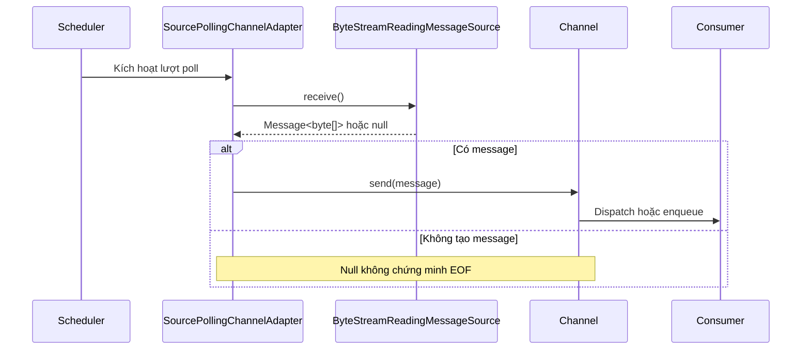

# Backpressure khi đọc stream dài

## 1. Vấn đề: nguồn có thể nhanh hơn nơi xử lý

Trong module **SPRING_INTEGRATION_ADAPTERS**, Spring Integration kết nối các hệ thống ngoài bằng **inbound/outbound adapter, gateway, poller và `MessageChannel`**. Khi thực hành luồng qua file, SFTP, HTTP, JMS, AMQP, Kafka và cơ sở dữ liệu, cần kiểm soát không chỉ hợp đồng message mà cả tốc độ nhận/gửi, lỗi và vòng đời kết nối.

Chương **Adapter Stream** có trường hợp điển hình: một `InputStream` hoặc `Reader` cung cấp dữ liệu rất lớn, hoặc liên tục trong nhiều giờ, trong khi phía sau phải giải mã, kiểm tra nghiệp vụ và lưu vào database với tốc độ chậm hơn. Nếu cứ đọc càng nhanh càng tốt rồi đưa mọi message vào hàng đợi trong RAM, ứng dụng có thể:

- Tăng bộ nhớ không giới hạn, gây GC pressure và `OutOfMemoryError`.
- Tích tụ độ trễ: message vừa được nhận nhưng phải đợi rất lâu mới được xử lý.
- Giữ nhiều event **chưa commit**, dễ mất dữ liệu khi JVM chết.
- Làm một scheduler thread bị block trong `InputStream.read()` hoặc lúc gửi vào queue.
- Cố gắng retry khi byte nguồn đã bị đọc mất, tạo lỗi trùng/lệch bản ghi.
- Dừng ứng dụng khó khăn vì queue còn đầy, stream vẫn mở hoặc writer vẫn ghi.

**Backpressure** là cơ chế để nơi xử lý chậm gây ảnh hưởng ngược lên nơi phát nhanh, nhằm **giới hạn tài nguyên và tốc độ nhận dữ liệu** theo năng lực thật. Trong Java stream và Spring Integration, nó có thể xảy ra nhờ **dispatch đồng bộ**, **hàng đợi hữu hạn làm bên gửi phải chờ**, **giới hạn poller**, hoặc **giao thức phía nguồn hỗ trợ tạm dừng**. Những cơ chế này không hoàn toàn giống Reactive Streams `request(n)`.

```text
  Huge file / endless pipe / SDK InputStream
                    |
                    v
      ByteStreamReadingMessageSource
                    |
                  poller
                    |
                    v
          Spring Message<byte[]>
                    |
            [Backpressure point]
               /          \\
        DirectChannel   Bounded QueueChannel
             |               |
    Sync downstream       Polling consumer
             |               |
             +-------+-------+
                     |
               Frame decoder
                     |
             Slow DB / HTTP / SDK
```

### Mục tiêu học tập

Sau bài học, bạn có thể:

1. Giải thích **tốc độ nguồn**, **tốc độ consumer**, **queue depth**, **in-flight**, latency và memory budget.
2. Phân biệt **stream vô hạn**, **file lớn hữu hạn**, byte chunk, bản ghi nghiệp vụ và offset đã commit.
3. Dùng `ByteStreamReadingMessageSource` / `CharacterStreamReadingMessageSource` đúng vai trò `MessageSource` của inbound adapter.
4. Áp dụng backpressure đồng bộ với `DirectChannel` và vùng đệm hữu hạn với `QueueChannel`.
5. Cấu hình poller `fixedDelay`, `maxMessagesPerPoll` và một consumer poller riêng cho `PollableChannel`.
6. Hiểu chính xác `MessageChannel.send(message, timeout)` khi queue đầy và xử lý kết quả thất bại.
7. Đánh giá `ExecutorChannel`, `ThreadPoolTaskExecutor`, `RendezvousChannel`, `Reactive Streams` và những giới hạn tương ứng.
8. Thiết kế framing/buffer giới hạn khi đọc UTF-8/JSON/binary theo từng chunk.
9. Thử nghiệm consumer chậm, queue đầy, shutdown và lỗi sau khi dữ liệu nguồn đã bị tiêu thụ.
10. Chọn giải pháp lưu bền/ACK/offset thích hợp khi không được phép mất hoặc xử lý trùng dữ liệu.

## 2. Mô hình tải: vì sao queue có thể phình ra?

Gọi:

- `λ` (lambda): tốc độ producer tạo message, đơn vị **message/giây**.
- `μ` (mu): tốc độ consumer xử lý xong, đơn vị **message/giây**.
- `Q`: số message đang chờ trong queue.
- `S`: kích thước payload trung bình, đơn vị **byte/message**.
- `W`: số message đang in-flight ngoài queue.

Trong một khoảng ngắn `Δt`:

\[
\Delta Q \approx (\lambda-\mu)\,\Delta t
\]

Nếu `λ > μ` kéo dài và không có backpressure, `Q` có xu hướng tăng liên tục. Ước lượng tối thiểu bộ nhớ dành cho **payload của queue**:

\[
M_{\mathrm{payload}} \approx Q \times S
\]

Thực tế còn cần bộ nhớ cho Spring `Message`, headers, mảng, dữ liệu decoder chưa đủ frame, objects sau parse, thread stacks, executor queues và GC overhead. Vì vậy một queue có sức chứa 64 message × 16 KiB payload đã chiếm **ít nhất khoảng 1 MiB payload**, chưa kể những phần khác. Con số này minh họa nguyên lý sizing, không phải benchmark.

### Khi queue đầy, có bốn nhóm hành động

| Chính sách | Hệ quả | Khi phù hợp |
| --- | --- | --- |
| **Block producer** | Nguồn giảm tốc khi lời gọi gửi bị chặn | Nguồn có thể chờ và deadline rõ |
| **Reject / fail-fast** | Gửi trả false hoặc ném lỗi theo component | Có retry/replay/quarantine rõ |
| **Drop** | Mất một số message đã quy định | Telemetry best-effort, không dùng cho dữ liệu quan trọng |
| **Persist/broker handoff** | Đưa dữ liệu vào store có thể phục hồi | Event nghiệp vụ cần durability, nhưng store cũng cần capacity |

**Không có hành động nào miễn phí.** Block có thể chiếm thread và gây timeout phía nguồn; drop làm mất event; persist mang chi phí I/O và vận hành. Đặc biệt, **chặn đọc không tự hoàn tác bytes đã bị lấy khỏi `InputStream`**.

### Backpressure và batching khác nhau

`maxMessagesPerPoll(10)` giới hạn số message được lấy **trong một lần kích hoạt poller**, không giới hạn tổng số message trọn đời ứng dụng. `bytesPerMessage=4096` quyết định lượng bytes source cố đọc cho **một Spring message**, không phải tốc độ end-to-end hoặc số record nghiệp vụ. `QueueChannel(32)` là **capacity theo message**, không phải 32 MB.

## 3. Nhận diện nguồn stream trước khi thiết kế

“Stream dài” không chỉ một loại nguồn:

| Loại nguồn | Ví dụ | Khi bị chặn đọc sẽ thế nào? | Có replay không? |
| --- | --- | --- | --- |
| File lớn hữu hạn | `Files.newInputStream(...)` | OS có thể dừng tiến trình đọc; file vẫn tồn tại | Có thể mở/seek lại nếu file bất biến và có checkpoint |
| `ByteArrayInputStream` | Fixture trong RAM | Data tồn tại sẵn, đọc tiếp khi có lượt poll | Có thể tái tạo từ fixture |
| Pipe bên trong JVM | `PipedInputStream` | Buffer pipe có thể đầy, bên ghi bị block | Không mặc định |
| OS stdin/pipe | `System.in` | Có thể tạo áp lực lên process đang ghi pipe | Tùy bên gửi và độ bền đầu nguồn |
| Socket `InputStream` | TCP connection | TCP window/buffer có thể hạn chế upstream, nhưng timeout/disconnect phụ thuộc giao thức | Không mặc định |
| Object store/SDK stream | HTTP response body, SDK upload/download | SDK có thể buffer hoặc timeout riêng | Thường cần mở request/range lại |
| `Reader` text | `InputStreamReader`/`BufferedReader` | Có thể block trong readLine | Tùy nguồn bytes bên dưới |
| Broker JMS/AMQP/Kafka | Consumer records | Có API ACK/pause/offset riêng | Không nên giả lập bằng raw InputStream |

Từ việc **không đọc thêm** không thể suy ra bên gửi đã dừng phát vào hạ tầng. TCP có buffer/kernel flow control, nhưng application-level acknowledgement vẫn phải do giao thức định nghĩa. Với HTTP tải stream một chiều, đọc quá chậm có thể gặp read timeout từ server/proxy. Với file, không có producer đang chờ, nên “backpressure” chủ yếu điều tiết tốc độ **tiêu thụ tài nguyên nội bộ**.

### Nhầm lẫn thường gặp về `InputStream.available()`

`available()==0` chỉ là ước lượng không có byte đọc ngay mà không block; **không chứng minh EOF**. `InputStream.read(byte[])` cũng có thể trả ít hơn số bytes yêu cầu. Không dùng `available()` như một feedback signal toàn hệ thống để quyết định dừng poller hoặc đánh dấu công việc hoàn tất.

## 4. ByteStreamReadingMessageSource, poller và giới hạn từng lần đọc

Với **Spring Integration 6.5.x**:

```java
import java.io.InputStream;
import org.springframework.integration.stream.ByteStreamReadingMessageSource;

InputStream input = /* luong do ung dung cap */;

ByteStreamReadingMessageSource source =
        new ByteStreamReadingMessageSource(input);
source.setBytesPerMessage(4096);
source.setShouldTruncate(true);
```

`ByteStreamReadingMessageSource` tạo `Message<byte[]>`. Theo tài liệu, `bytesPerMessage` **mặc định 1024**. Đặt `4096` chỉ là lựa chọn của ví dụ; không phải con số “tốt nhất” cho mọi transport. `shouldTruncate(true)` giúp payload phản ánh **số byte thực đọc** khi ngắn hơn buffer mong muốn.

### Source là pollable, không tự push vô hạn



Một poller chủ động `receive()`, chuyển message đến channel rồi lặp theo trigger. Đặt `maxMessagesPerPoll(1)` để một lần trigger xử lý tối đa một source message. Tuy nhiên nếu gửi vào `QueueChannel` bị block vì queue đầy, **lượt poll đang chạy vẫn có thể bị giữ lại**, dù lần poll tiếp theo chưa bắt đầu.

### Bảng các knob quan trọng

| Knob | Thay đổi điều gì? | Không giải quyết |
| --- | --- | --- |
| `bytesPerMessage` | Kích thước byte chunk source cố đọc | Framing, max business record |
| `shouldTruncate(true)` | Tránh payload có bytes đệm ngoài số thực đọc | Replay/ACK |
| `fixedDelay` | Thời gian nghỉ sau lần kích hoạt trước | Timeout của blocking `InputStream.read()` |
| `maxMessagesPerPoll` | Giới hạn số `receive()` trong mỗi lượt poll | Số message tồn trong queue |
| `QueueChannel(capacity)` | Giới hạn số message đang chờ | Giới hạn tuyệt đối của toàn bộ heap |
| `receiveTimeout` của polling consumer | Thời gian đợi lấy message từ channel | Read timeout của nguồn bên ngoài |
| `send(message, timeout)` | Thời gian chờ để channel chấp nhận message khi hỗ trợ | Timeout cho I/O business của consumer |

**Nguồn byte cần poller; outbound handler nhận từ `DirectChannel` không cần poller**. Một `QueueChannel` nằm giữa hai endpoint tạo thêm **một polling consumer**, có poller riêng với cách tính throughput/timeout riêng.

## 5. Phương án A: DirectChannel làm backpressure đồng bộ

Luồng đơn giản nhất không có hàng đợi giữa source và business handler:

```text
InputStream -> ByteStreamReadingMessageSource -> inbound poller
                 -> DirectChannel -> slow business handler
                           |
                   thread poller chờ
                           |
                   mới có lần poll tiếp theo
```

`DirectChannel` dispatch message đồng bộ trên thread gọi `send()` trong trường hợp điển hình. Nếu handler làm việc 250 ms trước khi trả về, poller chịu tác động trực tiếp của độ trễ này. Đây là **backpressure tự nhiên do call stack**, không cần buffer lớn.

### 5.1. Java DSL ví dụ

```java
import java.time.Duration;
import java.io.InputStream;

import org.springframework.context.annotation.Bean;
import org.springframework.integration.dsl.IntegrationFlow;
import org.springframework.integration.dsl.Pollers;
import org.springframework.integration.stream.ByteStreamReadingMessageSource;

@Bean
IntegrationFlow directByteStreamFlow(InputStream input) {
    ByteStreamReadingMessageSource source =
            new ByteStreamReadingMessageSource(input);
    source.setBytesPerMessage(4096);
    source.setShouldTruncate(true);

    return IntegrationFlow
            .from(source, endpoint -> endpoint
                    .id("directStreamInbound")
                    .poller(Pollers.fixedDelay(
                                    Duration.ofMillis(100))
                            .maxMessagesPerPoll(1)))
            .channel("directByteChunks")
            .get();
}
```

Đây là **mảnh cấu hình**: `input` phải là bean được quản lý; `directByteChunks` phải là `DirectChannel` có consumer. Không khai báo cùng lúc ví dụ này và ví dụ queue ở dưới để hai source đọc **cùng `InputStream`**.

### 5.2. Ưu và nhược điểm

| Ưu điểm | Giới hạn |
| --- | --- |
| Giữ memory backlog thấp giữa các endpoint | Consumer chậm chiếm thread poller |
| Thứ tự xử lý tuần tự dễ hiểu hơn | Throughput giới hạn bởi handler chậm |
| Exception có thể đi ngược call stack | Không tự replay bytes nguồn sau lỗi |
| Dễ debug latency tại một thread | Nhiều nguồn cùng scheduler có thể tranh thread |

**DirectChannel không phải transaction**. Nếu consumer ghi DB thất bại sau khi source đã đọc bytes, dữ liệu không tự được “unread” khỏi InputStream. Với dữ liệu quan trọng, lưu bền đầu vào hoặc dùng nguồn hỗ trợ replay/checkpoint.

## 6. Phương án B: QueueChannel có capacity hữu hạn

Khi muốn tách nhịp đọc khỏi nhịp xử lý, dùng `QueueChannel(capacity)`. Theo tài liệu 6.5:

- `QueueChannel` là point-to-point, **không phải broadcast** cho mọi consumer.
- Constructor không tham số về cơ bản tạo queue không bị giới hạn thực tế (`Integer.MAX_VALUE`); tránh dùng mặc định nếu tải lớn.
- `new QueueChannel(32)` giới hạn **32 Spring messages chờ trong queue**.
- Khi đầy, `send(message)` có thể **block** cho đến lúc có chỗ; `send(message, timeout)` cho phép giới hạn chờ.
- Khi consumer gọi `receive()` và lấy một message ra, một slot queue được giải phóng.

```text
                   fast ingress
InputStream -> Source -> poller -> QueueChannel(32)
                                  [msg1..msg32]
                                        |
                           queue full -> sender blocks
                                        |
                           separate consumer poller
                                        |
                                        v
                                 Slow business
```

### 6.1. Buffer hữu hạn không phải độ bền

Queue mặc định giữ messages **trong RAM**. Dù capacity hữu hạn, những message đang nằm trong queue vẫn có thể mất khi JVM chết. Nếu cần durable queue, Spring Integration có lựa chọn `MessageGroupStore`/`ChannelMessageStore` được cấu hình; hoặc dùng JMS/AMQP/Kafka có hợp đồng broker riêng.

**Không bỏ qua một failure của `send()` chỉ vì InputStream có thể đọc tiếp.** Source đã tiêu thụ bytes, nên phải dừng intake hoặc lưu durable state; nếu không sẽ tạo mất dữ liệu im lặng.

### 6.2. Khi capacity đầy

| API | Khi có chỗ | Khi đã đầy |
| --- | --- | --- |
| `queue.send(message)` | Chấp nhận, trả `true` | Có thể chờ vô thời hạn (cho tới có chỗ/interrupt) |
| `queue.send(message, 0)` | Chấp nhận ngay | Trả `false` ngay |
| `queue.send(message, 500)` | Chấp nhận nếu có chỗ trong khoảng chờ | Trả `false` sau khoảng chờ nếu vẫn đầy |
| `queue.receive(0)` | Lấy message có sẵn | Trả `null` ngay |

`500` ở đây là **mili giây** trong API `MessageChannel.send(Message, long)`. Không nhầm timeout này với 500 ms timeout xử lý database. Với `DirectChannel`, tham số timeout không biến một lời gọi handler đồng bộ đang chạy thành cancellable operation.

### 6.3. Queue depth và remaining capacity

`QueueChannel` cung cấp các operations như:

```java
int pendingMessages = boundedChunks.getQueueSize();
int remainingSlots = boundedChunks.getRemainingCapacity();
```

`boundedChunks` là một instance `QueueChannel`; các giá trị này là **snapshot tức thời**, có thể thay đổi ngay sau khi đọc do concurrency. Chúng phù hợp cho metrics/alert; không dùng cách đọc `getQueueSize()` rồi tự quyết định `send()` sẽ chắc chắn không block (đó là lỗi check-then-act).

## 7. Spring Boot hoàn chỉnh: đọc file dài qua bounded QueueChannel

Ví dụ thực hành dùng **Java 17+**, Spring Boot và Spring Integration **6.5.x**. Ứng dụng đọc một file binary có sẵn bằng `InputStream`, tạo các `Message<byte[]>` qua poller, đưa vào `QueueChannel(16)` và xử lý trên **polling consumer** chậm.

Sơ đồ có hai lịch poll độc lập:

```text
  InputStream (owned by Spring context)
                |
       ByteStreamReadingMessageSource
                |
        Inbound poller #1
     maxMessagesPerPoll=1
                |
                v
          boundedChunks
         QueueChannel(16)
                |
        Consumer poller #2
     maxMessagesPerPoll=1
                |
                v
     slowChunkConsumer handler
                |
         downstream operation
```

### 7.1. Dependencies

```xml
<dependencies>
    <dependency>
        <groupId>org.springframework.boot</groupId>
        <artifactId>spring-boot-starter-integration</artifactId>
    </dependency>
    <dependency>
        <groupId>org.springframework.integration</groupId>
        <artifactId>spring-integration-stream</artifactId>
    </dependency>
</dependencies>
```

Sử dụng **Spring Boot BOM** để quản lý version đồng bộ hoặc chỉ định version tương thích khi dự án không dùng BOM. Với Spring Integration 6.5, `ByteStreamReadingMessageSource` nằm ở `org.springframework.integration.stream`; trong phiên bản 7.x, import có thể ở package `.stream.inbound`. Không ghép import/implementation của hai dòng framework trong một ứng dụng.

### 7.2. application.yml

```yaml
app:
  stream:
    input-path: ${STREAM_INPUT_PATH:./data/large-input.bin}
    chunk-size: ${STREAM_CHUNK_SIZE:4096}
    queue-capacity: ${STREAM_QUEUE_CAPACITY:16}
```

Ứng dụng ví dụ cần một file đầu vào thật và một đường dẫn do **operator đáng tin cậy** cấu hình. Không cho HTTP request tự chỉ định đường dẫn file bất kỳ trên server. Không áp dụng ví dụ trực tiếp cho socket đang mở vô hạn mà chưa kiểm tra timeout và EOF.

### 7.3. Cấu hình Java đầy đủ

```java
import java.io.IOException;
import java.io.InputStream;
import java.nio.file.Files;
import java.nio.file.Path;
import java.time.Duration;
import java.util.concurrent.atomic.AtomicLong;

import org.springframework.beans.factory.annotation.Qualifier;
import org.springframework.beans.factory.annotation.Value;
import org.springframework.boot.SpringApplication;
import org.springframework.boot.autoconfigure.SpringBootApplication;
import org.springframework.context.annotation.Bean;
import org.springframework.integration.annotation.Poller;
import org.springframework.integration.annotation.ServiceActivator;
import org.springframework.integration.channel.QueueChannel;
import org.springframework.integration.config.EnableIntegration;
import org.springframework.integration.dsl.IntegrationFlow;
import org.springframework.integration.dsl.Pollers;
import org.springframework.integration.stream.ByteStreamReadingMessageSource;
import org.springframework.messaging.Message;
import org.springframework.messaging.PollableChannel;

@SpringBootApplication
@EnableIntegration
public class StreamBackpressureApplication {

    private final AtomicLong processedBytes = new AtomicLong();

    public static void main(String[] args) {
        SpringApplication.run(
                StreamBackpressureApplication.class, args);
    }

    @Bean(name = "ownedInput", destroyMethod = "close")
    public InputStream ownedInput(
            @Value("${app.stream.input-path}") String filename)
            throws IOException {

        Path path = Path.of(filename).toAbsolutePath().normalize();
        return Files.newInputStream(path);
    }

    @Bean
    public PollableChannel boundedChunks(
            @Value("${app.stream.queue-capacity:16}") int capacity) {

        if (capacity < 1 || capacity > 1024) {
            throw new IllegalArgumentException(
                    "Queue capacity is outside allowed range");
        }
        return new QueueChannel(capacity);
    }

    @Bean
    public IntegrationFlow streamInboundFlow(
            @Qualifier("ownedInput") InputStream input,
            @Value("${app.stream.chunk-size:4096}") int chunkSize) {

        if (chunkSize < 1 || chunkSize > 1024 * 1024) {
            throw new IllegalArgumentException(
                    "Invalid chunkSize");
        }

        ByteStreamReadingMessageSource source =
                new ByteStreamReadingMessageSource(input);
        source.setBytesPerMessage(chunkSize);
        source.setShouldTruncate(true);

        return IntegrationFlow
                .from(source, endpoint -> endpoint
                        .id("streamInputAdapter")
                        .poller(Pollers
                                .fixedDelay(Duration.ofMillis(50))
                                .maxMessagesPerPoll(1)))
                .channel("boundedChunks")
                .get();
    }

    @ServiceActivator(
            inputChannel = "boundedChunks",
            poller = @Poller(
                    fixedDelay = "100",
                    maxMessagesPerPoll = "1"))
    public void slowChunkConsumer(Message<byte[]> message) {

        byte[] chunk = message.getPayload();
        try {
            // Demo: gia lap xu ly DB/HTTP cham.
            // Production: thay bang handler/transaction that.
            Thread.sleep(250);
        }
        catch (InterruptedException ex) {
            Thread.currentThread().interrupt();
            throw new IllegalStateException(
                    "Consumer was interrupted", ex);
        }

        long total = processedBytes.addAndGet(chunk.length);
        // Chi log metadata, khong dump payload binary.
        if (total % (1024L * 1024L) < chunk.length) {
            System.err.println("Processed bytes=" + total);
        }
    }
}
```

Đây là ví dụ Spring Boot **một lớp cấu hình** với hai endpoint. Không cần file khác ngoài cấu hình build và file binary đầu vào; bài Knowledge này **không chạy build hoặc test ứng dụng**.

### 7.4. Diễn giải từng bước

1. Spring tạo **một `InputStream`** từ file. `destroyMethod="close"` đóng nó khi context hủy bean.
2. Inbound `ByteStreamReadingMessageSource` đọc từng chunk, tối đa theo `chunkSize`.
3. Inbound poller chạy theo lịch, `maxMessagesPerPoll(1)` giới hạn mỗi lượt poll tối đa một message.
4. `QueueChannel(capacity)` nhận chunk vào RAM; **khi đầy, poller phía đọc bị chặn tại bước gửi** theo semantics của channel.
5. Consumer có `@ServiceActivator(... poller=@Poller(...))` nhận tối đa một chunk mỗi lượt polling.
6. `Thread.sleep(250)` chỉ **giả lập** tác vụ downstream chậm; tuyệt đối không dùng ngủ cố định như một cách thiết kế business processing.
7. Nếu consumer xử lý chậm hơn nguồn đọc, `boundedChunks` sẽ đầy và gây áp lực ngược lên inbound poller, hạn chế thêm các chunk được đọc.

**Giới hạn:** việc gửi vào queue thành công chỉ có nghĩa **đã enqueue**, không có nghĩa consumer đã xử lý xong. Nếu chương trình crash, các messages đang chờ trong `QueueChannel` RAM có thể mất. Nếu consumer ném exception sau khi lấy message khỏi queue, việc redelivery **không tự được đảm bảo**.

### 7.5. Hai tham số không được nhầm

| Parameter | Ở đâu? | Ý nghĩa |
| --- | --- | --- |
| `fixedDelay(50 ms)` | Poller inbound | Khi nào đọc stream lần sau |
| `maxMessagesPerPoll(1)` | Poller inbound | Tối đa một chunk nhận mỗi lần kích hoạt |
| `new QueueChannel(16)` | Channel | Tối đa 16 messages đang chờ |
| `fixedDelay=100 ms` | Poller consumer | Khi nào lấy message tiếp theo |
| `maxMessagesPerPoll=1` | Poller consumer | Tối đa một message tiêu thụ mỗi lượt |
| `Thread.sleep(250)` | Demo handler | Giả lập downstream chậm |

Vì handler chậm 250 ms, queue có thể tăng tới capacity và bắt đầu chặn inbound poller. Con số này nhằm **biểu diễn tác động**, không phải throughput được đo thực tế. Scheduler, I/O, số thread và cấu hình khác có thể thay đổi timing.

### 7.6. EOF file không tự stop ứng dụng

`ByteStreamReadingMessageSource` có thể trả `null` khi không còn message; với file hữu hạn, poller có thể tiếp tục hoạt động nếu ứng dụng không có completion coordinator. **Không tự suy ra byte source phát `StreamClosedEvent` giống `CharacterStreamReadingMessageSource` bật detect EOF**. Nếu cần batch chạy một lần rồi kết thúc, phải có chính sách hoàn tất nguồn và **drain queue trước khi close input/output**.

### 7.7. Vì sao chọn QueueChannel thay vì hai DirectChannel?

Nếu `rawInputChannel` và `processedChannel` đều là `DirectChannel`, một handler chậm sẽ giữ thread inbound cho đến khi trả. Queue tạo **đệm hữu hạn** để nguồn có thể đọc trước một lượng nhỏ. Đây là trade-off giữa throughput và memory, không phải tối ưu mặc định cho mọi flow. Khi yêu cầu đơn giản và không cần tách thread, DirectChannel có thể dễ chứng minh correctness hơn.

## 8. XML thay thế: queue hữu hạn và hai poller

Cùng ý tưởng có thể khai báo trong XML Spring Integration 6.5. Đoạn này giả định ứng dụng đã cung cấp bean `ownedInput` và bean `slowChunkService` có method `consume(byte[])`.

```xml
<beans:beans
    xmlns:beans="http://www.springframework.org/schema/beans"
    xmlns:xsi="http://www.w3.org/2001/XMLSchema-instance"
    xmlns:int="http://www.springframework.org/schema/integration"
    xsi:schemaLocation="
        http://www.springframework.org/schema/beans
        https://www.springframework.org/schema/beans/spring-beans.xsd
        http://www.springframework.org/schema/integration
        https://www.springframework.org/schema/integration/spring-integration.xsd">

    <beans:bean id="byteStreamSource"
                class="org.springframework.integration.stream.ByteStreamReadingMessageSource">
        <beans:constructor-arg ref="ownedInput"/>
        <beans:property name="bytesPerMessage" value="4096"/>
        <beans:property name="shouldTruncate" value="true"/>
    </beans:bean>

    <int:channel id="boundedChunksXml">
        <int:queue capacity="16"/>
    </int:channel>

    <int:inbound-channel-adapter
            id="streamInputAdapterXml"
            channel="boundedChunksXml"
            ref="byteStreamSource">
        <int:poller fixed-delay="50"
                    max-messages-per-poll="1"/>
    </int:inbound-channel-adapter>

    <int:service-activator
            id="slowChunkConsumerXml"
            input-channel="boundedChunksXml"
            ref="slowChunkService"
            method="consume">
        <int:poller fixed-delay="100"
                    max-messages-per-poll="1"/>
    </int:service-activator>
</beans:beans>
```

Đây là **cấu hình thay thế** Java ở mục 7, không bật song song để hai adapter tranh đọc cùng một `InputStream`. `<int:queue capacity="16"/>` hữu hạn; thiếu `capacity` sẽ tạo queue không có giới hạn nhỏ hữu ích cho vận hành. Consumer nối `PollableChannel` **phải có poller** hoặc sử dụng poller mặc định được cấu hình đúng.

### Khi chưa có consumer đang chạy

Queue hữu hạn có thể đầy rồi giữ thread inbound tại `send()`. Đó là một dạng backpressure, nhưng cũng có thể là **sự cố vận hành** nếu consumer chưa được start hoặc đã chết. Cần metric/alert về `queueDepth`, `consumerRunning`, `oldestMessageAge` và thời gian gửi bị block. Đừng coi queue đầy lâu là trạng thái ổn định chấp nhận được.

## 9. Tính đúng của dữ liệu: chunk không phải event

Khi đọc file/pipe dài, bạn phải phân biệt **số byte source trả** và **ranh giới một record nghiệp vụ**.

```text
Wire UTF-8 record 1:  31 2C C4 90 0A      ("1,Đ\\n")
Wire UTF-8 record 2:  32 2C 50 41 49 44 0A ("2,PAID\\n")

Chunk A: 31 2C C4
Chunk B: 90 0A 32
Chunk C: 2C 50 41 49 44 0A
```

Ở đây chữ `Đ` gồm **2 byte UTF-8** `C4 90` nhưng bị cắt qua hai chunks. Nếu worker convert `new String(chunk, UTF_8)` từng chunk, có thể tạo ký tự thay thế hoặc strict decoder sẽ ném lỗi, dù toàn bộ stream hợp lệ.

### Thiết kế pipeline đúng

```text
Message<byte[]> chunks
        |
        v
Bounded reassembler (up to maxFrameBytes)
        |
   Complete byte record
        |
        v
Strict CharsetDecoder UTF-8
        |
        v
Parse schema / business validation
        |
        v
Durable inbox / sink
```

**Backpressure không chỉ áp dụng cho queue.** Một reassembler có thể giữ dữ liệu chờ LF/length-prefix. Nếu nguồn gửi một record dài hàng GB không có delimiter, `ByteArrayOutputStream` hoặc `StringBuilder` không giới hạn vẫn làm OOM **dù QueueChannel chỉ có một message**.

### Quy tắc tài nguyên cho decoder

- Giới hạn `bytesPerMessage` ở source nhưng cũng cần **`maxRecordBytes` cho reassembler**.
- Với length-prefix, reject độ dài âm/0/giá trị vượt policy **trước khi cấp phát mảng lớn**.
- Với text, dùng `CharsetDecoder` có trạng thái hoặc ghép đủ record rồi mới decode.
- Không decode từng byte chunk rồi coi đó là JSON/CSV record.
- Giới hạn thời gian một frame chưa hoàn tất được phép tồn tại.
- Duy trì một decoder/reassembler **cho từng stream logic**, không trộn dữ liệu socket/tenant khác nhau.
- Không làm queue vô hạn chỉ để né lỗi thiếu frame.

## 10. Một bài toán sizing có thể kiểm tra

Giả sử hệ thống dự kiến:

| Tham số | Giá trị ví dụ |
| --- | --- |
| `bytesPerMessage` | 16 KiB |
| Queue capacity | 64 messages |
| Số consumer | 1 |
| Mỗi consumer xử lý | 25 messages/giây |
| Nguồn đọc nhanh nhất | 80 messages/giây |
| Memory thêm cho payload trong queue khi đầy | Ít nhất khoảng 1 MiB |

Nếu không có giới hạn, backlog tăng theo chênh lệch ~55 messages/giây. Khi có `QueueChannel(64)` và gửi kiểu blocking, nguồn sẽ **bị chặn trước khi queue vượt quá 64 messages** (không tính các message đang được xử lý và bytes đã read vào source/OS buffers).

Đây chỉ là **bài tập dung lượng**, không phải benchmark: tốc độ đọc thật bị ảnh hưởng bởi cách stream block, scheduler và disk/network; kích thước `Message`/headers/GC làm bộ nhớ thực cao hơn phép tính payload.

### Đừng đếm chỉ số “bytes đã đọc” như “đơn hàng đã hoàn thành”

Một chunk có thể chứa:

- Nửa một JSON event.
- Hai NDJSON lines và phần đầu dòng thứ ba.
- Một phần của file nén.
- Bytes của một event đã enqueue nhưng consumer chưa commit.

Hãy đo riêng `bytesRead`, `chunksEmitted`, `framesCompleted`, `eventsValidated` và `eventsCommitted` để hiểu backlog thực và tính đúng dữ liệu.

## 11. Giới hạn của backpressure: byte đã đọc không thể “unread”

Trong luồng đọc stream thông thường, thứ tự là:

```text
InputStream.read()
      |
      v
ByteStreamReadingMessageSource nhận bytes
      |
      v
Tạo Message<byte[]>
      |
      v
MessageChannel.send(...)
      |
      +-- Queue còn chỗ -> enqueue OK
      |
      +-- Queue đầy -> block / timeout / fail
```

Tại thời điểm queue từ chối hoặc timeout, byte có thể **đã được đọc khỏi `InputStream`**. Nguồn file/socket/pipe không mặc định hỗ trợ “put bytes back”. Đây là lý do **bounded queue chỉ là một phần của bài toán reliability**.

### 11.1. Nếu send timeout sau khi source đã đọc thì sao?

| Cách phản ứng | Vấn đề |
| --- | --- |
| Bỏ qua message để đọc tiếp | Mất chunk, hỏng framing của tất cả record tiếp theo |
| Retry vô hạn trên poller thread | Có thể block/shutdown khó và tạo bão retry |
| Đọc lại ngay từ InputStream | Nhận bytes tiếp theo, **không phải chunk vừa thất bại** |
| Cố mở lại file từ đầu | Tạo event trùng nếu không có checkpoint |
| Lưu message vào staging bền trước khi tiếp tục | Cần transaction/idempotency, nhưng có đường khôi phục |
| Pause/stop inbound có kiểm soát | Giới hạn thêm bytes mới; vẫn cần xử lý chunk đã đọc |

Không áp dụng `drop` cho dữ liệu cần đủ bytes như JSON stream, file nén, truyền tài chính hoặc log audit, vì mất một chunk có thể khiến decoder **không thể đồng bộ lại**.

### 11.2. Kiểu delivery cần nói rõ

| Mục tiêu | Phải có gì ngoài QueueChannel? |
| --- | --- |
| Best-effort telemetry | Chính sách drop, metrics, bảo vệ tài nguyên |
| At-least-once event delivery | Nguồn replay/durable staging, retry, stable event ID |
| Dữ liệu đúng thứ tự theo nguồn | Single-reader/sequence, ordered processing hoặc partitioned ordering |
| Không tạo side effect trùng | Idempotent consumer/durable inbox |
| Không mất bytes sau crash | Storage bền + checkpoint, không chỉ in-memory queue |
| End-to-end ACK | Phản hồi nghiệp vụ riêng từ hệ thống đích |

Nếu nguồn là file nguyên bản chưa bị xóa, có thể xây một job có **checkpoint theo record/offset đã commit**. Nhưng buffering có thể đọc trước khỏi OS, và một chunk có thể chứa nhiều record; việc checkpoint đúng cần tách vị trí **đã đọc** khỏi vị trí **đã commit**.

### 11.3. Không tự tuyên bố exactly-once

`QueueChannel(16)` chỉ giới hạn số message chờ; nó không tự tạo transaction giữa InputStream, database và output broker. Với stream không seek, một lần crash có thể phá chuỗi byte chưa được lưu lại. Muốn exactly-once *business effect* cần idempotency/transaction có scope và giao thức rõ, không thể suy ra từ `send()==true`.

## 12. Poller là bộ điều tốc, không phải read timeout

### 12.1. `fixedDelay`

Với `Pollers.fixedDelay(Duration.ofMillis(200))`, scheduler đợi một khoảng tương ứng theo trigger **sau lượt kích hoạt trước**. Nó giảm số lần `receive()` trong điều kiện thuận lợi, nhưng:

- Nếu `receive()` block chờ network, trigger không hủy `read()`.
- Nếu channel send bị block, lượt poll cũng bị kéo dài.
- Nó không biết backlog business trong queue trừ khi ứng dụng đưa feedback vào.
- Nó không đảm bảo mỗi lượt poll luôn đọc đúng `bytesPerMessage`.

### 12.2. `maxMessagesPerPoll`

Với `SourcePollingChannelAdapter`, **mặc định `maxMessagesPerPoll=1`** nếu không cấu hình. Đặt `-1` (không giới hạn) có thể làm một lượt poll đọc liên tiếp tới khi source trả `null` và chiếm scheduler lâu; điều này nguy hiểm với nguồn luôn có dữ liệu hoặc source không phản hồi interrupt.

Theo Spring Integration từ 5.5, giá trị **`0`** có thể mang nghĩa **tạm bỏ qua việc gọi `receive()`** khi chỉnh trên adapter/poller metadata đúng cách. Đây là cơ chế **pause inbound polling**, không phải cơ chế lưu bền bytes và không giúp hủy một `InputStream.read()` đang block.

### 12.3. Thay đổi tốc độ poller có phải backpressure hoàn chỉnh?

Không. Nếu nguồn đẩy nhanh vào OS/socket buffer, việc giảm polling chỉ dời áp lực sang một buffer khác. Nó có thể:

1. Giúp application heap không tăng.
2. Khi pipe/socket buffer đầy, truyền áp lực ngược qua transport (nếu transport hỗ trợ).
3. Gây timeout/disconnect nếu bên phát không chấp nhận chờ.

Vì vậy cần **hợp đồng transport**: timeout, reconnect, read resume, cách phát lại dữ liệu, xác nhận offset/record và size limits. Với Kafka, JMS/AMQP hay HTTP protocol, dùng adapter chuyên dụng để có các cơ chế dừng/ACK/offset phù hợp.

### 12.4. Tần suất poll không đo được throughput thực

Tăng `maxMessagesPerPoll` hoặc giảm `fixedDelay` không đảm bảo throughput tăng tương ứng. Consumer chậm, queue đầy, disk I/O, serialization, transaction và memory pressure có thể là nút thắt thật. Đo **bytes/sec, messages/sec và commits/sec** riêng thay vì chỉ đo số lần poll.

## 13. QueueChannel, ExecutorChannel và RendezvousChannel

### 13.1. DirectChannel

`DirectChannel` phù hợp khi muốn **feedback đồng bộ** từ handler về producer. Nó không tạo backlog queue mặc định giữa hai endpoint, nhưng producer có thể bị block lâu khi handler chậm.

### 13.2. QueueChannel có capacity

`QueueChannel` hữu hạn hữu ích khi cần một vùng đệm nhỏ giữa hai tốc độ. Khi queue đầy, send chờ hoặc từ chối theo timeout; **producer phải có chính sách**. Channel là `PollableChannel` nên consumer cần poller hoặc logic `receive()` riêng.

### 13.3. ExecutorChannel không đồng nghĩa bounded queue

`ExecutorChannel` dispatch tới một `TaskExecutor` và có thể tách caller khỏi business handler. Nhưng nếu executor dùng queue không giới hạn, ứng dụng vẫn có thể OOM. Cần cấu hình:

- Giới hạn số worker threads.
- Giới hạn task queue.
- Rejection policy rõ ràng.
- Hành vi shutdown/drain cho executor.
- Ordering theo source/partition key, nếu cần.

**Ví dụ executor hữu hạn** (mảnh cấu hình, không phải flow hoàn chỉnh):

```java
import java.util.concurrent.ThreadPoolExecutor;
import org.springframework.context.annotation.Bean;
import org.springframework.scheduling.concurrent.ThreadPoolTaskExecutor;

@Bean
public ThreadPoolTaskExecutor streamWorkerExecutor() {
    ThreadPoolTaskExecutor executor =
            new ThreadPoolTaskExecutor();
    executor.setCorePoolSize(2);
    executor.setMaxPoolSize(4);
    executor.setQueueCapacity(16);
    executor.setThreadNamePrefix("stream-worker-");
    executor.setRejectedExecutionHandler(
            new ThreadPoolExecutor.CallerRunsPolicy());
    executor.setWaitForTasksToCompleteOnShutdown(true);
    executor.setAwaitTerminationSeconds(15);
    return executor;
}
```

Spring quản lý khởi tạo bean `ThreadPoolTaskExecutor` qua lifecycle. `CallerRunsPolicy` thường đẩy việc thực thi về thread gọi khi executor quá tải, qua đó tạo áp lực ngược, **nhưng không phải một bảo đảm tuyệt đối về fairness hoặc durability**; chính sách khi executor shutdown còn phải được test. Nếu áp dụng cho source poller, workload CPU/I/O có thể chạy ngay trên poller thread khi quá tải. Không dùng executor vô hạn như một cách “giảm backpressure”.

### 13.4. RendezvousChannel

`RendezvousChannel` có tính chất **zero-capacity handoff**: một sender cần có receiver đang chờ để giao message. Nó giảm vùng đệm trung gian, nhưng có thể gây blocking mạnh và không phù hợp khi lịch consumer không phối hợp. Nó cũng **không có broker ACK/commit**; receiver chấp nhận message chưa có nghĩa business transaction đã thành công.

### 13.5. So sánh

| Channel | Dispatch | Buffer | Feedback đến nguồn | Điều cần chú ý |
| --- | --- | --- | --- | --- |
| `DirectChannel` | Đồng bộ | Không có queue riêng | Handler chậm làm sender chậm | I/O có thể block scheduler |
| `QueueChannel(16)` | Producer enqueue, consumer poll | 16 messages | Đầy thì block/fail theo send timeout | Hai poller, in-memory không durable |
| `ExecutorChannel` + bounded executor | Bất đồng bộ | Executor queue tùy cấu hình | Rejection/CallerRuns khi quá tải | Ordering và lifecycle |
| `RendezvousChannel` | Handoff giữa thread | Zero-capacity | Sender chờ receiver | Dễ gây deadlock nếu wiring sai |
| Broker JMS/AMQP/Kafka | Theo giao thức broker | Broker-managed | ACK/offset/consumer pacing riêng | Cần config transaction/retry/partitions |

## 14. Reactive Streams `request(n)` là một mô hình khác

Trong **Reactive Streams**, subscriber có thể yêu cầu tối đa `n` elements trước mắt bằng demand protocol `request(n)`. Đây là **backpressure theo tín hiệu demand**, không đồng nghĩa với việc chỉ dùng:

```java
new QueueChannel(16);
```

`QueueChannel` tạo **blocking/backed-up sender** theo capacity; nó không tự phát tín hiệu `request(n)` đến một `InputStream`/SDK bất kỳ. Tương tự, tạo `Flux` từ một nguồn `InputStream` bằng cách đọc hết rồi phát cũng **không** đem lại hiệu quả memory nếu upstream đã materialize toàn bộ bytes.

### Khi nào dùng Reactor/WebFlux?

- Nguồn và đích đã hỗ trợ **non-blocking/Reactive Streams** rõ ràng.
- Có cách diễn đạt demand và cancellation xuyên suốt pipeline.
- Cần quản lý nhiều kết nối đồng thời mà không giữ một thread cho mỗi request blocking.
- Có thể xác minh backpressure trên **transport thật**, không chỉ trong các operator của Flux.

Nếu đầu nguồn vẫn là một `InputStream.read()` blocking, cần tách thread/scheduler phù hợp, giới hạn buffer và xử lý cancellation/close. Không chạy blocking `read()` trực tiếp trên event-loop thread và coi đó là reactive programming. Với bài toán một file đơn giản, Spring Integration poller + DirectChannel/QueueChannel hữu hạn thường dễ hiểu và dễ vận hành hơn.

## 15. Deadline, timeout và circuit breaker

Backpressure không nên biến thành **đợi vô hạn không có chỉ số**.

| Timeout / giới hạn | Áp dụng ở đâu? | Điều không làm được |
| --- | --- | --- |
| `send(message, timeout)` | Channel lúc enqueue/dispatch theo semantics | Không hủy một DB query đang chạy |
| Consumer poll `receiveTimeout` | Đợi message từ `PollableChannel` | Không hủy InputStream read |
| Socket read timeout | TCP `InputStream` | Không đặt timeout tổng quát cho output write |
| SDK/HTTP request timeout | External client | Không phục hồi byte đã đọc từ nguồn không replay |
| Circuit breaker | Handler gọi dịch vụ hay lỗi | Không phải dữ liệu queue bền vững |
| Graceful shutdown deadline | Coordinator | Không đảm bảo SIGKILL chạy cleanup |

### Khi downstream ngừng nhận

Quy trình thường dùng:

1. Đánh dấu degraded/not-ready.
2. Dừng hoặc giảm intake; không đọc vô hạn.
3. Cho phép xử lý trong giới hạn queue/timeout còn lại.
4. Nếu thất bại, lưu trạng thái `PENDING`/`UNCERTAIN` theo policy nếu có durable inbox.
5. Alert operator khi queue occupancy hoặc time spent blocked vượt ngưỡng.
6. Khôi phục nguồn/connection theo protocol, tránh retry nóng.

Không đồng nhất `send=false` với “đã bỏ qua an toàn”. Nếu một byte chunk bị từ chối, framing của các chunks sau có thể đã mất. Chọn **fail-fast rồi dừng stream** nếu không có khả năng replay.

## 16. Sizing memory: capacity × kích thước chỉ là mức tối thiểu

Giả sử cấu hình `chunkSize=4096`, `capacity=16`. Chỉ riêng payload queue khi đầy có thể giữ tối đa khoảng 64 KiB; trong ứng dụng còn:

- Một chunk đã được nguồn đọc nhưng đang chờ enqueue.
- Một hoặc nhiều message đang xử lý.
- Các mảng buffer của `InputStream` và stream source.
- Reassembler đang chờ đủ frame.
- Java `String`, JSON DOM hoặc DTO tạo ra sau decode.
- Executor tasks, headers/metadata, connection buffers.
- Vùng nhớ phía OS/network không phản ánh trong heap.

Nếu mỗi chunk 4 KiB nhưng parser tích lũy một JSON object 50 MiB chưa có delimiter, **queue capacity=16 vẫn không cứu được memory**. Đặt cả **`maxFrameBytes`**, `maxDecodedChars`, JSON depth/array limits và disk quota nếu staging.

### Budget gợi ý

```text
M_total_memory =
    M_queue_payload_and_headers
  + M_in_flight
  + M_reassembly
  + M_parser_objects
  + M_io_buffers
  + M_executor_tasks
  + M_runtime_headroom
```

Chọn budget theo **peak**, không theo average. Khi payload size có phân phối lệch (ví dụ 99% records nhỏ, 1% rất lớn), sizing chỉ dựa vào kích thước trung bình có thể gây OOM. Giới hạn theo bytes ở điểm ingest và theo số message trong queue là hai trục khác nhau.

## 17. JUnit 5: kiểm thử capacity và kết quả gửi

Không cần file hay server ngoài để chứng minh một `QueueChannel` hữu hạn từ chối message khi đầy.

### 17.1. Test đơn giản với capacity=1

```java
import static org.junit.jupiter.api.Assertions.*;

import org.junit.jupiter.api.Test;
import org.springframework.integration.channel.QueueChannel;
import org.springframework.messaging.Message;
import org.springframework.messaging.support.MessageBuilder;

class QueueBackpressureTest {

    @Test
    void refusesImmediateSendWhenFull() {
        QueueChannel queue = new QueueChannel(1);

        Message<byte[]> first = MessageBuilder
                .withPayload(new byte[] {1, 2})
                .build();
        Message<byte[]> second = MessageBuilder
                .withPayload(new byte[] {3, 4})
                .build();

        assertTrue(queue.send(first, 0));
        assertEquals(1, queue.getQueueSize());
        assertEquals(0, queue.getRemainingCapacity());

        assertFalse(queue.send(second, 0));
        assertEquals(1, queue.getQueueSize());

        Message<?> received = queue.receive(0);
        assertNotNull(received);
        assertArrayEquals(
                new byte[] {1, 2},
                (byte[]) received.getPayload());

        assertEquals(0, queue.getQueueSize());
        assertTrue(queue.send(second, 0));
        assertEquals(1, queue.getQueueSize());
    }
}
```

**Đây là test được đề xuất, chưa chạy trong STEP 4.** Test xác nhận **queue capacity và channel send semantics**; nó không chứng minh end-to-end database commit hoặc InputStream replay. Khi dùng queue thật trong `ApplicationContext`, kiểm tra consumer/poller đang chạy, retry và shutdown semantics nữa.

### 17.2. Test `send(message, timeout)`

Với queue capacity 1 đang đầy:

```java
import org.springframework.integration.channel.QueueChannel;
import org.springframework.messaging.Message;
import org.springframework.messaging.support.MessageBuilder;

QueueChannel queue = new QueueChannel(1);
Message<String> first = MessageBuilder.withPayload("first").build();
Message<String> second = MessageBuilder.withPayload("second").build();

boolean acceptedFirst = queue.send(first, 0);
boolean acceptedSecond = queue.send(second, 100);
```

Nếu không có consumer lấy message trong lúc chờ, `acceptedFirst` kỳ vọng `true` và `acceptedSecond` kỳ vọng `false` **sau khoảng timeout**. Kết quả không khẳng định chính xác 100 ms wall-clock vì scheduler có sai số; test nên đặt giới hạn trên tương đối hợp lý, không assert mili giây tuyệt đối.

Khi chuyển từ queue test sang inbound stream thật, **phải xử lý message không được chấp nhận**. Vì bytes đã được nguồn đọc, không thể đơn giản gọi `source.receive()` lại để lấy đúng chunk cũ.

### 17.3. Test producer bị block và consumer giải phóng slot

Tạo một queue capacity 1; gửi trước message đầu, rồi gọi `send(second, timeout)` trên một thread khác. Khi main thread gọi `receive(0)`, slot được mở, sender có thể hoàn tất. Dùng `CountDownLatch`/`Future.get(timeout)`/cleanup `ExecutorService.shutdownNow()` để test có deadline.

**Không dùng `Thread.sleep(500)` làm điều kiện đồng bộ duy nhất**. Scheduler có thể chạy chậm; test cần await một trạng thái có thể quan sát, timeout trên toàn test và cleanup khi assertion fail.

## 18. Integration test với source hữu hạn và consumer chậm

### 18.1. Dùng ByteArrayInputStream thay network

Với nguồn 128 KiB trong RAM:

```java
import java.io.ByteArrayInputStream;
import org.springframework.integration.stream.ByteStreamReadingMessageSource;

byte[] fixture = new byte[128 * 1024];
ByteStreamReadingMessageSource source =
        new ByteStreamReadingMessageSource(
                new ByteArrayInputStream(fixture));

source.setBytesPerMessage(4096);
source.setShouldTruncate(true);
```

Đây là **fixture source**, chưa phải flow đầy đủ. Tạo inbound poller, `QueueChannel(2)` và consumer chậm có latch. Quan sát rằng:

1. Queue không vượt capacity 2.
2. Poller không lấy hàng trăm chunks rồi tích tụ trong heap sau khi queue đầy.
3. Khi consumer giải phóng slot, inbound tiếp tục có thể đọc và enqueue.
4. Tổng bytes tại consumer bằng bytes của fixture nếu không lỗi/reject.
5. Khi consumer không chạy, thread gửi vào queue có thể block và cần chính sách shutdown.

### 18.2. Đếm đủ bytes chưa đủ để chứng minh đủ event

Nếu flow đọc dữ liệu CSV/NDJSON, một chunk có thể chứa nhiều dòng. Test vừa phải kiểm tra:

- `sum(chunk.length) == originalInputLength`.
- Framing assembler tạo đúng **số logical records**.
- Parser/validator tạo đúng số **business events**.
- Sau DB transaction, số event **committed** khớp expected.
- Không có duplicate do retry/restart.

Đếm raw bytes chỉ chứng minh dữ liệu byte đã đi qua một điểm đo, không chứng minh schema/ACK.

### 18.3. Test producer nhanh, consumer chậm

Trong integration test, dùng một handler có thể đợi trên `CountDownLatch` để cố ý giữ consumer. Khi queue đầy:

- Ghi nhận `getQueueSize()` đạt capacity.
- Đo thời gian `send()` hoặc trạng thái thread blocked.
- Giải phóng latch rồi xác minh pipeline tiếp tục.
- Thử ngắt consumer khi đang đợi và xác minh shutdown đạt deadline.

Nếu ứng dụng có nhiều stream đầu vào, tạo hai fixture độc lập. Không dùng một `InputStream` chung cho hai adapters trừ khi đã chủ động xây một reader owner/dispatcher.

## 19. Test trường hợp lỗi sau khi bytes đã được đọc

### 19.1. Sink từ chối message

Tạo queue capacity 1 và không chạy consumer. Để source đọc các chunk 4 KiB, cố gắng gửi chunk thứ hai vào queue đầy với timeout ngắn:

```text
source.receive() -> chunk 1 -> queue accepts
source.receive() -> chunk 2 -> queue is full
                               |
                               v
                          send fails
                               |
                    chunk 2 is already read!
```

Đây là bài tập tình huống, không phải một lời gọi API được Spring Integration tự động rollback. Hãy thiết kế:

- Dừng inbound intake ngay khi chưa thể handoff.
- Ghi lại vị trí nguồn/identifer và **bytes đã nhận nhưng chưa lưu** nếu policy cho phép.
- Không tiếp tục đọc chunk 3 khi chunk 2 chưa có quyết định.
- Nếu file immutable và có checkpoint bền, restart/resume đúng offset đã commit.
- Nếu nguồn không replay, báo thất bại rõ ràng thay vì giả vờ thành công.

### 19.2. Consumer lỗi sau khi dequeue

Với `QueueChannel`, khi consumer lấy message ra, slot được giải phóng. Nếu handler làm DB query rồi ném lỗi, **message vừa lấy khỏi queue không mặc định tự quay lại**; phải có retry advice/redelivery strategy hoặc durable staging theo yêu cầu.

Đừng chỉ dựa vào `QueueChannel.getQueueSize()==0` để đánh dấu batch hoàn tất. Một message có thể **đã dequeue nhưng vẫn in-flight**, và DB transaction có thể chưa commit.

### 19.3. Partial frame sau crash

InputStream hữu hạn có record dài 100 KiB, queue chứa vài chunk nhưng JVM crash. Sau restart, file gốc có thể còn, nhưng để xử lý lại an toàn cần:

1. Nhận diện chính xác file (path/size/version/checksum theo policy).
2. Xác định checkpoint **đã commit nghiệp vụ** chứ không phải offset vừa read.
3. Reassemble lại từ ranh giới frame/record hợp lệ.
4. Dùng stable business `eventId`, consumer idempotent.
5. Không mặc định rằng `MessageHeaders.ID` là khóa chống trùng qua restart.

## 20. Graceful shutdown: dừng đọc nhưng không làm mất backlog

`SmartLifecycle.stop()` điều khiển endpoint; `InputStream.close()` là thao tác khác. Một flow có `QueueChannel` còn cần **drain**:

```text
SIGTERM / admin stop
         |
         v
Mark not-ready for new work
         |
         v
Stop inbound SourcePollingChannelAdapter
         |
         v
Wait for in-flight + QueueChannel drain
         |
         +---- deadline exceeded ---> Persist UNCERTAIN / recovery state
         |
         v
Flush / close downstream owned streams
         |
         v
Close input stream via resource owner
         |
         v
Context shutdown
```

### Trường hợp nguy hiểm: poller đang block ở send()

Nếu queue đầy, inbound poller có thể đang đợi slot; `stop()`/interrupt có thể ảnh hưởng lời gọi gửi. Nếu không có consumer đang chạy, **stop có thể không đủ để giải quyết tắc nghẽn ngay lập tức** theo implementation cụ thể. Cần bounded waits, khả năng interrupt và monitoring, không giả định `SmartLifecycle.stop()` là nút “hủy mọi I/O” tức thì.

### Nguồn còn đang block trong `read()`

`fixedDelay` không hủy `InputStream.read()`. Nếu đọc socket/pipe, thread có thể chờ dữ liệu cho tới timeout/EOF/close, tùy implementation. Dùng connection manager/SDK timeout hoặc cơ chế close/cancel được chứng minh bằng test. Không đóng `System.in` của JVM đang dùng chung chỉ để giải phóng một reader nếu runtime khác còn cần.

### Reader/Writer ownership

| Tài nguyên | Nên đóng khi nào? |
| --- | --- |
| `Files.newInputStream` do Spring bean mở | Khi job/context hoàn tất, theo owner/hook |
| `ByteArrayInputStream` fixture | Test scope |
| `System.in` | CLI/JVM owner, không phải một component bất kỳ |
| `OutputStream` do SDK cấp | Theo session/commit/abort contract |
| Writer file của ứng dụng | Sau khi đã drain/flush và không còn producer |
| Queue in-memory | Không tự biến thành durable backlog khi shutdown |

### EOF và backlog là hai điều kiện độc lập

Với file hữu hạn, source có thể tới EOF **trước khi queue trở về 0**. Nếu close context ngay tại EOF, những message còn queue có thể chưa được xử lý. Phải theo dõi đồng thời:

\[
\text{Completed} =
\text{SourceEOF} \land
\text{QueueEmpty} \land
\text{InFlightZero} \land
\text{BusinessCommitsConfirmed}
\]

Biểu thức là **điều kiện kiến trúc**; nguồn byte có thể không phát một sự kiện EOF Spring mặc định, nên ứng dụng phải tự xây `SourceEOF` theo contract (file length, custom source, job coordinator hoặc protocol EOF).

## 21. Quan sát backpressure và cảnh báo

Một hệ thống có queue bounded mà không có metrics dễ biến thành một hệ thống **block im lặng**. Đừng chỉ đo số message được đưa vào queue: một consumer chậm có thể chưa commit bất kỳ bản ghi nào.

### 21.1. Các metric cần theo dõi

| Metric gợi ý | Ý nghĩa | Lưu ý |
| --- | --- | --- |
| `stream_bytes_read_total` | Số bytes đã đọc từ nguồn | Chưa phải bytes đã commit |
| `stream_chunks_emitted_total` | Số `Message<byte[]>` được tạo | Chunk khác business record |
| `stream_queue_depth` | Số message đang chờ | Có thể dùng `getQueueSize()` |
| `stream_queue_capacity` | Giới hạn số messages | Config, không phải MB |
| `stream_queue_remaining_capacity` | Số slot còn lại | Snapshot, có thể thay đổi ngay |
| `stream_send_block_seconds` | Thời gian sender bị block khi gửi | Một tín hiệu backpressure rõ |
| `stream_send_timeouts_total` | Số lần enqueue không kịp deadline | Phải có policy khi bytes đã read |
| `stream_inflight_messages` | Message đã dequeue nhưng chưa hoàn tất | Không có sẵn nếu không instrument |
| `stream_records_decoded_total` | Số logical records hoàn chỉnh | Sau framing |
| `stream_business_commits_total` | Số events đã commit | Tách khỏi source receive |
| `stream_processing_seconds` | Độ trễ consumer | Dùng histogram/P95/P99 nếu hỗ trợ |
| `stream_reassembly_pending_bytes` | Bytes chưa đủ frame | Cần capacity/timeout |
| `stream_read_errors_total` | Lỗi `InputStream.read()` | Phân biệt với EOF |
| `stream_retry_attempts_total` | Số retry | Theo lỗi/destination, tránh cardinality cao |
| `stream_shutdown_deadline_exceeded_total` | Drain quá hạn | Báo nguy cơ mất backlog |

Đây là **tên metric đề xuất của ứng dụng**, không phải tất cả được Spring Integration tạo tự động. Nếu dùng Micrometer/IntegrationManagement, kiểm tra meters hiện có trước khi thêm metric riêng để không trùng đếm. Không dùng `eventId`, token, full filename hoặc nội dung message làm label.

### 21.2. Cảnh báo dựa trên nhiều tín hiệu

| Tín hiệu | Cách diễn giải | Hành động |
| --- | --- | --- |
| Queue depth cao vài giây | Có thể là burst tạm thời | Quan sát tốc độ drain |
| Queue depth gần capacity kéo dài | Consumer không theo kịp | Giảm intake/tăng xử lý trong giới hạn |
| `sendTimeouts` tăng | Producer không handoff thành công | Không tiếp tục đọc khi chunk chưa được xử lý |
| Consumer latency tăng | DB/HTTP/SDK trở nên chậm | Điều tra downstream và circuit breaker |
| `bytesRead` tăng, `recordsCommitted` không tăng | Framing/validation/consumer lỗi | Kiểm tra parser, queue và error path |
| `pendingReassemblyBytes` tăng | Thiếu delimiter/record quá lớn | Max frame và timeout |
| Memory/GC tăng dù queue nhỏ | Parser/record buffer/executor khác đang phình | Heap profiling, max object size |
| Queue empty nhưng in-flight > 0 | Handler còn xử lý | Không báo hoàn tất batch |
| Input EOF nhưng queue depth > 0 | Chưa drain | Giữ context/resources tới deadline |

### 21.3. Bounded queue occupancy

```java
int queued = boundedChunks.getQueueSize();
int free = boundedChunks.getRemainingCapacity();
int capacitySnapshot = queued + free;

double occupancy = capacitySnapshot == 0
        ? 0.0
        : (double) queued / capacitySnapshot;
```

`boundedChunks` là `QueueChannel`. Đây chỉ là **snapshot gần đúng**, vì hai số được đọc ở hai thời điểm khác nhau. Khi có concurrency, đừng dùng nó để quyết định chấp nhận message mà không gọi `send()` thực sự; dùng nó cho dashboard/alert và đọc cấu hình capacity cố định nếu cần occupancy chính xác hơn.

## 22. Troubleshooting

| Hiện tượng | Nguyên nhân có thể | Hướng xử lý |
| --- | --- | --- |
| Heap tăng dù có QueueChannel | Queue đang unbounded hoặc parser/reassembler giữ nhiều dữ liệu | Đặt capacity + max frame/line |
| `OutOfMemoryError` khi đọc một dòng rất dài | `readLine()` hoặc accumulator không có giới hạn | Bounded line parser, size/time cap |
| Source poller bị “treo” | Block trong `InputStream.read()` hoặc queue `send()` | Thread dump, phân biệt vị trí block |
| `fixedDelay(100)` nhưng có lúc poll chậm hơn nhiều | Lượt read/send/consumer kéo dài | Đo poll duration, downstream latency |
| Queue capacity 16 nhưng vẫn có nhiều bytes ở memory | In-flight, parser và buffers ngoài queue | Tính memory budget tổng |
| Queue depth luôn 16 | Consumer không chạy/chậm hơn producer | Kiểm tra consumer poller, lỗi, DB |
| `send(message, 0)` trả false | Queue đầy | Dừng/retry handoff theo policy, không bỏ chunk |
| Retry sau lỗi làm mất một đoạn stream | Đã đọc rồi nhưng không lưu bytes thất bại | Durable staging/checkpoint |
| Consumer lỗi rồi message biến mất | Dequeue trước khi DB commit | Durable inbox hoặc retry advice phù hợp |
| Message đến không theo thứ tự | Executor/parallel consumers, nhiều nguồn | Single owner/partition ordering |
| JSON parser lỗi ngẫu nhiên | Decode từng byte chunk không đúng frame | Reassemble trước, strict UTF-8 |
| Chữ tiếng Việt biến thành `�` | UTF-8 bị cắt giữa chunk | Decoder có trạng thái hoặc ghép record bytes |
| Queue trống nhưng DB còn cập nhật | Message đang in-flight | Theo dõi active tasks/transactions |
| EOF nhưng JVM không thoát | Byte source/poller không có completion coordinator | Dừng endpoint, drain, close context |
| `StreamClosedEvent` không đến với byte source | Nhầm character EOF event với byte source | Thiết kế EOF riêng cho binary |
| Read timeout dù đã giảm poller | Transport không chịu được consumer chậm | Transport timeout/keepalive/replay |
| `ExecutorChannel` làm tăng memory | Executor task queue không bounded | Giới hạn queue, threads, rejection |
| `CallerRunsPolicy` làm poller chậm | Task thực thi ngay trên thread gọi | Đây có thể là backpressure chủ động; kiểm tra latency |
| Shutdown kéo dài | Poller block, consumer không thoát, queue còn backlog | Deadline, cancel/close theo transport |
| Phát hiện duplicate sau restart | Checkpoint/ACK không đồng nhất | Stable event ID và idempotency |
| File output mất khi restart | Reopen với truncate hoặc close chưa flush | File publish/recovery policy |
| Error channel trống dù có IOException | Sync vs async routing hoặc lỗi tại cleanup | Test error path và lifecycle riêng |

### Quy trình chẩn đoán theo thứ tự

1. **Xác định nguồn thật**: file, pipe, stdin, socket, SDK hay broker.
2. **Kiểm tra kiểu channel**: `DirectChannel`, `QueueChannel` hay `ExecutorChannel`?
3. **Đọc cấu hình**: `bytesPerMessage`, `maxMessagesPerPoll`, `fixedDelay`, queue capacity, executor queue size.
4. **Đo throughput thực**: nguồn tạo bytes/chunks bao nhiêu, downstream commit bao nhiêu.
5. **Chụp queue depth và in-flight**: backlog đang ở RAM queue hay ở consumer/DB?
6. **Phân tích thread dump**: block trong read, send hay downstream write?
7. **Kiểm tra decoder/framing**: có một record bị chia hoặc quá lớn?
8. **Kiểm tra lỗi/timeout**: message nào đã bị read nhưng chưa được handoff?
9. **Kiểm tra replay/checkpoint**: có nguồn hoặc staging bền trước khi restart không?
10. **Kiểm tra shutdown**: đã stop intake, drain, flush, close đúng owner chưa?

## 23. Khi nào nên dùng adapter chuyên dụng thay vì raw Stream?

| Bài toán | Adapter phù hợp | Backpressure/reliability ở đâu? |
| --- | --- | --- |
| Đọc một `InputStream` do SDK cung cấp | Stream inbound + bounded channel | Poller/channel/SDK timeout; thêm checkpoint nếu cần |
| Đọc hàng triệu bytes từ file đơn lẻ | Stream inbound hoặc batch file reader | Giới hạn chunk, record, drain; file immutable để replay |
| Theo dõi nhiều file mới trong thư mục | **File inbound adapter** | Scanner/filter/poller, file completion và lock |
| SFTP remote file | **SFTP inbound adapter** | Remote listing/synchronization, local filters/metadata |
| HTTP streaming request/response | **HTTP/WebFlux** tùy use case | Reactive demand hoặc transport flow control, timeout |
| TCP socket dài hạn | **TCP adapter/gateway** | Connection factory, serializer, framing, reconnect |
| JMS/AMQP queue | **JMS/AMQP inbound adapter** | Broker ACK/redelivery, listener concurrency, prefetch |
| Kafka topic | **Kafka inbound adapter** | Poll/consumer group, pause/resume, offset, partitions |
| Database poll/CDC | **JDBC/CDC adapter** | Query limit, transaction/checkpoint và CDC source contract |
| Ghi dữ liệu đến slow sink | Outbound adapter/gateway tương ứng | Sink timeout, concurrency, ACK/commit |

Raw `InputStream` rất hữu ích khi một SDK đã trao stream và bạn cần một adapter mỏng. Nhưng nếu protocol vốn có **ACK/offset, session, reconnect, partition hoặc transaction**, giữ lại những semantics của adapter chuyên dụng sẽ dễ thiết kế backpressure và recovery hơn việc tự dựng chúng trên byte chunks.

## 24. Bài tập thực hành

1. Nêu ví dụ producer đọc 100 message/s còn consumer xử lý 20 message/s; giải thích vì sao queue unbounded sẽ lớn dần.
2. Tính payload memory tối thiểu của `QueueChannel(64)` khi chunkSize=16 KiB; liệt kê những phần overhead không có trong công thức.
3. So sánh `ByteStreamReadingMessageSource` với `CharacterStreamReadingMessageSource` khi nguồn là file binary và file UTF-8 line-oriented.
4. Tạo `ByteArrayInputStream` có 100 KiB dữ liệu, `bytesPerMessage=4096`, kiểm tra tổng bytes.
5. Đổi `bytesPerMessage` thành 1024/8192, đo số message và peak heap khi có consumer chậm.
6. Dùng `DirectChannel` để xử lý đồng bộ; đo thời gian poller bị giữ khi consumer chậm.
7. Dùng `QueueChannel(2)`, kiểm tra `send(message,0)` trả false khi đầy.
8. Dùng `send(message,100)` và chứng minh timeout chờ enqueue không phải DB query timeout.
9. Viết một polling consumer riêng cho `QueueChannel` bằng `@ServiceActivator(poller=@Poller(...))`.
10. Tăng `maxMessagesPerPoll` của inbound, quan sát queue saturation và scheduler fairness.
11. Giảm `fixedDelay`, kiểm tra throughput có thật sự tăng khi consumer đang là bottleneck?
12. Dùng hai producer nhưng chỉ một consumer, đo ordering và queue depth.
13. Thêm `ThreadPoolTaskExecutor` với queue hữu hạn, kiểm tra policy khi saturation.
14. Giải thích tại sao `CallerRunsPolicy` có thể tạo feedback nhưng không là durable queue.
15. Thử `RendezvousChannel` với hai thread, mô tả zero-capacity handoff.
16. Gửi hai byte chunks làm đứt một ký tự UTF-8, xác minh phải reassemble trước khi strict-decode.
17. Tạo một record dài không có LF, thiết kế `maxFrameBytes`/timeout để tránh OOM.
18. So sánh `bytesRead`, `chunksEmitted`, `recordsDecoded` và `eventsCommitted`.
19. Giả lập queue đầy sau khi source vừa đọc chunk; viết policy không làm mất chunk.
20. Giả lập consumer lấy message rồi DB rollback, phân tích redelivery/replay.
21. Tạo nguồn file immutable và checkpoint theo record **đã commit**, không theo bytes đã read.
22. Giả lập `InputStream.read()` bị block, xác minh `fixedDelay` không hủy blocking read.
23. Giả lập socket/pipe ngắt ở giữa frame, thiết kế retry/reconnect phù hợp nguồn.
24. Thử shutdown khi queue còn 10 messages; đo `inFlight` và drain deadline.
25. Sau EOF nhưng queue chưa empty, chứng minh batch chưa completed.
26. Viết metrics/alert cho queue occupancy, send blocked duration và oldest queued message age.
27. Giới hạn total heap của flow, tính cả decoder/JSON parser/executor buffers.
28. So sánh `QueueChannel` RAM với persistent message store và broker JMS/AMQP.
29. Giải thích khác biệt với Reactive Streams `request(n)` và cancellation.
30. Đề xuất khi nào File, SFTP, TCP, HTTP, JMS, AMQP, Kafka adapter phù hợp hơn raw stream.

### Câu hỏi tự kiểm tra

**Q1. Backpressure là gì?**  
Là cơ chế để downstream có năng lực xử lý thấp gây giới hạn áp lực lên upstream, tránh tích tụ dữ liệu vượt khả năng tài nguyên.

**Q2. Vì sao queue unbounded nguy hiểm?**  
Khi producer nhanh hơn consumer, backlog tăng cho tới khi hết RAM, đồng thời tăng độ trễ và nguy cơ mất dữ liệu sau crash.

**Q3. `ByteStreamReadingMessageSource` mặc định dùng `bytesPerMessage` bao nhiêu?**  
1024 byte, nhưng giá trị này không tự là max record size hay message ACK.

**Q4. `DirectChannel` tạo backpressure thế nào?**  
Handler được dispatch đồng bộ; handler chậm giữ đường gọi producer/poller trước khi đọc tiếp.

**Q5. `QueueChannel(16)` có giới hạn bao nhiêu byte?**  
Không trực tiếp giới hạn bytes; nó chứa tối đa 16 **messages**, mỗi message có payload/headers khác kích thước.

**Q6. Khi QueueChannel đầy thì `send(message,0)` làm gì?**  
Trả `false` ngay nếu không có slot; producer phải xử lý kết quả.

**Q7. Khi đã đọc bytes khỏi `InputStream` rồi send thất bại, retry bằng cách gọi `receive()` lần nữa có lấy lại bytes cũ không?**  
Không. Nó thường đọc bytes tiếp theo; cần bản sao bền/replay/checkpoint hoặc giữ message đã đọc.

**Q8. `fixedDelay` có timeout cho `InputStream.read()` không?**  
Không; phải dùng timeout/close/cancel phù hợp transport.

**Q9. Consumer nối với `QueueChannel` có cần poller không?**  
Có, nếu dùng polling consumer; inbound source cũng có poller riêng.

**Q10. `maxMessagesPerPoll=-1` có thể gây tác dụng phụ gì?**  
Một lượt poll có thể đọc liên tục lâu nếu nguồn luôn có message và không trả `null`, làm giảm khả năng phản hồi lifecycle/fairness.

**Q11. Vì sao không decode UTF-8 từng byte chunk?**  
Ký tự nhiều byte có thể bị chia giữa hai chunk; phải ghép record bytes hoặc dùng streaming decoder có trạng thái.

**Q12. Queue depth bằng 0 có nghĩa batch xong chưa?**  
Chưa. Có thể còn message in-flight, transaction chưa commit hoặc source vẫn đọc.

**Q13. QueueChannel RAM có tự chống mất dữ liệu khi JVM crash không?**  
Không. Cần nguồn replay, persistent message store hoặc broker theo contract phù hợp.

**Q14. `ExecutorChannel` có tự an toàn với memory không?**  
Không. Nếu TaskExecutor có queue unbounded, vẫn có nguy cơ OOM; cần giới hạn và rejection policy.

**Q15. Backpressure qua QueueChannel có giống Reactive Streams `request(n)` không?**  
Không. QueueChannel làm sender block/fail theo capacity; Reactive Streams có protocol demand riêng.

**Q16. Khi nào cần checkpoint?**  
Khi nguồn có thể replay và ứng dụng phải phục hồi sau lỗi mà không mất/trùng business records; checkpoint phải bám theo dữ liệu đã commit.

## 25. Ghi nhớ

**Backpressure khi đọc stream dài** là bài toán giữ cân bằng giữa `InputStream`/`Reader`, poller, `MessageChannel` và consumer. Trong Spring Integration **6.5**, `ByteStreamReadingMessageSource` sinh `Message<byte[]>` theo `bytesPerMessage`; poller quyết định nhịp gọi `receive()`. Với `DirectChannel`, downstream chậm tạo **áp lực ngược đồng bộ**. Với `QueueChannel(capacity)`, bạn có **đệm hữu hạn** và sender bị block hoặc từ chối khi đầy, nhưng cần **consumer poller riêng**.

**Bốn nguyên tắc không được quên**:

1. **Giới hạn cả message count và byte size**: queue capacity không thay thế max frame/line length, parser/decoder buffer hoặc heap budget.
2. **Chunk không phải record**: khi đọc UTF-8, JSON hay protocol binary, cần framing/reassembler trước khi parse; short read không tự là EOF.
3. **Block không phải replay**: bytes có thể đã bị lấy khỏi InputStream trước khi send vào queue; lỗi/retry cần nguồn bền, checkpoint, stable event ID và idempotent consumer.
4. **Stop không phải commit**: graceful shutdown cần ngừng đọc, drain backlog, xác nhận in-flight, flush/close đúng owner và xử lý trường hợp deadline hoặc crash.

Khi hệ thống cần kết nối SFTP/HTTP/TCP/JMS/AMQP/Kafka hoặc database có session, transaction, offset và ACK, nên dùng **adapter chuyên dụng của SPRING_INTEGRATION_ADAPTERS** để giữ đúng semantics, thay vì coi một queue trong RAM là hàng rào duy nhất bảo vệ dữ liệu.

### Tài liệu tham khảo

- [Spring Integration Reference 6.5 — Stream Support](https://docs.spring.io/spring-integration/reference/6.5/stream.html)
- [Spring Integration Reference 6.5 — Message Channel Implementations](https://docs.spring.io/spring-integration/reference/6.5/channel/implementations.html)
- [Spring Integration Reference 6.5 — Configuring Message Channels](https://docs.spring.io/spring-integration/reference/6.5/channel/configuration.html)
- [Spring Integration Reference 6.5 — Message Endpoints and Pollers](https://docs.spring.io/spring-integration/reference/6.5/endpoint.html)
- [Spring Integration Reference 6.5 — Channel Adapter](https://docs.spring.io/spring-integration/reference/6.5/channel-adapter.html)
- [Spring Integration API 6.5 — QueueChannel](https://docs.spring.io/spring-integration/docs/6.5.0/api/org/springframework/integration/channel/QueueChannel.html)
- [Spring Integration API 6.5 — QueueChannelOperations](https://docs.spring.io/spring-integration/docs/6.5.0/api/org/springframework/integration/channel/QueueChannelOperations.html)
- [Spring Integration API 6.5 — ByteStreamReadingMessageSource](https://docs.spring.io/spring-integration/docs/6.5.0/api/org/springframework/integration/stream/ByteStreamReadingMessageSource.html)
- [Spring Integration API 6.5 — CharacterStreamReadingMessageSource](https://docs.spring.io/spring-integration/docs/6.5.0/api/org/springframework/integration/stream/CharacterStreamReadingMessageSource.html)
- [Spring Integration API 6.5 — SourcePollingChannelAdapter](https://docs.spring.io/spring-integration/docs/6.5.0/api/org/springframework/integration/endpoint/SourcePollingChannelAdapter.html)
- [Spring Integration Reference 6.5 — Annotation Support / @Poller](https://docs.spring.io/spring-integration/reference/6.5/configuration/annotations.html)
- [Spring Framework API — ThreadPoolTaskExecutor](https://docs.spring.io/spring-framework/docs/6.2.x/javadoc-api/org/springframework/scheduling/concurrent/ThreadPoolTaskExecutor.html)
- [Java SE 17 — InputStream](https://docs.oracle.com/en/java/javase/17/docs/api/java.base/java/io/InputStream.html)
- [Java SE 17 — BlockingQueue](https://docs.oracle.com/en/java/javase/17/docs/api/java.base/java/util/concurrent/BlockingQueue.html)
- [Reactive Streams Specification](https://www.reactive-streams.org/)


