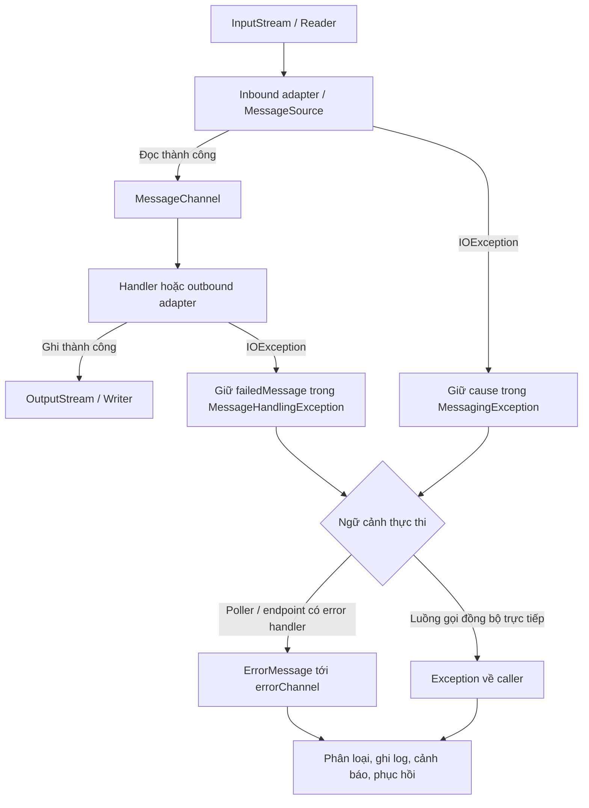

# Xử lý `IOException` trong Stream Adapter

## 1. Bối cảnh và mục tiêu

Trong **Spring Integration**, Stream Adapter đưa dữ liệu từ `InputStream`/`Reader` vào một `MessageChannel` (inbound) hoặc ghi payload của message ra `OutputStream`/`Writer` (outbound). Đây là một điểm tiếp giáp với tài nguyên I/O bên ngoài, vì vậy luồng tích hợp vẫn có thể gặp `IOException` dù những bước biến đổi và định tuyến message trước đó đều hợp lệ.

Bài này thuộc chương **Adapter Stream** của module **`SPRING_INTEGRATION_ADAPTERS`**: kết nối hệ thống ngoài bằng inbound/outbound adapter, gateway, poller và `MessageChannel`; thực hành xử lý hợp đồng message, lỗi và vòng đời kết nối. Sau bài học, người học cần có thể:

- Chỉ ra thao tác đọc/ghi nào có thể ném `IOException` và phân biệt lỗi I/O với **EOF** (hết dữ liệu) hoặc lỗi chuyển đổi payload.
- Giữ nguyên nguyên nhân gốc khi đưa lỗi vào cơ chế `MessagingException`/`ErrorMessage` của Spring Integration.
- Biết khi nào ngoại lệ trả về caller, khi nào được poller/endpoint bất đồng bộ gửi tới `errorChannel`.
- Chọn cách phục hồi, retry, đóng/mở lại stream và kiểm soát nguy cơ mất hoặc trùng dữ liệu.

Giả sử ứng dụng đọc từng dòng từ một stream rồi đẩy sang `MessageChannel`; một handler khác ghi các message xuống một stream đích. Lỗi `read()` ở đầu vào và lỗi `write()`/`flush()` ở đầu ra cần được quan sát khác nhau, bởi ở thời điểm lỗi ghi xảy ra, **một phần byte có thể đã được chuyển đến đích**.

## 2. `IOException` xuất hiện ở đâu?

| Vị trí | Thao tác liên quan | Tình huống ví dụ | Hệ quả cần kiểm tra |
| --- | --- | --- | --- |
| Inbound đọc byte | `InputStream.read()` | Stream đã đóng, nguồn bị ngắt, lỗi thiết bị | Có thể chưa tạo được `Message<?>`; trạng thái đọc hiện tại chưa chắc khôi phục được. |
| Inbound đọc ký tự | `Reader.read()`, `BufferedReader.readLine()` | Lỗi đọc hoặc lỗi giải mã khi decoder được cấu hình báo lỗi | Có thể đã đọc một phần dòng/bản ghi trước khi thất bại. |
| Outbound ghi byte | `OutputStream.write()` | Broken pipe, tài nguyên đích bị đóng, lỗi thiết bị | Có thể đã ghi **một phần payload** trước khi ném lỗi. |
| Outbound ghi ký tự | `Writer.write()`, `Writer.flush()` | Lỗi ghi/đẩy bộ đệm | Không thể mặc nhiên suy ra đích chưa nhận dữ liệu. |
| Quản lý tài nguyên | `flush()`, `close()`, mở stream mới | Lỗi lúc giải phóng tài nguyên hoặc mở lại kết nối/file | Cần ghi nhận riêng lỗi tác vụ chính và lỗi dọn dẹp. |

Các lớp stream adapter liên quan gồm `ByteStreamReadingMessageSource`, `CharacterStreamReadingMessageSource` (inbound) và `ByteStreamWritingMessageHandler`, `CharacterStreamWritingMessageHandler` (outbound). Với cấu hình XML, cùng ý tưởng được thể hiện qua các phần tử như `stdin-channel-adapter` và `stdout-channel-adapter`. Dù dùng Java DSL, annotation hay XML, nguyên tắc xử lý lỗi vẫn xuất phát từ **thao tác I/O thực tế** và **ngữ cảnh thực thi endpoint**.

**Phân biệt ba trạng thái quan trọng:**

1. **Có dữ liệu:** adapter tạo một message có payload thích hợp và gửi sang channel.
2. **Hết dữ liệu hợp lệ:** `InputStream.read()` trả về `-1`, `BufferedReader.readLine()` trả về `null`. Trong giao ước `MessageSource.receive()`, giá trị `null` nghĩa là *hiện không có message*. Đây không phải `IOException` và không nên gửi vào `errorChannel` như một lỗi.
3. **Đọc/ghi thất bại:** API stream ném `IOException`; phải bảo tồn `cause`, xác định điểm lỗi, và chọn cách xử lý dựa trên khả năng khôi phục tài nguyên.

Đừng đồng nhất một bản ghi sai định dạng với lỗi I/O. Ví dụ parse JSON thất bại thường là lỗi chuyển đổi/kiểm tra dữ liệu; dù cùng đi qua error flow, chính sách xử lý có thể khác hoàn toàn lỗi mất kết nối.

## 3. Đường đi của lỗi trong Spring Integration



Trong Spring Integration, một `IOException` phát sinh bên trong adapter thường xuất hiện ở tầng tích hợp dưới dạng một ngoại lệ thông điệp hoặc ngoại lệ lồng nhau. Khi tự viết adapter hoặc handler, hãy **giữ nguyên `IOException` trong chuỗi `cause`**, thay vì chỉ giữ thông báo văn bản. Với lỗi ở handler có message đầu vào, `MessageHandlingException` còn cho phép gắn `failedMessage` để phục vụ chẩn đoán.

`errorChannel` **không phải một `try/catch` toàn cục cho mọi lời gọi**:

- Với **polling inbound adapter**, lỗi xảy ra trên tác vụ poller có thể được `ErrorMessage` đưa tới error channel đã cấu hình; nếu không có cấu hình riêng, cơ chế xử lý lỗi của endpoint có thể dùng `errorChannel` mặc định.
- Với **`DirectChannel` đồng bộ**, handler ném lỗi thường làm `send()` thất bại và ngoại lệ quay về thread gọi. Nếu caller là một poller có error handler, poller mới có thể tiếp nhận và chuyển lỗi sang error channel.
- Với **endpoint bất đồng bộ**, cơ chế bắt và phát lỗi phụ thuộc channel, executor và error handler được cấu hình. Cần kiểm tra đường chạy thực tế trước khi kết luận lỗi đã được chuyển tới đâu.

`ErrorMessage#getPayload()` là một `Throwable`, có thể bọc nhiều lớp `MessagingException`. Không giả định mọi `ErrorMessage` đều có `failedMessage`: khi inbound chưa tạo ra message, chưa có message nào để gắn vào ngoại lệ.

## 4. Ví dụ inbound: bảo toàn `IOException` khi đọc từng dòng

Ví dụ sau minh họa một `MessageSource<String>` dùng `BufferedReader`; mỗi lần `receive()` đọc một dòng, tạo message nếu có dữ liệu và ném `MessagingException` chứa nguyên nhân gốc khi đọc lỗi. Cách bọc này cũng là nguyên tắc cần kiểm tra khi sử dụng các stream source có sẵn của Spring Integration.

```java
import java.io.BufferedReader;
import java.io.IOException;
import java.io.InputStreamReader;
import java.nio.charset.StandardCharsets;
import java.time.Duration;

import org.springframework.context.annotation.Bean;
import org.springframework.context.annotation.Configuration;
import org.springframework.integration.config.EnableIntegration;
import org.springframework.integration.core.MessageSource;
import org.springframework.integration.dsl.IntegrationFlow;
import org.springframework.integration.dsl.Pollers;
import org.springframework.integration.channel.DirectChannel;
import org.springframework.messaging.MessageChannel;
import org.springframework.messaging.MessagingException;
import org.springframework.messaging.support.MessageBuilder;

@Configuration
@EnableIntegration
public class StreamInputConfiguration {

    @Bean
    MessageSource<String> stdinLines() {
        BufferedReader reader = new BufferedReader(
                new InputStreamReader(System.in, StandardCharsets.UTF_8));

        return () -> {
            try {
                String line = reader.readLine();
                return line == null
                        ? null
                        : MessageBuilder.withPayload(line).build();
            } catch (IOException ex) {
                throw new MessagingException("Không thể đọc stream đầu vào", ex);
            }
        };
    }

    @Bean
    MessageChannel streamErrors() {
        return new DirectChannel();
    }

    @Bean
    IntegrationFlow inboundLines(MessageSource<String> stdinLines) {
        return IntegrationFlow.from(stdinLines,
                    endpoint -> endpoint.poller(
                        Pollers.fixedDelay(Duration.ofSeconds(1))
                               .errorChannel("streamErrors")))
                .channel("streamInput")
                .get();
    }
}
```

Ở đây `streamInput` cần được nối với một consumer xử lý message; `streamErrors` cần có handler nhận `ErrorMessage` (phần 6). Code chủ ý không đóng `System.in`, vì đây là stream dùng chung do môi trường chạy quản lý. Nếu nguồn là file hoặc socket do ứng dụng tự mở, ứng dụng phải định nghĩa rõ ai đóng và ai có quyền mở lại.

**Lưu ý về poller:** `readLine()` trên `System.in` có thể **chặn thread** cho tới khi nhập một dòng hoặc nguồn đóng. `fixedDelay` chỉ điều tiết khoảng cách giữa các lần poll đã kết thúc; nó không biến thao tác `readLine()` thành non-blocking và cũng không đặt timeout đọc. Với console hoặc socket có khả năng chờ lâu, cần chọn thread/lifecycle thích hợp và hỗ trợ dừng có kiểm soát. Khi EOF là trạng thái kết thúc vĩnh viễn, nên dừng endpoint theo lifecycle thay vì tiếp tục poll vô hạn.

## 5. Ví dụ outbound: không làm mất nguyên nhân và message thất bại

Với outbound, điều quan trọng là biết **message nào** gặp lỗi và **đích có thể đã nhận bao nhiêu byte**. Một handler tự viết có thể giữ thông tin đó như sau:

```java
import java.io.IOException;
import java.io.OutputStream;

import org.springframework.integration.annotation.ServiceActivator;
import org.springframework.messaging.Message;
import org.springframework.messaging.MessageHandlingException;
import org.springframework.stereotype.Component;

@Component
public class SafeStreamWriter {
    private final OutputStream output;

    public SafeStreamWriter(OutputStream output) {
        this.output = output;
    }

    @ServiceActivator(inputChannel = "streamOutput")
    public synchronized void write(Message<byte[]> message) {
        try {
            output.write(message.getPayload());
            output.flush();
        } catch (IOException ex) {
            throw new MessageHandlingException(
                    message, "Ghi payload ra stream thất bại", ex);
        }
    }
}
```

`OutputStream` trong ví dụ phải được khai báo/cấp phát bởi ứng dụng (chẳng hạn một bean mở file với `Files.newOutputStream(...)`) và đóng khi endpoint dừng. `synchronized` ngăn nhiều thread cùng đi vào **một instance** handler; nếu có nhiều instance hoặc nhiều process ghi chung một đích, phải có cơ chế đồng bộ phù hợp ở mức cao hơn. Với stream do người khác sở hữu như `System.out`, không tự ý đóng từ handler.

Handler của ví dụ nhận `Message<byte[]>`; luồng upstream phải chuyển payload sang `byte[]` trước khi gửi vào `streamOutput`. Khi dùng `CharacterStreamWritingMessageHandler` hoặc `ByteStreamWritingMessageHandler` có sẵn, cũng cần đảm bảo kiểu payload, charset, cách phân tách bản ghi và chính sách flush phù hợp.

`flush()` giúp đẩy dữ liệu đang được đệm trong tầng Java, **không đồng nghĩa dữ liệu đã được ghi bền vững xuống thiết bị**. Nếu `write()` hay `flush()` ném lỗi, không thể kết luận chưa có byte nào tới đích; việc gửi lại toàn bộ message có thể làm trùng dữ liệu. Đặc biệt, `System.out` là `PrintStream`: nhiều lỗi I/O được giữ ở cờ lỗi (`checkError()`) thay vì ném `IOException` cho caller. Nếu ứng dụng yêu cầu phát hiện lỗi ghi đáng tin cậy, cần chọn abstraction có tín hiệu lỗi phù hợp.

## 6. Tiếp nhận `ErrorMessage` và xác định lỗi gốc

Có thể gắn một service activator vào `streamErrors` để phân loại nguyên nhân. Ví dụ dưới đây tập trung vào việc xác nhận lỗi có nguồn gốc I/O; trên hệ thống thật cần bổ sung kênh cảnh báo hoặc nơi lưu lỗi có kiểm soát.

```java
import java.io.IOException;

import org.slf4j.Logger;
import org.slf4j.LoggerFactory;
import org.springframework.integration.annotation.ServiceActivator;
import org.springframework.messaging.support.ErrorMessage;
import org.springframework.stereotype.Component;

@Component
public class StreamErrorHandler {
    private static final Logger log =
            LoggerFactory.getLogger(StreamErrorHandler.class);

    @ServiceActivator(inputChannel = "streamErrors")
    public void handle(ErrorMessage errorMessage) {
        Throwable failure = errorMessage.getPayload();

        if (hasIoCause(failure)) {
            log.error("Lỗi I/O trong stream adapter; kiểm tra nguồn/đích", failure);
            // Ghi metric, gửi cảnh báo, kích hoạt phục hồi có kiểm soát.
        } else {
            log.error("Lỗi xử lý message không thuộc I/O", failure);
        }
    }

    private boolean hasIoCause(Throwable error) {
        Throwable current = error;
        while (current != null) {
            if (current instanceof IOException) {
                return true;
            }
            current = current.getCause();
        }
        return false;
    }
}
```

Đối với đường đi đồng bộ do một API/gateway gọi trực tiếp, hãy xử lý ngoại lệ tại biên gọi (hoặc cấu hình tầng bất đồng bộ/error handling tương ứng). Chỉ tạo handler trên `streamErrors` chưa bảo đảm mọi lỗi từ `streamOutput` đều tự động đi vào đó. `errorChannel` giúp **quan sát và phản ứng với lỗi**; nó không tự mở lại stream, khôi phục cursor hay retry message.

Khi ghi log, nên đính kèm `adapterId`, hướng `inbound`/`outbound`, loại exception, ID/correlation ID của message nếu tồn tại, số bản ghi hoặc offset nếu được quản lý. Tránh ghi toàn bộ payload nhạy cảm. Việc log đầy đủ stack trace cần được cân bằng với khả năng lỗi lặp liên tục gây tràn log.

## 7. Quyết định retry, phục hồi và vòng đời kết nối

| Tình huống | Hành động khuyến nghị | Lý do |
| --- | --- | --- |
| EOF hợp lệ | Trả `null`; nếu nguồn hữu hạn đã kết thúc thì dừng/giải phóng endpoint | EOF không phải ngoại lệ; retry lỗi ở đây chỉ làm poll vô ích. |
| Lỗi đọc thoáng qua, nguồn có thể mở lại và có checkpoint | Mở lại nguồn, phục hồi đúng offset/bản ghi, retry có giới hạn | Cho phép tiếp tục mà không bỏ sót hoặc nhân đôi dữ liệu. |
| Lỗi đọc trên stream chỉ đọc tiến (stdin, nhiều loại socket/pipe) | Ghi nhận trạng thái không chắc chắn; tái kết nối theo giao thức hoặc dừng để can thiệp | Byte đã tiêu thụ không thể tùy ý đọc lại. |
| Lỗi ghi trước/khi `flush()` và đích không có xác nhận | Kiểm tra khả năng ghi một phần; dùng ID bản ghi, framing, ACK hoặc thao tác idempotent nếu cần retry | Retry mù có thể lặp lại một phần nội dung ở đích. |
| Stream bị đóng/hỏng vĩnh viễn, mất quyền, lỗi định dạng | Dừng retry tự động, cảnh báo và yêu cầu sửa nguyên nhân | Thêm lượt retry không giúp khôi phục tài nguyên sai cấu hình. |

### 7.1. Chính sách retry có giới hạn

Một chiến lược phổ biến là **số lần thử hữu hạn + khoảng lùi tăng dần + giới hạn tối đa**, nhưng chỉ áp dụng khi nguồn/đích có thể phục hồi trạng thái và thao tác thử lại là an toàn. Ví dụ: 3 lần thử, chờ 200 ms, 400 ms, 800 ms, sau đó đưa message vào tuyến xử lý lỗi và cảnh báo. Các con số chỉ là ví dụ; thời gian thực tế phụ thuộc SLA và loại stream.

Trong Spring Integration, `RequestHandlerRetryAdvice` thích hợp cho việc thử lại xử lý **message handler** khi việc xử lý có thể lặp lại. Không suy luận rằng gắn advice này vào handler sẽ tự động tua ngược `InputStream` đã đọc. Retry tầng nguồn cần có cách khôi phục vị trí đọc; retry tầng ghi cần xem xét trường hợp ghi dở. Trước khi kích hoạt retry, hãy tự trả lời:

1. Lần thử trước đã đọc/ghi đến đâu và bằng chứng xác định trạng thái là gì?
2. Thao tác có idempotent không; nếu không, đích có hỗ trợ khóa trùng hoặc bù trừ không?
3. Lỗi có khả năng tự phục hồi không, và khi nào nên dừng, báo động hoặc chuyển sang xử lý thủ công?

### 7.2. Quản lý tài nguyên

- **Ownership:** stream do ứng dụng mở thì ứng dụng đóng ở đúng thời điểm; stream dùng chung (`System.in`, `System.out`) không nên bị adapter tùy tiện đóng.
- **Tách lỗi dọn dẹp:** nếu ghi lỗi rồi `close()` cũng lỗi, cần giữ nguyên lỗi chính và ghi nhận lỗi đóng stream; `try-with-resources` có thể lưu lỗi dọn dẹp dưới dạng *suppressed exception* khi tài nguyên thuộc một phạm vi sử dụng ngắn.
- **Không chia sẻ stream tùy tiện:** đọc đồng thời từ một stream làm rối thứ tự bản ghi; ghi đồng thời có thể xen byte. Cần giới hạn concurrency, đồng bộ hoặc thiết kế kênh ghi có thứ tự.
- **Quản lý trạng thái sau khi hỏng:** xác định adapter cần dừng, mở lại nguồn hay thay thế `Reader`/`OutputStream`; không cố dùng một stream đã bị đánh dấu hỏng mà không kiểm tra.

## 8. Kiểm thử lỗi chủ động

Không cần chờ sự cố thật mới kiểm tra error flow. Dùng stream giả ném lỗi có kiểm soát để xác minh exception được giữ nguyên và chính sách retry không làm mất dữ liệu. Ví dụ tạo một nguồn byte luôn lỗi:

```java
InputStream failingInput = new InputStream() {
    @Override
    public int read() throws IOException {
        throw new IOException("simulated read failure");
    }
};

OutputStream failingOutput = new OutputStream() {
    @Override
    public void write(int value) throws IOException {
        throw new IOException("simulated broken pipe");
    }
};
```

Từ hai stream này, xây dựng unit/integration test với source/handler tương ứng và kiểm tra:

| Ca kiểm thử | Kỳ vọng |
| --- | --- |
| Đọc thành công một dòng | Tạo đúng một message với nội dung, charset và ranh giới bản ghi dự kiến. |
| Đọc tới EOF | `receive()` trả `null`, không phát `ErrorMessage` cho EOF. |
| `read()` ném `IOException` | Chuỗi `cause` còn nguyên; nếu chạy qua poller được cấu hình, handler lỗi nhận được `ErrorMessage`. |
| `write()`/`flush()` ném `IOException` | Lỗi giữ `failedMessage`; caller đồng bộ hoặc error flow nhận được thất bại tương ứng. |
| Ghi được một phần rồi lỗi | Chính sách retry chứng minh không nhân đôi bản ghi hoặc công khai trạng thái không chắc chắn. |
| Handler lỗi hoặc hệ thống cảnh báo bị lỗi | Không rơi vào vòng lặp phát lại lỗi vô hạn; có tín hiệu theo dõi để vận hành. |

Trong vận hành, nên quan sát số lỗi đọc/ghi, số lần reconnect/retry, số message chưa xử lý, thời gian từ lần xử lý thành công cuối cùng và tỷ lệ lỗi theo adapter. Các chỉ số giúp phát hiện trường hợp poller còn chạy nhưng nguồn liên tục thất bại.

## 9. Checklist khi đưa Stream Adapter vào môi trường thực tế

1. Xác định **hướng đọc/ghi**, kiểu `InputStream`/`Reader` hay `OutputStream`/`Writer`, charset, delimiter và hợp đồng payload của message.
2. Tách **EOF** khỏi exception; không biến nguồn không có message thành lỗi giả.
3. Giữ `IOException` làm `cause` và `failedMessage` khi đã có message; kiểm tra chính xác ngữ cảnh poller, đồng bộ hoặc bất đồng bộ để cấu hình error flow.
4. Thiết lập điểm quan sát (`errorChannel`/caller, log, metric, cảnh báo) và cách dừng adapter khi nguồn/đích không thể phục hồi.
5. Chỉ retry khi có phương án phục hồi vị trí đọc hoặc xử lý phần ghi đã hoàn thành; giới hạn số lần retry và có tuyến xử lý lỗi cuối cùng.
6. Kiểm soát ownership, đóng/mở lại và concurrency để tránh sử dụng stream đã hỏng hoặc trộn byte giữa các message.
7. Kiểm chứng các trường hợp EOF, lỗi đọc, lỗi ghi dở, lỗi `flush()` và phục hồi qua test có chủ đích.

**Ghi nhớ:** Trong Stream Adapter, thành công hay thất bại của thao tác I/O không luôn tương ứng với việc một message đã được xử lý trọn vẹn. Xử lý `IOException` đúng nghĩa là bảo tồn dấu vết lỗi, đưa nó tới đúng cơ chế xử lý của Spring Integration, đồng thời biết được dữ liệu đã đi đến đâu trước khi quyết định thử lại.
