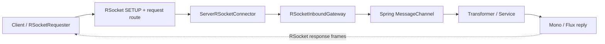
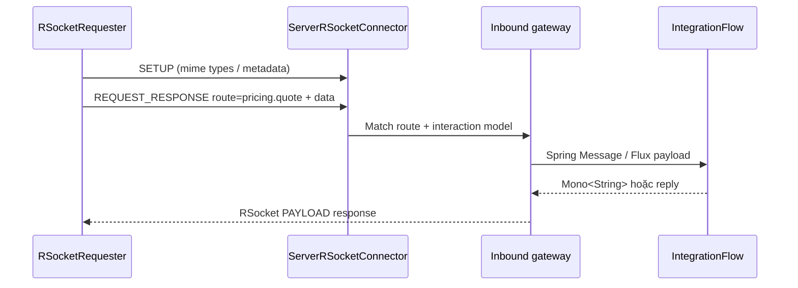
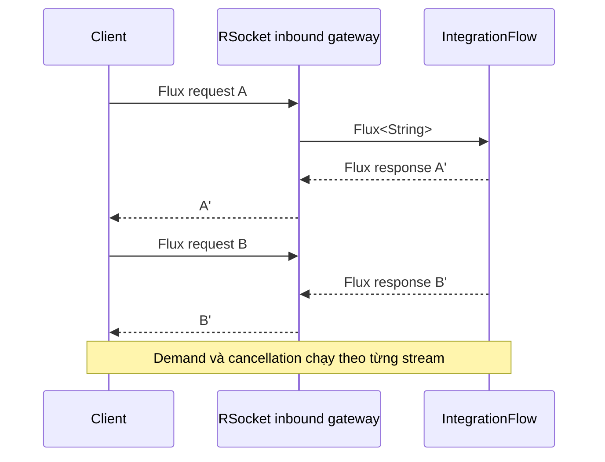
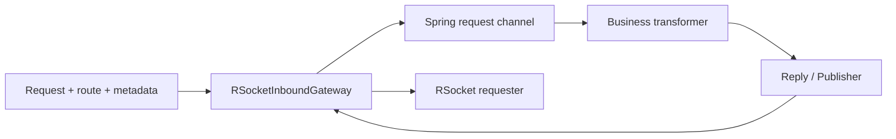
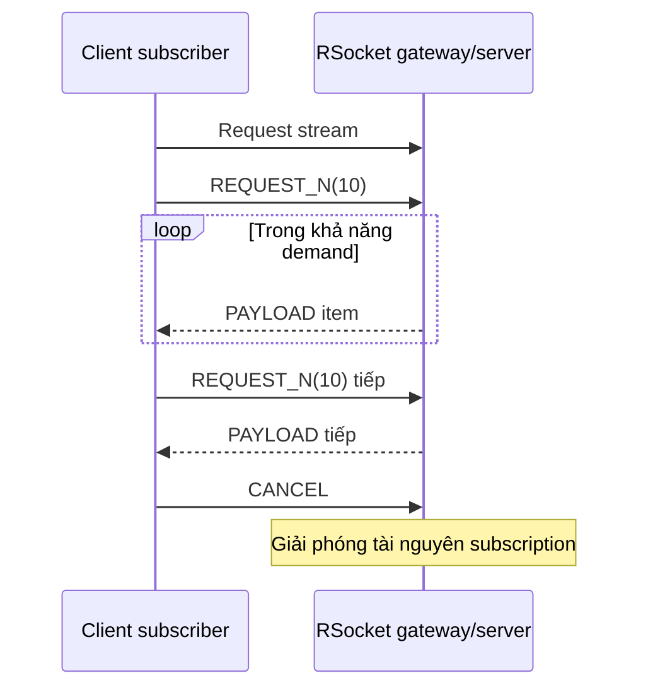
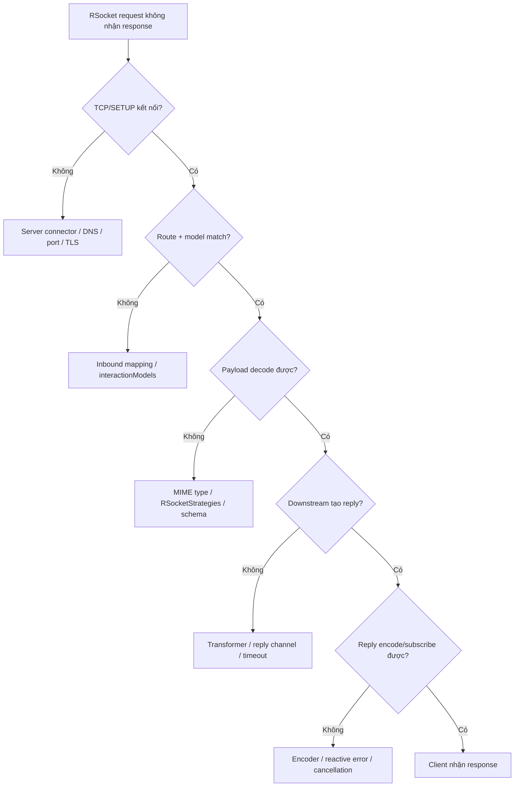

# RSocket inbound gateway trong Spring Integration

## 1. Bối cảnh: tiếp nhận một request và trả phản hồi qua RSocket

Giả sử một hệ thống thương mại điện tử có dịch vụ **pricing-service** viết bằng Spring Boot. Khi ứng dụng quản trị yêu cầu tính giá, nó gửi một request tới route `pricing.quote`. Dịch vụ phải đọc dữ liệu, kiểm tra quyền truy cập, tính kết quả và gửi phản hồi lại qua cùng tương tác RSocket. Một yêu cầu khác có thể cần trả **dòng cập nhật giá** thay vì chỉ một kết quả.

Trong Spring Integration, thành phần tiếp nhận và điều phối những yêu cầu này có tên **`RSocketInboundGateway`**. Nó không đơn thuần “lắng nghe một port” rồi đẩy bytes vào channel; nó là một **gateway hướng vào**, kết nối các request RSocket với hệ thống `Message<?>` và luồng request–reply của Spring Integration, đồng thời cho phép phản hồi bằng `Mono`, `Flux` hoặc payload thông thường theo interaction model.

Bài **“RSocket inbound gateway”** thuộc chương **Adapter RSocket**, module **SPRING_INTEGRATION_ADAPTERS**. Module tập trung kết nối hệ thống ngoài bằng inbound/outbound adapter, gateway, poller và `MessageChannel`; thực hành trao đổi qua file, SFTP, HTTP, JMS, AMQP, Kafka và cơ sở dữ liệu, đồng thời thiết kế message contract, xử lý lỗi và vòng đời kết nối. Với RSocket, điểm nhấn là **route, payload, metadata, request–reply, reactive streams và connector lifecycle**.

### Mục tiêu

Sau bài học, bạn có thể:

1. Phân biệt RSocket protocol, `ServerRSocketConnector`, `ClientRSocketConnector`, `RSocketInboundGateway` và Spring `MessageChannel`.
2. Giải thích bốn interaction model: `fireAndForget`, `requestResponse`, `requestStream`, `requestChannel`.
3. Đăng ký route bằng Java configuration hoặc Java DSL `RSockets.inboundGateway(...)`.
4. Tạo server RSocket TCP với `ServerRSocketConnector` và gửi thử request bằng `RSocketRequester`.
5. Hiểu kiểu payload reactive `Flux<T>`, reply `Mono<T>`/`Flux<T>` và tác động của codec/`RSocketStrategies`.
6. Phân biệt **RSocket inbound gateway** với inbound channel adapter của file/FTP và với `@MessageMapping` của Spring Messaging.
7. Thiết kế request/reply/error/timeout/cancellation và backpressure không làm chặn event-loop.
8. Kiểm thử routing, dữ liệu, security, failure mode và kết nối với socket thật.

## 2. Kiến trúc và vị trí của inbound gateway



Mỗi thành phần có trách nhiệm riêng:

| Thành phần | Vai trò | Điều **không** tự làm |
| --- | --- | --- |
| **RSocket protocol** | Truyền request, stream, metadata, tín hiệu demand/cancel | Không tự quyết định business rule hoặc database transaction |
| **`ServerRSocketConnector`** | Bind transport server, nhận và quản lý kết nối RSocket, ánh xạ endpoint | Không phải service xử lý nghiệp vụ |
| **`ClientRSocketConnector`** | Kết nối tới peer bằng client requester; cũng có thể đăng ký inbound endpoint cho request từ phía peer | Không tự lưu request bền vững |
| **`RSocketInboundGateway`** | Ánh xạ route và interaction model, chuyển request vào Spring Integration và tạo response | Không phải một message broker |
| **`MessageChannel`** | Điều phối `Message<?>` giữa các endpoint | Không tự bảo đảm requester nhận phản hồi đúng SLA |
| **Transformer/service activator** | Xử lý payload, validate, đọc/ghi dữ liệu, trả reply | Không tự tạo bảo đảm exactly-once |
| **`RSocketStrategies`** | Encoder/decoder, route matching, data buffer handling | Không phải authentication hay authorization |

### 2.1. Inbound gateway khác inbound channel adapter

Trong module về file/FTP, inbound adapter thường **đọc dữ liệu rồi phát message một chiều**. Ở đây RSocket inbound gateway có thể **nhận request và tạo reply**. Vì vậy phải xem xét:

- Request route đã ánh xạ tới gateway nào?
- Mỗi interaction model đòi response dạng gì?
- Reply được tạo ở handler/transformer nào?
- Nếu không trả lời, RSocket client nhận tín hiệu kết thúc hay timeout?
- Lỗi decoding, nghiệp vụ và connection sẽ biểu hiện thế nào?

**Lưu ý:** tên “inbound” mô tả **hướng request đi vào Spring Integration flow**, không mặc định có nghĩa endpoint luôn là server. Một `ClientRSocketConnector` cũng có thể đăng ký inbound gateway để xử lý **request từ server gửi về client** trên kết nối RSocket hai chiều.

## 3. Bốn interaction model cần nắm vững

RSocket hỗ trợ bốn kiểu trao đổi cơ bản:

| Model Spring Integration | Request từ peer | Response | Trường hợp sử dụng |
| --- | --- | --- | --- |
| `RSocketInteractionModel.fireAndForget` | Một payload | Không có application reply | Telemetry có thể mất/chấp nhận xử lý bất đồng bộ |
| `RSocketInteractionModel.requestResponse` | Một payload | Một response hoặc lỗi | Tra cứu thông tin, tính giá, xác nhận lệnh |
| `RSocketInteractionModel.requestStream` | Một payload | Một chuỗi response `Flux<T>` | Cập nhật tiến độ, danh sách lớn, feed kết quả |
| `RSocketInteractionModel.requestChannel` | Một stream request `Flux<T>` | Một stream response `Flux<R>` | Trao đổi hai chiều, pipeline xử lý liên tục |

Các tên enum **dùng chữ thường đầu từ** như `requestResponse` và `requestChannel`, không phải `REQUEST_RESPONSE`. Trên `RSocketInboundGateway`, có thể giới hạn các model phù hợp bằng `setInteractionModels(...)` hoặc DSL `.interactionModels(...)`. Nếu không cấu hình, gateway hỗ trợ các model theo mặc định; trong production nên **chỉ bật các model được endpoint thực sự thiết kế để xử lý**.

### 3.1. Không đánh đồng model với loại payload Java

- `requestResponse` mô tả **một request, một reply**; payload trong Spring Integration có thể được biểu diễn bằng publisher, tùy cách gateway chuyển đổi.
- `requestStream` mô tả **một request, nhiều reply**; response có backpressure theo demand.
- `requestChannel` mô tả **nhiều request elements, nhiều response elements**; không có cam kết cặp request[i] luôn khớp một response[i].
- `fireAndForget` không có response để chứa một ACK nghiệp vụ. Một `Mono<Void>` hoàn tất ở client **không nên được hiểu** là database phía server đã commit.

Đặc biệt, hướng dẫn Spring Integration mô tả inbound payload thường là một `Flux` trong luồng request có reply, còn `fireAndForget` dùng payload được chuyển đổi trực tiếp theo xử lý của gateway. Handler/transformer cần khai báo đúng contract đang dùng.

## 4. Routing: path của gateway không phải URL HTTP

`RSocketInboundGateway` yêu cầu một hoặc nhiều **route/path mapping**, ví dụ:

```text
pricing.quote
pricing.stream
inventory.changes
echo
```

RSocket requester truyền route qua **metadata của request**, không phải gửi HTTP `GET /pricing.quote`. Với transport TCP, không có HTTP method hoặc HTTP controller tự xuất hiện chỉ vì route có dấu `/`.



**Route** có thể là pattern tương tự các quy tắc mapping trong Spring Messaging, nhưng nó **không phải** một form của URL HTTP. Tên route, phân cách, metadata MIME type và cách client tạo request phải đồng nhất với connector và `RSocketStrategies`.

### 4.1. Trùng route và model

Hai gateway cùng nhận một route và interaction model có thể gây xung đột/không rõ mapping. Khi thiết kế:

1. Đặt route có namespace, ví dụ `orders.quote.v1`.
2. Giới hạn interaction model rõ ràng.
3. Tránh pattern quá rộng nếu có endpoint nhạy cảm.
4. Kiểm tra kết quả routing khi application context khởi động.
5. Không dùng route làm cơ chế phân quyền duy nhất.

## 5. Connector và lifecycle: ai mở TCP port?

Spring Integration RSocket dùng `ServerRSocketConnector` hoặc `ClientRSocketConnector` để thiết lập và quản lý kết nối. **`RSocketInboundGateway` tự nó không có nghĩa đã mở một TCP port**.

| Vùng trách nhiệm | Thành phần |
| --- | --- |
| Bind TCP hoặc WebSocket listener | `ServerRSocketConnector` |
| Kết nối tới RSocket server | `ClientRSocketConnector` / `RSocketRequester` |
| Đăng ký route incoming | `RSocketInboundGateway` |
| Gửi Spring message nội bộ | `MessageChannel` |
| Xử lý và tạo phản hồi | Transformer, service activator, business service |

Một gateway bean được `ServerRSocketConnector` hoặc `ClientRSocketConnector` **tự phát hiện và đăng ký** khi được cấu hình đúng trong context. Nếu gọi `setRSocketConnector(...)` để đăng ký tường minh, cần xem xét cơ chế discovery trên connector đó: cấu hình explicit có thể **vô hiệu hóa autodetection** đối với connector liên quan, khiến những gateway khác không còn tự được đưa vào mapping như mong đợi.

### 5.1. `ServerRSocketConnector` với port cố định

```java
import org.springframework.context.annotation.Bean;
import org.springframework.context.annotation.Configuration;
import org.springframework.integration.rsocket.ServerRSocketConnector;

@Configuration
public class RSocketTransportConfiguration {

    @Bean
    public ServerRSocketConnector rsocketServerConnector() {
        // Server độc lập trên RSocket TCP, không phải HTTP.
        return new ServerRSocketConnector("0.0.0.0", 7000);
    }
}
```

Trong môi trường production, bind interface cụ thể hoặc đặt phía sau hạ tầng mạng được kiểm soát. `0.0.0.0` nghĩa là listener trên các interface khả dụng, **không tự cung cấp authentication hoặc TLS**.

**Không cấu hình song song hai RSocket servers cùng bind port 7000**, ví dụ một `ServerRSocketConnector` tự tạo server và một RSocket server Boot autoconfiguration được đặt cùng port. Nếu đã có RSocket server do ứng dụng quản lý, Spring Integration hỗ trợ tích hợp thông qua `ServerRSocketMessageHandler`/connector dạng external server phù hợp; không dựng thêm một listener trùng cổng.

### 5.2. Bind port động

`ServerRSocketConnector("localhost", 0)` có thể được dùng trong integration test để hệ điều hành chọn port. API `getBoundPort()` trả về `Mono<Integer>`; cần đọc **sau khi connector đã start/bind**, không giả định có thể lấy số port hợp lệ từ một bean còn chưa khởi động.

```java
// Ví dụ minh họa trong một integration test sau application startup:
Integer actualPort = connector.getBoundPort()
        .block(java.time.Duration.ofSeconds(5));
if (actualPort == null || actualPort <= 0) {
    throw new IllegalStateException("RSocket server chưa bind");
}
```

Đừng đặt `.block()` trong một Netty/Reactor event-loop callback. Ở test orchestration hoặc command-line setup riêng, gọi block có deadline rõ ràng có thể chấp nhận; trong business reactive flow, hãy nối tiếp bằng operator Reactor.

## 6. Dependencies và cấu hình Spring Boot

Ví dụ dùng Spring Boot BOM để quản lý phiên bản tương thích:

```xml
<dependencies>
    <dependency>
        <groupId>org.springframework.boot</groupId>
        <artifactId>spring-boot-starter-integration</artifactId>
    </dependency>
    <dependency>
        <groupId>org.springframework.integration</groupId>
        <artifactId>spring-integration-rsocket</artifactId>
    </dependency>

    <!-- Chỉ cần nếu ví dụ chọn JSON DTO và ứng dụng chưa có Jackson. -->
    <dependency>
        <groupId>com.fasterxml.jackson.core</groupId>
        <artifactId>jackson-databind</artifactId>
    </dependency>

    <!-- Đưa vào test scope khi viết StepVerifier tests. -->
    <dependency>
        <groupId>io.projectreactor</groupId>
        <artifactId>reactor-test</artifactId>
        <scope>test</scope>
    </dependency>
</dependencies>
```

`spring-integration-rsocket` là module chuyên dụng cho RSocket gateway, khác `spring-integration-http`, `spring-integration-webflux`, `spring-integration-zeromq` và `spring-boot-starter-rsocket`. Dùng đúng BOM tương thích với Spring Framework/Boot của ứng dụng, không ghép tùy tiện major versions.

Một số dự án thêm `spring-boot-starter-rsocket` để có Boot hỗ trợ RSocket rộng hơn. Khi đó phải thống nhất **ai sở hữu server transport**: không bật cả Boot server trên cùng port với `ServerRSocketConnector` tự bind.

### 6.1. Property cho ví dụ

```yaml
# application.yml
app:
  rsocket:
    bind-host: ${RSOCKET_BIND_HOST:127.0.0.1}
    port: ${RSOCKET_PORT:7000}
    client-host: ${RSOCKET_CLIENT_HOST:127.0.0.1}
    client-port: ${RSOCKET_CLIENT_PORT:7000}
    reply-timeout: 5s
```

`127.0.0.1` thích hợp khi client và server chạy trên cùng host/network namespace. Khi hai pod khác nhau, `client-host` phải là DNS/IP mà client có thể kết nối. Đối với server pod, `bind-host` có thể cần `0.0.0.0` để nhận kết nối bên ngoài container; phải kết hợp NetworkPolicy, service routing và bảo mật transport.

## 7. Java configuration: inbound gateway request–response

Cách trực tiếp nhất là khai báo `RSocketInboundGateway` với route, đặt request channel, rồi dùng transformer trả `Mono<String>`.

### 7.1. Khai báo gateway bean

```java
import org.springframework.context.annotation.Bean;
import org.springframework.context.annotation.Configuration;
import org.springframework.integration.rsocket.RSocketInteractionModel;
import org.springframework.integration.rsocket.inbound.RSocketInboundGateway;

@Configuration
public class RSocketEchoGatewayConfiguration {

    @Bean
    public RSocketInboundGateway echoInboundGateway() {
        RSocketInboundGateway gateway =
                new RSocketInboundGateway("echo");
        gateway.setInteractionModels(
                RSocketInteractionModel.requestResponse);
        gateway.setRequestChannelName("echoRequests");
        return gateway;
    }
}
```

`ServerRSocketConnector` ở mục 5 có thể tự phát hiện inbound gateway này để ánh xạ route `echo`. Khi đã đăng ký explicit connector, phải đảm bảo connector thực sự có mapping gateway.

### 7.2. Transformer nhận publisher và tạo một reply

```java
import java.util.Locale;
import org.springframework.integration.annotation.Transformer;
import org.springframework.stereotype.Component;
import reactor.core.publisher.Flux;
import reactor.core.publisher.Mono;

@Component
public class EchoRequestTransformer {

    @Transformer(inputChannel = "echoRequests")
    public Mono<String> uppercase(Flux<String> incoming) {
        return incoming.next()
                .map(value -> value.toUpperCase(Locale.ROOT));
    }
}
```

Đây là dạng **fully reactive** mà tài liệu Spring Integration dùng khi minh họa RSocket inbound gateway. Điểm đáng chú ý là `incoming` có kiểu `Flux<String>`; không nên viết handler chỉ nhận `String` nếu luồng và model được cấu hình đưa publisher vào payload.

Trong ví dụ trên, `requestResponse` chỉ mong một input. `incoming.next()` lấy phần tử đầu tiên rồi hoàn tất. Với một client truyền dữ liệu text đúng codec, kết quả `"hello"` sẽ là `"HELLO"`. Nếu body không decode được thành `String` hoặc request không có payload, cần policy lỗi hoặc giá trị mặc định; không nên coi `Mono.empty()` là một kết quả business thành công trong mọi trường hợp.

### 7.3. Vì sao gateway có thể trả reply mà không chỉ rõ replyChannel?

`RSocketInboundGateway` kế thừa cơ chế messaging gateway của Spring Integration. Khi request–reply, cơ chế gateway dùng thông tin reply/correlation của request để chuyển response về tương tác RSocket. Người học vẫn cần hiểu:

- Handler/transformer downstream **phải tạo reply** khi interaction model yêu cầu reply.
- Nếu không có reply, client có thể hoàn tất rỗng hoặc timeout tùy luồng/chính sách.
- Error và timeout không phải HTTP status; RSocket có giao thức frame lỗi và kết thúc riêng.
- Nếu custom `replyChannel`, `errorChannel`, `requestTimeout` hoặc `replyTimeout` thì phải kiểm tra chính xác channel/reply semantics theo version và mô hình reactive.

**Không tự thêm một `QueueChannel` polling vô thời hạn** để “giữ reply” khi khách hàng đang chờ; điều đó có thể làm mất deadline và backpressure.

## 8. Java DSL: một endpoint trọn vẹn trong IntegrationFlow

Spring Integration Java DSL có factory `RSockets.inboundGateway(...)`. Ví dụ:

```java
import java.util.Locale;
import org.springframework.context.annotation.Bean;
import org.springframework.context.annotation.Configuration;
import org.springframework.core.ResolvableType;
import org.springframework.integration.dsl.IntegrationFlow;
import org.springframework.integration.rsocket.RSocketInteractionModel;
import org.springframework.integration.rsocket.dsl.RSockets;
import reactor.core.publisher.Flux;
import reactor.core.publisher.Mono;

@Configuration
public class RSocketUppercaseFlowConfiguration {

    @Bean
    public IntegrationFlow uppercaseInboundFlow() {
        return IntegrationFlow
                .from(RSockets.inboundGateway("uppercase")
                        .interactionModels(
                                RSocketInteractionModel.requestResponse)
                        .requestElementType(
                                ResolvableType.forClass(String.class)))
                .<Flux<String>, Mono<String>>transform(incoming ->
                        incoming.next().map(value ->
                                value.toUpperCase(Locale.ROOT)))
                .get();
    }
}
```

Đây là **gateway request–response** sử dụng một route `uppercase`. `requestElementType(String.class)` dưới dạng `ResolvableType` làm contract decode rõ hơn; cần chọn `RSocketStrategies`/MIME type hỗ trợ `String`. Các ký tự tên route `"uppercase"` phải khớp với client.

Nếu đang đọc một tài liệu dùng `.requestElementClass(...)` trên Java bean, lưu ý API DSL `RSocketInboundGatewaySpec` có `.requestElementType(ResolvableType)`; không suy đoán tất cả setter của bean đều có overload DSL tương ứng.

### 8.1. Biến thể cho request-channel theo ví dụ tham khảo chính thức

```java
@Bean
public IntegrationFlow firstValueUppercaseChannelFlow() {
    return IntegrationFlow
            .from(RSockets.inboundGateway("uppercase.channel")
                    .interactionModels(
                            RSocketInteractionModel.requestChannel))
            .<Flux<String>, Mono<String>>transform(flux ->
                    flux.next().map(String::toUpperCase))
            .get();
}
```

Biến thể này nhận request stream từ phía client nhưng **chỉ lấy phần tử đầu** và trả một reply. Nó minh họa gateway có thể xử lý `Flux` reactive; nếu yêu cầu response stream nhiều phần tử, cần trả `Flux` thay vì `Mono` và kiểm soát quy tắc hoàn tất/cancellation.

## 9. Kết nối client: RSocketRequester gọi inbound gateway

Trong Spring Framework, `RSocketRequester` là client API cho RSocket, hoạt động cả khi phía gọi nằm ngoài Spring Integration. Không cần một `RSocketOutboundGateway` chỉ để viết thử client: requester chuẩn có thể trực tiếp gọi endpoint server.

### 9.1. Ví dụ client request–response

```java
import java.time.Duration;
import org.springframework.messaging.rsocket.RSocketRequester;
import org.springframework.util.MimeTypeUtils;
import reactor.core.publisher.Mono;

public class EchoRSocketClient {

    public static Mono<String> call() {
        RSocketRequester requester = RSocketRequester.builder()
                .dataMimeType(MimeTypeUtils.TEXT_PLAIN)
                .tcp("127.0.0.1", 7000);

        return requester
                .route("echo")
                .data("xin chao")
                .retrieveMono(String.class)
                .timeout(Duration.ofSeconds(5));
    }
}
```

**Cách dùng:** sau khi `ServerRSocketConnector` đã start và gateway route `echo` được đăng ký, gọi `EchoRSocketClient.call()` và **subscribe** bằng một subscriber/StepVerifier hoặc tích hợp vào một reactive chain. Chỉ tạo một `Mono` mà không subscribe thì request có thể chưa được thực thi. Không tạo một requester mới **cho mỗi message** trong ứng dụng throughput cao nếu có thể tái sử dụng kết nối phù hợp.

`dataMimeType(TEXT_PLAIN)` giúp hai bên hiểu body là text. Route nằm trong RSocket metadata theo cách requester encode, không phải header HTTP. Khi client chỉ dùng `retrieveMono(String.class)`, model mong đợi là request–response với một kết quả.

### 9.2. Client dùng Java DSL của chính Spring Integration

Nếu ứng dụng caller cũng dùng Spring Integration, có thể định nghĩa **RSocket outbound gateway**:

```java
import org.springframework.context.annotation.Bean;
import org.springframework.context.annotation.Configuration;
import org.springframework.integration.dsl.IntegrationFlow;
import org.springframework.integration.rsocket.ClientRSocketConnector;
import org.springframework.integration.rsocket.RSocketInteractionModel;
import org.springframework.integration.rsocket.dsl.RSockets;

@Configuration
public class EchoOutboundCallerFlow {

    @Bean
    public IntegrationFlow callEcho(ClientRSocketConnector connector) {
        return IntegrationFlow
                .from("echoOutgoingRequests")
                .handle(RSockets.outboundGateway("echo")
                        .interactionModel(
                                RSocketInteractionModel.requestResponse)
                        .expectedResponseType(String.class)
                        .clientRSocketConnector(connector))
                .channel("echoReplies")
                .get();
    }
}
```

Đây là **luồng phía client**, không phải server inbound gateway. Để chạy cần một `ClientRSocketConnector` kết nối đúng server, các channel/consumer tương ứng và một luồng có subscriber phù hợp. Theo Spring Integration, outbound gateway sinh payload kết quả dạng reactive (`Mono` và/hoặc `Flux` theo model), nên consumer phải hiểu khi nào stream được subscribe và hoàn tất.

### 9.3. Ví dụ ClientRSocketConnector

```java
import org.springframework.context.annotation.Bean;
import org.springframework.context.annotation.Configuration;
import org.springframework.integration.rsocket.ClientRSocketConnector;

@Configuration
public class RSocketClientConnectorConfiguration {

    @Bean
    public ClientRSocketConnector clientRSocketConnector() {
        return new ClientRSocketConnector("127.0.0.1", 7000);
    }
}
```

Nếu client và server chạy trong cùng Spring context để demo, cần tránh tạo **hai inbound gateways có cùng route** trên cùng connector mà không cố ý. Trong production, cấu hình hostname/port từ property và quản lý trust boundary rõ.

## 10. Cấu hình codec: RSocketStrategies, MIME type và payload

RSocket truyền **data payload** và **metadata**, trong đó metadata có thể chứa route và những thuộc tính khác. `RSocketStrategies` quy định encoder/decoder giúp biến `DataBuffer` thành `String`, `byte[]` hoặc DTO.

### 10.1. Kiểu mặc định và kiểu cấu hình

Theo API của `RSocketInboundGateway`:

- Có thể đặt `setRequestElementClass(Class<?>)` hoặc `setRequestElementType(ResolvableType)` trên Java bean.
- Nếu không có kiểu được chỉ định, gateway dựa trên header content type; **text** thường được decode thành `String`, còn loại khác có thể mặc định thành `byte[]`.
- Khi request có publisher, payload có thể là `Flux<T>` mà tầng ứng dụng phải xử lý; không tự biến mọi request thành một DTO đơn.
- Reply được encode bằng các encoder trong `RSocketStrategies` và kiểu dữ liệu reply hoặc element type của publisher.

Vì vậy, trước khi viết handler `Mono<OrderQuote>` hay `Flux<OrderEvent>`, cần xác định rõ **MIME type, serializer, decoder và schema** ở cả client/server.

### 10.2. Cấu hình text-only strategies theo tài liệu Spring

```java
import org.springframework.context.annotation.Bean;
import org.springframework.context.annotation.Configuration;
import org.springframework.core.codec.CharSequenceEncoder;
import org.springframework.core.codec.StringDecoder;
import org.springframework.messaging.rsocket.RSocketStrategies;

@Configuration
public class TextRSocketCodecConfiguration {

    @Bean
    public RSocketStrategies rsocketStrategies() {
        return RSocketStrategies.builder()
                .decoder(StringDecoder.textPlainOnly())
                .encoder(CharSequenceEncoder.allMimeTypes())
                .build();
    }
}
```

Sau đó có thể inject strategies cho connector:

```java
@Bean
public ServerRSocketConnector serverRSocketConnector(
        RSocketStrategies strategies) {
    ServerRSocketConnector server =
            new ServerRSocketConnector("0.0.0.0", 7000);
    server.setRSocketStrategies(strategies);
    return server;
}
```

**Đây là cấu hình thay thế cho bean connector ở mục 5**, không phải bean thứ hai cùng bind port. Khi connector được cung cấp cho một inbound gateway, `RSocketStrategies` của connector có thể được ưu tiên hơn strategies cấu hình tường minh tại gateway. Hãy nhất quán để tránh tình trạng server dùng codec A còn gateway kỳ vọng codec B.

### 10.3. DTO JSON

Ví dụ domain:

```java
public record QuoteRequest(String sku, int quantity) {
}

public record QuoteReply(String sku, int quantity, long totalCents) {
}
```

Nếu chuyển sang JSON, cần bộ Jackson encoder/decoder phù hợp, `application/json` trên connection/request, schema rõ, validation và giới hạn kích thước payload. Không tự suy rằng chỉ cần thêm Jackson dependency là mọi `RSocketStrategies` đã cấu hình text-only đều decode được DTO.

**Không serialize Spring `Message.toString()` để gửi qua RSocket.** Consumer ngôn ngữ khác chỉ hiểu bytes theo codec và schema đã thống nhất, không hiểu một representation Java tùy ý.

## 11. Request-stream: một request, nhiều reply

Với `requestStream`, client gửi một request nhưng muốn nhận **chuỗi kết quả**:

```text
Client: route=pricing.updates, data="SKU-42"
Server: reply SKU-42:1
        reply SKU-42:2
        reply SKU-42:3
        ...
```

Một flow minh họa:

```java
import java.time.Duration;
import org.springframework.context.annotation.Bean;
import org.springframework.context.annotation.Configuration;
import org.springframework.integration.dsl.IntegrationFlow;
import org.springframework.integration.rsocket.RSocketInteractionModel;
import org.springframework.integration.rsocket.dsl.RSockets;
import reactor.core.publisher.Flux;

@Configuration
public class PriceStreamFlow {

    @Bean
    public IntegrationFlow priceUpdates() {
        return IntegrationFlow
                .from(RSockets.inboundGateway("pricing.updates")
                        .interactionModels(
                                RSocketInteractionModel.requestStream))
                .<Flux<String>, Flux<String>>transform(requests ->
                        requests.next().flatMapMany(sku ->
                                Flux.range(1, 5)
                                        .delayElements(
                                                Duration.ofMillis(200))
                                        .map(n -> sku + ":version-" + n)))
                .get();
    }
}
```

Đây là **demo dòng hữu hạn năm phần tử**, không phải cách phát một giá thực tế từ database. Client gọi `retrieveFlux(String.class)` và dùng demand/cancellation để điều khiển số response đã nhận. Nếu stream vô hạn, phải có cơ chế cancel khi subscriber đi offline; không sinh một thread riêng cho mỗi stream mà không quản lý tài nguyên.

### 11.1. Client nhận stream

```java
import java.time.Duration;
import org.springframework.messaging.rsocket.RSocketRequester;
import reactor.core.publisher.Flux;

public Flux<String> readUpdates(RSocketRequester requester) {
    return requester.route("pricing.updates")
            .data("SKU-42")
            .retrieveFlux(String.class)
            .take(5)
            .timeout(Duration.ofSeconds(10));
}
```

`take(5)` kết thúc stream phía client sau năm phần tử và gửi tín hiệu cancellation theo reactive protocol khi cần. `timeout` chỉ là deadline của chuỗi reactive ở client; một luồng đã bị cancel không tự undo side effect database mà server có thể đã commit.

### 11.2. Trả Flux không có nghĩa giữ mọi phần tử trong RAM

RSocket có cơ chế **request(n)/backpressure** cho stream, nhưng tầng ứng dụng vẫn phải tuân thủ demand. Nếu lấy dữ liệu từ một source không backpressure-aware rồi `buffer()` vô hạn, server vẫn có nguy cơ tăng heap. Với source liên tục:

- Sử dụng publisher đúng reactive contract.
- Giới hạn buffer/concurrency.
- Áp dụng rate limit/overflow policy có chủ đích.
- Theo dõi subscriber cancel và đóng resource.
- Không giữ transaction DB mở suốt hàng giờ chỉ để chờ client đọc tiếp.

## 12. Request-channel: stream hai chiều

`requestChannel` thích hợp khi client liên tục gửi một chuỗi event và server phát một chuỗi phản hồi trong cùng tương tác:



### 12.1. Ví dụ stream-to-stream

```java
import java.util.Locale;
import org.springframework.context.annotation.Bean;
import org.springframework.context.annotation.Configuration;
import org.springframework.integration.dsl.IntegrationFlow;
import org.springframework.integration.rsocket.RSocketInteractionModel;
import org.springframework.integration.rsocket.dsl.RSockets;
import reactor.core.publisher.Flux;

@Configuration
public class EventChannelFlow {

    @Bean
    public IntegrationFlow mapIncomingEvents() {
        return IntegrationFlow
                .from(RSockets.inboundGateway("events.duplex")
                        .interactionModels(
                                RSocketInteractionModel.requestChannel))
                .<Flux<String>, Flux<String>>transform(source ->
                        source.map(value ->
                                "ack:" + value.toUpperCase(Locale.ROOT)))
                .get();
    }
}
```

Đây là **phản hồi text cho từng phần tử** để học, không phải ACK sau DB commit. Trong sản xuất, nếu response nói `ack:...`, hãy xác định nó có nghĩa **đã nhận**, **đã validate** hay **đã commit**. Một `map` đồng bộ ở đây không thể thay thế transactional acknowledgement.

### 12.2. Client gửi Flux data

```java
import java.time.Duration;
import org.springframework.messaging.rsocket.RSocketRequester;
import reactor.core.publisher.Flux;

public Flux<String> channelDemo(RSocketRequester requester) {
    return requester.route("events.duplex")
            .data(Flux.just("a", "b", "c"), String.class)
            .retrieveFlux(String.class)
            .timeout(Duration.ofSeconds(5));
}
```

Khi data là publisher và retrieve là Flux, RSocketRequester sử dụng interaction model phù hợp cho request-channel. Có thể cần truyền `ParameterizedTypeReference` hoặc kiểu phần tử tường minh khi payload generic hoặc DTO phức tạp. Với model request-channel, cả hai chiều đều phải hỗ trợ cancellation và terminal error hợp lệ.

### 12.3. `decodeFluxAsUnit` và ranh giới phần tử

Từ Spring Integration 5.3, inbound gateway có tùy chọn `setDecodeFluxAsUnit(boolean)` (DSL `.decodeFluxAsUnit(...)`). Mặc định là `false`, nghĩa là cố decode **từng event của Flux**; `true` cho phép decode toàn bộ Flux như một đơn vị tùy decoder.

**Không nhầm** “một RSocket payload frame” với “một chuỗi Java đã hoàn tất” trong mọi decoder. Ví dụ `StringDecoder` có thể dùng dấu xuống dòng để xác định ranh giới nội dung, và cách ghép buffer phụ thuộc encoding. Khi interop với client bên ngoài Spring, cần kiểm thử:

1. Một phần tử string ở phía client thành bao nhiêu phần tử ở phía server?
2. Điều gì xảy ra nếu body chứa newline?
3. Frame bị chia thành nhiều `DataBuffer` có làm thay đổi decoding không?
4. `decodeFluxAsUnit(true)` có làm tăng memory khi stream dài không?

Không bật `decodeFluxAsUnit(true)` cho luồng vô hạn chỉ để “đỡ mất phần tử”; một decoder cần toàn bộ stream có thể không bao giờ hoàn tất hoặc tiêu thụ quá nhiều RAM.

## 13. Fire-and-forget: inbound gateway không trả business reply

`fireAndForget` nhận request nhưng không trả một payload ứng dụng. Nó có thể dùng cho tín hiệu telemetry, đo lường hoặc sự kiện có chính sách mất dữ liệu rõ. Một inbound gateway có thể giới hạn:

```java
@Bean
public RSocketInboundGateway telemetryIngress() {
    RSocketInboundGateway gateway =
            new RSocketInboundGateway("telemetry.ingest");
    gateway.setInteractionModels(
            RSocketInteractionModel.fireAndForget);
    gateway.setRequestChannelName("telemetryRequests");
    return gateway;
}
```

Ở downstream, cần một handler phù hợp để xử lý payload, ví dụ validate và lưu telemetry. Vì mô hình này không có response business, **đừng coi `send()` hoàn tất ở client là bằng chứng DB phía server đã commit**.

Nếu message không được mất, cần durable handoff, outbox/inbox, retry có idempotency hoặc chuyển sang request–response với ACK nghiệp vụ rõ nghĩa. Nhưng ngay cả request–response cũng không tự giải quyết ACK loss/duplicate: retry cùng command ID vẫn có thể cần.

## 14. Phân biệt RSocket inbound gateway với @MessageMapping

Hai cách thường thấy trong Spring:

| Phương án | Cách đăng ký route | Cách xử lý |
| --- | --- | --- |
| **Spring Integration RSocketInboundGateway** | Gateway bean hoặc `RSockets.inboundGateway(...)` | Spring Integration `MessageChannel`, transformer, service activator |
| **Spring Messaging @MessageMapping** | Annotated controller method | Method argument/reply handlers của Spring Messaging |

Cả hai dùng chung nền tảng RSocket/Spring Messaging nhưng **không phải cứ khai báo cả hai là tự được ánh xạ chung không xung đột**. Trong kiến trúc tích hợp, `ServerRSocketMessageHandler` có tùy chọn `messageMappingCompatible` để xử lý `@MessageMapping` trong cấu hình external server phù hợp. Cần xác định ai sở hữu RSocket server và handler mapping.

### 14.1. Khi nào chọn inbound gateway?

Chọn inbound gateway nếu request phải đi qua một hoặc nhiều pattern của Spring Integration:

- Transformer chuẩn hóa dữ liệu trước nghiệp vụ.
- Router theo message header hoặc payload contract.
- Filter/validation, publish-subscribe trong JVM.
- Channel interception, tracing và error handling được quản lý trong flow.
- Kết nối tiếp sang JMS/AMQP/Kafka/DB thông qua các adapter khác.

Chọn `@MessageMapping` nếu service là một RSocket controller đơn giản, ít flow orchestration. Không cần cố đưa mọi thao tác vào IntegrationFlow chỉ để dùng thêm một gateway.

## 15. RequestChannel, replyChannel và correlation

Một inbound gateway là boundary request–reply. Để hoàn tất đúng một tương tác RSocket, Spring Integration phải biết **reply nào thuộc về request nào**.



### 15.1. Trường hợp một request–response

`@Transformer(inputChannel="echoRequests")` trả `Mono<String>`. Gateway ánh xạ reply về tương tác RSocket của chính request đó theo cơ chế của framework. Việc thêm một header `correlationId` tùy ý **không** tự thay thế được reply correlation logic của gateway.

Nếu ghi log correlation, dùng message ID và business correlation ID được validate, nhưng không ghi lộ credential/PII.

### 15.2. Khi downstream có nhiều bước xử lý

```text
RSocketInboundGateway
    ↓ requestChannel
validate
    ↓
enrich / transform
    ↓
business service
    ↓
reply message / publisher
    ↓
RSocket response
```

Nếu một handler trả `null`, không có reply hoặc tạo publisher không được subscribe, request có thể không cho kết quả như mong đợi. Với các bước **bất đồng bộ**, phải hiểu reply channel và lifecycle; không nên đọc request rồi “tự gửi một message khác” mà không gắn đúng correlation và mong gateway tự tìm đúng client.

### 15.3. Gateway metadata và RSocket headers

RSocket route/metadata được framework decode thành header theo chính sách Spring Messaging. Không giả định mọi Spring `MessageHeaders` nội bộ đều là RSocket metadata wire hoặc đều an toàn để trả cho peer.

Nếu downstream dùng header để điều khiển router hoặc authorization, chỉ tin những header đã được mapper/validation kiểm tra; không dùng route string do client gửi làm bằng chứng client có quyền truy cập một tenant.

## 16. Lỗi, timeout và cancellation

RSocket có các tín hiệu lỗi và kết thúc riêng. Một lỗi ở decoder, transformer, business service hoặc network có thể tạo kết quả khác nhau:

| Vị trí lỗi | Ví dụ | Điều nên làm |
| --- | --- | --- |
| **SETUP/transport** | Không connect, MIME type không hợp lệ | Phân biệt lỗi kết nối với lỗi ứng dụng |
| **Route mapping** | Route không tồn tại hoặc model không được phép | Kiểm tra route/model; trả lỗi giao thức phù hợp |
| **Decoding** | Body không đúng UTF-8/JSON/schema | Reject, log mã lỗi, không retry vô hạn |
| **Validation** | `quantity <= 0`, SKU không hợp lệ | Trả lỗi nghiệp vụ có kiểm soát |
| **Downstream handler** | Database timeout | Chính sách retry/rollback theo transaction |
| **Response encoding** | Reply type không có encoder | Sửa `RSocketStrategies` và DTO contract |
| **Client timeout** | Server xử lý quá SLA | Cancel request; không suy rằng DB chưa commit |
| **Peer disconnected** | Client đóng kết nối giữa stream | Cancel và giải phóng resource nếu có thể |

### 16.1. Lỗi reactive phải phát đúng cách

Trong flow reactive, thay vì `throw` ở bên ngoài publisher sau khi đã trả nó, dùng tín hiệu lỗi:

```java
import reactor.core.publisher.Flux;
import reactor.core.publisher.Mono;

public Mono<String> normalize(Flux<String> incoming) {
    return incoming.next()
            .switchIfEmpty(Mono.error(
                    new IllegalArgumentException("Payload rỗng")))
            .map(String::trim)
            .flatMap(value -> value.isBlank()
                    ? Mono.error(new IllegalArgumentException("Text rỗng"))
                    : Mono.just(value.toUpperCase()));
}
```

Với một `Mono.error`, RSocket responder có thể truyền tín hiệu lỗi tới requester; client cần `onErrorResume`, `retryWhen` hoặc mapping exception phù hợp. Không log stack trace/secret vào message lỗi mà client bên ngoài có thể thấy.

### 16.2. Client timeout không phải rollback

```java
Mono<String> reply = requester.route("orders.submit")
        .data("order-42")
        .retrieveMono(String.class)
        .timeout(java.time.Duration.ofSeconds(3));
```

Nếu timeout ở client, request **có thể đã tới server và database có thể đã commit**. Khi retry lệnh có side effect, gửi lại **cùng idempotency key** và cho receiver deduplicate. Không cấp ID mới mỗi lần retry rồi mong “một request–response” đồng nghĩa xử lý một lần.

### 16.3. Cancellation và tài nguyên

Nếu client hủy một request-stream, server nên quan sát tín hiệu cancel để dừng work còn lại và giải phóng publisher/resource. Nhưng cancellation **không tự undo** side effect đã hoàn tất. Với các luồng có transaction, đặt ranh giới transaction ngắn, không giữ DB connection vô thời hạn trong một stream nhiều giờ.

### 16.4. Error channel trong Spring Integration

Gateway dựa trên cơ chế `MessagingGatewaySupport` nên có cấu hình liên quan `errorChannel` và request/reply timeout. Tuy nhiên, lỗi reactive có thể xảy ra **sau khi lời gọi đồng bộ kết thúc**; không mặc định mọi lỗi từ decoder/network/publisher sẽ đi vào cùng một `errorChannel` nếu chưa kiểm thử theo đúng phiên bản và channel topology.

Trong production, cần test tối thiểu: route lỗi, payload lỗi, transformer ném exception, reply publisher lỗi, client timeout, client cancel và server disconnect.

## 17. Backpressure: điểm mạnh của request-stream và request-channel

RSocket có **request(n)** ở các model streaming để downstream thể hiện demand. Điều này giúp caller không nhất thiết phải nhận vô hạn dữ liệu nhanh hơn khả năng xử lý.



**Nhưng backpressure không tự giải quyết tất cả vấn đề quá tải**:

- `flatMap` với concurrency lớn có thể mở nhiều tác vụ DB cùng lúc.
- `buffer()` không giới hạn có thể tích lũy hàng triệu phần tử.
- Chuyển sang `ExecutorChannel` không có bounded queue có thể chỉ dời backlog sang heap.
- Một source không hỗ trợ demand có thể cần chính sách `onBackpressureBuffer` có giới hạn, drop hoặc fail fast.
- Một reply nhanh không chứng minh downstream transaction đã commit nếu workflow cố ý trả trước.

### 17.1. Khi có tác vụ blocking

Không gọi JDBC blocking hoặc `Thread.sleep` trực tiếp trên Netty/Reactor event loop. Nếu phải dùng một thư viện blocking trong demo, hãy chuyển nó sang scheduler dành cho blocking work với concurrency/queue được giám sát:

```java
import reactor.core.publisher.Mono;
import reactor.core.scheduler.Schedulers;

public Mono<String> lookupBlocking(String sku) {
    return Mono.fromCallable(() -> {
                // Ví dụ blocking repository call.
                return legacyRepository.findDescription(sku);
            })
            .subscribeOn(Schedulers.boundedElastic());
}
```

Đây là **đoạn minh họa**, `legacyRepository` đại diện dependency do người học cung cấp. Với thông lượng cao và database reactive, cân nhắc R2DBC hoặc API non-blocking, nhưng vẫn phải kiểm soát concurrency và transaction. `boundedElastic()` không biến JDBC thành non-blocking; nó chỉ chuyển công việc sang pool phù hợp hơn.

### 17.2. Response stream lớn

Với `requestStream` trả hàng chục nghìn phần tử:

1. Không materialize toàn bộ dữ liệu thành `List` nếu có thể stream từng trang.
2. Có giới hạn truy vấn và cơ chế pagination/cursor nếu cần.
3. Có timeout và cancellation cleanup.
4. Có metric stream duration, active streams và error rate.
5. Có quota per-client/tenant để một client không chiếm hết tài nguyên.

## 18. Security: route không thay thế authentication

Một inbound gateway có thể được gọi từ peer ngoài JVM. Vì thế cần xem nó như một **trust boundary**:

| Rủi ro | Giải pháp |
| --- | --- |
| Client không được xác thực | Bảo vệ transport/SETUP hoặc security interceptor tương thích |
| Route bị truy cập trái phép | Authorization theo principal, role và resource ownership |
| Payload lớn/bất thường | Giới hạn byte size, element count, JSON depth và stream duration |
| Stream quá nhiều | Connection quota, request concurrency quota, rate limit |
| Metadata chứa giả mạo tenant | Không tin header/route string; map tenant từ identity được xác thực |
| Rò dữ liệu trong error | Sanitized error mapping, không lộ stack trace/SQL/secret |
| TCP không mã hóa | TLS khi deployment/transport hỗ trợ, hoặc lớp mạng bảo vệ được kiểm chứng |
| Retry side effect | Idempotency key + transaction để tránh double commit |

**RSocket TCP không phải HTTPS.** Nếu yêu cầu end-to-end encryption, cấu hình TLS cho transport phù hợp với RSocket/Reactor Netty hoặc bảo vệ qua hạ tầng được phê duyệt; không mặc định port TCP 7000 đã được mã hóa.

### 18.1. RSocket route chỉ là metadata định tuyến

Một client gửi `route("admin.deleteOrder")` không đồng nghĩa họ có quyền xóa đơn. Tầng xử lý phải xác thực người gọi và kiểm tra quyền theo object/resource. Không phân quyền dựa trên pattern route hoặc một header do client tùy ý khai báo.

### 18.2. Request–response với hành động có tác dụng phụ

Nếu inbound gateway dùng để ghi đơn hàng, payment hoặc cập nhật inventory, cần xác định:

- Có nhận duplicate không?
- Khi timeout, có thể đã commit không?
- Event ID/idempotency key có ở wire protocol không?
- Transaction scope nằm ở đâu?
- Khi server restart giữa xử lý, client có cơ chế reconcile không?

Một request–response trên RSocket **không tương đương distributed transaction**.

## 19. Lifecycle và shutdown

`ServerRSocketConnector` quản lý server listener và các client requesters kết nối. `RSocketInboundGateway` là endpoint có lifecycle theo Spring Integration.

```text
ApplicationContext starts
  → tạo connector / strategies / gateway bean
  → connector bind TCP/WebSocket transport
  → route của inbound gateway được đăng ký
  → client gửi SETUP và request
  → request đi vào Spring flow
  → reply trở về client

ApplicationContext stops
  → ngừng nhận công việc mới (theo cấu hình/hạ tầng)
  → cancel/drain các stream trong thời hạn hữu hạn
  → stop gateway/connector, đóng kết nối
  → kết thúc process
```

### 19.1. Readiness không chỉ là port đã mở

| Điều kiện | Kết luận có thể rút ra |
| --- | --- |
| Listener bind thành công | Transport đã lắng nghe; **chưa** đảm bảo route được đăng ký đúng |
| SETUP thành công | Hai peer có kết nối RSocket; **chưa** chắc business downstream sẵn sàng |
| Request `echo` trả đúng text | Route và codec hoạt động cho trường hợp kiểm thử |
| Business DB commit/ACK | Có bằng chứng nghiệp vụ cho request cụ thể |

Trong container/Kubernetes, `readinessProbe` chỉ kiểm tra TCP port có thể không đủ. Nên có một kiểm tra health phù hợp (không phá dữ liệu), bảo vệ khỏi traffic sớm và theo dõi lỗi route/codec.

### 19.2. Reconnect và retry

Kết nối RSocket bị đứt không đồng nghĩa các request chưa được commit tự replay hoàn hảo. Nếu requester có retry, cần phân loại:

- Retry request idempotent (tra cứu) thường dễ hơn.
- Retry command thay đổi state phải có idempotency key.
- Retry stream từ vị trí đã nhận có thể cần **cursor/offset ứng dụng**.
- Một subscription mới không tự nhận lại dữ liệu đã phát khi không có event store hoặc snapshot.

Nếu phải bảo đảm durable delivery/replay, cần thêm outbox/inbox/broker hoặc giao thức checkpoint riêng. RSocket streaming có backpressure và multiplexing, **không phải durable log**.

## 20. Test inbound gateway từ một RSocketRequester thực

Một bài test tốt không chỉ gọi trực tiếp transformer. Phải thực hiện request qua TCP/WebSocket transport và connector thật để kiểm tra route, MIME type và response serialization.

### 20.1. Test request–response với StepVerifier

```java
import java.time.Duration;
import org.junit.jupiter.api.Test;
import org.springframework.messaging.rsocket.RSocketRequester;
import org.springframework.util.MimeTypeUtils;
import reactor.test.StepVerifier;

class EchoRSocketIntegrationTest {

    @Test
    void echoRouteReturnsUppercase() {
        // Giả định Spring application có ServerRSocketConnector
        // đã start tại localhost:7000 và route "echo".
        RSocketRequester requester = RSocketRequester.builder()
                .dataMimeType(MimeTypeUtils.TEXT_PLAIN)
                .tcp("127.0.0.1", 7000);

        StepVerifier.create(
                requester.route("echo")
                        .data("hello")
                        .retrieveMono(String.class)
                        .timeout(Duration.ofSeconds(3)))
                .expectNext("HELLO")
                .verifyComplete();
    }
}
```

Đây là **mã kiểm thử mẫu** để chạy trong dự án đã cấu hình application context/server. Nó không có `@SpringBootTest` và cách tự start server trong đoạn ngắn này; không được coi là kết quả test đã chạy. Với CI, nên bind port động, lấy port qua `ServerRSocketConnector.getBoundPort()` sau startup rồi tạo requester từ port thực để tránh xung đột.

### 20.2. Test request-stream

```java
StepVerifier.create(
        requester.route("pricing.updates")
                .data("SKU-42")
                .retrieveFlux(String.class)
                .take(5))
        .expectNextCount(5)
        .verifyComplete();
```

Test cần assert **nội dung/thứ tự** nếu business contract yêu cầu, không chỉ count. Với stream vô hạn, thêm cancellation/`thenCancel()` hoặc `take` để test có thể kết thúc; test client timeout phải có deadline hữu hạn.

### 20.3. Test request-channel

```java
StepVerifier.create(
        requester.route("events.duplex")
                .data(reactor.core.publisher.Flux.just("a", "b"), String.class)
                .retrieveFlux(String.class))
        .expectNext("ack:A", "ack:B")
        .verifyComplete();
```

Kiểm thử này phù hợp với transformer `source.map(...)` ở mục 12, khi các codec text được cấu hình tương thích. Nếu thay `flatMap` có xử lý bất đồng bộ, thứ tự response có thể thay đổi; cần dùng policy/operator có thứ tự nếu protocol yêu cầu.

### 20.4. Ma trận kiểm thử

| Kịch bản | Điều cần xác minh |
| --- | --- |
| Route đúng và model requestResponse | Nhận một reply đúng type |
| Route không tồn tại | Lỗi mapping, không đi nhầm handler |
| Route đúng nhưng model không được cho phép | Request bị từ chối rõ ràng |
| Content-Type text | Decode `String` đúng UTF-8 |
| Content-Type JSON | DTO decode/encode đúng schema và validation |
| Payload rỗng | Lỗi hoặc policy mặc định nhất quán |
| Payload quá lớn | Reject, không làm memory tăng vô hạn |
| Transformer phát `Mono.error` | Client thấy lỗi được sanitize |
| Downstream thiếu reply | Client có timeout/empty-response policy rõ |
| Request-stream N phần tử | Thứ tự, demand, hoàn tất đúng |
| Client cancel giữa stream | Resource được giải phóng, không leak |
| Request-channel Flux input | Từng phần tử được decode đúng |
| `decodeFluxAsUnit` thay đổi | Decoder behavior đã được test theo contract |
| Subscriber chậm | Bounded buffer/backpressure hoạt động |
| Database blocking | Không block Netty event-loop; có concurrency limit |
| Server restart giữa request | Timeout/reconnect/retry đúng chính sách |
| Hai server cùng bind port | Startup phát hiện conflict |
| Duplicate route/model | Startup hoặc request không bị ánh xạ mơ hồ |
| Client sai MIME type | Reject/codec error, không deserialize nhầm |
| Client thiếu quyền | Authorization từ chối, không chỉ route filtering |
| Retry lệnh có side effect | Một idempotency key không gây commit lặp |

## 21. Troubleshooting: điều tra theo tầng

| Triệu chứng | Nguyên nhân thường gặp | Hướng kiểm tra |
| --- | --- | --- |
| Không connect được TCP 7000 | Server connector chưa bind, sai DNS/port | Listener, address, firewall, container network |
| Server đã mở port nhưng route không tìm thấy | Inbound gateway chưa được mapping/dùng sai connector | Gateway bean, route, interaction models, explicit vs autodetection |
| `requestResponse` nhưng client chờ mãi | Downstream không trả reply hoặc reactive publisher chưa chạy đúng | Request/reply channels, subscriber, timeout |
| Handler mong `String` nhưng nhận `Flux` | Inbound gateway chuyển request vào reactive payload | Khai báo `Flux<String>` đúng theo flow |
| Handler nhận `byte[]` | MIME type không phải text hoặc type chưa cấu hình | `requestElementType`, `RSocketStrategies`, client data MIME |
| JSON DTO không decode | Thiếu codec/schema hoặc client MIME type sai | Jackson encoder/decoder, schema, type |
| Trả `Flux` nhưng requester dùng `retrieveMono` | Interaction model hoặc response cardinality không khớp | `retrieveFlux` và route model |
| Request-channel chỉ thấy một phần tử | Sử dụng `flux.next()` hoặc decoder/framing | Chọn `map/flatMap`, test `decodeFluxAsUnit` |
| Stream mất thứ tự | `flatMap` concurrent hoặc nhiều nguồn | Kiểm soát ordering operator và transaction |
| Heap tăng khi stream dài | Unbounded buffer/slow subscriber | Backpressure, quotas, cancel, bounded queues |
| Timeout nhưng DB vẫn thay đổi | Server có thể đã commit trước cancel | Idempotency và đối soát |
| Fire-and-forget không có ACK | Đây là model không trả business response | Chọn requestResponse/ACK riêng nếu cần |
| RSocket server bind port trùng | Boot server và connector cùng mở | Chọn một owner cho listener |
| Test flaky với random port | Client lấy port trước startup | Lấy `getBoundPort()` sau bind |
| Error channel không nhận lỗi mong đợi | Exception ở reactive/transport boundary khác | Test propagation theo phiên bản |
| Route đúng nhưng client không có quyền | Thiếu authentication/authorization | Kiểm tra security integration |

### 21.1. Cây chẩn đoán



## 22. Bài tập tình huống

**Bối cảnh:** Dịch vụ **inventory-service** dùng Spring Integration RSocket inbound gateway cho các route:

```text
inventory.lookup     → client gửi SKU, server trả một InventoryView
inventory.watch      → client gửi SKU, server trả stream trạng thái
inventory.ingest     → client gửi nhiều StockEvent, server trả stream ACK
telemetry.temperature → client gửi dữ liệu không cần reply
```

Nhóm phát triển cấu hình `ServerRSocketConnector("0.0.0.0", 7000)` nhưng cũng bật một RSocket server Boot khác trên port 7000. Gateway `inventory.ingest` lại được viết với handler nhận một `String` trong khi client gửi `Flux<String>`. Khi client request-stream bị cancel, server vẫn chạy tác vụ blocking ở event-loop. Ngoài ra, nhóm vận hành dự định coi một `fireAndForget` đã hoàn tất là bằng chứng database đã commit.

Hãy trả lời:

1. Inbound gateway và ServerRSocketConnector có vai trò khác nhau thế nào?
2. Vì sao cấu hình hai server cùng bind port 7000 là sai?
3. Route trong RSocket nằm ở HTTP URL hay metadata?
4. Route `inventory.lookup` nên giới hạn interaction model nào?
5. Route `inventory.watch` cần model và return type gì?
6. Route `inventory.ingest` nên dùng model gì nếu input và output đều là stream?
7. `telemetry.temperature` có thể dùng model nào khi không cần reply?
8. `fireAndForget` hoàn tất có chứng minh DB commit chưa?
9. Vì sao handler có thể nhận `Flux<String>` thay vì một `String`?
10. API Java DSL tạo inbound gateway là gì?
11. Khi dùng `@Bean RSocketInboundGateway`, cần gọi method nào để chỉ định request channel?
12. Cấu hình nào giới hạn route nhận `requestResponse` mà không nhận `requestStream`?
13. `RSocketStrategies` và MIME type ảnh hưởng đến payload ra sao?
14. Nếu text được decode thành `byte[]` thay vì `String`, cần kiểm tra gì?
15. Khi nào cần `decodeFluxAsUnit(true)` và rủi ro của nó?
16. Client gọi `retrieveMono` hay `retrieveFlux` cho một stream kết quả?
17. Tại sao không gọi JDBC blocking trực tiếp trên Reactor event loop?
18. RSocket backpressure có tự giới hạn mọi `ExecutorChannel` queue không?
19. Khi client timeout sau khi server commit, retry thế nào để tránh tạo bản trùng?
20. Vì sao cần kiểm thử bằng requester/connector thật thay vì chỉ gọi transformer?
21. Khi `getBoundPort()` được dùng với port 0, phải lấy giá trị vào thời điểm nào?
22. Nếu gateway không nhận request vì explicit connector registration, cần kiểm tra gì?
23. Làm sao giới hạn quyền truy cập route của từng tenant?
24. Những metric nào theo dõi request-stream và request-channel?

**Gợi ý đáp án:** (1) Connector mở/quản lý transport, gateway ánh xạ request vào flow và reply. (2) Tranh cổng; chọn một owner listener. (3) RSocket metadata. (4) `requestResponse`. (5) `requestStream` và `Flux<InventoryView>` hoặc publisher tương đương. (6) `requestChannel`. (7) `fireAndForget`. (8) Không. (9) Gateway đưa payload publisher vào integration flow. (10) `RSockets.inboundGateway(...)`. (11) `setRequestChannelName(...)`. (12) `setInteractionModels(RSocketInteractionModel.requestResponse)` hoặc DSL tương ứng. (13) Quy định encoder/decoder và type. (14) Content-Type, `requestElementType` và codec. (15) Khi contract cần decode cả Flux như một đơn vị; nguy cơ chờ vô hạn/tăng memory. (16) `retrieveFlux`. (17) Làm kẹt event loop và giảm throughput. (18) Không. (19) Idempotency key và đối soát trạng thái. (20) Vì route/transport/metadata/codec/error/cancellation chỉ được kiểm chứng đầy đủ trên giao thức. (21) Sau khi connector start và bind thành công. (22) Cơ chế auto-discovery bị thay thế hay bị vô hiệu hóa. (23) Authentication + authorization dựa trên principal và resource ownership. (24) Requests/sec, active streams, latency, cancellation, errors, backpressure/queue depth và memory.

## Ghi nhớ

- **`RSocketInboundGateway`** là gateway hướng vào Spring Integration để nhận RSocket request và tạo reply (nếu model có reply), **không tự mở TCP listener**.
- Cần **`ServerRSocketConnector`** hoặc `ClientRSocketConnector` phù hợp để tạo/giữ kết nối và đăng ký mapping route.
- Bốn model là **`fireAndForget`, `requestResponse`, `requestStream` và `requestChannel`**. Giới hạn đúng model trên từng route.
- RSocket route là **metadata**, không phải HTTP URL. Codec/`RSocketStrategies` và MIME type quyết định payload `String`, `byte[]` hoặc DTO.
- Ví dụ Java dùng **`new RSocketInboundGateway("echo")` + `setRequestChannelName(...)`**; Java DSL dùng **`RSockets.inboundGateway("uppercase")`**.
- Trong request có reply, payload của flow có thể là **`Flux<T>`**, phản hồi là `Mono<T>` hoặc `Flux<T>`. Không mặc định dùng handler nhận DTO đơn.
- **Backpressure/cancellation** hỗ trợ stream nhưng không tự giải quyết queue/DB blocking hay durable replay.
- **Client timeout không đồng nghĩa server rollback**. Với thao tác có side effect cần idempotency key và ACK sau commit.
- Test qua **RSocketRequester + connector thật**, xác minh route, model, codec, error, timeout, cancellation và security.

## Tài liệu tham khảo

- [Spring Integration Reference — RSocket Support](https://docs.spring.io/spring-integration/reference/rsocket.html)
- [Spring Integration API — RSocketInboundGateway](https://docs.spring.io/spring-integration/api/org/springframework/integration/rsocket/inbound/RSocketInboundGateway.html)
- [Spring Integration API — RSocketInboundGatewaySpec](https://docs.spring.io/spring-integration/api/org/springframework/integration/rsocket/dsl/RSocketInboundGatewaySpec.html)
- [Spring Integration API — ServerRSocketConnector](https://docs.spring.io/spring-integration/api/org/springframework/integration/rsocket/ServerRSocketConnector.html)
- [Spring Integration API — ClientRSocketConnector](https://docs.spring.io/spring-integration/api/org/springframework/integration/rsocket/ClientRSocketConnector.html)
- [Spring Integration API — RSocketInteractionModel](https://docs.spring.io/spring-integration/api/org/springframework/integration/rsocket/RSocketInteractionModel.html)
- [Spring Framework Reference — RSocket](https://docs.spring.io/spring-framework/reference/rsocket.html)
- [RSocket Protocol](https://rsocket.io/)
