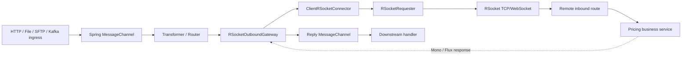
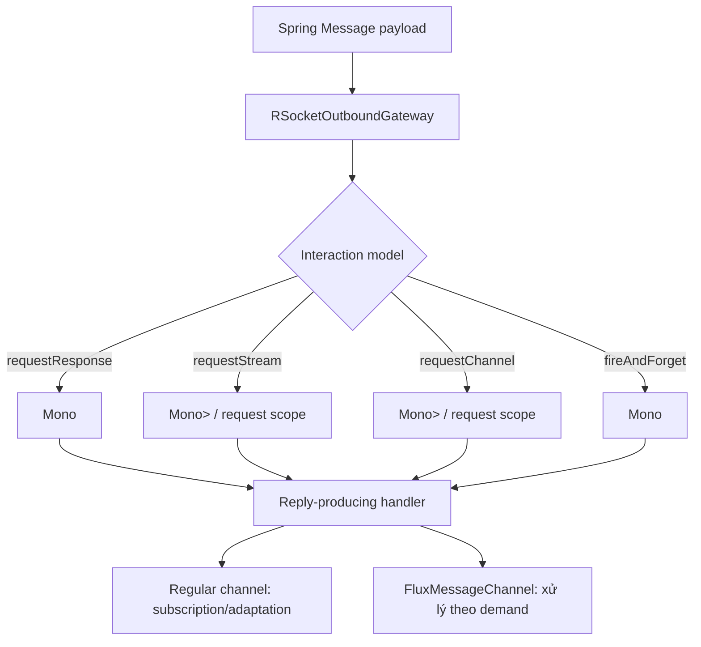
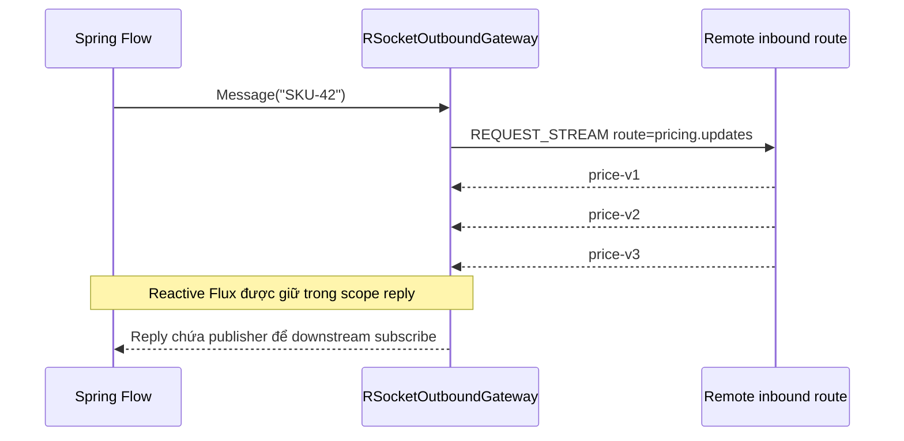
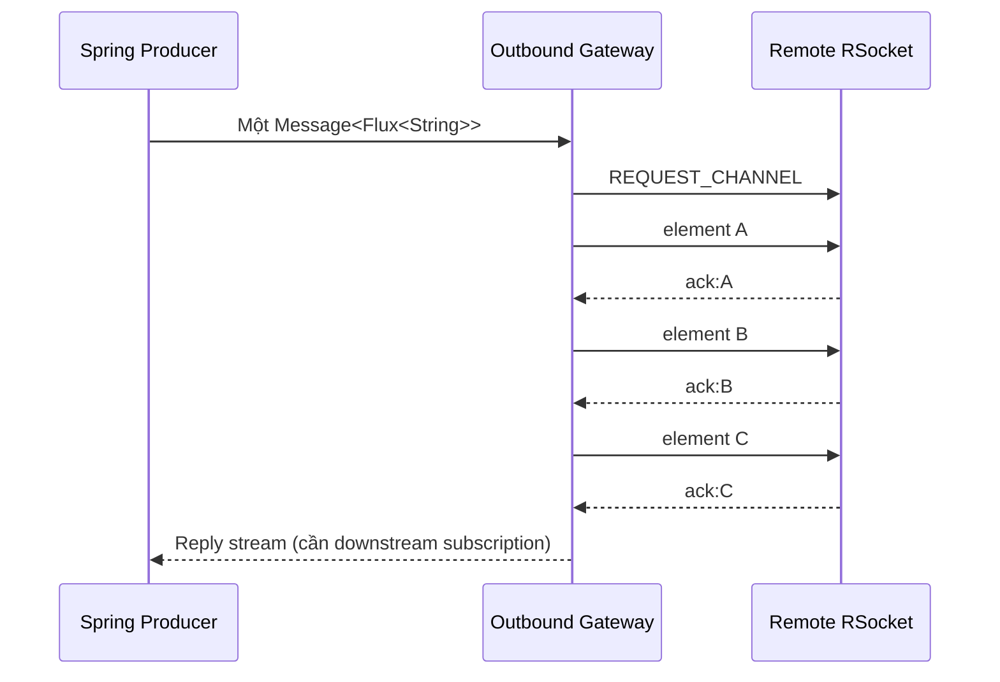
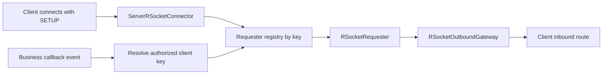
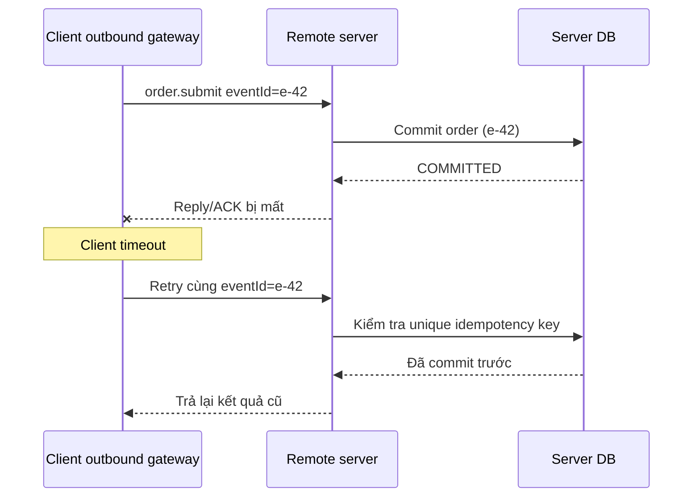
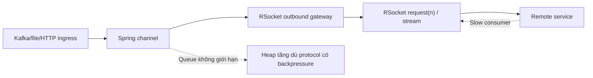
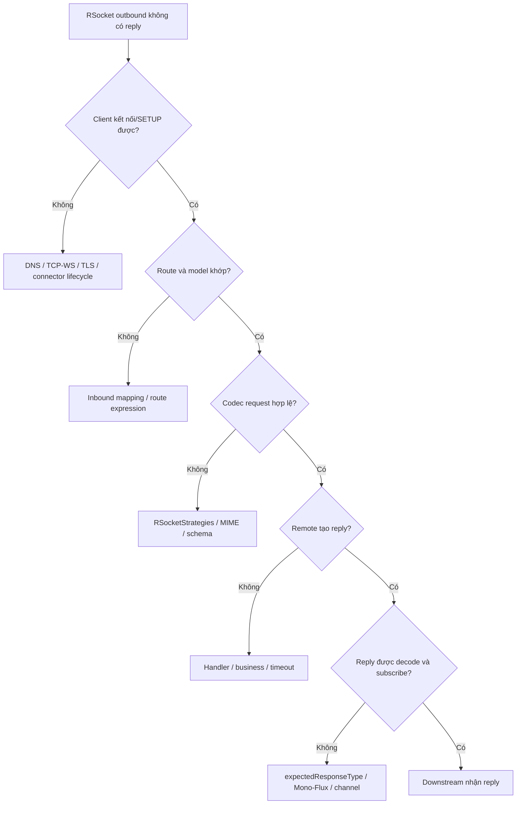

# RSocket outbound gateway trong Spring Integration

## 1. Bài toán: gọi dịch vụ RSocket từ một IntegrationFlow

Giả sử một ứng dụng xử lý đơn hàng nhận dữ liệu qua HTTP, kiểm tra tồn kho trong database, rồi cần hỏi **pricing-service** để xác định giá. Pricing-service không cung cấp HTTP endpoint; nó dùng RSocket và route `pricing.quote`. Có yêu cầu chỉ cần một kết quả giá, nhưng cũng có yêu cầu theo dõi **dòng cập nhật giá** và truyền **một chuỗi sự kiện đầu vào**.

Thay vì để từng service tự tạo và đóng `RSocketRequester` cho mỗi command, ứng dụng có thể dùng **`RSocketOutboundGateway`** trong Spring Integration. Gateway nhận một Spring `Message<?>` từ luồng nội bộ, chọn route cùng interaction model, gửi request qua kết nối RSocket rồi chuyển reply trở lại flow.

Bài **“RSocket outbound gateway”** thuộc chương **Adapter RSocket** của module **SPRING_INTEGRATION_ADAPTERS**. Mục tiêu chung của module là kết nối hệ thống ngoài bằng inbound/outbound adapter, gateway, poller và `MessageChannel`, thực hành qua file, SFTP, HTTP, JMS, AMQP, Kafka và cơ sở dữ liệu, đồng thời xử lý hợp đồng message, lỗi và vòng đời kết nối. Trong bài này, điểm nhấn là **client-side request/reply, reactive response, route/metadata, codec và connector lifecycle**.

### Mục tiêu học tập

Sau khi hoàn thành bài, bạn có thể:

1. Phân biệt `RSocketOutboundGateway`, `ClientRSocketConnector`, `RSocketRequester`, `ServerRSocketConnector` và `RSocketInboundGateway`.
2. Cấu hình outbound gateway bằng Java bean và Java DSL `RSockets.outboundGateway(...)`.
3. Giải thích bốn interaction model: `fireAndForget`, `requestResponse`, `requestStream`, `requestChannel`.
4. Hiểu reply `Mono`, reply `Flux` được bọc trong `Mono`, subscription và ranh giới `FluxMessageChannel`.
5. Chọn `expectedResponseType`, `publisherElementType`, route expression và metadata tương thích giữa client/server.
6. Thiết kế timeout, cancellation, retry và idempotency cho remote request.
7. Phân biệt route RSocket với HTTP URL, kiểu payload với wire MIME type và kết quả send với database commit.
8. Viết kiểm thử tích hợp với server RSocket thật, đo backpressure, routing và lỗi.

## 2. Vị trí outbound gateway trong kiến trúc



| Thành phần | Trách nhiệm | Không tự cung cấp |
| --- | --- | --- |
| `RSocketOutboundGateway` | Biến Spring message thành RSocket request; tạo reply theo model | Server listener hay durable message store |
| `ClientRSocketConnector` | Quản lý requester/kết nối tới RSocket server từ phía client | Business retry, outbox, ACK sau DB commit |
| `RSocketRequester` | API thấp hơn để gửi `route(...)`, `data(...)`, `retrieveMono/Flux(...)` | Spring Integration routing và channel orchestration |
| `RSocketInboundGateway` | Nhận request RSocket ở peer và đưa vào Spring flow | Client connection cho outbound caller |
| `ServerRSocketConnector` | Bind listener và mapping route ở phía server | Tự động xác nhận request đã hoàn tất nghiệp vụ |
| `MessageChannel` | Điều phối Spring `Message<?>` trong JVM | End-to-end transport backpressure hoặc exactly-once |
| `RSocketStrategies` | Encoder/decoder, MIME và dữ liệu trên wire | Authentication/authorization và domain validation |

**“Outbound” chỉ hướng request ra khỏi Spring Integration flow hiện tại**, không phải “bắt buộc nằm trong một client app”. RSocket hỗ trợ giao tiếp hai chiều: phía server đang giữ kết nối với client cũng có thể chủ động gửi request ngược tới client bằng một `RSocketRequester` gắn với connection phù hợp.

### 2.1. So sánh với HTTP outbound gateway

| Đặc điểm | HTTP outbound gateway | RSocket outbound gateway |
| --- | --- | --- |
| Đích | URL, HTTP method | RSocket route trong metadata |
| Connection | HTTP client/transport | RSocket requester và transport TCP/WebSocket |
| Request–reply | Thường một response | `requestResponse` hoặc dòng `requestStream` |
| Dòng hai chiều | Không phải HTTP request thông thường | `requestChannel` |
| Fire-and-forget | HTTP vẫn thường có response status | RSocket `fireAndForget` không có payload reply |
| Backpressure | Tùy API/streaming | RSocket có request(n) cho streaming |
| Durable replay | Không tự có | **Cũng không tự có** |

RSocket không thay thế Kafka/AMQP/JMS nếu bài toán cần broker lưu bền vững, lịch sử tiêu thụ hoặc consumer group offset.

## 3. Bốn interaction model quyết định yêu cầu và kiểu reply

| `RSocketInteractionModel` | Request | Response | Ví dụ |
| --- | --- | --- | --- |
| `requestResponse` | Một payload | Một reply hoặc lỗi | `pricing.quote` |
| `requestStream` | Một payload | `Flux<T>` nhiều phần tử | `pricing.updates` |
| `requestChannel` | `Publisher<T>` nhiều request elements | `Flux<R>` phản hồi | `inventory.ingest` |
| `fireAndForget` | Một payload | **Không** có business response | Telemetry có thể mất |

Tên enum thực tế là **`requestResponse`, `requestStream`, `requestChannel`, `fireAndForget`**; không phải enum viết HOA. `RSocketOutboundGateway` mặc định dùng `requestResponse` nếu không cấu hình interaction model.

### 3.1. Model không đồng nghĩa kiểu Java của từng message

Đối với `requestStream`, gateway phát **một request** rồi nhận nhiều response. Đối với `requestChannel`, payload của **một Spring Message** phải là `Publisher`, ví dụ `Flux<String>`; nó không phải ba lời gọi riêng tới outbound gateway. Một lời gọi `fireAndForget` hoàn tất ở tầng RSocket **không** chứng minh peer đã commit database.

### 3.2. Chọn model theo yêu cầu nghiệp vụ

```text
Hỏi giá một SKU                 → requestResponse
Theo dõi 100 bản cập nhật giá   → requestStream
Gửi một dòng event và nhận ACK  → requestChannel
Gửi nhiệt độ không cần reply    → fireAndForget
```

Không dùng `fireAndForget` chỉ để tăng tốc lệnh thanh toán nếu yêu cầu phải biết đã xử lý thành công. Nếu cần ACK sau commit, chọn giao thức request–response hoặc thiết kế ACK riêng; đồng thời phải xử lý tình huống **ACK mất sau commit** bằng idempotency.

## 4. Điểm khác biệt quan trọng: response có tính reactive

Tài liệu Spring Integration mô tả reply của `RSocketOutboundGateway` ở mức xử lý nội bộ là **`Mono`**, kể cả với `fireAndForget` (khi đó là `Mono<Void>`). Nếu reply gốc là `Flux` của `requestStream` hoặc `requestChannel`, gateway **bọc Flux trong Mono để giữ scope của một request**.



**Không hiểu biểu đồ như một lời hứa rằng mọi downstream message luôn có generic Java type chính xác `Mono<Flux<T>>`.** Framework có bước subscribe/adapt trước khi phát ra **regular output channel**; đối với `FluxMessageChannel`, subscription theo demand. Điều cần nhớ là **không flatten stream một cách vô ý** và phải kiểm tra kiểu payload thực tế tại boundary đã chọn.

### 4.1. Regular channel và FluxMessageChannel

- Với regular reply channel, framework **subscribe/adapt `Mono`** trước khi đưa kết quả vào output channel.
- Với `FluxMessageChannel`, reply reactive được xử lý theo demand.
- Với reply là một `Flux`, downstream cần **lấy `Flux` khỏi payload và subscribe/flatten có chủ đích**.
- Nếu chỉ lấy một `Flux` rồi không ai subscribe, tác vụ phát dữ liệu có thể **chưa chạy**.
- Nếu `FluxMessageChannel` ở **đầu vào** flatten một request `Flux` thành nhiều `Message` đơn lẻ, **scope của một requestChannel bị mất**.

Đây là nguồn lỗi phổ biến: endpoint RSocket hoạt động, nhưng ứng dụng không thu thập stream response, hoặc gửi từng phần tử thay vì một request-channel.

### 4.2. `expectedResponseType`

Khi model không phải `fireAndForget`, `expectedResponseType` xác định kiểu decode phía reply. Nếu không cấu hình, gateway có mặc định **`String.class`**. Với JSON DTO hoặc binary, **không** dựa vào mặc định này.

Đặt `expectedResponseType(QuoteReply.class)` nếu hai phía dùng codec JSON hợp lệ; đặt `byte[].class` nếu protocol trả bytes chưa decode. Với các kiểu generic, có thể dùng biểu thức trả về `ParameterizedTypeReference` theo API tương ứng, nhưng nên có integration test do codec rất dễ không khớp.

## 5. Dependencies và topology

### 5.1. Maven

```xml
<dependencies>
    <dependency>
        <groupId>org.springframework.boot</groupId>
        <artifactId>spring-boot-starter-integration</artifactId>
    </dependency>
    <dependency>
        <groupId>org.springframework.integration</groupId>
        <artifactId>spring-integration-rsocket</artifactId>
    </dependency>
    <!-- Chỉ cần khi ứng dụng dùng Jackson cho JSON DTO. -->
    <dependency>
        <groupId>com.fasterxml.jackson.core</groupId>
        <artifactId>jackson-databind</artifactId>
    </dependency>
    <dependency>
        <groupId>io.projectreactor</groupId>
        <artifactId>reactor-test</artifactId>
        <scope>test</scope>
    </dependency>
</dependencies>
```

Ứng dụng cần BOM Spring Boot/Spring Integration tương thích để quyết định phiên bản. Spring Integration hỗ trợ RSocket từ dòng 5.2, nhưng các API/behavior có thay đổi theo major/minor version; các ví dụ dựa trên các API `RSocketOutboundGateway`, `RSocketOutboundGatewaySpec`, `ClientRSocketConnector` trong các dòng hiện hành. Khi xây dựng dự án thật, kiểm tra JavaDoc đúng version của BOM đang dùng.

### 5.2. application.yml

```yaml
app:
  rsocket:
    host: ${RSOCKET_HOST:127.0.0.1}
    port: ${RSOCKET_PORT:7000}
    response-timeout: ${RSOCKET_RESPONSE_TIMEOUT:5s}
    route:
      uppercase: uppercase
      price: pricing.quote
      stream: pricing.updates
      channel: events.duplex
```

Khi peer ở Kubernetes pod khác, `127.0.0.1` là loopback của **pod đang chạy**, không phải service đích. Phải dùng DNS Service/địa chỉ có route được và port RSocket thực tế. RSocket TCP **khác** endpoint HTTP `http://host:port`; nếu server sử dụng RSocket over WebSocket thì client phải dùng đúng WebSocket transport.

### 5.3. Một kết nối có thể chở nhiều request

RSocket hỗ trợ multiplex nhiều interaction trên cùng một connection. `ClientRSocketConnector` giữ một `RSocketRequester` phục vụ các gateway liên quan; không tạo một client connector và TCP connection **cho mỗi message**.

```text
Client Spring Boot:
  RSocketOutboundGateway("pricing.quote") ─┐
  RSocketOutboundGateway("pricing.updates") ├→ ClientRSocketConnector
  RSocketOutboundGateway("events.duplex") ─┘          ↓
                                              RSocketRequester
                                                     ↓ TCP
Remote ServerRSocketConnector → inbound routes
```

Chia sẻ requester/connection giúp tiết kiệm handshake, nhưng vẫn cần quota và kiểm soát concurrency/active streams. Tất cả request cùng đi qua một connection không biến business transactions thành một transaction chung.

## 6. Khởi tạo `ClientRSocketConnector`

Client connector đại diện một kết nối hướng tới remote server; nó không phải một HTTP session pool tùy ý.

```java
import org.springframework.beans.factory.annotation.Value;
import org.springframework.context.annotation.Bean;
import org.springframework.context.annotation.Configuration;
import org.springframework.integration.rsocket.ClientRSocketConnector;

@Configuration
public class PricingRSocketClientConfiguration {

    @Bean
    public ClientRSocketConnector pricingRSocketConnector(
            @Value("${app.rsocket.host}") String host,
            @Value("${app.rsocket.port}") int port) {
        return new ClientRSocketConnector(host, port);
    }
}
```

`ClientRSocketConnector` có lifecycle do Spring quản lý, có `getRequester()` để lấy requester đã kết nối, cùng các tùy chọn `setSetupRoute`, `setSetupData`, `setSetupMetadata`, `setRSocketStrategies` và `setConnectorConfigurer`. Việc `connect`/setup có thể liên quan I/O bất đồng bộ; **khởi tạo bean xong chưa chứng minh peer đã sẵn sàng xử lý request**.

### 6.1. SETUP route khác business request route

```java
@Bean
public ClientRSocketConnector pricingConnector() {
    ClientRSocketConnector connector =
            new ClientRSocketConnector("pricing-service", 7000);
    connector.setSetupRoute("connect/client");
    connector.setSetupData("order-service");
    return connector;
}
```

Đây là **ví dụ biến thể** thay thế bean ở trên; không tạo cả hai nếu không cần hai kết nối. `setupRoute` và `setupData` được gửi khi **thiết lập kết nối**, không tự thay thế `RSockets.outboundGateway("pricing.quote")` cho từng business request. Không nhét token nhạy cảm vào log SETUP.

### 6.2. Client connector với WebSocket

`ClientRSocketConnector` có overload nhận `URI` dùng WebSocket client transport theo API. Chỉ dùng khi server thực sự mở một RSocket/WebSocket endpoint, ví dụ qua `ws://...` hoặc `wss://...`. Không thay `tcp://` bằng `ws://` rồi kỳ vọng firewall, proxy, TLS và handshake vẫn giữ nguyên.

### 6.3. Startup và readiness

Các trạng thái cần phân biệt:

| Quan sát | Có thể kết luận | Chưa thể kết luận |
| --- | --- | --- |
| Spring context tạo `ClientRSocketConnector` | Bean có mặt | Peer online |
| TCP connect/SETUP thành công | Transport/codec setup cơ bản hoạt động | Route `pricing.quote` tồn tại |
| Request trả text thử nghiệm | Route, model và codec hoạt động cho trường hợp đó | Mọi nghiệp vụ và DB đều sẵn sàng |
| Business reply sau commit | Có bằng chứng theo contract của request | Không có duplicate khi retry các request khác |

Readiness nên kiểm tra một route **không tạo side effect**, với timeout/quota phù hợp. Không chọn một API tạo đơn hàng làm health probe.

## 7. Java DSL tối thiểu: request–response

Đây là mô hình chủ đạo của **RSocket outbound gateway**.

### 7.1. Flow gửi chuỗi và nhận chuỗi

```java
import org.springframework.context.annotation.Bean;
import org.springframework.context.annotation.Configuration;
import org.springframework.integration.dsl.IntegrationFlow;
import org.springframework.integration.rsocket.ClientRSocketConnector;
import org.springframework.integration.rsocket.RSocketInteractionModel;
import org.springframework.integration.rsocket.dsl.RSockets;

@Configuration
public class UppercaseRSocketOutboundFlow {

    @Bean
    public IntegrationFlow uppercaseRequestFlow(
            ClientRSocketConnector pricingRSocketConnector) {

        return IntegrationFlow
                .from("uppercaseRequests")
                .handle(RSockets.outboundGateway("uppercase")
                        .interactionModel(
                                RSocketInteractionModel.requestResponse)
                        .expectedResponseType(String.class)
                        .clientRSocketConnector(pricingRSocketConnector))
                .channel("uppercaseReplies")
                .get();
    }
}
```

Đây là **flow phía client**. Nó cần có `uppercaseRequests` làm đầu vào và `uppercaseReplies` là điểm nhận reply; các channel có thể được khai báo/đăng ký bởi Spring Integration theo DSL phù hợp hoặc tạo bean tường minh. Remote server **phải** có route `uppercase` đã đăng ký, sử dụng `requestResponse` và codec tương thích. `handle(...)` ở đây thực hiện một tương tác RSocket, không phải xử lý local.

### 7.2. Tạo message từ business service

```java
import org.springframework.beans.factory.annotation.Qualifier;
import org.springframework.messaging.MessageChannel;
import org.springframework.messaging.support.MessageBuilder;
import org.springframework.stereotype.Service;

@Service
public class UppercaseRequestPublisher {

    private final MessageChannel channel;

    public UppercaseRequestPublisher(
            @Qualifier("uppercaseRequests") MessageChannel channel) {
        this.channel = channel;
    }

    public void dispatch(String text) {
        if (text == null || text.isBlank() || text.length() > 4_096) {
            throw new IllegalArgumentException("Input không hợp lệ");
        }
        boolean accepted = channel.send(
                MessageBuilder.withPayload(text).build());
        if (!accepted) {
            throw new IllegalStateException(
                    "Spring MessageChannel không tiếp nhận request");
        }
    }
}
```

**Không có `String result = channel.send(...)`**: `MessageChannel.send(...)` trả boolean, chỉ phản ánh boundary Spring, **không** phải giá trị trả về của remote route. Phải nhận reply qua channel/gateway contract đã cấu hình, hoặc dùng một Java `@MessagingGateway` request–reply API sau khi đã kiểm thử asynchronous reply.

### 7.3. Nếu cần API giống một phương thức

Một cách chọn kiểu giao diện thích hợp với Spring Integration:

```java
import org.springframework.integration.annotation.Gateway;
import org.springframework.integration.annotation.MessagingGateway;

@MessagingGateway
public interface PricingRequestGateway {

    @Gateway(requestChannel = "uppercaseRequests")
    String uppercase(String text);
}
```

Interface này chỉ là **mặt trước của một Spring messaging gateway**, không phải bản thân `RSocketOutboundGateway`. Vì outbound handler làm việc theo reactive/async semantics, phải **kiểm chứng** rằng kiểu trả về, reply channel, reply timeout và cơ chế subscribe/adapt hoạt động đúng với phiên bản đang dùng; không mặc định việc gọi phương thức đồng bộ an toàn trên Netty event-loop.

Nếu caller là một reactive endpoint, ưu tiên thiết kế trả `Mono<T>` hoặc dùng API `RSocketRequester` trong một reactive chain phù hợp, tránh vô tình `block()` trên event loop.

## 8. Java bean: khai báo `RSocketOutboundGateway` trực tiếp

Java DSL không phải cách duy nhất. Có thể khai báo bean handler và gắn `@ServiceActivator`:

```java
import org.springframework.beans.factory.annotation.Qualifier;
import org.springframework.context.annotation.Bean;
import org.springframework.context.annotation.Configuration;
import org.springframework.integration.annotation.ServiceActivator;
import org.springframework.integration.rsocket.ClientRSocketConnector;
import org.springframework.integration.rsocket.RSocketInteractionModel;
import org.springframework.integration.rsocket.outbound.RSocketOutboundGateway;

@Configuration
public class DirectRSocketOutboundGatewayConfiguration {

    @Bean
    @ServiceActivator(
            inputChannel = "directUppercaseRequests",
            outputChannel = "directUppercaseReplies")
    public RSocketOutboundGateway directUppercaseGateway(
            @Qualifier("pricingRSocketConnector")
            ClientRSocketConnector connector) {

        RSocketOutboundGateway gateway =
                new RSocketOutboundGateway("uppercase");
        gateway.setClientRSocketConnector(connector);
        gateway.setInteractionModel(
                RSocketInteractionModel.requestResponse);
        gateway.setExpectedResponseType(String.class);
        return gateway;
    }
}
```

Ví dụ này là **phương án thay thế** cho Java DSL ở mục 7: không khai báo cả hai flow với cùng input channel nếu không cố ý muốn fan-out. Trong thực tế hãy chọn một cách cấu hình và giữ ownership của client connector rõ ràng.

### 8.1. Giải thích API

| API | Tác dụng |
| --- | --- |
| `new RSocketOutboundGateway("uppercase")` | Cấu hình route tĩnh |
| `setClientRSocketConnector(...)` | Dùng connection/requester phía client |
| `setInteractionModel(requestResponse)` | Chọn một request/một response |
| `setExpectedResponseType(String.class)` | Decode reply thành `String` |
| `@ServiceActivator(inputChannel=..., outputChannel=...)` | Kết nối outbound handler với Spring channels |

Trong mode **server gửi request ngược tới client**, `setClientRSocketConnector` không bắt buộc nếu message có header requester chính xác. Phần callback hai chiều được giải thích ở mục sau; không lấy connector của một server khác để gửi bừa sang client.

## 9. Đối chiếu với remote inbound gateway

Một outbound gateway chỉ có giá trị khi có peer xử lý route tương ứng. Để người học dễ thử, dưới đây là server demo độc lập:

```java
import java.util.Locale;
import org.springframework.context.annotation.Bean;
import org.springframework.context.annotation.Configuration;
import org.springframework.integration.dsl.IntegrationFlow;
import org.springframework.integration.rsocket.ServerRSocketConnector;
import org.springframework.integration.rsocket.RSocketInteractionModel;
import org.springframework.integration.rsocket.dsl.RSockets;
import reactor.core.publisher.Flux;
import reactor.core.publisher.Mono;

@Configuration
public class DemoRSocketServer {

    @Bean
    public ServerRSocketConnector rsocketServer() {
        return new ServerRSocketConnector("0.0.0.0", 7000);
    }

    @Bean
    public IntegrationFlow uppercaseInboundFlow() {
        return IntegrationFlow
                .from(RSockets.inboundGateway("uppercase")
                        .interactionModels(
                                RSocketInteractionModel.requestResponse))
                .<Flux<String>, Mono<String>>transform(incoming ->
                        incoming.next().map(
                                value -> value.toUpperCase(Locale.ROOT)))
                .get();
    }
}
```

Đây là **cấu hình server chạy riêng** với client ở mục 7. Không tạo `ServerRSocketConnector` bind cổng 7000 **cả ở client** và một Boot RSocket server khác cùng port. Phía server phải chọn `RSocketStrategies`/MIME type phù hợp để decode `String`.

### 9.1. Khi không cần Integration inbound gateway

Server có thể dùng `@MessageMapping("uppercase")` của Spring Messaging thay vì một inbound IntegrationFlow. Outbound gateway **không bắt buộc remote cũng dùng Spring Integration**; một server Java, Kotlin, Node hoặc Go có RSocket implementation tương thích có thể phục vụ route đã thống nhất.

Điều kiện là **route, interaction model, MIME type và payload schema phải khớp**.

## 10. Requester trực tiếp để kiểm chứng wire contract

Để tách lỗi ở outbound gateway khỏi lỗi protocol, có thể gọi trực tiếp qua `RSocketRequester`:

```java
import java.time.Duration;
import org.springframework.messaging.rsocket.RSocketRequester;
import org.springframework.util.MimeTypeUtils;
import reactor.core.publisher.Mono;

public final class DirectRequesterProbe {

    public static Mono<String> probe() {
        RSocketRequester requester = RSocketRequester.builder()
                .dataMimeType(MimeTypeUtils.TEXT_PLAIN)
                .tcp("127.0.0.1", 7000);

        return requester.route("uppercase")
                .data("xin chao")
                .retrieveMono(String.class)
                .timeout(Duration.ofSeconds(5));
    }
}
```

**Probe chỉ dùng trong môi trường kiểm thử hoặc vận hành kiểm soát**, không tạo requester mới mỗi request production. Caller phải subscribe vào `Mono` (ví dụ qua `StepVerifier`) thì reactive exchange mới diễn ra. Khi gateway Spring Integration lỗi nhưng requester trực tiếp thành công, kiểm tra lại message channel, loại payload, route expression và reply subscription.

## 11. Route tĩnh, route động và biến trong route

### 11.1. Route cố định

```java
RSockets.outboundGateway("pricing.quote")
        .interactionModel(RSocketInteractionModel.requestResponse)
        .expectedResponseType(QuoteReply.class)
        .clientRSocketConnector(connector);
```

Route RSocket là **metadata**, không phải HTTP `GET /pricing.quote`. Hai bên phải thống nhất đúng chuỗi/pattern; việc thêm hoặc bỏ dấu `/` có thể thay đổi mapping tùy server.

### 11.2. Route template

API hỗ trợ route template và route variables:

```java
RSockets.outboundGateway("pricing/{version}/quote", "v1")
        .interactionModel(RSocketInteractionModel.requestResponse)
        .expectedResponseType(QuoteReply.class)
        .clientRSocketConnector(connector);
```

Biến được mở rộng thành route theo logic của requester, **không** tự kiểm tra quyền của caller. Không chấp nhận route variables không giới hạn từ người dùng để truy cập một route quản trị nhạy cảm.

### 11.3. Route động dựa trên Spring header

`RSockets.outboundGateway(...)` có overload nhận `Function<Message<P>, ?>`. Có thể viết:

```java
import org.springframework.messaging.Message;
import org.springframework.integration.rsocket.dsl.RSockets;

// Đoạn DSL bên trong .handle(...):
RSockets.outboundGateway((Message<String> message) -> {
            String requested =
                    (String) message.getHeaders().get("businessRoute");
            if (!"pricing.quote".equals(requested) &&
                    !"pricing.preview".equals(requested)) {
                throw new IllegalArgumentException(
                        "Route không được phép");
            }
            return requested;
        })
        .interactionModel(RSocketInteractionModel.requestResponse)
        .expectedResponseType(String.class)
        .clientRSocketConnector(connector);
```

**Quan trọng:** route expression làm cho endpoint linh hoạt, nhưng **route lấy từ message header là dữ liệu có thể không tin cậy**. Dùng whitelist/authorization và tránh ánh xạ nguyên văn input đến route tùy ý của peer.

### 11.4. Route expression và request scope

Route expression được đánh giá trên **request Spring Message**, không tự lấy từ field trong một `Flux<T>` đã bị flatten. Nếu một `FluxMessageChannel` đã biến từng phần tử của request-channel thành message riêng, không còn một request scope ban đầu để gắn metadata/route một cách chính xác.

## 12. Kiểu response và schema

Với request–response JSON, có thể định nghĩa DTO:

```java
// Java 17+, file QuoteRequest.java
public record QuoteRequest(
        String sku, int quantity, String requestId) {
}

// File QuoteReply.java
public record QuoteReply(
        String sku, int quantity,
        long totalCents, String requestId) {
}
```

```json
{
  "sku": "SKU-42",
  "quantity": 3,
  "requestId": "req-20261123-42"
}
```

Server trả:

```json
{
  "sku": "SKU-42",
  "quantity": 3,
  "totalCents": 123450,
  "requestId": "req-20261123-42"
}
```

Trong DSL, có thể dùng:

```java
.handle(RSockets.outboundGateway("pricing.quote")
        .interactionModel(RSocketInteractionModel.requestResponse)
        .expectedResponseType(QuoteReply.class)
        .clientRSocketConnector(connector))
```

Điều kiện để chạy là client và server có **codec JSON tương thích**, `dataMimeType` (thường `application/json`) phù hợp và model đúng. `expectedResponseType(QuoteReply.class)` chỉ hướng dẫn decoder; nó **không tự sửa** JSON sai schema hoặc tự chọn đúng loại MIME cho request.

### 12.1. Validation trước khi gửi

```java
public final class QuoteValidation {

    private QuoteValidation() {
    }

    public static void validate(QuoteRequest req) {
        if (req == null ||
                req.sku() == null ||
                !req.sku().matches("[A-Za-z0-9_-]{1,64}") ||
                req.quantity() < 1 || req.quantity() > 10_000 ||
                req.requestId() == null ||
                !req.requestId().matches("[A-Za-z0-9_-]{1,128}")) {
            throw new IllegalArgumentException(
                    "QuoteRequest không hợp lệ");
        }
    }
}
```

Các quy tắc ở đây là ví dụ; production phải kiểm tra tenant, entitlement, giá hợp lệ, byte limit và khả năng tự hồi phục khi client timeout. Không đưa toàn bộ JPA entity hoặc thông tin nhạy cảm qua RSocket chỉ vì Jackson có thể serialize nó.

### 12.2. Khi response là generic

Nếu route trả `List<QuoteReply>` hoặc `Page<QuoteReply>`, kiểu response cần giữ generic type bằng cơ chế expression/`ParameterizedTypeReference` mà API hỗ trợ. Nếu chỉ chọn `List.class`, nội dung có thể giải mã thành `Map` thay vì DTO typed. Với dữ liệu nhiều phần tử, cân nhắc `requestStream` để không materialize tất cả vào RAM.

## 13. `requestStream`: một request, nhiều response

Khi cần theo dõi cập nhật giá, có thể gọi route `pricing.updates` bằng `RSocketInteractionModel.requestStream`. Outbound gateway gửi **một request**, remote publisher phát nhiều phần tử cho tới khi hoàn tất, lỗi hoặc bị cancel.



### 13.1. Flow outbound

```java
import org.springframework.context.annotation.Bean;
import org.springframework.context.annotation.Configuration;
import org.springframework.integration.dsl.IntegrationFlow;
import org.springframework.integration.rsocket.ClientRSocketConnector;
import org.springframework.integration.rsocket.RSocketInteractionModel;
import org.springframework.integration.rsocket.dsl.RSockets;

@Configuration
public class PricingUpdatesOutboundFlow {

    @Bean
    public IntegrationFlow priceStreamGatewayFlow(
            ClientRSocketConnector pricingRSocketConnector) {

        return IntegrationFlow
                .from("priceUpdatesRequests")
                .handle(RSockets.outboundGateway("pricing.updates")
                        .interactionModel(
                                RSocketInteractionModel.requestStream)
                        .expectedResponseType(String.class)
                        .clientRSocketConnector(pricingRSocketConnector))
                .channel("priceStreamReplies")
                .get();
    }
}
```

Ở client, message gửi tới `priceUpdatesRequests` có thể chứa `"SKU-42"`. Remote route phải được cài như một `requestStream` và trả dữ liệu có codec `String`. `expectedResponseType(String.class)` là kiểu **mỗi phần tử response**, không phải yêu cầu “server gửi toàn bộ stream thành một chuỗi String duy nhất”.

### 13.2. Downstream phải subscribe vào Flux reply

Tài liệu Spring Integration mô tả một cách flatten reply stream:

```java
import org.springframework.integration.annotation.ServiceActivator;
import reactor.core.publisher.Flux;

@ServiceActivator(
        inputChannel = "priceStreamReplies",
        outputChannel = "priceUpdatesFluxChannel")
public Flux<?> flattenRSocketResponse(Flux<?> payload) {
    return payload;
}
```

Trong mô hình này, `priceUpdatesFluxChannel` nên được xây cho xử lý **reactive/`FluxMessageChannel`** đúng ngữ nghĩa. Một service activator chỉ trả `Flux` mà không có subscriber ở phía sau có thể không kích hoạt xử lý stream; ngược lại, subscribe vô điều kiện ở nhiều nơi có thể gửi lại request cho một publisher lạnh hoặc nhân đôi side effect.

**Không viết `collectList().block()` ngay trong event-loop để “đổi Flux thành List”**. Nếu cần tổng hợp một chuỗi hữu hạn, `collectList()` trả `Mono<List<T>>` và phải có hạn mức số phần tử/timeout. Với stream vô hạn, nó không hoàn tất và có nguy cơ tăng memory.

### 13.3. Cách xử lý phía caller

Một handler downstream nhận reply `Flux<String>` có thể gắn phép biến đổi:

```java
import java.time.Duration;
import reactor.core.publisher.Flux;

public Flux<String> normalizeUpdates(Flux<String> updates) {
    return updates
            .filter(value -> value != null && !value.isBlank())
            .take(100)
            .timeout(Duration.ofSeconds(15))
            .doOnCancel(() -> System.out.println("Client cancelled"));
}
```

Hàm này chỉ là **ví dụ xử lý publisher**; cần cho downstream subscribe. `take(100)` giới hạn số phần tử, và `timeout` ở đây áp dụng theo semantics reactive operator được chọn, không tự đặt **tổng SLA** cho mọi request trong hệ thống.

### 13.4. Một requestStream không tự có lịch sử

Khi mạng đứt hoặc client hủy subscription, RSocket không tự cung cấp offset bền vững để phát lại những phần tử đã bỏ lỡ. Nếu cần resume có độ tin cậy cao, phải thêm:

1. `streamId` và `eventId`/`sequenceNumber` trong payload.
2. Cursor/offset/checkpoint theo client.
3. Event store hoặc snapshot nguồn dữ liệu.
4. Quy tắc resubscribe/replay và xử lý duplicate.

Không nên coi khả năng multiplex và backpressure của RSocket là một durable event log.

## 14. `requestChannel`: một Publisher đầu vào, một dòng phản hồi

Khác `requestStream`, `requestChannel` có **stream ở cả hai chiều**:



### 14.1. Java DSL

```java
import org.springframework.context.annotation.Bean;
import org.springframework.context.annotation.Configuration;
import org.springframework.integration.dsl.IntegrationFlow;
import org.springframework.integration.rsocket.ClientRSocketConnector;
import org.springframework.integration.rsocket.RSocketInteractionModel;
import org.springframework.integration.rsocket.dsl.RSockets;

@Configuration
public class EventsRequestChannelOutboundFlow {

    @Bean
    public IntegrationFlow duplexEventsFlow(
            ClientRSocketConnector pricingRSocketConnector) {

        return IntegrationFlow
                .from("duplexEventsRequests")
                .handle(RSockets.outboundGateway("events.duplex")
                        .interactionModel(
                                RSocketInteractionModel.requestChannel)
                        .publisherElementType(String.class)
                        .expectedResponseType(String.class)
                        .clientRSocketConnector(pricingRSocketConnector))
                .channel("duplexEventsReplies")
                .get();
    }
}
```

`publisherElementType(String.class)` chỉ kiểu **mỗi phần tử gửi** trong `Publisher`. `expectedResponseType(String.class)` chọn kiểu **mỗi phần tử reply**. Đối với DTO JSON, cả hai phía cần thống nhất codec/MIME type. Với `requestChannel` có generic data type, cấu hình expression có thể trả về `ParameterizedTypeReference` khi API hỗ trợ.

### 14.2. Gửi một Flux như payload của **một** Spring Message

```java
import org.springframework.messaging.MessageChannel;
import org.springframework.messaging.support.MessageBuilder;
import reactor.core.publisher.Flux;

public void submitDuplex(
        MessageChannel duplexEventsRequests) {

    Flux<String> requestElements = Flux.just("a", "b", "c");
    boolean accepted = duplexEventsRequests.send(
            MessageBuilder.withPayload(requestElements).build());
    if (!accepted) {
        throw new IllegalStateException(
                "Channel không tiếp nhận request-channel");
    }
}
```

**Không** thay bằng:

```java
// PHẢN VÍ DỤ: tạo ba Spring Messages riêng rẽ.
Flux.just("a", "b", "c").subscribe(value ->
        duplexEventsRequests.send(
                MessageBuilder.withPayload(value).build()));
```

Ba lời gọi thứ hai là **ba request messages độc lập**, không phải một `requestChannel` với ba input elements. Nếu upstream `FluxMessageChannel` tự flatten payload `Flux`, request scope còn có thể bị mất trước khi outbound gateway nhận message. Vì vậy hãy kiểm tra channel topology và loại payload tại gateway.

### 14.3. Backpressure hai chiều

RSocket request-channel sử dụng reactive demand/cancel để điều tiết dữ liệu trên từng hướng khi publisher tuân thủ contract. Nhưng:

- `flatMap` có concurrency lớn có thể tạo nhiều side effects đồng thời.
- Một buffer bất định trong `ExecutorChannel` có thể làm heap tăng.
- Source bên ngoài không hỗ trợ backpressure cần bounded buffer hoặc policy rõ.
- Reply stream có thể không có quan hệ 1:1 với request elements.
- Cancel có thể dừng phần chưa xử lý, nhưng **không rollback transaction đã commit**.

Nếu dùng response “ACK cho từng event”, xác định chính xác ACK nghĩa là **đã nhận**, **đã lưu bền vững**, hay **đã commit**. Không đặt `ack` trong một `map` đơn thuần rồi mặc định nó là xác nhận transaction.

## 15. `fireAndForget`: không mong business reply

`fireAndForget` dùng khi client không cần application response payload. Có thể dùng với telemetry có chính sách mất dữ liệu rõ hoặc tín hiệu không quan trọng.

```java
import org.springframework.context.annotation.Bean;
import org.springframework.context.annotation.Configuration;
import org.springframework.integration.dsl.IntegrationFlow;
import org.springframework.integration.rsocket.ClientRSocketConnector;
import org.springframework.integration.rsocket.RSocketInteractionModel;
import org.springframework.integration.rsocket.dsl.RSockets;

@Configuration
public class TelemetryFireAndForgetFlow {

    @Bean
    public IntegrationFlow sendTelemetry(
            ClientRSocketConnector pricingRSocketConnector) {

        return IntegrationFlow
                .from("telemetryToSend")
                .handle(RSockets.outboundGateway("telemetry.ingest")
                        .interactionModel(
                                RSocketInteractionModel.fireAndForget)
                        .expectedResponseType(void.class)
                        .clientRSocketConnector(pricingRSocketConnector))
                .channel("nullChannel")
                .get();
    }
}
```

Theo reference, outbound gateway trả `Mono<Void>` nội bộ cho fire-and-forget. **Kể cả khi muốn hành xử giống outbound channel adapter và đặt response type là `void`, vẫn phải có `outputChannel`** (ví dụ `nullChannel`) để khởi động subscription đúng trong flow.

**Đừng bỏ `.channel("nullChannel")` chỉ vì không có business reply rồi mặc định request được gửi.** Những chi tiết subscription và channel adapter/gateway ở phiên bản đang chạy phải được xác minh bằng integration test.

### 15.1. Fire-and-forget không có ACK nghiệp vụ

Client nhìn thấy `Mono<Void>` hoàn tất không thể suy ra:

- DB đã commit.
- Event đã được ghi vào kho bền vững.
- Worker không xử lý trùng.
- Remote có khả năng replay qua restart.

Nếu command quan trọng, dùng transactional outbox, idempotency và một giao thức ACK/đối soát phù hợp; hoặc đổi sang `requestResponse` để nhận status có nghĩa được định nghĩa rõ.

## 16. Chọn interaction model, response type động

Gateway có thể nhận static interaction model hoặc **Function/SpEL expression** đánh giá trên Spring request message.

### 16.1. Chọn model dựa trên header đã được kiểm tra

```java
import org.springframework.messaging.Message;
import org.springframework.integration.rsocket.RSocketInteractionModel;
import org.springframework.integration.rsocket.dsl.RSockets;

RSockets.outboundGateway("events.endpoint")
        .interactionModel((Message<String> message) -> {
            Object model = message.getHeaders().get("rsocketModel");
            if ("fire-and-forget".equals(model)) {
                return RSocketInteractionModel.fireAndForget;
            }
            if ("request-response".equals(model)) {
                return RSocketInteractionModel.requestResponse;
            }
            throw new IllegalArgumentException(
                    "Interaction model không được phép");
        })
        .expectedResponseType(String.class)
        .clientRSocketConnector(connector);
```

Ví dụ là **một builder fragment** được dùng bên trong `.handle(...)`; route/model ở đây là giả định server hỗ trợ cả hai. Chọn model động cần nhất quán với **response type, output channel và input payload**, đặc biệt nếu một nhánh là `fireAndForget` còn nhánh khác là request–reply. Trong production, **thường dễ hiểu hơn khi tách hai flow** theo model thay vì để một endpoint động phục vụ quá nhiều semantics.

### 16.2. Kiểu response động

API hỗ trợ `setExpectedResponseTypeExpression(...)` hoặc DSL `.expectedResponseType(...)` dạng expression/Function, ví dụ chọn `String.class` hoặc DTO class tùy route. Không trả một string tên class không đáng tin và để SpEL tự tạo kiểu tùy ý; nên whitelist kiểu được phép.

```text
route=pricing.quote       → expectedResponseType=QuoteReply.class
route=pricing.summaryText → expectedResponseType=String.class
route=inventory.raw       → expectedResponseType=byte[].class
```

Chỉ đổi Java type ở outbound gateway không làm remote reply thay codec. MIME và schema trên wire phải phù hợp, nếu không có thể gặp decoding exception hoặc payload sai kiểu.

## 17. Metadata, MIME và route khác nhau thế nào?

RSocket payload có **data** và **metadata**; route thường được biểu diễn qua routing metadata. Spring Integration outbound gateway có thể thêm metadata bằng một expression tạo **`Map<Object, MimeType>`**.

| Thành phần | Ví dụ | Mục đích |
| --- | --- | --- |
| Route | `pricing.quote` | Định tuyến đến handler remote |
| Data MIME | `application/json` | Chọn encoder/decoder body |
| Metadata MIME | composite metadata/routing metadata theo connector | Đọc route và phần metadata khác |
| Application metadata | Trace ID/schema info, nếu đã thỏa thuận | Quan sát hoặc hợp đồng business |
| Setup metadata | Gửi khi mở connection | Thương lượng/nhận dạng connection; không phải mỗi request |
| Spring `MessageHeaders` | `traceId`, `replyChannel` | Metadata nội bộ JVM, không tự serialize toàn bộ |

### 17.1. Ví dụ `metadata(...)` trong DSL

```java
import java.util.Map;
import org.springframework.messaging.Message;
import org.springframework.util.MimeType;
import org.springframework.util.MimeTypeUtils;
import org.springframework.integration.rsocket.dsl.RSockets;

RSockets.outboundGateway("pricing.quote")
        .metadata((Message<QuoteRequest> message) ->
                Map.<Object, MimeType>of(
                        "schema-v1", MimeTypeUtils.TEXT_PLAIN))
        .expectedResponseType(QuoteReply.class)
        .clientRSocketConnector(connector);
```

Đây chỉ là **metadata bổ sung mang giá trị chuỗi trong một MIME type**. Remote phải có cách parse/đồng ý nhận metadata đó; không giả định Spring tự ánh xạ `schema-v1` thành field `schemaVersion` trong JSON. Không truyền token hoặc dữ liệu riêng tư nếu chưa có cơ chế security phù hợp.

### 17.2. Khi cần metadata từ request headers

```java
.metadata((Message<QuoteRequest> message) -> {
    Object raw = message.getHeaders().get("traceId");
    String trace = raw instanceof String value &&
            value.matches("[A-Za-z0-9_-]{1,128}")
            ? value : "missing-trace-id";
    return Map.<Object, MimeType>of(
            trace, MimeTypeUtils.TEXT_PLAIN);
})
```

Hãy kiểm tra phạm vi tin cậy: một trace ID không chứng minh caller được phép truy cập SKU/tenant. Nếu server cần authorization, dùng thông tin principal đã xác thực và kiểm tra quyền ở business boundary.

### 17.3. `RSocketStrategies`

`RSocketStrategies` xác định encoder/decoder cho text, JSON, binary hoặc DTO. Có thể cấu hình trực tiếp trên connector:

```java
import org.springframework.context.annotation.Bean;
import org.springframework.context.annotation.Configuration;
import org.springframework.core.codec.CharSequenceEncoder;
import org.springframework.core.codec.StringDecoder;
import org.springframework.integration.rsocket.ClientRSocketConnector;
import org.springframework.messaging.rsocket.RSocketStrategies;
import org.springframework.util.MimeTypeUtils;

@Configuration
public class TextRSocketClientCodec {

    @Bean
    public RSocketStrategies textRSocketStrategies() {
        return RSocketStrategies.builder()
                .decoder(StringDecoder.textPlainOnly())
                .encoder(CharSequenceEncoder.allMimeTypes())
                .build();
    }

    @Bean
    public ClientRSocketConnector textClientConnector(
            RSocketStrategies textRSocketStrategies) {
        ClientRSocketConnector connector =
                new ClientRSocketConnector("127.0.0.1", 7000);
        connector.setRSocketStrategies(textRSocketStrategies);
        connector.setDataMimeType(MimeTypeUtils.TEXT_PLAIN);
        return connector;
    }
}
```

Đây là **cấu hình thay thế** cho connector ở mục 6; không dùng text-only codec cho DTO JSON rồi kỳ vọng Jackson tự hoạt động. Với JSON, cần codec Jackson phù hợp với BOM, data MIME `application/json` và schema version nhất quán. Định dạng body phải được kiểm thử cả hai chiều.

### 17.4. Phân biệt SETUP metadata và per-request metadata

`setSetupRoute(...)` được gửi trong SETUP connection, phục vụ nhận dạng client/đăng ký callback nếu server hỗ trợ. `.metadata(...)` trên outbound gateway áp dụng cho **mỗi request** được tạo từ `Message<?>`. Đừng dùng SETUP route như thể nó là route xử lý tất cả business requests.

## 18. Server gửi request ngược lại client

RSocket là kết nối hai chiều. `RSocketOutboundGateway` có thể được sử dụng **trong một ứng dụng server** để gửi request tới một RSocket client đã kết nối.

### 18.1. Hai cách xác định requester

1. **Client-side:** gọi `setClientRSocketConnector(...)`; gateway lấy `RSocketRequester` từ connector.
2. **Server-side callback:** request Spring message chứa header `RSocketRequesterMethodArgumentResolver.RSOCKET_REQUESTER_HEADER` với giá trị `RSocketRequester` phù hợp; gateway dùng requester trong header thay vì client connector.

Server cũng có thể lấy requester từ `ServerRSocketConnector.getClientRSocketRequester(key)` hoặc qua `RSocketConnectedEvent`, với `clientRSocketKeyStrategy` đã định nghĩa trước.



### 18.2. Minh họa chọn requester ở server

```java
import org.springframework.integration.rsocket.ServerRSocketConnector;
import org.springframework.messaging.rsocket.RSocketRequester;

// Đoạn logic được dùng trong service phía server:
RSocketRequester requester =
        serverConnector.getClientRSocketRequester(clientKey);

if (requester == null) {
    throw new IllegalStateException(
            "Client chưa kết nối hoặc không còn trong registry");
}
```

Muốn gửi bằng outbound gateway qua requester đó, Spring message cần có header:

```java
import org.springframework.messaging.rsocket.annotation.support.RSocketRequesterMethodArgumentResolver;
import org.springframework.messaging.support.MessageBuilder;

var callbackMessage = MessageBuilder
        .withPayload("recalculate")
        .setHeader(
                RSocketRequesterMethodArgumentResolver
                        .RSOCKET_REQUESTER_HEADER,
                requester)
        .build();
```

Trong ví dụ này, **không** cấu hình `clientRSocketConnector` cho outbound gateway ở phía server; gateway sẽ lấy requester từ header khi xử lý message. Đây là kiến trúc **tùy chọn nâng cao**, cần xác thực/authorize đúng `clientKey`, route và trạng thái connection; **không** gửi callback tới mọi client dựa vào ID do người dùng cung cấp.

### 18.3. Rủi ro của callback

- Một client disconnect có thể khiến requester trong registry không còn sử dụng được.
- Client có thể không đăng ký inbound route mong muốn.
- Kết quả connect không chứng minh client đã có quyền nhận dữ liệu của tenant.
- Không nên lưu nguyên Java `RSocketRequester` vào database.
- Nếu callback không được phép mất, cần durable event store, cursor và replay sau khi client reconnect.

## 19. Timeout, cancellation và retry

### 19.1. Bốn loại timeout dễ nhầm

| Timeout/deadline | Phạm vi | Không suy ra |
| --- | --- | --- |
| Connect/SETUP timeout | Thiết lập RSocket connection | Remote business service đã/ chưa commit |
| Client response timeout | Đợi một reply hoặc tín hiệu trên publisher | Server chưa từng nhận request |
| Stream idle timeout | Không có phần tử mới trong khoảng chờ | Stream đã mất dữ liệu vĩnh viễn |
| Business deadline | Một command phải hoàn tất trước SLA | Tự rollback transaction khi client timeout |

`RSocketOutboundGateway` thực hiện request qua `RSocketRequester`. Lỗi và completion có tính **reactive**, không được giả định mọi exception được ném ngay trên thread gọi `MessageChannel.send()`.

### 19.2. Timeout trong reactive flow

```java
import java.time.Duration;
import reactor.core.publisher.Mono;

public Mono<String> callWithTimeout(
        org.springframework.messaging.rsocket.RSocketRequester requester,
        String sku) {

    return requester.route("pricing.quote")
            .data(sku)
            .retrieveMono(String.class)
            .timeout(Duration.ofSeconds(3));
}
```

Đây là ví dụ `RSocketRequester` trực tiếp để làm rõ timeout của **remote reply**, không phải setter trên `RSocketOutboundGatewaySpec`. Với IntegrationFlow, cần đưa deadline vào reactive chain phù hợp, hoặc cấu hình gateway timeout/error channel dựa trên API đúng version. Không tự đoán rằng `sendTimeout` của `MessageChannel` cũng là thời hạn RSocket requester.

### 19.3. Unknown outcome sau timeout



Nếu client timeout, không thể khẳng định server chưa xử lý. Với command tạo đơn hàng, thanh toán, ghi tồn kho hoặc cấp quyền:

1. Cấp **idempotency key/event ID** trước khi gọi.
2. Ghi dữ liệu vào outbox nếu command quan trọng.
3. Server deduplicate **trong transaction** theo ID.
4. Khi retry, dùng lại ID; không tự sinh một ID mới mỗi attempt.
5. Có cơ chế tra cứu/reconcile kết quả.

### 19.4. Retry khi nào?

| Lỗi | Có thể retry? | Lưu ý |
| --- | --- | --- |
| TCP mất kết nối nhất thời | Có, với backoff/deadline | Kết quả request cũ có thể chưa rõ |
| Server quá tải | Có, có rate limit/circuit breaker | Tránh retry storm |
| Client bị timeout nhưng server có thể commit | Có điều kiện | Bắt buộc idempotency |
| Route không tồn tại | Không tự hồi phục | Sửa cấu hình/mapping |
| Codec/schema không tương thích | Không bằng retry mù | Sửa payload/MIME/codec |
| Authorization bị từ chối | Không tự động | Không cố vượt security |
| Stream bị cancel theo yêu cầu người dùng | Tùy business contract | Không tự resubscribe vô hạn |

Với Reactor, `retryWhen(...)` chỉ nên gắn trong **pipeline có kiểm soát, phân loại exception và giới hạn lần retry**. Retry một publisher lạnh có thể **gửi lại remote request**, vì vậy không retry command có side effect nếu chưa có idempotency.

## 20. Backpressure và giới hạn tài nguyên

RSocket `requestStream` và `requestChannel` hỗ trợ demand/cancel theo Reactive Streams. Nhưng application vẫn phải kiểm soát:

- Số connection và active streams tối đa.
- Số request đồng thời tới remote service.
- Độ sâu hàng đợi `ExecutorChannel`/`QueueChannel` và buffer Reactor.
- Số phần tử được phép giữ trong memory khi chờ subscriber.
- Payload size, JSON depth, element count và stream duration.
- Timeout và cancellation khi peer chậm.



**RSocket backpressure không tự giới hạn toàn bộ queue của Spring Integration.** Nếu upstream chuyển 1 triệu message vào một executor không giới hạn rồi mới gọi gateway, memory có thể tăng ngay cả khi RSocket request(n) hoạt động đúng.

### 20.1. `flatMap` có thể làm mất thứ tự

Một pipeline:

```java
Flux<String> events = Flux.just("a", "b", "c");

Flux<String> concurrent = events
        .flatMap(value -> remoteCall(value), 8);
```

Nếu `remoteCall` hoàn tất với thời gian khác nhau, kết quả có thể không theo thứ tự input. Khi hợp đồng yêu cầu thứ tự trong stream, cân nhắc `concatMap` hoặc `flatMapSequential` phù hợp, cùng **idempotency/sequence guard ở DB** cho tác vụ nghiệp vụ. RSocket duy trì request scope nhưng không hứa nhiều tác vụ business bất đồng bộ sẽ commit đúng thứ tự.

### 20.2. Không block event-loop

```java
import reactor.core.publisher.Mono;
import reactor.core.scheduler.Schedulers;

public Mono<String> lookupBlocking(String sku) {
    return Mono.fromCallable(() -> legacyRepository.findSku(sku))
            .subscribeOn(Schedulers.boundedElastic());
}
```

Đây là đoạn minh họa; `legacyRepository` là dependency phải cung cấp khi áp dụng. Dời JDBC blocking khỏi event-loop không làm nó thành API non-blocking, và `boundedElastic()` vẫn có giới hạn tài nguyên cần giám sát.

## 21. Security và trust boundary

Một outbound gateway tiếp xúc với RSocket peer ngoài JVM. Cần bảo vệ cả dữ liệu gửi **lẫn** kết quả trả về.

| Rủi ro | Biện pháp |
| --- | --- |
| Kết nối tới peer giả mạo | Xác thực transport/TLS hoặc hạ tầng bảo vệ được kiểm chứng |
| Route động từ dữ liệu không tin cậy | Whitelist route, không để user truy cập admin route tùy ý |
| Metadata/SETUP giả mạo | Xác thực principal, không coi metadata tự khai là danh tính |
| Lộ token hoặc PII | Không log raw data/credential, kiểm soát trace và audit |
| Payload/response quá lớn | Byte limit, schema validation, quota/stream limit |
| RSocket request dùng sai interaction model | Cố định/validate model theo route |
| Retry tạo tác dụng phụ trùng | Idempotency key và server transaction |
| Callback server → client sai tenant | Key strategy tin cậy và authorization trên từng connection |
| Error lộ thông tin nội bộ | Sanitize exception trả về remote |
| Flood active stream | Connection concurrency quota, rate limit, circuit breaker |

**RSocket TCP không tự đồng nghĩa HTTPS/TLS.** Khi cần mã hóa/nhận dạng peer, phải cấu hình đúng transport TLS trong stack RSocket/Reactor Netty hoặc lớp hạ tầng được phê duyệt. `ws://` không có TLS còn `wss://` yêu cầu cấu hình bảo mật phù hợp; cả hai phải khớp với server.

### 21.1. Data boundary

Không tin một `QuoteReply` chỉ vì JSON parse thành công. Phải kiểm tra:

- `sku`/`requestId` trong reply khớp request đang chờ.
- Currency/decimal/units không bị đổi.
- Tổng tiền nằm trong miền hợp lệ.
- Service trả lời có quyền báo giá cho tenant.
- Schema version phù hợp và unknown field policy đã thống nhất.

Payload type đúng **không** đồng nghĩa dữ liệu business đúng.

## 22. Lifecycle, shutdown và kết nối lại

### 22.1. Vòng đời một application

```text
ApplicationContext starts
  → tạo ClientRSocketConnector
  → tạo RSocketOutboundGateway / IntegrationFlow
  → connector bắt đầu connect/SETUP theo lifecycle
  → request từ MessageChannel kích hoạt gateway
  → reply publisher được subscribe/adapt theo channel

ApplicationContext stops
  → ngừng nhận yêu cầu mới
  → chờ/cancel active streams có deadline
  → dừng outbound endpoints và connector
  → giải phóng requester/connection
  → replay các command quan trọng chưa ACK từ outbox sau restart
```

**Connect/SETUP thành công** không chứng minh route `pricing.quote` đang hoạt động. **Gateway đã start** không chứng minh tất cả reply publishers đều được subscribe. Cần probe routing/codec an toàn cùng metric error/timeout.

### 22.2. Reconnect không tự replay những request đã mất

Nếu remote service restart, connector có thể cần được khôi phục theo lifecycle/cơ chế reconnect và cấu hình transport. Nhưng một request đã timeout/cancel/đứt kết nối **không tự có durable replay**. Muốn đảm bảo completion phải dùng application-level idempotency, outbox, ACK và reconciliation.

Đặc biệt với `requestStream`, khi reconnect phải xác định **resume từ sequence/cursor nào**, không coi stream mới tiếp tục đúng chỗ cũ một cách mặc định.

### 22.3. Shutdown và reply đang xử lý

Khi dừng pod:

1. Đặt readiness false để ngừng traffic mới.
2. Ngừng nguồn phát Spring channels/schedulers.
3. Theo dõi in-flight request và active stream.
4. Chờ completion trong deadline hữu hạn; cancel phần chưa hoàn tất.
5. Giữ các command chưa ACK trong durable source.
6. Dừng connector/endpoint và kiểm tra resource leak.

Grace period hay `doOnCancel` không thay thế nghiệp vụ bù trừ. Nếu remote đã commit trước khi client cancel, tác dụng phụ không tự rollback.

## 23. Observability: đo từng ranh giới

| Metric | Khi đo | Câu hỏi trả lời |
| --- | --- | --- |
| `rsocket_connect_attempts_total` | Mỗi lần connect/SETUP | Peer có flapping không? |
| `rsocket_connections_active` | Connection đang tồn tại | Số connection thực tế |
| `rsocket_gateway_requests_total` | Gateway nhận Spring message | Traffic theo route/model |
| `rsocket_gateway_errors_total` | Lỗi request/codec/route | Lỗi thuộc nhóm nào? |
| `rsocket_request_duration_ms` | Từ request tới terminal signal | Latency p50/p95/p99 |
| `rsocket_streams_active` | Stream được subscribe chưa kết thúc | Có stream leak không? |
| `rsocket_stream_items_total` | Các phần tử response tiêu thụ | Throughput/slow subscribers |
| `rsocket_cancellations_total` | Client/downstream cancel | Stream có bị bỏ dở không? |
| `rsocket_codec_failures_total` | Decoder/encoder thất bại | MIME/schema không tương thích? |
| `spring_channel_queue_depth` | Executor/QueueChannel | Pressure có bị chuyển vào JVM? |
| `business_commit_total` | Remote DB commit | Có xử lý xong thật không? |
| `outbox_pending` | Command chưa ACK | Có tồn đọng qua reconnect không? |

**Không gộp** “Gateway đã nhận một Spring message”, “RSocket request đã được phát”, “Remote gửi response” và “DB commit” vào cùng metric `success`. Chúng nằm ở những boundary khác nhau.

### 23.1. Correlation/tracing

Với request–response, thêm `requestId` vào payload/metadata contract, ghi log:

```text
requestId=req-42
route=pricing.quote
model=requestResponse
stage=REPLY_DECODED
durationMs=37
responseType=QuoteReply
peer=pricing-service
```

Không đưa raw token, dữ liệu thanh toán, toàn bộ payload hoặc `requestId` có cardinality rất cao làm Prometheus metric label. Dùng trace/span ID có kiểm soát, kết hợp log truy vết khi cần điều tra sự cố.

## 24. Kiểm thử integration với RSocket server thật

Chỉ mock một `MessageHandler` không xác minh route, SETUP, codecs, request model hoặc reactive subscription. Nên chạy **Spring Integration server connector thật** với client connector thật trong môi trường test cô lập.

### 24.1. Server fixture tối thiểu

```java
import java.util.Locale;
import org.springframework.context.annotation.Bean;
import org.springframework.context.annotation.Configuration;
import org.springframework.integration.dsl.IntegrationFlow;
import org.springframework.integration.rsocket.ServerRSocketConnector;
import org.springframework.integration.rsocket.RSocketInteractionModel;
import org.springframework.integration.rsocket.dsl.RSockets;
import reactor.core.publisher.Flux;
import reactor.core.publisher.Mono;

@Configuration
public class UppercaseTestRSocketServer {

    @Bean
    public ServerRSocketConnector testRSocketServer() {
        return new ServerRSocketConnector("127.0.0.1", 0);
    }

    @Bean
    public IntegrationFlow testUppercaseRoute() {
        return IntegrationFlow
                .from(RSockets.inboundGateway("uppercase")
                        .interactionModels(
                                RSocketInteractionModel.requestResponse))
                .<Flux<String>, Mono<String>>transform(source ->
                        source.next().map(text ->
                                text.toUpperCase(Locale.ROOT)))
                .get();
    }
}
```

Đây là **test fixture** không phải cấu hình client/server production. Sau khi connector bind port `0`, lấy port thực bằng `getBoundPort()` **sau startup**:

```java
Integer port = testServer.getBoundPort()
        .block(java.time.Duration.ofSeconds(5));
if (port == null || port < 1) {
    throw new IllegalStateException("Test server chưa bind");
}
```

Không gọi `.block()` trong Netty event-loop. Trong test setup có deadline hữu hạn, điều đó có thể chấp nhận; với reactive business flow, dùng operator.

### 24.2. Kiểm tra wire bằng RSocketRequester

```java
import java.time.Duration;
import org.junit.jupiter.api.Test;
import org.springframework.messaging.rsocket.RSocketRequester;
import org.springframework.util.MimeTypeUtils;
import reactor.test.StepVerifier;

class RSocketWireSmokeTest {

    @Test
    void uppercaseRouteWorks() {
        // Giả định đã start server test tại localhost:7000.
        // CI tốt hơn: truyền dynamic bound port từ test fixture.
        RSocketRequester requester = RSocketRequester.builder()
                .dataMimeType(MimeTypeUtils.TEXT_PLAIN)
                .tcp("127.0.0.1", 7000);

        StepVerifier.create(
                requester.route("uppercase")
                        .data("hello")
                        .retrieveMono(String.class)
                        .timeout(Duration.ofSeconds(3)))
                .expectNext("HELLO")
                .verifyComplete();
    }
}
```

Ví dụ kiểm tra remote route độc lập với Spring Integration outbound gateway, giúp xác định lỗi nằm ở transport/codec hay ở IntegrationFlow. Nó **chưa** bao gồm setup context của JUnit/test class; người học cần nối với `@SpringBootTest`/dynamic port phù hợp và không được coi như đã được chạy trong repository.

### 24.3. Kiểm tra outbound flow thật

Khi remote test server đã sẵn sàng:

```text
1. Tạo ClientRSocketConnector trỏ đúng bound port.
2. Khởi động IntegrationFlow có RSockets.outboundGateway("uppercase").
3. Gửi Spring Message payload="hello" vào uppercaseRequests.
4. Đọc uppercaseReplies với deadline hữu hạn.
5. Assert reply được giải mã thành "HELLO".
6. Assert gateway không trả về trước khi đã có subscriber/adaptation phù hợp.
7. Stop connector/server và kiểm tra không leak active streams.
```

Không dùng `MessageChannel.send()==true` làm assertion cho bước 5. Nếu reply channel dùng `QueueChannel`, có thể `receive(timeout)` ở test thread; nếu dùng `FluxMessageChannel`, cần reactive subscriber/StepVerifier và kiểm tra publisher đã được consume.

### 24.4. Ma trận test bắt buộc

| Test | Kỳ vọng |
| --- | --- |
| Route cố định, requestResponse | Reply đúng một phần tử/kiểu |
| Route động trong whitelist | Chọn đúng route |
| Route động bị từ chối | Fail trước khi gọi remote |
| Route không tồn tại | Lỗi mapping rõ |
| Model không được server hỗ trợ | Phản hồi lỗi, không treo vô hạn |
| DTO JSON đúng | Encode/decode như schema |
| Data MIME sai | Lỗi codec có phân loại |
| Generic response list | Preserve element type nếu yêu cầu |
| Publisher payload requestChannel | **Một** request-channel, nhiều elements |
| Flux bị flatten ở upstream | Test phát hiện scope bị mất |
| requestStream 5 phần tử | Downstream thực sự subscribe và nhận đủ |
| requestStream cancellation | Remote cleanup theo contract |
| fireAndForget với nullChannel | Mono được subscribe, không đợi business reply |
| FireAndForget side effect | Không đánh dấu đã commit chỉ từ completion |
| metadata expression | Map<Object,MimeType> được encode phù hợp |
| SETUP metadata khác request metadata | Không nhầm scope |
| Server callback requester header | Đúng client key/connection, quyền hợp lệ |
| Client offline / connection refused | Error, timeout/recovery rõ |
| Client timeout sau remote commit | Retry cùng idempotency key, không duplicate |
| Slow subscriber / burst | Bounded queue, backpressure, no OOM |
| Stop connector giữa active stream | Cancel/cleanup và outbox reconciliation |
| Hai listeners trùng port | Startup conflict được phát hiện |

### 24.5. Test fault injection an toàn

Với một command có side effect:

```text
1. Tạo requestId=req-42 và lưu trạng thái pending.
2. Gửi requestResponse tới remote.
3. Để remote commit DB.
4. Chặn reply trước khi client nhận.
5. Client timeout; trạng thái kết quả được đánh dấu UNKNOWN.
6. Retry cùng requestId=req-42.
7. Remote trả kết quả đã commit, không tạo side effect lần hai.
8. Client nhận ACK/response và đánh dấu completed.
```

Lỗi cố ý chỉ được tạo trong test/staging cô lập. Với production, cần cơ chế đối soát/alert thay vì replay mù một lệnh có tác dụng phụ.

## 25. Troubleshooting theo tầng

| Triệu chứng | Nguyên nhân có thể | Hướng khắc phục |
| --- | --- | --- |
| `ClientRSocketConnector` có bean nhưng không gọi được | Peer chưa online, SETUP/transport sai | Kiểm tra host/port/transport, lifecycle, logs |
| `127.0.0.1` chạy local nhưng fail giữa pods | Loopback riêng từng pod | Dùng DNS Service, port/NetworkPolicy |
| Remote không tìm thấy route | Sai route, thiếu inbound mapping, route expression | Test requester trực tiếp, kiểm tra server routes |
| Route động gọi nhầm endpoint | Header chưa validate/whitelist | Kiểm tra Function/SpEL và authorization |
| Response nhận `String` thay vì DTO | `expectedResponseType` mặc định String | Đặt DTO type và codec JSON |
| Reply decode thành `Map` | Generic type không được giữ | Dùng ParameterizedTypeReference/expression phù hợp |
| Client gửi object nhưng server muốn text | Data MIME/codec không nhất quán | RSocketStrategies, JSON/text schema |
| requestStream chỉ thấy một item | Dùng model/consumer sai hoặc `next()` | Kiểm tra model, subscriber và operator |
| requestChannel thành nhiều request đơn | Upstream Flux bị flatten | Giữ Flux trong một Spring Message payload |
| Reply Flux không chạy | Không có subscriber downstream | Dùng FluxMessageChannel/subscriber phù hợp |
| fireAndForget dường như không gửi | Thiếu outputChannel/subscription | Cấu hình outputChannel (nullChannel nếu phù hợp) |
| Output `nullChannel` mà không có business ACK | FireAndForget không trả nghiệp vụ | Dùng ACK protocol nếu cần |
| Client timeout nhưng DB có record | Remote đã commit trước khi reply mất | Idempotency và reconciliation |
| Retry tạo duplicate | Mỗi attempt tạo ID mới, server không dedup | Cùng idempotency key và unique DB constraint |
| Stream memory tăng | Buffer/concurrency không giới hạn | Backpressure, quotas, bounded buffers |
| Event loop bị block | JDBC/Thread.sleep ở Reactor thread | Dời blocking I/O sang boundedElastic hoặc dùng reactive DB |
| Server callback gửi nhầm client | Key strategy/tenant mapping sai | Verify authenticated identity và requester registry |
| Port đang bị dùng | Hai connectors/Boot server cùng bind | Một owner listener cho port |
| Route hoạt động qua requester trực tiếp nhưng không qua IntegrationFlow | Channel, handler, reply subscription/codec | Kiểm tra topology và metrics ở từng boundary |

### 25.1. Cây chẩn đoán



## 26. Bài tập tình huống tổng hợp

**Bối cảnh:** Hệ thống **order-service** sử dụng Spring Integration, có một `ClientRSocketConnector` kết nối tới pricing-service:

```text
pricing.quote          → requestResponse, JSON QuoteReply
pricing.updates        → requestStream, Flux<PriceUpdate>
inventory.ingest       → requestChannel, Flux<StockAck>
telemetry.ingest       → fireAndForget
clients/{id}/refresh   → callback từ server gửi tới client
```

Nhóm phát triển đưa một `Flux<StockEvent>` qua `FluxMessageChannel` làm mỗi event biến thành một Spring message riêng, rồi cấu hình `requestChannel` ở cuối flow. Họ cũng không cấu hình `expectedResponseType` nên JSON DTO bị decode sai. Một flow fire-and-forget không có output channel. Khi client requestResponse timeout, code tạo request ID mới rồi retry ngay, trong khi server đã có thể commit lần trước. Cuối cùng, một route động được lấy nguyên văn từ HTTP header mà không qua whitelist.

Hãy trả lời:

1. `RSocketOutboundGateway` làm gì và khác `RSocketInboundGateway` thế nào?
2. `ClientRSocketConnector` có chức năng gì? Vì sao không nên tạo per-request?
3. `RSocketRequester` là thành phần client hay server? Server có thể dùng nó để callback không?
4. `pricing.quote` nên chọn interaction model và response type gì?
5. `pricing.updates` nên chọn interaction model nào?
6. `inventory.ingest` phải truyền payload kiểu gì để giữ một request-channel?
7. Vì sao flatten `Flux<StockEvent>` ở upstream có thể làm hỏng request scope?
8. `publisherElementType` và `expectedResponseType` khác nhau thế nào?
9. Vì sao mặc định `expectedResponseType=String.class` dễ gây lỗi với JSON DTO?
10. Một reply `Flux` từ outbound gateway được giữ trong scope reply bằng cơ chế nào?
11. Ai phải subscribe vào reply stream để dữ liệu thực sự được xử lý?
12. `fireAndForget` có tự cung cấp ACK business không?
13. Vì sao flow fire-and-forget vẫn cần output channel/`nullChannel` theo tài liệu?
14. `MessageChannel.send()==true` có nghĩa remote đã commit không?
15. Khi timeout nhưng remote có thể đã commit, cần retry như thế nào?
16. Route trong RSocket là HTTP URL hay metadata?
17. Route function từ untrusted header có rủi ro gì?
18. `metadata(...)` trong DSL trả kiểu dữ liệu gì?
19. SETUP route khác route xử lý business ở điểm nào?
20. `RSocketStrategies` dùng để làm gì? Khi nào cần Jackson?
21. Nếu inbound route remote trả `Flux` vô hạn, client cần chính sách gì?
22. RSocket backpressure có tự giới hạn `ExecutorChannel` queue không?
23. Khi server muốn callback client nào đó, cần requester/connection key nào?
24. Vì sao không được dùng key do tenant khác tự khai để chọn callback requester?
25. Test nào chứng minh outbound gateway hoạt động, không chỉ remote route?
26. Những metric nào giúp phát hiện stream leak, timeout và lỗi codec?

**Đáp án gợi ý:** (1) Outbound gửi request từ Spring flow, inbound nhận và xử lý request RSocket. (2) Quản lý requester/kết nối, nên tái sử dụng theo lifecycle. (3) Requester là API initiator; cả hai phía đều có thể khởi tạo request trên kết nối hai chiều. (4) `requestResponse` và `QuoteReply.class`. (5) `requestStream`. (6) Một `Message<Flux<StockEvent>>`. (7) Từng element thành request độc lập. (8) Kiểu phần tử outbound publisher so với kiểu decode reply. (9) DTO cần type/codec riêng. (10) `Flux` được bọc trong reply `Mono` ở boundary. (11) Downstream subscriber hoặc `FluxMessageChannel` được cấu hình đúng. (12) Không. (13) Để subscribe `Mono<Void>` và thực thi tương tác. (14) Không. (15) Giữ cùng idempotency key, đối soát và retry có backoff. (16) Metadata. (17) Route injection/unauthorized invocation. (18) `Map<Object, MimeType>`. (19) SETUP khi kết nối; business route trên request. (20) Encoder/decoder; Jackson cho JSON DTO. (21) Quota, cancellation, timeout, cursor/replay nếu cần. (22) Không. (23) `ServerRSocketConnector.getClientRSocketRequester(key)` hoặc header requester được bảo vệ. (24) Có thể lộ dữ liệu sai tenant. (25) Gửi Spring Message vào request channel, assert reply channel sau gateway với peer thật. (26) Active streams, latency, error rate, decoder failures, cancellations, queue depth và pending outbox.

## Ghi nhớ

- **`RSocketOutboundGateway`** là outbound messaging gateway trong Spring Integration, dùng `ClientRSocketConnector` hoặc requester từ message header để gửi request theo **route** và **interaction model**.
- Java DSL **`RSockets.outboundGateway(...)`** hỗ trợ route tĩnh/động, `interactionModel`, `publisherElementType`, `expectedResponseType`, `metadata` và `clientRSocketConnector`.
- Bốn model là **`requestResponse`, `requestStream`, `requestChannel`, `fireAndForget`**; mỗi model có request/response cardinality khác nhau.
- Reply xử lý nội bộ là **`Mono`**; reply `Flux` được bọc để giữ request scope. Phải **subscribe/flatten đúng** trong downstream; đừng flatten publisher đầu vào `requestChannel` thành nhiều request riêng.
- Với **`fireAndForget`**, cần output channel phù hợp để subscription diễn ra, ngay cả khi dùng `nullChannel` và không có application reply. Completion **không phải** remote DB ACK.
- Route RSocket là **metadata**, còn payload/metadata MIME và `RSocketStrategies` quyết định codec. Dynamic route và metadata cần validation/security.
- **Timeout/cancellation không tự rollback remote transaction**; retry có side effect phải dùng idempotency key, outbox/ACK và reconciliation.
- **Backpressure không tự biến mọi Spring queue thành bounded**, và RSocket không có durable event log/replay mặc định.
- Kiểm thử bằng **RSocket connector/requester thật cùng IntegrationFlow**, xác minh route, kiểu response, subscription, payload schema, lỗi, reconnect, cancellation và security.

## Tài liệu tham khảo

- [Spring Integration Reference — RSocket Support](https://docs.spring.io/spring-integration/reference/rsocket.html)
- [Spring Integration API — RSocketOutboundGateway](https://docs.spring.io/spring-integration/api/org/springframework/integration/rsocket/outbound/RSocketOutboundGateway.html)
- [Spring Integration API — RSocketOutboundGatewaySpec](https://docs.spring.io/spring-integration/api/org/springframework/integration/rsocket/dsl/RSocketOutboundGatewaySpec.html)
- [Spring Integration API — RSockets DSL Factory](https://docs.spring.io/spring-integration/api/org/springframework/integration/rsocket/dsl/RSockets.html)
- [Spring Integration API — ClientRSocketConnector](https://docs.spring.io/spring-integration/api/org/springframework/integration/rsocket/ClientRSocketConnector.html)
- [Spring Integration API — ServerRSocketConnector](https://docs.spring.io/spring-integration/api/org/springframework/integration/rsocket/ServerRSocketConnector.html)
- [Spring Integration API — RSocketInteractionModel](https://docs.spring.io/spring-integration/api/org/springframework/integration/rsocket/RSocketInteractionModel.html)
- [Spring Framework Reference — RSocket](https://docs.spring.io/spring-framework/reference/rsocket.html)
- [Spring Framework API — RSocketRequester](https://docs.spring.io/spring-framework/docs/current/javadoc-api/org/springframework/messaging/rsocket/RSocketRequester.html)
- [Reactor Reference Guide — Mono, Flux, backpressure](https://projectreactor.io/docs/core/release/reference/)
- [RSocket Protocol](https://rsocket.io/)
