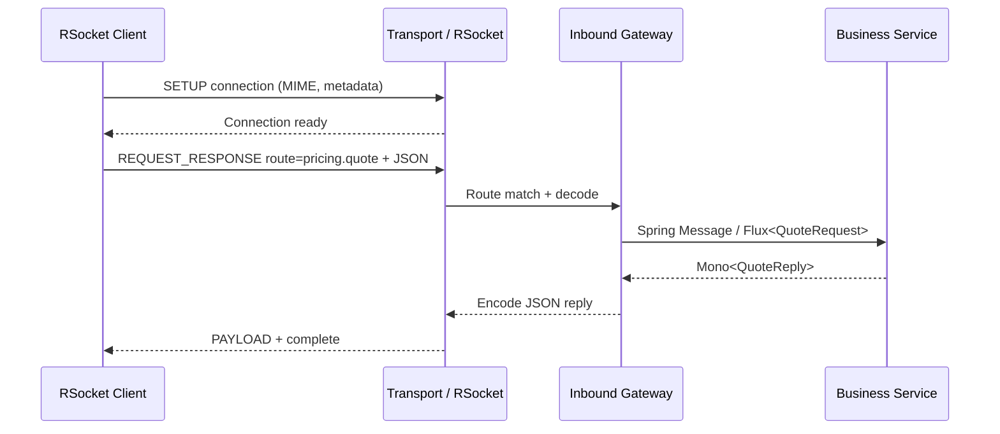
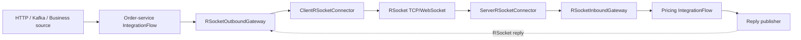
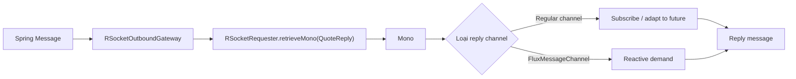
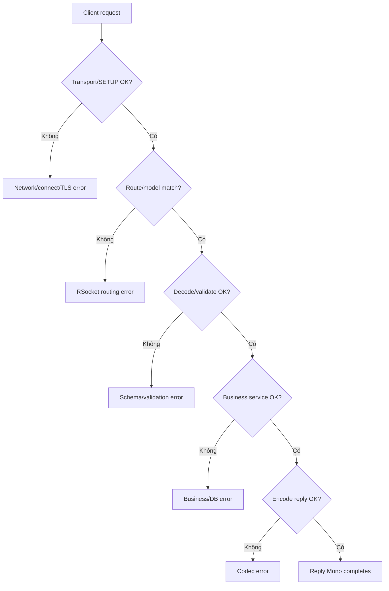
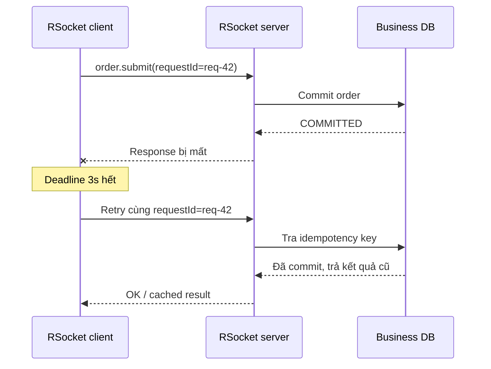
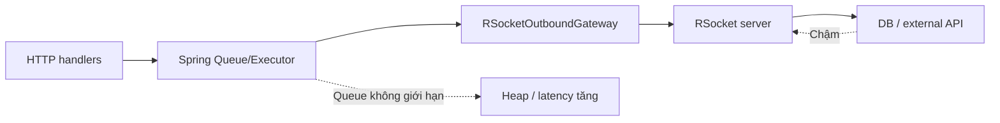
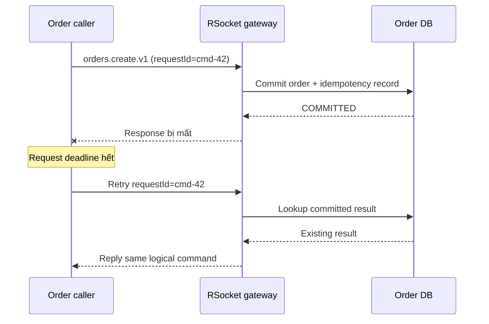
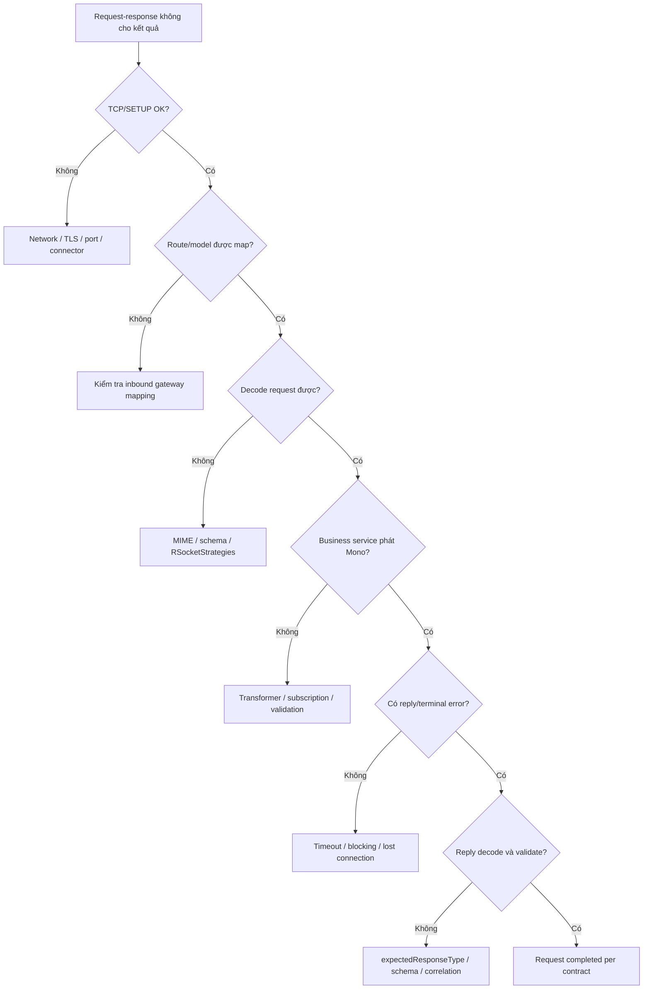

# Request-response qua RSocket trong Spring Integration

## 1. Vấn đề thực tế: gọi một dịch vụ và nhận đúng một phản hồi

Một ứng dụng đặt hàng cần hỏi dịch vụ định giá trước khi xác nhận đơn. Ứng dụng gửi yêu cầu `pricing.quote` với mã sản phẩm, số lượng và mã tương quan, rồi nhận **một** báo giá hoặc **một** tín hiệu lỗi. Hai bên không muốn tạo HTTP endpoint riêng; chúng dùng RSocket trên kết nối TCP có thể tái sử dụng.

```text
Order service                                      Pricing service
  QuoteRequest(sku, quantity, requestId)
          ────── REQUEST_RESPONSE ────────────────►
                                    Validate → Calculate
          ◄──────── QuoteReply ────────────────────
```

Đây là **request-response**. Điều khó không chỉ là gửi bytes mà còn phải xác định **route, data MIME type, DTO schema, loại phản hồi, deadline, kết quả khi server lỗi và cách xử lý nếu reply bị mất sau khi nghiệp vụ đã commit**.

Bài **“Request-response qua RSocket”** nằm trong chương **Adapter RSocket**, thuộc module **SPRING_INTEGRATION_ADAPTERS**. Module giới thiệu việc kết nối hệ thống ngoài bằng inbound/outbound adapter, gateway, poller và `MessageChannel`; thực hành các luồng với file, SFTP, HTTP, JMS, AMQP, Kafka và cơ sở dữ liệu, đồng thời kiểm soát message contract, lỗi và vòng đời kết nối. Bài này tập trung vào **một request – một response** qua RSocket và cách ghép interaction đó vào Spring Integration.

### Mục tiêu học tập

Sau bài này bạn có thể:

1. Giải thích ý nghĩa của mô hình `REQUEST_RESPONSE` và phân biệt với `fireAndForget`, `requestStream`, `requestChannel`.
2. Hiểu các lớp: `RSocketRequester`, `ClientRSocketConnector`, `ServerRSocketConnector`, `RSocketOutboundGateway`, `RSocketInboundGateway`.
3. Định nghĩa route, MIME type, request DTO và reply DTO đồng nhất trên wire.
4. Xây dựng một server Spring Integration nhận request và trả `Mono<QuoteReply>` bằng Java DSL.
5. Gọi server bằng `RSocketRequester` và qua outbound IntegrationFlow.
6. Hiểu phản hồi reactive, subscribe/adapt, correlation và điểm khác nhau giữa Spring `MessageChannel.send()` với remote reply.
7. Thiết kế timeout, cancellation, retry và idempotency cho yêu cầu có tác dụng phụ.
8. Kiểm thử route, codec, error, network failure và trạng thái kết quả không rõ.

## 2. Mô hình giao tiếp RSocket request-response

RSocket là giao thức giao tiếp hướng message có các interaction model, bao gồm request-response. Một bên khởi tạo **request** với payload và metadata; phía bên kia trả **một payload response**, hoàn tất rỗng trong trường hợp được contract cho phép, hoặc phát tín hiệu lỗi.



**Một request-response không phải một distributed transaction.** Transport có thể truyền request thành công và receiver đã commit DB nhưng response bị mất trước khi client nhận được. Do đó caller phải tách “có response” khỏi “command được xử lý đúng một lần”.

### 2.1. Bốn mô hình RSocket

| Interaction model | Request | Response | Khi dùng |
| --- | --- | --- | --- |
| `requestResponse` | Một payload | Một response hoặc terminal signal | Tra cứu giá, kiểm tra trạng thái, gửi command có reply |
| `fireAndForget` | Một payload | Không có application response | Telemetry không cần xác nhận |
| `requestStream` | Một payload | `Flux<T>` nhiều kết quả | Theo dõi giá thay đổi, feed cập nhật |
| `requestChannel` | `Publisher<T>` nhiều request elements | `Flux<R>` | Stream hai chiều |

Trong Spring Integration, enum `RSocketInteractionModel` dùng các tên **`requestResponse`**, `fireAndForget`, `requestStream`, `requestChannel`. Một inbound gateway có thể giới hạn model được chấp nhận bằng `.interactionModels(RSocketInteractionModel.requestResponse)`; outbound gateway chọn model bằng `.interactionModel(RSocketInteractionModel.requestResponse)`.

### 2.2. Request-response là “một kết quả”, không nhất thiết blocking

Một lời gọi Java:

```java
Mono<QuoteReply> result = requester.route("pricing.quote")
        .data(request)
        .retrieveMono(QuoteReply.class);
```

Trả về `Mono<QuoteReply>`, **không phải một `QuoteReply` đã có sẵn**. Reactor publisher là một hợp đồng bất đồng bộ; một request từ publisher lạnh thường chỉ được thực thi khi có subscriber. Không gọi `block()` trong Netty/Reactor event-loop.

Với thao tác đọc đơn giản, caller có thể dùng `StepVerifier` trong test, `flatMap` trong reactive service hoặc một Spring Integration gateway/channel đúng ngữ nghĩa.

## 3. Phân biệt inbound, outbound và connector



| Thành phần | Trách nhiệm | Không phải là |
| --- | --- | --- |
| `RSocketRequester` | API client thấp hơn: `route`, `data`, `retrieveMono` | Spring Integration MessageChannel |
| `ClientRSocketConnector` | Thiết lập/quản lý requester và connection đến peer | Business retry queue |
| `RSocketOutboundGateway` | Đưa Spring message ra RSocket request và tạo reply | Một HTTP client hoặc RSocket server listener |
| `ServerRSocketConnector` | Bind transport và quản lý request vào server | Handler tính giá |
| `RSocketInboundGateway` | Map route/model, chuyển request vào IntegrationFlow và encode reply | Thành phần tự mở port nếu chưa có connector |
| `Transformer` / service activator | Tính toán và phát reply | Mặc định là network ACK durable |
| `MessageChannel` | Dispatch Spring `Message<?>` | Bảo đảm peer đã commit |

**Outbound/inbound là hướng nhìn từ IntegrationFlow**, không phải giới hạn cứng bên nào được phát request. RSocket hỗ trợ kết nối hai chiều; server có thể chủ động request tới client qua requester phù hợp. Nhưng ví dụ cốt lõi ở đây là **client initiates, server responds**.

### 3.1. So sánh với HTTP request-response

| HTTP | RSocket |
| --- | --- |
| `GET /pricing/quote` hoặc `POST` | `route("pricing.quote")` trong metadata |
| HTTP status `200/400/500` | RSocket PAYLOAD/ERROR/terminal signal, không phải HTTP status |
| HTTP body và headers | RSocket data/metadata với MIME type |
| HTTP request có thể tạo connection riêng tùy client | RSocket có thể multiplex nhiều interaction trên một connection |
| Response thông thường có một body | `requestResponse` có một kết quả; các model khác có stream |

Không cấu hình `RSocketOutboundGateway` với `http://pricing-service/quote` rồi chờ nó tự chuyển sang HTTP POST. RSocket route là **logical request mapping**, không phải URL HTTP.

## 4. Wire contract: route, content type, payload và correlation

Giả sử thiết kế giao thức:

```text
Transport: TCP RSocket
Server address: pricing-service:7000
Route: pricing.quote.v1
Interaction model: requestResponse
Data MIME: application/json
Request type: QuoteRequest
Reply type: QuoteReply
Correlation: requestId (trong JSON)
Business timeout: client budget, ví dụ 3 giây
```

Một request minh họa:

```json
{
  "schemaVersion": 1,
  "requestId": "req-20261123-42",
  "sku": "SKU-42",
  "quantity": 3
}
```

Response:

```json
{
  "schemaVersion": 1,
  "requestId": "req-20261123-42",
  "sku": "SKU-42",
  "quantity": 3,
  "currency": "VND",
  "totalMinorUnits": 37500
}
```

### 4.1. Vai trò từng field

| Field | Ý nghĩa | Ràng buộc |
| --- | --- | --- |
| `schemaVersion` | Phiên bản schema wire | Chỉ nhận version đã hỗ trợ |
| `requestId` | Correlation của logical request | Không đổi giữa các attempt của cùng yêu cầu |
| `sku` | Mã sản phẩm | Kiểm tra cú pháp, quyền truy cập tenant |
| `quantity` | Số lượng | Dương, dưới hạn mức |
| `currency` | Mã tiền tệ | Theo danh sách chuẩn/hợp đồng |
| `totalMinorUnits` | Tổng tiền ở đơn vị nhỏ nhất do contract định nghĩa | Không chuyển qua `double` dễ sai số |

Không chỉ gửi `requestId` dưới dạng một Spring header và giả định remote client bằng ngôn ngữ khác sẽ tự thấy header Java đó. Nếu là **hợp đồng liên hệ business**, đặt ID vào JSON hoặc metadata đã định nghĩa.

### 4.2. Route metadata không phải authorization

Client có thể gửi `route("pricing.quote.v1")`, nhưng việc match route **không chứng minh** họ có quyền báo giá cho một tenant. Cần xác thực connection/principal và kiểm tra quyền theo SKU/tenant ở service.

### 4.3. Kiểu reply phải khớp decoder

Nếu response là JSON `QuoteReply`, phía caller dùng `retrieveMono(QuoteReply.class)` hoặc outbound gateway `expectedResponseType(QuoteReply.class)`. Nếu để mặc định response là `String.class`, có thể nhận chuỗi JSON chưa deserialize hoặc lỗi codec, không tự có DTO.

## 5. Dependencies và ứng dụng ví dụ

Ví dụ giả định Java 17+, Spring Boot và các phiên bản Spring Integration tương thích theo BOM:

```xml
<dependencies>
    <dependency>
        <groupId>org.springframework.boot</groupId>
        <artifactId>spring-boot-starter-integration</artifactId>
    </dependency>
    <dependency>
        <groupId>org.springframework.integration</groupId>
        <artifactId>spring-integration-rsocket</artifactId>
    </dependency>
    <dependency>
        <groupId>com.fasterxml.jackson.core</groupId>
        <artifactId>jackson-databind</artifactId>
    </dependency>
    <dependency>
        <groupId>io.projectreactor</groupId>
        <artifactId>reactor-test</artifactId>
        <scope>test</scope>
    </dependency>
</dependencies>
```

Không trộn tự do major version của Spring Boot, Spring Framework, Spring Integration và Reactor. Các API trong bài dùng các lớp đã có ở Spring Integration RSocket; khi áp dụng vào dự án thật, cần đối chiếu JavaDoc của BOM đã chọn.

### 5.1. Hai tiến trình độc lập

Để kiểm thử thực tế, có thể chạy:

```text
Process A: pricing-service
  ServerRSocketConnector bound TCP 7000
  RSocketInboundGateway route pricing.quote.v1
  PricingService trả Mono<QuoteReply>

Process B: order-service
  ClientRSocketConnector nối pricing-service:7000
  RSocketOutboundGateway gọi route pricing.quote.v1
  Downstream nhận kết quả QuoteReply
```

Nếu chạy hai phần trong một JVM để học, hãy tránh tạo **hai connector/server beans cùng bind một port** hoặc cùng một route với model trùng nhau.

### 5.2. Cấu hình ứng dụng

```yaml
# application.yml minh họa
app:
  rsocket:
    bind-host: ${RSOCKET_BIND_HOST:127.0.0.1}
    host: ${RSOCKET_HOST:127.0.0.1}
    port: ${RSOCKET_PORT:7000}
    request-timeout: ${RSOCKET_REQUEST_TIMEOUT:3s}
```

Trong Kubernetes, phía server có thể cần bind `0.0.0.0` và phía client dùng DNS của Kubernetes Service, không dùng loopback `127.0.0.1` từ pod khác. Kết hợp firewall/NetworkPolicy và authentication/TLS phù hợp.

## 6. DTO và quy tắc nghiệp vụ

### 6.1. Các Java record

```java
// File QuoteRequest.java
public record QuoteRequest(
        int schemaVersion,
        String requestId,
        String sku,
        int quantity) {
}
```

```java
// File QuoteReply.java
public record QuoteReply(
        int schemaVersion,
        String requestId,
        String sku,
        int quantity,
        String currency,
        long totalMinorUnits) {
}
```

**Đây là DTO minh họa**. Trong production, nên dùng package có version rõ và không cho input JSON tự đi thẳng vào entity ORM chứa thông tin nhạy cảm.

### 6.2. Validation

```java
public final class QuoteValidation {
    private QuoteValidation() {
    }

    public static void requireValid(QuoteRequest request) {
        if (request == null ||
                request.schemaVersion() != 1 ||
                request.requestId() == null ||
                !request.requestId().matches("[A-Za-z0-9_-]{1,128}") ||
                request.sku() == null ||
                !request.sku().matches("[A-Za-z0-9_-]{1,64}") ||
                request.quantity() < 1 ||
                request.quantity() > 10_000) {
            throw new IllegalArgumentException(
                    "QuoteRequest không hợp lệ");
        }
    }
}
```

Việc validate regex chưa kiểm tra quyền truy cập tenant, inventory policy hay giá trị doanh nghiệp. Đặt các kiểm tra tương ứng ở service boundary. Không trả stack trace hoặc chi tiết SQL cho requester bên ngoài.

### 6.3. Service trả Mono thay vì chặn event-loop

```java
import org.springframework.stereotype.Service;
import reactor.core.publisher.Mono;

@Service
public class QuoteCalculationService {

    public Mono<QuoteReply> quote(QuoteRequest request) {
        return Mono.fromSupplier(() -> {
            QuoteValidation.requireValid(request);
            long unitPrice = 12_500L; // Minh họa, đơn vị VND.
            long amount = Math.multiplyExact(
                    unitPrice, request.quantity());
            return new QuoteReply(
                    1,
                    request.requestId(),
                    request.sku(),
                    request.quantity(),
                    "VND",
                    amount);
        });
    }
}
```

`Mono.fromSupplier` ở đây chỉ tính toán CPU rất nhỏ; không dùng nó để bọc một JDBC call blocking rồi nghĩ đã trở thành non-blocking. Với repository blocking, cần scheduler phù hợp và giới hạn concurrency (xem mục 17).

## 7. Server: `ServerRSocketConnector` mở listener

Đầu tiên tạo connector ở **pricing-service**:

```java
import org.springframework.beans.factory.annotation.Value;
import org.springframework.context.annotation.Bean;
import org.springframework.context.annotation.Configuration;
import org.springframework.integration.rsocket.ServerRSocketConnector;

@Configuration
public class PricingRSocketServerConfiguration {

    @Bean
    public ServerRSocketConnector pricingServerConnector(
            @Value("${app.rsocket.bind-host}") String bindHost,
            @Value("${app.rsocket.port}") int port) {
        return new ServerRSocketConnector(bindHost, port);
    }
}
```

`ServerRSocketConnector` mở và quản lý RSocket transport; `RSocketInboundGateway` sẽ được nhận diện/đăng ký theo cơ chế của framework. Chỉ khai báo một inbound gateway bean **không tự mở listener**.

### 7.1. Ai sở hữu port?

Nếu bật thêm Spring Boot RSocket server auto-configuration cũng bind cổng 7000, có thể xảy ra `Address already in use`. Chọn **một** server owner. Nếu ứng dụng đã có RSocket server khác do Spring Messaging quản lý, cần tích hợp gateway qua `ServerRSocketMessageHandler`/connector đúng kiến trúc, không tạo listener thứ hai trùng cổng.

### 7.2. Port động trong test

`new ServerRSocketConnector("127.0.0.1", 0)` cho phép hệ điều hành chọn port động. API `getBoundPort()` trả một `Mono<Integer>`:

```java
// Chỉ dùng trong test setup sau khi connector start/bind.
Integer port = connector.getBoundPort()
        .block(java.time.Duration.ofSeconds(5));
if (port == null || port < 1) {
    throw new IllegalStateException("RSocket chưa bind");
}
```

Không dùng `.block()` trên Netty event-loop; gọi block với timeout hữu hạn có thể chấp nhận trong orchestration của integration test.

## 8. Server: inbound gateway tiếp nhận request-response

### 8.1. Java DSL

```java
import org.springframework.context.annotation.Bean;
import org.springframework.context.annotation.Configuration;
import org.springframework.core.ResolvableType;
import org.springframework.integration.dsl.IntegrationFlow;
import org.springframework.integration.rsocket.RSocketInteractionModel;
import org.springframework.integration.rsocket.dsl.RSockets;
import reactor.core.publisher.Flux;
import reactor.core.publisher.Mono;

@Configuration
public class PricingInboundFlowConfiguration {

    @Bean
    public IntegrationFlow pricingQuoteInboundFlow(
            QuoteCalculationService service) {

        return IntegrationFlow
                .from(RSockets.inboundGateway("pricing.quote.v1")
                        .interactionModels(
                                RSocketInteractionModel.requestResponse)
                        .requestElementType(
                                ResolvableType.forClass(QuoteRequest.class)))
                .<Flux<QuoteRequest>, Mono<QuoteReply>>transform(
                        requestFlux ->
                                requestFlux.single()
                                        .flatMap(service::quote))
                .get();
    }
}
```

**Ý nghĩa từng phần:**

- `RSockets.inboundGateway("pricing.quote.v1")` đăng ký route.
- `interactionModels(requestResponse)` chỉ cho phép model tương ứng ở endpoint này.
- `requestElementType(ResolvableType.forClass(QuoteRequest.class))` giúp decoder xác định kiểu phần tử request.
- Payload hướng vào IntegrationFlow là **`Flux<QuoteRequest>`** theo semantics reactive inbound gateway.
- `single()` yêu cầu **đúng một phần tử**, phù hợp với request-response; nếu zero hoặc nhiều phần tử, publisher báo lỗi.
- `flatMap(service::quote)` phát một `Mono<QuoteReply>` mà gateway có thể encode thành một response.

Khi dùng JSON, server và client cần thống nhất `RSocketStrategies`/codec và `application/json`. Java type chỉ là contract trong JVM; nó không tự sửa một client gửi `text/plain` với nội dung JSON hoặc schema khác.

### 8.2. Java bean thay vì Java DSL

```java
import org.springframework.context.annotation.Bean;
import org.springframework.context.annotation.Configuration;
import org.springframework.core.ResolvableType;
import org.springframework.integration.rsocket.RSocketInteractionModel;
import org.springframework.integration.rsocket.inbound.RSocketInboundGateway;

@Configuration
public class PricingInboundBeanConfiguration {

    @Bean
    public RSocketInboundGateway quoteGateway() {
        RSocketInboundGateway gateway =
                new RSocketInboundGateway("pricing.quote.v1");
        gateway.setRequestChannelName("quoteRequests");
        gateway.setInteractionModels(
                RSocketInteractionModel.requestResponse);
        gateway.setRequestElementType(
                ResolvableType.forClass(QuoteRequest.class));
        return gateway;
    }
}
```

Kết hợp với transformer:

```java
import org.springframework.integration.annotation.Transformer;
import org.springframework.stereotype.Component;
import reactor.core.publisher.Flux;
import reactor.core.publisher.Mono;

@Component
public class QuoteTransformer {
    private final QuoteCalculationService service;

    public QuoteTransformer(QuoteCalculationService service) {
        this.service = service;
    }

    @Transformer(inputChannel = "quoteRequests")
    public Mono<QuoteReply> quote(Flux<QuoteRequest> input) {
        return input.single().flatMap(service::quote);
    }
}
```

**Đây là một cách cấu hình thay thế** cho Java DSL ở mục 8.1. Trong một ứng dụng, **không đăng ký cả hai inbound gateways vào cùng connector và cùng route/model** nếu không cố ý xử lý xung đột mapping.

### 8.3. Vì sao handler không nhận trực tiếp `QuoteRequest`?

Spring Integration RSocket inbound gateway dùng payload là **publisher/`Flux`** trong request với reply, tương thích các model reactive. Transformer trong ví dụ cần làm việc với `Flux<QuoteRequest>`; nếu khai báo `QuoteRequest` đơn trong trường hợp framework truyền `Flux`, việc chuyển đổi argument có thể không khớp.

Đây là **điểm khác** so với một `@MessageMapping` controller nhận DTO đơn, và cần được kiểm chứng theo đúng implementation/version.

## 9. Client đơn giản: `RSocketRequester`

Trước khi tích hợp outbound gateway, nên chứng minh **server, route, MIME và DTO** hoạt động bằng requester trực tiếp.

### 9.1. Gọi route và lấy một `Mono<QuoteReply>`

```java
import java.time.Duration;
import org.springframework.messaging.rsocket.RSocketRequester;
import org.springframework.util.MimeTypeUtils;
import reactor.core.publisher.Mono;

public class DirectPricingClient {

    public static Mono<QuoteReply> requestQuote() {
        RSocketRequester requester = RSocketRequester.builder()
                .dataMimeType(MimeTypeUtils.APPLICATION_JSON)
                .tcp("127.0.0.1", 7000);

        QuoteRequest request =
                new QuoteRequest(1, "req-42", "SKU-42", 3);

        return requester.route("pricing.quote.v1")
                .data(request)
                .retrieveMono(QuoteReply.class)
                .timeout(Duration.ofSeconds(3));
    }
}
```

`route(...)` chọn RSocket routing metadata; `data(request)` dùng decoder/encoder theo MIME type; `retrieveMono(QuoteReply.class)` biểu diễn một phản hồi. `timeout(...)` là deadline ở reactive chain, **không** buộc server rollback nếu server đã có side effect.

**Không tạo một requester cho mỗi bản tin production.** Ví dụ trên tối giản để học; ứng dụng thật nên giữ requester/connector theo lifecycle, giới hạn active requests và đóng resource khi shutdown.

### 9.2. Đọc kết quả bằng StepVerifier

```java
import reactor.test.StepVerifier;

StepVerifier.create(DirectPricingClient.requestQuote())
        .expectNextMatches(reply ->
                reply.requestId().equals("req-42") &&
                reply.totalMinorUnits() == 37_500L &&
                reply.currency().equals("VND"))
        .verifyComplete();
```

Đây là ví dụ assertion **chỉ hợp lệ nếu server test đã start**, route và codec đúng. Nó không có nghĩa test đã được chạy trong repository. Khi có port động và CI, hãy lấy port thực từ server trước khi tạo requester.

### 9.3. Khi nào request thực sự xảy ra?

Với một publisher lạnh:

```java
Mono<QuoteReply> mono = requester.route("pricing.quote.v1")
        .data(request)
        .retrieveMono(QuoteReply.class);

// Chưa có subscriber: không nên coi là đã hoàn tất remote call.
Mono<QuoteReply> checked = mono.doOnNext(this::validateReply);
// checked cần được subscribe bởi reactive chain hoặc test.
```

Tránh gọi `subscribe()` thủ công không quản lý trong service method rồi trả ngay một “thành công” giả. Ưu tiên **return Mono** cho caller quản lý cancellation/error/deadline; trong Spring Integration hãy kiểm tra cách gateway subscribe/adapt theo channel.

## 10. Client Spring Integration: outbound gateway gọi remote

### 10.1. Bean `ClientRSocketConnector`

```java
import org.springframework.beans.factory.annotation.Value;
import org.springframework.context.annotation.Bean;
import org.springframework.context.annotation.Configuration;
import org.springframework.integration.rsocket.ClientRSocketConnector;

@Configuration
public class PricingRSocketClientConnectorConfiguration {

    @Bean
    public ClientRSocketConnector pricingClientConnector(
            @Value("${app.rsocket.host}") String host,
            @Value("${app.rsocket.port}") int port) {
        return new ClientRSocketConnector(host, port);
    }
}
```

Connector quản lý `RSocketRequester` đến server. Có thể tái sử dụng cùng connection cho nhiều request; điều đó giảm handshake/connection churn nhưng **không** đồng nghĩa các request cùng nằm trong một business transaction.

### 10.2. Java DSL `RSockets.outboundGateway(...)`

```java
import org.springframework.context.annotation.Bean;
import org.springframework.context.annotation.Configuration;
import org.springframework.integration.dsl.IntegrationFlow;
import org.springframework.integration.rsocket.ClientRSocketConnector;
import org.springframework.integration.rsocket.RSocketInteractionModel;
import org.springframework.integration.rsocket.dsl.RSockets;

@Configuration
public class PricingRSocketOutboundFlowConfiguration {

    @Bean
    public IntegrationFlow quoteOutboundFlow(
            ClientRSocketConnector pricingClientConnector) {

        return IntegrationFlow
                .from("quoteOutboundRequests")
                .handle(RSockets.outboundGateway("pricing.quote.v1")
                        .interactionModel(
                                RSocketInteractionModel.requestResponse)
                        .expectedResponseType(QuoteReply.class)
                        .clientRSocketConnector(pricingClientConnector))
                .channel("quoteOutboundReplies")
                .get();
    }
}
```

**Giải thích:**

1. Spring message gửi vào `quoteOutboundRequests` chứa `QuoteRequest` làm payload.
2. Outbound gateway chọn route `pricing.quote.v1` và model `requestResponse`.
3. Requester bên trong `ClientRSocketConnector` gửi data/metadata qua connection.
4. Remote inbound gateway nhận request, tính giá và trả `QuoteReply`.
5. Spring Integration phát reply theo **reactive reply semantics** tới `quoteOutboundReplies`.

`MessageChannel.send()==true` **chỉ** cho biết message đã được channel chấp nhận/dispatch theo contract, **không** có nghĩa remote response đã đến hoặc DB đã commit.

### 10.3. Gửi Spring Message qua channel

```java
import org.springframework.beans.factory.annotation.Qualifier;
import org.springframework.messaging.MessageChannel;
import org.springframework.messaging.support.MessageBuilder;
import org.springframework.stereotype.Service;

@Service
public class QuoteRequestPublisher {
    private final MessageChannel channel;

    public QuoteRequestPublisher(
            @Qualifier("quoteOutboundRequests")
            MessageChannel channel) {
        this.channel = channel;
    }

    public void submit(QuoteRequest request) {
        QuoteValidation.requireValid(request);
        boolean accepted = channel.send(
                MessageBuilder.withPayload(request).build());

        if (!accepted) {
            throw new IllegalStateException(
                    "Channel không nhận được QuoteRequest");
        }
        // Không đánh dấu business COMPLETED ở đây.
    }
}
```

### 10.4. Downstream consumer nhận kết quả

Một reply handler có thể dùng `@ServiceActivator` để validate reply:

```java
import org.springframework.integration.annotation.ServiceActivator;
import org.springframework.stereotype.Component;

@Component
public class QuoteReplyConsumer {

    @ServiceActivator(inputChannel = "quoteOutboundReplies")
    public void handle(QuoteReply reply) {
        if (reply == null ||
                reply.schemaVersion() != 1 ||
                reply.totalMinorUnits() < 0) {
            throw new IllegalArgumentException(
                    "QuoteReply không hợp lệ");
        }
        // Đối soát requestId với request ban đầu ở tầng business.
        System.out.println("Quote amount: " +
                reply.totalMinorUnits());
    }
}
```

**Cần kiểm thử type thật ở output channel theo phiên bản/channel implementation.** `RSocketOutboundGateway` trả một `Mono` nội bộ; với regular channel, Spring Integration subscribe/adapt trước khi phát reply, còn `FluxMessageChannel` xử lý theo demand. Không tự giả định handler sẽ luôn nhìn thấy `Mono<QuoteReply>` hay luôn thấy DTO trực tiếp ở mọi topology.

## 11. Java bean handler thay cho Java DSL

Nếu codebase dùng annotation endpoints, có thể cấu hình `RSocketOutboundGateway` trực tiếp:

```java
import org.springframework.beans.factory.annotation.Qualifier;
import org.springframework.context.annotation.Bean;
import org.springframework.context.annotation.Configuration;
import org.springframework.integration.annotation.ServiceActivator;
import org.springframework.integration.rsocket.ClientRSocketConnector;
import org.springframework.integration.rsocket.RSocketInteractionModel;
import org.springframework.integration.rsocket.outbound.RSocketOutboundGateway;

@Configuration
public class PricingOutboundBeanConfiguration {

    @Bean
    @ServiceActivator(
            inputChannel = "beanQuoteRequests",
            outputChannel = "beanQuoteReplies")
    public RSocketOutboundGateway quoteGateway(
            @Qualifier("pricingClientConnector")
            ClientRSocketConnector connector) {

        RSocketOutboundGateway gateway =
                new RSocketOutboundGateway("pricing.quote.v1");
        gateway.setInteractionModel(
                RSocketInteractionModel.requestResponse);
        gateway.setExpectedResponseType(QuoteReply.class);
        gateway.setClientRSocketConnector(connector);
        return gateway;
    }
}
```

Đây là **phương án thay thế**, không tạo cùng route gateway hai lần trên **cùng request channel** nếu không chủ đích fan-out. Với request-response, fan-out có thể khiến nhiều request được tạo ra và làm mơ hồ reply/correlation.

## 12. Reactive reply: gateway subscribe và chuyển kết quả thế nào?

`RSocketOutboundGateway` là `AbstractReplyProducingMessageHandler`. Theo Spring Integration RSocket reference, reply nội bộ từ gateway là **`Mono`**; với model `requestResponse`, nó biểu diễn một response element/terminal signal.



### 12.1. Hai chỗ dễ nhầm

**Nhầm thứ nhất:** một lời gọi `channel.send(...)` thành công là “server đã trả giá”. Thực tế, Spring channel có thể chấp nhận message trước khi asynchronous remote reply hoàn tất.

**Nhầm thứ hai:** thấy `Mono<QuoteReply>` nên tự `block()` ở Netty event-loop. Việc chặn event-loop có thể gây deadlock/throughput thấp hoặc exception. Hãy nối tiếp reactive chain hoặc để Spring Integration adapt đúng channel.

### 12.2. Reply correlation trong một IntegrationFlow

Khi nhiều request cùng chạy qua một gateway, framework sử dụng request/reply channel/correlation context để đưa đúng reply về luồng nội bộ theo hợp đồng. Tuy nhiên:

- Business `requestId` trong payload vẫn cần để đối soát và truy vết.
- `replyChannel` header nội bộ **không tự xuất hiện trên wire** ở remote service.
- Nếu một flow có nhiều nhánh, không tự gửi một response vào channel khác không có correlation rồi kỳ vọng requester nào cũng nhận đúng.
- Nếu cần `@MessagingGateway` trả về `QuoteReply` theo một phương thức đồng bộ, phải kiểm thử reply timeout và thread model, đặc biệt khi handler bất đồng bộ.

### 12.3. Không nhầm với request-stream

Với `requestStream` và `requestChannel`, một reply `Flux` được bọc trong `Mono` để giữ request scope. Downstream phải subscribe/flatten `Flux` đúng cách. Nhưng bài này chọn `requestResponse`: **một request và nhiều nhất một reply nghiệp vụ**, nên thường làm việc với `Mono<QuoteReply>`.

### 12.4. Request không có reply

Nếu remote handler trả `Mono.empty()`, interaction có thể hoàn tất **không kèm QuoteReply**. Với API đòi bắt buộc có giá, không nên xem empty là thành công; quy định cách trả `NOT_FOUND` hoặc lỗi được ánh xạ rõ. Client có thể:

```java
import reactor.core.publisher.Mono;

Mono<QuoteReply> requiredReply =
        requester.route("pricing.quote.v1")
                .data(request)
                .retrieveMono(QuoteReply.class)
                .switchIfEmpty(Mono.error(
                        new IllegalStateException(
                                "Remote không trả báo giá")));
```

Sử dụng `switchIfEmpty` chỉ ở tầng caller phù hợp; không bắt mọi empty response thành lỗi nếu business contract cho phép kết quả rỗng.

## 13. Routing và dynamic route trong request-response

### 13.1. Route cố định là mặc định dễ kiểm soát

```java
RSockets.outboundGateway("pricing.quote.v1")
        .interactionModel(RSocketInteractionModel.requestResponse)
        .expectedResponseType(QuoteReply.class)
        .clientRSocketConnector(connector);
```

Không tự đổi route theo user input nếu có nhiều route nhạy cảm. Khi route không tồn tại, client cần thấy một lỗi mapping (không phải HTTP 404), và ứng dụng không nên retry vô hạn lỗi configuration.

### 13.2. Route động theo header đã whitelist

`RSockets.outboundGateway(...)` có overload nhận `Function<Message<P>, ?>`; ví dụ:

```java
import org.springframework.messaging.Message;
import org.springframework.integration.rsocket.dsl.RSockets;

RSockets.outboundGateway((Message<QuoteRequest> msg) -> {
            Object raw = msg.getHeaders().get("pricingRoute");
            String route = raw instanceof String s ? s : "";
            if (!"pricing.quote.v1".equals(route) &&
                    !"pricing.preview.v1".equals(route)) {
                throw new IllegalArgumentException(
                        "Route không được phép");
            }
            return route;
        })
        .interactionModel(RSocketInteractionModel.requestResponse)
        .expectedResponseType(QuoteReply.class)
        .clientRSocketConnector(connector);
```

Đây là một DSL builder fragment, không phải một bean chạy độc lập nếu chưa gắn trong `IntegrationFlow.handle(...)`. Route lấy từ header không đáng tin thì phải **validate và authorize** trước khi remote call.

### 13.3. Route version

Nếu có `pricing.quote.v1` và `pricing.quote.v2`, migration cần nêu rõ:

1. Version nào được client hỗ trợ.
2. Request/response schema tương ứng.
3. Cách lựa chọn version trong routing.
4. Có fallback an toàn không.
5. Timeout và retry có giữ nguyên version khi gửi lại không.

Một retry của cùng logical request nên giữ **cùng route/schema version** trừ khi ứng dụng có một migration/reconciliation protocol tường minh.

## 14. RSocketStrategies và JSON codec

Spring RSocket mã hóa/giải mã data bằng `RSocketStrategies`. Những yếu tố phải khớp:

| Yếu tố | Client | Server |
| --- | --- | --- |
| Route | `pricing.quote.v1` | Inbound mapping cùng tên |
| Model | `requestResponse` | Inbound cho phép model này |
| Data MIME | `application/json` | Có decoder JSON |
| Request type | `QuoteRequest` | `requestElementType(QuoteRequest.class)` theo `ResolvableType` |
| Reply type | `QuoteReply` | Encoder trả được `QuoteReply` |
| Metadata route | Được requester encode | Connector/gateway parse được |

### 14.1. Cấu hình JSON decoder/encoder tường minh

Nếu project cần kiểm soát codec, có thể định nghĩa:

```java
import com.fasterxml.jackson.databind.ObjectMapper;
import org.springframework.context.annotation.Bean;
import org.springframework.context.annotation.Configuration;
import org.springframework.http.codec.json.Jackson2JsonDecoder;
import org.springframework.http.codec.json.Jackson2JsonEncoder;
import org.springframework.messaging.rsocket.RSocketStrategies;

@Configuration
public class QuoteRSocketCodecConfiguration {

    @Bean
    public RSocketStrategies quoteRSocketStrategies(
            ObjectMapper mapper) {
        return RSocketStrategies.builder()
                .decoder(new Jackson2JsonDecoder(mapper))
                .encoder(new Jackson2JsonEncoder(mapper))
                .build();
    }
}
```

Sau đó connector có thể được cấu hình dùng strategies đó:

```java
ServerRSocketConnector server =
        new ServerRSocketConnector("0.0.0.0", 7000);
server.setRSocketStrategies(strategies);

ClientRSocketConnector client =
        new ClientRSocketConnector("pricing-service", 7000);
client.setRSocketStrategies(strategies);
```

Đây là **đoạn minh họa cách set**, không phải tạo một server/client mới bên trong mỗi request. Nếu đã có bean connector, inject `RSocketStrategies` vào bean đó; **không** cấu hình thêm connector thứ hai cùng bind port. Khi dùng chiến lược codec tùy chỉnh, cần bảo đảm vẫn giữ những thành phần định tuyến/metadata cần thiết và chạy integration test xuyên suốt.

### 14.2. MIME type phải khớp với codec

Với `RSocketRequester` trực tiếp, có thể đặt:

```java
RSocketRequester requester = RSocketRequester.builder()
        .dataMimeType(
                org.springframework.util.MimeTypeUtils.APPLICATION_JSON)
        .tcp("127.0.0.1", 7000);
```

Với `ClientRSocketConnector`, cấu hình `RSocketStrategies` và data MIME theo API connector phù hợp, rồi thử bằng server thực. **Không chỉ đổi `expectedResponseType` rồi nghĩ message text/plain sẽ tự chuyển thành JSON.**

### 14.3. Các lỗi codec phổ biến

- Client gửi `String` text nhưng server ép kiểu `QuoteRequest`.
- Client gửi JSON nhưng data MIME là `text/plain`.
- DTO hai bên khác field/schemaVersion.
- Server không có encoder phù hợp cho reply record.
- Có hai bean `RSocketStrategies` với quy tắc khác nhau được inject vào các connector khác nhau.
- Reply generic type như `List<QuoteReply>` mất element type nếu chỉ dùng `List.class`.

Lỗi codec thường **không tự phục hồi bằng retry**. Cần sửa hợp đồng/triển khai, ghi mã lỗi và quarantine input khi phù hợp.

## 15. Error handling: tín hiệu lỗi RSocket không phải HTTP status

Trong request-response, một lỗi có thể xuất hiện ở nhiều điểm:



| Tầng lỗi | Ví dụ | Chính sách |
| --- | --- | --- |
| Transport | Peer offline, TCP refused, TLS handshake fail | Retry có backoff nếu phù hợp, alert |
| SETUP | MIME/metadata không được hỗ trợ | Sửa client/server contract |
| Route | Không có `pricing.quote.v1` | Sửa config, không retry vô hạn |
| Interaction model | Gửi `requestStream` vào route chỉ cho `requestResponse` | Sửa model |
| Decode | JSON malformed hoặc schema version sai | Reject, không retry mù |
| Validate/authorize | SKU/tenant không hợp lệ | Trả lỗi có kiểm soát, audit |
| Business | Database timeout | Xác định outcome, retry idempotent nếu được |
| Encode reply | Không có encoder cho `QuoteReply` | Sửa `RSocketStrategies` |
| Reply mất | Server đã tính/commit nhưng client timeout | Reconcile theo requestId |

### 15.1. Biểu diễn lỗi reactive

```java
import reactor.core.publisher.Mono;

public Mono<QuoteReply> quoteWithError(QuoteRequest req) {
    return Mono.defer(() -> {
        if (req == null || req.quantity() < 1) {
            return Mono.error(new IllegalArgumentException(
                    "Số lượng không hợp lệ"));
        }
        return service.quote(req);
    });
}
```

Đây là ví dụ trong một class có field `service` tương ứng; nó minh họa **terminal error** trong publisher. Với consumer bên ngoài, cần sanitize exception và quyết định mã lỗi ứng dụng trên wire. Đừng lộ tên bảng DB, SQL query, token hay stack trace trong thông điệp trả cho client.

### 15.2. Phân biệt lỗi đồng bộ và lỗi sau khi subscribe

Lỗi mapping khi tạo message có thể xuất hiện đồng bộ, nhưng kết nối, timeout, decoding reply và business publisher errors thường xảy ra bất đồng bộ **sau khi subscription**. Vì vậy:

- Không bọc mỗi lời gọi `channel.send(...)` bằng `try/catch` rồi tin đã bắt mọi lỗi RSocket.
- Không coi một Spring Integration `errorChannel` là durable retry queue.
- Với outbound gateway, cần kiểm chứng error propagation theo channel/reply boundary đang dùng.
- Với command quan trọng, giữ trạng thái pending/unknown trong outbox cho tới khi có kết quả nghiệp vụ rõ.

## 16. Timeout, cancellation và trạng thái “unknown outcome”

Giả sử client có deadline 3 giây, server commit sau 2 giây, nhưng reply bị mất:



**Timeout không chứng minh remote chưa xử lý.** Client cancel hoặc reactive `timeout` có thể dừng chờ response, nhưng không tự rollback transaction đã commit ở server.

### 16.1. Một deadline có thể gồm nhiều giai đoạn

| Mốc | Cần tính tới |
| --- | --- |
| Connect/SETUP | DNS, route, TLS và khởi tạo connection |
| Request serialization | JSON encoder, payload size |
| Network transit | Latency mạng |
| Server validation | Auth, schema, routing |
| Business processing | CPU, database/transaction |
| Reply encode/transit | JSON codec, response network |
| Consumer adaptation | Reply subscription, channel topology |

Nếu HTTP caller có SLA 2 giây mà RSocket client lại retry ba lần với mỗi lần đợi 5 giây, tổng thời gian có thể vượt SLA. Chọn deadline tổng, số lần thử, backoff và chính sách fallback theo contract.

### 16.2. Cách biểu diễn timeout khi dùng RSocketRequester

```java
import java.time.Duration;
import reactor.core.publisher.Mono;

public Mono<QuoteReply> requestWithDeadline(
        RSocketRequester requester, QuoteRequest request) {
    return requester.route("pricing.quote.v1")
            .data(request)
            .retrieveMono(QuoteReply.class)
            .timeout(Duration.ofSeconds(3));
}
```

Đây là API **RSocketRequester**, không phải setter trực tiếp trên `RSocketOutboundGatewaySpec`. Trong Spring Integration, tích hợp deadline ở reactive layer/caller thích hợp và kiểm thử hành vi reply/error theo version thực tế.

### 16.3. Retry phải theo loại lỗi

| Lỗi | Retry? | Điều kiện |
| --- | --- | --- |
| Đọc giá idempotent, mất kết nối nhất thời | Thường có thể | Backoff, giới hạn attempts |
| Remote quá tải tạm thời | Có điều kiện | Rate limit/circuit breaker |
| JSON malformed | Không | Sửa dữ liệu |
| Route sai | Không | Sửa cấu hình |
| Bị từ chối quyền | Không | Không cố vượt authorization |
| Command DB timeout outcome chưa rõ | Có điều kiện | Idempotency key, reconcile |
| Hết deadline HTTP | Không tiếp tục block user request | Có thể hoàn tất async nếu có nguồn pending bền vững |

### 16.4. Không tạo requestId mới cho cùng logical command

```text
Sai khi submit order:
  attempt1: requestId=req-42
  timeout
  attempt2: requestId=req-43

Đúng khi dùng idempotency:
  attempt1: requestId=req-42
  timeout (outcome unknown)
  attempt2: requestId=req-42
  remote dedup và trả lại kết quả đã commit
```

Một thao tác **quote thuần đọc** thường có thể retry đơn giản hơn; nhưng khi RSocket request-response được dùng để tạo đơn hoặc ghi thanh toán, idempotency phải nằm **trong transaction của server**, không chỉ một `ConcurrentHashMap` trong RAM.

## 17. Threading, backpressure và ranh giới blocking

RSocket tương tác với Reactor publisher; đối với request-response, một request trả một `Mono`. Điều đó không tự giới hạn số request đồng thời hay số công việc đang chờ trong `ExecutorChannel`.



### 17.1. Không chặn Reactor event-loop

Không gọi `Thread.sleep(...)` hoặc blocking JDBC trực tiếp trong `map(...)`/`flatMap(...)` chạy trên Netty event-loop. Nếu buộc phải dùng một legacy blocking repository, chuyển nó sang scheduler phù hợp:

```java
import reactor.core.publisher.Mono;
import reactor.core.scheduler.Schedulers;

public Mono<String> queryLegacy(String sku) {
    return Mono.fromCallable(() ->
                    legacyRepository.findSkuDescription(sku))
            .subscribeOn(Schedulers.boundedElastic());
}
```

Đây là code minh họa với `legacyRepository` giả định có sẵn. `boundedElastic` không biến một JDBC call thành non-blocking; nó chỉ đưa blocking work ra khỏi event-loop, vẫn phải giám sát concurrency/queue.

### 17.2. Concurrency limit và overload policy

Với vài nghìn request cùng lúc:

- Giới hạn số request đồng thời theo service/tenant.
- Đặt timeout hợp lý, tránh giữ request vô hạn.
- Dùng bounded queue và rejection policy rõ.
- Có metric active requests, queue depth, P95/P99 latency.
- Tránh retry storm khi peer vừa khôi phục.
- Tách request đọc (idempotent) và command ghi (cần ACK/idempotency).

RSocket request-response có thể multiplex trên connection, **không có nghĩa server có vô hạn CPU/DB connections**.

### 17.3. Cancellation không tự hủy tác dụng phụ

Nếu client cancel `Mono` khi server đang xử lý, một số công việc reactive có thể nhận cancel; nhưng transaction đã commit, I/O blocking đang chạy hoặc side effect ở hệ thống khác **không chắc được hoàn tác**. Do đó thiết kế tính nhất quán nghiệp vụ **không được dựa vào cancel** như một lệnh rollback.

## 18. Bảo mật request-response

RSocket route là nơi nhận dữ liệu từ ngoài process; cần xem như một trust boundary:

| Vấn đề | Kiểm soát |
| --- | --- |
| Caller identity | Authentication tại transport/SETUP hoặc security integration phù hợp |
| Route-level access | Authorization theo principal/role |
| Tenant/resource ownership | Validate tenant của SKU/đơn hàng ở business service |
| Traffic abuse | Rate limit, active request quota, payload size |
| Payload/schema | Whitelist field, JSON depth, schemaVersion |
| Reply data leakage | Không trả trường nhạy cảm, sanitize lỗi |
| Dynamic route | Whitelist route, không lấy raw header của user làm quyền |
| Replay/duplicate | Idempotency key và kiểm soát retry |
| Data transport | TLS trên transport hoặc mạng bảo vệ được kiểm chứng |
| Observability | Trace ID, không log raw secret/PII |

`tcp://` RSocket không đồng nghĩa tự có TLS. Nếu cần mã hóa/xác thực peer, cấu hình transport TLS cho RSocket/Reactor Netty hoặc lớp hạ tầng được phê duyệt; định nghĩa rõ ai terminate TLS và tin tưởng header/metadata nào.

### 18.1. Error message cũng là dữ liệu trả cho peer

Nếu `IllegalArgumentException` từ service được truyền thành lỗi RSocket, client có thể thấy chi tiết exception tùy handler. Nên mapping thành một **application error contract** có mã và thông điệp an toàn, đồng thời lưu stack trace trong server logs có quyền truy cập giới hạn.

### 18.2. Không tin một QuoteReply chỉ vì JSON hợp lệ

Client phải xác minh `requestId`, `sku`, `quantity`, `currency` và giá trị tiền trong reply phù hợp yêu cầu. Một phản hồi decode đúng `QuoteReply.class` chưa chứng minh giá trị business hợp lệ hoặc thuộc tenant mong muốn.

## 19. Request-response với command ghi dữ liệu: ACK và idempotency

Tính giá là request **chỉ đọc**. Nếu route đổi thành `orders.create.v1` và server ghi database, một response `SUCCESS` là **kết quả nghiệp vụ** theo contract; nhưng một request timeout vẫn có thể có side effect.

### 19.1. Mẫu transaction với idempotency key

Một bảng minh họa:

```sql
-- SQL minh họa, điều chỉnh theo hệ quản trị DB.
CREATE TABLE processed_command (
    request_id     VARCHAR(128) PRIMARY KEY,
    command_type   VARCHAR(64) NOT NULL,
    result_json    TEXT NOT NULL,
    committed_at   TIMESTAMP NOT NULL
);
```

Khi nhận `requestId`:

```text
BEGIN TRANSACTION
  1. Validate schema, caller identity, domain state.
  2. Kiểm tra processed_command(requestId) dưới cơ chế transaction an toàn.
  3. Nếu đã commit cùng nội dung command:
       trả lại kết quả cũ; KHÔNG ghi side effect lần nữa.
  4. Nếu requestId xung đột với command khác:
       reject/record conflict.
  5. Nếu mới:
       tạo đơn hàng + lưu processed_command(result_json)
       trong CÙNG transaction.
COMMIT
Trả response được lấy từ kết quả đã commit.
```

Chỉ dùng `SELECT` rồi `INSERT` ở hai transaction riêng mà không có unique constraint/lock có thể gây race khi hai attempt đến cùng lúc. Cần **unique key cùng transaction** hoặc một thuật toán DB có khả năng xử lý conflict an toàn.

### 19.2. Sơ đồ retry an toàn



**Không cố hứa exactly-once network delivery.** Mục tiêu thực tế là **at-least-once attempts + idempotent business effects + durable reconciliation**, để nhiều attempt của cùng logical command chỉ tạo một tác dụng phụ.

### 19.3. Khi outbox phù hợp

Với command không thể mất và remote có thể offline lâu, người gọi có thể:

1. Ghi business intent cùng outbox trong một transaction.
2. Trả cho HTTP caller trạng thái `PENDING` sau khi commit local.
3. Một worker đọc outbox và gọi request-response qua RSocket.
4. Khi nhận response xác minh đã commit, đánh dấu outbox `ACKED`.
5. Nếu timeout, giữ `PENDING/UNKNOWN` và retry cùng `requestId`, có backoff và giới hạn.
6. Receiver dùng idempotency; nếu ACK mất, lần retry trả kết quả đã lưu.

RSocket có transport, framing và reactive response, **không tự ghi outbox/inbox bền vững**. Nếu cần fan-out/replay/consumer groups, cân nhắc một broker durable như Kafka/JMS/AMQP tùy contract thay vì tự xây mọi thứ qua request-response.

## 20. Lifecycle, connection reuse và shutdown

`ClientRSocketConnector` và `ServerRSocketConnector` quản lý connection ở hai phía. RSocket có thể multiplex nhiều request-response trên cùng connection; tuy nhiên, connection tồn tại **không** đồng nghĩa tất cả routes đã sẵn sàng.

### 20.1. Startup và readiness

```text
Server application:
  create RSocketStrategies, inbound flows
  → ServerRSocketConnector binds TCP port
  → route mappings registered
  → client SETUP
  → safe probe via a read-only route

Client application:
  create ClientRSocketConnector
  → connection/SETUP lifecycle
  → outbound flow available
  → actual request can be sent
```

| Tín hiệu | Suy được | Không suy được |
| --- | --- | --- |
| Bean connector đã tạo | Bean được cấu hình | Peer đã online |
| Server bind port | Transport listener hoạt động | Route JSON đúng và business ready |
| Client SETUP thành công | Hai phía có RSocket connection | Route `pricing.quote.v1` xử lý được |
| Health probe nhận đúng reply | Route + codec hoạt động cho trường hợp probe | Mọi command ghi DB đã hoàn tất |
| Một response business hợp lệ | Logical request đó có kết quả theo contract | Không có race khi retry command khác |

Nếu dùng Kubernetes, `readinessProbe` chỉ TCP port có thể không đủ khi downstream DB chưa sẵn sàng. Nên có một route health/khả năng xử lý an toàn, tránh tạo side effect trong probe.

### 20.2. Shutdown

Khi application nhận tín hiệu dừng:

1. Ngừng tiếp nhận công việc mới và đặt readiness false.
2. Theo dõi số request đang in-flight và deadline còn lại.
3. Cho hoàn thành/cancel có giới hạn thời gian.
4. Bảo toàn outbox đối với command chưa có kết quả xác thực.
5. Dừng IntegrationFlow/gateway và connector theo Spring lifecycle.
6. Không để async callback tiếp tục gửi request qua connection đã đóng.
7. Khi restart, tái tạo connection và xử lý pending commands theo chính sách idempotency.

**Cancellation/connection close không tự rollback DB**. Nếu server hoàn tất commit sau khi client ngừng chờ, cần reconciliation theo `requestId`.

### 20.3. Client/server dùng một port

Một server thường có một owner port RSocket. Nếu ứng dụng vừa dùng `spring-boot-starter-rsocket` với listener 7000, vừa tự tạo `ServerRSocketConnector("0.0.0.0",7000)`, có thể bị trùng bind. Với outbound client, **không cần** tạo một `ServerRSocketConnector` chỉ để gửi request tới server.

## 21. Observability: theo dõi request và reply qua từng boundary

Một dashboard nên tách **client dispatch, network exchange, business completion**:

| Metric | Mốc ghi nhận | Mục tiêu |
| --- | --- | --- |
| `pricing_request_created_total` | Business tạo logical request | Đếm nguồn yêu cầu |
| `rsocket_outbound_attempt_total` | Một attempt từ outbound flow | Đo retry |
| `rsocket_request_response_duration_ms` | Từ subscribe/gửi đến terminal signal | P50/P95/P99 latency |
| `rsocket_response_success_total` | Reply decode/validate thành công | Tỷ lệ reply hợp lệ |
| `rsocket_response_error_total` | Terminal error | Lỗi theo nhóm |
| `rsocket_request_timeout_total` | Client deadline vượt quá | Đánh giá SLA |
| `rsocket_connections_active` | Kết nối RSocket hiện có | Phát hiện connection leak |
| `rsocket_inflight_requests` | Request chưa terminal | Quá tải |
| `rsocket_codec_errors_total` | Encode/decode lỗi | Schema/MIME mismatch |
| `pricing_business_committed_total` | Server DB commit | Kết quả nghiệp vụ thật |
| `outbox_pending` | Command chưa có ACK hợp lệ | Độ tin cậy |
| `outbox_oldest_age_seconds` | Tuổi command pending lâu nhất | SLA/reconciliation |
| `spring_channel_queue_depth` | Queue downstream/upstream | Backpressure trong JVM |

### 21.1. Correlation trong log

```text
timestamp=2026-11-23T03:00:00Z
requestId=req-42
route=pricing.quote.v1
interactionModel=requestResponse
clientService=order-service
serverService=pricing-service
stage=REPLY_VALIDATED
durationMs=41
```

Với ứng dụng nhiều tenant, nên dùng correlation ID được validate cùng trace/span ID; **không đưa requestId duy nhất của từng giao dịch làm Prometheus label**, vì cardinality quá cao. Không log token, thông tin thanh toán hoặc toàn bộ request/reply nếu có dữ liệu riêng tư.

### 21.2. Không gộp “success”

```text
Spring channel accepted
   != RSocket request subscribed/sent
   != remote route matched
   != remote business committed
   != reply received
   != reply validated by caller
```

Tương tự, “client timeout” không đồng nghĩa “server không nhận request”. Mọi metric cần nêu rõ mốc đo.

## 22. Kiểm thử tích hợp request-response

Một unit test chỉ gọi `QuoteCalculationService.quote(...)` không chứng minh route, MIME, transport hay conversion. Cần bổ sung **test dùng requester và connector thật**, rồi mới test outbound Spring Integration channel.

### 22.1. Fixture server với port động

```java
import org.springframework.context.annotation.Bean;
import org.springframework.context.annotation.Configuration;
import org.springframework.integration.rsocket.ServerRSocketConnector;

@Configuration
public class QuoteTestServerConfiguration {
    @Bean
    public ServerRSocketConnector testRSocketConnector() {
        return new ServerRSocketConnector("127.0.0.1", 0);
    }
}
```

Fixture này dùng cùng `PricingInboundFlowConfiguration` và `QuoteCalculationService` đã định nghĩa. Trong test lifecycle, sau khi connector start:

```java
Integer boundPort = testConnector.getBoundPort()
        .block(java.time.Duration.ofSeconds(5));
if (boundPort == null || boundPort <= 0) {
    throw new IllegalStateException(
            "RSocket test connector chưa bind");
}
```

Đây là **test setup** được phép block với deadline, không đặt trong Reactor event-loop. Client phải connect vào `boundPort` thực tế, không hardcode 7000 nếu server bind port 0.

### 22.2. Client test bằng StepVerifier

```java
import java.time.Duration;
import org.springframework.messaging.rsocket.RSocketRequester;
import org.springframework.util.MimeTypeUtils;
import reactor.test.StepVerifier;

// Giả sử boundPort được lấy sau khi test server start.
RSocketRequester requester = RSocketRequester.builder()
        .dataMimeType(MimeTypeUtils.APPLICATION_JSON)
        .tcp("127.0.0.1", boundPort);

QuoteRequest request =
        new QuoteRequest(1, "test-quote-42", "SKU-42", 3);

StepVerifier.create(
        requester.route("pricing.quote.v1")
                .data(request)
                .retrieveMono(QuoteReply.class)
                .timeout(Duration.ofSeconds(3)))
        .expectNextMatches(reply ->
                reply.requestId().equals("test-quote-42") &&
                reply.sku().equals("SKU-42") &&
                reply.quantity() == 3 &&
                reply.totalMinorUnits() == 37_500L)
        .verifyComplete();
```

Đây là **một đoạn test minh họa**, không phải kết quả đã chạy. Trong JUnit thực tế cần tạo `ApplicationContext`, inject `ServerRSocketConnector`, đóng connection và dọn fixture sau test. Nếu ghép server/client trong cùng context, chú ý chỉ có một bean connector bind port và không có route trùng.

### 22.3. Kiểm thử outbound Spring Integration

Để xác minh `RSocketOutboundGateway` (khác test requester trực tiếp), cần:

```text
1. Start remote test server, lấy bound port.
2. Tạo ClientRSocketConnector trỏ đúng host/port.
3. Start IntegrationFlow:
     quoteOutboundRequests
         → RSockets.outboundGateway("pricing.quote.v1")
         → quoteOutboundReplies
4. Gửi một Message<QuoteRequest> chứa requestId duy nhất.
5. Chờ reply ở channel/subscriber với deadline hữu hạn.
6. Assert QuoteReply có requestId/sku/quantity/amount đúng.
7. Assert failure/timeout đi tới error boundary đúng.
8. Shutdown connector và kiểm tra không còn request/stream pending.
```

Không chỉ assert `quoteOutboundRequests.send(...) == true`, vì đó là **điểm trước remote reply**. Nếu dùng `QueueChannel` trong test, có thể nhận `receive(timeout)` trên test thread; nếu dùng reactive `FluxMessageChannel`, gắn subscriber và StepVerifier theo publisher tương ứng.

### 22.4. Ma trận test quan trọng

| Kịch bản | Cách tạo | Điều cần xác nhận |
| --- | --- | --- |
| Request-response hợp lệ | Đúng route + JSON | Một `QuoteReply`, fields khớp |
| Route không tồn tại | `route("pricing.unknown")` | Mapping error, không treo |
| Model sai | Gọi requestStream vào route chỉ nhận requestResponse | Error rõ |
| JSON schema sai | `schemaVersion=99` | Reject, không retry mù |
| Body rỗng | Không cung cấp data phù hợp | Empty/error policy rõ |
| Quantity ngoài phạm vi | Quantity âm/vượt max | Validation reject |
| Unauthorized tenant | Principal không đủ quyền | Không tính/tiết lộ giá |
| Data MIME sai | Client text/plain, server DTO JSON | Codec error |
| Reply DTO sai schema | Server reply thiếu field bắt buộc | Decode/validate fail |
| Remote trả Mono.empty | Service không có kết quả | Caller xử lý empty theo contract |
| Remote trả Mono.error | Business fail | Terminal error tới client |
| Transport không connect | Dừng server | Timeout/connect error trong deadline |
| Client timeout | Server xử lý chậm | Unknown outcome, không đánh dấu rollback |
| Remote commit rồi mất reply | Fault injection sau DB commit | Retry cùng ID, không side effect trùng |
| Concurrent requests | N requestId cùng lúc | Reply tương quan đúng, không lẫn dữ liệu |
| Duplicate requestId | Gửi cùng logical command hai lần | Transaction dedup |
| Duplicate ID khác payload | Gửi payload khác nhưng giữ ID | Conflict reject |
| Slow database | Tăng latency | Không block Netty event-loop |
| Outbound gateway error boundary | Tiêm lỗi sau subscription | Được quan sát đúng channel/trace |
| Client cancel | `take`/timeout/dispose | Dọn resource, không giả rollback |
| Port random | Bind 0 rồi lấy getBoundPort | Connect đúng endpoint |
| Two server beans same port | Khởi động cấu hình lỗi | Detect conflict |

### 22.5. Fault injection: commit thành công nhưng reply bị mất

```text
1. Lưu requestId=cmd-42 trong nguồn durable của caller.
2. Gửi requestResponse tới server.
3. Server commit business DB + processed_command(cmd-42).
4. Cố ý chặn reply trên transport test.
5. Client timeout; giữ kết quả trạng thái UNKNOWN/PENDING.
6. Gửi lại cùng requestId=cmd-42.
7. Server thấy bản ghi processed_command đã có,
   trả lại kết quả cũ, không thực hiện side effect lần hai.
8. Client nhận response và đánh dấu completed.
9. Assert DB chỉ có một logical operation.
```

Không thực hiện fault injection trên giao dịch production thật nếu chưa có quy trình an toàn. Test này phân biệt được **retry đúng** với việc coi timeout là rollback.

## 23. Troubleshooting: tìm đúng tầng gây lỗi

| Triệu chứng | Nguyên nhân thường gặp | Hướng điều tra |
| --- | --- | --- |
| RSocket client không kết nối được | Sai DNS/port, server chưa bind, NetworkPolicy/TLS | Transport logs, connector lifecycle |
| Local chạy, Kubernetes không | Client dùng `127.0.0.1` trỏ về pod mình | Dùng Service DNS/port |
| SETUP thành công nhưng route lỗi | Inbound gateway chưa mapping hoặc route sai | Route/model và connector registration |
| Server trả JSON nhưng client decode lỗi | `expectedResponseType`/MIME/codec sai | `RSocketStrategies`, DTO schema |
| Handler nhận `Flux`, không nhận DTO đơn | Inbound gateway truyền publisher | Transformer nhận `Flux<QuoteRequest>` |
| Business service không chạy | Publisher chưa subscribe hoặc channel sai | Trace subscription và flow |
| `MessageChannel.send` true nhưng không có reply | Chỉ là channel dispatch | Reply channel/timeout/reactive adaptation |
| Server trả Mono.empty | Không có payload reply | Empty response policy |
| Client requestResponse bị treo | Downstream không trả terminal signal hoặc blocking | Timeout, thread dump, reactive chain |
| Reply có requestId khác request | Reply mapping/correlation sai | Validate ID, tracing, concurrent tests |
| Data MIME là text/plain | Client chưa cấu hình JSON | RSocketStrategies/MIME |
| Client timeout nhưng DB có record | Commit rồi reply bị mất | Idempotency, reconcile |
| Retry tạo hai đơn | Mỗi attempt ID khác nhau hoặc server thiếu dedup | Unique key + same ID |
| P99 latency tăng | DB/queue/CPU quá tải, retry storm | Metrics active requests, thread pool |
| Connection leak sau test | Tạo requester per-message không dispose | Connector lifecycle/connection count |
| Stream operator block event-loop | JDBC/Thread.sleep trong reactive callback | Scheduler phù hợp, non-blocking DB |
| Dynamic route vào sai handler | Header chưa whitelist | Validate/authorize |
| RSocket error bị hiểu như HTTP 500 | Giao thức khác HTTP | Map lỗi đúng RSocket/error contract |

### 23.1. Sơ đồ chẩn đoán



## 24. Bài tập tình huống

**Bối cảnh:** Hệ thống `order-service` có một Spring Integration `RSocketOutboundGateway` gọi `pricing.quote.v1` ở `pricing-service`. Request là JSON gồm `requestId`, `sku`, `quantity`. Server dùng `RSocketInboundGateway` và transformer trả `Mono<QuoteReply>`. Khi lên production, team gặp các hiện tượng:

- Client đôi khi thấy timeout nhưng server log tính giá thành công.
- Một nhóm caller dùng `text/plain`, nhóm khác dùng `application/json`.
- Có team gọi `channel.send(...)` rồi chuyển trạng thái đơn hàng thành `COMPLETED` mà chưa đọc reply.
- Một service khác dùng request-response để tạo đơn và retry với **requestId mới** sau mỗi timeout.
- Team test chỉ gọi trực tiếp `QuoteCalculationService.quote(...)`, chưa test route/connector thật.

Trả lời các câu hỏi sau:

1. Request-response khác fire-and-forget ở chỗ nào?
2. `RSocketRequester.retrieveMono(QuoteReply.class)` trả DTO ngay hay `Mono`?
3. Phải làm gì để một `Mono` lạnh thực thi remote interaction?
4. Route `pricing.quote.v1` được gửi qua HTTP URL hay RSocket metadata?
5. `ServerRSocketConnector` và `RSocketInboundGateway` có cùng vai trò không?
6. Java DSL tạo inbound route requestResponse như thế nào?
7. Vì sao transformer inbound có thể nhận `Flux<QuoteRequest>`?
8. Outbound gateway và client connector khác nhau thế nào?
9. API Java DSL để tạo outbound request-response là gì?
10. `expectedResponseType(QuoteReply.class)` giải quyết vấn đề gì?
11. Chỉ đặt response type có đủ để tự giải quyết JSON codec sai không?
12. Khi `MessageChannel.send()==true`, có chứng minh remote đã trả reply không?
13. Khi caller timeout, có kết luận server chắc chắn rollback không?
14. Nếu một command ghi DB bị timeout, ID khi retry nên thay hay giữ?
15. DB phải có cơ chế gì để tránh hai attempt cùng tạo side effect?
16. Khi caller nhận `Mono.empty()` nhưng giá bắt buộc tồn tại, nên xử lý thế nào?
17. Vì sao không nên gọi `.block()` trên event-loop?
18. Có thể gọi `new RSocketRequester` cho mỗi message production không? Vì sao?
19. Nếu client trong pod A dùng `127.0.0.1`, nó có thấy server pod B không?
20. Khi một client nhận reply JSON có `requestId` khác request, nên làm gì?
21. Lỗi route không tồn tại có nên retry như lỗi mạng tạm thời không?
22. RSocket request-response có tự cung cấp durable replay qua process crash không?
23. Một test dùng socket thật cần kiểm tra những bước gì?
24. Làm sao kiểm thử trường hợp DB commit trước khi reply bị mất?
25. Những metric nào tách được network error, codec error và business commit?
26. Nếu server có hai connector cùng bind TCP port 7000, chuyện gì xảy ra?

**Đáp án gợi ý:** (1) Request-response có một reply/terminal signal, fire-and-forget không có application reply. (2) `Mono<QuoteReply>`. (3) Có subscriber hoặc reactive chain được subscribe/adapt đúng. (4) Routing metadata. (5) Không; connector mở transport, gateway route request vào flow. (6) `RSockets.inboundGateway(...).interactionModels(requestResponse)`. (7) Inbound gateway chuyển request dưới dạng reactive publisher. (8) Gateway là messaging endpoint, connector giữ requester/connection. (9) `RSockets.outboundGateway(...).interactionModel(requestResponse)`. (10) Chọn Java type để decode reply. (11) Không, MIME và codec cũng phải đồng nhất. (12) Không. (13) Không, outcome có thể chưa rõ. (14) Giữ cùng ID. (15) Unique constraint/idempotent transaction. (16) `switchIfEmpty` với policy lỗi hợp lệ. (17) Làm kẹt event-loop, giảm thông lượng. (18) Không nên; dùng connection reuse/lifecycle. (19) Không, loopback chỉ trỏ pod hiện tại. (20) Reject/alert, không ghép sai transaction. (21) Không, phải sửa config. (22) Không. (23) Start connector, route, MIME, gửi requester/flow, assert reply/error/timeout, dọn resource. (24) Fault injection sau commit, retry cùng ID, assert một side effect. (25) Connect attempts, codec failures, request latency, business commits, pending outbox. (26) Port conflict/startup fail.

## Ghi nhớ

- **RSocket `requestResponse`** biểu diễn một logical request với **tối đa một reply**, không bắt buộc blocking; API `retrieveMono(...)` trả một Reactor publisher.
- Trong Spring Integration, **`RSocketOutboundGateway`** gửi request từ `MessageChannel` qua `ClientRSocketConnector`; **`RSocketInboundGateway`** nhận route ở phía server qua `ServerRSocketConnector`.
- Phải thống nhất **route, interaction model, MIME, DTO schema, requestId và response type**; route là metadata RSocket, không phải URL HTTP.
- Inbound gateway có thể phát **`Flux<QuoteRequest>`** tới transformer, và reply bằng **`Mono<QuoteReply>`**. Java DSL minh họa bằng `RSockets.inboundGateway(...)` và `RSockets.outboundGateway(...)`.
- **Spring `MessageChannel.send()==true` không phải remote reply hoặc DB commit.** Reply có reactive semantics, cần subscription/adaptation và correlation đúng.
- **Timeout/cancel không có nghĩa rollback**. Với command có side effect, retry giữ nguyên idempotency key và deduplicate trong transaction.
- RSocket không tự cung cấp **durable replay**; cần outbox/inbox/broker/reconciliation nếu nghiệp vụ yêu cầu.
- Kiểm soát **backpressure, thread blocking, codec, security, lifecycle và observability** ở cả hai phía.
- Kiểm thử bằng **RSocketRequester/connector thật và IntegrationFlow thật**, gồm cả tình huống server commit nhưng client mất reply.

## Tài liệu tham khảo

- [Spring Integration Reference — RSocket Support](https://docs.spring.io/spring-integration/reference/rsocket.html)
- [Spring Integration API — RSocketInboundGateway](https://docs.spring.io/spring-integration/api/org/springframework/integration/rsocket/inbound/RSocketInboundGateway.html)
- [Spring Integration API — RSocketOutboundGateway](https://docs.spring.io/spring-integration/api/org/springframework/integration/rsocket/outbound/RSocketOutboundGateway.html)
- [Spring Integration API — RSocketInboundGatewaySpec](https://docs.spring.io/spring-integration/api/org/springframework/integration/rsocket/dsl/RSocketInboundGatewaySpec.html)
- [Spring Integration API — RSocketOutboundGatewaySpec](https://docs.spring.io/spring-integration/api/org/springframework/integration/rsocket/dsl/RSocketOutboundGatewaySpec.html)
- [Spring Integration API — ServerRSocketConnector](https://docs.spring.io/spring-integration/api/org/springframework/integration/rsocket/ServerRSocketConnector.html)
- [Spring Integration API — ClientRSocketConnector](https://docs.spring.io/spring-integration/api/org/springframework/integration/rsocket/ClientRSocketConnector.html)
- [Spring Integration API — RSocketInteractionModel](https://docs.spring.io/spring-integration/api/org/springframework/integration/rsocket/RSocketInteractionModel.html)
- [Spring Framework Reference — RSocket](https://docs.spring.io/spring-framework/reference/rsocket.html)
- [Spring Framework API — RSocketRequester](https://docs.spring.io/spring-framework/docs/current/javadoc-api/org/springframework/messaging/rsocket/RSocketRequester.html)
- [Project Reactor Reference — Mono, Flux, error, backpressure](https://projectreactor.io/docs/core/release/reference/)
- [RSocket Protocol](https://rsocket.io/)
