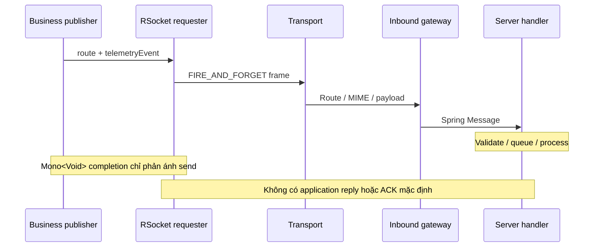
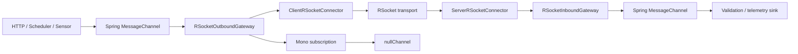
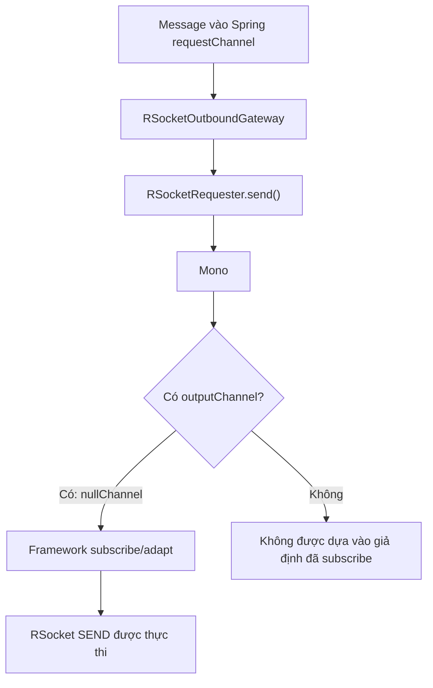
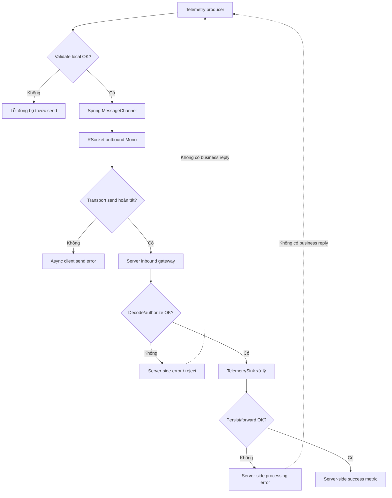
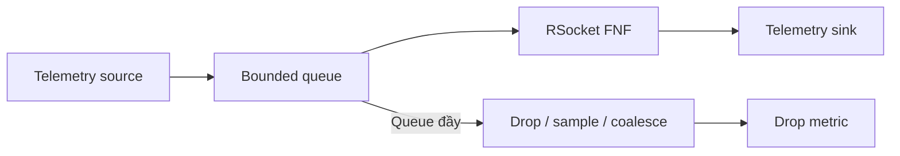
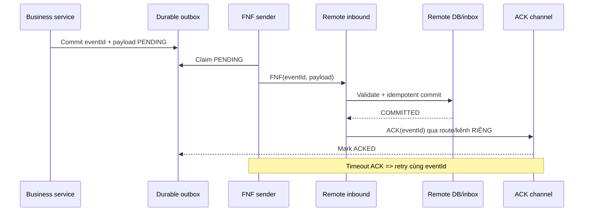
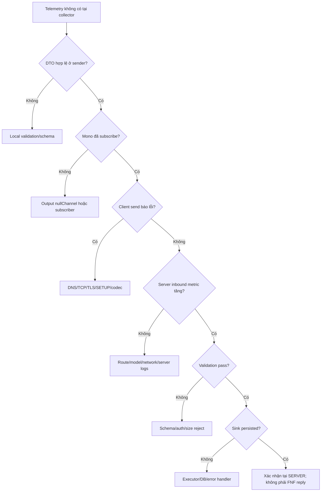

# Fire-and-forget qua RSocket trong Spring Integration

## 1. Bối cảnh: gửi tín hiệu mà không cần phản hồi nghiệp vụ

Một hệ thống quản lý đội xe nhận hàng nghìn bản ghi cảm biến mỗi giây. Mỗi thiết bị gửi tọa độ tương đối, trạng thái pin và số đo nhiệt độ. Dịch vụ **telemetry-collector** chỉ cần tiếp nhận, kiểm tra định dạng và chuyển dữ liệu vào hệ thống phân tích; client không cần chờ một giá trị response cho từng điểm đo.

Một cách gọi RSocket rất ngắn:

```java
Mono<Void> sendAttempt = requester
        .route("telemetry.ingest.v1")
        .data(telemetryEvent)
        .send();
```

Đây là interaction model **fire-and-forget**: phía client gửi **một request** nhưng **không mong chờ một response payload ứng dụng** từ server. Tuy nhiên, tên gọi “forget” **không** có nghĩa là message chắc chắn đã được xử lý, được ghi database hay có thể phục hồi sau khi mất mạng.

**Thông điệp trọng tâm của bài:** `Mono<Void>` hoàn tất nghĩa là hoạt động gửi được thực hiện theo phạm vi xác nhận của RSocket client; **không chứng minh** phía nhận đã chạy handler, commit DB hoặc nhận dữ liệu bền vững. Nếu cần biết điều đó, ứng dụng phải thiết kế **ACK riêng hoặc dùng request-response**, cùng cơ chế lưu trữ/retry phù hợp.

Bài **“Fire-and-forget qua RSocket”** thuộc chương **Adapter RSocket**, module **SPRING_INTEGRATION_ADAPTERS**. Module giải thích cách kết nối các hệ thống ngoài bằng inbound/outbound adapter, gateway, poller và `MessageChannel`; thực hành qua file, SFTP, HTTP, JMS, AMQP, Kafka và cơ sở dữ liệu; thiết kế hợp đồng message, lỗi và vòng đời kết nối. Bài này tập trung vào **RSocket fireAndForget**, Java DSL trong Spring Integration, semantics reactive, giới hạn độ tin cậy, xử lý lỗi, bảo mật và kiểm thử.

### Mục tiêu học tập

Sau bài học, bạn có thể:

1. Phân biệt `fireAndForget`, `requestResponse`, `requestStream` và `requestChannel`.
2. Giải thích tại sao `RSocketRequester.send()` trả `Mono<Void>` nhưng không có ACK nghiệp vụ.
3. Cấu hình `ClientRSocketConnector`, `ServerRSocketConnector`, `RSocketOutboundGateway` và `RSocketInboundGateway`.
4. Dùng `RSockets.outboundGateway(...)` với `RSocketInteractionModel.fireAndForget` và **output channel `nullChannel`**.
5. Cấu hình server inbound gateway chỉ cho phép `fireAndForget`, decode JSON thành DTO và xử lý không có reply.
6. Định nghĩa route, MIME, schema/version, metadata, payload size và message ID.
7. Phân tích lỗi trước/sau khi gửi, timeout, cancellation, retry, duplicate và mất dữ liệu.
8. Lựa chọn giữa telemetry best-effort, outbox/inbox có ACK, request-response và message broker bền vững.
9. Kiểm thử với RSocket transport thật, kiểm tra subscription, server receive và không tạo reply.
10. Đặt giới hạn tài nguyên, quan sát metric và quản lý kết nối/shutdown.

## 2. RSocket fire-and-forget hoạt động như thế nào?

RSocket là giao thức hướng message dựa trên reactive streams. Trong **`fire-and-forget`** (request loại `FIRE_AND_FORGET` trên wire), caller gửi một payload kèm metadata để server định tuyến, nhưng không yêu cầu server trả data response như trong request-response.



### 2.1. So sánh bốn interaction model

| Model | Request phía client | Reply phía server | Phù hợp |
| --- | --- | --- | --- |
| **`fireAndForget`** | Một payload | Không có application response payload | Telemetry best-effort, sự kiện không cần đối soát từng message |
| **`requestResponse`** | Một payload | Một response hoặc lỗi | Lấy trạng thái, tạo lệnh cần xác nhận |
| **`requestStream`** | Một payload | Nhiều response `Flux<T>` | Feed kết quả, theo dõi tiến độ |
| **`requestChannel`** | Một stream request `Publisher<T>` | Một stream response `Flux<R>` | Stream hai chiều |

Trong Spring Integration, enum tương ứng là `RSocketInteractionModel.fireAndForget`, `requestResponse`, `requestStream` và `requestChannel`. **Không** coi `fireAndForget` là `requestResponse` với response body rỗng: hai interaction model có khác biệt giao thức và lifecycle.

### 2.2. Phân biệt năm mốc trong cùng một sự kiện

```text
CREATED:   Business producer đã tạo telemetryEvent.
ACCEPTED:  Spring MessageChannel đã tiếp nhận/dispatch message.
SENT:      RSocket client hoàn tất thao tác gửi của nó.
RECEIVED:  Server inbound gateway/handler đã quan sát event.
COMMITTED: Server ghi dữ liệu nghiệp vụ thành công.
```

| Dấu hiệu | Có thể kết luận | Không thể kết luận |
| --- | --- | --- |
| `MessageChannel.send()==true` | Channel chấp nhận theo contract của channel | Event được gửi ra mạng |
| `RSocketRequester.send()` tạo `Mono<Void>` | Có publisher biểu diễn thao tác gửi | Request đã chạy khi chưa subscribe |
| `Mono<Void>` hoàn tất | Thao tác gửi hoàn tất ở phạm vi client RSocket | Server đã nhận, xác thực hoặc commit |
| Server log `received` | Handler đã quan sát event | DB đã commit, log đã flush an toàn |
| Server DB có record | Có bằng chứng xử lý cụ thể ở DB | Sender có biết kết quả hay không |
| Có ACK sau commit qua kênh riêng | Đạt hợp đồng ACK đã định nghĩa cho event ID cụ thể | Mọi event khác đều được xử lý |

**Không có ACK ở fire-and-forget** nghĩa là caller không thể phân biệt chắc chắn một event vừa bị mất trên mạng, vừa bị reject vì schema hay đã ghi DB rồi. Vì thế **delivery contract** phải được thống nhất trước khi dùng model này.

## 3. Kiến trúc fire-and-forget trong Spring Integration



Các thành phần có vai trò rõ ràng:

| Thành phần | Vai trò |
| --- | --- |
| `ClientRSocketConnector` | Quản lý requester/kết nối đến peer, MIME và strategies |
| `RSocketOutboundGateway` | Nhận Spring message, định tuyến và gọi RSocket theo model |
| `RSocketRequester` | API thấp hơn dùng `route(...).data(...).send()` |
| `ServerRSocketConnector` | Bind server transport, tiếp nhận kết nối |
| `RSocketInboundGateway` | Map route, chọn interaction models, decode request và gửi vào Spring flow |
| `MessageChannel` | Ranh giới xử lý message trong JVM |
| `nullChannel` | Nuốt kết quả nội bộ không cần consumer, **vẫn là output channel để kích hoạt subscription** |
| Business handler | Validate/process, tự quyết định lưu, drop, queue hoặc gửi ACK riêng |

### 3.1. Vì sao dùng “outbound gateway” dù không có reply?

`RSocketOutboundGateway` kế thừa một **reply-producing handler**; theo tài liệu Spring Integration, **reply nội bộ của thành phần luôn có dạng `Mono`**, kể cả `fireAndForget` khi đó là `Mono<Void>`. Trong regular output channel, framework sẽ subscribe/adapt; với `FluxMessageChannel`, subscription phụ thuộc demand.

Điểm quan trọng: đặt `expectedResponseType(void.class)` để dùng gateway như outbound channel adapter, **nhưng vẫn phải cấu hình output channel** (ví dụ `nullChannel`) để **khởi tạo subscription**. Bỏ output channel có thể khiến luồng không phát request như mong đợi.

### 3.2. Inbound gateway không phải inbound adapter file/FTP

Inbound file/FTP adapter thường poll file và phát Spring message. RSocket inbound gateway được **remote peer kích hoạt khi nhận RSocket request**. Với `fireAndForget`, không có reply correlation như request-response: inbound gateway thực hiện **plain send** vào channel đích, thay vì chờ một business reply để trả qua RSocket.

**Không dùng `@Poller`/`Pollers.fixedDelay` để “kéo” RSocket fire-and-forget request từ server**. Remote requester chủ động gửi; server chỉ map route và xử lý message khi nó đến.

## 4. Lựa chọn fire-and-forget theo yêu cầu độ tin cậy

Một số bài toán **phù hợp**:

- Một cảm biến gửi nhiệt độ mỗi giây; bỏ lỡ một điểm đo được chấp nhận vì điểm kế tiếp sẽ cập nhật.
- UI gửi “đang xem mục X” để thống kê, có thể lấy mẫu hoặc bỏ khi quá tải.
- Trạng thái thiết bị mang tính snapshot cập nhật liên tục, có nguồn đồng bộ lại.
- Tín hiệu nội bộ có policy rõ “best-effort” và không là nguồn sự thật duy nhất.

Những bài toán **không nên dùng fire-and-forget đơn độc**:

- Trừ tiền, tạo khoản thanh toán, chuyển tiền.
- Ghi nhận mỗi giao dịch duy nhất để đối soát tài chính.
- Xác nhận đơn hàng đã được thực thi.
- Xóa dữ liệu hoặc thay đổi quyền truy cập không thể bỏ qua.
- Yêu cầu mọi event phải có replay sau crash và không được mất.

| Yêu cầu | Thiết kế khuyến nghị |
| --- | --- |
| Có thể bỏ một số bản tin, đo xu hướng | Fire-and-forget + bounded buffer + metric drop |
| Cần thông báo lỗi nghiệp vụ ngay | `requestResponse` với response contract |
| Cần nhận liên tục nhiều kết quả | `requestStream` |
| Hai chiều cần demand/cancel trên luồng phần tử | `requestChannel` |
| Phải chịu crash, replay, ACK/dedup | Outbox/inbox + ACK riêng hoặc broker bền vững |

**Một quyết định kiến trúc phải bao gồm điều gì xảy ra khi server offline 30 giây, client bị kill, network bị chia cắt, queue đầy và peer đã commit nhưng client không biết.**

## 5. Định nghĩa wire contract cho telemetry

Để interop giữa các service, dùng route và JSON payload có version:

```text
Transport         : RSocket over TCP
Server address    : telemetry-collector:7000
Route             : telemetry.ingest.v1
Interaction model : fireAndForget
Data MIME         : application/json
Schema version    : 1
Reply             : KHÔNG có
Failure policy    : Best-effort, bounded retry khi lỗi gửi; drop có metric
```

```json
{
  "schemaVersion": 1,
  "eventId": "evt-device17-000042",
  "deviceId": "device-17",
  "metric": "temperature.celsius",
  "value": 26.5,
  "observedAt": "2026-11-23T03:00:00Z"
}
```

| Trường | Tác dụng | Lưu ý |
| --- | --- | --- |
| `schemaVersion` | Cho decoder/consumer biết phiên bản | Reject version không hỗ trợ |
| `eventId` | Truy vết và có thể dedup | Cùng logical event giữ ID khi retry |
| `deviceId` | Xác định nguồn | Validate và kiểm tra principal/tenant |
| `metric` | Loại giá trị đo | Whitelist, không để chuỗi tùy ý làm metric label |
| `value` | Số đo | Kiểm tra phạm vi, NaN/Infinity và unit |
| `observedAt` | Event time để phân tích | Không coi timestamp của nhiều máy là global sequence |

**Vì sao vẫn cần `eventId` dù best-effort?** Khi xuất hiện duplicate do application retry, receiver có thể phát hiện/truy vết; khi thử tải, có thể đối soát số message tạo–gửi–nhận. Nhưng `eventId` **không tự làm transport reliable**.

### 5.1. Java record minh họa

```java
// File TelemetryEvent.java - Java 17+
import java.time.Instant;

public record TelemetryEvent(
        int schemaVersion,
        String eventId,
        String deviceId,
        String metric,
        double value,
        Instant observedAt) {
}
```

### 5.2. Validation trước khi gửi và sau khi nhận

```java
// File TelemetryValidation.java
public final class TelemetryValidation {
    private TelemetryValidation() {
    }

    public static void validate(TelemetryEvent event) {
        if (event == null || event.schemaVersion() != 1 ||
                event.eventId() == null ||
                !event.eventId().matches("[A-Za-z0-9_-]{1,128}") ||
                event.deviceId() == null ||
                !event.deviceId().matches("[A-Za-z0-9_-]{1,64}") ||
                !"temperature.celsius".equals(event.metric()) ||
                !Double.isFinite(event.value()) ||
                event.value() < -100.0 || event.value() > 250.0 ||
                event.observedAt() == null) {
            throw new IllegalArgumentException(
                    "Telemetry event không hợp lệ");
        }
    }
}
```

Validation trên sender giúp phát hiện lỗi sớm, nhưng **không thay thế validation phía server** vì dữ liệu gửi từ peer ngoài JVM là không đáng tin. Production cần giới hạn byte size, rate limit, quyền sở hữu `deviceId` và chính sách xử lý event quá cũ/tương lai.

### 5.3. Metadata và route

`route("telemetry.ingest.v1")` gắn routing metadata, **không phải HTTP URL**. Spring `MessageHeaders` không tự xuất hiện đầy đủ trên wire; nếu remote cần `eventId`/`deviceId` thì đặt trong payload hoặc metadata đã thỏa thuận. Không sử dụng route string hay header từ client để suy ra họ được phép gửi dữ liệu cho thiết bị bất kỳ.

## 6. Dependencies và cấu hình hai ứng dụng

### 6.1. Maven dependencies

```xml
<dependencies>
    <dependency>
        <groupId>org.springframework.boot</groupId>
        <artifactId>spring-boot-starter-integration</artifactId>
    </dependency>
    <dependency>
        <groupId>org.springframework.integration</groupId>
        <artifactId>spring-integration-rsocket</artifactId>
    </dependency>
    <dependency>
        <groupId>com.fasterxml.jackson.core</groupId>
        <artifactId>jackson-databind</artifactId>
    </dependency>
    <!-- Ho tro Java Time Instant trong DTO JSON. -->
    <dependency>
        <groupId>com.fasterxml.jackson.datatype</groupId>
        <artifactId>jackson-datatype-jsr310</artifactId>
    </dependency>
    <dependency>
        <groupId>io.projectreactor</groupId>
        <artifactId>reactor-test</artifactId>
        <scope>test</scope>
    </dependency>
</dependencies>
```

Giữ Spring Boot/Spring Integration/Spring Framework/Reactor theo BOM tương thích. Vì `TelemetryEvent` chứa `Instant`, đảm bảo Jackson có `JavaTimeModule` và được đăng ký với `ObjectMapper`; Spring Boot thường tự đăng ký module có mặt trên classpath, còn custom mapper cần cấu hình rõ. Nếu ứng dụng bật thêm `spring-boot-starter-rsocket` và RSocket server Boot autoconfiguration, cần quyết định **ai sở hữu TCP listener**, tránh hai server cùng bind một port.

### 6.2. application.yml

```yaml
app:
  rsocket:
    bind-host: ${RSOCKET_BIND_HOST:127.0.0.1}
    host: ${RSOCKET_HOST:127.0.0.1}
    port: ${RSOCKET_PORT:7000}
    route: telemetry.ingest.v1
    max-event-bytes: 16384
```

Đây là property minh họa cho cả server/client trong môi trường local; production thường tách thành hai process/pod. Nếu hai pod khác nhau, `127.0.0.1` của sender **không** trỏ tới receiver; hãy dùng Kubernetes Service DNS/địa chỉ route được. Bên server có thể cần bind `0.0.0.0` kèm NetworkPolicy, TLS và authorization.

### 6.3. Kết nối không có nghĩa endpoint đã sẵn sàng

`ClientRSocketConnector` tạo connection/requester đến RSocket server. Một kết nối TCP/SETUP thành công **không đảm bảo** route `telemetry.ingest.v1` được map, decoder JSON hoạt động hay telemetry sink đã sẵn sàng. Vì fire-and-forget không có reply, nếu cần readiness có độ tin cậy hãy cung cấp **route health request-response riêng** (không tạo side effect), không dùng một message telemetry thử rồi coi `send()` completion là server-ready.

## 7. Client: gửi trực tiếp với `RSocketRequester.send()`

API thấp hơn này minh họa rõ nhất fire-and-forget:

```java
import java.time.Duration;
import org.springframework.messaging.rsocket.RSocketRequester;
import org.springframework.util.MimeTypeUtils;
import reactor.core.publisher.Mono;

public final class DirectTelemetryClient {
    private final RSocketRequester requester;

    public DirectTelemetryClient(String host, int port) {
        this.requester = RSocketRequester.builder()
                .dataMimeType(MimeTypeUtils.APPLICATION_JSON)
                .tcp(host, port);
    }

    public Mono<Void> send(TelemetryEvent event) {
        TelemetryValidation.validate(event);
        return requester.route("telemetry.ingest.v1")
                .data(event)
                .send()
                .timeout(Duration.ofSeconds(3));
    }
}
```

`send()` là operation **fire-and-forget**, khác `retrieveMono(...)` của request-response. Kết quả `Mono<Void>` chỉ cung cấp completion/error tại phía client.

### 7.1. Publisher lạnh cần được subscribe

```java
Mono<Void> pending = client.send(event);
// Chưa subscribe: không được coi đã gửi thành công.

Mono<Void> observed = pending
        .doOnSuccess(ignored ->
                System.out.println("Client send operation completed"))
        .doOnError(ex ->
                System.err.println(ex.getClass().getSimpleName()));

// Trả observed cho một reactive caller, hoặc subscribe từ
// tầng orchestration có quản lý lifecycle/error.
```

Một `Mono` chưa có subscriber **không tự thực thi** network send. Ngược lại, gọi `subscribe()` vô điều kiện ở khắp nơi có thể tạo tác vụ “bị quên” thật: không giữ `Disposable`, không thu lỗi, không theo dõi shutdown và không giới hạn số attempt.

### 7.2. Trong test có thể dùng StepVerifier

```java
import reactor.test.StepVerifier;

StepVerifier.create(client.send(event))
        .verifyComplete();
```

**Assertion này chỉ kiểm tra client publisher hoàn tất.** Nó không chứng minh receiver có record. Nếu test muốn xác minh server nhận, cần thêm một cơ chế quan sát độc lập (ví dụ `BlockingQueue` test fixture) và await số event đã xử lý, không dùng completion làm ACK.

### 7.3. Không tạo requester per-message ở production

Một connection RSocket có thể chở nhiều interaction. Tạo mới requester/TCP connection trên mỗi điểm đo gây handshake overhead, connection churn và khó shutdown. Dùng một `ClientRSocketConnector` hoặc requester được quản lý theo application lifecycle; đặt quota/concurrency limit để một client không tạo vô hạn request đang chờ.

## 8. Client: `ClientRSocketConnector` và Java DSL outbound

Spring Integration có `RSockets.outboundGateway(...)` và enum `RSocketInteractionModel.fireAndForget`.

### 8.1. Connector theo Spring bean lifecycle

```java
import org.springframework.beans.factory.annotation.Value;
import org.springframework.context.annotation.Bean;
import org.springframework.context.annotation.Configuration;
import org.springframework.integration.rsocket.ClientRSocketConnector;
import org.springframework.util.MimeTypeUtils;

@Configuration
public class TelemetryRSocketClientConfiguration {

    @Bean
    public ClientRSocketConnector telemetryClientConnector(
            @Value("${app.rsocket.host}") String host,
            @Value("${app.rsocket.port}") int port) {
        ClientRSocketConnector connector =
                new ClientRSocketConnector(host, port);
        connector.setDataMimeType(MimeTypeUtils.APPLICATION_JSON);
        return connector;
    }
}
```

Để serialize record `TelemetryEvent` thành JSON, connector phải có `RSocketStrategies` với Jackson encoder phù hợp với BOM và MIME type. Một số Spring Boot setup đã cung cấp JSON codecs, nhưng nếu dùng custom strategies chỉ chứa text encoder thì cần bổ sung Jackson; **đừng mặc định chỉ thêm dependency là hai phía đã tương thích schema**.

### 8.2. Outbound IntegrationFlow với output `nullChannel`

```java
import org.springframework.context.annotation.Bean;
import org.springframework.context.annotation.Configuration;
import org.springframework.integration.dsl.IntegrationFlow;
import org.springframework.integration.rsocket.ClientRSocketConnector;
import org.springframework.integration.rsocket.RSocketInteractionModel;
import org.springframework.integration.rsocket.dsl.RSockets;

@Configuration
public class TelemetryOutboundFlow {

    @Bean
    public IntegrationFlow telemetryFireAndForgetFlow(
            ClientRSocketConnector telemetryClientConnector) {

        return IntegrationFlow
                .from("telemetryToSend")
                .handle(RSockets.outboundGateway("telemetry.ingest.v1")
                        .interactionModel(
                                RSocketInteractionModel.fireAndForget)
                        .expectedResponseType(void.class)
                        .clientRSocketConnector(telemetryClientConnector))
                // Bắt buộc có output channel để Mono<Void>
                // được subscribe/adapt theo semantics của gateway.
                .channel("nullChannel")
                .get();
    }
}
```

**Điểm quan trọng nhất của code:**

1. `.interactionModel(fireAndForget)` chọn **một request không có reply**.
2. `.expectedResponseType(void.class)` diễn tả không chờ giá trị response.
3. `.channel("nullChannel")` vẫn là **outputChannel hợp lệ** cho gateway, khiến `Mono<Void>` được subscribe theo contract framework.
4. Bean `telemetryClientConnector` quản lý requester/connection; business service không tự gọi `RSocketRequester` trực tiếp.
5. Downstream `nullChannel` **không phải nơi nhận ACK**: nó hủy/tiêu thụ output nội bộ, không chứng minh server đã xử lý.

**Không bỏ output channel và cho rằng gateway sẽ “fire” ngay khi `MessageChannel.send()` trả true.** Đây là khác biệt giữa **handler trả reactive publisher** và một hàm đồng bộ đã thực hiện I/O xong.

### 8.3. Service gửi Spring Message

```java
import org.springframework.beans.factory.annotation.Qualifier;
import org.springframework.messaging.MessageChannel;
import org.springframework.messaging.support.MessageBuilder;
import org.springframework.stereotype.Service;

@Service
public class TelemetryDispatcher {

    private final MessageChannel telemetryToSend;

    public TelemetryDispatcher(
            @Qualifier("telemetryToSend")
            MessageChannel telemetryToSend) {
        this.telemetryToSend = telemetryToSend;
    }

    public void publish(TelemetryEvent event) {
        TelemetryValidation.validate(event);
        boolean accepted = telemetryToSend.send(
                MessageBuilder.withPayload(event)
                        .setHeader("eventId", event.eventId())
                        .build());

        if (!accepted) {
            throw new IllegalStateException(
                    "Spring MessageChannel không tiếp nhận telemetry");
        }
        // KHÔNG: mark event đã COMMITTED ở remote.
    }
}
```

Header `eventId` trên Spring Message phục vụ tracing/flow trong JVM; DTO cũng chứa `eventId` vì **phía server không tự thấy mọi Spring header** trên wire.

### 8.4. Java bean `RSocketOutboundGateway` thay cho DSL

```java
import org.springframework.beans.factory.annotation.Bean;
import org.springframework.beans.factory.annotation.Qualifier;
import org.springframework.context.annotation.Configuration;
import org.springframework.integration.annotation.ServiceActivator;
import org.springframework.integration.rsocket.ClientRSocketConnector;
import org.springframework.integration.rsocket.RSocketInteractionModel;
import org.springframework.integration.rsocket.outbound.RSocketOutboundGateway;

@Configuration
public class TelemetryOutboundGatewayBeanConfiguration {

    @Bean
    @ServiceActivator(
            inputChannel = "rawTelemetryRequests",
            outputChannel = "nullChannel")
    public RSocketOutboundGateway sendTelemetry(
            @Qualifier("telemetryClientConnector")
            ClientRSocketConnector connector) {

        RSocketOutboundGateway gateway =
                new RSocketOutboundGateway("telemetry.ingest.v1");
        gateway.setInteractionModel(
                RSocketInteractionModel.fireAndForget);
        gateway.setExpectedResponseType(void.class);
        gateway.setClientRSocketConnector(connector);
        return gateway;
    }
}
```

Đây là **phương án thay thế** cho flow `telemetryFireAndForgetFlow`, không phải một bean nữa dùng cùng input channel trong cùng ví dụ chạy nếu không có chủ đích. Hai cách cấu hình đều phải giữ `outputChannel` để chủ động subscribe `Mono<Void>`.

## 9. Server: tạo `ServerRSocketConnector` để lắng nghe

Phía collector cần một listener:

```java
import org.springframework.beans.factory.annotation.Value;
import org.springframework.context.annotation.Bean;
import org.springframework.context.annotation.Configuration;
import org.springframework.integration.rsocket.ServerRSocketConnector;
import org.springframework.util.MimeTypeUtils;

@Configuration
public class TelemetryRSocketServerConfiguration {

    @Bean
    public ServerRSocketConnector telemetryServerConnector(
            @Value("${app.rsocket.bind-host}") String host,
            @Value("${app.rsocket.port}") int port) {

        ServerRSocketConnector connector =
                new ServerRSocketConnector(host, port);
        connector.setDataMimeType(MimeTypeUtils.APPLICATION_JSON);
        return connector;
    }
}
```

`ServerRSocketConnector` bind transport, còn `RSocketInboundGateway` đăng ký route. Cần nhất quán về `RSocketStrategies`/data MIME trên hai phía. Nếu sử dụng Spring Boot server riêng với cùng port, không được bind thêm một `ServerRSocketConnector` trùng cổng.

### 9.1. Một server có thể nhận nhiều routes

Một connector có thể quản lý nhiều inbound endpoints nếu route/model khác nhau. Chẳng hạn:

```text
telemetry.ingest.v1  : fireAndForget
telemetry.health.v1  : requestResponse
telemetry.watch.v1   : requestStream
```

**Không gắn requestResponse vào route telemetry.ingest.v1 chỉ để lấy ACK** mà không cập nhật client/contract. Nếu cần ACK sau commit, thiết kế endpoint riêng và dùng đúng model/response type.

## 10. Server inbound gateway nhận fire-and-forget

### 10.1. Java DSL nhận một DTO

```java
import org.springframework.context.annotation.Bean;
import org.springframework.context.annotation.Configuration;
import org.springframework.core.ResolvableType;
import org.springframework.integration.dsl.IntegrationFlow;
import org.springframework.integration.rsocket.RSocketInteractionModel;
import org.springframework.integration.rsocket.dsl.RSockets;

@Configuration
public class TelemetryInboundFlow {

    @Bean
    public IntegrationFlow telemetryInbound(
            TelemetrySink telemetrySink) {
        return IntegrationFlow
                .from(RSockets.inboundGateway("telemetry.ingest.v1")
                        .interactionModels(
                                RSocketInteractionModel.fireAndForget)
                        .requestElementType(
                                ResolvableType.forClass(
                                        TelemetryEvent.class)))
                .handle(telemetrySink, "accept")
                .get();
    }
}
```

Tài liệu Spring Integration mô tả **fire-and-forget inbound có payload đã decode trực tiếp**; khác các interaction có reply nơi payload thường là `Flux`. Do đó một handler nhận `TelemetryEvent` ở ví dụ trên là lựa chọn phù hợp. Cần kiểm tra version và codec bằng integration test thật: nếu client gửi MIME không tương thích, gateway có thể chỉ decode thành `byte[]` hoặc báo lỗi.

### 10.2. Telemetry sink không có reply

```java
import org.springframework.stereotype.Service;
import java.util.concurrent.atomic.LongAdder;

@Service
public class TelemetrySink {

    private final LongAdder received = new LongAdder();

    public void accept(TelemetryEvent event) {
        TelemetryValidation.validate(event);
        received.increment();
        // Demo: không trả reply.
        // Production: lưu, chuyển pipeline hoặc drop theo policy.
    }

    public long receivedCount() {
        return received.sum();
    }
}
```

`receivedCount()` chỉ là bộ đếm in-memory cho demo/test. Nó **không phải** lưu trữ bền vững và có thể reset khi restart. Nếu tăng bộ đếm trước khi xử lý async hoặc DB commit, metric đó phải được đặt tên đúng là **đã nhận/validate**, không phải “đã lưu thành công”.

### 10.3. Java bean `RSocketInboundGateway` thay thế DSL

```java
import org.springframework.context.annotation.Bean;
import org.springframework.context.annotation.Configuration;
import org.springframework.core.ResolvableType;
import org.springframework.integration.rsocket.RSocketInteractionModel;
import org.springframework.integration.rsocket.inbound.RSocketInboundGateway;

@Configuration
public class TelemetryInboundGatewayBeanConfiguration {

    @Bean
    public RSocketInboundGateway telemetryGateway() {
        RSocketInboundGateway gateway =
                new RSocketInboundGateway("telemetry.ingest.v1");
        gateway.setInteractionModels(
                RSocketInteractionModel.fireAndForget);
        gateway.setRequestElementType(
                ResolvableType.forClass(TelemetryEvent.class));
        gateway.setRequestChannelName("telemetryInboundRequests");
        return gateway;
    }
}
```

Sau đó một `@ServiceActivator(inputChannel="telemetryInboundRequests")` nhận `TelemetryEvent`. Đây là **phương án thay thế** cho Java DSL ở mục 10.1, không đăng ký hai gateway cùng route/model nếu không có chủ đích giải quyết xung đột.

### 10.4. Inbound không đợi một reply từ Spring flow

Trong `fireAndForget`, RSocket inbound gateway không nhận response correlation header như ở request-response, và **không yêu cầu business handler trả `Mono<Reply>`**. Nó chuyển message vào Spring channel theo send semantics của gateway. Việc handler bắt exception sau khi client đã gửi **không tạo một business reply** trên tương tác này.

Nếu muốn caller biết handler đã lưu DB, phải thay đổi **hợp đồng giao tiếp**; không chỉ thêm `return "OK"` vào một service method vốn được gọi từ fire-and-forget.

## 11. Cấu hình kiểu data, codec và route metadata

Một route fire-and-forget có hai phần quan trọng:

```text
RSocket request metadata:
  route = telemetry.ingest.v1
  (các metadata khác nếu protocol và security cho phép)

RSocket data:
  JSON TelemetryEvent (schemaVersion=1)
```

| Thành phần | Client cấu hình | Server cấu hình |
| --- | --- | --- |
| Route | `route("telemetry.ingest.v1")` hoặc DSL | `RSockets.inboundGateway("telemetry.ingest.v1")` |
| Interaction model | `send()`/`fireAndForget` | Chỉ nhận `fireAndForget` |
| Data MIME | `application/json` | `application/json` |
| Java payload | `TelemetryEvent` record | `requestElementType(TelemetryEvent.class)` |
| Encoder/decoder | Jackson phù hợp với strategies | Decoder/validation phù hợp |
| Response | `Mono<Void>`, không có reply payload | Handler không phát response |

### 11.1. JSON codec với RSocketStrategies

```java
import com.fasterxml.jackson.databind.ObjectMapper;
import org.springframework.context.annotation.Bean;
import org.springframework.context.annotation.Configuration;
import org.springframework.http.codec.json.Jackson2JsonDecoder;
import org.springframework.http.codec.json.Jackson2JsonEncoder;
import org.springframework.messaging.rsocket.RSocketStrategies;

@Configuration
public class TelemetryRSocketCodecConfiguration {

    @Bean
    public RSocketStrategies telemetryRSocketStrategies(
            ObjectMapper mapper) {
        return RSocketStrategies.builder()
                .decoder(new Jackson2JsonDecoder(mapper))
                .encoder(new Jackson2JsonEncoder(mapper))
                .build();
    }
}
```

Khi dùng strategies này, inject vào **bean connector hiện hữu** bằng `connector.setRSocketStrategies(strategies)` trên **cả client và server** (hoặc dùng autoconfiguration phù hợp). Đây chỉ là ví dụ cấu hình codec; production cần giữ các codec/metadata registrations cần thiết của stack đã chọn. Không tạo thêm server listener thứ hai chỉ để đổi strategies.

### 11.2. Dùng text thay cho JSON khi nào?

Một tín hiệu chỉ là `"device-17:online"` có thể dùng `text/plain` và `String`. Khi đó:

- Client/connector chọn `MimeTypeUtils.TEXT_PLAIN`.
- Server inbound chọn `requestElementType(String.class)`.
- Handler nhận `String` và parse/validate.
- Không trộn text payload với server chỉ chờ `TelemetryEvent` JSON.

Đừng gửi `TelemetryEvent.toString()` rồi gọi đó là JSON chuẩn; Java record `toString()` không phải một wire contract có version.

### 11.3. Metadata biểu diễn trace, không thay authorization

Outbound gateway hỗ trợ biểu thức metadata theo `Map<Object, MimeType>`. Nếu gửi trace ID hoặc schema hint, server phải có mapping/decoder cho metadata đó. **Không mặc định mọi Spring header được tự truyền**; và một header tenant ID do client tự khai không chứng minh họ có quyền gửi event cho tenant đó.

## 12. Vì sao `nullChannel` là chi tiết bắt buộc?

Trong Spring Integration, `RSocketOutboundGateway` là reply-producing handler dù interaction model không có business reply. Khi gửi fire-and-forget, phần xử lý nội bộ tạo **`Mono<Void>`** và cần kích hoạt subscription.



### 12.1. Mẫu chuẩn trong Java DSL

```java
return IntegrationFlow.from("telemetryToSend")
        .handle(RSockets.outboundGateway("telemetry.ingest.v1")
                .interactionModel(
                        RSocketInteractionModel.fireAndForget)
                .expectedResponseType(void.class)
                .clientRSocketConnector(connector))
        .channel("nullChannel")
        .get();
```

Với `FluxMessageChannel`, xử lý reply theo demand; nếu không có subscriber, phải xem xét tương tác có thực sự được thực thi không. Với regular output channel, framework subscribe/adapt theo semantics được tài liệu Spring Integration mô tả.

### 12.2. `nullChannel` không phải “đã thành công”

`nullChannel` là sink nội bộ nhận output không cần xử lý tiếp. Nó **không lưu** message, không xuất ACK và không có durable offset. Không dùng metric “số message vào nullChannel” làm số message đã được server commit.

### 12.3. Anti-pattern

```java
// PHẢN VÍ DỤ: thiếu output channel cho Mono<Void>.
IntegrationFlow.from("telemetryToSend")
        .handle(RSockets.outboundGateway("telemetry.ingest.v1")
                .interactionModel(
                        RSocketInteractionModel.fireAndForget)
                .clientRSocketConnector(connector))
        .get();
```

**Không suy rằng đoạn này hoàn tất send** chỉ vì `handle(...)` được cấu hình. Với fire-and-forget hãy khai báo `.channel("nullChannel")` hoặc output channel thích hợp theo contract của gateway.

### 12.4. Khi output channel cần phục vụ quan sát

Nếu dùng một regular channel khác để đo completion, cần phân biệt:

- **`send attempt started`:** đã bắt đầu subscription.
- **`send completed`:** client operation hoàn tất.
- **`send failed`:** client operation lỗi.
- **`server received/processed`:** phải đo ở server hoặc qua ACK riêng.

Không tự gửi một giả `Reply("OK")` vào Spring output rồi tưởng đó là RSocket response từ remote.

## 13. Lỗi của fire-and-forget xảy ra ở ranh giới nào?

Vì không có reply nghiệp vụ, phải phân loại lỗi theo **vị trí** thay vì chỉ bắt một exception tổng quát.



| Ranh giới | Ví dụ lỗi | Caller có biết không? | Hướng xử lý |
| --- | --- | --- | --- |
| **Tạo/validate DTO** | `deviceId` rỗng, value NaN | Có thể biết đồng bộ | Reject và sửa nguồn dữ liệu |
| **Spring channel dispatch** | Bounded executor reject | Tùy channel/boundary; có thể sync exception | Metric reject, giảm tải hoặc durable fallback |
| **RSocket client** | Connection refused, encode fail | Có thể phát `Mono.error` | Lắng nghe error signal, backoff |
| **RSocket transport** | Gửi hoàn tất nhưng peer mất ngay sau đó | Không chắc biết kết quả | Chấp nhận mất hoặc ACK/replay riêng |
| **Server route/codec** | Route sai, JSON không parse được | Không có business reply trong FNF | Server log/metric, fix protocol |
| **Server authorization** | Không được gửi cho device khác | Không có business reply | Reject, audit, bảo vệ resource |
| **Server business handler** | DB fail hoặc executor reject | Caller thường không biết | Error handler/server metrics, durable storage |
| **Server shutdown/crash** | Event đang trong RAM queue | Caller không thể chắc đã xử lý | Snapshot/replay/broker nếu quan trọng |

### 13.1. `try/catch` quanh `channel.send` không đủ

```java
// PHẢN VÍ DỤ nếu coi đoạn này xác nhận server đã xử lý.
try {
    telemetryToSend.send(
            MessageBuilder.withPayload(event).build());
    markEventProcessedRemotely(event.eventId()); // SAI
} catch (Exception ex) {
    scheduleRetryWithoutIdempotency();           // CÓ THỂ TRÙNG
}
```

`RSocketOutboundGateway` phát `Mono<Void>` với xử lý bất đồng bộ. Lỗi network/encoding có thể xuất hiện **sau** khi `MessageChannel.send()` trả về. Cần quan sát lỗi ở đúng reactive/error boundary và dựa vào **nguồn trạng thái bền vững** nếu dữ liệu không được mất.

### 13.2. Server exception không biến thành một reply

```java
public void accept(TelemetryEvent event) {
    TelemetryValidation.validate(event);
    if (isUnknownDevice(event.deviceId())) {
        throw new IllegalArgumentException(
                "Thiết bị chưa đăng ký");
    }
    // Không có response payload cho fire-and-forget.
}
```

Ví dụ này giả định `isUnknownDevice(...)` là method của một service thực tế. Khi method ném lỗi, server có thể quan sát bằng error handler/log/metric tùy channel topology. **Không** kỳ vọng client nhận một response business chứa `"Thiết bị chưa đăng ký"` từ tương tác fire-and-forget.

Nếu client bắt buộc phải biết lý do reject, chọn `requestResponse` và định nghĩa error response contract hoặc một kênh ACK/notification riêng.

### 13.3. Error channel là nơi xử lý lỗi, không phải kho lưu bền vững

Spring Integration có error channel và handler theo endpoint/channel. Tuy nhiên:

- Exception của caller trước khi gửi khác lỗi của reactive publisher sau subscribe.
- Lỗi trong handler bất đồng bộ phía server có thể đi theo error boundary riêng.
- Một `ErrorMessage`/`errorChannel` không tự có durable replay/offset.
- Khi fire-and-forget đã gửi, không có reply để đưa kết quả business trở lại cùng request.

Trong integration test, phải chứng minh **lỗi nào đi vào error channel**, lỗi nào nằm trong client `Mono` và lỗi nào chỉ quan sát được ở server. Không cấu hình `errorChannel` rồi tuyên bố mọi thất bại sẽ được tự retry.

## 14. Backpressure: fire-and-forget **không có request(n) cho từng ACK**

RSocket hỗ trợ `REQUEST_N` cho những mô hình streaming, nhưng **fire-and-forget là một request một chiều**, không có stream response để downstream gửi `request(n)` và không có ACK nghiệp vụ cho từng message. Điều này **không** có nghĩa mọi layer đều buffer vô hạn hay mạng không bao giờ gây chậm: transport, I/O và JVM vẫn có giới hạn.

### 14.1. Khi nguồn gửi nhanh hơn collector

Giả sử:

```text
Source phát:     5.000 telemetry events/giây
Collector xử lý: 2.000 telemetry events/giây

Chênh lệch:       3.000 events/giây
Sau 60 giây:    180.000 events backlog (nếu không drop/block/scale)
```

Không thể tăng queue vô hạn. Với mô hình best-effort, nên có **explicit overload policy**:

1. **Drop latest:** bỏ điểm đo mới khi queue đầy, phát metric.
2. **Drop oldest:** giữ trạng thái mới nhất, bỏ điểm đo cũ nếu domain cho phép.
3. **Coalesce:** gộp cập nhật cùng `deviceId + metric` để giữ snapshot cuối.
4. **Sample:** chỉ lấy một phần dữ liệu khi tăng tải.
5. **Rate limit:** giảm tốc nguồn phát theo quota.
6. **Scale out:** tăng công suất server nếu còn tài nguyên.
7. **Durable buffer:** nếu không chấp nhận mất dữ liệu, chọn broker/outbox phù hợp.

Chính sách nào đúng phụ thuộc ý nghĩa của điểm đo: nhiệt độ “trạng thái hiện tại” có thể coalesce, nhưng một **cảnh báo vượt ngưỡng duy nhất** có thể không được bỏ.

### 14.2. Bounded executor phía receiver

Nếu xử lý telemetry cần I/O blocking, có thể tách công việc khỏi event-loop bằng bounded executor:

```java
import java.util.concurrent.ThreadPoolExecutor;
import org.springframework.context.annotation.Bean;
import org.springframework.context.annotation.Configuration;
import org.springframework.scheduling.concurrent.ThreadPoolTaskExecutor;

@Configuration
public class TelemetryWorkerPoolConfiguration {

    @Bean
    public ThreadPoolTaskExecutor telemetryWorkerPool() {
        ThreadPoolTaskExecutor pool = new ThreadPoolTaskExecutor();
        pool.setThreadNamePrefix("telemetry-worker-");
        pool.setCorePoolSize(4);
        pool.setMaxPoolSize(8);
        pool.setQueueCapacity(1_000);
        pool.setRejectedExecutionHandler(
                new ThreadPoolExecutor.AbortPolicy());
        return pool;
    }
}
```

**Đây là phần minh họa ngân sách tài nguyên**, chưa tự động nối pool vào IntegrationFlow. Nếu dùng `ExecutorChannel`/async executor, phải cấu hình channel với bean pool này, đo queue depth và bắt rejected tasks đúng error boundary. Đặc biệt, khi async enqueue thành công nhưng worker chưa xử lý, việc caller đã gửi xong **không** là bằng chứng xử lý hoàn tất.

### 14.3. Một cách nối bounded `ExecutorChannel`

```java
import org.springframework.context.annotation.Bean;
import org.springframework.context.annotation.Configuration;
import org.springframework.integration.channel.ExecutorChannel;
import org.springframework.messaging.MessageChannel;
import org.springframework.scheduling.concurrent.ThreadPoolTaskExecutor;

@Configuration
public class TelemetryChannels {

    @Bean("telemetryWorkChannel")
    public MessageChannel telemetryWorkChannel(
            ThreadPoolTaskExecutor telemetryWorkerPool) {
        return new ExecutorChannel(telemetryWorkerPool);
    }
}
```

Trong inbound flow:

```java
IntegrationFlow.from(
        RSockets.inboundGateway("telemetry.ingest.v1")
                .interactionModels(
                        RSocketInteractionModel.fireAndForget)
                .requestElementType(
                        ResolvableType.forClass(TelemetryEvent.class)))
        .channel("telemetryWorkChannel")
        .handle(telemetrySink, "accept")
        .get();
```

Khi queue đầy, executor có thể reject; cần metric/alert và **không** mong rằng FNF client chắc chắn nhận một business error để retry. Nếu yêu cầu không mất telemetry, ghi nó vào durable buffer **trước async handoff** hoặc thay kiến trúc.

### 14.4. Không dùng `onBackpressureBuffer()` không giới hạn

```java
// PHẢN VÍ DỤ - buffer không kiểm soát khi nguồn nhanh:
Flux<TelemetryEvent> flow = source
        .onBackpressureBuffer();
```

Nếu source vượt công suất sink trong thời gian dài, bộ nhớ có thể tăng tới OOM. Hãy dùng bounded buffer, overflow strategy và metric, hoặc durable queue cho dữ liệu quan trọng. Thêm Reactor `Flux` phía client cũng **không biến từng fire-and-forget request thành `requestChannel`**.

## 15. Retry trong fire-and-forget: duplicate và kết quả không chắc chắn

### 15.1. Bốn tình huống

| Tình huống | Có thể retry? | Rủi ro |
| --- | --- | --- |
| Payload không qua validation local | Sửa dữ liệu trước | Retry y nguyên không giúp |
| Connection chưa mở, send thất bại rõ | Có thể retry với backoff | Có thể tạo burst khi peer trở lại |
| Client send hoàn tất nhưng không thấy server metric | Không có ACK để kết luận | Retry có thể trùng hoặc chỉ tăng tải |
| Server đã lưu DB rồi restart | Sender không biết từ FNF | Gửi lại sẽ tạo trùng nếu server không idempotent |

**Retry trên một event đã “không rõ kết quả”** là chấp nhận khả năng duplicate. Với best-effort telemetry, có thể **chấp nhận mất dữ liệu và không retry** nhằm giữ độ trễ/thông lượng, hoặc retry bounded và dùng dedup theo `eventId`.

### 15.2. Vì sao không retry vô hạn?

```text
while (true) {
    requester.route("telemetry.ingest.v1")
             .data(event)
             .send()
             .subscribe();     // PHẢN VÍ DỤ: runaway requests
}
```

Đoạn này vừa không giới hạn số subscription, vừa không quan sát completion/error, không có backoff và có thể tạo thác lũ kết nối/tác vụ khi peer gặp sự cố. Không dùng `retryWhen(Retry.max(Long.MAX_VALUE))` cho mọi lỗi, nhất là schema/auth errors không thể tự hồi phục.

### 15.3. Retry có giới hạn trong RSocketRequester trực tiếp

```java
import java.time.Duration;
import reactor.core.publisher.Mono;
import reactor.util.retry.Retry;

public Mono<Void> sendWithBoundedRetry(
        RSocketRequester requester, TelemetryEvent event) {

    TelemetryValidation.validate(event);
    return requester.route("telemetry.ingest.v1")
            .data(event)
            .send()
            .retryWhen(Retry.backoff(2, Duration.ofMillis(200))
                    .maxBackoff(Duration.ofSeconds(2)))
            .timeout(Duration.ofSeconds(6));
}
```

**Đây là demo cho best-effort telemetry**, không phải công thức bảo đảm at-most-once hoặc exactly-once. Khi `send()` đã đưa dữ liệu tới network nhưng completion/error đến không rõ ràng, retry có thể tạo **bản trùng**. Trong production cần phân loại exception retryable, thêm jitter/total budget, kiểm tra deadline và chính sách drop/reconciliation.

### 15.4. Gửi lại phải giữ cùng event ID

```text
Attempt 1:
  eventId=evt-device17-000042
  value=26.5

Attempt 2 (retry):
  eventId=evt-device17-000042
  value=26.5

Không tự đổi:
  eventId=evt-device17-000043
chỉ vì network send attempt mới.
```

Nếu mỗi retry tạo `eventId` mới, receiver không thể phân biệt retry với telemetry logical event mới. Khi gửi cập nhật trạng thái liên tục, nên quyết định rõ một lần đo có ID riêng và thời gian quan sát riêng; không gộp nhầm hai phép đo khác nhau chỉ vì cùng giá trị.

## 16. Muốn không mất message: thêm durability và ACK ngoài FNF

Fire-and-forget **không tự cung cấp**:

- ACK sau commit.
- Outbox/inbox/offset.
- Consumer group và retention.
- Replay message sau process crash.
- Exactly-once side effect.

### 16.1. Mô hình best-effort



Đây là kiến trúc có thể hợp lý cho nhiệt độ liên tục, miễn là:

1. Product/business chấp nhận drop một số điểm.
2. Có limit queue, payload size, rate và retry.
3. Server có biểu đồ receiver lag và error.
4. Không báo `received/persisted` chỉ từ completion phía client.

### 16.2. Mô hình cần ACK sau commit



**Lưu ý thiết kế:** ACK trong sơ đồ **không phải reply của fire-and-forget**. Nó là một interaction khác (ví dụ server gửi request-response/callback, một kênh message có persistence hoặc API trạng thái riêng). Dùng `RSocketRequester.send()` không tự tạo cho bạn `ACK(eventId)`.

### 16.3. Outbox và inbox tối thiểu

| Trường/khóa | Nguồn | Vì sao |
| --- | --- | --- |
| `eventId` | Sender và receiver | Idempotency/correlation |
| `payloadBytes` | Sender outbox | Replay cùng nội dung |
| `status` | Sender | `PENDING/ACKED/DEAD` |
| `nextAttemptAt` | Sender | Backoff |
| `attemptCount` | Sender | Retry budget |
| `lockedUntil` | Sender | Chống worker claim trùng không kiểm soát |
| Unique `eventId` | Receiver inbox/DB | Dedup sau restart |
| `processedAt` | Receiver | Audit/retention |

Nếu ACK bị mất sau khi server đã commit, retry với cùng `eventId` phải là **idempotent no-op** hoặc trả kết quả trước đó. Dùng `ConcurrentHashMap` RAM để dedup không đủ vì restart làm mất history.

### 16.4. Khi nào nên chọn request-response hoặc broker?

| Yêu cầu | Đề xuất |
| --- | --- |
| Một phép đo mới, không cần status | FNF best-effort |
| Gửi command và cần kết quả trả ngay | RSocket `requestResponse` |
| Gửi rất nhiều event và cần xác nhận từng batch | Thiết kế `requestChannel`/protocol ACK phù hợp |
| Bắt buộc mọi event có offset/replay lâu dài | Broker durable như Kafka/JMS/AMQP hoặc event store |
| FNF đã dùng nhưng nay bắt buộc không mất | Bổ sung durable source/ACK hoặc đổi kiến trúc; không chỉ tăng timeout |

**Mục tiêu bài là chọn đúng model**, không cố ép FNF trở thành một durable broker bằng cách thêm một vài retry hoặc `Thread.sleep()`.

## 17. Ordering: gửi lần lượt không bảo đảm commit theo thứ tự

Giả sử thiết bị gửi:

```text
seq=41 temperature=26.4
seq=42 temperature=26.5
seq=43 temperature=26.6
```

Một kết nối có thể giao các frame theo thứ tự, nhưng ứng dụng vẫn có thể:

- Xử lý song song bằng `ExecutorChannel` nên seq=43 commit trước 42.
- Retry seq=42 sau khi seq=43 đã tới.
- Mất seq=42 do transport/overload.
- Khởi động lại server và mất queue trong RAM.

Với telemetry analytics, event timestamp/sequence giúp phát hiện gap, chọn last observation hoặc reorder trong một cửa sổ giới hạn. Với nghiệp vụ cần state transition chính xác, phải có **per-stream sequence guard**, durable inbox/outbox và ACK phù hợp; FNF tự nó không đủ.

### 17.1. Timestamp không thay sequence

Đồng hồ giữa thiết bị có thể lệch. Hai event đến collector có timestamp khác với thời điểm chúng được tạo hoặc commit. Nếu cần thứ tự theo một `deviceId`, dùng sequence monotonic do nguồn có thẩm quyền cấp và định nghĩa cách reset sequence khi thiết bị reboot.

### 17.2. Trường hợp snapshot có thể coalesce

Nếu mỗi event chỉ đại diện **trạng thái mới nhất**, có thể giữ `lastByDevice` tại gateway và ghi đè điểm cũ chưa gửi. Nhưng nếu event là **một cảnh báo rời rạc** (“mở cửa an ninh lúc 10:00”), coalescing có thể xóa mất thông tin quan trọng. Chọn policy dựa trên semantics chứ không chỉ để giảm lưu lượng.

## 18. Lỗi payload, metadata và authorization

RSocket route là metadata định tuyến; không tự xác thực caller. Server inbound FNF phải có cơ chế bảo mật:

| Rủi ro | Biện pháp |
| --- | --- |
| Không xác thực client | Authentication ở SETUP/security layer hoặc transport được bảo vệ |
| `deviceId` giả mạo | Đối chiếu principal với danh sách device được phép |
| Dữ liệu JSON độc hại | Max bytes, schemaVersion, whitelist fields, JSON depth |
| Client spam FNF | Rate limit, quota per identity/device |
| Route khác của hệ thống bị gọi | Authorization theo route, không chỉ name matching |
| Metadata chứa token | Mã hóa transport, không log token |
| Giá trị metric sinh vô hạn label | Whitelist metric name, chống cardinality explosion |
| Peer giả mạo | TLS/mTLS hoặc hạ tầng trust được kiểm chứng |
| Lỗi nội bộ bị lộ qua log | Sanitize error, hạn chế dữ liệu nhạy cảm |

RSocket TCP **không tự tương đương HTTPS/TLS**. Nếu yêu cầu confidentiality/integrity end-to-end, cấu hình transport TLS hoặc lớp mạng được phê duyệt và kiểm tra danh tính peer.

### 18.1. Không dùng FNF cho lỗi cần phản hồi tức thì

Nếu bên ngoài phải biết `deviceId` không hợp lệ để sửa cấu hình ngay, FNF không thể trả business validation response. Hãy cung cấp một route `devices.validate` hoặc `telemetry.submit` dùng `requestResponse`, hoặc một kênh trạng thái khác có ACK rõ nghĩa. Server log/error handler chỉ giải quyết **quan sát nội bộ**, không tự báo điều kiện reject cho caller.

## 19. Lifecycle và shutdown của connection

### 19.1. Khởi động

```text
Spring ApplicationContext starts
  → tạo RSocketStrategies / connectors
  → bind ServerRSocketConnector
  → đăng ký inbound route fireAndForget
  → ClientRSocketConnector thiết lập connection
  → producer gửi vào MessageChannel
  → outbound gateway subscribe Mono<Void> qua output channel
  → RSocket data được gửi, server dispatch vào sink
```

Kết nối RSocket có thể tái sử dụng qua nhiều request. **Không** tạo client connector mới mỗi event và **không** tự sửa dữ liệu socket/buffer từ những thread không thuộc quyền sở hữu connection.

### 19.2. Shutdown có giới hạn

1. Ngừng nhận telemetry từ nguồn hoặc giảm rate trước khi stop.
2. Đặt readiness false để load balancer giảm traffic mới.
3. Đối soát backlog trong bounded queue hoặc durable source.
4. Cho công việc đã nhận hoàn thành **trong deadline hữu hạn**.
5. Dừng Spring Integration endpoint/connector theo lifecycle của context.
6. Đóng requester/connection có owner rõ ràng.
7. Khi restart, **chỉ replay** event có nguồn durable và policy tương ứng.

Nếu FNF đã `send()` completion nhưng server chưa xử lý, shutdown hai bên có thể làm mất dữ liệu. **Graceful shutdown không tạo ACK nghiệp vụ**.

### 19.3. Reconnect không phải replay

Khi peer reconnect, transport có thể tiếp tục nhận request mới theo lifecycle/configuration. Các event đã mất trong lúc offline **không tự được phát lại** nếu ứng dụng không lưu chúng. Không coi `ClientRSocketConnector` và `RSocketRequester` là database outbox.

### 19.4. Health route cần model khác

Với FNF, không thể dùng bản tin telemetry để chứng minh cả đường xử lý đã commit. Một route `telemetry.health.v1` kiểu `requestResponse` có thể xác minh codec/route/DB readiness mà không tạo tác dụng phụ; phải giới hạn quyền, rate và timeout để probe không tạo áp lực lên collector.

## 20. Observability cho một chiều gửi

Một hệ thống không có per-message reply cần quan sát **hai phía** và đối soát có giới hạn.

| Metric | Đo ở đâu | Ý nghĩa |
| --- | --- | --- |
| `telemetry_created_total` | Nguồn | Event logical được tạo |
| `telemetry_channel_accepted_total` | Spring channel | Message đã nhận trong JVM |
| `rsocket_send_attempts_total` | Client gateway/requester | Số attempt |
| `rsocket_send_complete_total` | Client completion | Client send operation hoàn tất |
| `rsocket_send_errors_total` | Client error signal | Không gửi được theo ranh giới client |
| `telemetry_server_received_total` | Server inbound | Receiver thấy message |
| `telemetry_validation_reject_total` | Server validation | Payload/auth lỗi |
| `telemetry_server_persisted_total` | Sau DB commit | Lưu thành công |
| `telemetry_buffer_dropped_total` | Bounded queue | Event chủ động bị bỏ |
| `rsocket_connections_active` | Connector | Số connection |
| `telemetry_executor_queue_depth` | Executor | Backlog nội bộ |
| `telemetry_event_lag_seconds` | Receiver analytics | Chênh lệch event time và receive time |
| `telemetry_sequence_gaps_total` | Receiver | Số gap phát hiện |
| `outbox_pending` (nếu có) | Durable sender | Nghĩa vụ chưa ACK |

**Không gộp** `rsocket_send_complete_total` với `telemetry_server_persisted_total` thành một metric “delivered”. Hai bộ đếm đo ở **hai boundary khác nhau** và có thể chênh trong thời gian ngắn hoặc vĩnh viễn nếu drop/crash.

### 20.1. Structured log minh họa

```text
eventId=evt-device17-000042
deviceId=device-17
route=telemetry.ingest.v1
model=fireAndForget
stage=SERVER_VALIDATED
schemaVersion=1
```

Trong production không đưa `eventId` cá thể hoặc `deviceId` có cardinality lớn vào mọi Prometheus label. Tracing có thể dùng sampled logs/spans; không log token, tọa độ chính xác hoặc payload riêng tư khi không cần.

### 20.2. Đối soát bằng sequence

Nếu thiết bị gửi `seq=1..1000` và collector nhận 998 ID, đây là một tín hiệu rõ rằng một số dữ liệu không có mặt. Nhưng phải phân biệt:

- Producer có thực sự tạo đủ 1.000 events không?
- Có event nào bị lọc trước send?
- Có duplicate khiến count tăng mà số ID unique không tăng?
- Một batch đến muộn có thể xuất hiện sau thời điểm đối soát không?

Một công cụ reconciliation cần ID/sequence, cửa sổ thời gian, chính sách late arrival và nguồn sự thật bền vững nếu cần replay.

## 21. Kiểm thử với server RSocket thật

Không chỉ mock `RSocketOutboundGateway` hoặc `TelemetrySink` rồi cho rằng transport hoạt động. Cần kiểm thử **route, MIME, serialization, subscription và server receive** qua RSocket connector thật.

### 21.1. Fixture dùng port động

```java
import org.springframework.context.annotation.Bean;
import org.springframework.context.annotation.Configuration;
import org.springframework.integration.rsocket.ServerRSocketConnector;
import org.springframework.util.MimeTypeUtils;

@Configuration
public class TelemetryTestServerConfiguration {

    @Bean
    public ServerRSocketConnector testServerConnector() {
        ServerRSocketConnector server =
                new ServerRSocketConnector("127.0.0.1", 0);
        server.setDataMimeType(MimeTypeUtils.APPLICATION_JSON);
        return server;
    }
}
```

Đoạn trên là **test configuration thay cho server port cố định**, không khai báo cùng lúc hai server connectors cùng bind cổng. Khi context đã khởi động, lấy port thực:

```java
Integer port = serverConnector.getBoundPort()
        .block(java.time.Duration.ofSeconds(5));
if (port == null || port < 1) {
    throw new IllegalStateException(
            "RSocket test server chưa bind");
}
```

Trong test setup được phép block với deadline hữu hạn; **không dùng `block()` trên Netty/Reactor event-loop ở production**.

### 21.2. Fixture đếm/đợi event phía server

```java
import java.util.concurrent.ArrayBlockingQueue;
import java.util.concurrent.BlockingQueue;
import java.util.concurrent.TimeUnit;

public class TelemetryProbeSink {
    private final BlockingQueue<TelemetryEvent> events =
            new ArrayBlockingQueue<>(100);

    public void accept(TelemetryEvent event) {
        TelemetryValidation.validate(event);
        if (!events.offer(event)) {
            throw new IllegalStateException(
                    "Test probe queue is full");
        }
    }

    public TelemetryEvent poll(long timeoutMillis)
            throws InterruptedException {
        return events.poll(timeoutMillis, TimeUnit.MILLISECONDS);
    }
}
```

Trong test application, dùng `TelemetryProbeSink` thay cho `TelemetrySink` ở Java DSL, đăng ký route `telemetry.ingest.v1` và set JSON strategies. Bounded queue trong fixture tránh giữ vô hạn event khi một test thất bại; nó chỉ dùng để **quan sát phía server**.

### 21.3. StepVerifier kiểm tra send, rồi đợi server receive

```java
import static org.junit.jupiter.api.Assertions.*;
import java.time.Duration;
import java.time.Instant;
import org.springframework.messaging.rsocket.RSocketRequester;
import org.springframework.util.MimeTypeUtils;
import reactor.test.StepVerifier;

// Đoạn thân của một @Test. Giả định test context đã cung cấp:
// int port = serverConnector.getBoundPort().block(...);
// TelemetryProbeSink probeSink;
TelemetryEvent event = new TelemetryEvent(
        1, "evt-test-42", "device-17",
        "temperature.celsius", 26.5, Instant.now());

RSocketRequester requester = RSocketRequester.builder()
        .dataMimeType(MimeTypeUtils.APPLICATION_JSON)
        .tcp("127.0.0.1", port);

StepVerifier.create(
        requester.route("telemetry.ingest.v1")
                .data(event)
                .send()
                .timeout(Duration.ofSeconds(3)))
        .verifyComplete();

// Đây là assertion RIÊNG tại server.
TelemetryEvent received = probeSink.poll(3_000);
assertNotNull(received);
assertEquals(event.eventId(), received.eventId());
assertEquals(event.deviceId(), received.deviceId());
```

**Phải có cả hai assertion khác nhau:** `verifyComplete()` đo hoạt động gửi của client, `probeSink.poll(...)` kiểm tra server đã nhận. Chỉ assert một bên sẽ bỏ lọt nhiều loại lỗi. Đây là **đoạn test minh họa**, chưa bao gồm full `@SpringBootTest`, constructor/bean fixture và teardown; không được coi là test đã chạy.

### 21.4. Test Spring Integration outbound gateway với `nullChannel`

Để kiểm tra đúng bug “Mono không được subscribe”, phải test **flow**, không chỉ direct requester:

```text
1. Start TelemetryTestServerConfiguration + inbound route.
2. Lấy boundPort từ server sau khi bind.
3. Tạo ClientRSocketConnector trỏ đúng boundPort.
4. Start Spring Integration outbound flow:
     telemetryToSend
         → RSockets.outboundGateway(... fireAndForget ...)
         → nullChannel
5. Gửi Message<TelemetryEvent> vào telemetryToSend.
6. Assert channel.send(...) được tiếp nhận.
7. ĐỢI probeSink thấy đúng eventId trong một deadline hữu hạn.
8. Stop client/server connectors và kiểm tra không leak resources.
```

Nếu chỉ kiểm tra bước 6, chưa chứng minh network send đã xảy ra. Nếu bỏ `nullChannel` khỏi flow, test này phải giúp phát hiện sự thay đổi subscription/semantics, thay vì chỉ nhìn Spring application startup thành công.

### 21.5. Test lỗi JSON và route

```text
Input: route = telemetry.unknown.v1
  → Server không map đúng inbound gateway
  → Không có business reply ở FNF
  → Assert server handler không nhận event
  → Quan sát log/metric phía server.

Input: JSON schemaVersion = 99
  → Server decoder có thể parse DTO nhưng validation reject.
  → Không có business reply FNF.
  → Assert số sự kiện persisted không tăng, validation_reject tăng.

Input: client data MIME text/plain,
       server chờ TelemetryEvent JSON
  → Có thể decode fail hoặc payload sai kiểu.
  → Assert server error metric, không chỉ Mono completion.
```

Do không có response từ server, **client-side test không thể khẳng định chi tiết lỗi handler** chỉ bằng `Mono<Void>`. Muốn kiểm tra kết quả server, phải có một điểm quan sát khác (test repository/metric/probe).

### 21.6. Ma trận kiểm thử

| Kịch bản | Cách tạo | Điều cần xác minh |
| --- | --- | --- |
| Fire-and-forget hợp lệ | DTO đúng JSON/route | Server nhận event, không có reply |
| Direct requester send | `route().data().send()` | Client `Mono<Void>` hoàn tất |
| Chỉ tạo Mono, không subscribe | Không có StepVerifier/subscriber | Không tự coi remote receive đã diễn ra |
| Outbound DSL có `nullChannel` | Gửi qua Spring request channel | Server thực sự quan sát event |
| Outbound thiếu output channel | Thử cấu hình sai trong fixture riêng | Phát hiện lỗi subscription/flow behavior |
| Server route chỉ `fireAndForget` | Client gửi đúng model | Inbound match |
| Client gửi `requestResponse` vào route FNF | Model không đúng | Route/model error theo protocol |
| Route không tồn tại | `telemetry.unknown.v1` | Server không ghi event |
| JSON body sai schema | Wrong field/version | Validation/codec error phía server |
| JSON MIME sai | text/plain vs JSON DTO | Không xử lý nhầm payload |
| Không được quyền `deviceId` | Client thiếu authorization | Server reject/audit |
| Payload quá lớn | Vượt byte limit | Reject, không OOM |
| Client offline lúc start | Server chưa bind | Error và backoff theo policy |
| Server stop giữa send | Ngắt connection có kiểm soát | Phân biệt client error với unknown outcome |
| Client send complete, server chưa persist | Async handler chậm | Không nhầm boundary |
| Lỗi DB sau server receive | Throw/rollback trong handler | Server error metric; client không có ACK |
| Queue bounded đầy | Executor reject | Có metric dropped/rejected |
| Burst 10.000 events có hạn mức | Tạo tải test cô lập | Không tăng heap vô hạn |
| Retry cùng eventId | Gửi lặp khi lỗi mô phỏng | Receiver dedup hoặc chấp nhận trùng theo policy |
| Retry bằng eventId mới | Phản ví dụ | Test nhận diện duplicate logical event |
| Collector crash/restart | Kill process test | Không tuyên bố RAM queue có replay |
| Graceful shutdown | Dừng source/connector theo deadline | Không còn request/stream leak |
| Health probe riêng | requestResponse route an toàn | Có tín hiệu readiness thực tế |

### 21.7. Thử tải an toàn

Sử dụng event giả, số lượng hữu hạn, byte limit và deadline cho test. Không tạo hàng triệu `subscribe()` đồng thời không giữ `Disposable` rồi lấy OOM làm kết luận “RSocket không chịu tải”. Đo throughput, backlog, latency, số request in-flight, số event server nhận và số event drop để biết bottleneck ở đâu.

## 22. Troubleshooting: khi “đã gửi” mà server không thấy

| Triệu chứng | Nguyên nhân có thể | Cách điều tra |
| --- | --- | --- |
| `MessageChannel.send` true nhưng không thấy event | Outbound `Mono<Void>` chưa subscribe | Kiểm tra output channel, `nullChannel` |
| Caller tạo `Mono<Void>` nhưng không thấy I/O | Publisher lạnh, chưa subscribe | Trả Mono cho caller hoặc StepVerifier |
| Server có port mở nhưng route không hoạt động | Gateway chưa được map/route sai | Kiểm tra inbound registration và `interactionModels` |
| Client gửi requestResponse vào FNF | Sai interaction model | Dùng `send()` hoặc DSL `fireAndForget` |
| Client nhận JSON error | Không phải business FNF reply mặc định | Kiểm tra có thật đang gọi đúng model không |
| `ClientRSocketConnector` không connect | DNS, port, firewall, TLS/SETUP | Kiểm tra transport và lifecycle |
| Localhost chạy nhưng Kubernetes fail | Loopback riêng từng pod | Dùng Service DNS và policy TCP |
| Server không deserialize DTO | MIME/`RSocketStrategies`/schema sai | Kiểm tra cả client và server codec |
| Server handler nhận `byte[]` thay DTO | Request element type chưa đặt | `requestElementType(ResolvableType)` |
| Server validate fail nhưng client không biết | FNF không có business reply | Server logs/metrics, route ACK nếu cần |
| Client send complete nhưng DB chưa có row | Completion ≠ processing/commit | Quan sát server DB/metrics riêng |
| Event bị mất sau server restart | Queue RAM không bền vững | Outbox/inbox hoặc broker |
| Retry tạo duplicate | Không giữ eventId hoặc thiếu idempotency | Dedup trong DB, retry cùng ID |
| Consumer chậm, heap tăng | Unbounded executor/Reactor buffer | Bounded queue, drop/sample/scale |
| Error channel không nhận mọi lỗi | Reactive/server boundary khác nhau | Integration test đường propagation |
| Đã bật `nullChannel` nhưng không có ACK | NullChannel không phải ACK | Thiết kế requestResponse hoặc ACK riêng |
| Pod stop chậm | Worker/connection chưa dừng | Deadline, lifecycle, thread/stream metrics |
| Metadata tenant giả làm hợp lệ | Thiếu authorization | Xác thực principal/resource ownership |
| GET URL HTTP không hoạt động | Route RSocket không phải HTTP URL | Dùng RSocket requester đúng transport |

### 22.1. Sơ đồ chẩn đoán theo ranh giới



### 22.2. Phân biệt “không có response” với lỗi

Ở `fireAndForget`, **không có business response là bình thường**. Nếu client cần dữ liệu phản hồi và coi absence là timeout, client đang dùng sai model. Với mục tiêu có reply, dùng `requestResponse`; không cố chờ một `QuoteReply` trên `send()`.

### 22.3. Chẩn đoán theo eventId

Khi điều tra một điểm đo:

```text
eventId=evt-device17-000042
client.stage=SEND_COMPLETED
server.stage=INBOUND_RECEIVED
server.validation=PASSED
server.persisted=UNKNOWN
```

Đây là **một kết quả chưa rõ** nếu thiếu metric DB commit; không tự đổi thành `server.persisted=TRUE`. Nếu cần outcome xác định, phải tra nguồn bền vững hoặc sử dụng ACK riêng.

## 23. Case study: chọn giữa telemetry best-effort và cảnh báo an toàn

Một nhà máy có hai loại event từ cùng thiết bị:

**Loại A — nhiệt độ tức thời**

```text
deviceId=device-17
metric=temperature.celsius
value=26.5
cadence=1 event/second
delivery=best-effort
```

Một vài điểm đo bị mất không làm mất khả năng quan sát xu hướng. Mô hình FNF với bounded queue, coalesce hoặc sample và metric drop **có thể chấp nhận** nếu stakeholder đã thống nhất.

**Loại B — cảnh báo hệ thống làm mát hỏng**

```text
deviceId=device-17
eventType=cooling-failure
eventId=alarm-1729
delivery=must-be-auditable
```

Cảnh báo này cần người vận hành nhận được hoặc có hồ sơ truy vết. **Không nên dùng FNF đơn độc**. Có thể chọn `requestResponse` trả ACK sau durable write, hoặc durable broker/outbox + idempotent receiver và reconciliation. Nếu vẫn truyền FNF qua một đoạn mạng, phải có ACK/durable retry protocol riêng.

### 23.1. Ma trận quyết định

| Tiêu chí | Temperature best-effort | Cooling-failure alarm |
| --- | --- | --- |
| Mất một event có chấp nhận không? | Có điều kiện | Không |
| Có cần biết server commit không? | Thường không | Có |
| Có cần replay qua restart không? | Có thể không | Có |
| Có thể coalesce/drop oldest không? | Có thể | Không nên |
| Giao thức phù hợp | FNF + metrics | Request-response/ACK + durable storage |
| Duplicate có thể xảy ra khi retry? | Có; chấp nhận hoặc dedup | Bắt buộc dedup |
| Mức cảnh báo khi lỗi | Theo tỷ lệ drop/lag | Theo eventId còn pending |

### 23.2. Câu hỏi thiết kế bắt buộc

Trước khi chọn fire-and-forget, hãy trả lời:

1. Có thể mất bao nhiêu message trong một phút?
2. Tỷ lệ mất tối đa theo SLO là bao nhiêu?
3. Khi mất network 30 giây, điểm đo có cần phát lại không?
4. Có cần ACK sau server persist?
5. Nếu retry làm duplicate, server có gây tác dụng phụ không?
6. Khi queue đầy, ưu tiên drop oldest, drop latest hay chặn producer?
7. Ai sở hữu metric kiểm tra loss và quyền quyết định bật replay?

Không có câu trả lời “RSocket tự đảm bảo hết” cho những điều này: giao thức và ứng dụng chịu trách nhiệm ở các tầng khác nhau.

## 24. Bài tập thực hành

**Bối cảnh:** `sensor-edge` thu thập 2.000 event/giây rồi đưa vào `telemetry-collector` bằng Spring Integration RSocket. Bên gửi có `ClientRSocketConnector`, outbound `RSockets.outboundGateway("telemetry.ingest.v1")` và nhận `Message<TelemetryEvent>` từ `telemetryToSend`. Bên nhận có `ServerRSocketConnector` và inbound gateway chỉ nhận `fireAndForget`. Mỗi giây, server có thể xử lý khoảng 1.200 event. Khi thử tải, caller ghi “success” ngay sau `MessageChannel.send()==true`; test chỉ dùng `StepVerifier.verifyComplete()` phía client; đôi lúc server bị mất kết nối 20 giây. Sau đó team muốn dùng chính luồng này để chuyển lệnh thanh toán.

Hãy trả lời:

1. Fire-and-forget khác request-response ở điểm nào?
2. `RSocketRequester` cần gọi method nào cho fire-and-forget?
3. `send()` trả về giá trị có kiểu gì?
4. `Mono<Void>` hoàn tất có chứng minh server đã commit không?
5. Nếu mới tạo `Mono<Void>` nhưng chưa subscribe, có thể kết luận request đã gửi không?
6. Enum nào cấu hình outbound interaction model?
7. API Java DSL tạo RSocket outbound gateway là gì?
8. Vì sao cần `.expectedResponseType(void.class)` trong mô hình outbound như adapter một chiều?
9. Vì sao vẫn cần `.channel("nullChannel")` sau outbound gateway?
10. `nullChannel` có lưu dữ liệu bền vững hoặc phát ACK không?
11. Inbound gateway cần giới hạn model bằng API nào?
12. Với FNF, payload inbound đã decode thường là DTO đơn hay `Flux<DTO>`?
13. `ServerRSocketConnector` và `RSocketInboundGateway` khác vai trò thế nào?
14. Route `telemetry.ingest.v1` là HTTP URL hay metadata?
15. JSON schema/version và data MIME phải thống nhất ra sao?
16. Nếu server validation reject một device, client FNF có tự nhận lỗi business không?
17. `MessageChannel.send()==true` đo boundary nào?
18. Khi sender phát 2.000 và receiver xử lý 1.200 event/giây, backlog có xu hướng ra sao?
19. Vì sao không nên dùng unbounded buffer để “giải quyết” backlog?
20. Nêu hai overload policies hợp lý cho nhiệt độ best-effort.
21. Nếu mất kết nối 20 giây, RSocket FNF có tự replay event đã mất không?
22. Retry theo eventId mới có rủi ro gì?
23. Nếu cần chống duplicate qua server restart, phải lưu state ở đâu?
24. Nếu chuyển sang thanh toán, có nên dùng FNF đơn độc không?
25. Muốn ACK sau commit khi vẫn truyền FNF, cần thêm cơ chế gì?
26. Một test end-to-end nên có những assertion nào?
27. Khi client `send()` complete nhưng DB không có record, phải điều tra mốc nào?
28. Vì sao không nên coi port TCP đã mở là route/business health?
29. Khi chạy trên Kubernetes, vì sao client không được dùng `127.0.0.1` để gọi pod khác?
30. Những metric nào theo dõi client send, server receive, drop và persist riêng biệt?

**Gợi ý đáp án:**

1. FNF không có application reply; request-response có một response/terminal signal.
2. `requester.route(...).data(...).send()`.
3. `Mono<Void>`.
4. Không, chỉ completion gửi phía client.
5. Không, publisher lạnh cần subscription.
6. `RSocketInteractionModel.fireAndForget`.
7. `RSockets.outboundGateway(...)`.
8. Để xác định không chờ reply payload khi dùng gateway như outbound adapter.
9. Để framework subscribe/adapt `Mono<Void>`.
10. Không.
11. `.interactionModels(RSocketInteractionModel.fireAndForget)` hoặc bean setter tương ứng.
12. Payload đã decode trực tiếp theo FNF; cần test codec/type.
13. Connector bind/giữ transport, gateway map route vào Spring channel.
14. Routing metadata RSocket.
15. Hai phía cùng data MIME, codec và schemaVersion.
16. Không có business reply mặc định.
17. Channel acceptance/dispatch trong JVM, không phải server commit.
18. Tăng khoảng 800 event/giây nếu không drop/block/scale.
19. Memory/latency tăng và có thể OOM.
20. Drop-oldest, sampling/coalescing hoặc rate limit tùy domain.
21. Không có durable replay mặc định.
22. Server có thể coi một retry là event mới, tạo trùng.
23. Durable inbox/DB unique eventId nếu cần qua restart.
24. Không, phải có ACK/durability/idempotency hoặc đổi model.
25. Kênh ACK riêng, eventId, outbox/inbox và reconciliation.
26. Client `Mono` complete **và** probe phía server nhận đúng event, có deadline.
27. Server route, validation, async queue, DB/error boundary.
28. Listener hoạt động chưa chứng minh route/codec/DB ready.
29. Loopback chỉ trỏ network namespace của pod hiện tại.
30. `rsocket_send_complete_total`, `telemetry_server_received_total`, `telemetry_buffer_dropped_total`, `telemetry_server_persisted_total`.

## Ghi nhớ

- **`RSocketInteractionModel.fireAndForget` là một request, không có application reply.** Không coi nó là `requestResponse` với kết quả rỗng.
- `RSocketRequester.route(...).data(...).send()` trả **`Mono<Void>`**; publisher cần subscription. Completion chỉ nghĩa **client send thành công theo giao thức**, **không chứng minh server đã nhận hoặc commit**.
- Trong Spring Integration, dùng **`RSockets.outboundGateway(...).interactionModel(fireAndForget).expectedResponseType(void.class)`**, rồi **`.channel("nullChannel")`** để kích hoạt subscription của `Mono<Void>`.
- Server dùng **`ServerRSocketConnector` + `RSockets.inboundGateway(...).interactionModels(fireAndForget)`**; inbound payload FNF được decode thành dữ liệu đơn theo type/codec phù hợp, handler không phát business reply.
- Route là **RSocket metadata**, không phải HTTP URL. `RSocketStrategies`, data MIME và schema phải thống nhất giữa hai phía.
- **Không có ACK nghiệp vụ và durable replay mặc định.** Với best-effort telemetry, dùng bounded buffer, rate limit, drop/sample/coalesce và đo loss; với command quan trọng dùng request-response hoặc outbox/inbox + ACK riêng.
- Retry có thể tạo **duplicate** khi outcome chưa rõ. Giữ cùng `eventId` qua mọi attempt; idempotency cần trạng thái bền vững nếu yêu cầu chịu restart.
- **Backpressure không tự giới hạn mọi Spring queue**; fire-and-forget không có request(n) và acknowledgement ứng dụng cho từng message.
- Kiểm thử **cả client send completion và server receive/persist riêng biệt** bằng connector thật, không chỉ mock handler hoặc assert `MessageChannel.send()==true`.

## Tài liệu tham khảo

- [Spring Integration Reference — RSocket Support](https://docs.spring.io/spring-integration/reference/rsocket.html)
- [Spring Integration API — RSocketOutboundGateway](https://docs.spring.io/spring-integration/api/org/springframework/integration/rsocket/outbound/RSocketOutboundGateway.html)
- [Spring Integration API — RSocketOutboundGatewaySpec](https://docs.spring.io/spring-integration/api/org/springframework/integration/rsocket/dsl/RSocketOutboundGatewaySpec.html)
- [Spring Integration API — RSocketInboundGateway](https://docs.spring.io/spring-integration/api/org/springframework/integration/rsocket/inbound/RSocketInboundGateway.html)
- [Spring Integration API — RSocketInboundGatewaySpec](https://docs.spring.io/spring-integration/api/org/springframework/integration/rsocket/dsl/RSocketInboundGatewaySpec.html)
- [Spring Integration API — ClientRSocketConnector](https://docs.spring.io/spring-integration/api/org/springframework/integration/rsocket/ClientRSocketConnector.html)
- [Spring Integration API — ServerRSocketConnector](https://docs.spring.io/spring-integration/api/org/springframework/integration/rsocket/ServerRSocketConnector.html)
- [Spring Integration API — RSocketInteractionModel](https://docs.spring.io/spring-integration/api/org/springframework/integration/rsocket/RSocketInteractionModel.html)
- [Spring Framework Reference — RSocket, Fire-and-Forget](https://docs.spring.io/spring-framework/reference/rsocket.html)
- [Spring Framework API — RSocketRequester](https://docs.spring.io/spring-framework/docs/current/javadoc-api/org/springframework/messaging/rsocket/RSocketRequester.html)
- [Project Reactor Reference — Mono, Flux, error handling](https://projectreactor.io/docs/core/release/reference/)
- [Spring Blog — Getting Started With RSocket Fire-and-Forget](https://spring.io/blog/2020/03/16/getting-started-with-rsocket-spring-boot-fire-and-forget/)
- [RSocket Protocol](https://rsocket.io/)
