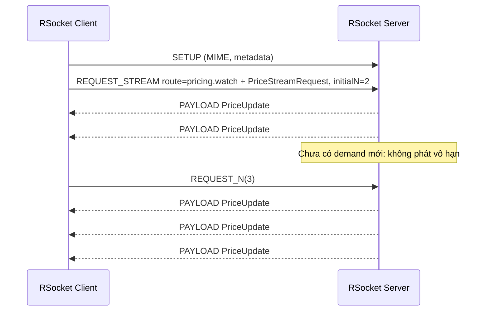
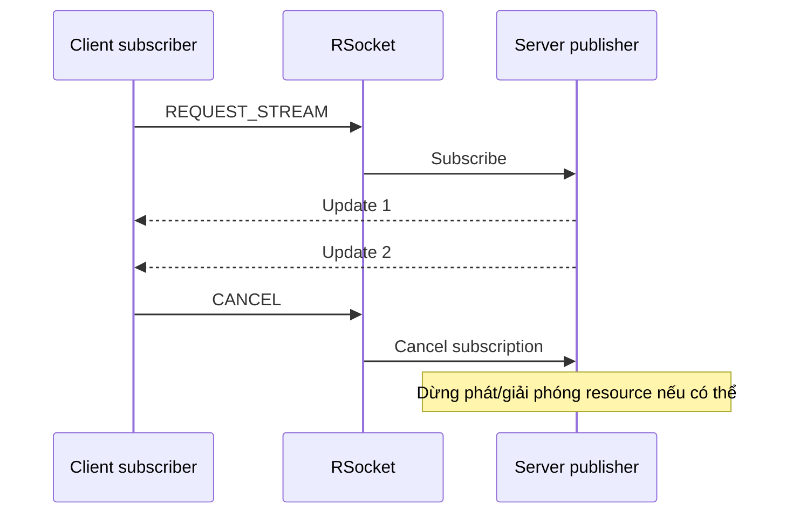
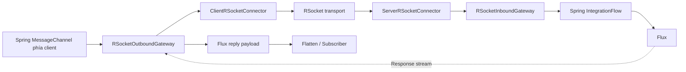
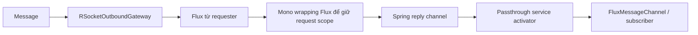
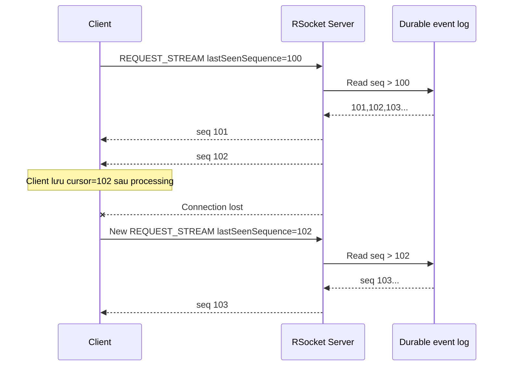
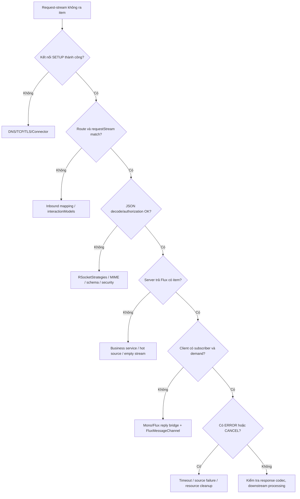

# Request-stream và response-stream trong Spring Integration RSocket

## 1. Bối cảnh: một yêu cầu, nhiều kết quả theo thời gian

Giả sử ứng dụng quản lý giá có một bảng điều khiển theo dõi SKU `SKU-42`. Người dùng nhấn **Theo dõi giá** một lần; dịch vụ `pricing-service` liên tục phát các cập nhật giá sau đó. Nếu sử dụng request–response thuần túy, client phải lặp lại request để hỏi “có giá mới chưa?”, dẫn tới polling, overhead và thời gian trễ. Với RSocket **request-stream**, client gửi **một request**, còn server phát **một response stream** gồm nhiều bản tin.

```text
Order-dashboard                  Pricing-service
  request SKU-42
       ── REQUEST_STREAM ──────────►
       ◄── PriceUpdate(seq=101) ───
       ◄── PriceUpdate(seq=102) ───
       ◄── PriceUpdate(seq=103) ───
       ...
       ── CANCEL ──────────────────►
```

Bài **“Request-stream và response-stream”** thuộc chương **Adapter RSocket**, module **SPRING_INTEGRATION_ADAPTERS**. Phạm vi của module là kết nối các hệ thống ngoài vào Spring Integration bằng inbound/outbound adapter, gateway, poller và `MessageChannel`; thực hành trao đổi qua file, SFTP, HTTP, JMS, AMQP, Kafka và cơ sở dữ liệu, đồng thời kiểm soát hợp đồng message, lỗi và vòng đời kết nối. Bài tập trung vào cách **nhận một request và trả về nhiều response qua RSocket** mà vẫn bảo toàn backpressure, cancellation, tài nguyên và ngữ nghĩa Spring message.

### Mục tiêu học tập

Sau bài này, bạn có thể:

1. Giải thích `REQUEST_STREAM`, `PAYLOAD`, `REQUEST_N`, `CANCEL`, `COMPLETE` và `ERROR` ở mức giao thức.
2. Phân biệt **request-stream** với `requestResponse`, `requestChannel` và `fireAndForget`.
3. Xây dựng server Spring Integration bằng `ServerRSocketConnector` và `RSockets.inboundGateway(...)` giới hạn `RSocketInteractionModel.requestStream`.
4. Trả `Flux<PriceUpdate>` từ transformer/service và xác định điều kiện hoàn tất, lỗi hoặc cancel.
5. Gọi server bằng `RSocketRequester.route(...).data(...).retrieveFlux(...)`.
6. Xây client Spring Integration dùng `ClientRSocketConnector` và `RSockets.outboundGateway(...)`.
7. Giải thích vì sao reply stream được **bọc trong `Mono`** và downstream cần flatten/subscribe có chủ đích.
8. Thiết kế DTO, codec JSON, metadata, stream ID, sequence và khả năng resume ở tầng ứng dụng.
9. Kiểm soát demand, bounded buffers, quá tải, blocking I/O và tài nguyên bị bỏ quên.
10. Kiểm thử end-to-end với request thật, backpressure, cancellation, lỗi và reconnect.

## 2. Khái niệm: request-stream không phải nhiều request-response

**Request-stream** là một interaction trong RSocket:

- **Requester** gửi một `REQUEST_STREAM` chứa route/metadata và tối đa một logical request payload.
- **Responder** tạo ra một `Publisher` trả nhiều response `PAYLOAD`, có thể là **0, 1, N** phần tử.
- Frame **`REQUEST_STREAM` chứa `Initial Request N`** (credit ban đầu, phải lớn hơn 0); về sau requester dùng **`REQUEST_N`** để cấp thêm credit cho response items.
- Mỗi interaction kết thúc bằng **`COMPLETE`**, **`ERROR`** hoặc **`CANCEL`**; với các lỗi transport, kết nối có thể chấm dứt trước khi thấy terminal signal mong đợi.



Trong giao thức RSocket, request-stream có frame `REQUEST_STREAM` (mã `0x06`, mang **initial credit**), `REQUEST_N` (`0x08`, **cấp thêm credit**), `CANCEL` (`0x09`), `PAYLOAD` (`0x0A`) và `ERROR` (`0x0B`). Những tên này mô tả **giao thức**, còn `Flux` là API Reactive Streams phía Java.

### 2.1. Response-stream nghĩa là gì?

Trong bài, **response-stream** là luồng các response elements server trả lại cho **một** request-stream:

```text
Một request:
  PriceStreamRequest(sku=SKU-42, cursor=100)

Một response stream:
  PriceUpdate(sku=SKU-42, seq=101)
  PriceUpdate(sku=SKU-42, seq=102)
  PriceUpdate(sku=SKU-42, seq=103)
  ...
```

Không có một interaction model RSocket riêng tên `responseStream`. Tên giao thức là **`requestStream`**, còn response về phía ứng dụng thường là **`Flux<T>`**.

### 2.2. So sánh bốn interaction model

| Model | Số lượng phần tử request | Số lượng phần tử response | API thường dùng | Bài toán |
| --- | --- | --- | --- | --- |
| `fireAndForget` | Một | Không có application reply | `.send()` | Telemetry best-effort |
| `requestResponse` | Một | Tối đa một | `.retrieveMono(T.class)` | Báo giá tức thời |
| **`requestStream`** | **Một** | **0..N** | **`.retrieveFlux(T.class)`** | Theo dõi giá hoặc feed kết quả |
| `requestChannel` | **0..N** | **0..N** | `.data(Flux,...).retrieveFlux(...)` | Trao đổi stream hai chiều |

**Đừng gọi `requestStream` chỉ vì request của bạn là một `Flux<T>`.** Một request-stream chỉ chứa một logical request. Nếu có **nhiều input elements**, đó là bài toán `requestChannel`. Ngược lại, gọi `retrieveMono(...)` khi muốn nhận nhiều kết quả là sai cardinality/contract.

### 2.3. Request-stream có thể hữu hạn hoặc vô hạn

| Dạng | Ví dụ | Termination mong đợi |
| --- | --- | --- |
| **Hữu hạn** | Trả 50 kết quả tìm kiếm theo batch | `COMPLETE` sau item cuối |
| **Gần thời gian thực** | Theo dõi 1 SKU trong 5 phút | Server `COMPLETE` theo deadline hoặc client `CANCEL` |
| **Dài hạn** | Theo dõi bảng giá liên tục | Client cancel khi không còn nhu cầu; recovery nếu reconnect |
| **Rỗng** | Không có bản ghi phù hợp | Hoàn tất không có item |

Không thiết kế một stream vô hạn rồi dùng `collectList()` trong client; collection đó có thể không bao giờ hoàn tất và sẽ tích lũy memory.

## 3. Reactive Streams: demand không phải ACK nghiệp vụ

RSocket dùng credit-based flow control cho response stream. Khi subscriber downstream gọi `Subscription.request(n)`, RSocket có thể truyền yêu cầu cấp thêm credit qua `REQUEST_N`. Server chỉ được phát theo credit đã nhận trong trường hợp publisher tuân thủ quy tắc giao thức.

### 3.1. Tại sao cần `request(n)`?

Giả sử server tính ra 10.000 giá/giây nhưng client chỉ hiển thị được 100 giá/giây. Nếu không điều tiết, backlog tăng rất nhanh. Flow control cho phép client báo nhu cầu theo **số item**, chứ không phải mặc định “cứ gửi hết”.

```text
Client requested=5 response items.
Server may emit at most 5 items against that granted credit.

When client requests another 3, credit increases by 3.
Credit đã cấp không phải ACK rằng item đã commit DB.
```

**Không đồng nhất `REQUEST_N(5)` với “đã lưu an toàn năm event trước”.** Nó là **flow-control demand** cho việc phát response, không có nghĩa consumer đã persist, hiển thị hay xác nhận business state.

### 3.2. Reactor `Flux` và các operator có thể ảnh hưởng demand

| Operator | Tác dụng | Rủi ro/điểm cần kiểm soát |
| --- | --- | --- |
| `map` | Biến đổi 1–1 đồng bộ | Không gọi I/O blocking bên trong |
| `filter` | Bỏ item không phù hợp | Có thể yêu cầu thêm upstream để đáp ứng downstream |
| `take(n)` | Chỉ nhận tối đa n item rồi cancel | Bên server có thể đã tạo một số dữ liệu trước cancel |
| `limitRate(n)` | Điều chỉnh demand theo từng lô | Không chứng minh có đúng n frame trên wire mỗi lần do prefetch/encoding |
| `concatMap` | Xử lý async theo thứ tự | Có thể chậm vì tuần tự |
| `flatMap` | Xử lý async song song | Kết quả có thể đảo thứ tự |
| `onBackpressureBuffer` | Buffer khi producer quá nhanh | Phải bounded, không để tăng vô hạn |
| `timeout` | Phát lỗi nếu không có signal trong thời hạn đã đặt | Không tự tạo resume/replay |

RSocket có flow control nhưng **queue tại HTTP ingress, Spring `ExecutorChannel`, reactive hot source hoặc database** không tự trở nên bounded chỉ vì phía cuối dùng `Flux`.

### 3.3. Khi client CANCEL



`CANCEL` là tín hiệu **ngừng luồng tương lai**, không phải rollback transaction hoặc hủy mọi side effect đã diễn ra. Với stream truy vấn DB, server phải đóng cursor/resource theo cancellation. Nếu một phép ghi đã commit, cancellation không tự hoàn tác.

## 4. Kiến trúc Spring Integration RSocket



| Thành phần | Vai trò | Không tự làm |
| --- | --- | --- |
| `RSocketRequester` | API client gọi `route().data().retrieveFlux()` | Tạo Spring Integration message channels |
| `ClientRSocketConnector` | Giữ requester/transport phía caller | Durable replay/outbox |
| `RSocketOutboundGateway` | Từ Spring message tạo RSocket request và reply | Đảm bảo downstream đã subscribe đúng |
| `ServerRSocketConnector` | Bind TCP/WebSocket server transport | Trả business updates |
| `RSocketInboundGateway` | Ánh xạ route/model vào Spring flow | Tự động mở listener khi chưa có connector |
| `Transformer` / service activator | Nhận request, trả `Flux` response | Automatic event log/recovery |
| `FluxMessageChannel` | Reactive handoff theo demand khi cấu hình đúng | Giới hạn mọi nguồn upstream |
| `RSocketStrategies` | Codec và dữ liệu metadata | Security/validation domain |

### 4.1. Inbound và outbound là hướng của Spring flow

**Inbound gateway** nhận request từ RSocket peer và đưa vào Spring Integration. **Outbound gateway** lấy Spring message và gửi request tới peer. Một server có thể chủ động gọi ngược client thông qua RSocketRequester của connection hai chiều, nhưng điều đó không thay đổi khái niệm request-stream: người **khởi tạo tương tác** gửi một request và nhận response stream.

### 4.2. Đừng nhầm route RSocket với URL HTTP

Một route như `pricing.updates.v1` được truyền qua **RSocket routing metadata**, không phải HTTP `GET /pricing.updates.v1`. Transport có thể là RSocket TCP hoặc RSocket over WebSocket, nhưng **route vẫn không phải URL**.

### 4.3. Spring reply có tính reactive

Theo Spring Integration, `RSocketOutboundGateway` trả một **`Mono`** nội bộ. Nếu remote trả `Flux` qua `requestStream`, **gateway bọc `Flux` trong reply `Mono` để giữ phạm vi request**. Downstream phải lấy `Flux` từ reply payload và **subscribe/flatten có chủ đích**. Đây là điểm khác với handler thông thường trả một DTO đơn.

## 5. Hợp đồng wire cho request-stream

Một contract nên ghi đầy đủ:

```text
Transport           : RSocket over TCP
Server address      : pricing-service:7000
Route               : pricing.updates.v1
Interaction model   : requestStream
Data MIME           : application/json
Request payload     : PriceStreamRequest
Response item type  : PriceUpdate
Stream identity     : subscriptionId
Resume cursor       : lastSeenSequence (nếu có replay store)
Completion policy   : maxItems hoặc server business deadline
Failure policy      : ERROR / cancel / reconnect + explicit resume
```

Ví dụ request:

```json
{
  "schemaVersion": 1,
  "subscriptionId": "sub-sku42-dashboard1",
  "sku": "SKU-42",
  "lastSeenSequence": 100,
  "maxItems": 5
}
```

Một item response:

```json
{
  "schemaVersion": 1,
  "subscriptionId": "sub-sku42-dashboard1",
  "sku": "SKU-42",
  "sequence": 101,
  "priceMinorUnits": 37500,
  "currency": "VND"
}
```

### 5.1. Ý nghĩa các trường

| Field | Request hay response? | Mục đích |
| --- | --- | --- |
| `schemaVersion` | Cả hai | Thương lượng schema/codec |
| `subscriptionId` | Cả hai | Correlate luồng logic, kiểm tra item không lẫn subscription |
| `sku` | Cả hai | Khóa tài nguyên và authorization |
| `lastSeenSequence` | Request | Vị trí resume của ứng dụng, không phải RSocket offset |
| `maxItems` | Request | Giới hạn stream hữu hạn trong bài thực hành |
| `sequence` | Response | Phát hiện gap, duplicate và thứ tự theo SKU |
| `priceMinorUnits` | Response | Giá dưới dạng nguyên, tránh sai số floating point |
| `currency` | Response | Đơn vị tiền tệ của giá |

**Quan trọng:** `lastSeenSequence` là **hợp đồng do ứng dụng tự định nghĩa**. RSocket request-stream **không mặc định có durable cursor hay replay**. Server chỉ có thể “tiếp tục từ sequence 100” nếu có nguồn dữ liệu/history hoặc snapshot có khả năng đáp ứng.

### 5.2. Quyết định semantic: snapshot, events hay cả hai?

| Luồng | Khi client subscribe mới | Khi mất mạng |
| --- | --- | --- |
| **Snapshot updates** | Trả trạng thái giá hiện tại, rồi theo dõi mới | Có thể lấy snapshot mới; không nhất thiết giữ mọi thay đổi |
| **Event history** | Trả các event từ offset hợp lệ | Phải có event store/replay |
| **Live-only hot feed** | Chỉ nhận item từ sau khi subscribe | Có thể mất item, không replay |
| **Batch response-stream** | Trả đúng N phần tử rồi complete | Retry nguyên batch có thể trùng item |

Không chọn live-only stream khi business yêu cầu **mỗi lần thay đổi giá đều phải được lưu/audit**. Khi cần bền vững, cân nhắc Kafka/JMS/AMQP/event log kết hợp RSocket làm lớp stream tới UI.

## 6. DTO Java và validation

### 6.1. Request và response records

```java
// File PriceStreamRequest.java (Java 17+)
public record PriceStreamRequest(
        int schemaVersion,
        String subscriptionId,
        String sku,
        long lastSeenSequence,
        int maxItems) {
}
```

```java
// File PriceUpdate.java
public record PriceUpdate(
        int schemaVersion,
        String subscriptionId,
        String sku,
        long sequence,
        long priceMinorUnits,
        String currency) {
}
```

`lastSeenSequence=0` trong demo có nghĩa chưa có cursor. Không dùng giá trị negative để báo “bắt đầu” nếu schema không quy định.

### 6.2. Validator ở ranh giới ứng dụng

```java
// File PriceStreamValidation.java
public final class PriceStreamValidation {

    private PriceStreamValidation() {
    }

    public static void validate(PriceStreamRequest request) {
        if (request == null ||
                request.schemaVersion() != 1 ||
                request.subscriptionId() == null ||
                !request.subscriptionId().matches(
                        "[A-Za-z0-9_-]{1,128}") ||
                request.sku() == null ||
                !request.sku().matches("[A-Za-z0-9_-]{1,64}") ||
                request.lastSeenSequence() < 0 ||
                request.maxItems() < 1 ||
                request.maxItems() > 100) {
            throw new IllegalArgumentException(
                    "PriceStreamRequest không hợp lệ");
        }
    }

    public static void validateUpdate(
            PriceStreamRequest request, PriceUpdate update) {
        if (update == null || update.schemaVersion() != 1 ||
                !request.subscriptionId().equals(
                        update.subscriptionId()) ||
                !request.sku().equals(update.sku()) ||
                update.sequence() <= request.lastSeenSequence() ||
                update.priceMinorUnits() < 0 ||
                !"VND".equals(update.currency())) {
            throw new IllegalArgumentException(
                    "PriceUpdate không thuộc luồng/không hợp lệ");
        }
    }
}
```

**Lưu ý:** validator trên chỉ đủ cho **demo có một currency và sequence tăng**. Trong production còn phải kiểm tra principal/tenant, currency schema, giới hạn bytes, quyền truy cập SKU, tính nhất quán sequence, overflow và chính sách xử lý duplicate/gap.

## 7. Dependencies và cấu hình Spring Boot

Ví dụ dùng Java 17+, Spring Boot BOM và Spring Integration RSocket. Một ứng dụng là **server**, một ứng dụng là **client**.

### 7.1. Maven

```xml
<dependencies>
    <dependency>
        <groupId>org.springframework.boot</groupId>
        <artifactId>spring-boot-starter-integration</artifactId>
    </dependency>
    <dependency>
        <groupId>org.springframework.integration</groupId>
        <artifactId>spring-integration-rsocket</artifactId>
    </dependency>
    <!-- Khi dùng DTO JSON và classpath chưa có Jackson. -->
    <dependency>
        <groupId>com.fasterxml.jackson.core</groupId>
        <artifactId>jackson-databind</artifactId>
    </dependency>
    <dependency>
        <groupId>io.projectreactor</groupId>
        <artifactId>reactor-test</artifactId>
        <scope>test</scope>
    </dependency>
</dependencies>
```

Không tự ghép các major versions Spring Boot/Framework/Integration/Reactor khác BOM được hỗ trợ. `spring-boot-starter-rsocket` có thể bổ sung khi ứng dụng dùng RSocket server/client Boot tự quản, nhưng nếu đã có `ServerRSocketConnector` tự bind, phải kiểm soát **một owner cho port**.

### 7.2. application.yml

```yaml
app:
  rsocket:
    bind-host: ${RSOCKET_BIND_HOST:127.0.0.1}
    host: ${RSOCKET_HOST:127.0.0.1}
    port: ${RSOCKET_PORT:7000}
    stream-route: pricing.updates.v1
    max-items: 100
```

`127.0.0.1` chỉ dùng khi hai phía ở **cùng network namespace**. Trong Kubernetes, client pod cần kết nối tới Service DNS, chẳng hạn `pricing-service`; server có thể cần bind `0.0.0.0` cùng NetworkPolicy/TLS và authorization.

### 7.3. Chọn codec thống nhất

RSocket mang **data** và **metadata**. Với DTO, chọn `application/json` và đảm bảo hai phía có encoder/decoder Jackson phù hợp trong `RSocketStrategies`. Nếu server chỉ có codec text và inbound chưa đặt `requestElementType`, JSON có thể trở thành `byte[]`/lỗi chuyển kiểu thay vì `PriceStreamRequest`.

Route `pricing.updates.v1` nằm trong routing metadata; không phải `GET /pricing.updates.v1`. Việc một TCP connection mở thành công không chứng minh route và JSON decoder đã sẵn sàng.

## 8. Server: `ServerRSocketConnector` mở listener

Server RSocket cần một connector để bind TCP:

```java
import org.springframework.beans.factory.annotation.Value;
import org.springframework.context.annotation.Bean;
import org.springframework.context.annotation.Configuration;
import org.springframework.integration.rsocket.ServerRSocketConnector;
import org.springframework.util.MimeTypeUtils;

@Configuration
public class PricingRSocketServerConfiguration {

    @Bean
    public ServerRSocketConnector pricingRSocketServer(
            @Value("${app.rsocket.bind-host}") String bindHost,
            @Value("${app.rsocket.port}") int port) {

        ServerRSocketConnector connector =
                new ServerRSocketConnector(bindHost, port);
        connector.setDataMimeType(MimeTypeUtils.APPLICATION_JSON);
        return connector;
    }
}
```

`ServerRSocketConnector` quản lý transport và đăng ký các inbound endpoints được phát hiện trong application context. `RSocketInboundGateway` tự nó **không** tạo server TCP port. Nếu sử dụng thêm RSocket server Boot autoconfiguration, cần tránh hai listeners cùng bind port 7000.

### 8.1. Port động trong integration test

```java
ServerRSocketConnector connector =
        new ServerRSocketConnector("127.0.0.1", 0);

// Trong test setup SAU khi connector đã start/bind:
Integer boundPort = connector.getBoundPort()
        .block(java.time.Duration.ofSeconds(5));
```

Ví dụ cho thấy cách dùng port 0 và API `getBoundPort()` (trả `Mono<Integer>`); **không** lấy giá trị trước khi connector start hoặc gọi `block()` trong Reactor/Netty event-loop. Khi test start connector qua Spring context, dùng bean thật để lấy bound port.

### 8.2. Readiness khác connection setup

| Quan sát | Xác nhận | Chưa xác nhận |
| --- | --- | --- |
| TCP bind thành công | Listener đã mở | Route hoạt động |
| RSocket SETUP thành công | Connection/MIME cơ bản tương thích | Business service sẵn sàng |
| Request-stream có item đầu | Route, decoder và upstream hoạt động tới mốc đó | Toàn bộ lịch sử đã có |
| Stream kết thúc `COMPLETE` | Server hoàn tất luồng theo contract | Client đã persist mọi item |

Nếu cần health check, dùng route read-only request–response an toàn và một readiness policy phù hợp; không dựa duy nhất vào port TCP.

## 9. Server: tạo `Flux<PriceUpdate>` hữu hạn

Đầu tiên làm một service phát năm kết quả theo thời gian. Ví dụ này **không** lấy dữ liệu từ DB và **không** cung cấp durable replay; nó chỉ minh họa response stream.

```java
// File PriceStreamService.java
import java.time.Duration;
import org.springframework.stereotype.Service;
import reactor.core.publisher.Flux;

@Service
public class PriceStreamService {

    public Flux<PriceUpdate> watch(PriceStreamRequest request) {
        return Flux.defer(() -> {
            PriceStreamValidation.validate(request);

            long last = request.lastSeenSequence();
            return Flux.range(1, request.maxItems())
                    .delayElements(Duration.ofMillis(120))
                    .map(index -> new PriceUpdate(
                            1,
                            request.subscriptionId(),
                            request.sku(),
                            Math.addExact(last, index),
                            37_500L + index * 100L,
                            "VND"))
                    .doOnSubscribe(subscription ->
                            System.out.println(
                                    "price stream started: " +
                                    request.subscriptionId()))
                    .doOnCancel(() ->
                            System.out.println(
                                    "price stream cancelled: " +
                                    request.subscriptionId()))
                    .doOnComplete(() ->
                            System.out.println(
                                    "price stream complete: " +
                                    request.subscriptionId()));
        });
    }
}
```

`Flux.defer(...)` tạo publisher theo mỗi subscription, nên retry/resubscribe có thể chạy lại logic phát. `delayElements` chỉ mô phỏng các lần cập nhật; nó không phải cách kết nối `RSocketInboundGateway` tới một giá thật. Trong sản xuất, service sẽ lấy event từ nguồn có backpressure và/hoặc một event store.

**Lưu ý về cursor:** ví dụ lấy `lastSeenSequence + index` để dễ thử nghiệm, **không chứng minh server có lịch sử các event sequence đó**. Với replay thật, phải query event log theo cursor, bảo đảm thứ tự/retention và kiểm tra cursor hợp lệ.

### 9.1. Tránh giữ tài nguyên suốt stream

Một response-stream dài có thể giữ:

- Reactive subscription và references tới request context.
- Connection/stream state ở RSocket.
- DB cursor hoặc subscription tới broker.
- Bounded buffer khi consumer chậm.
- Bộ đếm active stream, metric, trace.

Khi client cancel, error hoặc server shutdown, phải giải phóng mọi resource. Không mở một JDBC transaction rồi để nó sống vô hạn trong publisher theo dõi giá.

## 10. Server Java DSL: inbound gateway `requestStream`

### 10.1. Tạo route và transformer

```java
// File PriceStreamInboundConfiguration.java
import org.springframework.context.annotation.Bean;
import org.springframework.context.annotation.Configuration;
import org.springframework.core.ResolvableType;
import org.springframework.integration.dsl.IntegrationFlow;
import org.springframework.integration.rsocket.RSocketInteractionModel;
import org.springframework.integration.rsocket.dsl.RSockets;
import reactor.core.publisher.Flux;

@Configuration
public class PriceStreamInboundConfiguration {

    @Bean
    public IntegrationFlow priceUpdatesInbound(
            PriceStreamService priceStreamService) {

        return IntegrationFlow
                .from(RSockets.inboundGateway("pricing.updates.v1")
                        .interactionModels(
                                RSocketInteractionModel.requestStream)
                        .requestElementType(ResolvableType.forClass(
                                PriceStreamRequest.class)))
                .<Flux<PriceStreamRequest>, Flux<PriceUpdate>>transform(
                        incoming ->
                                incoming.single()
                                        .flatMapMany(priceStreamService::watch))
                .get();
    }
}
```

**Phân tích:**

1. `RSockets.inboundGateway("pricing.updates.v1")` nhận request theo route RSocket.
2. `interactionModels(requestStream)` chỉ cho phép model trả response stream cho route này.
3. `requestElementType(PriceStreamRequest.class)` (qua `ResolvableType`) chọn kiểu decode input.
4. Inbound gateway đưa payload vào flow ở dạng **`Flux<PriceStreamRequest>`**, không chỉ một DTO đơn.
5. `incoming.single()` đòi hỏi đúng một phần tử request.
6. `flatMapMany(priceStreamService::watch)` đổi `Mono<PriceStreamRequest>` thành **`Flux<PriceUpdate>` response**.
7. Gateway chuyển publisher reply thành RSocket response stream theo codec/strategies đã đăng ký.

**Đây là request-stream** vì **một request** sinh **nhiều response**. Không nhầm `incoming` có type `Flux<PriceStreamRequest>` với việc client đã gửi nhiều request elements: đó là representation reactive của inbound gateway.

### 10.2. Vì sao `single()` thay vì `next()`?

Trong một request-stream, contract chỉ chấp nhận **một logical input**:

- `next()` lấy phần tử đầu và bỏ qua những phần tử còn lại; có thể che giấu vi phạm protocol.
- `single()` yêu cầu đúng một phần tử, phát lỗi nếu rỗng hoặc có nhiều hơn một phần tử.
- Dù giao thức tự giới hạn request-stream là một request payload, kiểm tra ở application boundary làm contract rõ và dễ test.

Trong production cần xác định chính sách đối với request không có data, vì một số route request-stream cho phép request metadata-only. Nếu không cần body, hãy thiết kế một route riêng và handler tương ứng, đừng ép mọi route phải có DTO.

### 10.3. Cơ chế reply của inbound gateway

`RSocketInboundGateway` sử dụng Spring Integration gateway semantics để đưa một request vào flow, nhận reply và encode trả RSocket. Với interaction có reply, message request có reply context do framework quản lý; nếu handler trả `Flux<PriceUpdate>`, gateway xử lý publisher theo RSocket model tương ứng. Nó không cần người học tự tạo một TCP writer thread để đọc `Flux` và gửi frame.

Tuy vậy, nếu downstream **không trả reply**, trả sai type hoặc publisher không được subscribe, client có thể không nhận được item như kỳ vọng. Vì thế phải kiểm thử route/model, mã hóa, reply boundary và cancellation.

## 11. Java bean `RSocketInboundGateway` thay cho DSL

Đối với codebase dùng annotation-based endpoints, có thể cấu hình gateway bean:

```java
import org.springframework.context.annotation.Bean;
import org.springframework.context.annotation.Configuration;
import org.springframework.core.ResolvableType;
import org.springframework.integration.rsocket.RSocketInteractionModel;
import org.springframework.integration.rsocket.inbound.RSocketInboundGateway;

@Configuration
public class PriceInboundGatewayBeans {

    @Bean
    public RSocketInboundGateway priceStreamGateway() {
        RSocketInboundGateway gateway =
                new RSocketInboundGateway("pricing.updates.v1");
        gateway.setInteractionModels(
                RSocketInteractionModel.requestStream);
        gateway.setRequestElementType(
                ResolvableType.forClass(PriceStreamRequest.class));
        gateway.setRequestChannelName("pricingStreamRequestChannel");
        return gateway;
    }
}
```

Transformer tương ứng:

```java
import org.springframework.integration.annotation.Transformer;
import org.springframework.stereotype.Component;
import reactor.core.publisher.Flux;

@Component
public class PriceStreamTransformer {

    private final PriceStreamService service;

    public PriceStreamTransformer(PriceStreamService service) {
        this.service = service;
    }

    @Transformer(inputChannel = "pricingStreamRequestChannel")
    public Flux<PriceUpdate> stream(
            Flux<PriceStreamRequest> incoming) {
        return incoming.single().flatMapMany(service::watch);
    }
}
```

**Đây là phương án thay thế** cho IntegrationFlow mục 10. Không đăng ký **cả hai** gateways có cùng route và model trên cùng connector nếu không có cơ chế quản lý xung đột rõ ràng.

### 11.1. `decodeFluxAsUnit` có phải là công cụ response-stream?

`RSocketInboundGateway` có tùy chọn `decodeFluxAsUnit(boolean)` từ Spring Integration 5.3:

- `false` (mặc định): decode **từng phần tử** của inbound `Flux` theo decoder.
- `true`: thử decode toàn bộ inbound `Flux` như **một đơn vị** theo khả năng decoder.

Tùy chọn này áp dụng cho **input decoding** ở inbound gateway, **không phải** switch “bật/tắt response-stream”. Với một request đơn giản `PriceStreamRequest`, thường không cần thay đổi. Với `requestChannel` gửi dữ liệu streaming, decoder và `decodeFluxAsUnit` ảnh hưởng lớn đến ranh giới phần tử.

**Không bật `decodeFluxAsUnit(true)` cho một luồng request vô hạn** nếu decoder cần toàn bộ input để kết thúc; nó có thể chờ vô hạn hoặc giữ quá nhiều dữ liệu.

## 12. Client trực tiếp: `RSocketRequester.retrieveFlux(...)`

Trước khi đưa RSocket outbound gateway vào Spring Integration, hãy kiểm thử route bằng requester thông thường.

```java
// File DirectPriceStreamClient.java
import java.time.Duration;
import org.springframework.messaging.rsocket.RSocketRequester;
import org.springframework.util.MimeTypeUtils;
import reactor.core.publisher.Flux;

public class DirectPriceStreamClient {

    private final RSocketRequester requester;

    public DirectPriceStreamClient(String host, int port) {
        this.requester = RSocketRequester.builder()
                .dataMimeType(MimeTypeUtils.APPLICATION_JSON)
                .tcp(host, port);
    }

    public Flux<PriceUpdate> updates(PriceStreamRequest request) {
        PriceStreamValidation.validate(request);
        return requester
                .route("pricing.updates.v1")
                .data(request)
                .retrieveFlux(PriceUpdate.class)
                .timeout(Duration.ofSeconds(3));
    }
}
```

Điểm then chốt là `retrieveFlux(PriceUpdate.class)`: với một request data element và response `Flux`, RSocketRequester chọn **request-stream**. `retrieveMono(...)` là cardinality khác và không phù hợp nếu muốn xử lý nhiều response items.

`timeout(Duration.ofSeconds(3))` trong ví dụ phát lỗi khi không nhận một signal trong khoảng thời gian do operator định nghĩa (bao gồm chờ item tiếp theo); nó **không bảo đảm** tổng vòng đời stream chỉ tối đa ba giây nếu mỗi item mới đến trước hạn. Nếu cần một **deadline tổng**, phải có một policy riêng từ subscription start.

### 12.1. Gọi client trong reactive chain

```java
PriceStreamRequest request =
        new PriceStreamRequest(
                1, "sub-42", "SKU-42", 100L, 5);

Flux<PriceUpdate> responseStream =
        client.updates(request)
                .doOnNext(update ->
                        PriceStreamValidation.validateUpdate(
                                request, update))
                .take(5)
                .doFinally(signalType ->
                        System.out.println("Stream ended: " +
                                signalType));
```

Một `Flux` chỉ **mô tả pipeline**; nó chưa nhất thiết thực thi cho tới khi có subscriber. Caller có thể trả `Flux` cho Spring WebFlux, đưa vào một reactive channel hoặc dùng `StepVerifier` trong test.

**Không subscribe rồi lập tức trả “đã tải đủ giá”** khi stream vẫn đang chạy bất đồng bộ.

### 12.2. `take(n)` có thể hủy server stream

Nếu remote có 100 items nhưng client dùng `take(5)`, sau item thứ năm Reactor cancel subscription; RSocket có thể phát `CANCEL` tới server. Test nên xác minh publisher cleanup. Server có thể đã tạo một số item trong pipeline trước khi nhận cancel; đừng dựa vào `take(5)` như một ranh giới transactional.

### 12.3. Không tạo requester mới cho mỗi item

RSocket requester có thể multiplex nhiều request-stream trên cùng connection. Hãy tái sử dụng requester/`ClientRSocketConnector` theo lifecycle, giới hạn active streams và hủy subscription khi UI/consumer không cần nữa.

## 13. Client: `ClientRSocketConnector` trong Spring Integration

```java
import org.springframework.beans.factory.annotation.Value;
import org.springframework.context.annotation.Bean;
import org.springframework.context.annotation.Configuration;
import org.springframework.integration.rsocket.ClientRSocketConnector;
import org.springframework.util.MimeTypeUtils;

@Configuration
public class PriceStreamClientConnectorConfiguration {

    @Bean
    public ClientRSocketConnector pricingClientRSocketConnector(
            @Value("${app.rsocket.host}") String host,
            @Value("${app.rsocket.port}") int port) {

        ClientRSocketConnector connector =
                new ClientRSocketConnector(host, port);
        connector.setDataMimeType(MimeTypeUtils.APPLICATION_JSON);
        return connector;
    }
}
```

`ClientRSocketConnector` quản lý requester/kết nối; **không có nghĩa** mọi route ở server đã sẵn sàng hay stream có thể tự resume. Có thể đặt `RSocketStrategies` cùng codecs trên connector. Nếu server sử dụng WebSocket thay vì TCP, phải cấu hình đúng transport/URI WebSocket theo API.

### 13.1. Client connector và reply scope

Một application có thể có:

```text
pricing.quote.v1      → requestResponse    → Mono<QuoteReply>
pricing.updates.v1    → requestStream      → Flux<PriceUpdate>
pricing.health.v1     → requestResponse    → Mono<HealthReply>
```

Các request có thể chia sẻ connection, nhưng mỗi request-stream vẫn có stream ID/request scope và subscription riêng; cancel luồng A không đồng nghĩa hủy luồng B.

## 14. Java DSL outbound `requestStream`

```java
// File PriceStreamOutboundConfiguration.java
import org.springframework.context.annotation.Bean;
import org.springframework.context.annotation.Configuration;
import org.springframework.integration.dsl.IntegrationFlow;
import org.springframework.integration.rsocket.ClientRSocketConnector;
import org.springframework.integration.rsocket.RSocketInteractionModel;
import org.springframework.integration.rsocket.dsl.RSockets;

@Configuration
public class PriceStreamOutboundConfiguration {

    @Bean
    public IntegrationFlow pricingUpdatesOutbound(
            ClientRSocketConnector pricingClientRSocketConnector) {

        return IntegrationFlow
                .from("priceStreamRequests")
                .handle(RSockets.outboundGateway("pricing.updates.v1")
                        .interactionModel(
                                RSocketInteractionModel.requestStream)
                        .expectedResponseType(PriceUpdate.class)
                        .clientRSocketConnector(
                                pricingClientRSocketConnector))
                .channel("priceStreamReplies")
                .get();
    }
}
```

Flow phía client này:

1. Nhận một Spring `Message<PriceStreamRequest>` trên `priceStreamRequests`.
2. Dùng outbound gateway gửi route `pricing.updates.v1` theo `requestStream`.
3. Kỳ vọng **mỗi element response** có type `PriceUpdate.class`.
4. Dùng `ClientRSocketConnector` để truy cập RSocketRequester.
5. Đưa **reply gắn với request** vào `priceStreamReplies`; downstream xử lý `Flux` theo cấu trúc của framework.

### 14.1. Không đặt expected response type thành `Flux.class`

`expectedResponseType(PriceUpdate.class)` là **kiểu dữ liệu mỗi phần tử trả về** cho decoder. Một response stream có dạng `Flux<PriceUpdate>` ở tầng Reactor, nhưng **mỗi item wire** vẫn là `PriceUpdate`. Đặt `Flux.class` vào expected response type có thể khiến codec giải mã nhầm.

### 14.2. Gửi một request qua Spring channel

```java
import org.springframework.beans.factory.annotation.Qualifier;
import org.springframework.messaging.MessageChannel;
import org.springframework.messaging.support.MessageBuilder;
import org.springframework.stereotype.Service;

@Service
public class PriceStreamRequestDispatcher {

    private final MessageChannel requests;

    public PriceStreamRequestDispatcher(
            @Qualifier("priceStreamRequests")
            MessageChannel requests) {
        this.requests = requests;
    }

    public void start(PriceStreamRequest request) {
        PriceStreamValidation.validate(request);
        boolean accepted = requests.send(
                MessageBuilder.withPayload(request).build());
        if (!accepted) {
            throw new IllegalStateException(
                    "Spring channel từ chối PriceStreamRequest");
        }
        // TRUE không nghĩa đã nhận đủ stream results.
    }
}
```

**`MessageChannel.send()==true` chỉ xác nhận điều kiện dispatch ở Spring channel.** Nó **không** đồng nghĩa RSocket đã gửi request, response stream đã được subscribe, đã nhận item đầu tiên hay đã hoàn tất.

## 15. Reply stream trong outbound gateway: `Mono` bọc `Flux`

Đây là một phần đặc thù Spring Integration, thường gây hiểu nhầm khi làm việc với request-stream.

Theo Spring Integration RSocket reference:

- `RSocketOutboundGateway` là một `AbstractReplyProducingMessageHandler`.
- Reply nội bộ là một **`Mono`**, kể cả khi interaction model là `fireAndForget`.
- Nếu remote trả **`Flux`** (với `requestStream` hoặc `requestChannel`), gateway **bọc `Flux` trong reply `Mono`** để **giữ scope của một request**.
- Với **regular output channel**, `Mono` được subscribe/adapt trước khi phát output message.
- Với **`FluxMessageChannel`**, reactive reply được xử lý theo demand.
- **Downstream phải lấy `Flux` từ message payload rồi subscribe hoặc flatten**, thay vì đợi một collection đã tự đầy đủ.



**Biểu đồ này minh họa request scope**, không có nghĩa mọi message payload ở mọi phiên bản/channel đều là Java generic type `Mono<Flux<T>>` nguyên xi. Phải kiểm tra contract tại **boundary cụ thể** và không tạo subscription trùng.

### 15.1. Flatten theo mẫu Spring Integration reference

```java
import org.springframework.integration.annotation.ServiceActivator;
import reactor.core.publisher.Flux;

@ServiceActivator(
        inputChannel = "priceStreamReplies",
        outputChannel = "priceUpdateElements")
public Flux<?> flattenRSocketResponse(Flux<?> payload) {
    return payload;
}
```

Kênh đích nên hỗ trợ reactive demand, chẳng hạn `FluxMessageChannel`:

```java
import org.springframework.context.annotation.Bean;
import org.springframework.context.annotation.Configuration;
import org.springframework.integration.channel.FluxMessageChannel;

@Configuration
public class PriceStreamReactiveChannels {

    @Bean(name = "priceUpdateElements")
    public FluxMessageChannel priceUpdateElements() {
        return new FluxMessageChannel();
    }
}
```

Đây là **minh họa một bước bridge**. Sau đó cần một subscriber/consumer thực sự cho `priceUpdateElements`; nếu không có downstream demand thì không có cơ sở khẳng định stream đã được consume. Không tự gọi `subscribe()` thêm trên cùng publisher ở nhiều handler vì publisher lạnh có thể kích hoạt **một remote request mới mỗi subscription**.

### 15.2. Khi cần xử lý stream trong application logic

Nếu downstream đã nhận một `Flux<PriceUpdate>`, có thể xử lý:

```java
import reactor.core.publisher.Flux;

public Flux<PriceUpdate> validatePriceUpdates(
        PriceStreamRequest request,
        Flux<PriceUpdate> updates) {

    return updates
            .doOnNext(update ->
                    PriceStreamValidation.validateUpdate(
                            request, update))
            .take(request.maxItems());
}
```

Caller phải gắn subscriber và quản lý cancellation/lifecycle. Trong một server có business side effects, nên truyền tiếp pipeline thay vì tự subscribe “bắn rồi quên” trong handler.

### 15.3. Vì sao không dùng `collectList().block()`?

```java
// PHẢN VÍ DỤ: có thể chặn event-loop hoặc giữ hết stream trong RAM.
var allUpdates = incomingFlux.collectList().block();
```

Với stream vô hạn, phép toán có thể **không hoàn tất**; với stream lớn, toàn bộ dữ liệu dồn vào heap. Nếu phải tổng hợp kết quả hữu hạn, đặt maxItems/maxBytes/deadline, dùng `collectList()` trả một `Mono<List<T>>` cho caller reactive, không blocking trên Netty/Reactor event-loop.

## 16. XML hoặc Java bean: chọn cấu hình phù hợp

Java DSL tiện cho pipeline, nhưng API bean `RSocketOutboundGateway` cũng có thể dùng:

```java
import org.springframework.beans.factory.annotation.Qualifier;
import org.springframework.context.annotation.Bean;
import org.springframework.context.annotation.Configuration;
import org.springframework.integration.annotation.ServiceActivator;
import org.springframework.integration.rsocket.ClientRSocketConnector;
import org.springframework.integration.rsocket.RSocketInteractionModel;
import org.springframework.integration.rsocket.outbound.RSocketOutboundGateway;

@Configuration
public class PriceStreamGatewayBeans {

    @Bean
    @ServiceActivator(
            inputChannel = "beanPriceStreamRequests",
            outputChannel = "beanPriceStreamReplies")
    public RSocketOutboundGateway pricingOutboundGateway(
            @Qualifier("pricingClientRSocketConnector")
            ClientRSocketConnector connector) {

        RSocketOutboundGateway gateway =
                new RSocketOutboundGateway("pricing.updates.v1");
        gateway.setInteractionModel(
                RSocketInteractionModel.requestStream);
        gateway.setExpectedResponseType(PriceUpdate.class);
        gateway.setClientRSocketConnector(connector);
        return gateway;
    }
}
```

Đây là **phương án thay thế** cho Java DSL ở mục 14, không phải endpoint thứ hai phải thêm vào cùng project trong mọi trường hợp. Nếu sử dụng XML namespace `int-rsocket`, có `inbound-gateway` và `outbound-gateway`; cần cấu hình tương ứng route, interaction model, expected response type, connector và channels theo schema Spring Integration đang sử dụng.

## 17. Codec JSON, metadata và stream contracts

### 17.1. Cấu hình strategies cho DTO

```java
import com.fasterxml.jackson.databind.ObjectMapper;
import org.springframework.context.annotation.Bean;
import org.springframework.context.annotation.Configuration;
import org.springframework.http.codec.json.Jackson2JsonDecoder;
import org.springframework.http.codec.json.Jackson2JsonEncoder;
import org.springframework.messaging.rsocket.RSocketStrategies;

@Configuration
public class PriceRSocketCodecConfiguration {

    @Bean
    public RSocketStrategies priceRSocketStrategies(
            ObjectMapper mapper) {
        return RSocketStrategies.builder()
                .decoder(new Jackson2JsonDecoder(mapper))
                .encoder(new Jackson2JsonEncoder(mapper))
                .build();
    }
}
```

Ví dụ này cấu hình Jackson cho DTO JSON; trong ứng dụng thật phải đảm bảo **các codecs/metadata conventions khác cũng còn đầy đủ**. Nếu dùng custom strategies có thứ tự chọn decoder khác nhau giữa client/server, request có thể bị đọc thành `byte[]` hoặc reply thất bại. Inject strategies cho các connector hiện hữu thay vì tạo listener thứ hai cùng port chỉ để đổi codec.

### 17.2. Content MIME và routing metadata

| Phần RSocket message | Ví dụ | Ý nghĩa |
| --- | --- | --- |
| Data MIME | `application/json` | Chọn JSON encoder/decoder |
| Route metadata | `pricing.updates.v1` | Định tuyến inbound |
| Application metadata | Trace ID, tenant hint | Không thay authentication |
| Request data | `PriceStreamRequest` | Một logical query |
| Response data | `PriceUpdate` | Mỗi item của Flux |
| Stream identity | `subscriptionId` | App-level correlation và tracing |

`Spring MessageHeaders` không mặc định được serialize trọn vẹn qua wire. Nếu cần `subscriptionId`, `lastSeenSequence` hoặc `schemaVersion` ở peer ngôn ngữ khác, đưa chúng vào JSON hoặc metadata có schema/codec đã thống nhất.

### 17.3. JSON response generic type

Nếu response element là `PriceUpdate`, dùng `expectedResponseType(PriceUpdate.class)` và `retrieveFlux(PriceUpdate.class)`. Nếu mỗi phần tử là kiểu generic như `List<PriceUpdate>`, cần giữ generic type qua `ParameterizedTypeReference`/expression được API hỗ trợ; `List.class` có thể giải mã thành list của maps.

### 17.4. Kiểm soát kích thước item

Request-stream có thể phát hàng chục nghìn response items, nhưng **mỗi item** cũng cần byte-size/schema validation. Không trả một blob JSON nhiều gigabytes như một phần tử rồi coi backpressure sẽ khắc phục memory overhead; flow control tính theo số items, không đảm bảo mọi item nhỏ.

## 18. Backpressure trong thực tế: quan sát `REQUEST_N`

Một lợi ích quan trọng của request-stream là demand từ phía client **có thể điều tiết số response được gửi**. Tuy nhiên, Reactor operators có prefetch/buffer bên trong, nên cần phân biệt **yêu cầu của subscriber**, **demand của publisher**, **frame REQUEST_N trên wire** và **số item xử lý tại application**.

### 18.1. Subscriber yêu cầu theo lô

```java
import org.reactivestreams.Subscriber;
import org.reactivestreams.Subscription;

public class TwoAtATimeSubscriber
        implements Subscriber<PriceUpdate> {

    private Subscription subscription;
    private int sinceLastRequest;

    @Override
    public void onSubscribe(Subscription subscription) {
        this.subscription = subscription;
        subscription.request(2);
    }

    @Override
    public void onNext(PriceUpdate item) {
        System.out.println("Received: " + item.sequence());
        sinceLastRequest++;
        if (sinceLastRequest == 2) {
            sinceLastRequest = 0;
            subscription.request(2);
        }
    }

    @Override
    public void onError(Throwable error) {
        System.err.println(error.getMessage());
    }

    @Override
    public void onComplete() {
        System.out.println("Response stream complete");
    }
}
```

Gắn subscriber:

```java
// Ở nơi sở hữu lifecycle subscription:
responseStream.subscribe(new TwoAtATimeSubscriber());
```

**Đây là một mẫu minh họa Reactive Streams demand**, chưa bao gồm lưu `Subscription` để cancel theo lifecycle và truyền error tới hệ thống giám sát. Trong production, ưu tiên Reactor operators và subscriber/framework-managed lifecycle. Cần kiểm tra các operator trung gian vì prefetch có thể dẫn đến số credit trên wire khác trực giác của một subscriber demo.

### 18.2. StepVerifier với initial request bằng 0

```java
import java.time.Duration;
import reactor.test.StepVerifier;

PriceStreamRequest request =
        new PriceStreamRequest(1, "test-sub-42", "SKU-42", 100, 5);

StepVerifier.create(client.updates(request), 0)
        .thenRequest(2)
        .expectNextCount(2)
        .thenRequest(3)
        .expectNextCount(3)
        .expectComplete()
        .verify(Duration.ofSeconds(10));
```

Kiểm thử này chứng minh publisher **tuân thủ demand quan sát được bởi test subscriber** và trả đủ 5 items. Muốn chứng minh **số frame `REQUEST_N` thật** trên mạng, cần instrument transport/interceptor hoặc dùng test chuyên dụng; `StepVerifier` không trực tiếp là packet analyzer.

### 18.3. Vì sao `flatMap` có thể reorder?

```java
Flux<PriceUpdate> normalized = updates
        .flatMap(update -> asyncEnrich(update), 8);
```

Nếu `asyncEnrich` của sequence 102 nhanh hơn sequence 101, kết quả có thể xuất hiện khác thứ tự upstream. Với hợp đồng response-stream yêu cầu **per-SKU order**, cân nhắc:

```java
Flux<PriceUpdate> ordered = updates
        .concatMap(update -> asyncEnrich(update));
```

`asyncEnrich(...)` là hàm ứng dụng minh họa, có thể trả `Mono<PriceUpdate>`. `concatMap` giúp xử lý theo thứ tự nhưng thường giảm concurrency; nếu cần scale theo nhiều SKU, partition theo key và giữ thứ tự trong từng partition. **Thứ tự phát Flux không tự bảo đảm thứ tự commit DB khi downstream dùng nhiều transaction song song**.

### 18.4. Bounded buffering

```java
import reactor.core.publisher.BufferOverflowStrategy;

Flux<PriceUpdate> bounded = updates
        .onBackpressureBuffer(
                256,
                dropped -> System.err.println(
                        "Dropped seq=" + dropped.sequence()),
                BufferOverflowStrategy.DROP_OLDEST);
```

Đây là **chính sách chủ động bỏ item cũ**, phù hợp một số **snapshot UI** nhưng có thể **sai nghiêm trọng** nếu mỗi `PriceUpdate` là một audit event bắt buộc. Nếu contract đòi đủ mọi item, **không dùng drop**; hãy áp dụng durable store, pagination/replay, quota hoặc chậm lại ở nguồn.

**Lưu ý:** một publisher RSocket request-stream hoạt động đúng backpressure có thể không cần buffer thêm. Buffer thường dùng khi có operator/hot source hoặc handoff khác; thêm buffer không giới hạn sẽ chỉ chuyển vấn đề.

## 19. Cancellation, resource cleanup và consumer biến mất

Một response-stream có thể chạy rất lâu. Consumer có thể đóng browser tab, dừng ứng dụng, mất mạng hoặc chủ động `take(n)`. Server phải coi những tình huống này là **một phần của lifecycle**.

### 19.1. Gắn cleanup vào signal kết thúc

```java
import reactor.core.publisher.Flux;

public Flux<PriceUpdate> trackLifecycle(
        PriceStreamRequest request) {
    return watch(request)
            .doOnSubscribe(subscription ->
                    metrics.streamStarted())
            .doOnNext(update ->
                    metrics.streamItemEmitted())
            .doOnCancel(() ->
                    metrics.streamCancelled())
            .doOnError(error ->
                    metrics.streamFailed(error))
            .doFinally(signal ->
                    metrics.streamEnded(signal));
}
```

Ví dụ trên giả định có bean `metrics` và method `watch(...)`. `doFinally` quan sát termination, bao gồm complete/error/cancel. Không dùng `doOnComplete` làm nơi cleanup duy nhất vì cancel/error không gọi complete.

### 19.2. Tài nguyên mở theo subscription

Khi kết nối tới một nguồn như database cursor, file handle hoặc subscription broker, quản lý tài nguyên bằng operator có cleanup trên **complete/error/cancel**. Dạng khái niệm:

```java
// PSEUDOCODE - repository/cursor phải có API reactive thật:
Flux.usingWhen(
        repository.openCursor(request),
        cursor -> cursor.streamPriceUpdates(),
        cursor -> cursor.close(),
        (cursor, error) -> cursor.close(),
        cursor -> cursor.close());
```

`usingWhen` phù hợp với tài nguyên được acquire/cleanup bất đồng bộ; **không** áp dụng nguyên xi với JDBC blocking nếu API `close`/`streamPriceUpdates` không phải reactive publishers. Với tài nguyên blocking, phải dùng scheduler/transaction boundary đúng.

### 19.3. Cancellation không có nghĩa rollback

Giả sử server tính giá xong và ghi một record audit sau mỗi cập nhật. Client cancel ở item 5:

- Những bản ghi đã commit **không tự bị xóa**.
- Một task blocking không hỗ trợ cancel có thể tiếp tục đến khi xong.
- Một publisher hot có thể vẫn phát cho subscriber khác.
- Nếu request cần accounting, consumer phải gửi checkpoint/ACK riêng.

RSocket chỉ cung cấp tín hiệu cancel **cho stream**, không cung cấp transaction bù trừ.

### 19.4. Timeout của stream

```java
Flux<PriceUpdate> watched = requester
        .route("pricing.updates.v1")
        .data(request)
        .retrieveFlux(PriceUpdate.class)
        .timeout(java.time.Duration.ofSeconds(5))
        .take(100);
```

`timeout(Duration)` theo tín hiệu/idle chứ không nhất thiết là deadline tổng của subscription. Một stream có item mỗi 4 giây có thể kéo dài hàng giờ mà không timeout. Cần chính sách riêng cho **max stream duration**/lease, ví dụ dùng deadline được tính từ subscription start và cancel khi hết hạn, nếu business yêu cầu.

## 20. Hot stream, cold stream và các lần subscribe

### 20.1. Cold publisher trong demo

`PriceStreamService.watch(...)` dùng `Flux.defer` và `Flux.range`: **mỗi subscription tạo lại** 5 response items. Nếu client retry bằng `retryWhen(...)`, một **request-stream mới** có thể được mở, và server tạo lại các sequence theo logic demo.

**Kết luận:** một duplicate response trên retry không nhất thiết là lỗi transport. Có thể do application đã **đăng ký lại stream** hoặc source tự tạo dữ liệu mới cho mỗi subscription.

### 20.2. Hot publisher

Một live price feed dùng chung có thể có một `Sinks.Many<PriceUpdate>` hoặc broker subscription:

```text
Live price source
      ↓
Hot publisher
    ├─ subscriber A
    ├─ subscriber B
    └─ subscriber C
```

Người đăng ký muộn có thể **bỏ lỡ các item trước đó** nếu hot publisher không lưu history. Một slow subscriber có thể gặp overflow/drop/error tùy loại `Sinks` và overflow policy. RSocket `REQUEST_N` chỉ điều tiết **mỗi connection/stream tương ứng**, không tự biến hot source không hỗ trợ demand thành một durable log.

### 20.3. Thứ tự items qua nhiều publishers

Nếu nhiều backend producers cùng tạo giá cho SKU-42, timestamp không đủ để tạo global order; cần **nguồn sequence có thẩm quyền** hoặc ordered partition per SKU. Một RSocket response stream duy nhất có thể phát các items theo thứ tự nó nhận từ source, nhưng không tự đảm bảo domain sequence đúng khi source đã reorder.

### 20.4. Subscription có phí tài nguyên

Không thực hiện:

```java
// PHẢN VÍ DỤ: tạo subscription mới theo mỗi refresh UI,
// không đóng subscription cũ.
void onRefresh() {
    client.updates(request).subscribe(
            update -> render(update));
}
```

Nếu người dùng nhấn refresh nhiều lần, ứng dụng có thể tạo nhiều concurrent request-streams và nhận item lặp. Dùng owner lifecycle rõ ràng, lưu `Disposable` để `dispose()` khi thay subscription hoặc return publisher cho framework tự quản lý.

## 21. Retry, reconnect và resume: vấn đề quan trọng nhất

Một connection RSocket bị đứt có thể làm subscription kết thúc lỗi. **Khởi tạo request-stream mới không tự tiếp tục từ response item cuối**. Nếu không có application cursor/event store, stream mới có thể trả lại item cũ, bỏ item mới hoặc chỉ gửi snapshot hiện tại.

### 21.1. Cursor do ứng dụng định nghĩa



Các điều kiện để sơ đồ trên **đúng**:

1. Server có nguồn bền vững chứa các event theo sequence.
2. Client chỉ checkpoint sequence sau **processing checkpoint** phù hợp với nghiệp vụ.
3. Server kiểm tra cursor còn nằm trong retention.
4. Subscription mới định nghĩa ranh giới giữa **replay history** và **live updates** mà không tạo gap/duplicate không kiểm soát.
5. Client dedup nếu request hoặc checkpoint bị lặp.

**RSocket request-stream không tự cung cấp các điều kiện này.** Một số triển khai RSocket có tính năng protocol-level resumption tùy stack, nhưng **không được mặc định** coi đó là durable business replay qua process crash/retention gap.

### 21.2. Client ghi checkpoint quá sớm

```text
Client nhận seq=103
  → ghi lastSeen=103 ngay
  → crash trước khi persist/hiển thị/áp dụng 103
  → resubscribe from 103
  → seq=103 bị bỏ qua vĩnh viễn ở application
```

Với dữ liệu audit, checkpoint phải được ghi **sau khi side effect được commit bền vững**, tốt nhất trong cùng transaction/batch process. Với dashboard chỉ hiển thị snapshot, checkpoint policy có thể đơn giản hơn.

### 21.3. Replay có thể tạo duplicate

```text
Client đã xử lý seq=103
  → chưa ghi checkpoint=103
  → crash
  → resubscribe from 102
  → nhận lại seq=103
```

Với hợp đồng at-least-once, đây là điều bình thường. Dùng `streamId + sequence` hoặc `eventId` để dedup, không phát sinh side effect trùng.

### 21.4. Bounded retry khi lỗi tạm thời

```java
import java.time.Duration;
import reactor.core.publisher.Flux;
import reactor.util.retry.Retry;

public Flux<PriceUpdate> retryOnlyTransient(
        Flux<PriceUpdate> source) {
    return source.retryWhen(
            Retry.backoff(2, Duration.ofMillis(200))
                    .maxBackoff(Duration.ofSeconds(2))
                    .filter(this::isTransientTransportError));
}
```

Ví dụ giả định `isTransientTransportError(Throwable)` được cài đúng theo exception types/version. **Đây chỉ là retry trên cùng publisher**, thường tạo **subscription/request mới**; nó **không tự cập nhật cursor**. Với resume thật, cần một hàm tạo **request mới với lastSeenSequence mới nhất đã checkpoint**, đồng thời có policy cho duplicate và gap.

**Không retry mù** trên lỗi schema, authorization, route không tồn tại hoặc cursor hết retention. Retry không chữa được lỗi configuration/business contract.

### 21.5. Replay history và live stream không được có race gap

Một sai sót phổ biến:

```text
1. Query DB lịch sử tới seq=100.
2. Sau đó mới subscribe live publisher.
3. Event seq=101 phát giữa bước 1 và 2.
4. Client mất seq=101.
```

Muốn bảo đảm không gap:

- Dùng một ordered log có thể subscribe từ offset.
- Hoặc thực hiện handoff lịch sử→live có **watermark/overlap+dedup** rõ ràng.
- Hoặc ghi event vào durable inbox/broker trước khi công bố live.

Không mặc định `Flux.concat(history, live)` là một thiết kế gap-free nếu nguồn live chỉ bắt đầu nhận khi subscribe sau history.

## 22. Xử lý lỗi trong response-stream

RSocket response-stream có thể kết thúc bằng **`COMPLETE`**, **`ERROR`** hoặc **`CANCEL`**. Lỗi có thể đến từ nhiều tầng:

| Tầng lỗi | Biểu hiện | Hướng xử lý |
| --- | --- | --- |
| Connect/SETUP | DNS/TCP/TLS thất bại | Retry có backoff nếu lỗi tạm thời |
| Route/model | Route `pricing.updates.v1` không tồn tại hoặc không cho `requestStream` | Sửa cấu hình, không retry vô hạn |
| Decode request | JSON/schema sai | Reject rõ, không replay dữ liệu hỏng |
| Authorization | Không được theo dõi SKU | Sanitize error, audit |
| Business source | DB/broker unavailable | Emit error, retry policy hoặc fallback |
| Response encode | DTO không có encoder | Sửa `RSocketStrategies` |
| Client decode | MIME/response type sai | Sửa contract; retry mù vô ích |
| Client timeout | Không có item lâu hơn policy | Cancel/reconnect/resume nếu có cursor |
| Client cancellation | Người dùng đóng màn hình | Cleanup, không báo lỗi business |

### 22.1. Server phát lỗi reactive

```java
import reactor.core.publisher.Flux;

public Flux<PriceUpdate> watchWithValidation(
        PriceStreamRequest request) {
    return Flux.defer(() -> {
        PriceStreamValidation.validate(request);
        if (!authorizedForSku(request.sku())) {
            return Flux.error(
                    new IllegalArgumentException(
                            "Không được theo dõi SKU"));
        }
        return priceStreamService.watch(request);
    });
}
```

Hàm minh họa giả định `authorizedForSku(...)` kiểm tra **principal đã xác thực**, không chỉ đọc raw `sku` từ payload. Trong production cần mapping lỗi sanitized cho peer; không gửi stack trace/SQL details.

### 22.2. Partial result rồi ERROR

```text
Client nhận seq=101
Client nhận seq=102
Server phát ERROR vì DB unavailable.

Client đã có partial results 101,102.
Không thể xem toàn bộ request như một giao dịch atomic.
```

Nếu consumer đã commit side effects cho 101 và 102, retry có thể phát lại chúng. Vì vậy cần sequence, idempotency và checkpoint khi dùng stream để xử lý nghiệp vụ.

### 22.3. Lỗi sau subscription không phải exception đồng bộ

Một lỗi từ `retrieveFlux(...)` hoặc response publisher có thể xuất hiện sau khi Spring `MessageChannel.send(...)` đã trả true. Không chỉ dùng `try/catch` quanh `send()` để kết luận request đã thành công; cần quan sát `onError` và đường error channel đúng với topology/version.

### 22.4. Không dùng `onErrorContinue` như giải pháp chung

`onErrorContinue` có semantics khó kiểm soát với nhiều operator và có thể bỏ item âm thầm. Khi sequence có ý nghĩa, **bỏ một item** mà vẫn đánh dấu cursor tăng sẽ tạo data gap. Với schema/validation error, ưu tiên **fail stream + alert/quarantine** hoặc một business policy bỏ qua tường minh có audit.

## 23. Security và vận hành tài nguyên response-stream

Một stream chạy hàng giờ có thể tiêu thụ nhiều tài nguyên hơn một request–response:

| Rủi ro | Kiểm soát |
| --- | --- |
| Client mở hàng nghìn streams không đóng | Quota active subscriptions theo principal/tenant |
| Theo dõi SKU của tenant khác | Authentication và authorization theo resource |
| Payload quá lớn | Byte limit cho request và từng response item |
| Không có deadline | Max stream duration/lease, heartbeat và idle timeout |
| Bị giả mạo route/header | Route whitelist, kiểm tra principal, không tin tenant header tự khai |
| Stream giữ connection DB lâu | Reactive paging/cursor cleanup, transaction scope ngắn |
| Hot source bị nghẽn | Bounded buffer và overflow policy có chủ ý |
| Trace/log tràn | Sampling và không log mọi item khi throughput cao |
| TLS thiếu | TLS trên RSocket transport hoặc mạng bảo vệ được phê duyệt |
| Client retry storm | Backoff+jitter, circuit breaker và quota |

RSocket TCP **không tự là HTTPS**; phải cấu hình TLS/mTLS hoặc lớp hạ tầng bảo mật nếu business yêu cầu. Route trong metadata không phải bằng chứng quyền truy cập.

### 23.1. Tenant/resource authorization là việc ở server

`PriceStreamRequest.sku` và `subscriptionId` đều do client gửi; một client có thể giả mạo chúng. Server cần kiểm tra principal đã xác thực có quyền theo dõi SKU và chỉ truy vấn dữ liệu thuộc tenant tương ứng. Không tin vào `subscriptionId` hoặc metadata `tenantId` tự khai như authentication.

### 23.2. Quota thực tế

Một service có thể áp dụng:

```text
maxActiveStreamsPerClient = 20
maxActiveStreamsPerTenant = 200
maxItemsPerFiniteStream    = 1000
maxPayloadBytesPerItem     = 65536
maxStreamDuration          = 30 minutes
maxBufferedItems           = 256
```

Các số trên chỉ là **ví dụ để thiết kế quota**, không phải default của Spring Integration. Quyết định đúng phải dựa trên traffic và SLA thực tế. Khi quota bị vượt, trả terminal error có ý nghĩa và đo metrics; không âm thầm làm memory tăng vô hạn.

## 24. Lifecycle, shutdown và nhiều client

### 24.1. Khi một client disconnect

```text
Client browser tab closes
  → cancel reactive subscription
  → RSocket sends CANCEL if connection permits
  → server publisher receives cancellation
  → dispose source subscription / close resources
  → active-stream metric decreases
```

Nếu network chết đột ngột, không phải lúc nào server cũng nhận `CANCEL` ngay; cần keepalive/transport failure handling và lease timeout để giải phóng resource eventual.

### 24.2. Khi server restart

- Các active response streams cũ bị mất.
- Client có thể nhận `onError` hoặc connection closed.
- Sau reconnect cần subscribe lại bằng **cursor/snapshot policy**.
- Không có durable replay mặc định cho items đã phát khi server crash.
- Nếu source là event log, offset hợp lệ phải được kiểm tra với retention.

### 24.3. Graceful shutdown

1. Đặt readiness false, giảm request-stream mới.
2. Cho streams hữu hạn hoàn tất trong grace period nếu phù hợp.
3. Đóng streams dài hoặc gửi completion/error theo protocol.
4. Giải phóng DB/broker subscriptions.
5. Dừng inbound/outbound gateways, connectors và server listener.
6. Client tiếp tục bằng checkpoint/replay ở phiên tiếp theo nếu cần.

**Đừng giữ một stream vô hạn để process không bao giờ tắt**, cũng không hứa reconnect tự trả lại mọi item.

## 25. Observability: đừng gộp “subscribe” với “đã xử lý”

Request-stream có nhiều mốc riêng:

```text
REQUEST_CREATED
  → CLIENT_SUBSCRIBED
  → SERVER_ROUTE_MATCHED
  → RESPONSE_ITEM_EMITTED
  → RESPONSE_ITEM_RECEIVED
  → BUSINESS_ITEM_APPLIED
  → CHECKPOINT_COMMITTED
  → STREAM_COMPLETED / STREAM_CANCELLED / STREAM_FAILED
```

| Metric | Nơi đo | Ý nghĩa |
| --- | --- | --- |
| `rsocket_request_stream_started_total` | Client/server | Số request-stream đã mở |
| `rsocket_request_stream_active` | Client/server | Số stream đang sống |
| `rsocket_response_items_emitted_total` | Server | Số response items đã được phát tới RSocket boundary |
| `rsocket_response_items_received_total` | Client | Số items client đã quan sát |
| `rsocket_response_items_applied_total` | Consumer | Số items đã áp dụng vào nghiệp vụ |
| `rsocket_request_n_total` | RSocket instrumentation | Demand được cấp, nếu có instrumentation |
| `rsocket_stream_cancelled_total` | Client/server | Số luồng bị hủy |
| `rsocket_stream_error_total` | Client/server | Lỗi theo nhóm |
| `rsocket_stream_duration_seconds` | Client/server | Thời lượng, phân bố p50/p95/p99 |
| `rsocket_stream_first_item_latency` | Client | Thời gian từ subscribe đến response đầu |
| `stream_gap_detected_total` | Consumer | Số lần gặp gap sequence |
| `stream_replayed_items_total` | Server/client | Số item từ history/replay |
| `stream_checkpoint_lag` | Consumer | Last emitted vs checkpoint nếu có nguồn so sánh |
| `buffer_queue_depth` | Các channels/buffers | Overload/lag nội bộ |

### 25.1. Đừng dùng high-cardinality metric labels

`subscriptionId` và `eventId` thường là duy nhất cho mỗi luồng/message. Đưa chúng vào labels của Prometheus có thể làm nổ số time series. Dùng nhãn mức thấp như `route`, `model`, `service`, `result`, kết hợp structured logs và tracing để truy vấn một subscription cụ thể.

### 25.2. Ví dụ structured log

```text
subscriptionId=sub-sku42-dashboard1
route=pricing.updates.v1
model=requestStream
streamPhase=ITEM_RECEIVED
sku=SKU-42
sequence=103
clientInstance=order-dashboard-2
```

Không log toàn bộ payload chứa thông tin nhạy cảm. Với đa tenant, chỉ log SKU nếu policy dữ liệu cho phép.

### 25.3. Phân biệt phát, nhận và apply

```text
SERVER_EMITTED seq=104
CLIENT_RECEIVED seq=104
CONSUMER_APPLIED seq=104
CHECKPOINT_COMMITTED seq=104
```

Đó là **bốn mốc có thể xảy ra ở các thời điểm khác nhau**. `REQUEST_N` chỉ cấp quyền gửi, không tự chuyển bất kỳ mốc nào thành `CHECKPOINT_COMMITTED`.

## 26. Kiểm thử end-to-end bằng transport RSocket thật

Một unit test gọi trực tiếp `PriceStreamService.watch(...)` có thể chứng minh logic của service, nhưng **không** chứng minh route, MIME, codec, `REQUEST_STREAM`/`REQUEST_N` hay cancellation qua network. Cần thêm integration test với connector/server thật.

### 26.1. Fixture server dùng port 0

```java
import org.springframework.context.annotation.Bean;
import org.springframework.context.annotation.Configuration;
import org.springframework.integration.rsocket.ServerRSocketConnector;
import org.springframework.util.MimeTypeUtils;

@Configuration
public class PricingTestRSocketServer {

    @Bean
    public ServerRSocketConnector testPricingConnector() {
        ServerRSocketConnector server =
                new ServerRSocketConnector("127.0.0.1", 0);
        server.setDataMimeType(MimeTypeUtils.APPLICATION_JSON);
        return server;
    }
}
```

Đây là **cấu hình riêng cho test**, không dùng đồng thời server fixture và server production bean cùng một route/port nếu không có chủ đích. Sau khi application context khởi động, lấy port thực bằng:

```java
Integer port = testPricingConnector.getBoundPort()
        .block(java.time.Duration.ofSeconds(5));
if (port == null || port <= 0) {
    throw new IllegalStateException(
            "RSocket test server chưa bind");
}
```

`block()` chỉ sử dụng trong **test orchestration** với deadline hữu hạn, không phải trong Reactor event-loop. Test client phải kết nối đến `port` lấy được, **không hardcode 7000** khi server đã bind port 0.

### 26.2. Test request-stream với StepVerifier

```java
import static org.junit.jupiter.api.Assertions.*;
import java.time.Duration;
import org.springframework.messaging.rsocket.RSocketRequester;
import org.springframework.util.MimeTypeUtils;
import reactor.test.StepVerifier;

// Đoạn thân của một @Test.
// Giả định server test có route pricing.updates.v1
// và int port lấy từ connector sau khi start.
RSocketRequester requester = RSocketRequester.builder()
        .dataMimeType(MimeTypeUtils.APPLICATION_JSON)
        .tcp("127.0.0.1", port);

PriceStreamRequest request = new PriceStreamRequest(
        1, "sub-test-42", "SKU-42", 100L, 5);

StepVerifier.create(
        requester.route("pricing.updates.v1")
                .data(request)
                .retrieveFlux(PriceUpdate.class)
                .timeout(Duration.ofSeconds(3)))
        .expectNextMatches(item -> item.sequence() == 101)
        .expectNextMatches(item -> item.sequence() == 102)
        .expectNextMatches(item -> item.sequence() == 103)
        .expectNextMatches(item -> item.sequence() == 104)
        .expectNextMatches(item -> item.sequence() == 105)
        .verifyComplete();
```

**Đây là một đoạn test minh họa**, chưa bao gồm `@SpringBootTest`, wiring beans, teardown connection và cách inject `port` vào requester. Nó không phải bằng chứng đã chạy test trong repository. Test thực phải sử dụng server route/inbound flow thật và có deadline để tránh treo CI.

### 26.3. Test backpressure theo lượng demand

```java
StepVerifier.create(
        requester.route("pricing.updates.v1")
                .data(request)
                .retrieveFlux(PriceUpdate.class), 0)
        .thenRequest(1)
        .expectNextMatches(item -> item.sequence() == 101)
        .thenRequest(2)
        .expectNextMatches(item -> item.sequence() == 102)
        .expectNextMatches(item -> item.sequence() == 103)
        .thenRequest(2)
        .expectNextCount(2)
        .verifyComplete();
```

Test kiểm tra **publisher tôn trọng downstream demand**. Để chứng minh số `REQUEST_N` frame phát qua wire, cần thêm instrumentation ở transport/protocol layer vì Reactor operators/decoders có thể prefetch/buffer.

### 26.4. Test cancellation

```java
StepVerifier.create(
        requester.route("pricing.updates.v1")
                .data(new PriceStreamRequest(
                        1, "sub-cancel", "SKU-42", 100L, 100))
                .retrieveFlux(PriceUpdate.class))
        .expectNextCount(2)
        .thenCancel()
        .verify();
```

Để kiểm chứng cleanup thật, test fixture ở server nên có `doFinally` hoặc counter `activeStreams`, rồi **await** số active trở về 0. Chỉ thấy client cancel đã được phát lệnh chưa đủ để chứng minh DB cursor/broker subscription được đóng.

### 26.5. Test Spring Integration outbound flow

Đây là kiểm thử **khác** với requester trực tiếp:

```text
1. Start RSocket ServerRSocketConnector thật với route pricing.updates.v1.
2. Lấy boundPort.
3. Khởi tạo ClientRSocketConnector trỏ đúng boundPort.
4. Start IntegrationFlow:
     priceStreamRequests
       → RSockets.outboundGateway(... requestStream ...)
       → priceStreamReplies
       → flattenRSocketResponse
       → FluxMessageChannel / consumer.
5. Gửi Message<PriceStreamRequest> có subscriptionId duy nhất.
6. Consumer reactive subscribe, nhận năm PriceUpdate.
7. Assert sequence 101..105, subscriptionId và SKU khớp.
8. Assert terminal COMPLETE, không còn active stream.
9. Thử client cancel và lỗi route/model/codec.
10. Shutdown connectors để kiểm tra không leak.
```

**Không** dừng ở `priceStreamRequests.send(...) == true`. Điều đó mới xác nhận boundary channel, chưa có bằng chứng về network request hay việc consumer subscribe reply Flux.

### 26.6. Ma trận kiểm thử lỗi/thay đổi

| Kịch bản | Thiết lập | Điều cần assert |
| --- | --- | --- |
| Một request, năm response | `requestStream` + maxItems=5 | Đúng 5 phần tử và COMPLETE |
| Response rỗng | Server `Flux.empty()` | Hoàn tất không có item |
| Client yêu cầu theo lô | Initial demand 0, rồi 1/2/2 | Không vượt phạm vi demand observable |
| Cancel sau hai items | `thenCancel` | Server cleanup eventual |
| Route không tồn tại | Sai tên route | Error, không ngầm chuyển sang HTTP |
| Interaction model sai | Client requestResponse với route chỉ stream | Lỗi model/mapping |
| JSON MIME không khớp | Server text-only | Codec error rõ |
| Response DTO schema sai | Field/enum không phù hợp | Decode/validation fail |
| Unknown SKU | Không có quyền hoặc thiếu dữ liệu | Error/empty theo contract |
| Input maxItems quá lớn | maxItems=1000000 | Reject trước khi tạo stream |
| Slow subscriber | Chỉ request từng 1 | Bounded memory, demand behavior |
| Hot source chậm/overflow | Source nhanh, client chậm | Bounded policy, có metric |
| Client cancel giữa DB read | Dùng cursor thật/test fake | Không leak resources |
| Error sau ba items | Server `concatWith(Flux.error(...))` | Partial results + terminal ERROR |
| Client timeout | Server delay item quá policy | Timeout, cancellation và no fake success |
| Server restart | Tắt connector giữa stream | Error và reconnect rõ |
| Resume cursor | Đã xử lý tới seq=103 | Lấy seq tiếp theo khi có history |
| Duplicate khi retry | Lặp lại seq=103 | Consumer dedup |
| Replay/live handoff | Event xuất hiện đúng lúc chuyển | Không gap, hoặc gap phát hiện được |
| Trộn nhiều streams | Hai subscriptionId khác nhau | Không lẫn item/correlation |
| Outbound Flux reply không có subscriber | Cấu hình sai downstream | Test phát hiện không có consumption |
| ExecutorChannel backlog | Tăng ingress nhanh hơn sink | Bounded/reject policy |
| Security | SKU thuộc tenant khác | Reject, không rò dữ liệu |

### 26.7. Fault injection an toàn

```text
Given: server có durable history seq 1..100.
Client yêu cầu từ seq=90.
Server phát seq=91..94.
Tắt network test, client mất connection.
Client đã checkpoint seq=93.
Client gửi một REQUEST_STREAM mới từ seq=93.
Server phát seq=94.. và không bỏ seq=94.
Client dedup mọi seq đã apply, giữ thứ tự trong stream.
```

Chỉ chạy fault injection với dữ liệu test/staging và deadline hữu hạn. Nếu server **không có** durable history, không thể khẳng định test resume này thành công; hãy dùng snapshot/resync theo business policy hoặc thay nguồn dữ liệu.

## 27. Troubleshooting: có request nhưng không thấy response stream

| Triệu chứng | Nguyên nhân thường gặp | Cách kiểm tra |
| --- | --- | --- |
| Client không kết nối được | Host/port sai, DNS, TLS, connector chưa start | SETUP/transport logs và port |
| Local chạy, Kubernetes fail | `127.0.0.1` trỏ về pod riêng | Dùng Service DNS/NetworkPolicy |
| Route không tìm thấy | Inbound gateway chưa mapping, route typo | Route, model, connector discovery |
| Client chỉ có một response | Dùng `retrieveMono` hoặc server `.next()` | Chọn `retrieveFlux` và trả `Flux` |
| Client nhận `Flux` nhưng không có item | Publisher chưa subscribe | Kiểm tra downstream subscriber/FluxMessageChannel |
| Reply Flux bị xem là DTO đơn | Chưa hiểu Mono wrapping/flatten | Passthrough service activator và channel |
| Outbound handler trả payload không đúng type | `expectedResponseType(Flux.class)` | Dùng **element type** như `PriceUpdate.class` |
| Server nhận payload `byte[]` | Missing requestElementType/JSON decoder | `RSocketStrategies`, `ResolvableType`, MIME |
| Decode JSON fail | Client/server schemas khác nhau | Logs codec, data MIME, schemaVersion |
| Client treo mãi | Stream vô hạn, không có cancel/deadline | `take`/duration policy/consumer lifecycle |
| Stream dừng sau vài item | Terminal ERROR hoặc client CANCEL | Reactor signal logs |
| Không có backpressure mong muốn | Operator prefetch/buffer hoặc hot publisher | Demand instrumentation, bounded buffer |
| Heap tăng khi stream dài | `collectList`, unbounded buffer, slow consumer | Heap/queue/active streams |
| Cursor nhảy nhưng thiếu event | Checkpoint trước commit hoặc replay/live gap | Durable offset, handoff algorithm |
| Retry thấy item cũ | Subscription tạo lại từ cursor cũ | Sequence dedup và checkpoint |
| Retry không bao giờ khôi phục | Không có history hoặc cursor quá hạn | Snapshot/resync policy |
| Items đảo thứ tự | `flatMap` concurrent hoặc source reorder | `concatMap`/ordered partition |
| Client cancel nhưng server còn giữ DB cursor | Resource không cleanup | `doFinally`/`usingWhen` và metrics |
| Server restart làm mất live items | Hot publisher RAM không durable | Event store/broker |
| Route đúng nhưng không được quyền | Authentication/authorization thiếu | Principal/tenant/resource checks |
| Queue Spring tăng vô hạn | RSocket demand không chi phối mọi upstream | Bounded QueueChannel/ExecutorChannel |
| Health port OK nhưng stream fail | Codec/route/DB không ready | Read-only functional probe |

### 27.1. Cây chẩn đoán



### 27.2. Năm câu hỏi tối thiểu khi debug

1. Client thực sự gọi `retrieveFlux(...)` hay `retrieveMono(...)`?
2. Route và interaction model ở inbound gateway có khớp không?
3. Server có phát `Flux` và đã được subscribe chưa?
4. Outbound gateway reply `Flux` đã được flatten/subscribe ở downstream chưa?
5. Nếu từng có item nhưng không còn, đó là **CANCEL**, **ERROR**, **complete**, **no demand** hay **source idle**?

Ghi các mốc này vào logs/traces trước khi tăng timeout hoặc queue size một cách mù quáng.

## 28. Bài tập tình huống và đáp án

**Bối cảnh:** Một hệ thống quản lý tồn kho dùng RSocket để hiển thị biến động giá. UI tạo request:

```json
{
  "schemaVersion": 1,
  "subscriptionId": "sub-42",
  "sku": "SKU-42",
  "lastSeenSequence": 150,
  "maxItems": 20
}
```

Server có `ServerRSocketConnector` và `RSockets.inboundGateway("pricing.updates.v1")`. Client gọi từ Spring Integration `RSockets.outboundGateway(...)` với reply đi qua một `DirectChannel`. Đội phát triển chỉ xử lý `MessageChannel.send()==true` và không subscribe reply Flux. Một số client dùng `retrieveMono(...)` thay vì `retrieveFlux(...)`. Khi source bị quá tải, team thêm `collectList().block()` và buffer không giới hạn. Khi mạng đứt, họ gọi `retryWhen(...)` nhưng không cập nhật cursor; một lần chuyển từ history sang hot feed còn bị mất seq=164.

Hãy trả lời:

1. Tên interaction model RSocket của một request và nhiều response là gì?
2. Có model riêng tên `responseStream` không?
3. Request-stream khác request-channel ở chiều request thế nào?
4. API Spring Framework nào nhận `Flux<PriceUpdate>` từ RSocketRequester?
5. Khi client gửi `REQUEST_N(2)`, server được phép làm gì?
6. `REQUEST_N` có phải ACK DB commit hai items trước không?
7. `CANCEL` có tự rollback những side effects đã commit không?
8. Tại sao `MessageChannel.send()==true` không chứng minh client đã nhận đủ response?
9. Java DSL inbound gateway cần enum nào cho route này?
10. Java DSL outbound gateway cần enum nào?
11. Vì sao server transformer có thể nhận `Flux<PriceStreamRequest>` dù client chỉ gửi một DTO?
12. Operator `single()` giúp xác nhận điều gì?
13. Khi server trả `Flux<PriceUpdate>`, outbound gateway làm gì để giữ phạm vi request?
14. Ai phải subscribe/flatten `Flux` ở phía client Spring Integration?
15. Kiểu `expectedResponseType` nên là `Flux.class` hay `PriceUpdate.class`?
16. Có thể dùng `FluxMessageChannel` trong response flow không?
17. Vì sao chỉ dùng `collectList().block()` là phản mẫu?
18. Nếu stream không giới hạn, `collectList()` có hoàn tất không?
19. `flatMap` có thể làm thay đổi thứ tự response không?
20. Khi cần thứ tự, operator nào là lựa chọn đơn giản để xử lý async từng item?
21. Một subscriber chậm có được bảo vệ hoàn toàn khỏi mọi `ExecutorChannel` queue chỉ nhờ RSocket backpressure không?
22. Vì sao phải giới hạn kích thước mỗi response item dù có `REQUEST_N`?
23. Một client dùng `take(5)` khi server định phát 20 items sẽ gây gì?
24. Khi client cancel, DB cursor có tự đóng nếu handler không cài cleanup không?
25. `lastSeenSequence` được cung cấp sẵn bởi RSocket hay do ứng dụng thiết kế?
26. Muốn resume từ seq=160 sau reconnect thì server cần gì?
27. Nếu checkpoint seq=160 trước khi persist 160, rủi ro gì?
28. Nếu checkpoint chậm hơn processing, retry có thể tạo duplicate không?
29. Vì sao `Flux.concat(history, live)` có thể tạo gap?
30. Khi cursor hết retention, có nên retry vô hạn không?
31. Nếu server phát hai items rồi ERROR, client đã có partial results chưa?
32. Một integration test cần assert gì ngoài số lượng item nhận?
33. `StepVerifier.create(publisher, 0)` giúp kiểm tra điều gì?
34. Để xác nhận `REQUEST_N` frames trên wire, StepVerifier có đủ không?
35. Những metric nào theo dõi stream leak và lag?
36. Nếu tenant A đoán được SKU của tenant B, route match có đủ để cho xem giá không?

**Đáp án gợi ý:**

1. `RSocketInteractionModel.requestStream` / `REQUEST_STREAM`.
2. Không; response-stream là các response items của request-stream.
3. Request-stream chỉ một logical input; request-channel nhiều input elements.
4. `route(...).data(...).retrieveFlux(PriceUpdate.class)`.
5. Phát theo credit đã cấp, không vượt số response được phép.
6. Không, đó là flow-control demand.
7. Không, cancel chỉ dừng stream tương lai/công việc có thể hủy.
8. Send ở Spring channel không phải response subscription hay completion.
9. `RSockets.inboundGateway(...).interactionModels(requestStream)`.
10. `RSockets.outboundGateway(...).interactionModel(requestStream)`.
11. Gateway biểu diễn inbound request bằng publisher `Flux`.
12. Yêu cầu đúng một request element.
13. Bọc `Flux` trong `Mono` reply nội bộ.
14. Downstream subscriber/bridge `FluxMessageChannel` đúng semantics.
15. `PriceUpdate.class` là type mỗi response item.
16. Có, kèm consumer demand/subscription.
17. Chặn event-loop và tích lũy toàn stream trong memory.
18. Không, nếu stream vô hạn không có terminal signal.
19. Có, khi các tác vụ async hoàn tất khác thứ tự.
20. `concatMap`; có đánh đổi concurrency/throughput.
21. Không, queue Spring/upstream vẫn cần bounded policy.
22. Demand tính theo item, một item lớn vẫn có thể làm OOM.
23. Client cancel sau năm item; server cần cleanup.
24. Không thể giả định; phải kiểm tra lifecycle/cleanup operator.
25. Do ứng dụng tự định nghĩa; cần durable store nếu replay.
26. Event history/log có sequence và retention phù hợp.
27. Có thể mất item 160 ở application sau restart.
28. Có, cần idempotent processing/dedup.
29. Event có thể xuất hiện giữa lúc query history và subscribe live.
30. Không, cần snapshot/resync hoặc báo lỗi cần xử lý.
31. Có, stream không atomic trên toàn bộ các response elements.
32. Route, MIME, type, sequence, demand, terminal signal, cleanup, security.
33. Demand-controlled publisher behavior, chưa phải packet-level proof.
34. Không; cần protocol instrumentation.
35. `rsocket_request_stream_active`, cancellation, first-item latency, checkpoint lag, queue depth.
36. Không, server phải xác thực/authorize theo principal và resource ownership.

## Ghi nhớ

- **RSocket `REQUEST_STREAM` = một request, một `Flux` response nhiều phần tử.** “Response-stream” không phải một model giao thức độc lập.
- `RSocketRequester.route(...).data(...).retrieveFlux(T.class)` là API trực tiếp; `retrieveMono(...)` có cardinality khác.
- Trong Spring Integration, server dùng **`RSockets.inboundGateway(...).interactionModels(requestStream)`** và có thể trả **`Flux<PriceUpdate>`** từ transformer nhận `Flux<PriceStreamRequest>`.
- Client dùng **`RSockets.outboundGateway(...).interactionModel(requestStream).expectedResponseType(PriceUpdate.class)`** với `ClientRSocketConnector`.
- **Gateway bọc reply `Flux` trong `Mono` để giữ request scope**; downstream phải **subscribe hoặc flatten** qua flow/`FluxMessageChannel` phù hợp.
- `REQUEST_N` điều tiết **demand**, không phải ACK nghiệp vụ; `CANCEL` dừng subscription nhưng không tự rollback side effect đã commit.
- Backpressure không tự khống chế mọi Spring queue/hot source. Cần **bounded buffers, quotas, payload size limits và cleanup** trên complete/error/cancel.
- Request-stream không có **durable replay/cursor mặc định**. Resume đáng tin cậy cần `streamId/sequence`, event store, checkpoint sau apply, dedup và cơ chế history→live không tạo gap.
- Kiểm thử qua **RSocketRequester + connector thật + outbound IntegrationFlow**, kiểm tra item type/sequence, demand, cancellation, error, timeout, resource release và security.

## Tài liệu tham khảo

- [Spring Integration Reference — RSocket Support](https://docs.spring.io/spring-integration/reference/rsocket.html)
- [Spring Integration API — RSocketInboundGateway](https://docs.spring.io/spring-integration/api/org/springframework/integration/rsocket/inbound/RSocketInboundGateway.html)
- [Spring Integration API — RSocketInboundGatewaySpec](https://docs.spring.io/spring-integration/api/org/springframework/integration/rsocket/dsl/RSocketInboundGatewaySpec.html)
- [Spring Integration API — RSocketOutboundGateway](https://docs.spring.io/spring-integration/api/org/springframework/integration/rsocket/outbound/RSocketOutboundGateway.html)
- [Spring Integration API — RSocketOutboundGatewaySpec](https://docs.spring.io/spring-integration/api/org/springframework/integration/rsocket/dsl/RSocketOutboundGatewaySpec.html)
- [Spring Integration API — ClientRSocketConnector](https://docs.spring.io/spring-integration/api/org/springframework/integration/rsocket/ClientRSocketConnector.html)
- [Spring Integration API — ServerRSocketConnector](https://docs.spring.io/spring-integration/api/org/springframework/integration/rsocket/ServerRSocketConnector.html)
- [Spring Integration API — RSocketInteractionModel](https://docs.spring.io/spring-integration/api/org/springframework/integration/rsocket/RSocketInteractionModel.html)
- [Spring Framework Reference — RSocketRequester / RSocket](https://docs.spring.io/spring-framework/reference/rsocket.html)
- [RSocket Protocol — REQUEST_STREAM, REQUEST_N, CANCEL](https://rsocket.io/about/protocol/)
- [Project Reactor Reference — Flux, Backpressure, Error Handling](https://projectreactor.io/docs/core/release/reference/)
