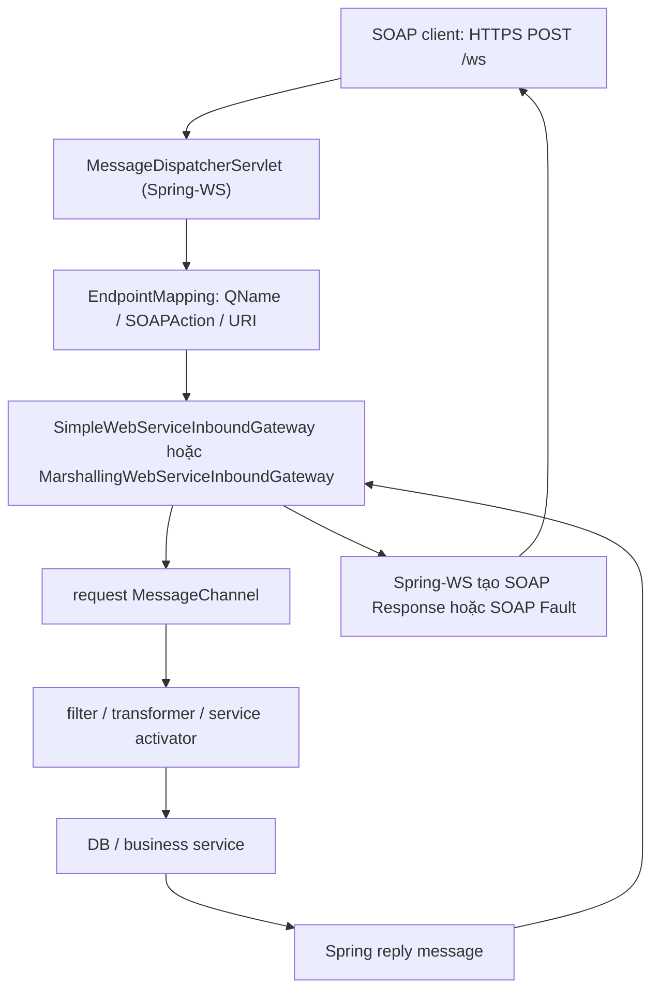
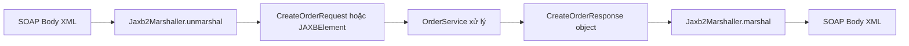
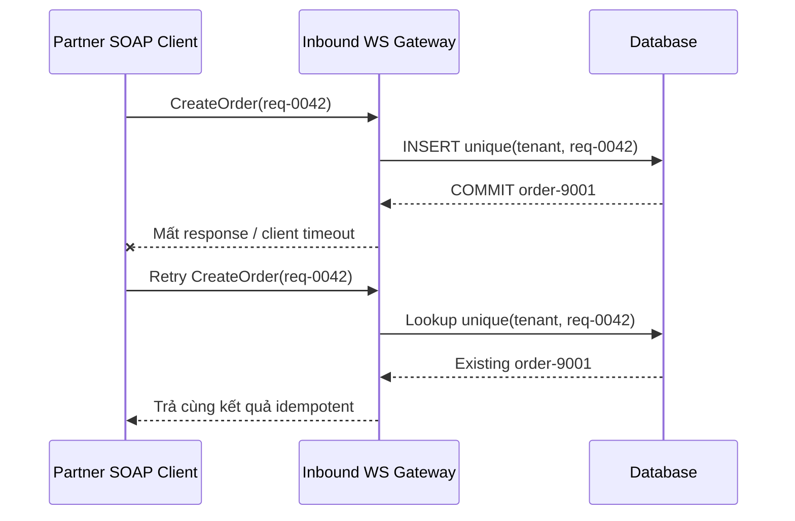

# Web service inbound gateway

## 1. Bài toán: đối tác gọi SOAP, hệ thống xử lý qua Spring Integration

Một đối tác logistics vẫn dùng **SOAP 1.1** để gửi yêu cầu `CreateOrderRequest`. Hợp đồng XML đã được công bố bằng **XSD/WSDL**: đối tác POST một SOAP envelope tới endpoint HTTPS, dịch vụ kiểm tra dữ liệu, tạo đơn hàng và trả `CreateOrderResponse` ngay trong cùng request. Bên trong ứng dụng, nhóm phát triển muốn chuyển request tới các `MessageChannel`, bộ lọc, transformer, service activator và hệ thống nghiệp vụ, thay vì đặt tất cả trong một SOAP controller.

Trong module `SPRING_INTEGRATION_ADAPTERS` — kết nối hệ thống ngoài qua inbound/outbound adapter, gateway, poller và `MessageChannel`, quản lý hợp đồng message, xử lý lỗi và vòng đời kết nối cho file, SFTP, HTTP, JMS, AMQP, Kafka, database — **Web service inbound gateway** đóng vai trò cầu nối giữa **Spring Web Services (Spring-WS)** và **Spring Integration**. Nó nhận một lời gọi web service từ client, tạo Spring Message, đợi một phản hồi từ integration flow và ghi kết quả thành SOAP response.

**Vì sao dùng inbound gateway mà không phải inbound channel adapter?** Đối tác cần **request–reply** trong cùng tương tác: sau khi gửi `CreateOrderRequest`, client mong nhận `CreateOrderResponse` hoặc SOAP Fault. Một **outbound gateway** là chiều ngược lại: ứng dụng gọi một SOAP service bên ngoài. Một **poller** chỉ dùng cho nguồn chủ động lấy dữ liệu theo lịch, **không cần** cho SOAP inbound được HTTP request kích hoạt.

Sau bài này, bạn có thể:

1. Mô tả chuỗi `MessageDispatcherServlet → EndpointMapping → inbound gateway → MessageChannel → reply`.
2. Phân biệt `SimpleWebServiceInboundGateway` với `MarshallingWebServiceInboundGateway` và dạng payload `Source`/object.
3. Cấu hình một SOAP inbound gateway thực tế bằng Java với `PayloadRootQNameEndpointMapping` và `IntegrationFlow`; biết khi nào dùng DSL `Ws.simpleInboundGateway()`.
4. Thiết kế hợp đồng **contract-first** XSD/WSDL, SOAPAction, SOAP header, phiên bản namespace và validation.
5. Xử lý reply channel, timeout, SOAP Fault, retry/idempotency và tránh nhầm HTTP/SOAP accepted với database commit.
6. Bảo vệ XML parser và endpoint bằng TLS, authn/authz, WS-Security, request size/time limits, quan sát và kiểm thử sandbox.

> **Phiên bản minh họa:** Spring Integration **6.5.x**, Spring Web Services **4.0.x**, Spring Framework **6.x**, Java 17+ và Spring Boot với dependency BOM tương thích. Các package cấu hình SOAP dùng `org.springframework.ws.*` và payload XML dùng `javax.xml.transform.Source` (**javax trong JAXP vẫn đúng**, không nhầm với chuyển đổi Jakarta). URI `urn:demo:orders:v1`, đơn hàng và endpoint là dữ liệu mẫu; không phải hệ thống thật.

## 2. Kiến trúc: có hai tầng dispatch



**Tầng 1 — Spring-WS routing:** `MessageDispatcherServlet` nhận HTTP request và tạo `WebServiceMessage` từ SOAP envelope. `EndpointMapping` chọn đúng `MessageEndpoint` dựa trên payload QName, SOAPAction, URI hoặc XPath. Cả `SimpleWebServiceInboundGateway` và `MarshallingWebServiceInboundGateway` đều là **Spring-WS `MessageEndpoint`**.

**Tầng 2 — Spring Integration routing:** inbound gateway tạo `Message<?>` chứa nội dung payload đã trích xuất hoặc object đã unmarshal, chuyển vào **request channel**. Các bước tích hợp xử lý yêu cầu và trả lại Spring reply. Gateway dùng kết quả để tạo web-service response. Các `MessageHeaders` có thể mang `WebServiceHeaders.SOAP_ACTION` (thường là `ws_soapAction`), reply/error channel và các giá trị được cho phép.

| Thành phần | Trách nhiệm | Không tự thực hiện |
| --- | --- | --- |
| HTTP/SOAP transport | Nhận HTTPS POST, handshake TLS, giới hạn request | Phân quyền đơn hàng theo người gọi |
| `MessageDispatcherServlet` | Chạy Spring-WS message dispatcher | Tự tìm tất cả IntegrationFlow khi không có mapping |
| `EndpointMapping` | Chọn endpoint theo QName/SOAPAction/URI | Validate toàn bộ XSD hoặc quyền truy cập |
| `SimpleWebServiceInboundGateway` | Chuyển `Source`/`WebServiceMessage` vào channel và chờ reply | Tự unmarshal thành POJO |
| `MarshallingWebServiceInboundGateway` | Dùng Spring OXM marshaller/unmarshaller | Tự chống XXE, validate business rule nếu cấu hình chưa đủ |
| `MessageChannel` | Định tuyến Spring Message trong integration graph | Bảo đảm DB commit hoặc remote ACK |
| Service activator | Xử lý nghiệp vụ, tạo response payload | Tự chuyển exception thành SOAP Fault đúng hợp đồng |
| Spring-WS exception resolver | Chuyển các lỗi thích hợp thành SOAP Fault | Tự xác thực tenant hoặc rollback side effect |

**Đừng nhầm `Http.inboundGateway("/...")` với `Ws.simpleInboundGateway()`.** Cái trước thuộc Spring Integration HTTP, route theo HTTP request mapping; cái sau là **Spring-WS message endpoint** được tìm bởi SOAP `EndpointMapping`. Cùng dùng HTTP làm transport nhưng contract, fault, header và dispatch khác nhau.

## 3. Một SOAP 1.1 request và response hợp lệ

Mẫu SOAP request bên dưới dùng `Content-Type: text/xml; charset=utf-8` và, khi cần, SOAPAction do client gửi:

```http
POST /ws HTTP/1.1
Host: api.example.test
Content-Type: text/xml; charset=utf-8
SOAPAction: "urn:demo:orders:v1/CreateOrder"

<?xml version="1.0" encoding="UTF-8"?>
<soapenv:Envelope xmlns:soapenv="http://schemas.xmlsoap.org/soap/envelope/"
                  xmlns:ord="urn:demo:orders:v1">
  <soapenv:Header/>
  <soapenv:Body>
    <ord:CreateOrderRequest>
      <ord:requestId>req-0042</ord:requestId>
      <ord:customerId>C-100</ord:customerId>
    </ord:CreateOrderRequest>
  </soapenv:Body>
</soapenv:Envelope>
```

Một response thành công có body:

```xml
<?xml version="1.0" encoding="UTF-8"?>
<soapenv:Envelope xmlns:soapenv="http://schemas.xmlsoap.org/soap/envelope/"
                  xmlns:ord="urn:demo:orders:v1">
  <soapenv:Body>
    <ord:CreateOrderResponse>
      <ord:requestId>req-0042</ord:requestId>
      <ord:status>ACCEPTED</ord:status>
    </ord:CreateOrderResponse>
  </soapenv:Body>
</soapenv:Envelope>
```

Spring-WS nhận phần SOAP envelope, còn **simple inbound gateway mặc định trích `Source` của SOAP Body payload**: phần tử `ord:CreateOrderRequest`, **không phải toàn bộ Envelope**. Service activator bình thường chỉ cần tạo một `Source` chứa **`ord:CreateOrderResponse`**; Spring-WS sẽ đặt payload reply vào SOAP Body của response. Nếu bạn trả cả `<soapenv:Envelope>` như payload trong chế độ mặc định, có thể tạo cấu trúc sai hoặc SOAP envelope bị lồng.

Với **SOAP 1.2**, namespace envelope, Content-Type (`application/soap+xml`) và cách truyền action khác SOAP 1.1. Không trộn tùy tiện hai version khi client có WSDL policy/contract cố định.

## 4. Phân biệt simple và marshalling inbound gateway

Spring Integration hỗ trợ hai loại inbound:

| Tiêu chí | `SimpleWebServiceInboundGateway` | `MarshallingWebServiceInboundGateway` |
| --- | --- | --- |
| Request payload mặc định | `javax.xml.transform.Source` | Object do `Unmarshaller` tạo |
| Response của handler | `Source` hoặc dạng hỗ trợ theo contract | POJO được `Marshaller` chuyển thành XML |
| Phù hợp | XML transformer/XSLT, ESB, pass-through, contract còn nhiều biến thể | XSD-generated JAXB classes hoặc domain DTO đã tách rõ |
| Kiểm tra schema | Cần cấu hình Spring-WS validator/logic riêng | **Unmarshal không phải toàn bộ schema/business validation** |
| Phụ thuộc | Spring Integration WS + Spring-WS | Cộng Spring OXM/JAXB implementation và binding classes |
| Rủi ro điển hình | Parse XML thiếu bảo vệ; nhầm Source với String | QName/JAXB annotation sai, JAXB runtime thiếu, object graph quá lớn |

Với simple gateway:

```java
SimpleWebServiceInboundGateway simpleGateway =
        new SimpleWebServiceInboundGateway();
simpleGateway.setRequestChannel(orderRequests);
// Reply channel là tùy chọn; gateway có thể dùng replyChannel
// được gắn trong request message để nhận phản hồi.
```

Với marshalling gateway:

```java
MarshallingWebServiceInboundGateway objectGateway =
        new MarshallingWebServiceInboundGateway(jaxbMarshaller);
objectGateway.setRequestChannel(orderObjectRequests);
```

Hai đoạn là **trích đoạn giải thích API**, chưa phải cấu hình web endpoint chạy độc lập. Chúng vẫn cần `MessageDispatcherServlet` và `EndpointMapping`. Với Spring Integration 6.5, `Ws.simpleInboundGateway()` và `Ws.marshallingInboundGateway()` cũng có factory DSL tương ứng.

### Chế độ `extractPayload(false)` của simple gateway

Nếu dùng `simpleGateway.setExtractPayload(false)` hoặc `Ws.simpleInboundGateway().extractPayload(false)`, Spring message mang **toàn bộ `WebServiceMessage`** thay vì chỉ `Source`. Hữu ích khi xử lý SOAP header, attachment, metadata hoặc custom logic cần envelope. Nhưng `WebServiceMessage` thường gắn với request lifecycle/transport, **không nên serialize tùy tiện đưa vào Kafka/JMS**. Muốn async phải materialize một DTO + metadata đã kiểm soát trước khi servlet request kết thúc.

## 5. Gradle và cấu hình web-service transport

Ví dụ dùng Spring Boot BOM tương thích Spring Integration 6.5:

```groovy
dependencies {
    implementation 'org.springframework.boot:spring-boot-starter-integration'
    implementation 'org.springframework.integration:spring-integration-ws'
    implementation 'org.springframework.boot:spring-boot-starter-web-services'
    // JAXB runtime/binding cần thêm khi chọn marshalling gateway.
    testImplementation 'org.springframework.boot:spring-boot-starter-test'
    testImplementation 'org.springframework.ws:spring-ws-test'
}
```

`spring-integration-ws` là **module riêng**, không thay thế bởi `spring-integration-http`. Spring-WS cung cấp `MessageDispatcherServlet`, SOAP factories, endpoint mapping, WSDL và fault resolution. Với Spring Boot starter, cần kiểm tra **auto-config hiện có** trước khi tự đăng ký servlet: **chỉ dùng một servlet registration/mapping đúng `/ws/*`** để tránh hai servlet cạnh tranh. Ví dụ tiếp theo cho thấy cách **đăng ký tường minh**; khi dùng Boot auto-config tương đương, có thể bỏ phần registration thủ công.

```yaml
server:
  port: 8080

spring:
  application:
    name: order-web-service

# Production: TLS được termination tại ingress/proxy hoặc ứng dụng
# với mTLS/rate limits/size caps, không cấu hình HTTP demo trực tiếp ra Internet.
```

**Không tự giả định `spring.webservices.path=/ws` đã đăng ký gateway:** property này liên quan Spring-WS servlet path khi dùng auto-config, còn **chọn gateway bean theo QName/SOAPAction vẫn cần mapping**. Routing bằng @RestController/@RequestMapping không tự chuyển một SOAP request thành Spring Integration WS message.

## 6. Java configuration tối thiểu: servlet + channel + inbound gateway + QName mapping

Mẫu dưới có thể dùng làm **bộ khung** cho một endpoint SOAP 1.1 nhận `CreateOrderRequest`. Trong phiên bản Spring-WS 4.x, `PayloadRootQNameEndpointMapping` nhận map từ chuỗi QName dạng `{namespaceURI}localPart` tới một endpoint bean; **đây không phải `@PayloadRoot` method mapping**.

```java
import java.util.Map;

import org.springframework.beans.factory.annotation.Qualifier;
import org.springframework.boot.web.servlet.ServletRegistrationBean;
import org.springframework.context.ApplicationContext;
import org.springframework.context.annotation.Bean;
import org.springframework.context.annotation.Configuration;
import org.springframework.integration.channel.DirectChannel;
import org.springframework.integration.ws.SimpleWebServiceInboundGateway;
import org.springframework.messaging.MessageChannel;
import org.springframework.ws.server.endpoint.mapping.PayloadRootQNameEndpointMapping;
import org.springframework.ws.transport.http.MessageDispatcherServlet;

@Configuration
public class SoapOrdersInboundConfig {

    public static final String NS = "urn:demo:orders:v1";
    public static final String REQUEST_QNAME =
            "{" + NS + "}CreateOrderRequest";

    @Bean
    public ServletRegistrationBean<MessageDispatcherServlet> soapDispatcher(
            ApplicationContext context) {
        MessageDispatcherServlet servlet = new MessageDispatcherServlet();
        servlet.setApplicationContext(context);
        servlet.setTransformWsdlLocations(true);
        return new ServletRegistrationBean<>(servlet, "/ws/*");
    }

    @Bean
    public MessageChannel orderSoapRequests() {
        return new DirectChannel();
    }

    @Bean
    public SimpleWebServiceInboundGateway orderSoapGateway(
            @Qualifier("orderSoapRequests") MessageChannel requests) {

        SimpleWebServiceInboundGateway gateway =
                new SimpleWebServiceInboundGateway();
        gateway.setRequestChannel(requests);
        gateway.setRequestTimeout(5_000L);
        gateway.setReplyTimeout(10_000L);
        // Reply channel tùy chọn; gateway cấp reply channel tạm
        // theo cơ chế request-reply khi không cấu hình kênh cố định.
        return gateway;
    }

    @Bean
    public PayloadRootQNameEndpointMapping orderSoapEndpointMapping(
            SimpleWebServiceInboundGateway orderSoapGateway) {

        PayloadRootQNameEndpointMapping mapping =
                new PayloadRootQNameEndpointMapping();
        mapping.setEndpointMap(Map.of(REQUEST_QNAME, orderSoapGateway));
        return mapping;
    }
}
```

**Lưu ý về vòng đời bean:** `orderSoapGateway` là `MessageEndpoint`; `orderSoapEndpointMapping` tham chiếu chính object đó. Nếu code chỉ đăng ký gateway mà không đăng ký `PayloadRootQNameEndpointMapping`/mapping khác, `MessageDispatcherServlet` có thể không tìm ra endpoint và trả lỗi dispatch. Nếu code chỉ có `EndpointMapping` mà không có request channel subscriber, request sẽ không được xử lý thành reply. Nếu auto-config đã đăng ký servlet, tránh đăng ký servlet thứ hai trùng path.

### Vì sao dùng `DirectChannel` trong ví dụ đầu tiên?

Gateway đang phục vụ **SOAP request–reply đồng bộ**. `DirectChannel` gọi handler đồng bộ trên thread gửi message, giúp dễ kiểm thử response và exception. Nếu dùng `ExecutorChannel`, gateway có thể vẫn đợi trên reply channel nhưng giờ phải phối hợp thread, timeout, context và khả năng hết servlet threads. Nếu dùng `QueueChannel` mà không có consumer, request sẽ đợi rồi timeout. Với xử lý mất nhiều phút, nên cân nhắc **accept/ack + correlation ID** hoặc callback/poll status theo hợp đồng thay vì giữ HTTP connection.

## 7. Java DSL xử lý SOAP payload và trả reply

Gateway ở mục 6 đã đưa payload dạng `Source` vào channel `orderSoapRequests`. Flow dưới minh họa một response tĩnh để **kiểm tra end-to-end wiring**; nó cố tình không tạo đơn hàng hay đọc ID từ yêu cầu. Bản production cần parse/validate XML an toàn, xác thực quyền và gọi business service idempotent.

```java
import java.io.StringReader;

import javax.xml.transform.Source;
import javax.xml.transform.stream.StreamSource;

import org.springframework.beans.factory.annotation.Qualifier;
import org.springframework.context.annotation.Bean;
import org.springframework.context.annotation.Configuration;
import org.springframework.integration.dsl.IntegrationFlow;
import org.springframework.messaging.MessageChannel;

@Configuration
public class SoapOrdersProcessingFlow {

    @Bean
    public IntegrationFlow orderSoapProcessing(
            @Qualifier("orderSoapRequests") MessageChannel requestChannel) {

        return IntegrationFlow.from(requestChannel)
                .handle(Source.class, (requestPayload, headers) -> {
                    // Kết nối demo: KHÔNG dùng như xử lý nghiệp vụ thật.
                    String responsePayload = """
                        <ord:CreateOrderResponse
                            xmlns:ord="urn:demo:orders:v1">
                          <ord:requestId>req-0042</ord:requestId>
                          <ord:status>ACCEPTED</ord:status>
                        </ord:CreateOrderResponse>
                        """;
                    return new StreamSource(new StringReader(responsePayload));
                })
                .get();
    }
}
```

Vì handler **trả giá trị** thay vì `void`, Spring Integration tạo reply và đưa về reply channel tạm mà gateway cấp cho request, theo quy tắc request–reply. Gateway nhận `Source` chứa phần tử `CreateOrderResponse` và Spring-WS tạo SOAP envelope response. Nếu handler ném lỗi, không trả reply, hoặc mất quá thời gian đợi, client không được đảm bảo response thành công.

**Điểm giới hạn của mã mẫu:** response luôn trả `req-0042` và trạng thái ACCEPTED để chứng minh kết nối; **không phản ánh ID thực tế**. Mục 10 sẽ mô tả ranh giới xử lý business đúng, và mục 11 hướng dẫn cách trả lỗi SOAP. Không được đưa demo này lên production.

### Hợp đồng request–reply ở từng bước

| Bước | Input | Output |
| --- | --- | --- |
| SOAP client | Envelope XML | HTTP request |
| Spring-WS | `SoapMessage`/`WebServiceMessage` | Mapping tới gateway bằng body QName |
| Simple inbound gateway | `Source` + headers | Spring `Message<Source>` |
| `IntegrationFlow` | Request payload + headers | `Source` response |
| Inbound gateway | Spring reply | Spring-WS response body |
| SOAP client | HTTP + SOAP Envelope | Kết quả theo XSD/WSDL |

## 8. Java DSL tạo **gateway ở đầu IntegrationFlow**: phương án thay thế

Ngoài việc tạo `SimpleWebServiceInboundGateway` bean ở mục 6, Spring Integration 6.5 hỗ trợ DSL `Ws.simpleInboundGateway()` và `Ws.marshallingInboundGateway()`. Tài liệu chính thức dùng:

```java
import org.springframework.context.annotation.Bean;
import org.springframework.context.annotation.Configuration;
import org.springframework.integration.dsl.IntegrationFlow;
import org.springframework.integration.ws.dsl.Ws;

@Configuration
public class WsInboundDslAlternative {

    @Bean
    public IntegrationFlow inboundOrderFlow(OrderSoapBusinessHandler handler) {
        return IntegrationFlow.from(
                        Ws.simpleInboundGateway()
                                .id("createOrderDslGateway"))
                .handle(handler)
                .get();
    }
}
```

`OrderSoapBusinessHandler` là handler **do ứng dụng cài đặt** với logic validation và trả `Source`; không phải Spring Integration API. Với cách DSL, endpoint `createOrderDslGateway` vẫn phải được **Spring-WS EndpointMapping trỏ đến**, ví dụ dùng bean name làm giá trị:

```java
@Bean
public PayloadRootQNameEndpointMapping dslOrderMapping() {
    PayloadRootQNameEndpointMapping mapping =
            new PayloadRootQNameEndpointMapping();
    mapping.setEndpointMap(Map.of(
            "{urn:demo:orders:v1}CreateOrderRequest",
            "createOrderDslGateway"));
    return mapping;
}
```

Đoạn mapping đặt trong configuration có import `Map` và `PayloadRootQNameEndpointMapping` như mục 6. Spring-WS cho phép endpointMap nhận **bean instance hoặc tên bean**; hãy kiểm tra rằng DSL đăng ký gateway theo đúng ID trong phiên bản đã chọn. **Đây là cách thay thế**, không bật cả `orderSoapGateway` và `createOrderDslGateway` cùng map một QName, vì hai mappings cạnh tranh route có thể gây dispatch không xác định.

## 9. Contract-first: XSD và WSDL là ranh giới tích hợp

Với web service SOAP giữa các doanh nghiệp, **hợp đồng cần được công bố trước** và kiểm soát phiên bản. XSD quy định phần tử/thứ tự/kiểu dữ liệu, WSDL mô tả operation, message, binding và endpoint address. Một client đã tạo code từ WSDL có thể phụ thuộc chặt vào QName, SOAPAction, namespace và XML schema.

Ví dụ XSD tối thiểu cho operation CreateOrder:

```xml
<?xml version="1.0" encoding="UTF-8"?>
<xs:schema xmlns:xs="http://www.w3.org/2001/XMLSchema"
           targetNamespace="urn:demo:orders:v1"
           xmlns:ord="urn:demo:orders:v1"
           elementFormDefault="qualified">

  <xs:element name="CreateOrderRequest">
    <xs:complexType>
      <xs:sequence>
        <xs:element name="requestId" type="xs:string"/>
        <xs:element name="customerId" type="xs:string"/>
      </xs:sequence>
    </xs:complexType>
  </xs:element>

  <xs:element name="CreateOrderResponse">
    <xs:complexType>
      <xs:sequence>
        <xs:element name="requestId" type="xs:string"/>
        <xs:element name="status" type="xs:string"/>
      </xs:sequence>
    </xs:complexType>
  </xs:element>
</xs:schema>
```

**Chú ý:** đây là XSD học tập, chưa ràng buộc `requestId` theo pattern, `status` theo enumeration hay giới hạn độ dài. Bản production nên có kiểu/domain constraints, backward compatibility rules và CI contract tests. Cần validate cả business rules (ví dụ customer thuộc tenant) **sau** khi XML hợp lệ.

### Công bố WSDL với `DefaultWsdl11Definition`

Spring Web Services có thể tạo WSDL 1.1 từ XSD qua `DefaultWsdl11Definition`, hoặc phục vụ WSDL tĩnh đã được đối tác duyệt. Ví dụ Spring bean nếu tài nguyên `orders.xsd` thực sự tồn tại trong classpath:

```java
import org.springframework.context.annotation.Bean;
import org.springframework.context.annotation.Configuration;
import org.springframework.core.io.ClassPathResource;
import org.springframework.ws.wsdl.wsdl11.DefaultWsdl11Definition;
import org.springframework.xml.xsd.SimpleXsdSchema;
import org.springframework.xml.xsd.XsdSchema;

@Configuration
public class OrdersContractConfiguration {

    @Bean
    public XsdSchema ordersSchema() {
        return new SimpleXsdSchema(new ClassPathResource("orders.xsd"));
    }

    @Bean(name = "orders")
    public DefaultWsdl11Definition ordersWsdl(XsdSchema ordersSchema) {
        DefaultWsdl11Definition wsdl = new DefaultWsdl11Definition();
        wsdl.setPortTypeName("OrdersPort");
        wsdl.setLocationUri("/ws");
        wsdl.setTargetNamespace("urn:demo:orders:v1");
        wsdl.setSchema(ordersSchema);
        return wsdl;
    }
}
```

Khi `MessageDispatcherServlet` được cấu hình để công bố WSDL, URL thường có dạng `/ws/orders.wsdl` trong ví dụ này; **kiểm tra mapping và Boot auto-config** trên môi trường chạy thực tế. `setTransformWsdlLocations(true)` giúp cập nhật location theo request/địa chỉ phía ngoài, nhưng khi có ingress/proxy cần quản lý Forwarded headers và **chỉ tin các proxy được cấp quyền**. Nếu không, WSDL sinh ra có thể quảng bá sai scheme/host hoặc tin header do client tự giả.

Một WSDL có thể được công bố qua HTTPS, nhưng việc tải WSDL **không đồng nghĩa client được phép thực hiện operation**. Xác thực/ủy quyền nằm ở ranh giới HTTP/SOAP/business, không dựa vào bí mật của đường dẫn `orders.wsdl`.

### Versioning contract-first

| Thay đổi | Ảnh hưởng | Hướng xử lý |
| --- | --- | --- |
| Đổi namespace từ `v1` sang `v2` | QName routing và JAXB classes thay đổi | Tạo mapping/version mới, contract test riêng |
| Thêm phần tử tùy chọn trong XSD | Có thể tương thích một phần | Xác nhận với generated clients và schema rules |
| Thêm phần tử bắt buộc | Dễ phá backward compatibility | Nên tạo contract version mới |
| Đổi SOAP 1.1 sang SOAP 1.2 | Envelope/Content-Type/Action khác | Kiểm thử client/binding và message factory |
| Đổi tên operation/response element | WSDL/client stub cần tái tạo | Migration plan, giữ endpoint v1 trong thời hạn |
| Đổi semantics của `ACCEPTED` | Có thể phá workflow đối tác dù XML không đổi | Version hóa hành vi, không chỉ schema |

Không dùng string-split theo tag XML hoặc so tên local part mà bỏ namespace. `{urn:demo:orders:v1}CreateOrderRequest` khác `{urn:attacker:orders}CreateOrderRequest` dù cùng `CreateOrderRequest` ở bề ngoài.

## 10. Mapping theo QName, SOAPAction, URI và XPath

Spring-WS có nhiều `EndpointMapping`. Với integration gateway, chọn **một hợp đồng chính** để route rồi validate nội dung:

| Mapping | Khóa routing | Khi nào dùng | Lưu ý |
| --- | --- | --- | --- |
| `PayloadRootQNameEndpointMapping` | QName phần tử đầu SOAP Body | Contract-first theo XSD | Tránh bỏ namespace; QName chính xác |
| `SoapActionEndpointMapping` | HTTP SOAPAction / action phù hợp SOAP version | Đối tác có action ổn định | Action do client khai báo, **không** là chứng thực |
| `UriEndpointMapping` | URI endpoint/path theo Spring-WS | Endpoint dành riêng cho nhóm operation | Không thay validation nội dung |
| `XPathPayloadEndpointMapping` | XPath từ payload XML | Legacy contract có nhiều dạng một root | Giới hạn XML/XPath complexity, namespaces |

Mục 6 dùng QName vì rõ ràng và ít phụ thuộc HTTP header. Với `SoapActionEndpointMapping`, cấu hình endpointMap theo SOAPAction hợp đồng; phía business vẫn phải kiểm tra đúng payload QName và schema. Nếu SOAPAction nói “CreateOrder” nhưng body là “CancelOrder”, **không thực hiện thao tác hủy** vì route đã được chọn.

Nếu ứng dụng đồng thời dùng `@Endpoint` + `@PayloadRoot`, Spring-WS có **`PayloadRootAnnotationMethodEndpointMapping`** cho method-based endpoints. Một bean `SimpleWebServiceInboundGateway` **không phải** phương thức `@PayloadRoot` trong controller; bạn cần mapping **đúng loại** tới gateway. Khi cấu hình nhiều mapping với cùng điều kiện, thứ tự/order và độ ưu tiên phải được test, tránh default endpoint “bắt tất cả” khiến request đi sai luồng.

### Dòng Spring headers của SOAPAction

Spring Integration định nghĩa `WebServiceHeaders.SOAP_ACTION` với giá trị key `ws_soapAction`. Theo reference, SOAPAction được đặt vào Spring message headers khi inbound message là SOAP. Ví dụ handler chỉ đọc để log/routing sau khi đã xác thực:

```java
import org.springframework.integration.ws.WebServiceHeaders;
import org.springframework.messaging.Message;

public static void inspectAction(Message<?> message) {
    String action = message.getHeaders()
            .get(WebServiceHeaders.SOAP_ACTION, String.class);
    // Chỉ dùng cho correlation hoặc kiểm tra contract; không dùng làm
    // authentication/authorization hoặc business unique key.
}
```

Không giả định **mọi SOAP header tùy ý** tự trở thành Spring header. Muốn map các trường như correlation ID hoặc WS-Addressing cần cấu hình `SoapHeaderMapper`/`DefaultSoapHeaderMapper` hoặc đọc từ `WebServiceMessage`, với allowlist và giới hạn độ dài.

## 11. Marshalling inbound gateway: ánh xạ XML sang Java object

Khi dự án dùng schema-generated Java classes (JAXB/XJC), `MarshallingWebServiceInboundGateway` có thể unmarshal request XML thành object, rồi marshal response object trở lại SOAP body:



Ví dụ `Jaxb2Marshaller` với các binding classes **được sinh từ XSD** đã có trong project:

```java
import org.springframework.context.annotation.Bean;
import org.springframework.context.annotation.Configuration;
import org.springframework.integration.dsl.IntegrationFlow;
import org.springframework.integration.ws.dsl.Ws;
import org.springframework.oxm.jaxb.Jaxb2Marshaller;

@Configuration
public class OrderJaxbInboundAlternative {

    @Bean
    public Jaxb2Marshaller orderMarshaller() {
        Jaxb2Marshaller marshaller = new Jaxb2Marshaller();
        marshaller.setContextPath("com.example.generated.orders.v1");
        // Schema validation, XXE hardening, type allowlists và JAXB
        // runtime cần được cấu hình/kiểm chứng trong dự án thực.
        return marshaller;
    }

    @Bean
    public IntegrationFlow marshallingOrderFlow(
            Jaxb2Marshaller orderMarshaller,
            GeneratedOrderRequestHandler orderRequestHandler) {

        return IntegrationFlow.from(
                        Ws.marshallingInboundGateway()
                                .marshaller(orderMarshaller)
                                .unmarshaller(orderMarshaller)
                                .id("marshalledOrderGateway"))
                .handle(orderRequestHandler)
                .get();
    }
}
```

`GeneratedOrderRequestHandler` là **handler do ứng dụng xây dựng**, nhận object do JAXB tạo và trả response object; bạn phải định nghĩa class/binding từ XSD. Theo cách XJC sinh class, payload có thể là `JAXBElement<CreateOrderRequest>` thay vì `CreateOrderRequest` trực tiếp; cần inspect type trong test. `Jaxb2Marshaller` cần JAXB runtime/provider phù hợp và chỉ trust/allow các type cho contract. Cũng phải tạo một `PayloadRootQNameEndpointMapping` hoặc mapping khác trỏ tới bean `marshalledOrderGateway` như mục 8, **không dùng cùng QName với simple gateway đang hoạt động**.

### Không đánh đồng unmarshalling với validation

Unmarshal thành POJO **không mặc định** bảo đảm:

- Request tuân thủ mọi `minOccurs/maxOccurs`, pattern, extension và version được XSD mong đợi.
- Customer/tenant hoặc token được cấp quyền tạo order.
- `requestId` chưa từng được xử lý và business transaction sẽ chạy một lần.
- Parser an toàn trước XML external entities, entity expansion, XInclude hoặc oversized payload.

Cần **XSD validation + business validation + authz + quotas** ở đúng ranh giới. Một số generated fields có thể `null` khi schema validation không được bật, dù code business mặc định giả định chúng bắt buộc.

## 12. XSD validation bằng Spring-WS interceptor

Spring-WS cung cấp `PayloadValidatingInterceptor` phía **server** ở package `org.springframework.ws.soap.server.endpoint.interceptor`. Khi request không hợp lệ, interceptor có thể tạo SOAP Fault trước khi gọi business handler. Ví dụ thêm vào `PayloadRootQNameEndpointMapping` với XSD đã tồn tại ở classpath:

```java
import org.springframework.core.io.ClassPathResource;
import org.springframework.ws.server.EndpointInterceptor;
import org.springframework.ws.server.endpoint.mapping.PayloadRootQNameEndpointMapping;
import org.springframework.ws.soap.server.endpoint.interceptor.PayloadValidatingInterceptor;

// Trích đoạn đặt trong cấu hình tạo PayloadRootQNameEndpointMapping.
PayloadValidatingInterceptor validator = new PayloadValidatingInterceptor();
validator.setSchema(new ClassPathResource("orders.xsd"));
validator.setValidateRequest(true);
validator.setValidateResponse(true);

PayloadRootQNameEndpointMapping mapping =
        new PayloadRootQNameEndpointMapping();
mapping.setEndpointMap(Map.of(
        "{urn:demo:orders:v1}CreateOrderRequest", orderSoapGateway));
mapping.setInterceptors(new EndpointInterceptor[]{validator});
```

`Map` và `orderSoapGateway` là bean/biến như mục 6. Đây là **phương án mở rộng** cho mapping hiện tại, không tạo một mapping thứ hai nhận cùng QName. Validator cần được quản lý như Spring bean/interceptor có vòng đời khởi tạo đúng; khi ghép code production, bảo đảm `afterPropertiesSet`/Spring container initialization được thực thi và XSD resource có thật.

**Validation policy là quyết định hợp đồng:** request validation nghiêm ngặt có thể chặn extension hợp lệ của đối tác. Nếu chọn permissive contract, vẫn phải giới hạn XML complexity, xác thực dữ liệu bắt buộc và ngăn business operation không đúng schema. Response validation có thể hữu ích để phát hiện lỗi contract trước khi gửi cho client. Không bật tracing toàn SOAP envelope trong production chỉ để debug XSD failure.

## 13. SOAP Fault, lỗi nghiệp vụ và lỗi tích hợp

SOAP inbound gateway cần một **error contract** rõ ràng. Không biến mọi exception thành HTTP 200 + `status=ERROR` một cách tùy tiện; cũng không để exception Java stack trace/SQL statement lộ trong SOAP Fault.

Ví dụ SOAP 1.1 Fault ở mức khái niệm:

```xml
<soapenv:Envelope xmlns:soapenv="http://schemas.xmlsoap.org/soap/envelope/">
  <soapenv:Body>
    <soapenv:Fault>
      <faultcode>soapenv:Client</faultcode>
      <faultstring>Request violates the published contract</faultstring>
    </soapenv:Fault>
  </soapenv:Body>
</soapenv:Envelope>
```

| Lỗi | Hành vi thường hợp lý | Không nên |
| --- | --- | --- |
| XML malformed, sai QName, không khớp XSD | SOAP Fault dạng client/sender theo version, không vào business | Nuốt lỗi rồi tạo order mặc định |
| Chưa xác thực/không có quyền | HTTP/SOAP security failure theo policy | Tin SOAPAction/From làm quyền |
| Customer không tồn tại | Business fault hoặc response decline theo WSDL | Trả thông tin SQL/stack trace |
| DB tạm unavailable | Server/receiver fault hoặc thông báo retryable contract | Hứa request chưa tạo side effect nếu không chắc |
| Flow không trả reply kịp | Timeout/fault có giám sát và correlation | Để servlet thread treo vô hạn |
| Response không hợp schema | Lỗi server, không gửi reply không hợp đồng | Coi HTTP 200 là thành công |

Spring-WS có `SoapFaultMappingExceptionResolver` để map exception sang SOAP fault code/reason, cùng cơ chế `@SoapFault` trong endpoint kiểu annotation. Với Spring Integration WS inbound, hãy kiểm tra exception phát sinh trong integration flow được truyền ra **tầng Spring-WS resolver** như mong đợi. Một Spring Integration `errorChannel` chỉ nhận lỗi theo messaging infrastructure; **không tự biến mọi `ErrorMessage` thành SOAP Fault**. Đặt resolver trong Spring-WS context, định nghĩa fault mapping theo code hợp đồng và test request thực.

### HTTP status không thay thế phân tích SOAP body

Với SOAP 1.1, lỗi thường xuất hiện dưới HTTP 500 cùng SOAP Fault; với SOAP 1.2 hoặc provider cụ thể, semantics có thể khác. Client phải kiểm tra **SOAP Fault và contract payload**, không chỉ dựa vào một mã 200/500. Nếu reverse proxy trả HTML error page thay vì SOAP envelope, client SOAP có thể không giải mã được: nên kiểm thử auth/filter/ingress và error boundary từ HTTP đến Spring-WS.

### Request timeout, reply timeout và business timeout

`gateway.setRequestTimeout(...)` giới hạn thời gian gửi message tới request channel; `setReplyTimeout(...)` giới hạn thời gian đợi reply qua messaging gateway, **không** là deadline end-to-end cho toàn HTTP client, DB transaction và proxy. Với `DirectChannel`, thời gian chạy handler đồng bộ có thể chiếm phần lớn thời gian request; đặt HTTP server/proxy/read timeout và DB query timeout phù hợp.

Nếu downstream handler tạo đơn hàng rồi crash trước reply, client có thể **không nhận được kết quả dù DB đã commit**. Khi client retry cùng `requestId`, service phải nhận ra request đã xử lý và trả **kết quả idempotent**; không tạo đơn thứ hai.

## 14. SOAP security: TLS, WS-Security và xác thực nghiệp vụ

Một SOAP client có thể gửi XML hợp lệ nhưng **không có quyền** tạo đơn hàng. `EndpointMapping` xác định nơi xử lý dựa vào QName/SOAPAction/URI; đó **không phải** kiểm tra danh tính hoặc ủy quyền.

| Ranh giới | Cần xác minh | Công cụ hoặc chính sách |
| --- | --- | --- |
| Network/transport | Kết nối TLS đáng tin, chỉ host/port hợp lệ | HTTPS ở ingress hoặc embedded server; kiểm tra cert và mTLS theo yêu cầu |
| Caller authentication | Ai gửi request? | OAuth2/JWT ở HTTP layer, mTLS, hoặc WS-Security token/signature |
| Message integrity | SOAP body/header có bị thay đổi sau ký? | WS-Security chữ ký số/timestamp, `Wss4jSecurityInterceptor` |
| Authorization | Client/tenant được phép tạo đơn của customer này không? | Business policy, customer ownership, scope/role |
| Replay protection | Một request đã gửi trước đó được phát lại? | Unique `(tenant_id, request_id)`, timestamp/nonce khi phù hợp |
| Payload validation | XML đúng contract và an toàn? | XSD, parser hardening, giới hạn size/depth/attachments |
| Secrets and privacy | Không lộ token, customer PII, key/certificate | Secret manager, logging redaction, retention và kiểm soát quyền |

**TLS và WS-Security giải quyết các lớp khác nhau.** TLS bảo vệ vận chuyển giữa hai điểm kết nối, nhưng sau TLS termination ở proxy, SOAP XML có thể tiếp tục đi qua các thành phần nội bộ. WS-Security có thể cung cấp integrity/signature ở mức message theo policy đối tác. Không tự cho rằng một SOAP header `UsernameToken` đã được xác thực chỉ vì nó hiện diện. Phải cấu hình interceptor xác minh chữ ký, timestamp/nonce và quyền principal tương ứng.

### `Wss4jSecurityInterceptor` và policy

Spring Web Services hỗ trợ `org.springframework.ws.soap.security.wss4j2.Wss4jSecurityInterceptor` (đối chiếu package theo phiên bản Spring-WS); có thể cấu hình kiểm tra UsernameToken, chữ ký, thời hạn và mật mã theo hợp đồng. Cần đưa interceptor vào Spring-WS endpoint mapping hoặc một interceptor policy được Spring-WS thực thi, kết hợp authentication provider/keystore/truststore đúng môi trường. **Không** tự ghi một header mapper giả chữ ký, và không đọc UsernameToken rồi so plaintext bằng mã tự viết.

Nếu dùng HTTP Bearer token tại API gateway, phải xác minh JWT issuer, audience, signature, expiration và authorization scope; không tin các header `X-User` do client tự khai báo khi chúng chưa được proxy tin cậy chuẩn hóa. Nếu dùng mTLS, cần xác thực certificate client và liên kết subject/SAN với danh tính tenant, không chỉ nhìn cờ `isSecure()`.

## 15. XML parser hardening, XXE, entity expansion và MTOM

SOAP sử dụng XML; một request với external entity, DTD hoặc payload phình nở có thể gây **XXE/SSRF**, đọc file, hoặc denial-of-service nếu parser được cấu hình không an toàn. XML body cũng có thể chứa hàng triệu node/attribute hoặc nesting depth quá sâu.

Những quy tắc bắt buộc:

1. **Giới hạn kích thước request ngay ở ingress/servlet** và giới hạn số attachment, MTOM size, độ sâu XML, thời gian xử lý.
2. **Tắt DTD/external entities/XInclude** ở parser nào do ứng dụng tự tạo; bật secure processing, vô hiệu external DTD/schema/XSLT access khi phù hợp.
3. Không dùng `TransformerFactory.newInstance()` với stylesheet/`Source` không tin cậy mà chưa bật các giới hạn bảo mật và xác định provider implementation.
4. Với `Jaxb2Marshaller`, giới hạn các class được phép, kiểm soát unmarshalling, validate schema; không cho client chỉ định class Java tùy ý.
5. Không tự triển khai SOAP parser bằng `String.split`, XPath expression do client đưa nguyên văn, hoặc XSLT tải từ URL không đáng tin.
6. Nếu SOAP có attachment/MTOM, kiểm tra quota và antivirus theo loại dữ liệu, không log raw bytes hoặc đưa stream request sang queue khi request lifecycle đã kết thúc.

Trích đoạn hardening **chỉ áp dụng khi ứng dụng tự tạo DOM parser**; không tự động cấu hình mọi parser bên trong Spring-WS:

```java
import javax.xml.XMLConstants;
import javax.xml.parsers.DocumentBuilderFactory;

public static DocumentBuilderFactory secureDocumentBuilderFactory()
        throws Exception {
    DocumentBuilderFactory factory =
            DocumentBuilderFactory.newInstance();
    factory.setNamespaceAware(true);
    factory.setFeature(XMLConstants.FEATURE_SECURE_PROCESSING, true);
    factory.setFeature(
            "http://apache.org/xml/features/disallow-doctype-decl", true);
    factory.setFeature(
            "http://xml.org/sax/features/external-general-entities", false);
    factory.setFeature(
            "http://xml.org/sax/features/external-parameter-entities", false);
    factory.setXIncludeAware(false);
    factory.setExpandEntityReferences(false);
    factory.setAttribute(XMLConstants.ACCESS_EXTERNAL_DTD, "");
    factory.setAttribute(XMLConstants.ACCESS_EXTERNAL_SCHEMA, "");
    return factory;
}
```

Đoạn code là **method utility** cần đặt trong class và xử lý `ParserConfigurationException`/khả năng hỗ trợ feature theo JAXP provider. Nếu một provider không hỗ trợ một feature bảo vệ cần thiết, **fail configuration**, không âm thầm bỏ qua rồi parse. Khi dùng SOAP/JAXB, phải xác minh cấu hình `WebServiceMessageFactory`, SAAJ/JAXB/Transformer thực tế — hardening một factory thủ công **không đảm bảo** toàn bộ stack an toàn.

### Khi nào cần `extractPayload(false)`?

Mặc định simple gateway chuyển `Source` của body XML. Nếu cần xử lý **SOAP headers hoặc MIME/MTOM attachments** đặc biệt, có thể chọn `extractPayload(false)` và nhận `WebServiceMessage`, sau đó trích xuất dữ liệu cần thiết trong cùng request scope. Nhưng khi làm vậy, code phải kiểm soát SOAP version, attachment resource lifecycle, quota, header trust và transformation. Không có lý do để chuyển toàn bộ `WebServiceMessage` qua JMS/Kafka rồi mong nó vẫn truy cập được HTTP request stream.

## 16. Idempotency và timeout khi đối tác gửi lại request

SOAP inbound gateway thường chạy **đồng bộ**. Nếu DB đã commit nhưng client timeout trước khi nhận SOAP response, đối tác có thể gửi lại `CreateOrderRequest` với cùng `requestId`. Nếu server không có idempotency, có thể tạo hai đơn hàng.



**Phân biệt hai kiểu khóa:**

- `requestId` của đối tác là key để **nhận ra retry của cùng yêu cầu**, có phạm vi theo tenant/client identity đã được xác thực.
- `orderId` hoặc một business reference trong DB là **identity nghiệp vụ**. Hai request khác nhau không nhất thiết được xem là trùng chỉ vì tên khách hàng giống nhau.

Ví dụ schema và cơ chế:

```sql
CREATE TABLE soap_request_ledger (
    tenant_id       VARCHAR(80) NOT NULL,
    request_id      VARCHAR(120) NOT NULL,
    request_hash    VARCHAR(64) NOT NULL,
    status          VARCHAR(30) NOT NULL,
    order_id        VARCHAR(120),
    response_ref    VARCHAR(255),
    created_at      TIMESTAMP NOT NULL,
    updated_at      TIMESTAMP NOT NULL,
    PRIMARY KEY (tenant_id, request_id)
);
```

Luồng xử lý:

1. Xác thực tenant và kiểm tra payload đúng XSD + business constraints.
2. Chuẩn hóa và tính hash **nội dung nghiệp vụ** theo chính sách (không tự hash raw XML rồi tin hai envelope cùng semantics có bytes giống nhau).
3. Transaction claim `(tenant_id, request_id)`, kiểm tra hash của request đã tồn tại.
4. Nếu lần đầu, thực hiện business logic + lưu kết quả/`response_ref`, commit atomically với ledger.
5. Nếu retry cùng nội dung và record đã `COMPLETED`, trả **cùng response đã lưu**.
6. Nếu cùng request ID nhưng nội dung khác, trả contract fault/validation conflict, không âm thầm dùng kết quả cũ.
7. Nếu trạng thái `IN_PROGRESS` chưa rõ do crash, reconcile với DB; không tạo order thứ hai.

**Không dựa vào Spring `MessageHeaders.ID` làm idempotency key.** Header đó mô tả một lần phát message trong flow; khi client retry HTTP/SOAP, một Spring message mới thường có ID mới. Cũng không tin SOAPAction hay bất kỳ header do caller gửi là business unique key nếu chưa xác thực phạm vi tenant.

### Khi nghiệp vụ chậm hơn HTTP timeout

Nếu tạo đơn phải gọi nhiều hệ thống kéo dài hàng phút, giữ HTTP connection đồng bộ có thể dẫn đến timeout ở ingress/servlet/client. Có thể thiết kế contract dạng:

```xml
<ord:CreateOrderResponse xmlns:ord="urn:demo:orders:v1">
  <ord:requestId>req-0042</ord:requestId>
  <ord:status>ACCEPTED_FOR_PROCESSING</ord:status>
  <ord:jobId>job-7823</ord:jobId>
</ord:CreateOrderResponse>
```

**Đây là một contract khác** cần XSD/WSDL tương ứng: `ACCEPTED_FOR_PROCESSING` không có nghĩa order đã commit. Sau khi reply, downstream job được xử lý bằng durable queue, partner theo dõi qua operation query status hoặc callback theo thỏa thuận. Không gửi một reply “success hoàn tất” trong khi thực tế mới đặt job vào RAM.

## 17. Error channel, transaction và SOAP reply

Spring Integration có `errorChannel`/`ErrorMessage` và nhiều loại `MessageChannel`; tuy nhiên lỗi trong request–reply SOAP có **hai mặt**:

1. **Messaging error:** service activator, transformer, router hoặc downstream handler ném exception; Spring Integration có thể bọc lỗi và gửi đến error flow theo cấu hình.
2. **SOAP transport error:** client cần một SOAP Fault/response theo contract, Spring-WS exception resolver hoặc gateway phải hoàn tất request trước timeout.

Nếu một error flow chỉ log rồi **nuốt exception**, SOAP client có thể nhận timeout hoặc phản hồi không rõ ràng. Nếu handler trả một object `ErrorMessage` thay cho `Source`/POJO response, gateway cũng có thể không marshal được. Error pipeline cần quyết định **rõ ràng**: trả business response, ném exception để Spring-WS fault resolver xử lý, hay kết thúc với lỗi transport có metric/correlation.

| Cách xử lý | Tình huống phù hợp | Cần tránh |
| --- | --- | --- |
| Service trả `CreateOrderResponse` với status rõ | Đơn đã được từ chối hợp lệ theo business contract | Giấu lỗi hệ thống thành `ACCEPTED` |
| Spring-WS SOAP Fault | XML/schema/auth/business fault theo WSDL policy | Lộ stack trace/SQL/token vào fault detail |
| DB rollback + retry từ client | Lỗi trước commit, side effect rõ ràng chưa xảy ra | Hứa client retry là an toàn nếu commit không rõ |
| Outbox/job + async response | Xử lý lâu, cần durable continuation | Reply thành công trước khi lưu job bền vững |
| Reject tại gateway/ingress | Request quá lớn, chưa auth, rate limit | Để payload vào business queue trước auth |

Với transaction DB, giữ phạm vi transaction ngắn và rõ; không mở transaction rồi đợi một remote call chậm nếu có thể thiết kế inbox/outbox. Khi SOAP response bị mất sau commit, **unique constraint/ledger** chịu trách nhiệm chống tạo đơn trùng.

## 18. Hiệu năng: servlet thread, channel và backpressure

Khác file/SFTP poller, SOAP request là **push** từ đối tác. Mỗi request có thể chiếm servlet thread, XML parser, DB connection và reply waiting capacity. Một flood request có thể làm cạn tài nguyên **trước** khi message vào integration flow.

| Công cụ | Bảo vệ điều gì? | Giới hạn |
| --- | --- | --- |
| Rate limiting ở ingress theo client/tenant | Số request/giây | Không tự giới hạn XML depth |
| Max HTTP body/attachment size | Dung lượng bộ nhớ/IO | Không tự chặn entity expansion hoặc XSLT recursion |
| `DirectChannel` | Đường xử lý đồng bộ, dễ kiểm soát reply | Handler chậm giữ servlet thread |
| `ExecutorChannel` | Đẩy việc sang executor | Gateway vẫn phải đợi reply và giữ request context |
| `QueueChannel` | Buffer nội bộ | Nếu không có consumer/reply, request timeout; buffer RAM không durable |
| DB connection pool | Tránh quá nhiều transaction đồng thời | Không ngăn CPU XML parsing quá tải |
| Circuit breaker/rate limiter advice | Cô lập downstream tạm lỗi | Không thay auth, schema hoặc ingress rate limit |
| Durable job/outbox | Chuyển xử lý nặng sang async | Cần contract bất đồng bộ, correlation và retention |

**Đừng gắn `Pollers.fixedDelay(...)` lên inbound SOAP gateway:** servlet gọi endpoint khi request đến; thêm poller sẽ thay đổi semantics và không khiến client gửi nhanh/chậm hơn. Một async worker sau staging có thể dùng poller/queue riêng, nhưng **source SOAP vẫn là request-driven**.

### Kiểm soát timeout

- HTTP client timeout, reverse proxy read timeout, server request timeout và Spring Integration `replyTimeout` phải được cấu hình thống nhất theo SLA.
- Nếu handler có DB lock hoặc downstream HTTP call, giới hạn chúng riêng, không tin một reply timeout có thể hủy side effect đã khởi chạy.
- Retry của SOAP client phải đi cùng idempotency; số lần retry lớn làm tăng tải provider/DB khi outage.
- Khi toàn bộ connection pool đã bão hòa, trả lỗi tạm thời có correlation ID theo hợp đồng; không nhận thêm job vào RAM vô hạn.

## 19. Quan sát và tracing

Mọi bước nên có một **correlation ID** nội bộ, có thể liên kết với `requestId` của đối tác sau validation. SOAP headers có thể mang trace identifiers nhưng chúng là input từ caller; cần tạo/bổ sung span/trace theo OpenTelemetry hoặc hệ thống logging tin cậy và giới hạn độ dài ký tự.

| Metric | Ý nghĩa |
| --- | --- |
| `soap_request_total{operation,client}` | Số request tới gateway sau ingress |
| `soap_endpoint_not_found_total` | Request không khớp QName/SOAPAction/URI mapping |
| `soap_xsd_validation_failure_total` | XML không hợp XSD |
| `soap_auth_failure_total` | Authn/authz bị từ chối |
| `soap_fault_total{category}` | SOAP Fault theo code/client/server |
| `soap_gateway_reply_timeout_total` | Request không có reply đúng hạn |
| `soap_request_duration` | End-to-end thời gian từ nhận request đến response |
| `soap_integration_processing_duration` | Thời gian integration flow xử lý payload |
| `soap_business_committed_total` | Số business transactions đã commit |
| `soap_idempotent_replay_total` | Số lần retry trả kết quả cũ |
| `soap_active_requests` | Số request đang đợi, phát hiện bão hòa |

**Không log raw SOAP body** ở production chỉ để debug mapping. SOAP payload/header có thể chứa dữ liệu cá nhân, credential, UsernameToken, chữ ký, certificate và thông tin kinh doanh nhạy cảm. Log operation QName, tenantId nội bộ, correlation ID, duration, trạng thái và mã lỗi đã chuẩn hóa; redact mọi dữ liệu cần bảo vệ. Khi phải lưu raw XML để audit, mã hóa, phân quyền và áp retention.

## 20. Kiểm thử bằng MockWebServiceClient và HTTP client

Để kiểm tra một SOAP inbound gateway, nên kiểm thử **hai cấp**:

- **Integration test trong Spring-WS:** `MockWebServiceClient` dispatch SOAP payload qua Spring-WS mappings/gateway vào integration flow, xác minh reply/fault. Loại test này chạy nhanh và cô lập khỏi network.
- **End-to-end HTTP/HTTPS test:** client thực gọi `MessageDispatcherServlet` qua port/ingress; kiểm tra Content-Type, TLS, auth, path, WSDL, SOAPAction, status và limits. MockWebServiceClient **không thay** các bài kiểm tra về servlet registration, reverse proxy hay mTLS.

### Test request–reply qua Spring-WS

Mẫu unit/integration test sau sử dụng flow demo ở mục 6–7, không đòi gửi SOAP envelope thủ công vì `withPayload` tự đặt phần XML cần test vào message request:

```java
import org.junit.jupiter.api.Test;
import org.springframework.beans.factory.annotation.Autowired;
import org.springframework.boot.test.context.SpringBootTest;
import org.springframework.context.ApplicationContext;
import org.springframework.ws.test.server.MockWebServiceClient;
import org.springframework.xml.transform.StringSource;

import static org.springframework.ws.test.server.RequestCreators.withPayload;
import static org.springframework.ws.test.server.ResponseMatchers.noFault;
import static org.springframework.ws.test.server.ResponseMatchers.payload;

@SpringBootTest
class OrderWsInboundTest {

    @Autowired
    ApplicationContext context;

    @Test
    void inboundGatewayShouldReplyWithSoapPayload() {
        MockWebServiceClient client =
                MockWebServiceClient.createClient(context);

        StringSource request = new StringSource("""
            <ord:CreateOrderRequest xmlns:ord="urn:demo:orders:v1">
              <ord:requestId>req-0042</ord:requestId>
              <ord:customerId>C-100</ord:customerId>
            </ord:CreateOrderRequest>
            """);

        StringSource expected = new StringSource("""
            <ord:CreateOrderResponse xmlns:ord="urn:demo:orders:v1">
              <ord:requestId>req-0042</ord:requestId>
              <ord:status>ACCEPTED</ord:status>
            </ord:CreateOrderResponse>
            """);

        client.sendRequest(withPayload(request))
                .andExpect(noFault())
                .andExpect(payload(expected));
    }
}
```

Các test khác phải kiểm tra **sai QName**, payload thiếu field, invalid namespace, response schema sai, exception handler và timeout. Nếu test chỉ pass vì response demo luôn là `req-0042` thì nó **chưa chứng minh business logic** đúng với request khác. Khi dùng JAXB alternative, test với classes được tạo từ XSD và xác nhận `JAXBElement`/type mapping thật.

### Kiểm thử SOAP qua HTTP

Trong sandbox, lưu request XML SOAP Envelope ở mục 3 vào file `create-order.soap.xml`, rồi gọi endpoint:

```bash
curl -i \
  -X POST "http://localhost:8080/ws" \
  -H "Content-Type: text/xml; charset=utf-8" \
  -H 'SOAPAction: "urn:demo:orders:v1/CreateOrder"' \
  --data-binary @create-order.soap.xml
```

`http://localhost:8080/ws` chỉ dành cho **môi trường phát triển cục bộ**. Production phải dùng HTTPS, auth, rate limit và host/path được đối tác phê duyệt. Nếu servlet đăng ký `/ws/*` và WSDL bean `orders` đang hoạt động, có thể kiểm tra `GET /ws/orders.wsdl`; route thực tế còn tùy Boot registration/ingress.

Đừng kiểm thử bằng cách chỉ gọi GET `/ws` rồi kết luận gateway không chạy: SOAP 1.1 operation dùng **POST envelope**, không phải REST GET endpoint.

## 21. Kịch bản kiểm thử có thể áp dụng khi triển khai

| # | Tình huống | Kỳ vọng |
| --- | --- | --- |
| 1 | SOAP 1.1 envelope + `CreateOrderRequest` hợp lệ | Gateway được mapping, flow trả `CreateOrderResponse` |
| 2 | Không có mapping theo QName | Không chạy business handler; lỗi dispatch được ghi metric |
| 3 | Cùng local part nhưng namespace sai | Không bị nhận nhầm làm request v1 |
| 4 | SOAPAction hợp lệ nhưng body QName sai | Mapping/body validation ngăn thao tác sai contract |
| 5 | SOAPAction vắng trong QName mapping | Hành vi theo WSDL/policy; không mặc định coi là auth thất bại |
| 6 | XML thiếu `customerId` | XSD validation trả lỗi client/fault theo contract |
| 7 | XML có field chưa hỗ trợ | Schema/version policy rõ ràng, không âm thầm bỏ qua |
| 8 | Chọn simple gateway | Handler nhận `Source` chứ không tự nhận `CreateOrderRequest` POJO |
| 9 | Chọn marshalling gateway | JAXB unmarshal/marshal đúng request/response generated classes |
| 10 | `extractPayload(false)` | Handler nhận `WebServiceMessage`, vòng đời được kiểm soát |
| 11 | SOAP Header chứa correlation ID | Chỉ header allowlisted được map và ghi trace |
| 12 | SOAP Envelope chứa WS-Security UsernameToken không hợp lệ | Security interceptor chặn trước business |
| 13 | TLS client không có certificate theo mTLS policy | Connection/auth bị từ chối |
| 14 | Client có token hợp lệ nhưng tenant khác | Business authorization từ chối |
| 15 | XML có DTD/external entity | Parser phải từ chối hoặc không mở tài nguyên ngoài |
| 16 | XML cực sâu hoặc oversized body | Giới hạn XML/HTTP bảo vệ CPU/memory |
| 17 | MTOM attachment vượt quota | Reject/quarantine; không đọc vô hạn vào heap |
| 18 | Handler ném business validation exception | Fault/decline theo hợp đồng, không rò stack trace |
| 19 | Handler không trả reply | Gateway timeout và metric; không treo vô hạn |
| 20 | DB commit thành công nhưng mất SOAP reply | Client retry cùng requestId và nhận kết quả idempotent |
| 21 | Cùng requestId với body khác | Báo conflict/contract fault, không trả kết quả cũ bừa bãi |
| 22 | Hai client retry đồng thời | DB unique key ngăn double create |
| 23 | Downstream chậm hơn proxy timeout | Chính sách async/ack hoặc lỗi timeout rõ; không tuyên bố success sai |
| 24 | WSDL công bố qua HTTPS reverse proxy | Address trong WSDL trỏ đúng endpoint được công bố |
| 25 | Đổi namespace v1 → v2 | Hai contracts có mapping/tests riêng; không route nhầm |
| 26 | 100 requests song song | Có rate limit/backpressure, không cạn servlet threads |
| 27 | SOAP Fault từ XSD interceptor | Client nhận body Fault đúng SOAP version và status phù hợp |
| 28 | Bật cả DSL và gateway bean cùng QName | Test phát hiện route conflict; chỉ giữ một mapping hoạt động |

### Ma trận kết quả cần quan sát

| Giai đoạn | Bằng chứng thành công | Dấu hiệu thất bại |
| --- | --- | --- |
| HTTP/Servlet | Request tới `/ws`, đúng HTTPS policy | 404, 405, body size limit, TLS/auth reject |
| Spring-WS routing | QName khớp một gateway | Unknown endpoint hoặc mapping conflict |
| Input validation | XSD + authn/authz pass | SOAP Fault hoặc reject an toàn |
| Integration processing | Handler tạo reply payload đúng type | Conversion error, timeout, exception |
| Database | Unique business key + commit rõ | Rollback, deadlock, request conflict |
| SOAP serialization | Response đúng namespace/schema/envelope | Marshalling error hoặc malformed reply |
| Client receipt | SOAP reply đến client | Network timeout không đồng nghĩa DB rollback |

## 22. Những sai lầm thường gặp

- **Chỉ tạo `SimpleWebServiceInboundGateway` rồi mong nhận HTTP:** cần `MessageDispatcherServlet` và `EndpointMapping`.
- **Dùng `Http.inboundGateway` để xử lý SOAP contract-first mà không có Spring-WS:** HTTP gateway không tự cung cấp SOAP fault/WSDL/WS-Security.
- **Nhầm `SimpleWebServiceInboundGateway` với `SimpleWebServiceOutboundGateway`:** chiều inbound tiếp nhận client, outbound gọi server bên ngoài.
- **Cho rằng SOAP inbound cần `Poller`:** HTTP/SOAP request đã kích hoạt gateway; poller là cơ chế khác.
- **Mapping bằng local name mà bỏ namespace:** `{nsA}CreateOrderRequest` khác `{nsB}CreateOrderRequest`.
- **Không đăng ký endpoint mapping cho DSL gateway:** flow có thể có bean nhưng Spring-WS không biết route request.
- **Đăng ký nhiều mappings cùng một QName:** request bị định tuyến sai hoặc khó dự đoán khi đổi order.
- **Trả cả SOAP Envelope trong simple gateway mặc định:** mặc định payload là phần body `Source`, Spring-WS tự gói envelope.
- **Cố cast `Source` sang JAXB POJO khi chưa chọn marshalling gateway:** contract payload khác nhau.
- **Cho rằng `Unmarshaller` mặc định validate toàn XSD và business authorization:** cần kiểm thử/config riêng.
- **Tưởng SOAPAction header là bằng chứng client được phép gọi operation:** header có thể do client tự khai báo.
- **Tin mọi SOAP header tự map thành Spring MessageHeaders:** phải có header mapper/allowlist đúng chính sách.
- **Nuốt lỗi trong `errorChannel` rồi chờ client được SOAP Fault:** messaging error handling không tự đảm bảo fault contract.
- **Đưa raw `WebServiceMessage` sang Kafka/JMS sau khi HTTP request đã kết thúc:** resource lifecycle và serialization không phù hợp.
- **Dùng `ExecutorChannel` và chỉ dựa vào `send() == true` để trả business success:** downstream chưa chắc đã xử lý.
- **Coi reply timeout là dấu hiệu DB rollback:** handler có thể đã commit rồi mất phản hồi.
- **Không có idempotency cho `requestId` do partner gửi:** network retry có thể tạo nhiều đơn hàng.
- **Dùng requestId làm key toàn cục không gắn tenant identity:** hai đối tác khác nhau có thể dùng cùng ID.
- **Bật XML DTD/external entities hoặc untrusted XSLT:** gây XXE/SSRF/DoS.
- **Tắt TLS hostname verification hoặc WS-Security để giảm lỗi tích hợp:** giảm an toàn hệ thống.
- **Log raw SOAP envelope/WS-Security token:** có thể lộ secret hoặc dữ liệu khách hàng.
- **Dùng WSDL sinh tự động mà không test qua reverse proxy:** client có thể nhận sai public URL/scheme.
- **Chỉ test request happy path với response tĩnh:** không chứng minh validation, mapping, security, DB hoặc fault đúng.

## 23. Câu hỏi tự kiểm tra

1. Vì sao inbound web service gateway khác inbound channel adapter và outbound web service gateway?
2. `MessageDispatcherServlet` và `PayloadRootQNameEndpointMapping` giải quyết những trách nhiệm khác nhau nào?
3. Nếu một bean `SimpleWebServiceInboundGateway` không được endpoint mapping trỏ đến thì chuyện gì xảy ra?
4. Với gateway đơn giản, payload mặc định là `Source` của thành phần SOAP nào?
5. `extractPayload(false)` thay đổi message contract và giới hạn lifecycle ra sao?
6. `MarshallingWebServiceInboundGateway` cần `Marshaller` và `Unmarshaller` để làm gì?
7. Vì sao một JAXB object được tạo thành công chưa chứng minh toàn bộ request hợp lệ với XSD?
8. QName khác SOAPAction như thế nào? Cái nào có thể dùng để xác thực người gọi?
9. Tại sao `{urn:demo:orders:v1}CreateOrderRequest` không tương đương cùng local name ở namespace khác?
10. `ReplyChannel`/`replyTimeout` có vai trò gì trong SOAP request–reply?
11. Khi handler ném exception, Spring Integration `errorChannel` và Spring-WS SOAP Fault mapping khác nhau ra sao?
12. Khi nào dùng business decline response, khi nào dùng SOAP Fault?
13. Nếu DB đã commit nhưng client timeout, idempotency sẽ ngăn tạo order thứ hai như thế nào?
14. Vì sao `requestId` phải được ràng buộc với tenant đã xác thực và request hash?
15. Nếu tạo đơn kéo dài 2 phút, contract đồng bộ có những rủi ro gì và cách đổi sang async ra sao?
16. XSD validation, XXE hardening và business authorization bảo vệ các rủi ro khác nhau thế nào?
17. WS-Security và HTTPS/mTLS khác nhau ở lớp nào? Tại sao không chỉ dựa vào SOAPAction?
18. Vì sao log đầy đủ SOAP request/response có thể nguy hiểm?
19. `MockWebServiceClient` kiểm tra được những gì và những gì cần HTTP end-to-end test riêng?
20. Bạn sẽ thiết kế metrics và fault injection thế nào để đo mapping errors, schema faults, reply timeout và business duplicate?

## 24. Tài liệu tham khảo

- [Spring Integration 6.5 — Web Services Support: inbound, outbound, headers, MTOM và Java DSL](https://docs.spring.io/spring-integration/reference/6.5/ws.html)
- [Spring Integration 6.5 API — SimpleWebServiceInboundGateway](https://docs.spring.io/spring-integration/docs/6.5.x/api/org/springframework/integration/ws/SimpleWebServiceInboundGateway.html)
- [Spring Integration 6.5 API — MarshallingWebServiceInboundGateway](https://docs.spring.io/spring-integration/docs/6.5.x/api/org/springframework/integration/ws/MarshallingWebServiceInboundGateway.html)
- [Spring Integration 6.5 API — WS Java DSL](https://docs.spring.io/spring-integration/docs/6.5.x/api/org/springframework/integration/ws/dsl/Ws.html)
- [Spring Integration 6.5 API — WebServiceHeaders](https://docs.spring.io/spring-integration/docs/6.5.x/api/org/springframework/integration/ws/WebServiceHeaders.html)
- [Spring Web Services 4.0 — Reference Documentation, endpoint mappings, WSDL, security và testing](https://docs.spring.io/spring-ws/docs/4.0.x/reference/html/)
- [Spring Web Services 4.0 — PayloadRootQNameEndpointMapping API](https://docs.spring.io/spring-ws/docs/4.0.12/api/org/springframework/ws/server/endpoint/mapping/PayloadRootQNameEndpointMapping.html)
- [Spring Web Services 4.0 — AbstractMapBasedEndpointMapping API](https://docs.spring.io/spring-ws/docs/4.0.12/api/org/springframework/ws/server/endpoint/mapping/AbstractMapBasedEndpointMapping.html)
- [Spring Web Services 4.0 — PayloadValidatingInterceptor API](https://docs.spring.io/spring-ws/docs/4.0.12/api/org/springframework/ws/soap/server/endpoint/interceptor/PayloadValidatingInterceptor.html)
- [Spring Framework — Jaxb2Marshaller API](https://docs.spring.io/spring-framework/docs/6.2.x/javadoc-api/org/springframework/oxm/jaxb/Jaxb2Marshaller.html)
- [Spring Boot — Spring Web Services auto-configuration](https://docs.spring.io/spring-boot/reference/io/webservices.html)
- [W3C — SOAP Version 1.2](https://www.w3.org/TR/soap12/)
- [W3C — XML Schema Definition Language (XSD)](https://www.w3.org/XML/Schema)


