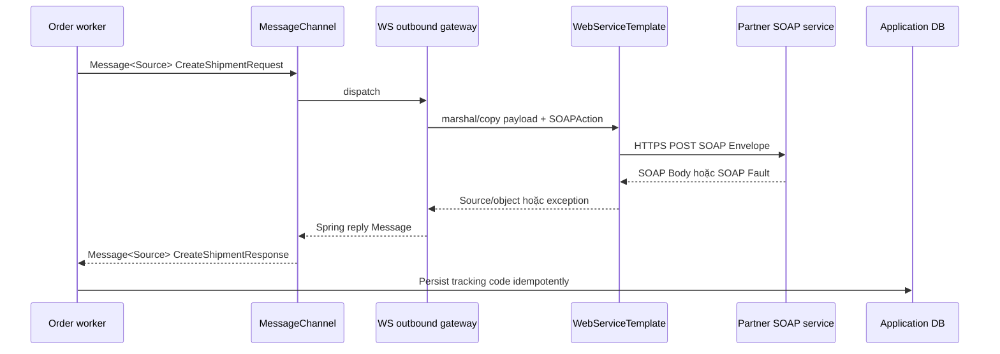
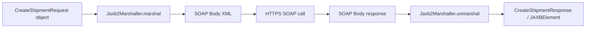
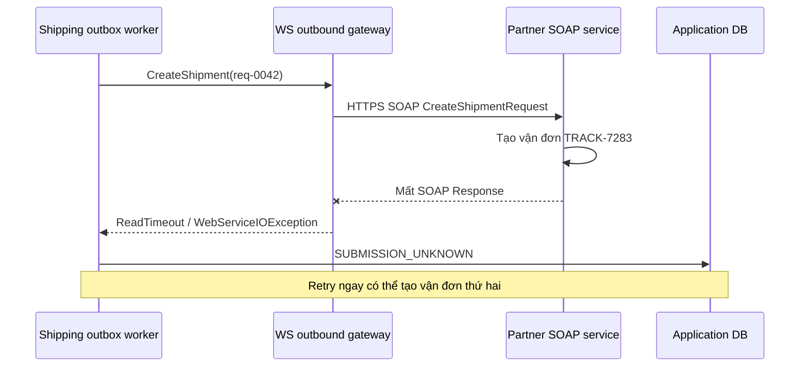
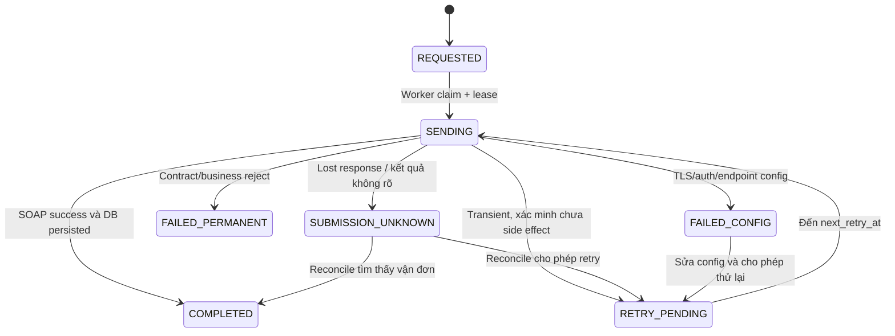

# Web service outbound gateway

## 1. Bài toán: gọi SOAP của đối tác từ một integration flow

Ứng dụng Spring Boot quản lý đơn hàng cần gửi yêu cầu tạo vận đơn sang hệ thống logistics cũ chỉ cung cấp **SOAP 1.1**. Bên trong ứng dụng, sự kiện `ORDER_READY` đã được kiểm tra, lưu vào database và chuyển vào luồng xử lý. Hệ thống phải dựng `CreateShipmentRequest` đúng XML Schema, gọi HTTPS endpoint, đọc `CreateShipmentResponse`, lưu mã vận đơn và xử lý trường hợp SOAP Fault, timeout hoặc phản hồi mất sau khi phía đối tác **đã tạo vận đơn**.

**Web service outbound gateway** của Spring Integration giúp biến lời gọi SOAP thành một bước **request–reply** trong `IntegrationFlow`:

- **Đầu vào:** Spring `Message<?>` chứa XML `String`/`Source` hoặc object cần marshal.
- **Xử lý:** gateway dùng Spring Web Services (Spring-WS) để gửi SOAP qua transport, nhận response, áp header mapper và xử lý SOAP Fault.
- **Đầu ra:** một Spring reply message chứa payload phản hồi, được chuyển tiếp tới transformer/handler hoặc reply channel.

Bài thuộc chương **Adapter Web Services** của module `SPRING_INTEGRATION_ADAPTERS`: kết nối hệ thống ngoài qua inbound/outbound adapter, gateway, poller và `MessageChannel`; thực hành hợp đồng message, lỗi và vòng đời kết nối với file, SFTP, HTTP, JMS, AMQP, Kafka và database. SOAP outbound gateway là ví dụ về **điểm gọi hệ thống bên ngoài có thể gây side effect**, nơi phải phân biệt timeout, kết quả nghiệp vụ và trách nhiệm retry.

### Mục tiêu học tập

1. Phân biệt **outbound gateway**, **outbound channel adapter**, **inbound gateway**, `WebServiceTemplate` và HTTP outbound gateway.
2. Sử dụng `SimpleWebServiceOutboundGateway` với payload XML và `MarshallingWebServiceOutboundGateway` với `Marshaller`/`Unmarshaller`.
3. Cấu hình `Ws.simpleOutboundGateway(...)` và `Ws.marshallingOutboundGateway(...)` trong Java DSL, biết cách gửi message qua channel và nhận reply.
4. Thiết kế request/response theo XSD/WSDL, SOAP 1.1/1.2, SOAPAction, SOAP headers, mã hóa URI và MTOM.
5. Thiết lập HTTPS, authentication, WS-Security, connect/read timeout, chặn SSRF và bảo vệ XML parser.
6. Phân loại SOAP Fault, response rỗng, network timeout, lỗi mapping, retry/idempotency và quan sát trạng thái remote side effect.
7. Kiểm thử SOAP outbound bằng `MockWebServiceServer` và kiểm thử HTTPS end-to-end trong sandbox.

> **Phiên bản mẫu:** Spring Integration **6.5.x**, Spring Web Services **4.0.x**, Spring Framework **6.x**, Spring Boot với BOM tương thích, Java 17+. XML `Source` thuộc **`javax.xml.transform.Source`** (JAXP vẫn dùng package `javax`); JAXB trong Jakarta stack có thể dùng `jakarta.xml.bind.*`. Tên miền `example.test`, XML namespace và operation trong bài đều là ví dụ giả lập.

## 2. Ranh giới kiến trúc: request–reply trong luồng Spring Integration



Có **hai lớp message**:

- `org.springframework.messaging.Message<?>` của Spring Integration: payload và `MessageHeaders`, dùng để nối các adapter/router/transformer/service activator.
- `org.springframework.ws.WebServiceMessage` của Spring-WS: SOAP Envelope, Header, Body, attachment và transport metadata, được tạo/đọc bởi `WebServiceTemplate`.

Gateway chuyển đổi giữa hai lớp. Khi gọi HTTPS, Spring-WS đặt **XML payload vào SOAP Body**; ứng dụng gửi `<CreateShipmentRequest>` theo contract, **không** phải tự bọc nguyên `Envelope` vào payload mặc định.

| Thành phần | Vai trò | Điều **không** bảo đảm |
| --- | --- | --- |
| `MessageChannel` | Đưa request tới outbound gateway | Lời gọi phía đối tác đã hoàn tất chỉ vì `send()` trả true trong async channel |
| `SimpleWebServiceOutboundGateway` | Chuyển `String`/`Source` thành SOAP request, trích response | Unmarshal thành domain POJO |
| `MarshallingWebServiceOutboundGateway` | Dùng `Marshaller` và `Unmarshaller` cho request/response | Business authz, schema validation đầy đủ nếu chưa cấu hình |
| `WebServiceTemplate` | Client Spring-WS phụ trách message factory, transport, interceptors, fault handling | Distributed transaction hoặc exactly-once |
| `WebServiceMessageSender` | Mở HTTP/HTTPS hoặc transport được hỗ trợ | Retry an toàn khi request đã được server xử lý |
| `ClientInterceptor` | Quan sát/chỉnh/kiểm tra WS request/response | Tự xác thực tenant, chống replay nếu policy chưa có |
| Handler sau gateway | Chuyển response thành kết quả nghiệp vụ, ghi DB | Tự biết kết quả khi partner timeout sau commit |

**Không cần poller để gọi SOAP theo một message đã có.** Poller có thể kích hoạt worker đọc DB outbox hoặc queue, nhưng outbound gateway được **message-driven**: khi nhận request trên channel, nó gọi dịch vụ rồi tạo reply.

## 3. Phân biệt outbound gateway với các adapter lân cận

| Tích hợp | Hướng và hợp đồng | Ví dụ |
| --- | --- | --- |
| **WS outbound gateway** | Ứng dụng **gọi** SOAP từ Spring Message, chờ reply hoặc fault | Tạo vận đơn ở đối tác |
| WS inbound gateway | Đối tác **gọi vào** SOAP service của ứng dụng, chờ reply | Đối tác gửi đơn vào hệ thống |
| HTTP outbound gateway | Gọi HTTP/REST qua HTTP message conversion | JSON API thanh toán |
| HTTP outbound channel adapter | Gọi HTTP nhưng không phát reply message vào flow | Thông báo không cần body reply |
| SOAP client thuần `WebServiceTemplate` | Service Java gọi trực tiếp Spring-WS API | Một service nhỏ không cần message flow |
| JMS/AMQP/Kafka outbound | Gửi message đến broker | Durable async business job |

WS outbound gateway thường **đồng bộ tại điểm gọi transport**. Việc thêm `ExecutorChannel` trước gateway có thể tách khỏi thread tạo message, nhưng **không biến SOAP thành giao thức bất đồng bộ**: một worker thread vẫn đợi partner response/timeout. Nếu dùng queue/broker phía trước, phải xác định job claim, replay, idempotency và khi nào được ACK message.

## 4. Hai gateway chính: simple và marshalling

Tài liệu Spring Integration 6.5 mô tả hai lựa chọn:

| Tiêu chí | `SimpleWebServiceOutboundGateway` | `MarshallingWebServiceOutboundGateway` |
| --- | --- | --- |
| Payload request | `String` hoặc `javax.xml.transform.Source` | Java object được `Marshaller` hỗ trợ |
| Payload reply | XML `Source`/`String` theo extraction contract | Java object được `Unmarshaller` tạo |
| Trường hợp phù hợp | XML có sẵn, XSLT, ESB, legacy partner đặc biệt | JAXB/XSD-generated classes, DTO theo WSDL |
| Thành phần bổ sung | XML validation/transformers nếu cần | `Jaxb2Marshaller` + JAXB runtime/binding |
| Rủi ro chính | XML không hợp XSD, nhầm Body với Envelope, parser không an toàn | Namespace/JAXB `JAXBElement`/schema/type mismatch |
| Attachment | `WebServiceMessage`/`MimeMessage` khi cần | MTOM qua marshaller hỗ trợ |

Khởi tạo bằng Java API (chỉ minh họa):

```java
DestinationProvider partnerDestination = ...; // Spring-WS bean.

SimpleWebServiceOutboundGateway xmlGateway =
        new SimpleWebServiceOutboundGateway(partnerDestination);

MarshallingWebServiceOutboundGateway objectGateway =
        new MarshallingWebServiceOutboundGateway(
                partnerDestination, orderMarshaller);
```

Ở Spring Integration **6.5**, ngoài `DestinationProvider` có thể dùng **fixed URI** thông qua namespace/DSL hoặc cung cấp một `WebServiceTemplate` bên ngoài để cấu hình transport và fault policy. `DestinationProvider` phù hợp endpoint lookup động theo registry quản lý; **không** nhận URL tùy ý từ request HTTP hoặc SOAP body rồi gửi trực tiếp.

## 5. Hợp đồng SOAP 1.1 và thứ cần đưa vào payload

Ví dụ đối tác định nghĩa QName `{urn:demo:logistics:v1}CreateShipmentRequest`. Message SOAP 1.1 hoàn chỉnh trên wire:

```http
POST /ws/shipping HTTP/1.1
Host: logistics.example.test
Content-Type: text/xml; charset=utf-8
SOAPAction: "urn:demo:logistics:v1/CreateShipment"

<?xml version="1.0" encoding="UTF-8"?>
<soapenv:Envelope xmlns:soapenv="http://schemas.xmlsoap.org/soap/envelope/"
                  xmlns:ship="urn:demo:logistics:v1">
  <soapenv:Header/>
  <soapenv:Body>
    <ship:CreateShipmentRequest>
      <ship:clientRequestId>req-0042</ship:clientRequestId>
      <ship:orderId>O-9001</ship:orderId>
    </ship:CreateShipmentRequest>
  </soapenv:Body>
</soapenv:Envelope>
```

Với **simple outbound gateway mặc định**, gửi payload chỉ gồm phần tử:

```xml
<ship:CreateShipmentRequest xmlns:ship="urn:demo:logistics:v1">
  <ship:clientRequestId>req-0042</ship:clientRequestId>
  <ship:orderId>O-9001</ship:orderId>
</ship:CreateShipmentRequest>
```

Spring-WS dựng SOAP Envelope và Header, và chèn XML đó vào SOAP Body. Phản hồi hợp lệ dự kiến:

```xml
<ship:CreateShipmentResponse xmlns:ship="urn:demo:logistics:v1">
  <ship:clientRequestId>req-0042</ship:clientRequestId>
  <ship:trackingNumber>TRACK-7283</ship:trackingNumber>
  <ship:status>CREATED</ship:status>
</ship:CreateShipmentResponse>
```

**Không bỏ namespace** chỉ vì tên phần tử có vẻ đúng. `{urn:demo:logistics:v1}CreateShipmentResponse` khác cùng local name ở namespace v2 hoặc namespace do kẻ khác khai báo.

Với SOAP 1.2, envelope namespace, HTTP Content-Type (`application/soap+xml`) và cơ chế action khác SOAP 1.1. Cần chọn `WebServiceMessageFactory`/SOAP version phù hợp WSDL của đối tác, không trộn request 1.1 với endpoint 1.2.

## 6. Dependency và endpoint configuration

Với Spring Boot quản lý phiên bản Spring Integration tương thích:

```groovy
dependencies {
    implementation 'org.springframework.boot:spring-boot-starter-integration'
    implementation 'org.springframework.integration:spring-integration-ws'
    implementation 'org.springframework.boot:spring-boot-starter-web-services'
    testImplementation 'org.springframework.boot:spring-boot-starter-test'
    testImplementation 'org.springframework.ws:spring-ws-test'
}
```

`spring-integration-ws` chứa gateway/WS DSL, Spring-WS cung cấp `WebServiceTemplate` và `MessageSender`. Ứng dụng **chỉ làm outbound SOAP client** không nhất thiết phải đăng ký `MessageDispatcherServlet`, `EndpointMapping` hoặc mở đường dẫn `/ws` — đó là thành phần phục vụ **inbound web service**.

```yaml
app:
  logistics:
    soap-endpoint: ${LOGISTICS_SOAP_ENDPOINT:https://logistics.example.test/ws/shipping}
    soap-action: "urn:demo:logistics:v1/CreateShipment"
    connect-timeout-ms: 5000
    read-timeout-ms: 20000
```

URL phải được cấp từ **cấu hình đáng tin**, secret manager/config registry đã kiểm soát, không nhận từ trường tùy ý của client. TLS ở production phải xác minh certificate chain, hostname và quyền truy cập tương ứng; không chuyển về HTTP hay trust-all khi provider handshake lỗi.

## 7. WebServiceTemplate: transport HTTPS và timeout

Spring-WS `WebServiceTemplate` quản lý message factory, message sender, interceptors, resolver và XML mapping. Với HTTP/HTTPS cơ bản, `HttpUrlConnectionMessageSender` trong Spring-WS 4.0 nhận timeout kiểu `java.time.Duration`:

```java
import java.time.Duration;

import org.springframework.beans.factory.annotation.Value;
import org.springframework.context.annotation.Bean;
import org.springframework.context.annotation.Configuration;
import org.springframework.ws.client.core.WebServiceTemplate;
import org.springframework.ws.transport.http.HttpUrlConnectionMessageSender;

@Configuration
public class PartnerSoapTransportConfig {

    @Bean
    public WebServiceTemplate partnerSoapTemplate(
            @Value("${app.logistics.connect-timeout-ms:5000}") long connectMs,
            @Value("${app.logistics.read-timeout-ms:20000}") long readMs) {

        HttpUrlConnectionMessageSender sender =
                new HttpUrlConnectionMessageSender();
        sender.setConnectionTimeout(Duration.ofMillis(connectMs));
        sender.setReadTimeout(Duration.ofMillis(readMs));

        WebServiceTemplate template = new WebServiceTemplate();
        template.setMessageSender(sender);
        // Theo mặc định, Spring-WS sử dụng fault resolver;
        // không tắt fault detection chỉ để biến SOAP Fault thành success.
        return template;
    }
}
```

**Hai timeout ở đây là giới hạn socket**, không phải toàn bộ business deadline. Một lời gọi gồm DNS, TCP, TLS, ghi SOAP request, đợi response, parse XML và handler DB tiếp theo. Cần thêm overall job budget/monitoring và giới hạn concurrency theo provider; khi socket timeout, **không suy ra đối tác chưa tạo vận đơn**.

Khi cần connection pooling, proxy hoặc client certificate/mTLS, có thể cấu hình `HttpComponents5MessageSender` và Apache HttpClient 5 phù hợp phiên bản Spring-WS. Khi tự cung cấp `HttpClient`, phải cấu hình timeout, pooling, TLS, auth và resource lifecycle trên chính client; **không giả định setter mặc định của sender sẽ override custom client**.

## 8. Java DSL: simple outbound gateway với reply

Flow ví dụ dùng một `DirectChannel` để nhận `Source` XML và gửi SOAP request tới endpoint tĩnh đã kiểm soát. Gateway **trả reply message** khi phía đối tác phản hồi có payload.

```java
import org.springframework.beans.factory.annotation.Qualifier;
import org.springframework.beans.factory.annotation.Value;
import org.springframework.context.annotation.Bean;
import org.springframework.context.annotation.Configuration;
import org.springframework.integration.channel.DirectChannel;
import org.springframework.integration.dsl.IntegrationFlow;
import org.springframework.integration.ws.dsl.Ws;
import org.springframework.messaging.MessageChannel;
import org.springframework.ws.client.core.WebServiceTemplate;

@Configuration
public class PartnerSoapOutboundFlow {

    @Bean
    public MessageChannel partnerSoapRequests() {
        return new DirectChannel();
    }

    @Bean
    public IntegrationFlow partnerSoapFlow(
            @Qualifier("partnerSoapRequests") MessageChannel requests,
            @Qualifier("partnerSoapTemplate") WebServiceTemplate template,
            @Value("${app.logistics.soap-endpoint}") String endpointUri) {

        return IntegrationFlow.from(requests)
                .handle(Ws.simpleOutboundGateway(template)
                        .uri(endpointUri))
                .get();
    }
}
```

Đây là **outbound handler** đặt giữa integration graph: `.handle(...)` nhận Spring Message, gửi SOAP, trả response. Lớp client cần quyết định request correlation, message payload và reply contract. `Ws.simpleOutboundGateway(template)` là DSL xây gateway dùng **external WebServiceTemplate** đã có transport timeout. Nếu không cần template ngoài, có thể dùng `Ws.simpleOutboundGateway().uri(endpointUri).messageSenders(sender)` với các setter có sẵn trên no-template spec, nhưng **không trộn cả hai kiểu cấu hình** rồi mặc định mọi property đều được áp.

## 9. Gửi request qua MessageChannel và nhận response

`MessagingTemplate` cho phép gửi một Spring Message tới outbound gateway và chờ reply từ flow. Ví dụ này khởi tạo `Source` payload, đặt SOAPAction header và đọc reply như một Spring message; nó không cần dựng SOAP Envelope bằng tay.

```java
import javax.xml.transform.Source;

import org.springframework.beans.factory.annotation.Qualifier;
import org.springframework.integration.core.MessagingTemplate;
import org.springframework.integration.ws.WebServiceHeaders;
import org.springframework.messaging.Message;
import org.springframework.messaging.MessageChannel;
import org.springframework.messaging.support.MessageBuilder;
import org.springframework.stereotype.Service;
import org.springframework.xml.transform.StringSource;

@Service
public class PartnerSoapCaller {

    private final MessageChannel channel;

    public PartnerSoapCaller(
            @Qualifier("partnerSoapRequests") MessageChannel channel) {
        this.channel = channel;
    }

    public Message<?> createShipment(String requestId, String orderId) {
        // Minh họa body XML cho các ID do ứng dụng tin cậy quản lý.
        // Production phải dựng bằng JAXB/builder hoặc XML escaping an toàn.
        String payloadXml = """
                <ship:CreateShipmentRequest
                    xmlns:ship="urn:demo:logistics:v1">
                  <ship:clientRequestId>req-0042</ship:clientRequestId>
                  <ship:orderId>O-9001</ship:orderId>
                </ship:CreateShipmentRequest>
                """;

        Source xml = new StringSource(payloadXml);
        Message<Source> request = MessageBuilder.withPayload(xml)
                .setHeader(WebServiceHeaders.SOAP_ACTION,
                        "urn:demo:logistics:v1/CreateShipment")
                .setHeader("businessRequestId", requestId)
                .build();

        MessagingTemplate messaging = new MessagingTemplate();
        messaging.setReceiveTimeout(25_000);
        Message<?> reply = messaging.sendAndReceive(channel, request);
        if (reply == null) {
            throw new IllegalStateException(
                    "SOAP không trả reply trong thời hạn cho phép");
        }
        return reply;
    }
}
```

Đoạn demo **cố ý chứa giá trị XML cố định** để minh họa wiring; tham số `requestId`/`orderId` thực tế phải được serialize/escape an toàn và ràng buộc với business ledger. Không nối chuỗi XML từ input không tin cậy vì có thể tạo XML injection hoặc body không hợp schema. `MessagingTemplate` có reply timeout ở tầng messaging, **không hủy side effect HTTP/SOAP đã thực hiện** nếu response về muộn. Bước kế tiếp phải parse/validate response và **commit mapping trackingNumber** sau khi kiểm tra đúng `requestId`/tenant.

### Kết quả reply là kiểu gì?

`SimpleWebServiceOutboundGateway` xử lý `String` hoặc `Source`; với XML payload tùy cấu hình `sourceExtractor`/`extractPayload` và loại request, response có thể là `Source` hoặc biểu diễn text tương ứng. Đặt **payload contract rõ ràng** cho downstream transformer: kiểm tra type, namespace, giới hạn kích thước và schema, không gọi `reply.toString()` rồi giả định đó là SOAP body XML.

## 10. SOAPAction và SOAP headers: mapping hai chiều

Spring Integration định nghĩa `WebServiceHeaders.SOAP_ACTION` (key `ws_soapAction`). `DefaultSoapHeaderMapper` tự ánh xạ **SOAPAction tiêu chuẩn** từ Spring `MessageHeaders` sang SOAP request và từ SOAP reply sang Spring reply headers. Các **SOAP header tùy biến** không tự động được gửi/nhận nếu chưa cấu hình tên header cần map.

```java
import org.springframework.integration.ws.WebServiceHeaders;
import org.springframework.messaging.Message;
import org.springframework.messaging.support.MessageBuilder;

Message<String> request = MessageBuilder
        .withPayload("""
            <ship:GetShipmentRequest xmlns:ship="urn:demo:logistics:v1">
              <ship:trackingNumber>TRACK-7283</ship:trackingNumber>
            </ship:GetShipmentRequest>
            """)
        .setHeader(WebServiceHeaders.SOAP_ACTION,
                "urn:demo:logistics:v1/GetShipment")
        .build();
```

Đây là **body XML**; gateway và `WebServiceTemplate` lo SOAP Envelope. Với SOAP 1.1, action có thể biểu hiện qua HTTP header `SOAPAction`; với SOAP 1.2, action thường gắn vào media type. Hãy dùng đúng WSDL binding/policy của partner, không tự nối header HTTP thủ công để tạo một “action” khác với Spring-WS.

### Mapping custom SOAP header có kiểm soát

Giả sử đối tác cần phần tử `<partner:CorrelationId>` trong SOAP Header. Spring Integration có `DefaultSoapHeaderMapper`:

```java
import org.springframework.context.annotation.Bean;
import org.springframework.integration.ws.DefaultSoapHeaderMapper;
import org.springframework.integration.ws.WebServiceHeaders;

@Bean
public DefaultSoapHeaderMapper partnerSoapHeaderMapper() {
    DefaultSoapHeaderMapper mapper = new DefaultSoapHeaderMapper();
    mapper.setRequestHeaderNames(
            WebServiceHeaders.SOAP_ACTION, "CorrelationId");
    mapper.setReplyHeaderNames(
            WebServiceHeaders.SOAP_ACTION, "CorrelationId");
    return mapper;
}
```

`CorrelationId` ở đây là **tên header mapping giả lập**, cần khớp QName/namespace và cấu hình thực tế. Spring Integration 6.5 cho phép custom `Source` trong Spring message headers được đưa thành child element của SOAP Header. Khi sử dụng:

```java
import org.springframework.xml.transform.StringSource;
import org.springframework.messaging.support.MessageBuilder;

StringSource correlation = new StringSource("""
        <partner:CorrelationId xmlns:partner="urn:demo:partner:headers">
          req-0042
        </partner:CorrelationId>
        """);

var request = MessageBuilder.withPayload("<ship:.../>")
        .setHeader("CorrelationId", correlation)
        .build();
```

`<ship:.../>` chỉ là **placeholder**, không phải XML đúng schema; dùng payload hợp lệ theo mục 5. Lúc tạo flow, gắn `.headerMapper(partnerSoapHeaderMapper)` vào spec tương ứng. **Không map mọi non-standard header bằng `*`** để “cho tiện”: có thể vô tình mang nội bộ tenant ID, OAuth token, stack trace hoặc Spring reply/error channel ra ngoài SOAP envelope.

### Header có phải bằng chứng quyền truy cập không?

**Không.** SOAPAction, CorrelationId, `From` hoặc `ClientId` do message producer đặt không tự chứng minh được danh tính đối tác. Quyền gọi operation dựa vào TLS/mTLS, OAuth/token hoặc WS-Security đã được xác thực, sau đó là business authorization. Nếu message đi qua nhiều router, hãy xác định header nào do thành phần tin cậy thiết lập và header nào đến từ request bên ngoài.

## 11. Response headers và `extractPayload(false)`

Theo mặc định, simple outbound gateway trích **SOAP body payload** từ `WebServiceMessage` response thành Spring payload. Khi cần truy cập **toàn bộ** SOAP message (SOAP Header, attachment, metadata), có thể đặt `.extractPayload(false)` ở `Ws.simpleOutboundGateway(...)`. Khi đó, payload sẽ là một dạng `WebServiceMessage` thay vì `String`/`Source` body.

| Cấu hình | Đầu ra | Khi dùng |
| --- | --- | --- |
| Default `extractPayload(true)` | XML body payload (`String`/`Source` theo contract) | Business transformer chỉ cần response element |
| `extractPayload(false)` | `WebServiceMessage` response đầy đủ | Cần đọc SOAP Header hoặc MIME attachment đặc biệt |
| `headerMapper(...)` | Mapping các SOAP headers cho phép sang Spring headers | Correlation, trace, contract metadata |
| `sourceExtractor(...)` | Custom xử lý `Source` response | Đọc XML theo kiểu riêng, giới hạn và validation |

**Lifecycle cảnh báo:** `WebServiceMessage` và attachment stream có thể gắn với transport/request context. Nếu phải gửi nội dung sang Kafka/JMS/queue hoặc xử lý bất đồng bộ, hãy **materialize dữ liệu cần thiết** trong thời gian response còn hợp lệ rồi lưu durable reference. Không serialize nguyên WebServiceMessage hoặc giữ stream qua thread khác rồi kỳ vọng nó luôn đọc được.

## 12. Marshalling outbound gateway: JAXB object → SOAP XML → JAXB object

Khi đối tác công bố XSD/WSDL, code generator có thể tạo Java classes trong package `com.example.partner.shipping.v1`. Spring OXM `Jaxb2Marshaller` hỗ trợ marshal request object thành XML và unmarshal response XML thành object. Phương án này dễ đưa vào domain service hơn raw XML, nhưng phải kiểm thử chính xác QName và schema.



### JAXB marshaller với classes do XSD tạo

```java
import org.springframework.context.annotation.Bean;
import org.springframework.context.annotation.Configuration;
import org.springframework.oxm.jaxb.Jaxb2Marshaller;

@Configuration
public class PartnerSoapBindingConfiguration {

    @Bean
    public Jaxb2Marshaller partnerOrderMarshaller() {
        Jaxb2Marshaller marshaller = new Jaxb2Marshaller();
        marshaller.setContextPath("com.example.partner.shipping.v1");
        // Chỉ dùng JAXB binding classes sinh từ XSD đáng tin cậy.
        // XSD validation và chính sách an toàn XML cần cấu hình/test.
        return marshaller;
    }
}
```

`com.example.partner.shipping.v1` là **package giả lập**; nó phải có generated JAXB classes/ObjectFactory từ XSD trong dự án. Với các bản Spring Boot/Jakarta hiện đại, cần JAXB runtime tương thích nếu BOM chưa mang đủ; không thêm `javax.xml.bind` runtime cũ vào ứng dụng Jakarta. Một phần tử root có thể được đại diện bởi `JAXBElement<CreateShipmentRequest>`, không phải instance raw `CreateShipmentRequest`; phụ thuộc annotation và cách sinh code.

### Java DSL dùng `Ws.marshallingOutboundGateway()`

```java
import org.springframework.beans.factory.annotation.Qualifier;
import org.springframework.beans.factory.annotation.Value;
import org.springframework.context.annotation.Bean;
import org.springframework.context.annotation.Configuration;
import org.springframework.integration.dsl.IntegrationFlow;
import org.springframework.integration.ws.dsl.Ws;
import org.springframework.oxm.jaxb.Jaxb2Marshaller;
import org.springframework.ws.transport.http.HttpUrlConnectionMessageSender;

@Configuration
public class PartnerMarshallingOutboundFlow {

    @Bean
    public IntegrationFlow marshallingPartnerSoapFlow(
            @Qualifier("partnerOrderMarshaller") Jaxb2Marshaller marshaller,
            @Value("${app.logistics.soap-endpoint}") String endpointUri) {

        HttpUrlConnectionMessageSender sender =
                new HttpUrlConnectionMessageSender();
        sender.setConnectionTimeout(java.time.Duration.ofSeconds(5));
        sender.setReadTimeout(java.time.Duration.ofSeconds(20));

        return IntegrationFlow.from("partnerSoapObjectRequests")
                .handle(Ws.marshallingOutboundGateway()
                        .uri(endpointUri)
                        .marshaller(marshaller)
                        .unmarshaller(marshaller)
                        .messageSenders(sender))
                .get();
    }
}
```

Flow này là **phương án thay thế** cho simple gateway ở mục 8; nó đọc từ channel `partnerSoapObjectRequests` với payload là JAXB object, thay vì `Source` XML. `.marshaller(...)` và `.unmarshaller(...)` trên **no-template spec** tương ứng Spring Integration 6.5. Khi dùng external `WebServiceTemplate`, các thành phần marshalling/fault/message-factory thường cần cấu hình trực tiếp trên template; không suy mọi setter của no-template spec còn có cùng semantics.

**Đừng gắn hai gateway lên cùng một channel rồi tưởng framework tự chọn theo payload type.** Nếu cần hỗ trợ cả legacy XML và JAXB objects, dùng router tường minh theo business contract, hoặc chuyển về một DTO/request type thống nhất trước khi gọi partner.

### Test response type và XSD

Unmarshal không mặc định chứng minh:

- Response có đúng namespace/element đã công bố trong WSDL.
- `status=CREATED` tương ứng một mã vận đơn hợp lệ; trường có thể null/blank.
- Response không thuộc một version schema khác nhưng được object mapper bỏ qua.
- Bản ghi response là của `clientRequestId` hiện tại (ngăn response mix-up).

Cần XSD/contract validation, giới hạn XML size và business validation trước khi ghi tracking number vào DB. Không persist “một POJO đã được parse” như bằng chứng duy nhất đối tác đã tạo vận đơn.

## 13. URI tĩnh, DestinationProvider và dynamic URI an toàn

Spring Integration WS outbound hỗ trợ URI tĩnh/templated và `DestinationProvider`. Chọn **một** kiểu điều phối endpoint:

| Cách cấu hình | Ví dụ | Khi dùng |
| --- | --- | --- |
| Fixed URI | `.uri("https://logistics.example.test/ws/shipping")` | Một partner endpoint ổn định |
| URI template | `https://services.example.test/{region}/shipping` | Region là giá trị từ allowlist |
| `DestinationProvider` | Lookup endpoint trong registry được tin cậy | Partner endpoint thay đổi qua config/registry |
| External `WebServiceTemplate` | Cấu hình transport/interceptors/fault riêng | TLS/mTLS/auth/timeout phức tạp |

### URI variables và encoding mode

Trong Java DSL, `uriVariableExpressions(...)` có thể tạo biến dựa trên message. Các mode `DefaultUriBuilderFactory.EncodingMode` xác định cách encode. Mặc định của Spring Integration WS là `TEMPLATE_AND_VALUES`; cần biết khi URL đã có các ký tự được encode trước để tránh double encoding. Nếu dùng `DestinationProvider`, Spring Integration **không hỗ trợ kết hợp URI variable substitution** và bỏ qua encoding mode liên quan destination provider.

**Ví dụ ý tưởng:**

```text
Trusted base: https://logistics.example.test
URI template: /ws/{region}/shipping
Allowed region values: vn, sg, th
Resolved: https://logistics.example.test/ws/vn/shipping
```

Không đưa `headers.callbackUrl` hoặc `payload.targetUri` do caller gửi vào `uri(...)` mà không validate. Đó là **SSRF**: attacker có thể khiến ứng dụng gọi metadata endpoint/cloud token service, IP loopback hoặc nội bộ. Cần:

1. Allowlist host/scheme/port **và đối chiếu DNS/IP đích thực**, chặn private/link-local/loopback nếu policy không cho phép.
2. Không để user input thay đổi scheme/host hoặc path vượt khỏi namespace đã định.
3. Kiểm soát redirect, DNS rebinding, egress proxy, certificate hostname verification và mTLS identity.
4. Giới hạn size/timeout/concurrency cho mọi endpoint được registry cho phép.
5. Không coi URI encoding là **biện pháp xác thực** hay bảo vệ SSRF.

Một `DestinationProvider` trả URL từ service registry vẫn phải tuân theo trust boundary: metadata registry có thể stale/compromised; cần quản trị và kiểm soát truy cập.

## 14. SOAP Fault, HTTP lỗi và `WebServiceTemplate`

SOAP Fault là **phản hồi theo giao thức SOAP** mô tả lỗi client/server; một HTTP 500 với SOAP Fault không giống HTTP 500 do reverse proxy trả HTML. `WebServiceTemplate` thường phát hiện lỗi transport/fault và dùng `FaultMessageResolver`, ví dụ mặc định có thể ném `SoapFaultClientException` khi đọc SOAP Fault.

```xml
<soapenv:Envelope xmlns:soapenv="http://schemas.xmlsoap.org/soap/envelope/">
  <soapenv:Body>
    <soapenv:Fault>
      <faultcode>soapenv:Client</faultcode>
      <faultstring>Invalid shipment request</faultstring>
      <detail>
        <err:code xmlns:err="urn:demo:errors:v1">INVALID_CUSTOMER</err:code>
      </detail>
    </soapenv:Fault>
  </soapenv:Body>
</soapenv:Envelope>
```

| Kết quả phía đối tác | Có thể xuất hiện | Cách xử lý |
| --- | --- | --- |
| SOAP Body success, HTTP success | Payload `CreateShipmentResponse` | Validate XSD, requestId, nghiệp vụ rồi commit |
| SOAP Fault kiểu client/sender | `SoapFaultClientException` hoặc fault resolver khác | Xem fault code/details theo contract, không retry vô hạn |
| SOAP Fault kiểu server/receiver | Fault hoặc error theo partner | Phân loại transient/permanent theo mã **có hợp đồng**, không chỉ chữ “Server” |
| HTTP 401/403 | Transport authentication/authorization | Refresh/rotate credential đúng policy, cảnh báo |
| HTTP 429/503 | Rate limit/outage | Backoff, jitter, quota, nhưng xem side effect có thể đã xảy ra |
| HTTP 500 với HTML | Reverse proxy/transport error | Không parse HTML như SOAP Fault |
| Socket read timeout sau gửi | Partner **có thể đã xử lý request** | UNKNOWN + reconciliation; không retry mù |
| HTTP 200 với SOAP Fault từ provider không chuẩn | Fault nằm trong SOAP body | Điều chỉnh `checkConnectionForFault` nếu cần, test nghiêm ngặt |

### `checkConnectionForFault` dùng khi nào?

`WebServiceTemplate` có property `checkConnectionForFault` để phù hợp dịch vụ SOAP có hành vi HTTP status không chuẩn. Đổi nó **không** biến mọi lỗi thành thành công; phải bảo đảm resolver vẫn kiểm tra SOAP Fault và trả trạng thái nghiệp vụ đúng. Chỉ điều chỉnh theo **contract của partner và integration tests**, không đặt `false` để nuốt exception.

**Đừng parse `SoapFaultClientException.getMessage()` bằng một regex tuỳ tiện để quyết định retry.** Dùng fault code/subcode/details đã tài liệu hóa, map sang error category có kiểm soát; không trả nguyên faultstring về API công khai nếu nó chứa PII, stack trace hoặc thông tin hệ thống.

## 15. Response rỗng và `ignoreEmptyResponses`

Đây là góc cạnh dễ bỏ sót. Spring Integration WS outbound mặc định **không tạo Spring reply message** cho một SOAP response không có payload thích hợp. Theo reference 6.5:

- Với request payload là **`String`**, nếu dịch vụ trả response rỗng thì mặc định `ignoreEmptyResponses=true` làm gateway **không phát reply**.
- Nếu cần message biểu diễn response rỗng, đặt `ignoreEmptyResponses(false)`; hành vi này được tài liệu mô tả **chỉ áp dụng cho request kiểu `String`**.
- Nếu request payload là `Source` hoặc `Document` và response trống, source extractor có thể trả `null`, nên **không tạo reply message** ngay cả khi muốn tắt ignore.

```java
// Trích đoạn Java DSL, giả sử đã có endpointUri và template bean:
.handle(Ws.simpleOutboundGateway(template)
        .uri(endpointUri)
        .ignoreEmptyResponses(false))
```

Đoạn chỉ là fragment của `IntegrationFlow`, không phải biểu thức Java độc lập. **Đừng để caller `sendAndReceive()` chờ 30 giây rồi tự coi đó là thất bại** nếu WSDL quy định operation one-way/void. Một operation “chỉ ACK HTTP” cần message contract khác: ghi nhận transport acceptance, xử lý không có reply đúng thiết kế và không suy business success khi chưa có confirmation khác.

## 16. MTOM và SOAP attachments

Một số partner gửi/nhận ảnh chứng từ, PDF và file nhị phân kèm SOAP. Có hai hướng:

| Cơ chế | Payload | Lưu ý |
| --- | --- | --- |
| JAXB MTOM | `@XmlMimeType`/`DataHandler` trong generated classes | `Jaxb2Marshaller.setMtomEnabled(true)`, cần XSD/WSDL hỗ trợ |
| Simple gateway với `MimeMessage` | `WebServiceMessage` + attachments | Tự tạo message factory, attachment IDs/media type |
| Nhúng Base64 trong XML | `xsd:base64Binary` | Dễ phình dung lượng, giới hạn memory |

Spring Integration 6.5 hỗ trợ attachments qua marshaller (ví dụ JAXB MTOM) và với simple gateway có thể truyền một `org.springframework.ws.mime.MimeMessage`. Ví dụ **minh họa** Spring-WS message factory:

```java
import jakarta.xml.soap.MessageFactory;
import javax.xml.transform.Transformer;
import javax.xml.transform.TransformerFactory;

import org.springframework.core.io.ByteArrayResource;
import org.springframework.ws.mime.MimeMessage;
import org.springframework.ws.soap.saaj.SaajSoapMessageFactory;
import org.springframework.xml.transform.StringSource;

SaajSoapMessageFactory factory =
        new SaajSoapMessageFactory(MessageFactory.newInstance());
factory.afterPropertiesSet();

MimeMessage soap = (MimeMessage) factory.createWebServiceMessage();
StringSource body = new StringSource("""
    <doc:UploadDocumentRequest xmlns:doc="urn:demo:documents:v1">
      <doc:requestId>req-0042</doc:requestId>
    </doc:UploadDocumentRequest>
    """);

Transformer transformer = TransformerFactory.newInstance().newTransformer();
transformer.transform(body, soap.getPayloadResult());

byte[] safePdfBytes = ...; // Đã validate size và MIME trước đó.
soap.addAttachment("invoicePdf",
        new ByteArrayResource(safePdfBytes), "application/pdf");
// Gửi soap dưới dạng payload qua simple WS outbound gateway.
```

Đoạn là **trích đoạn**; biến `safePdfBytes` chưa có implementation và `TransformerFactory` mới tạo cần được harden theo JAXP security policy của môi trường. Với file lớn, tránh nạp toàn bộ vào heap: dùng storage/stream có hạn mức và có khả năng đọc lại khi request được tạo/retry. Trong SOAP MTOM, WSDL/schema/attachment CID phải khớp với partner; không đồng nhất “có attachment” với “MTOM đã được negotiation”.

## 17. HTTPS, mTLS, WS-Security và danh tính đối tác

SOAP outbound thường chứa dữ liệu nhạy cảm (đơn hàng, hóa đơn, khách hàng). Cần bảo vệ **kênh transport**, **nội dung** và **quyền gọi operation** ở những lớp khác nhau:

| Lớp | Chính sách | Lưu ý |
| --- | --- | --- |
| HTTPS | TLS chain + hostname verification, protocol/cipher phù hợp | Không dùng trust-all hoặc disable certificate checks |
| mTLS | Client certificate được provider xác thực | Client key/truststore, rotation, tenant identity |
| HTTP authentication | Bearer/OAuth2, Basic qua TLS hoặc cơ chế đã thỏa thuận | Token TTL, scope, secret manager, không log Authorization |
| WS-Security | UsernameToken, XML Signature, Timestamp, encryption theo policy | Cần `Wss4jSecurityInterceptor` hoặc interceptor tương thích |
| Business authorization | Caller được phép tạo vận đơn/đọc trạng thái cho tenant/order nào | Không chỉ tin SOAPAction/headers |
| Anti-replay/idempotency | Request ID và timestamp/nonce theo contract | SOAP signature hợp lệ vẫn có thể bị replay |
| Data confidentiality | Hạn chế logging SOAP body và attachment | Có thể chứa PII và secret |

Spring-WS có `org.springframework.ws.soap.security.wss4j2.Wss4jSecurityInterceptor` để tích hợp WS-Security/WSS4J. Trên **client outbound**, cấu hình security actions và key/cert/credential phù hợp partner; **đừng giả định chỉ đặt một UsernameToken String vào SOAP header là đã xác thực**. Signed message phải có timestamp, canonicalization, certificate trust và replay policy được kiểm thử. Dùng secret manager và tách credential theo đối tác/tenant.

### TLS truststore và client certificate

- Khi server certificate được CA công cộng cấp, dùng trust policy đúng của JVM/HTTP client, kèm hostname verification.
- Với CA nội bộ, cấp CA chain tin cậy vào truststore đã quản lý; không cài “trust all” chỉ để vượt `PKIX path building failed`.
- Với mTLS, client có private key/certificate trong keystore có password được cấp runtime; kiểm soát rotation trước khi hết hạn.
- Nếu sử dụng custom Apache HttpClient, cấu hình `SSLContext`, trust strategy và hostname verifier phù hợp, đồng thời bảo đảm DNS/routing không cho truy cập địa chỉ ngoài allowlist.
- Sau TLS termination/proxy, không tin các header identity do nguồn không tin cậy tự gửi; chỉ nhận các trường đã được proxy tin cậy ký hoặc cấp phát.

**WS-Security không thay thế HTTPS**: WS-Security bảo vệ các phần message theo chính sách, còn HTTPS bảo vệ transport và ngăn interception trong đường truyền. Ngược lại HTTPS không làm cho SOAP body do đối tác gửi trở thành dữ liệu nghiệp vụ đáng tin nếu thiếu authz/validation.

## 18. XML hardening: SSRF, XXE, XSLT và payload phình nở

Một SOAP response cũng là dữ liệu từ **hệ thống ngoài**, dù đối tác được xác thực. XML parse/transform không an toàn có thể dẫn tới **XXE**, đọc file nội bộ, SSRF, entity expansion/denial-of-service hoặc xử lý quá nhiều memory.

**Các nguyên tắc:**

1. Giới hạn HTTP response bytes, XML depth/element/attribute count, MTOM attachment count/bytes và thời gian deserialize.
2. Không bật DTD/external entities/XInclude ở parser dùng để xử lý dữ liệu từ xa; bật secure processing và chặn external DTD/schema.
3. Không nhận XPath/XSLT do client hoặc partner tùy ý cung cấp rồi thực thi trên server.
4. Không gọi `Source.toString()` để lấy nội dung XML; dùng transformer được harden, streaming/size cap và kiểm tra namespace.
5. Với JAXB, giới hạn classes cho đúng contract; bật schema validation khi phù hợp và kiểm thử response thiếu required field.
6. Không tự fetch URL xuất hiện trong SOAP response như một attachment/path phụ mà không có allowlist, vì đó có thể là SSRF thứ cấp.
7. Có thể scan malware với tệp nhị phân trước khi nhập hệ thống nội bộ; sanitize filename, không sử dụng path trong SOAP làm filesystem path.

Khi ứng dụng tự tạo JAXP `TransformerFactory`, có thể harden theo provider:

```java
import javax.xml.XMLConstants;
import javax.xml.transform.TransformerFactory;

public static TransformerFactory newSecureTransformerFactory()
        throws Exception {

    TransformerFactory factory = TransformerFactory.newInstance();
    factory.setFeature(XMLConstants.FEATURE_SECURE_PROCESSING, true);
    factory.setAttribute(XMLConstants.ACCESS_EXTERNAL_DTD, "");
    factory.setAttribute(XMLConstants.ACCESS_EXTERNAL_STYLESHEET, "");
    return factory;
}
```

Đây là **utility method** cần đặt trong class. Không phải provider nào cũng triển khai mọi attribute; nếu một bảo vệ bắt buộc không được hỗ trợ, hãy **fail configuration** thay vì silently fallback. Ngoài ra phải kiểm tra cấu hình JAXP/JAXB/SAAJ/HTTP client thực tế: hardening một utility riêng không tự bảo vệ toàn bộ Spring-WS stack.

## 19. Timeout sau khi đối tác đã tạo tài nguyên: kết quả UNKNOWN

SOAP over HTTP có tình huống rất giống SMTP submission: **remote side effect có thể xảy ra trước khi response được client nhận**.



Khi request có side effect, không thể suy `SocketTimeoutException` hoặc `WebServiceIOException` có nghĩa đối tác **chưa xử lý**. Nếu partner hỗ trợ khóa idempotency ở `clientRequestId`, dùng **một ID ổn định** qua retry và xác minh họ bảo đảm dedup theo thời hạn/quy tắc nào. Nếu không, ưu tiên **operation GetShipmentByClientRequestId**, provider status API, audit/reconciliation hoặc manual review trước khi submit lại.

| Operation | Đặc tính | Chính sách retry |
| --- | --- | --- |
| `GetShipmentStatus` không thay đổi trạng thái | Read-only nếu đối tác xác nhận | Retry có backoff/budget, handle 429/503 |
| `CreateShipment` có idempotency key được provider hỗ trợ | Side effect có thể dedupe | Retry theo contract, kiểm tra key/TTL/response |
| `CreateShipment` không có idempotency | Có thể tạo nhiều vận đơn | UNKNOWN/reconcile, không retry mù |
| `CancelShipment` | Có thể làm thay đổi phí/quyền | Kiểm tra status trước retry, cần business authorization |
| SOAP Fault INVALID_ORDER rõ ràng | Permanent business reject | Không retry y hệt; cần sửa dữ liệu |
| SOAP Fault SERVER_TEMP_UNAVAILABLE | Có thể transient theo partner code | Retry nếu bảo đảm side effect safe hoặc có idempotency |

### Đặc biệt: timeout không rollback transaction nội bộ

DB của ứng dụng có thể đã commit bản ghi “cần gọi partner”; đối tác cũng có thể commit vận đơn; mạng có thể mất response giữa hai phía. **Không có transaction 2PC mặc định** giữa Spring Integration và SOAP endpoint. Đừng đặt một `@Transactional` bao quanh HTTP call rồi tuyên bố rollback sẽ hủy vận đơn ở server ngoài.

## 20. Durable outbox và inbox ledger để chống trùng

Đối với operation có side effect, một thiết kế đáng tin dùng **database outbox** làm chủ job, không gửi SOAP trực tiếp trong transaction xử lý HTTP:

```text
partner_operation_id           // unique theo tenant/order/operation
tenant_id, order_id, partner_id
operation: CREATE_SHIPMENT
client_request_id              // ID ổn định bên đối tác, có thể dùng dedup
payload_reference, payload_hash
status: REQUESTED | SENDING | COMPLETED
      | RETRY_PENDING | SUBMISSION_UNKNOWN
      | FAILED_PERMANENT | FAILED_CONFIG
attempt_count, next_retry_at, lease_until
last_error_code, partner_tracking_number
created_at, updated_at
```



**Các điều kiện bắt buộc của worker:**

- `claimReady()` phải atomic theo DB transaction, có lease/fencing để nhiều replica không cùng gọi partner một job.
- Gửi SOAP **bên ngoài DB transaction dài**; sau khi nhận kết quả, lưu tracking number và trạng thái bằng transaction ngắn.
- Unique constraint theo `(tenant_id, order_id, operation)` hoặc key phù hợp; **clientRequestId cố định** qua các lần thử lại.
- Nếu worker chết sau khi partner đã xử lý nhưng trước khi DB ghi `COMPLETED`, job cần **reconciliation**, không được mặc định gửi lần hai.
- Nếu đối tác không có dedup/reconcile API, lựa chọn retry là **quyết định nghiệp vụ có rủi ro duplicate** và phải được ghi nhận.

### Handler và retry advice của Spring Integration

Spring Integration có `RequestHandlerRetryAdvice`, `RequestHandlerCircuitBreakerAdvice` và rate-limiting advice cho message handler. Gắn advice lên SOAP gateway có thể retry **toàn bộ lời gọi tạo vận đơn**, vì vậy chỉ làm khi operation **read-only/idempotent** hoặc provider cung cấp idempotency guarantee rõ ràng.

Ví dụ **nguyên tắc**:

```text
GetShipmentStatus (read-only)
  -> bounded handler retry với backoff + jitter nếu có
CreateShipment (side effect)
  -> SOAP gateway gọi một lần
  -> lỗi rõ chưa gửi: RETRY_PENDING
  -> không chắc kết quả: SUBMISSION_UNKNOWN + reconciliation
  -> response hợp lệ: commit tracking number
```

Một `errorChannel` chỉ chuyển exception; **không tự lưu payload, trạng thái hoặc lịch retry bền vững**. Cần một inbox/outbox store hoặc durable broker cùng business idempotency. Circuit breaker/limiter chỉ giảm tải, không tự tạo exactly-once.

### Retry budget và backoff

Đối với lỗi transient đã xác minh có thể retry: dùng capped exponential backoff + jitter, `maxAttempts`, `maxAge`, rate limit theo partner và tenant. Lưu `next_retry_at` trong DB. **Không dùng vòng lặp `while(true)` hoặc `Thread.sleep` dài** trong mọi handler: cạn thread, mất lịch khi restart. TLS certificate mismatch và credentials không hợp lệ là lỗi cấu hình cần alert/rotate, không retry vô hạn.

## 21. Theo dõi và xử lý SOAP Fault một cách có hợp đồng

Không tự phân loại bằng cách so substring của `faultstring`. Đối tác nên công bố fault code/detail trong WSDL, ví dụ:

| Mã lỗi đối tác (minh họa) | Ý nghĩa | Xử lý |
| --- | --- | --- |
| `SHIPMENT_ALREADY_EXISTS` | Đã có vận đơn cho clientRequestId | Truy vấn lấy tracking number; không tạo thêm |
| `INVALID_CUSTOMER` | Dữ liệu vi phạm business contract | Permanent reject/quarantine |
| `UNAUTHORIZED_CLIENT` | Identity thiếu scope/quyền | Failed config/auth, alert |
| `RATE_LIMITED` | Provider throttle | Backoff/jitter, giảm concurrency |
| `TEMPORARY_UNAVAILABLE` | Provider outage tạm | Retry khi side effect safe, hoặc UNKNOWN nếu outcome mơ hồ |
| `INVALID_SCHEMA_VERSION` | Request không đúng namespace/XSD | Sửa contract/version, không retry y hệt |

`SoapFaultClientException` thường chứa SOAP fault code/reason; xử lý cần **fault detail/namespace** theo hợp đồng, không chỉ HTTP status. Với HTTP 500 không có SOAP Envelope, phân loại transport exception. Một số provider sai chuẩn trả SOAP Fault qua HTTP 200; điều chỉnh `WebServiceTemplate.checkConnectionForFault` chỉ khi đã kiểm thử kịch bản đó, không cố “nuốt” Fault thành success.

**Bảo mật lỗi:** không log toàn bộ fault detail/raw SOAP, vì đối tác có thể trả input nhạy cảm, customer ID hoặc stack trace. Chỉ lưu partner error code, correlation ID đã sanitize, request ID nội bộ và metadata phục vụ reconciliation.

## 22. Observability và performance của SOAP outbound

| Metric | Ý nghĩa và điều cần nhìn |
| --- | --- |
| `ws_outbound_request_total{partner,operation}` | Số yêu cầu SOAP đã bắt đầu |
| `ws_outbound_transport_error_total{reason}` | DNS/TLS/connect/read timeout, HTTP 4xx/5xx |
| `ws_outbound_fault_total{partner,code}` | SOAP Fault theo mã đã chuẩn hóa |
| `ws_outbound_request_duration` | Thời gian từ gửi message đến reply/fault |
| `ws_outbound_reply_empty_total` | Response rỗng/one-way |
| `ws_outbound_response_schema_error_total` | Response không khớp XSD hoặc business contract |
| `ws_partner_auth_failure_total` | OAuth/mTLS/WS-Security bị từ chối |
| `ws_outbox_retry_pending` | Số job chờ retry có thể thực hiện an toàn |
| `ws_outbox_unknown_pending` | Số job kết quả chưa chắc chắn |
| `ws_outbox_oldest_age` | Tuổi job chờ lâu nhất |
| `ws_outbound_in_flight` | Số lời gọi SOAP đang chiếm kết nối/thread |
| `ws_outbound_idempotent_replay_total` | Số replay không tạo thêm side effect |

Đừng chỉ báo “SOAP gateway connected” và coi integration khỏe: một service có thể trả HTTP 200 nhưng XML response sai schema hoặc business status = REJECTED. Tách **transport success**, **SOAP contract success**, **business acceptance** và **database commit**.

Khi nhiều replica cùng gọi partner, thiết kế global/per-partner concurrency cap, connection pool, timeout và circuit breaker; không để provider A chiếm hết thread mà provider B cần. SOAP XML và attachment có thể lớn, cần kiểm soát heap, bytes, parsing time và retention. Log `operation`, `clientRequestId` (được kiểm soát PII), `partnerId`, `correlationId`, `duration` và state transition, **không** log auth token, private key, full SOAP envelope hay attachment.

## 23. Contract-first: XSD/WSDL là tiêu chuẩn, không phải một XML “nhìn có vẻ đúng”

Partner có thể cung cấp WSDL 1.1 và XSD cho operation `CreateShipment`. WSDL mô tả `portType`, `binding`, `operation`, `soapAction` và endpoint; XSD định nghĩa QName, kiểu và thứ tự các phần tử. Client muốn tương thích phải giữ đúng **namespace**, SOAP version, action, mã hóa và message shape.

XSD tối giản để hiểu mẫu request/response:

```xml
<?xml version="1.0" encoding="UTF-8"?>
<xs:schema xmlns:xs="http://www.w3.org/2001/XMLSchema"
           targetNamespace="urn:demo:logistics:v1"
           xmlns:ship="urn:demo:logistics:v1"
           elementFormDefault="qualified">

  <xs:element name="CreateShipmentRequest">
    <xs:complexType>
      <xs:sequence>
        <xs:element name="clientRequestId" type="xs:string"/>
        <xs:element name="orderId" type="xs:string"/>
      </xs:sequence>
    </xs:complexType>
  </xs:element>

  <xs:element name="CreateShipmentResponse">
    <xs:complexType>
      <xs:sequence>
        <xs:element name="clientRequestId" type="xs:string"/>
        <xs:element name="trackingNumber" type="xs:string"/>
        <xs:element name="status" type="xs:string"/>
      </xs:sequence>
    </xs:complexType>
  </xs:element>
</xs:schema>
```

Đây là **schema giả lập**, chưa có `maxLength`, enumerations, size quotas, pattern, optionality, error details hoặc MTOM. Trong production cần dùng XSD của đối tác, kiểm tra tương thích ngược và generated bindings được quản lý version trong CI. Không tự cập nhật XSD từ WSDL qua mạng mỗi khi runtime khởi động nếu provider bị compromise/mất mạng; giữ bản contract đã pin/kiểm soát thay đổi.

### Kiểm soát JAXB marshalling và schema

Với `Jaxb2Marshaller` ở mục 12, có thể thêm schema validation (khi dự án đã có `shipment-v1.xsd` thực sự):

```java
import org.springframework.core.io.ClassPathResource;
import org.springframework.oxm.jaxb.Jaxb2Marshaller;

Jaxb2Marshaller marshaller = new Jaxb2Marshaller();
marshaller.setContextPath("com.example.partner.shipping.v1");
marshaller.setSchema(new ClassPathResource("shipment-v1.xsd"));
marshaller.setMtomEnabled(false);
```

Đây là **trích đoạn bean**; `ClassPathResource` phải tồn tại, runtime JAXB phù hợp và object types phải do generated classes hỗ trợ. XSD validation không thay **business validation**: tracking number có thể hợp `xs:string` nhưng không đủ điều kiện lưu thành vận đơn đã được đối tác xác nhận. Với một WSDL chỉ mô tả SOAP 1.2, phải cấu hình message factory theo SOAP 1.2 thay vì tiếp tục gửi SOAP 1.1 vì ví dụ trong bài.

### Contract tests bắt buộc

- Request element namespace + local name khớp WSDL message/binding.
- SOAPAction/header được gửi đúng theo SOAP version; không có action mâu thuẫn với body.
- XML field order, required/optional, datetime/timezone, decimal precision và enum values theo XSD.
- Marshalling/unmarshalling với JAXB classes cùng version; xử lý đúng `JAXBElement` khi cần.
- Partner trả SOAP Fault trong cả success HTTP và error HTTP tùy những case thật của họ.
- Response thiếu required field, trả thêm field mới hoặc wrong namespace phải có policy rõ.
- MTOM/attachment có Content-ID và media type đúng contract.

## 24. Kiểm thử outbound với `MockWebServiceServer`

**`MockWebServiceServer` là công cụ kiểm thử Spring-WS client**, khác với `MockWebServiceClient` dùng cho Spring-WS server/inbound endpoint. Nó thay transport của `WebServiceTemplate` và kiểm tra **request được gửi**, rồi dựng SOAP response/fault mà không cần gọi HTTPS thật.

### JUnit 5: xác minh body XML và reply từ integration flow

```java
import javax.xml.transform.Source;

import org.junit.jupiter.api.Test;
import org.springframework.beans.factory.annotation.Autowired;
import org.springframework.beans.factory.annotation.Qualifier;
import org.springframework.boot.test.context.SpringBootTest;
import org.springframework.integration.core.MessagingTemplate;
import org.springframework.integration.ws.WebServiceHeaders;
import org.springframework.messaging.Message;
import org.springframework.messaging.MessageChannel;
import org.springframework.messaging.support.MessageBuilder;
import org.springframework.ws.client.core.WebServiceTemplate;
import org.springframework.ws.test.client.MockWebServiceServer;
import org.springframework.xml.transform.StringSource;

import static org.junit.jupiter.api.Assertions.assertNotNull;
import static org.springframework.ws.test.client.RequestMatchers.payload;
import static org.springframework.ws.test.client.ResponseCreators.withPayload;

@SpringBootTest
class PartnerSoapOutboundTest {

    @Autowired
    @Qualifier("partnerSoapTemplate")
    WebServiceTemplate webServiceTemplate;

    @Autowired
    @Qualifier("partnerSoapRequests")
    MessageChannel requestChannel;

    @Test
    void outboundGatewaySendsCorrectPayloadAndReceivesReply() {
        StringSource expectedRequest = new StringSource("""
            <ship:CreateShipmentRequest xmlns:ship="urn:demo:logistics:v1">
              <ship:clientRequestId>req-0042</ship:clientRequestId>
              <ship:orderId>O-9001</ship:orderId>
            </ship:CreateShipmentRequest>
            """);
        StringSource fakeResponse = new StringSource("""
            <ship:CreateShipmentResponse xmlns:ship="urn:demo:logistics:v1">
              <ship:clientRequestId>req-0042</ship:clientRequestId>
              <ship:trackingNumber>TRACK-7283</ship:trackingNumber>
              <ship:status>CREATED</ship:status>
            </ship:CreateShipmentResponse>
            """);

        MockWebServiceServer mockServer =
                MockWebServiceServer.createServer(webServiceTemplate);
        mockServer.expect(payload(expectedRequest))
                .andRespond(withPayload(fakeResponse));

        Message<Source> request = MessageBuilder
                .withPayload((Source) new StringSource("""
                    <ship:CreateShipmentRequest xmlns:ship="urn:demo:logistics:v1">
                      <ship:clientRequestId>req-0042</ship:clientRequestId>
                      <ship:orderId>O-9001</ship:orderId>
                    </ship:CreateShipmentRequest>
                    """))
                .setHeader(WebServiceHeaders.SOAP_ACTION,
                        "urn:demo:logistics:v1/CreateShipment")
                .build();

        MessagingTemplate template = new MessagingTemplate();
        template.setReceiveTimeout(2_000);
        Message<?> reply =
                template.sendAndReceive(requestChannel, request);

        assertNotNull(reply);
        mockServer.verify();
        // Cần thêm assertions kiểm tra QName, trackingNumber và
        // clientRequestId trong reply, không chỉ kiểm tra khác null.
    }
}
```

Test này cần chạy trong Spring context có flow `PartnerSoapOutboundFlow` và bean `partnerSoapTemplate` (mục 7–8). `MockWebServiceServer.createServer(webServiceTemplate)` gắn mock transport vào template; không cần dùng endpoint bên ngoài. Nếu test chạy nhiều test methods cùng một template singleton, reset/rebuild mock server có kiểm soát, tránh expectations của test trước còn sót.

**Không dừng ở `assertNotNull(reply)`**: test production phải xác minh đúng schema/QName, SOAPAction nếu contract yêu cầu, correlation, fault mapping và side effect trong DB. Test này minh họa flow wiring; chưa chứng minh adapter sẽ hoạt động với TLS, mTLS, proxy và certificate thật.

### Mock SOAP Fault

Spring-WS test có các `ResponseCreators` cho Fault, ví dụ `withServerOrReceiverFault(...)`; dùng để xác minh gateway **phát exception hoặc map state đúng**, thay vì biến fault thành success. Kiểm thử riêng trường hợp HTTP 200 nhưng body là SOAP Fault và response rỗng nếu provider có hành vi không chuẩn. Không cần dựng một servlet inbound để test một **client outbound**.

## 25. Fault injection và end-to-end test matrix

Ngoài mock client test, cần một **SOAP sandbox server** và HTTPS reverse proxy/test harness để kiểm tra network, TLS, timeout, quota, retries và crash. Mỗi test ghi rõ cả **kết quả transport**, **trạng thái outbox/DB** và **số side effect thực sự tại partner**.

| # | Kịch bản | Kết quả kỳ vọng |
| --- | --- | --- |
| 1 | `Source` request SOAP 1.1 đúng QName | Gateway gửi XML body vào Envelope, nhận reply |
| 2 | Request đã chứa nguyên `SOAP Envelope` nhưng simple default | Contract test phát hiện envelope lồng/sai |
| 3 | Gửi SOAPAction đúng | Partner nhận action theo WSDL, payload khớp |
| 4 | SOAPAction mâu thuẫn với Body QName | Contract validator/partner reject |
| 5 | Thiếu custom SOAP header | Partner trả lỗi/contract test chỉ ra cần mapper |
| 6 | Custom header `Source` nằm ngoài allowlist | Không được đưa ra SOAP request |
| 7 | SOAP 1.1 request tới SOAP 1.2-only endpoint | Version mismatch được phát hiện rõ |
| 8 | JAXB request object và response object | Marshaller/unmarshaller tạo đúng QName, type |
| 9 | JAXB response là `JAXBElement` | Downstream xử lý đúng type và business payload |
| 10 | Response có namespace sai/field thiếu | Không đánh dấu vận đơn COMPLETED |
| 11 | SOAP Fault lỗi client `INVALID_CUSTOMER` | Permanent failure, không retry nguyên request |
| 12 | SOAP Fault lỗi server tạm thời | Bounded retry khi side effect safe hoặc reconciliation |
| 13 | HTTP 500 HTML từ proxy | Transport error, không parse HTML như SOAP Fault |
| 14 | HTTP 200 với SOAP Fault vendor không chuẩn | Fault vẫn được phát hiện với policy `checkConnectionForFault` phù hợp |
| 15 | SOAP response rỗng với `String` input | `ignoreEmptyResponses` tạo/không tạo reply theo config |
| 16 | SOAP response rỗng với `Source` input | Không ngầm tạo reply message khi extractor trả null |
| 17 | Connect timeout/DNS failure | Retry budget/backoff, không rò connection/thread |
| 18 | Read timeout **sau khi partner tạo vận đơn** | `SUBMISSION_UNKNOWN`, không submit lại mù |
| 19 | Partner hỗ trợ idempotent `clientRequestId` | Gọi lại cùng ID trả cùng trackingNumber |
| 20 | Partner **không** hỗ trợ dedup | Reconcile/manual review, test không tự gửi trùng |
| 21 | Worker crash sau SOAP success trước DB status | Lease expiry + reconciliation, không double create |
| 22 | Hai replica cùng nhận một outbox job | Atomic claim/fencing chỉ cho một worker submit |
| 23 | Endpoint URI từ input chứa localhost/private IP | SSRF protection chặn trước transport |
| 24 | HTTPS certificate hostname mismatch | Fail closed, không trust-all |
| 25 | OAuth token hết hạn hoặc mTLS cert hết hạn | Auth/config failure, rotate, không retry dồn dập |
| 26 | WS-Security chữ ký/timestamp sai | Partner từ chối, không nuốt lỗi bảo mật |
| 27 | SOAP chứa DTD/external entity | Parser không truy cập tài nguyên ngoài |
| 28 | Attachment/MTOM vượt quota | Bounded stream/memory, cleanup và reject an toàn |
| 29 | Proxy trả response chậm và body rất lớn | Timeout/size limit, không OOM |
| 30 | 100 calls đồng thời tới provider bị rate-limit | Bulkhead/circuit breaker/rate limiter tránh connection storm |
| 31 | URI template có ký tự cần encode | Kết quả đúng endpoint, không double-encode |
| 32 | WSDL/XSD đổi từ v1 sang v2 | Contract tests phát hiện version mismatch |

### Kết quả cần đối soát khi outage

| Trạng thái outbox | Trạng thái partner | Quyết định |
| --- | --- | --- |
| `REQUESTED` | Chưa gọi | Có thể claim/send lần đầu |
| `RETRY_PENDING` | Chắc chắn chưa tạo side effect, timeout budget còn | Gửi lại theo lịch |
| `SUBMISSION_UNKNOWN` | Không rõ | Truy vấn partner/logs trước khi thử |
| `SUBMISSION_UNKNOWN` | Có trackingNumber cho clientRequestId | Ghi `COMPLETED`, không tạo thêm |
| `COMPLETED` | Vận đơn đã có | Không gọi create lần hai |
| `FAILED_PERMANENT` | Bị từ chối do contract/business | Sửa dữ liệu hoặc manual review |
| `FAILED_CONFIG` | TLS/auth/URI sai | Sửa cấu hình, chỉ re-enable sau xác minh |

## 26. Sai lầm thường gặp

- **Dùng `Http.outboundGateway` mà nghĩ tự có SOAP header mapper, marshalling và Fault:** đó là một abstraction khác.
- **Gọi `Ws.simpleInboundGateway()` để gửi SOAP ra ngoài:** inbound và outbound ngược chiều.
- **Đưa nguyên SOAP Envelope vào simple default payload:** Spring-WS mặc định tự bao Envelope quanh body.
- **Đưa POJO vào simple gateway rồi mong JAXB tự chạy:** cần marshalling gateway hoặc transformer riêng.
- **Dùng `StringSource` nhưng downstream ép kiểu reply thành `String` mà không kiểm tra:** payload contract phụ thuộc extraction.
- **Chỉ gọi `MessageChannel.send()` rồi coi remote side effect đã thành công:** đặc biệt sai với executor/queue.
- **Quên reply channel cho một flow request–reply:** gateway có response nhưng không đến đúng người chờ.
- **Không biết `ignoreEmptyResponses`:** caller đợi reply cho operation one-way rồi timeout.
- **Bật ignore-empty false với `Source` và mong một reply luôn xuất hiện:** extractor có thể trả null.
- **Gửi SOAPAction nhưng không map custom SOAP headers:** default chỉ ánh xạ header tiêu chuẩn.
- **Map `*` tất cả Spring headers ra SOAP:** có thể rò tenant metadata/token nội bộ.
- **Tin SOAPAction hoặc header CorrelationId là authentication:** caller có thể giả mạo.
- **Sử dụng URI động từ payload mà không allowlist:** mở nguy cơ SSRF và gọi dịch vụ nội bộ.
- **Kết hợp `DestinationProvider` và URI variable substitution:** framework không hỗ trợ cách đó.
- **Không kiểm soát URL encoding và redirect:** double encoding hoặc sai endpoint; SSRF gián tiếp.
- **Tắt TLS hostname verification để “khắc phục” PKIX:** gây rủi ro MITM.
- **Cho rằng WS-Security header hiện diện nghĩa chữ ký đã xác minh:** cần đúng interceptor/policy.
- **Bỏ qua XML DTD/external entities/size limits:** có thể XXE hoặc denial-of-service.
- **Không phân biệt SOAP Fault với HTML HTTP 500 của proxy:** code retry/mapping sai.
- **Chỉ nhìn HTTP 200 mà không validate response body:** có thể SOAP Fault hoặc business reject.
- **Retry `CreateShipment` ngay sau read timeout:** partner có thể đã tạo vận đơn.
- **Dùng một clientRequestId mới cho mỗi retry:** phá hợp đồng idempotency của partner.
- **Dùng `RequestHandlerRetryAdvice` mặc định cho mọi SOAP call:** có thể tạo side effect lặp.
- **Không có ledger, lease/fencing hoặc reconciliation:** hai replica cùng submit một operation.
- **Giữ raw `WebServiceMessage`/attachment stream trong queue sau transport close:** data lifetime và serialization có thể lỗi.
- **Test chỉ có mock SOAP success:** bỏ qua fault, TLS/mTLS, proxy, timeout và partner contract thật.

## 27. Câu hỏi tự kiểm tra

1. `SimpleWebServiceOutboundGateway` khác `MarshallingWebServiceOutboundGateway` về kiểu payload và dependency nào?
2. Outbound SOAP gateway khác inbound SOAP gateway và HTTP outbound gateway như thế nào?
3. Vì sao simple outbound gửi body XML, không cần tự bọc cả `soapenv:Envelope`?
4. `MessageChannel`, `WebServiceTemplate` và `WebServiceMessageSender` chịu trách nhiệm ở những lớp nào?
5. `WebServiceHeaders.SOAP_ACTION` được map sang SOAP như thế nào? Vì sao SOAPAction không phải authorization?
6. Vì sao custom SOAP headers không tự được copy khi chưa dùng `DefaultSoapHeaderMapper`?
7. Khi nào cần `extractPayload(false)` và điều đó thay đổi resource lifecycle ra sao?
8. `Jaxb2Marshaller` xử lý object request/response thế nào, và khi nào có `JAXBElement`?
9. Vì sao unmarshal thành POJO chưa chứng minh XML hợp XSD và business contract?
10. Khi dùng external `WebServiceTemplate`, cấu hình transport, fault resolver và URI ở đâu?
11. `DestinationProvider` khác URI template; vì sao không dùng chúng đồng thời với variable substitution?
12. Có những nguy cơ gì khi cho message tự chọn endpoint URL hoặc region ngoài allowlist?
13. `checkConnectionForFault` hữu ích với provider không chuẩn ra sao, và giới hạn của nó là gì?
14. Với SOAP response rỗng, `ignoreEmptyResponses(false)` có bảo đảm reply cho mọi payload type không?
15. MTOM và SOAP `MimeMessage` khác việc nhúng Base64 trong XML ở điểm nào?
16. WS-Security, HTTPS/mTLS và business authorization bảo vệ những khía cạnh khác nhau nào?
17. Làm thế nào chặn XXE/entity expansion, XML response quá lớn và SOAP attachment giả mạo?
18. Vì sao read timeout khi gọi `CreateShipment` có thể dẫn tới trạng thái `SUBMISSION_UNKNOWN`?
19. Dùng `clientRequestId`/partner lookup để tránh tạo hai vận đơn như thế nào?
20. Nếu worker đã nhận SOAP success nhưng chết trước cập nhật DB, cần đối soát ra sao?
21. Tại sao không dùng `RequestHandlerRetryAdvice` mặc định cho mọi lời gọi SOAP có side effect?
22. `MockWebServiceServer` và một HTTPS end-to-end sandbox test kiểm chứng các phần khác nhau nào?
23. Những metric nào phân biệt transport success, SOAP contract success và business commit?

## 28. Tài liệu tham khảo

- [Spring Integration 6.5 — Web Services Support: outbound gateways, WS DSL, URI, headers, MTOM](https://docs.spring.io/spring-integration/reference/6.5/ws.html)
- [Spring Integration 6.5 API — SimpleWebServiceOutboundGateway](https://docs.spring.io/spring-integration/docs/6.5.x/api/org/springframework/integration/ws/SimpleWebServiceOutboundGateway.html)
- [Spring Integration 6.5 API — MarshallingWebServiceOutboundGateway](https://docs.spring.io/spring-integration/docs/6.5.x/api/org/springframework/integration/ws/MarshallingWebServiceOutboundGateway.html)
- [Spring Integration 6.5 API — AbstractWebServiceOutboundGateway](https://docs.spring.io/spring-integration/docs/6.5.x/api/org/springframework/integration/ws/AbstractWebServiceOutboundGateway.html)
- [Spring Integration 6.5 API — Ws Java DSL](https://docs.spring.io/spring-integration/docs/6.5.x/api/org/springframework/integration/ws/dsl/Ws.html)
- [Spring Integration 6.5 API — DefaultSoapHeaderMapper](https://docs.spring.io/spring-integration/docs/6.5.x/api/org/springframework/integration/ws/DefaultSoapHeaderMapper.html)
- [Spring Web Services 4.0 — Reference, client access, WS-Security, marshalling, testing](https://docs.spring.io/spring-ws/docs/4.0.x/reference/html/)
- [Spring Web Services 4.0 — WebServiceTemplate API](https://docs.spring.io/spring-ws/docs/4.0.x/api/org/springframework/ws/client/core/WebServiceTemplate.html)
- [Spring Web Services 4.0 — HttpUrlConnectionMessageSender](https://docs.spring.io/spring-ws/docs/4.0.x/api/org/springframework/ws/transport/http/HttpUrlConnectionMessageSender.html)
- [Spring Web Services 4.0 — MockWebServiceServer](https://docs.spring.io/spring-ws/docs/4.0.x/api/org/springframework/ws/test/client/MockWebServiceServer.html)
- [Spring Framework 6.2 — Jaxb2Marshaller API](https://docs.spring.io/spring-framework/docs/6.2.x/javadoc-api/org/springframework/oxm/jaxb/Jaxb2Marshaller.html)
- [Spring Boot — Web Services](https://docs.spring.io/spring-boot/reference/io/webservices.html)
- [W3C — SOAP 1.2](https://www.w3.org/TR/soap12/)
- [W3C — XML Schema](https://www.w3.org/XML/Schema)


