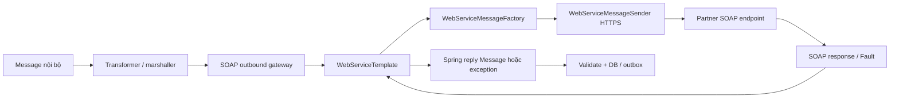
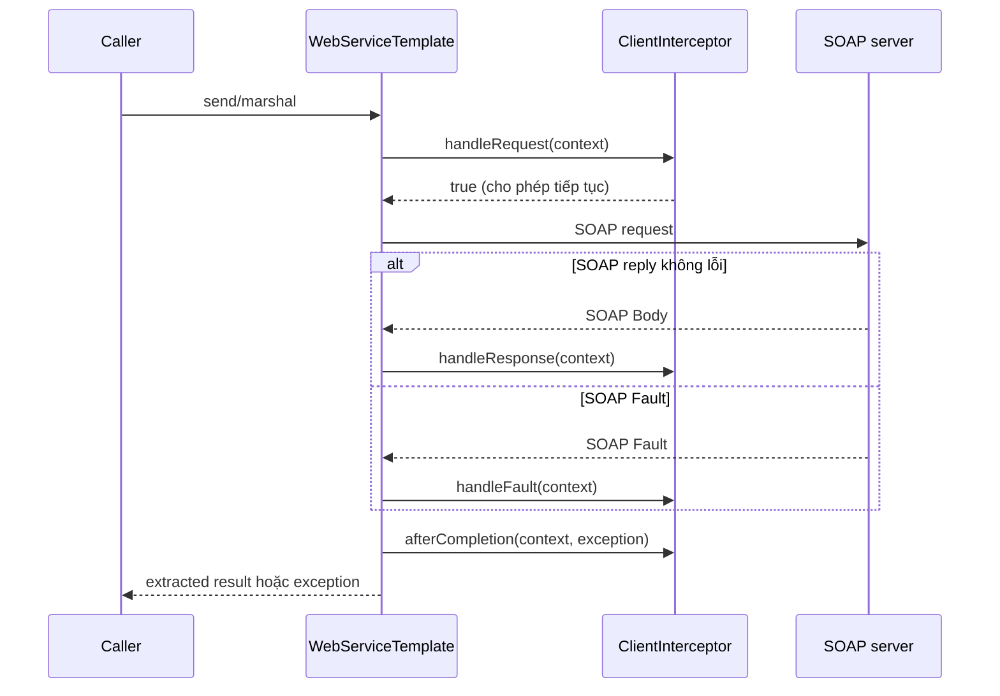
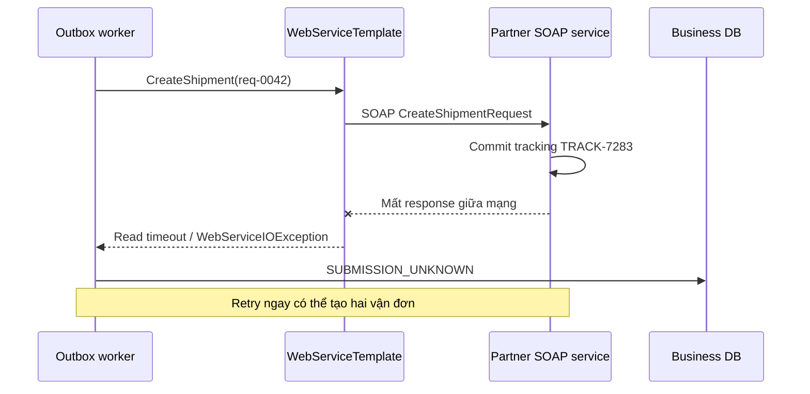

# SOAP message và WebServiceTemplate

## 1. Bài toán thực tế và mục tiêu

Hệ thống Spring Boot nhận sự kiện `ORDER_PAID` qua một `MessageChannel`, sau đó phải gọi SOAP service của đối tác để tạo vận đơn. Đối tác công bố WSDL/XSD, yêu cầu SOAP 1.1, `SOAPAction` đúng operation, header `ClientRequestId` để đối chiếu và phản hồi `CreateShipmentResponse` chứa mã tracking. Khi vận chuyển xảy ra lỗi, ứng dụng phải phân biệt **SOAP Fault**, HTTP transport error, XML invalid và trường hợp **đối tác đã tạo vận đơn nhưng phản hồi về bị mất**.

Để triển khai an toàn, người phát triển phải hiểu **hai loại message**:

- **Spring Integration `Message<?>`:** thông điệp nội bộ giữa channel, transformer, gateway, handler và error flow; có `payload` + `MessageHeaders`.
- **Spring Web Services `WebServiceMessage` / `SoapMessage`:** biểu diễn lời gọi SOAP (Envelope, Header, Body, Fault, attachment), được tạo và xử lý qua `WebServiceTemplate`.

`WebServiceTemplate` là client nền tảng của Spring-WS. Trong module `SPRING_INTEGRATION_ADAPTERS`, `SimpleWebServiceOutboundGateway` hoặc `MarshallingWebServiceOutboundGateway` dựa trên cùng hạ tầng đó để nối lời gọi SOAP vào integration flow. Đây là cách **kết nối hệ thống ngoài** bên cạnh File/SFTP/HTTP/JMS/AMQP/Kafka/database, với những nguyên tắc chung về hợp đồng message, lỗi, thời gian chờ và lifecycle kết nối.

Sau bài này, bạn có thể:

1. Đọc cấu trúc SOAP 1.1/1.2, phân biệt Envelope, Header, Body, Fault, `SOAPAction` và WS-Addressing `Action`.
2. Tạo/đọc `SoapMessage` qua `SaajSoapMessageFactory`; hiểu `Source`/`Result` và khác biệt giữa **body payload** với **toàn bộ SOAP envelope**.
3. Cấu hình `WebServiceTemplate`, `WebServiceMessageSender`, timeout, `WebServiceMessageCallback`, `SoapActionCallback` và `ClientInterceptor`.
4. Gửi/nhận SOAP bằng `sendSourceAndReceiveToResult`, `sendSourceAndReceive`, `marshalSendAndReceive` và `sendAndReceive`.
5. Tích hợp `WebServiceTemplate` vào Spring Integration Java DSL; map SOAPAction/headers và xử lý empty reply.
6. Chẩn đoán SOAP Fault, schema mismatch, transport/TLS error, retry và idempotency; kiểm thử bằng `MockWebServiceServer`.

> **Phạm vi phiên bản:** Spring Integration **6.5.x**, Spring Web Services **4.0.x**, Spring Framework 6.x, Spring Boot tương thích và Java 17+. XML transform API `javax.xml.transform.*` thuộc **JAXP và vẫn dùng `javax`**, còn Jakarta SOAP/JAXB dùng `jakarta.xml.soap.*` và `jakarta.xml.bind.*`. Tên miền `example.test`, namespace và dữ liệu sau đây hoàn toàn giả lập.

## 2. Một lời gọi SOAP đi qua những tầng nào?



| Thành phần | Trách nhiệm cụ thể | Không tự đảm bảo |
| --- | --- | --- |
| `MessageChannel` | Định tuyến Spring message giữa các endpoint | HTTP/SOAP đã gửi chỉ vì async channel nhận message |
| Spring Integration WS outbound gateway | Chuyển Spring message vào lời gọi SOAP và chuyển reply về flow | Remote business transaction là exactly-once |
| `WebServiceTemplate` | Điều phối request callback → transport → response/fault → extractor | Message reply chắc chắn đến client sau remote commit |
| `WebServiceMessageFactory` | Khởi tạo/phân tích message SOAP/POX tương ứng | Business authorization và XSD validation tự động |
| `SoapMessage` | Cho truy cập Envelope/Header/Body/Action/attachments | Tin cậy các header do remote khai báo |
| `WebServiceMessageSender` | Thực hiện transport (HTTP/HTTPS và sender khác được hỗ trợ) | Retry an toàn khi có side effect |
| `ClientInterceptor` | Gắn auth/trace/validation và quan sát request/response/fault | Tự quyết định nghiệp vụ đã commit hay chưa |
| Domain service/ledger | Kiểm tra và commit business result, chống trùng | Dùng SOAP Fault thay transaction DB |

`WebServiceTemplate` **không phải HTTP REST client**: nó không định nghĩa JSON mapping kiểu `RestClient`, cũng không tự hiểu WSDL để sinh Java classes. Với JAXB và contract-first, generated classes/`Jaxb2Marshaller` do dự án chuẩn bị riêng.

### So sánh inbound và outbound

- **Inbound SOAP:** HTTP/SOAP client gọi vào ứng dụng; `MessageDispatcherServlet` và `EndpointMapping` chọn `SimpleWebServiceInboundGateway` hoặc `MarshallingWebServiceInboundGateway`. Đây là phía **server**.
- **Outbound SOAP:** ứng dụng gọi SOAP endpoint ngoài; `WebServiceTemplate`/outbound gateway chịu vai trò **client**. Không cần đăng ký `MessageDispatcherServlet` chỉ để gọi ra.
- **SOAP vs REST:** SOAP có Envelope, Fault, Header, WSDL/XSD và thường dùng SOAPAction. Không đánh đồng Spring Integration `Http.outboundGateway` với `Ws.simpleOutboundGateway`.

## 3. Giải phẫu SOAP Envelope: Body khác Header

SOAP 1.1 yêu cầu root `Envelope` với namespace `http://schemas.xmlsoap.org/soap/envelope/`. `Header` có thể vắng mặt; `Body` là phần cần có và chứa message payload hoặc SOAP Fault.

```xml
<?xml version="1.0" encoding="UTF-8"?>
<soapenv:Envelope
    xmlns:soapenv="http://schemas.xmlsoap.org/soap/envelope/"
    xmlns:ship="urn:demo:shipping:v1"
    xmlns:sec="urn:demo:shipping:headers">
  <soapenv:Header>
    <sec:ClientRequestId soapenv:mustUnderstand="0">
      req-0042
    </sec:ClientRequestId>
  </soapenv:Header>
  <soapenv:Body>
    <ship:CreateShipmentRequest>
      <ship:clientRequestId>req-0042</ship:clientRequestId>
      <ship:orderId>O-9001</ship:orderId>
    </ship:CreateShipmentRequest>
  </soapenv:Body>
</soapenv:Envelope>
```

Điểm cốt lõi: khi gọi `WebServiceTemplate.sendSourceAndReceiveToResult(...)`, `Source` request thường là **chỉ phần tử `<ship:CreateShipmentRequest>`**, còn factory đóng gói vào SOAP Body. Nếu tự bọc cả `Envelope` làm `Source`, bạn có thể tạo **Envelope bị lồng vào Body** và khiến phía đối tác từ chối XML.

**SOAP Header không phải HTTP header:** `sec:ClientRequestId` nằm bên trong SOAP Envelope; `Content-Type` và `SOAPAction` của SOAP 1.1 là metadata HTTP/transport. Một giá trị có cùng tên ở HTTP header, SOAP Header và Spring `MessageHeaders` là **ba vị trí khác nhau** và chỉ được map khi có cấu hình.

### SOAP trên HTTP (bản rút gọn)

```http
POST /ws/shipping HTTP/1.1
Host: shipping.example.test
Content-Type: text/xml; charset=utf-8
SOAPAction: "urn:demo:shipping:v1/CreateShipment"

<?xml version="1.0" encoding="UTF-8"?>
<soapenv:Envelope xmlns:soapenv="http://schemas.xmlsoap.org/soap/envelope/"
                  xmlns:ship="urn:demo:shipping:v1">
  <soapenv:Body>
    <ship:CreateShipmentRequest>
      <ship:clientRequestId>req-0042</ship:clientRequestId>
      <ship:orderId>O-9001</ship:orderId>
    </ship:CreateShipmentRequest>
  </soapenv:Body>
</soapenv:Envelope>
```

Ví dụ HTTP dùng SOAP 1.1 với `text/xml` và `SOAPAction`; với SOAP 1.2, Content-Type thường là `application/soap+xml` cùng action parameter khi hợp đồng yêu cầu.

## 4. SOAP 1.1 và SOAP 1.2 không chỉ khác Content-Type

| Khía cạnh | SOAP 1.1 | SOAP 1.2 |
| --- | --- | --- |
| Envelope namespace | `http://schemas.xmlsoap.org/soap/envelope/` | `http://www.w3.org/2003/05/soap-envelope` |
| HTTP media type điển hình | `text/xml` | `application/soap+xml` |
| Action | HTTP `SOAPAction` theo binding | `action` parameter của media type và/hoặc WS-Addressing theo binding |
| Fault | `faultcode`, `faultstring`, `detail` | `Code`, `Reason`, `Detail`, tùy chọn `Subcode` |
| Cách tạo | `SoapVersion.SOAP_11` | `SoapVersion.SOAP_12` |
| Tương thích | Không tự tương thích 1.2 | Không tự chấp nhận 1.1 |

Ví dụ SOAP 1.2 body **đúng namespace**:

```xml
<env:Envelope xmlns:env="http://www.w3.org/2003/05/soap-envelope"
              xmlns:ship="urn:demo:shipping:v1">
  <env:Body>
    <ship:GetShipmentStatusRequest>
      <ship:trackingNumber>TRACK-7283</ship:trackingNumber>
    </ship:GetShipmentStatusRequest>
  </env:Body>
</env:Envelope>
```

**WS-Addressing Action** (`wsa:Action`) là một SOAP Header theo chuẩn WS-Addressing, khác `SOAPAction` của SOAP 1.1. Spring-WS có `SoapActionCallback` và `org.springframework.ws.soap.addressing.client.ActionCallback` với trách nhiệm khác nhau. Không thay một cái bằng cái kia nếu WSDL/policy yêu cầu cụ thể cả hai.

## 5. `WebServiceMessage`, `SoapMessage` và các kiểu XML trong Java

`WebServiceMessage` là abstraction của Spring-WS, còn `SoapMessage` cung cấp API SOAP-specific:

| API | Giá trị/ý nghĩa |
| --- | --- |
| `WebServiceMessage.getPayloadSource()` | `Source` của nội dung payload trong Body |
| `WebServiceMessage.getPayloadResult()` | `Result` để ghi payload vào Body |
| `SoapMessage.getEnvelope()` | Truy cập Envelope |
| `SoapMessage.getSoapHeader()` | Truy cập SOAP Header |
| `SoapMessage.getSoapBody()` | Truy cập SOAP Body |
| `SoapMessage.getSoapAction()` / `setSoapAction(...)` | Thao tác action theo SOAP version |
| `SoapMessage.getVersion()` | `SOAP_11` hoặc `SOAP_12` |
| `SoapMessage.getDocument()` | DOM toàn bộ SOAP message, cần cân nhắc memory |
| `SoapBody.hasFault()` / `getFault()` | Kiểm tra Fault trong Body |

### `Source` không phải String, `Result` không phải response Java object

Java XML transformation dùng `javax.xml.transform.Source` và `Result`:

- `StringSource` là Spring XML utility bọc XML string thành `Source`.
- `StreamSource` đọc từ `InputStream`/`Reader`, chịu lifecycle của stream.
- `DOMSource` gắn với DOM `Node`/`Document`, có thể tốn memory cho XML lớn.
- `DOMResult` nhận nội dung kết quả dưới dạng DOM.
- `StringResult` nhận XML được transform thành chuỗi.

Một `Source` thường **không có `toString()` cho ra XML text**. Cần `Transformer` hoặc XML parser có giới hạn/hardening khi chuyển đổi. `Source` có thể chỉ sử dụng một lần (stream) và không phù hợp làm payload để retry lâu dài nếu resource đã đóng.

### QName và namespace

Payload `<ship:CreateShipmentRequest xmlns:ship="urn:demo:shipping:v1">` có QName `{urn:demo:shipping:v1}CreateShipmentRequest`. `ship` chỉ là **prefix trình bày**, không phải danh tính phần tử; prefix `x` với cùng URI vẫn biểu diễn cùng QName. Ngược lại, tên `CreateShipmentRequest` ở namespace `v2` là **operation contract khác**, dù local name giống nhau.

## 6. `WebServiceMessageFactory`: tạo SOAP 1.1 và SOAP 1.2

Spring-WS dùng `WebServiceMessageFactory` để tạo/phân tích message. Với SAAJ, `SaajSoapMessageFactory` triển khai `SoapMessageFactory`. Trên Spring-WS 4.x, SAAJ thuộc Jakarta XML SOAP, không dùng javax SAAJ runtime cũ.

```java
import org.springframework.context.annotation.Bean;
import org.springframework.context.annotation.Configuration;
import org.springframework.ws.soap.SoapVersion;
import org.springframework.ws.soap.saaj.SaajSoapMessageFactory;

@Configuration
public class SoapMessageFactories {

    @Bean
    public SaajSoapMessageFactory partnerSoap11Factory() {
        SaajSoapMessageFactory factory = new SaajSoapMessageFactory();
        factory.setSoapVersion(SoapVersion.SOAP_11);
        // Với Spring bean, container gọi afterPropertiesSet().
        return factory;
    }
}
```

Nếu đối tác dùng SOAP 1.2, tạo **bean riêng** với `SoapVersion.SOAP_12` và inject vào template riêng; đừng dùng một factory thay đổi version theo từng request đồng thời. SAAJ thường xây message trên DOM, nên SOAP lớn/attachment cần giới hạn memory và kiểm thử hiệu năng. Với MTOM, cần hợp đồng XSD/WSDL và JAXB/attachment handling tương thích; chọn factory không tự bật MTOM.

### Tạo `SoapMessage`, ghi payload vào Body

```java
import javax.xml.transform.Transformer;
import javax.xml.transform.TransformerFactory;

import org.springframework.ws.soap.SoapMessage;
import org.springframework.ws.soap.saaj.SaajSoapMessageFactory;
import org.springframework.xml.transform.StringSource;

public class SoapMessageExample {

    public static SoapMessage createBody(SaajSoapMessageFactory factory)
            throws Exception {

        SoapMessage message = factory.createWebServiceMessage();
        message.setSoapAction("urn:demo:shipping:v1/CreateShipment");

        String body = """
            <ship:CreateShipmentRequest xmlns:ship="urn:demo:shipping:v1">
              <ship:clientRequestId>req-0042</ship:clientRequestId>
              <ship:orderId>O-9001</ship:orderId>
            </ship:CreateShipmentRequest>
            """;

        TransformerFactory tf = TransformerFactory.newInstance();
        // Production: phải cấu hình JAXP secure processing và
        // ACCESS_EXTERNAL_DTD/STYLESHEET cho factory này.
        Transformer transformer = tf.newTransformer();
        transformer.transform(new StringSource(body),
                message.getPayloadResult());
        return message;
    }
}
```

Code nhận factory đã được Spring khởi tạo. Nếu tự tạo bằng `new SaajSoapMessageFactory()` ngoài Spring container, phải khởi tạo đúng lifecycle (ví dụ `afterPropertiesSet()`), nếu không sẽ gặp lỗi message factory chưa sẵn sàng. **Chỉ truyền Body payload vào `getPayloadResult()`**, không ghi SOAP Envelope lần hai. Phần 18 sẽ trình bày hardening JAXP thực tế.

## 7. `WebServiceTemplate`: cấu hình transport, URI và timeout

Trung tâm Spring-WS client là `WebServiceTemplate`. Có thể tạo template bean bằng `WebServiceMessageFactory`, `WebServiceMessageSender`, default URI, marshaller/unmarshaller, interceptors và fault resolver. Không cần `MessageDispatcherServlet`: template đóng vai **client**.

```groovy
dependencies {
    implementation 'org.springframework.boot:spring-boot-starter-integration'
    implementation 'org.springframework.integration:spring-integration-ws'
    implementation 'org.springframework.boot:spring-boot-starter-web-services'
    testImplementation 'org.springframework.boot:spring-boot-starter-test'
    testImplementation 'org.springframework.ws:spring-ws-test'
}
```

Với Spring Boot BOM tương thích, đừng tự chèn cùng lúc các phiên bản `javax.xml.soap`/`jakarta.xml.soap` xung đột. Nếu dùng JAXB object mapping, thêm JAXB runtime/binding do BOM và build plugin quản lý.

```yaml
app:
  shipping:
    endpoint: ${SHIPPING_SOAP_ENDPOINT:https://shipping.example.test/ws/shipping}
    soap-action: "urn:demo:shipping:v1/CreateShipment"
    connect-timeout-ms: 5000
    read-timeout-ms: 20000
```

```java
import java.time.Duration;

import org.springframework.beans.factory.annotation.Value;
import org.springframework.context.annotation.Bean;
import org.springframework.context.annotation.Configuration;
import org.springframework.ws.client.core.WebServiceTemplate;
import org.springframework.ws.soap.saaj.SaajSoapMessageFactory;
import org.springframework.ws.transport.http.HttpUrlConnectionMessageSender;

@Configuration
public class ShippingWebServiceClientConfig {

    @Bean
    public WebServiceTemplate shippingWebServiceTemplate(
            SaajSoapMessageFactory partnerSoap11Factory,
            @Value("${app.shipping.endpoint}") String endpoint,
            @Value("${app.shipping.connect-timeout-ms:5000}") long connectMs,
            @Value("${app.shipping.read-timeout-ms:20000}") long readMs) {

        HttpUrlConnectionMessageSender sender =
                new HttpUrlConnectionMessageSender();
        sender.setConnectionTimeout(Duration.ofMillis(connectMs));
        sender.setReadTimeout(Duration.ofMillis(readMs));

        WebServiceTemplate template =
                new WebServiceTemplate(partnerSoap11Factory);
        template.setDefaultUri(endpoint);
        template.setMessageSender(sender);
        return template;
    }
}
```

Các timeout tính bằng **Duration**, đúng Spring-WS 4.x `HttpUrlConnectionMessageSender`. Connect timeout chỉ giới hạn giai đoạn kết nối socket; read timeout chỉ giới hạn thời gian chờ đọc dữ liệu. **Không có end-to-end deadline tự động** cho DNS + TLS + upload + xử lý server + decode XML + DB. Khi cần pool/mTLS/proxy, cân nhắc `HttpComponents5MessageSender` với client được cấu hình đúng; không suy các setter sender mặc định sẽ override một custom HTTP client.

**URI phải đến từ cấu hình được tin cậy**. Không để client HTTP gửi header `targetUrl` rồi đưa thẳng vào `setDefaultUri` hoặc `send... (uri, ...)`; có thể gây SSRF tới metadata service hoặc mạng nội bộ. Với nhiều tenant, tách client/credentials và allowlist endpoint rõ ràng.

## 8. Bốn nhóm lời gọi `WebServiceTemplate`

| Phương thức | Request API | Reply API | Mục đích |
| --- | --- | --- | --- |
| `sendSourceAndReceiveToResult` | `Source` | Ghi reply vào `Result`, trả `boolean` có response | Truyền XML không cần JAXB |
| `sendSourceAndReceive` | `Source` | `SourceExtractor<T>` lấy object kết quả | Tự đọc nội dung reply qua extractor |
| `marshalSendAndReceive` | Object + `Marshaller` | Object + `Unmarshaller` | Contract-first JAXB/POJO |
| `sendAndReceive` | `WebServiceMessageCallback` | `WebServiceMessageExtractor<T>` hoặc callback | Cần tự điều khiển Header, Body, attachment |

Mỗi nhóm có overload với **URI explicit** hoặc dùng `defaultUri` trên template. Overload không có URI chỉ dùng được khi template đã có destination/default URI. Mỗi nhóm có thể nhận `WebServiceMessageCallback` để sửa SOAP request sau khi body đã được ghi/marshal.

Với trường hợp response rỗng, không cho rằng return `false`/`null` luôn là lỗi network. Một SOAP operation có thể hợp đồng **one-way/void**. Ngược lại, operation yêu cầu tracking number mà response rỗng thì là **vi phạm contract** và phải được phân loại, không ghi DB “đã tạo vận đơn”.

## 9. Gọi SOAP bằng `Source` và nhận `Result` — ví dụ đầu tiên

Đây là đường đi ngắn nhất để học `WebServiceTemplate`: tạo XML phần tử body, truyền vào template, đặt SOAPAction qua callback và nhận response thành XML string.

```java
import org.springframework.beans.factory.annotation.Qualifier;
import org.springframework.stereotype.Service;
import org.springframework.ws.client.core.WebServiceTemplate;
import org.springframework.ws.soap.client.core.SoapActionCallback;
import org.springframework.xml.transform.StringResult;
import org.springframework.xml.transform.StringSource;

@Service
public class ShippingXmlClient {

    private final WebServiceTemplate template;

    public ShippingXmlClient(
            @Qualifier("shippingWebServiceTemplate") WebServiceTemplate template) {
        this.template = template;
    }

    public String submitDemoRequest() {
        StringSource request = new StringSource("""
            <ship:CreateShipmentRequest xmlns:ship="urn:demo:shipping:v1">
              <ship:clientRequestId>req-0042</ship:clientRequestId>
              <ship:orderId>O-9001</ship:orderId>
            </ship:CreateShipmentRequest>
            """);

        StringResult response = new StringResult();
        boolean received = template.sendSourceAndReceiveToResult(
                request,
                new SoapActionCallback("urn:demo:shipping:v1/CreateShipment"),
                response);

        if (!received) {
            throw new IllegalStateException(
                    "Operation cần response nhưng không có reply");
        }
        // Đây là XML của BODY PAYLOAD, chưa kiểm tra schema/nghiệp vụ.
        return response.toString();
    }
}
```

**Những điều mã thực sự làm:** dùng `defaultUri` trong bean `shippingWebServiceTemplate`; gửi SOAP 1.1 body, đặt SOAPAction và lấy kết quả. Nó **chưa** xác minh namespace, `clientRequestId`, tracking number hoặc status của response, nên không được coi một XML string bất kỳ là thành công nghiệp vụ.

Trong code sản xuất, `requestId`/`orderId` phải được marshal/escape theo XSD. Không nối chuỗi XML từ user input: `&`, `<` và các ký tự đặc biệt có thể làm request XML sai hoặc tạo XML injection. Nên dùng JAXB-generated classes hoặc builder XML an toàn và validate response qua XSD trước khi lưu DB.

### Nếu không có default URI

Có overload:

```java
boolean gotReply = template.sendSourceAndReceiveToResult(
        "https://shipping.example.test/ws/shipping",
        request,
        new SoapActionCallback("urn:demo:shipping:v1/CreateShipment"),
        response);
```

Đoạn là fragment trong method ở trên, dùng **URI tĩnh lấy từ cấu hình**. Không đưa URL từ SOAP payload hoặc HTTP input vào overload này nếu chưa kiểm soát host/scheme/port/IP/redirect; đó là điểm dễ gây SSRF.

## 10. `sendSourceAndReceive` và `SourceExtractor<T>`

Khi không muốn ghi response vào một `Result` có sẵn, bạn có thể cung cấp `SourceExtractor<T>`: một callback đọc `Source` của **response body payload** và trả kiểu dữ liệu có ý nghĩa cho ứng dụng. Không phải mọi extractor đều cần dựng DOM lớn.

```java
import javax.xml.transform.Source;
import javax.xml.transform.TransformerFactory;

import org.springframework.ws.client.core.SourceExtractor;
import org.springframework.ws.client.core.WebServiceTemplate;
import org.springframework.ws.soap.client.core.SoapActionCallback;
import org.springframework.xml.transform.StringResult;
import org.springframework.xml.transform.StringSource;

public final class SourceExtractorExample {

    public static String call(
            WebServiceTemplate template, String bodyXml) {

        SourceExtractor<String> extractor = responseSource -> {
            // TransformerFactory phải được harden theo mục bảo mật.
            var factory = TransformerFactory.newInstance();
            var transformer = factory.newTransformer();
            StringResult result = new StringResult();
            transformer.transform(responseSource, result);
            return result.toString();
        };

        return template.sendSourceAndReceive(
                new StringSource(bodyXml),
                new SoapActionCallback("urn:demo:shipping:v1/GetShipmentStatus"),
                extractor);
    }
}
```

Đoạn minh họa hợp đồng callback nhưng `TransformerFactory` ở đây chưa được harden: **không áp vào production khi parse XML không đáng tin**. Cách kiểm soát ở mục 21. `SourceExtractor` có thể trả `null` nếu không có response/không có payload. Nếu downstream cần dữ liệu ổn định, extractor phải materialize nội dung khi source còn hợp lệ, giới hạn số byte và kiểm tra QName/version.

Một extractor tốt có thể chỉ đọc `trackingNumber` và status với XML parser an toàn, nhưng không bỏ qua schema/business validation. `getPayloadSource()` có thể là stream/DOM tuỳ factory; không giả định một `Source` dùng được nhiều lần.

## 11. `marshalSendAndReceive`: object ↔ XML qua JAXB

Khi đối tác cung cấp XSD/WSDL, sử dụng JAXB classes sinh từ contract thường giảm lỗi XML thủ công. `WebServiceTemplate` cần có cả `Marshaller` và `Unmarshaller` để gửi object và nhận object.

```java
import org.springframework.context.annotation.Bean;
import org.springframework.context.annotation.Configuration;
import org.springframework.oxm.jaxb.Jaxb2Marshaller;

@Configuration
public class ShippingJaxbBindingConfig {

    @Bean
    public Jaxb2Marshaller shippingMarshaller() {
        Jaxb2Marshaller marshaller = new Jaxb2Marshaller();
        marshaller.setContextPath("com.example.partner.shipping.v1");
        // Package giả định có generated JAXB classes / ObjectFactory.
        // Schema validation, allowed types và runtime JAXB cần được test.
        return marshaller;
    }
}
```

```java
import org.springframework.beans.factory.annotation.Qualifier;
import org.springframework.beans.factory.annotation.Value;
import org.springframework.context.annotation.Bean;
import org.springframework.context.annotation.Configuration;
import org.springframework.oxm.jaxb.Jaxb2Marshaller;
import org.springframework.ws.client.core.WebServiceTemplate;
import org.springframework.ws.soap.saaj.SaajSoapMessageFactory;
import org.springframework.ws.transport.http.HttpUrlConnectionMessageSender;

@Configuration
public class ShippingJaxbClientConfig {

    @Bean
    public WebServiceTemplate jaxbShippingTemplate(
            @Qualifier("partnerSoap11Factory") SaajSoapMessageFactory factory,
            @Qualifier("shippingMarshaller") Jaxb2Marshaller marshaller,
            @Value("${app.shipping.endpoint}") String endpoint) {

        HttpUrlConnectionMessageSender sender =
                new HttpUrlConnectionMessageSender();
        sender.setConnectionTimeout(java.time.Duration.ofSeconds(5));
        sender.setReadTimeout(java.time.Duration.ofSeconds(20));

        WebServiceTemplate template = new WebServiceTemplate(factory);
        template.setDefaultUri(endpoint);
        template.setMessageSender(sender);
        template.setMarshaller(marshaller);
        template.setUnmarshaller(marshaller);
        return template;
    }
}
```

Service gọi template với object **đúng JAXB generated type**:

```java
import org.springframework.ws.client.core.WebServiceTemplate;
import org.springframework.ws.soap.client.core.SoapActionCallback;

public final class JaxbShippingCaller {

    private final WebServiceTemplate template;

    public JaxbShippingCaller(WebServiceTemplate template) {
        this.template = template;
    }

    public Object call(Object generatedJaxbRequest) {
        return template.marshalSendAndReceive(
                generatedJaxbRequest,
                new SoapActionCallback(
                        "urn:demo:shipping:v1/CreateShipment"));
    }
}
```

`generatedJaxbRequest` cần là object marshaller chấp nhận, ví dụ `JAXBElement<CreateShipmentRequest>` từ `ObjectFactory`; trả về cũng có thể là `JAXBElement<CreateShipmentResponse>` tuỳ XJC. **Không cast bừa object reply** sang domain DTO. Schema validation, non-null constraints và đối chiếu `clientRequestId`/tenant cần thực hiện riêng.

### Unmarshal không đồng nghĩa business success

Một response đúng XML nhưng `status=REJECTED` vẫn là thất bại nghiệp vụ; một response parse được nhưng có trackingNumber trống cũng chưa đủ điều kiện commit. Phân biệt:

1. **Transport success** — nhận HTTP/SOAP response.
2. **SOAP success** — không có SOAP Fault.
3. **Contract success** — đúng XSD, namespace, action và response type.
4. **Business success** — đúng request ID, tracking number/status hợp lệ, partner operation thành công.
5. **Local commit** — kết quả được ghi DB idempotent.

## 12. `WebServiceMessageCallback` và `SoapActionCallback`

Callback được thực thi **sau khi body request được dựng/marshal**, trước khi gửi qua `WebServiceMessageSender`. Nó là nơi thích hợp để thêm SOAPAction hoặc các SOAP header theo contract, không phải nơi sửa business transaction.

```java
import javax.xml.namespace.QName;

import org.springframework.ws.WebServiceMessage;
import org.springframework.ws.client.core.WebServiceMessageCallback;
import org.springframework.ws.soap.SoapHeaderElement;
import org.springframework.ws.soap.SoapMessage;

public final class ShippingSoapCallbacks {

    public static WebServiceMessageCallback withMetadata(String requestId) {
        // requestId đã được validate, giới hạn độ dài và gắn với tenant.
        return (WebServiceMessage message) -> {
            if (!(message instanceof SoapMessage soap)) {
                throw new IllegalStateException("Yêu cầu SOAP message factory");
            }

            soap.setSoapAction("urn:demo:shipping:v1/CreateShipment");
            SoapHeaderElement idHeader = soap.getSoapHeader()
                    .addHeaderElement(new QName(
                            "urn:demo:shipping:headers",
                            "ClientRequestId",
                            "hdr"));
            idHeader.setText(requestId);
        };
    }
}
```

Sử dụng callback này với `sendSourceAndReceiveToResult(...)` hoặc `marshalSendAndReceive(request, callback)`. Khi muốn **chỉ đặt action**, `SoapActionCallback` đơn giản và dễ audit hơn. Khi đối tác yêu cầu nhiều header như WS-Security signature, Timestamp, WS-Addressing, **đừng tự tạo XML giả chữ ký**; dùng chính sách Spring-WS client interceptor/WSS4J và key material phù hợp.

### `SoapHeaderElement` và thuộc tính `mustUnderstand`

`SoapHeaderElement#setMustUnderstand(true)` yêu cầu SOAP node giữ vai trò tiếp nhận header phải xử lý nó; nếu không, bên nhận có thể trả `MustUnderstand` Fault. Điều này **không có nghĩa** header đã được xác thực hoặc ký. `setActorOrRole(...)` phải tương thích SOAP version và binding của partner.

Không bật `mustUnderstand` cho mọi correlation header chỉ vì “quan trọng”: có thể làm client/server cũ từ chối message chưa hỗ trợ header đó.

## 13. `ClientInterceptor`: request, response, fault, cleanup

`WebServiceTemplate#setInterceptors(ClientInterceptor[])` cho phép gắn logic quan sát/validation/WS-Security dùng chung. Thứ tự vòng đời quan trọng:



`ClientInterceptor#handleRequest` được gọi sau payload creation/callback, trước transport. `handleResponse` dành cho response không fault, `handleFault` dành cho SOAP Fault, `afterCompletion` dọn tài nguyên/ghi metrics của các interceptor đã chạy phù hợp. Nếu một interceptor trả `false`, chain có thể dừng; **không dùng nó để âm thầm bỏ response rồi coi là success**.

Ví dụ một interceptor chỉ ghi metadata đã được giới hạn:

```java
import org.springframework.ws.context.MessageContext;
import org.springframework.ws.client.support.interceptor.ClientInterceptorAdapter;
import org.springframework.ws.soap.SoapMessage;

public class SoapMetadataInterceptor extends ClientInterceptorAdapter {

    @Override
    public boolean handleRequest(MessageContext context) {
        if (context.getRequest() instanceof SoapMessage soap) {
            String action = soap.getSoapAction();
            // Ghi action đã sanitize và correlation ID nội bộ;
            // không log SOAP body, UsernameToken hoặc raw Header.
        }
        return true;
    }

    @Override
    public boolean handleFault(MessageContext context) {
        // Ghi số lượng fault và category, không in toàn bộ Fault XML.
        return true;
    }
}
```

Đăng ký:

```java
import org.springframework.ws.client.support.interceptor.ClientInterceptor;

template.setInterceptors(
        new ClientInterceptor[]{new SoapMetadataInterceptor()});
```

Đây là trích đoạn trong bean configuration. Với production, Spring quản lý `ClientInterceptor` beans và policy/security order. Một interceptor làm logging không thay XSD validator, TLS hoặc business authorization.

## 14. SOAPAction, WS-Addressing và Spring Integration headers

Ba khái niệm thường bị nhầm:

| Tên | Nằm ở đâu | Dùng cho |
| --- | --- | --- |
| `SOAPAction` (SOAP 1.1) | HTTP transport metadata; Spring-WS `SoapMessage` abstraction | Chỉ ra intent của SOAP operation theo WSDL binding |
| `wsa:Action` | SOAP Header chuẩn WS-Addressing | Định tuyến/correlation theo WS-Addressing contract |
| `WebServiceHeaders.SOAP_ACTION` | Spring Integration `MessageHeaders`, key `ws_soapAction` | Gateway map action sang/ra `SoapMessage` |

`org.springframework.ws.soap.addressing.client.ActionCallback` là callback hỗ trợ WS-Addressing, **không phải** `SoapActionCallback`. Một endpoint có thể yêu cầu cả hai và chúng phải cùng chỉ đúng operation theo chính sách. Không dùng action nào làm authentication: caller hoàn toàn có thể tự ghi tên action.

Trong Spring Integration 6.5, `DefaultSoapHeaderMapper` mặc định copy **SOAPAction**; SOAP header tùy biến **không tự động map** nếu chưa được allowlist qua `requestHeaderNames` hoặc `replyHeaderNames`.

```java
import org.springframework.context.annotation.Bean;
import org.springframework.integration.ws.DefaultSoapHeaderMapper;
import org.springframework.integration.ws.WebServiceHeaders;

@Bean
public DefaultSoapHeaderMapper shippingSoapHeaderMapper() {
    DefaultSoapHeaderMapper mapper = new DefaultSoapHeaderMapper();
    mapper.setRequestHeaderNames(
            WebServiceHeaders.SOAP_ACTION, "ClientRequestId");
    mapper.setReplyHeaderNames(
            WebServiceHeaders.SOAP_ACTION, "PartnerReceiptId");
    return mapper;
}
```

Khi map custom headers, request có thể chứa `Source` làm XML child trong SOAP Header:

```java
import org.springframework.xml.transform.StringSource;
import org.springframework.messaging.support.MessageBuilder;

var springMessage = MessageBuilder
        .withPayload("<ship:.../>") // Placeholder, phải thay bằng XML hợp lệ.
        .setHeader("ClientRequestId", new StringSource("""
            <hdr:ClientRequestId xmlns:hdr="urn:demo:shipping:headers">
              req-0042
            </hdr:ClientRequestId>
            """))
        .build();
```

Đoạn này là fragment minh họa **cách map headers**, không phải SOAP request có body hợp lệ. Khi đọc reply custom SOAP header, Spring Integration có thể đặt `SoapHeaderElement` trong Spring message headers; `SoapHeaderElement#getSource()` cho phép parse dữ liệu, nhưng header vẫn là **input không đáng tin**. Không map wildcard `*` tất cả Spring headers ra SOAP vì có thể rò token, tenant metadata hoặc Spring reply/error channels.

## 15. Đưa `WebServiceTemplate` vào Spring Integration Java DSL

Lựa chọn client thuần hay integration flow phụ thuộc nhu cầu:

- **Client thuần:** domain service gọi `WebServiceTemplate` trực tiếp; phù hợp logic nhỏ, không cần router/channel.
- **Integration flow:** cần transformer, filter, gateway, retry policy, channel, metrics hoặc nhiều hệ thống ngoài; dùng Spring Integration WS outbound gateway trên template đã cấu hình.

```java
import org.springframework.beans.factory.annotation.Qualifier;
import org.springframework.beans.factory.annotation.Value;
import org.springframework.context.annotation.Bean;
import org.springframework.context.annotation.Configuration;
import org.springframework.integration.channel.DirectChannel;
import org.springframework.integration.dsl.IntegrationFlow;
import org.springframework.integration.ws.DefaultSoapHeaderMapper;
import org.springframework.integration.ws.dsl.Ws;
import org.springframework.messaging.MessageChannel;
import org.springframework.ws.client.core.WebServiceTemplate;

@Configuration
public class ShippingIntegrationWsFlow {

    @Bean
    public MessageChannel outboundShipmentRequests() {
        return new DirectChannel();
    }

    @Bean
    public IntegrationFlow submitShipmentViaSoap(
            @Qualifier("outboundShipmentRequests") MessageChannel requests,
            @Qualifier("shippingWebServiceTemplate") WebServiceTemplate template,
            DefaultSoapHeaderMapper shippingSoapHeaderMapper,
            @Value("${app.shipping.endpoint}") String uri) {

        return IntegrationFlow.from(requests)
                .handle(Ws.simpleOutboundGateway(template)
                        .uri(uri)
                        .headerMapper(shippingSoapHeaderMapper)
                        .ignoreEmptyResponses(true))
                .get();
    }
}
```

`Ws.simpleOutboundGateway(template)` dùng external `WebServiceTemplate`; cấu hình message factory, sender, fault resolver và interceptors nên đặt trên **template đó**. Đừng kỳ vọng mọi setter của **no-template spec** còn áp dụng giống nhau với external template.

### Gửi Spring message và nhận reply

```java
import org.springframework.beans.factory.annotation.Qualifier;
import org.springframework.integration.core.MessagingTemplate;
import org.springframework.integration.ws.WebServiceHeaders;
import org.springframework.messaging.Message;
import org.springframework.messaging.MessageChannel;
import org.springframework.messaging.support.MessageBuilder;
import org.springframework.stereotype.Service;

@Service
public class ShippingFlowCaller {

    private final MessageChannel channel;

    public ShippingFlowCaller(
            @Qualifier("outboundShipmentRequests") MessageChannel channel) {
        this.channel = channel;
    }

    public Message<?> callDemo() {
        String body = """
            <ship:CreateShipmentRequest xmlns:ship="urn:demo:shipping:v1">
              <ship:clientRequestId>req-0042</ship:clientRequestId>
              <ship:orderId>O-9001</ship:orderId>
            </ship:CreateShipmentRequest>
            """;
        Message<String> request = MessageBuilder.withPayload(body)
                .setHeader(WebServiceHeaders.SOAP_ACTION,
                        "urn:demo:shipping:v1/CreateShipment")
                .build();

        MessagingTemplate sender = new MessagingTemplate();
        sender.setReceiveTimeout(25_000);
        Message<?> reply = sender.sendAndReceive(channel, request);
        if (reply == null) {
            throw new IllegalStateException(
                    "Không có SOAP reply theo hợp đồng");
        }
        return reply;
    }
}
```

`MessagingTemplate` là **Spring Integration client**, không phải `WebServiceTemplate`. Nó gửi Spring Message vào channel và chờ Spring reply. Nếu flow dùng `ExecutorChannel`/queue, `send()` trả true **không chứng minh SOAP đã hoàn tất**. Với outbound request–reply thông thường, `DirectChannel` cho phép quan sát handler đồng bộ. `receiveTimeout` ở messaging layer không hủy side effect trên partner nếu HTTP request đã rời hệ thống.

## 16. SOAP Fault và `WebServiceTemplate` fault resolution

SOAP Fault là nội dung **theo giao thức SOAP** nằm trong SOAP Body, không đồng nghĩa mọi HTTP 4xx/5xx đều có Fault. Một proxy có thể trả HTTP 503 cùng HTML; ngược lại một provider không tuân thủ chuẩn có thể trả SOAP Fault trong HTTP 200.

SOAP 1.1 Fault ví dụ:

```xml
<soapenv:Envelope xmlns:soapenv="http://schemas.xmlsoap.org/soap/envelope/">
  <soapenv:Body>
    <soapenv:Fault>
      <faultcode>soapenv:Client</faultcode>
      <faultstring>Customer identifier is invalid</faultstring>
      <detail>
        <err:code xmlns:err="urn:demo:shipping:errors">INVALID_CUSTOMER</err:code>
      </detail>
    </soapenv:Fault>
  </soapenv:Body>
</soapenv:Envelope>
```

SOAP 1.2 Fault có cấu trúc khác:

```xml
<env:Envelope xmlns:env="http://www.w3.org/2003/05/soap-envelope">
  <env:Body>
    <env:Fault>
      <env:Code><env:Value>env:Sender</env:Value></env:Code>
      <env:Reason>
        <env:Text xml:lang="en">Invalid request</env:Text>
      </env:Reason>
    </env:Fault>
  </env:Body>
</env:Envelope>
```

`WebServiceTemplate` có cơ chế `FaultMessageResolver`. Với SOAP message/fault resolver thông dụng, client có thể nhận `org.springframework.ws.soap.client.SoapFaultClientException`; transport thuần có `WebServiceTransportException` hoặc `WebServiceIOException`; lỗi transform có `WebServiceTransformerException`. Exception có thể được Spring Integration bọc khi qua handler.

| Tình huống | Nhận biết | Điều cần làm |
| --- | --- | --- |
| SOAP `Client`/`Sender` Fault do input sai | Fault code/detail, namespace đúng contract | Quarantine/sửa request, không retry nguyên trạng |
| SOAP `Server`/`Receiver` Fault | Fault code/detail của partner | Phân loại transient theo tài liệu, không tự tin mọi lỗi server an toàn để retry |
| HTTP 401/403, TLS/auth fail | Transport/security exception | Sửa scope/cert/token, không brute-force |
| HTTP 429/503 | Rate limit/outage | Backoff/jitter, kiểm tra khả năng side effect đã xảy ra |
| HTTP 500 + HTML | Không có SOAP Envelope hợp lệ | Chẩn đoán proxy/endpoint, không parse HTML thành Fault XML |
| HTTP 200 + SOAP Fault | Provider không chuẩn status | Điều chỉnh fault detection theo test, không coi HTTP 200 là business success |
| Read timeout sau request | Không biết partner đã commit chưa | `SUBMISSION_UNKNOWN` + reconciliation |
| SOAP success, body sai XSD | Không phải SOAP Fault, nhưng vi phạm contract | Không commit dữ liệu không hợp lệ |

### Cấu hình xử lý Fault của template

```java
import org.springframework.ws.client.core.WebServiceTemplate;
import org.springframework.ws.soap.client.core.SoapFaultMessageResolver;

public static void configureFaults(WebServiceTemplate template) {
    template.setFaultMessageResolver(new SoapFaultMessageResolver());
    // Mặc định nên giữ kiểm tra HTTP status.
    // Chỉ sửa nếu provider trả SOAP Fault với status không chuẩn:
    // template.setCheckConnectionForFault(false);
}
```

Đây là utility method. `checkConnectionForFault` điều chỉnh việc dùng transport status để phát hiện Fault; **không vô hiệu SOAP Fault resolution**. Chỉ chuyển sang `false` nếu đã kiểm thử provider không chuẩn. `checkConnectionForError` là một property khác: đừng đặt cả hai thành false chỉ vì muốn “hết exception”.

### Fault code không phải business status

Một HTTP/SOAP response thành công vẫn có thể chứa `<status>REJECTED</status>`, không có Fault. Ngược lại Fault nói `SHIPMENT_ALREADY_EXISTS` có thể cho phép **truy vấn ID đã tạo** thay vì gọi Create lần nữa. Cần map **fault detail theo namespace/code hợp đồng**, không parse chuỗi `faultstring` ngôn ngữ tự nhiên bằng regex.

## 17. Empty SOAP response và `ignoreEmptyResponses`

Hai API có semantics khác nhau khi response trống:

- Trong `WebServiceTemplate.sendSourceAndReceiveToResult(...)`, kết quả `boolean` cho biết có response; `marshalSendAndReceive(...)` có thể trả `null` nếu không có nội dung để unmarshal.
- Trong **Spring Integration `SimpleWebServiceOutboundGateway`**, một HTTP/SOAP response không có body payload có thể dẫn tới **không phát Spring reply Message**.

Spring Integration 6.5 ghi rõ:

| Request payload của simple outbound gateway | Response trống, mặc định | Khi `ignoreEmptyResponses(false)` |
| --- | --- | --- |
| `String` | Không tạo reply | Có thể tạo Spring reply biểu diễn empty response |
| `Source` | Source extractor trả `null`, không tạo reply | Vẫn **không** bảo đảm reply |
| `Document` | Source extractor trả `null`, không tạo reply | Vẫn **không** bảo đảm reply |
| JAXB object | Theo contract marshalling/unmarshalling | Không suy giống simple String |

```java
// Trích đoạn nằm trong IntegrationFlow:
.handle(Ws.simpleOutboundGateway(template)
        .uri("https://shipping.example.test/ws/shipping")
        .ignoreEmptyResponses(false))
```

Đừng thêm `ignoreEmptyResponses(false)` rồi coi tất cả request–reply sẽ luôn có payload. Với WSDL quy định operation **one-way**, nên thiết kế flow/caller theo **không có SOAP reply**, hoặc xác nhận HTTP acceptance theo transport-level contract. Một operation tạo vận đơn cần `trackingNumber` không thể đánh dấu thành công chỉ vì có HTTP 202/200 trống.

### Timeout ở message channel khác response rỗng

Nếu `MessagingTemplate.sendAndReceive(...)` trả `null` do reply timeout, có thể có nhiều nguyên nhân: SOAP service không trả body; gateway không tạo Spring reply vì ignore-empty; handler không gửi về `replyChannel`; worker bị block; network chậm. Phải đo và log **stage** của request thay vì chỉ tăng timeout rồi gửi lại cùng side effect.

## 18. MessageFactory, MIME attachments và MTOM

SOAP body có thể tham chiếu tệp ảnh, PDF hoặc dữ liệu nhị phân. Có hai cơ chế phổ biến:

| Cách mang binary | Biểu diễn | Khi phù hợp |
| --- | --- | --- |
| `xsd:base64Binary` trong Body | Base64 text trong XML | File nhỏ, hợp đồng đơn giản; chi phí XML/heap lớn |
| MTOM/XOP qua SOAP attachment | MIME multipart, CID/xop:Include | File lớn, WSDL/XSD hỗ trợ MTOM |
| Attachment do client tạo | `org.springframework.ws.mime.MimeMessage` | Cần điều khiển content-ID/media type/stream |

Marshalling gateway và `WebServiceTemplate` có thể dùng `Jaxb2Marshaller#setMtomEnabled(true)` khi JAXB model có binding hỗ trợ MTOM. Điều này **không tự biến một byte[] bất kỳ thành attachment**: phần tử/schema, JAXB annotation (`@XmlMimeType` khi phù hợp), message factory và partner phải hỗ trợ tương ứng.

### Tạo SOAP message chứa attachment (mẫu minh họa)

```java
import java.nio.charset.StandardCharsets;
import javax.xml.transform.TransformerFactory;

import org.springframework.core.io.ByteArrayResource;
import org.springframework.ws.mime.MimeMessage;
import org.springframework.ws.soap.saaj.SaajSoapMessageFactory;
import org.springframework.xml.transform.StringSource;

public class SoapAttachmentExample {

    public static MimeMessage create(
            SaajSoapMessageFactory factory) throws Exception {

        MimeMessage message =
                (MimeMessage) factory.createWebServiceMessage();

        String bodyXml = """
            <doc:UploadDocumentRequest xmlns:doc="urn:demo:docs:v1">
              <doc:requestId>req-0042</doc:requestId>
            </doc:UploadDocumentRequest>
            """;
        var tf = TransformerFactory.newInstance();
        // Harden JAXP factory trước khi dùng với XML từ nguồn ngoài.
        tf.newTransformer().transform(
                new StringSource(bodyXml), message.getPayloadResult());

        byte[] demoBytes = "PDF DEMO PLACEHOLDER"
                .getBytes(StandardCharsets.UTF_8);
        message.addAttachment(
                "invoicePdf",
                new ByteArrayResource(demoBytes),
                "application/pdf");
        return message;
    }
}
```

**Không coi chuỗi bytes giả là PDF thực**; đây chỉ là mẫu API. Trong production, không đọc hết attachment 500 MB vào `byte[]`: giới hạn tổng bytes, số parts, thời gian, stream sang storage/quarantine và virus scan. `Content-ID`, tên file và media type do đối tác yêu cầu phải khớp WSDL/contract. Khi cần retry, nguồn dữ liệu nhị phân phải **repeatable** từ một durable store, không phải InputStream đã dùng một lần.

Spring Integration 6.5 simple WS gateways có thể nhận/trả một `MimeMessage` làm payload để làm việc với attachments. Vì `MimeMessage` là một đối tượng **gắn với message/stream lifecycle**, không đưa nguyên object này qua Kafka/JMS hoặc queue dài hạn rồi đọc sau; hãy lưu dữ liệu và chuyển storage reference.

## 19. XSD/WSDL và hợp đồng SOAP message

SOAP transport thành công **không** đủ để chứng minh XML đúng contract. Một WSDL/XSD có thể quy định thứ tự phần tử, enum, decimal scale, timezone, nillable/optional field và fault detail. Với SOAP, namespace và QName thường quyết định cả message type và operation.

XSD tối thiểu:

```xml
<?xml version="1.0" encoding="UTF-8"?>
<xs:schema xmlns:xs="http://www.w3.org/2001/XMLSchema"
           targetNamespace="urn:demo:shipping:v1"
           xmlns:ship="urn:demo:shipping:v1"
           elementFormDefault="qualified">

  <xs:element name="CreateShipmentRequest">
    <xs:complexType>
      <xs:sequence>
        <xs:element name="clientRequestId" type="xs:string"/>
        <xs:element name="orderId" type="xs:string"/>
      </xs:sequence>
    </xs:complexType>
  </xs:element>

  <xs:element name="CreateShipmentResponse">
    <xs:complexType>
      <xs:sequence>
        <xs:element name="clientRequestId" type="xs:string"/>
        <xs:element name="trackingNumber" type="xs:string"/>
        <xs:element name="status" type="xs:string"/>
      </xs:sequence>
    </xs:complexType>
  </xs:element>
</xs:schema>
```

Đây chỉ là schema học tập; production nên có `minLength/maxLength`, enum, regex, business constraints và một bản WSDL đã được đối tác công bố/phê duyệt. Nếu mã `trackingNumber` là `xs:string` thì một chuỗi rỗng có thể vẫn hợp XSD mẫu, nhưng **không** hợp nghiệp vụ.

### Client-side validation với `PayloadValidatingInterceptor`

Spring-WS có `org.springframework.ws.client.support.interceptor.PayloadValidatingInterceptor`. Nó có thể validate request (mặc định true) và response (khi bật) theo một XSD trong classpath. Vì interceptor chạy ở client, nó giúp phát hiện request sai trước khi gửi và response sai trước khi ghi DB:

```java
import org.springframework.core.io.ClassPathResource;
import org.springframework.ws.client.support.interceptor.ClientInterceptor;
import org.springframework.ws.client.support.interceptor.PayloadValidatingInterceptor;
import org.springframework.ws.client.core.WebServiceTemplate;

public static void addSchemaValidation(WebServiceTemplate template)
        throws Exception {
    PayloadValidatingInterceptor validator =
            new PayloadValidatingInterceptor();
    validator.setSchema(new ClassPathResource("shipping-v1.xsd"));
    validator.setValidateRequest(true);
    validator.setValidateResponse(true);
    validator.afterPropertiesSet();
    template.setInterceptors(new ClientInterceptor[]{validator});
}
```

`shipping-v1.xsd` phải tồn tại và tương thích. Đoạn là **trích đoạn trong configuration utility**. Nếu đã có interceptor khác (logging, WS-Security), **không ghi đè bằng một array chỉ có validator**; phải sắp xếp chúng đúng chính sách và tránh bỏ qua security interceptor. Validation XSD không thay tenant authorization, idempotency hay business validation.

### Pin version thay vì tải WSDL động lúc runtime

Đối tác có thể nâng WSDL/XSD mà chưa thông báo. Hãy **version hóa generated Java bindings, schema và tests trong repository**, kiểm tra thay đổi trong CI; không tải WSDL từ URL bất kỳ mỗi khi ứng dụng startup. Một response namespace v2 **không nên** bị parser v1 bỏ qua silently rồi commit dữ liệu sai.

## 20. HTTPS, mTLS, WS-Security và giới hạn tin cậy

SOAP client đang kết nối hệ thống ngoài, nên cần xác thực **hai chiều**: ta kết nối đúng host, và phía đối tác nhận diện đúng client. Các lớp bảo vệ có mục tiêu khác nhau:

| Lớp | Kiểm soát | Tại sao quan trọng |
| --- | --- | --- |
| TLS certificate/hostname verification | Đúng CA, SAN/host, protocol mạnh | Ngăn MITM, không gửi token cho server giả |
| mTLS | Client certificate/keystore được đối tác cấp quyền | Bảo vệ danh tính máy khách, cần rotation |
| OAuth2/HTTP auth | Access token/scope/expiration, Basic qua HTTPS nếu contract cho phép | Kiểm soát quyền gọi operation |
| WS-Security | UsernameToken, XML Signature/Timestamp/Encryption theo policy | Bảo vệ một phần SOAP message/anti-replay theo hợp đồng |
| Business authorization | Partner/tenant/order relationship | Chặn lệnh tạo vận đơn ngoài quyền dù token hợp lệ |
| Confidentiality | Redact log/trace; encryption at rest của payload | SOAP chứa thông tin khách hàng và attachment |

Spring-WS hỗ trợ `Wss4jSecurityInterceptor` (`org.springframework.ws.soap.security.wss4j2` trong Spring-WS 4.x) để xử lý WS-Security. Với outbound client, phải cấu hình đúng **securement actions**, khóa/keystore/truststore và policy timestamp/signature theo đối tác; **không** tự thêm SOAP Header `<Signature>ok</Signature>` rồi tin đã ký.

Nếu đối tác dùng HTTP Bearer token, token phải đến từ secret/token supplier và có refresh trước khi hết hạn. Đừng log `Authorization` hoặc dump nguyên envelope khi debug. Nếu dùng mTLS, certificate của client cần được map tới đúng partner/tenant; đừng dùng cùng private key cho mọi đối tác nếu không có yêu cầu rõ.

### SSRF và endpoint URL động

Khi `WebServiceTemplate` nhận URI từ caller, nó có thể mở kết nối đến host do caller chỉ định. Phải allowlist scheme/host/port, kiểm tra DNS/IP đích và chính sách redirect, chặn địa chỉ private/link-local/loopback không được phép; không xem URI encoding là bảo vệ SSRF. Khi dùng service registry/dynamic `DestinationProvider`, kiểm soát integrity và permission của registry.

### XXE, external schema, XML bombs

XML request/response cần parser an toàn. Với JAXP factory do ứng dụng tự tạo, bật `FEATURE_SECURE_PROCESSING` và đặt `ACCESS_EXTERNAL_DTD`/`ACCESS_EXTERNAL_STYLESHEET` về chuỗi rỗng; với DOM/SAX cần tắt external entities/DTD/XInclude theo nhu cầu. Nếu provider không hỗ trợ flag bảo vệ bắt buộc, **fail configuration**. Hạn chế SOAP body size, XML depth, element count, MTOM bytes và CPU/time.

**Quan trọng:** bảo mật một `TransformerFactory` utility **không tự bảo mật toàn bộ Spring-WS/SAAJ/JAXB pipeline**. Kiểm thử message factory, schema parser và HTTP client thực tế; không bật trace nguyên XML trên production chỉ để tìm lỗi QName.

## 21. Timeout, retries và remote side effect: SOAP success có thể bị mất

Một trong những lỗi nghiêm trọng nhất là “client timeout nên gửi lại”. Với `CreateShipmentRequest` có side effect:



| Kiểu thao tác | Đặc điểm | Cách retry |
| --- | --- | --- |
| `GetShipmentStatus` read-only | Không thay đổi trạng thái theo contract | Retry có backoff/jitter/budget |
| `CreateShipment` với idempotency được partner **xác nhận** | Partner dedupe bằng `clientRequestId` ổn định | Có thể retry theo điều kiện và TTL hợp đồng |
| `CreateShipment` không có idempotency | Có thể tạo vận đơn trùng | Chuyển `SUBMISSION_UNKNOWN`, đối soát trước retry |
| `CancelShipment` | Có side effect phức tạp, có thể tính phí | Kiểm tra status/contract trước khi thử lại |
| SOAP Fault do dữ liệu không hợp lệ | Thường lỗi vĩnh viễn | Sửa dữ liệu, không retry y hệt |
| TLS identity/auth lỗi | Sai certificate/token/scope | Fail closed, sửa config; không retry storm |

**Không có distributed transaction mặc định** giữa DB và SOAP service. Dù caller có `@Transactional`, rollback local DB không hủy vận đơn đã được tạo ở hệ thống ngoài. Nếu worker crash sau partner commit nhưng trước khi update DB, chỉ có **outbox + reconciliation** mới giúp quyết định bước tiếp theo.

### Durable outbox cho side effect

```text
operation_id (unique theo tenant/order/operation)
tenant_id, partner_id, order_id
client_request_id (cố định qua retry)
request_payload_ref, payload_hash
status: REQUESTED | SENDING | COMPLETED
      | RETRY_PENDING | SUBMISSION_UNKNOWN
      | FAILED_CONFIG | FAILED_PERMANENT
attempt_count, next_retry_at, lease_until
partner_tracking_number, last_error_category
created_at, updated_at
```

Worker phải **claim nguyên tử** với lease/fencing, giới hạn concurrent calls tới một partner, ghi kết quả bằng DB transaction ngắn. `RETRY_PENDING` chỉ dành cho lỗi transient mà cơ chế retry **an toàn theo hợp đồng**; `SUBMISSION_UNKNOWN` cần gọi status lookup theo `clientRequestId` hoặc manual review. Unique DB key ngăn tạo nhiều **job nội bộ**, nhưng không tự tạo exactly-once remote side effect.

Tránh đặt `RequestHandlerRetryAdvice` mặc định lên mọi `Ws.simpleOutboundGateway(...)`. Advice đó có thể phát lại toàn bộ lời gọi SOAP khi gặp exception, kể cả timeout sau partner commit. Chỉ áp retry handler trực tiếp khi thao tác **read-only/idempotent** hoặc có idempotency guarantee từ provider; các lần retry phải có backoff, quota và budget.

## 22. Lifecycle, throughput và observability

Một `WebServiceTemplate` bean có thể được tái sử dụng để gọi nhiều request, nhưng SOAP messages, response stream và transport connections có **vòng đời từng request**. `WebServiceMessageSender` quyết định cách mở kết nối, pooling và cleanup. Đừng giữ `WebServiceMessage`, `Source` kiểu stream hoặc attachment lâu hơn transport/request lifetime; hãy chuyển nội dung sang DTO/storage bền vững nếu cần dùng trong worker khác.

| Tài nguyên | Vấn đề dễ gặp | Cách kiểm soát |
| --- | --- | --- |
| HTTP connection | Provider không phản hồi, keep-alive/idle stale | Connect/read timeout, pool policy, health |
| Worker thread | Nhiều SOAP calls đồng bộ | Bounded executor/bulkhead, không block servlet thread quá lâu |
| XML DOM | SAAJ dựng payload lớn | Size cap, streaming khi phù hợp, giới hạn heap |
| MTOM attachment | File lớn, input stream không repeatable | Durable storage, quota, scan và stream có kiểm soát |
| TLS/auth token | Hết hạn cert/token | Rotation/refresh, alert, fail closed |
| Provider quota | Rate limit HTTP 429/503 | Per-partner concurrency cap, backoff/jitter |
| Reply routing | Message không đến reply channel/empty response | Contract tests, `replyTimeout` và correlation |
| Side effect | Timeout sau partner commit | Outbox `SUBMISSION_UNKNOWN` và reconciliation |

Nên đo riêng **transport thành công, SOAP contract hợp lệ, nghiệp vụ được partner chấp nhận, và local DB commit**:

| Metric | Giải thích |
| --- | --- |
| `ws_soap_request_total{partner,operation}` | Số call thực tế gửi tới partner |
| `ws_soap_http_error_total{status_class}` | 4xx/5xx transport, không đồng nghĩa SOAP Fault |
| `ws_soap_fault_total{code}` | Fault theo code đã chuẩn hóa |
| `ws_soap_request_duration` | Thời gian tổng của transport + parse |
| `ws_soap_connect_timeout_total` | Connect bị timeout |
| `ws_soap_read_timeout_total` | Đang chờ response bị timeout |
| `ws_soap_schema_error_total` | XML phản hồi không đúng XSD |
| `ws_soap_no_reply_total` | Empty body / missing Spring reply theo contract |
| `ws_soap_inflight` | Số thread/connection đang chờ partner |
| `ws_outbox_unknown_pending` | Side effect chưa rõ kết quả |
| `ws_outbox_retry_pending` | Lần retry được cho phép theo policy |
| `ws_shipment_committed_total` | Tracking number đã ghi DB thành công |

Đừng log raw SOAP body/Header ở production để “debug nhanh”: chúng có thể chứa PII, customer address, WS-Security UsernameToken, key material, Authorization token hoặc attachment. Log correlation ID nội bộ, operation QName, partner ID, request ID đã kiểm soát, duration, fault/error category và state transition. Khi cần lưu XML audit, phải có encryption at rest, phân quyền và retention.

### Trace theo boundary

```text
orderId=O-9001
operationId=ship-create-O-9001
soapOperation={urn:demo:shipping:v1}CreateShipmentRequest
clientRequestId=req-0042
stage=SOAP_TRANSPORT | SOAP_PARSE | PARTNER_ACCEPTED | DB_COMMIT
status=REQUESTED | SENDING | COMPLETED | SUBMISSION_UNKNOWN
```

`clientRequestId` của SOAP Header không tự là trace ID đáng tin: validate/normalize theo tenant và ánh xạ sang correlation ID nội bộ. Một trace có thể kết thúc “remote accepted” nhưng DB commit lỗi; cần tái xử lý **local state** mà không tạo thêm remote side effect.

## 23. Kiểm thử `WebServiceTemplate` bằng `MockWebServiceServer`

Spring-WS cung cấp:

- `MockWebServiceServer`: kiểm thử **SOAP client/outbound**, thay transport của `WebServiceTemplate`, xác nhận request payload và trả response/fault giả lập.
- `MockWebServiceClient`: kiểm thử **SOAP server/inbound** thông qua Spring-WS endpoint mapping.

Với bài này, ta dùng **`MockWebServiceServer`** để chứng minh `WebServiceTemplate` gửi đúng **Body payload**, đọc reply đúng và xử lý callback.

### JUnit 5 test request/response

```java
import org.junit.jupiter.api.Test;
import org.springframework.beans.factory.annotation.Autowired;
import org.springframework.beans.factory.annotation.Qualifier;
import org.springframework.boot.test.context.SpringBootTest;
import org.springframework.ws.client.core.WebServiceTemplate;
import org.springframework.ws.soap.client.core.SoapActionCallback;
import org.springframework.ws.test.client.MockWebServiceServer;
import org.springframework.xml.transform.StringResult;
import org.springframework.xml.transform.StringSource;

import static org.junit.jupiter.api.Assertions.assertTrue;
import static org.springframework.ws.test.client.RequestMatchers.payload;
import static org.springframework.ws.test.client.ResponseCreators.withPayload;

@SpringBootTest
class ShippingSoapTemplateTest {

    @Autowired
    @Qualifier("shippingWebServiceTemplate")
    WebServiceTemplate template;

    @Test
    void sendsBodyXmlAndReceivesPartnerResponse() {
        StringSource request = new StringSource("""
            <ship:CreateShipmentRequest xmlns:ship="urn:demo:shipping:v1">
              <ship:clientRequestId>req-0042</ship:clientRequestId>
              <ship:orderId>O-9001</ship:orderId>
            </ship:CreateShipmentRequest>
            """);
        StringSource response = new StringSource("""
            <ship:CreateShipmentResponse xmlns:ship="urn:demo:shipping:v1">
              <ship:clientRequestId>req-0042</ship:clientRequestId>
              <ship:trackingNumber>TRACK-7283</ship:trackingNumber>
              <ship:status>CREATED</ship:status>
            </ship:CreateShipmentResponse>
            """);

        MockWebServiceServer server =
                MockWebServiceServer.createServer(template);
        server.expect(payload(request))
                .andRespond(withPayload(response));

        StringResult result = new StringResult();
        boolean hasReply = template.sendSourceAndReceiveToResult(
                new StringSource("""
                    <ship:CreateShipmentRequest xmlns:ship="urn:demo:shipping:v1">
                      <ship:clientRequestId>req-0042</ship:clientRequestId>
                      <ship:orderId>O-9001</ship:orderId>
                    </ship:CreateShipmentRequest>
                    """),
                new SoapActionCallback(
                        "urn:demo:shipping:v1/CreateShipment"),
                result);

        assertTrue(hasReply);
        assertTrue(result.toString().contains("TRACK-7283"));
        server.verify();
    }
}
```

`MockWebServiceServer.createServer(template)` thay message sender của template để test không gọi partner thật. Test trên chỉ kiểm tra wiring và một chuỗi tracking demo; production phải thêm **namespace-aware schema/QName validation**, so `clientRequestId`, `status` và business constraints, không dùng `String.contains(...)` làm validator.

**Lưu ý về shared beans:** nếu các test chạy song song và cùng chỉnh một `WebServiceTemplate` singleton, mỗi test có thể va vào mock sender/expectations của test khác. Dùng context/test instance riêng hoặc cấu hình test isolation và reset rõ ràng. `MockWebServiceServer` không kiểm thử TLS/mTLS, socket timeout thực, proxy, DNS hay connection pooling — cần một HTTPS sandbox hoặc WireMock/proxy test harness phù hợp.

### Kiểm thử SOAP Fault và response rỗng

Viết thêm test:

1. Mock server trả `withServerOrReceiverFault(...)`; xác minh code ứng dụng phát exception/fault category dự kiến, **không** commit tracking number.
2. Mock response trống theo WSDL one-way; xác minh `sendSourceAndReceiveToResult` và Spring Integration `ignoreEmptyResponses` có semantics đúng.
3. Mock response sai QName/XSD; XSD client interceptor hoặc business parser phải phát hiện.
4. Mock header SOAPAction sai hoặc custom header thiếu; test mapping chính xác.
5. Mock SOAP 1.2 response với factory 1.1; test version mismatch không được silently bỏ qua.

Chỉ bật các ngoại lệ `checkConnectionForFault` theo provider behavior đã quan sát/ghi tài liệu; đừng “sửa” test bằng cách tắt mọi fault detection.

## 24. Kịch bản fault injection đầu-cuối (sandbox)

Mỗi case cần xem **request thực sự rời ứng dụng chưa, partner có side effect không, DB state ra sao**, chứ không chỉ nhìn có exception. Sandbox phải có khả năng kiểm soát HTTPS endpoint, TLS cert, fake response/fault và đếm số vận đơn đã tạo.

| # | Tình huống | Kết quả mong đợi |
| --- | --- | --- |
| 1 | SOAP 1.1 body đúng contract | `WebServiceTemplate` tạo Envelope, nhận reply |
| 2 | Gửi cả Envelope làm body payload | Test phát hiện XML bị lồng/sai QName |
| 3 | Đổi prefix XML nhưng giữ namespace | Vẫn hợp QName, business parser không lệ thuộc prefix |
| 4 | Đổi namespace v1 thành v2 | Bị contract validation chặn hoặc route đúng version |
| 5 | SOAP 1.2 client gọi SOAP 1.1 endpoint | Version mismatch rõ, không tự coi là success |
| 6 | SOAPAction đúng | Partner nhận action theo WSDL |
| 7 | `SOAPAction` khác `wsa:Action`/body QName | Reject/contract error theo policy |
| 8 | Custom SOAP Header không có mapper | Header không tự xuất hiện, test chỉ ra thiếu config |
| 9 | Custom SOAP Header đã allowlist | Được map, không lộ Spring internal headers |
| 10 | SOAP `mustUnderstand` header không được partner hỗ trợ | Nhận MustUnderstand Fault theo hợp đồng |
| 11 | `sendSourceAndReceiveToResult` reply hợp lệ | `true`, `Result` có payload đúng |
| 12 | `marshalSendAndReceive` với JAXB classes v1 | Object ↔ XML ↔ object đúng type |
| 13 | JAXB trả `JAXBElement` | Code caller xử lý đúng wrapper |
| 14 | SOAP success nhưng `status=REJECTED` | Không commit vận đơn, phân loại nghiệp vụ |
| 15 | SOAP Fault Client/Sender | Không retry y hệt, lưu mã lỗi |
| 16 | SOAP Fault Server/Receiver | Retry có kiểm soát khi operation side-effect safe |
| 17 | HTTP 503 + HTML | Transport error, không parse như SOAP XML |
| 18 | HTTP 200 nhưng SOAP Fault từ provider không chuẩn | Fault resolver vẫn phát hiện theo policy đã test |
| 19 | Response trống với simple `String` payload | `ignoreEmptyResponses` hoạt động đúng |
| 20 | Response trống với `Source` payload | Không hứa Spring reply khi extractor null |
| 21 | DTD/external entity trong SOAP response | XML parser không fetch external resource |
| 22 | XML entity expansion/response oversized | Giới hạn memory/time, từ chối an toàn |
| 23 | Attachment MTOM lớn quá quota | Không OOM, cleanup staging, audit |
| 24 | Connect timeout | Backoff/budget, không giữ connection vô hạn |
| 25 | TLS certificate hostname mismatch | Fail closed, không trust-all |
| 26 | mTLS client cert hết hạn/không được cấp quyền | Failed config/auth; rotation |
| 27 | Partner rate limit 429/503 | Bounded retry, giới hạn concurrency |
| 28 | Partner commit rồi response bị drop | `SUBMISSION_UNKNOWN`, không tạo hai vận đơn |
| 29 | Partner hỗ trợ idempotency clientRequestId | Retry cùng ID trả cùng kết quả |
| 30 | Partner không hỗ trợ idempotency | Reconcile/manual review trước retry |
| 31 | Worker crash sau reply nhưng trước DB commit | Ledger/outbox recovery, không double-create |
| 32 | Hai worker claim cùng một outbox job | Unique/lease/fencing chỉ cho owner hợp lệ gửi |
| 33 | URL do caller đặt thành localhost/link-local | SSRF guard từ chối |
| 34 | Partner WSDL/XSD v2 thay đổi required field | Contract test báo lỗi tương thích |
| 35 | SOAP Header chứa token giả hoặc bị sửa signature | WS-Security validation phải thất bại |
| 36 | 100 concurrent requests + pool hạn chế | Backpressure, không cạn thread/heap |

### Ma trận kết luận sau khi gọi SOAP

| Remote evidence | Local observation | Trạng thái nên ghi |
| --- | --- | --- |
| Partner trả SOAP success đầy đủ và tracking hợp lệ | Lưu DB thành công | `COMPLETED` |
| Partner trả Client/Sender Fault hợp đồng | Lỗi input rõ | `FAILED_PERMANENT` hoặc business rejected |
| TLS/auth sai | Không được kết nối | `FAILED_CONFIG`, cần sửa |
| Thất bại connect trước khi request được gửi | Lỗi transient, chưa side effect | `RETRY_PENDING` có lịch |
| Request có thể đã xử lý, response mất | Không biết partner commit hay chưa | `SUBMISSION_UNKNOWN` |
| Partner lookup xác nhận đã tạo | DB chưa biết tracking | Reconcile rồi `COMPLETED` |
| SOAP body không khớp XSD | HTTP status có thể vẫn 200 | `INVALID_RESPONSE`/manual review, không commit dữ liệu |

## 25. Troubleshooting theo triệu chứng

| Triệu chứng | Điều cần kiểm tra | Không nên làm |
| --- | --- | --- |
| SOAP version mismatch | `SoapVersion` và Content-Type/WSDL binding | Chỉ sửa HTTP Content-Type thủ công |
| `SoapFaultClientException` | Fault code/detail + namespace | Retry mọi Fault |
| HTTP 500 HTML | Ingress/proxy, TLS/auth, endpoint URI | Parse HTML như SOAP Fault |
| `Read timed out` | Partner có thể đã tạo resource | Gửi lại operation không idempotent ngay |
| `PKIX path building failed` | Truststore, CA/intermediate, SAN | Trust-all/disable hostname verification |
| JAXB marshalling exception | ObjectFactory, root element/QName, runtime dependencies | Cast Object mà không xem generated type |
| Response là `JAXBElement` thay vì POJO | JAXB binding semantics | Ghi DB bằng `toString()` |
| Không có reply ở Spring Integration | `ignoreEmptyResponses`, replyChannel, payload type | Tăng timeout vô hạn |
| SOAPAction không được gửi | `SoapActionCallback` hoặc header mapper | Sửa bằng HTTP header tùy tiện ở nhiều tầng |
| Custom header thiếu | `DefaultSoapHeaderMapper.requestHeaderNames` | Map wildcard tất cả headers |
| MTOM attachment không đọc được | MIME factory, CID, stream lifecycle/quota | Giữ message stream qua restart |
| Hai vận đơn cho một request | Outbox claim, idempotency partner, retry policy | Chỉ thêm `Message-ID` như SMTP |
| Response parser bị OOM | XML/attachment size, DOM, limits | Tăng heap mãi mà không đặt quota |
| `Source` không thể đọc lại | Stream đã tiêu thụ/đóng | Retry bằng raw InputStream cũ |

## 26. Checklist triển khai production

1. **Contract:** WSDL/XSD/version/QName/SOAPAction được pin và có contract tests.
2. **Message types:** quyết định rõ XML `String`/`Source`, JAXB object hoặc toàn bộ `WebServiceMessage`, không trộn trong cùng channel.
3. **Factory:** `SoapVersion.SOAP_11` hoặc `SOAP_12` phù hợp; giới hạn memory/attachments.
4. **Template:** URI tin cậy, HTTP message sender, connect/read timeout, fault resolver và interceptors được quản lý.
5. **Headers:** chỉ map SOAPAction và custom headers được phép, không leak Spring internal headers.
6. **Security:** HTTPS hostname verification, client auth/mTLS, WS-Security và secret rotation theo contract.
7. **XML safety:** XXE/DTD/XSLT controls, XSD validation, SOAP size/MTOM quotas, malware scan.
8. **Error taxonomy:** phân biệt SOAP Fault, HTTP transport, auth/TLS, XML contract và business status.
9. **No reply:** xử lý rỗng/one-way theo contract, không coi null do timeout là business success.
10. **Side effects:** dùng stable clientRequestId, durable outbox, unique key, claim/lease/fencing.
11. **Retries:** bounded backoff/jitter và reconciliation khi remote outcome không chắc chắn.
12. **Observability:** metrics tách transport, SOAP Fault, validation, business acceptance và DB commit.
13. **Testing:** MockWebServiceServer cho logic, HTTPS sandbox cho TLS/timeout/redirect, fault injection sau partner commit.
14. **Operations:** alert tuổi job chờ lâu nhất, `SUBMISSION_UNKNOWN`, certificate/token hết hạn và rate limit.

## 27. Câu hỏi tự kiểm tra

1. Spring `Message<?>` khác Spring-WS `WebServiceMessage` ở payload/header/lifecycle như thế nào?
2. `SoapMessage` mở rộng `WebServiceMessage` bằng các API nào?
3. Với SOAP 1.1, `Envelope`, `Header`, `Body` và `Fault` nằm ở đâu?
4. Vì sao dùng `Source` body thay vì truyền cả SOAP Envelope vào `sendSourceAndReceiveToResult`?
5. SOAP 1.1 và SOAP 1.2 khác nhau ở namespace, media type, action và Fault như thế nào?
6. `SaajSoapMessageFactory` đảm nhiệm gì? Khi nào chọn `SoapVersion.SOAP_12`?
7. `getPayloadSource()` khác `getEnvelope()`/`getDocument()` ở phạm vi XML nào?
8. Khi nào dùng `StringSource`, `StreamSource`, `DOMSource` và `StringResult`?
9. Bốn nhóm method của `WebServiceTemplate` có input/reply contract khác nhau ra sao?
10. `SoapActionCallback` và `ActionCallback` của WS-Addressing khác nhau thế nào?
11. `WebServiceMessageCallback` chạy ở đâu trong vòng đời gửi SOAP?
12. `ClientInterceptor#handleRequest/handleResponse/handleFault/afterCompletion` dùng lúc nào?
13. Vì sao JAXB unmarshal thành công chưa chứng minh schema và business success?
14. `DefaultSoapHeaderMapper` mặc định map gì, và vì sao không dùng wildcard cho mọi header?
15. `Ws.simpleOutboundGateway(template)` khác lời gọi `WebServiceTemplate` trực tiếp ở điều gì?
16. Khi dùng external template, nên cấu hình message factory, timeout và fault resolver ở đâu?
17. `ignoreEmptyResponses(false)` có tạo reply cho mọi kiểu payload `Source` không?
18. SOAP Fault khác HTTP 500 HTML hoặc business `status=REJECTED` như thế nào?
19. Khi nào SOAP message cần MTOM, và vì sao raw InputStream không thể dùng cho durable retry?
20. HTTPS/mTLS, WS-Security, business authz và XML validation giải quyết những lớp bảo mật khác nhau nào?
21. Nếu SOAP read timeout sau partner commit, vì sao phải có `SUBMISSION_UNKNOWN`?
22. Outbox unique key/lease có tự bảo đảm exactly-once remote SOAP side effect không?
23. `MockWebServiceServer` kiểm tra được gì, và điều gì chỉ HTTPS sandbox mới kiểm tra được?
24. Những metrics nào cho biết request đã tới partner, contract hợp lệ và DB thật sự commit?
25. Một lời gọi `CreateShipment` không có provider idempotency cần quy trình recovery nào?

## 28. Tài liệu tham khảo

- [Spring Integration 6.5 — Web Services Support](https://docs.spring.io/spring-integration/reference/6.5/ws.html)
- [Spring Integration 6.5 API — SimpleWebServiceOutboundGateway](https://docs.spring.io/spring-integration/docs/6.5.x/api/org/springframework/integration/ws/SimpleWebServiceOutboundGateway.html)
- [Spring Integration 6.5 API — MarshallingWebServiceOutboundGateway](https://docs.spring.io/spring-integration/docs/6.5.x/api/org/springframework/integration/ws/MarshallingWebServiceOutboundGateway.html)
- [Spring Integration 6.5 API — WS Java DSL](https://docs.spring.io/spring-integration/docs/6.5.x/api/org/springframework/integration/ws/dsl/Ws.html)
- [Spring Integration 6.5 API — DefaultSoapHeaderMapper](https://docs.spring.io/spring-integration/docs/6.5.x/api/org/springframework/integration/ws/DefaultSoapHeaderMapper.html)
- [Spring Web Services 4.0 — Reference Documentation](https://docs.spring.io/spring-ws/docs/4.0.x/reference/html/)
- [Spring Web Services 4.0 — WebServiceTemplate API](https://docs.spring.io/spring-ws/docs/4.0.x/api/org/springframework/ws/client/core/WebServiceTemplate.html)
- [Spring Web Services 4.0 — SoapMessage API](https://docs.spring.io/spring-ws/docs/4.0.6/api/org/springframework/ws/soap/SoapMessage.html)
- [Spring Web Services 4.0 — SaajSoapMessageFactory API](https://docs.spring.io/spring-ws/docs/4.0.9/api/org/springframework/ws/soap/saaj/SaajSoapMessageFactory.html)
- [Spring Web Services 4.0 — ClientInterceptor API](https://docs.spring.io/spring-ws/docs/4.0.13/api/org/springframework/ws/client/support/interceptor/ClientInterceptor.html)
- [Spring Web Services 4.0 — SoapActionCallback API](https://docs.spring.io/spring-ws/docs/4.0.9/api/org/springframework/ws/soap/client/core/SoapActionCallback.html)
- [Spring Web Services 4.0 — HttpUrlConnectionMessageSender API](https://docs.spring.io/spring-ws/docs/4.0.13/api/org/springframework/ws/transport/http/HttpUrlConnectionMessageSender.html)
- [Spring Web Services 4.0 — MockWebServiceServer API](https://docs.spring.io/spring-ws/docs/4.0.x/api/org/springframework/ws/test/client/MockWebServiceServer.html)
- [Spring Framework 6 — Jaxb2Marshaller API](https://docs.spring.io/spring-framework/docs/6.2.x/javadoc-api/org/springframework/oxm/jaxb/Jaxb2Marshaller.html)
- [W3C — SOAP Version 1.2](https://www.w3.org/TR/soap12/)
- [W3C — XML Schema](https://www.w3.org/XML/Schema)


