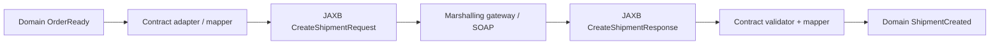
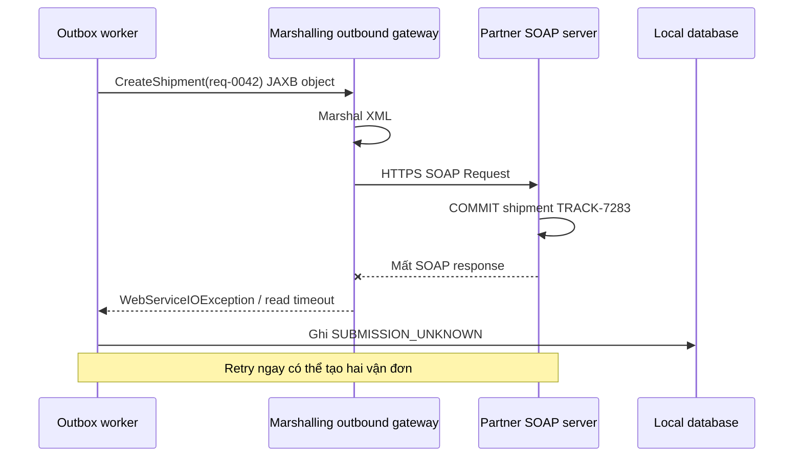

# Marshalling và unmarshalling

## 1. Bài toán: từ đối tượng Java tới SOAP contract của đối tác

Dịch vụ Spring Boot của một nền tảng bán hàng đã xử lý `ORDER_READY` và cần tạo vận đơn ở hệ thống logistics cung cấp **SOAP**. Phía đối tác công bố WSDL/XSD: client phải gửi `CreateShipmentRequest` chứa `clientRequestId` và `orderId`; nếu thành công, họ trả `CreateShipmentResponse` với `trackingNumber` và `status`. Bên trong ứng dụng, nghiệp vụ lại muốn làm việc với **đối tượng Java có kiểu**, không đọc/sửa XML bằng cách nối chuỗi và tìm substring.

Đây là lúc **marshalling** và **unmarshalling** phát huy tác dụng. Spring Framework cung cấp **Spring OXM (Object/XML Mapping)** qua `Marshaller` và `Unmarshaller`; Spring Web Services (`Spring-WS`) dùng chúng trong `WebServiceTemplate`; Spring Integration cung cấp `MarshallingWebServiceInboundGateway` và `MarshallingWebServiceOutboundGateway` để đưa SOAP request–reply vào `MessageChannel` và `IntegrationFlow`.

Bài thuộc **Adapter Web Services** của module `SPRING_INTEGRATION_ADAPTERS` — học cách kết nối hệ thống ngoài bằng inbound/outbound adapter, gateway, poller và `MessageChannel`; thực hành hợp đồng message, lỗi và vòng đời kết nối tương tự File/SFTP/HTTP/JMS/AMQP/Kafka/database. Điểm nhấn của bài này là **hợp đồng XML chặt chẽ**: khi ánh xạ sai QName/namespace hoặc unmarshal dữ liệu không đáng tin, integration flow có thể xử lý sai nghiệp vụ dù HTTP trả 200.

### Mục tiêu học tập

1. Phân biệt marshalling, unmarshalling, SOAP serialization, Spring `Message<?>` và Java object serialization.
2. Thiết kế XSD/WSDL theo hướng **contract-first**, hiểu namespace, QName, thứ tự phần tử, `minOccurs`, `nillable`, `xs:decimal` và kiểu ngày giờ.
3. Tạo JAXB-annotated classes hoặc dùng classes sinh từ XSD, biết khi nào có `JAXBElement<T>` và `ObjectFactory`.
4. Cấu hình `Jaxb2Marshaller` với `setContextPath`/`setClassesToBeBound`, `setSchema`, `setSupportDtd` và `setProcessExternalEntities`.
5. Tích hợp marshalling inbound/outbound gateway bằng Java DSL; phân biệt `SimpleWebService*Gateway` và `MarshallingWebService*Gateway`.
6. Phân loại lỗi XML parse/XSD/JAXB, SOAP Fault, network timeout và lỗi nghiệp vụ; bảo vệ ứng dụng trước XXE, oversized XML và retry gây side effect lặp.
7. Thực hành round-trip, test XSD, `MockWebServiceServer`/`MockWebServiceClient`, MTOM và migration schema version.

> **Phiên bản tham chiếu:** Spring Integration **6.5.x**, Spring Framework **6.2.x**, Spring Web Services **4.x**, Java 17+ và Spring Boot dùng dependency management tương thích. JAXB API trên Jakarta stack là `jakarta.xml.bind.*`; Java XML transform API vẫn là `javax.xml.transform.*` (JAXP). `example.test`, `urn:demo:shipping:v1` và mã vận đơn là dữ liệu giả. Không trộn runtime `javax.xml.bind` đời cũ với Jakarta stack.

## 2. Khái niệm cốt lõi và thuật ngữ thường bị nhầm

**Marshalling** chuyển một object graph Java thành biểu diễn XML phù hợp JAXB binding/hợp đồng schema. **Unmarshalling** đọc XML thành một object graph Java theo binding class. Đây không phải việc convert object Java sang bytes của Java serialization, cũng không phải tự động bọc XML vào SOAP Envelope.

```mermaid
flowchart LR
    A["CreateShipmentRequest (Java object)"] -->|Marshaller| B["XML Body payload (Source/Result)"]
    B -->|Spring-WS SOAP MessageFactory| C["SOAP Envelope + Header + Body"]
    C -->|HTTPS| D["Partner SOAP endpoint"]
    D -->|SOAP response| E["XML Body response"]
    E -->|Unmarshaller| F["CreateShipmentResponse (Java object)"]
    F --> G["Business validation + DB commit"]
```



| Thuật ngữ | Input → Output | Ví dụ và giới hạn |
| --- | --- | --- |
| **Marshalling** | Java object → XML `Result` | `Marshaller.marshal(request, result)`; **không** tự gửi HTTP |
| **Unmarshalling** | XML `Source` → Java object | `Unmarshaller.unmarshal(source)`; XML có thể không đáng tin |
| **Serialization SOAP** | XML payload → SOAP Envelope (+ Header, Fault, MTOM) | `WebServiceMessageFactory`/`SoapMessage` |
| **Spring message** | `Message<payload>` + `MessageHeaders` | Dùng trong `MessageChannel`, không phải SOAP Envelope |
| **JAXB `JAXBContext`** | Metadata binding giữa classes và XML | Có thể tái sử dụng; khởi tạo có chi phí |
| **`JAXBElement<T>`** | Giá trị Java + QName/root element metadata | Cần với generated types không có `@XmlRootElement` |
| **XSD validation** | XML/object serialization ↔ XML Schema | Kiểm tra hình dạng contract, **không** phân quyền nghiệp vụ |
| **Business validation** | Object/request ↔ rule của hệ thống | Kiểm tra tenant, đơn hàng, giá trị cho phép, idempotency |

### Một câu quan trọng

`marshaller.marshal(request, result)` tạo XML, nhưng **không chứng minh** SOAP server đã nhận hay tạo vận đơn. `unmarshaller.unmarshal(source)` tạo object, nhưng **không chứng minh** object đó hợp toàn bộ business contract, đã được xác thực hoặc nguồn XML đáng tin cậy.

## 3. Marshalling nằm ở đâu trong Spring Integration WS?

Trong Spring Integration 6.5 có hai cặp gateway:

| Chiều | Simple gateway | Marshalling gateway |
| --- | --- | --- |
| **Inbound** — đối tác gọi SOAP vào ứng dụng | `SimpleWebServiceInboundGateway`: đưa `Source` của SOAP Body vào `MessageChannel` | `MarshallingWebServiceInboundGateway`: **unmarshal** SOAP Body thành object rồi đưa vào channel; **marshal** reply object ra XML |
| **Outbound** — ứng dụng gọi SOAP đối tác | `SimpleWebServiceOutboundGateway`: nhận `String` hoặc `Source`, trả XML payload | `MarshallingWebServiceOutboundGateway`: **marshal** request object, gửi SOAP, **unmarshal** response thành object |

```mermaid
flowchart TD
    subgraph Inbound["SOAP inbound"]
        A["Partner SOAP request"] --> B["MessageDispatcherServlet"]
        B --> C["EndpointMapping → MarshallingWebServiceInboundGateway"]
        C --> D["Unmarshaller: XML → Java"]
        D --> E["MessageChannel → business handler"]
        E --> F["Marshaller: Java → XML"]
        F --> G["SOAP reply / Fault"]
    end
    subgraph Outbound["SOAP outbound"]
        H["MessageChannel<Java object>"] --> I["MarshallingWebServiceOutboundGateway"]
        I --> J["Marshaller: Java → XML"]
        J --> K["WebServiceTemplate → SOAP/HTTPS"]
        K --> L["Unmarshaller: XML → Java"]
        L --> M["Spring reply Message"]
    end
```



**Inbound** còn cần `MessageDispatcherServlet` và một Spring-WS `EndpointMapping` chọn gateway theo QName/SOAPAction/URI. Một inbound gateway bean **không tự tiếp nhận HTTP** nếu chưa được servlet mapping. **Outbound** cần endpoint URI hoặc `DestinationProvider` và transport; không cần servlet server-side chỉ để gọi SOAP ra ngoài.

Về hợp đồng payload, marshalling gateway nhận/trả **JAXB objects**; simple gateway nhận/trả **`Source`/`String` XML**. Không đặt hai loại trên cùng channel rồi giả định framework tự chọn theo payload nếu không có router/transformer tường minh.

## 4. XSD contract-first: nguồn chuẩn của cấu trúc XML

Giả sử phía logistics công bố namespace `urn:demo:shipping:v1` và operation `CreateShipment`. Bản XSD minh họa dưới đây có **hai top-level elements** và một số ràng buộc cơ bản:

```xml
<?xml version="1.0" encoding="UTF-8"?>
<xs:schema xmlns:xs="http://www.w3.org/2001/XMLSchema"
           xmlns:ship="urn:demo:shipping:v1"
           targetNamespace="urn:demo:shipping:v1"
           elementFormDefault="qualified">

  <xs:simpleType name="RequestIdType">
    <xs:restriction base="xs:string">
      <xs:minLength value="1"/>
      <xs:maxLength value="100"/>
    </xs:restriction>
  </xs:simpleType>

  <xs:simpleType name="ShipmentStatusType">
    <xs:restriction base="xs:string">
      <xs:enumeration value="CREATED"/>
      <xs:enumeration value="REJECTED"/>
    </xs:restriction>
  </xs:simpleType>

  <xs:element name="CreateShipmentRequest">
    <xs:complexType>
      <xs:sequence>
        <xs:element name="clientRequestId" type="ship:RequestIdType"/>
        <xs:element name="orderId" type="xs:string"/>
      </xs:sequence>
    </xs:complexType>
  </xs:element>

  <xs:element name="CreateShipmentResponse">
    <xs:complexType>
      <xs:sequence>
        <xs:element name="clientRequestId" type="ship:RequestIdType"/>
        <xs:element name="trackingNumber" type="xs:string"
                    minOccurs="0"/>
        <xs:element name="status" type="ship:ShipmentStatusType"/>
      </xs:sequence>
    </xs:complexType>
  </xs:element>
</xs:schema>
```

Tên file giả định `shipping-v1.xsd`; muốn chạy `setSchema(new ClassPathResource("shipping-v1.xsd"))`, người học cần lưu XSD này vào classpath `src/main/resources/shipping-v1.xsd`. Theo ràng buộc STEP 4, worker chỉ ghi Markdown và YAML được giao, **không tạo file XSD thực tế**.

### Ý nghĩa từng thành phần hợp đồng

- **Namespace + local name:** `{urn:demo:shipping:v1}CreateShipmentRequest` là QName của root element. Prefix `ship` có thể đổi thành `s` mà vẫn cùng QName; đổi namespace `v1` sang `v2` là **khác contract**.
- **`elementFormDefault="qualified"`:** local child elements cũng thuộc namespace `urn:demo:shipping:v1`.
- **`xs:sequence`:** thứ tự `clientRequestId` rồi `orderId` là một phần của contract, không được đảo tùy tiện.
- **`minOccurs="0"`:** `trackingNumber` có thể vắng mặt, ví dụ khi `status=REJECTED`. Điều này khác phần tử xuất hiện với `xsi:nil="true"` khi XSD có `nillable="true"`.
- **`xs:enumeration`:** response `status=APPROVED` không hợp XSD; nếu code JAXB chỉ dùng `String` mà không validate schema, có thể vẫn parse được rồi gây lỗi business.
- **`xs:string`:** không bảo đảm customer/order hợp lệ, thuộc tenant nào hay tracking number thực sự tồn tại.

Với các hệ thống tài chính, `xs:decimal` nên map sang `BigDecimal`, **không** chuyển tùy tiện sang `double` để tránh sai số. Với `xs:dateTime`, generated JAXB classes có thể dùng `XMLGregorianCalendar`; khi đổi sang `Instant`/`OffsetDateTime` cần xác định timezone và policy chuẩn hóa.

### WSDL và QName

XSD định nghĩa **message shape**; WSDL thêm `portType/operation/binding/soapAction/endpoint`. Spring OXM **không đọc WSDL mỗi lần marshal** để xác định action, URL hoặc TLS: các phần này thuộc `WebServiceTemplate`/gateway. Đừng coi XML parse thành công là bằng chứng SOAP 1.1 hay 1.2 binding đã đúng.

## 5. Dependencies và công cụ sinh classes từ XSD

Với Spring Boot BOM tương thích Spring Integration 6.5:

```groovy
dependencies {
    implementation 'org.springframework.boot:spring-boot-starter-integration'
    implementation 'org.springframework.integration:spring-integration-ws'
    implementation 'org.springframework.boot:spring-boot-starter-web-services'
    // Kiểm tra JAXB API/runtime trong dependency tree của BOM;
    // thêm runtime Jakarta JAXB phù hợp nếu build chưa có.
    testImplementation 'org.springframework.boot:spring-boot-starter-test'
    testImplementation 'org.springframework.ws:spring-ws-test'
}
```

**Spring OXM** cung cấp `org.springframework.oxm.Marshaller`/`Unmarshaller` và `Jaxb2Marshaller`; Spring-WS cung cấp `WebServiceTemplate`, SOAP message factory và test client/server; Spring Integration WS cung cấp các messaging gateways. Không thay thế `spring-integration-ws` bằng `spring-integration-http` nếu bài toán cần SOAP semantics.

Trong dự án **contract-first**, nên dùng JAXB/XJC code generation từ XSD/WSDL đã được đối tác phê duyệt, pin schema version và tool version trong build. Build có thể sinh `ObjectFactory`, `@XmlType`, `@XmlElement`, `@XmlRootElement` hoặc wrapper `JAXBElement<T>`. Đừng chỉnh tay generated classes vì lần generate sau có thể ghi đè; đặt custom domain mapping ở lớp adapter riêng.

**Không dùng `javax.xml.bind.*` như ở Java 8** trong runtime Jakarta 3+/Spring-WS 4 nếu dự án đang dùng `jakarta.xml.bind.*`. Riêng `javax.xml.transform.Source`/`Result` là JAXP và vẫn đúng trên Java 17.

## 6. JAXB model có kiểu, root QName và thứ tự field

Để bài tự chứa, ta minh họa JAXB-annotated classes. Trong code production, ưu tiên **generated classes từ XSD** thay vì tự viết; các ví dụ ở đây biểu diễn hình dạng tương tự.

```java
// src/main/java/com/example/shipping/xml/CreateShipmentRequest.java
package com.example.shipping.xml;

import jakarta.xml.bind.annotation.XmlAccessType;
import jakarta.xml.bind.annotation.XmlAccessorType;
import jakarta.xml.bind.annotation.XmlElement;
import jakarta.xml.bind.annotation.XmlRootElement;
import jakarta.xml.bind.annotation.XmlType;

@XmlRootElement(name = "CreateShipmentRequest",
        namespace = "urn:demo:shipping:v1")
@XmlAccessorType(XmlAccessType.FIELD)
@XmlType(propOrder = {"clientRequestId", "orderId"})
public class CreateShipmentRequest {
    @XmlElement(required = true)
    private String clientRequestId;

    @XmlElement(required = true)
    private String orderId;

    public CreateShipmentRequest() { }  // JAXB cần constructor no-arg.

    public CreateShipmentRequest(String clientRequestId, String orderId) {
        this.clientRequestId = clientRequestId;
        this.orderId = orderId;
    }

    public String getClientRequestId() { return clientRequestId; }
    public String getOrderId() { return orderId; }
}
```

```java
// src/main/java/com/example/shipping/xml/CreateShipmentResponse.java
package com.example.shipping.xml;

import jakarta.xml.bind.annotation.XmlAccessType;
import jakarta.xml.bind.annotation.XmlAccessorType;
import jakarta.xml.bind.annotation.XmlElement;
import jakarta.xml.bind.annotation.XmlRootElement;
import jakarta.xml.bind.annotation.XmlType;

@XmlRootElement(name = "CreateShipmentResponse",
        namespace = "urn:demo:shipping:v1")
@XmlAccessorType(XmlAccessType.FIELD)
@XmlType(propOrder = {"clientRequestId", "trackingNumber", "status"})
public class CreateShipmentResponse {
    @XmlElement(required = true)
    private String clientRequestId;

    @XmlElement
    private String trackingNumber;

    @XmlElement(required = true)
    private String status;

    public CreateShipmentResponse() { }

    public CreateShipmentResponse(
            String clientRequestId, String trackingNumber, String status) {
        this.clientRequestId = clientRequestId;
        this.trackingNumber = trackingNumber;
        this.status = status;
    }

    public String getClientRequestId() { return clientRequestId; }
    public String getTrackingNumber() { return trackingNumber; }
    public String getStatus() { return status; }
}
```

Để **child elements** đúng namespace `qualified` theo XSD, khai báo `package-info.java` trong cùng package:

```java
@jakarta.xml.bind.annotation.XmlSchema(
    namespace = "urn:demo:shipping:v1",
    elementFormDefault =
        jakarta.xml.bind.annotation.XmlNsForm.QUALIFIED)
package com.example.shipping.xml;
```

JAXB marshaller có thể sinh prefix `ns2` thay vì `ship`. **Prefix khác không phải lỗi** nếu namespace URI và QName đúng. Ngược lại, thiếu `@XmlSchema`/element namespace khi XSD yêu cầu `qualified` sẽ tạo child elements sai namespace; XML nhìn “giống hệt” khi đọc mắt nhưng bị reject bởi validator/partner.

**`@XmlElement(required=true)` không thay XSD validation.** Nó ảnh hưởng metadata JAXB/XSD generation; đừng giả định một field `null` luôn bị chặn khi marshal nếu chưa bật schema validation. Với `trackingNumber` optional, business logic phải kiểm tra rằng `status=CREATED` không có `trackingNumber` là một trường hợp bất thường cần xử lý.

## 7. `Jaxb2Marshaller` làm bean Spring OXM

`Jaxb2Marshaller` triển khai cả `Marshaller` và `Unmarshaller`. Với hai JAXB classes được định nghĩa ở mục 6 và bản XSD được đưa vào classpath:

```java
package com.example.shipping.config;

import com.example.shipping.xml.CreateShipmentRequest;
import com.example.shipping.xml.CreateShipmentResponse;

import org.springframework.context.annotation.Bean;
import org.springframework.context.annotation.Configuration;
import org.springframework.core.io.ClassPathResource;
import org.springframework.oxm.jaxb.Jaxb2Marshaller;

@Configuration
public class ShippingXmlBindingConfiguration {

    @Bean
    public Jaxb2Marshaller shippingMarshaller() {
        Jaxb2Marshaller mapper = new Jaxb2Marshaller();
        mapper.setClassesToBeBound(
                CreateShipmentRequest.class,
                CreateShipmentResponse.class);
        mapper.setSchema(new ClassPathResource("shipping-v1.xsd"));
        mapper.setSupportDtd(false);
        mapper.setProcessExternalEntities(false);
        mapper.setMtomEnabled(false);
        return mapper;
    }
}
```

Trong một dự án có **generated package** chứa `ObjectFactory`, có thể thay `setClassesToBeBound(...)` bằng `setContextPath("com.example.partner.shipping.v1")`, hoặc `setPackagesToScan(...)` theo yêu cầu. Chọn **một chiến lược binding có chủ đích** để dễ audit/version. `setSchema(...)` xác nhận theo XSD khi marshal/unmarshal, nhưng còn phải kiểm soát XML parser **ở mọi tầng trước khi dữ liệu đến OXM**.

| Cấu hình | Vai trò | Cảnh báo |
| --- | --- | --- |
| `setContextPath(packageName)` | JAXBContext tìm binding classes/ObjectFactory trong package | Package phải có binding metadata |
| `setClassesToBeBound(...)` | Đăng ký tập classes cụ thể | Root elements và loại nested types phải có binding hợp lệ |
| `setPackagesToScan(...)` | Tìm JAXB-annotated classes theo package | Scan rộng làm thời gian startup/các types khó kiểm soát |
| `setSchema(Resource)` / `setSchemas(...)` | Validate theo XSD | Schema resource/imports cần trust policy và có thật |
| `setSupportDtd(false)` | Không cho phép DTD | Mặc định false; nên viết rõ khi cần audit |
| `setProcessExternalEntities(false)` | Không resolve external entities cho các dạng Source mà Spring quản lý | **Không** thay hardening của DOM/StAX Source do caller tự tạo |
| `setMtomEnabled(true)` | Hỗ trợ XOP/MTOM khi binding và SOAP factory phù hợp | Không tự biến mọi `byte[]` thành attachment |
| `setMarshallerProperties(...)` | Cấu hình JAXB marshal, ví dụ formatted output | Pretty-print XML làm tăng bytes, không là contract validation |
| `setValidationEventHandler(...)` | Tùy biến xử lý validation events | Không nuốt invalid XML rồi coi là hợp lệ |

**Thread-safety:** `Jaxb2Marshaller` là Spring bean có thể tái sử dụng và quản lý JAXBContext; không tự giữ một instance `jakarta.xml.bind.Marshaller` hoặc `Unmarshaller` mutable rồi dùng đồng thời trên nhiều threads. Khi dùng XML adapter/custom listener, phải đánh giá thread-safety và tránh giữ request-specific state trên singleton.

## 8. Round-trip: Java → XML → Java không qua mạng

Thực hành trước với OXM **không cần SOAP endpoint**: gọi marshaller bằng `StringResult`, lấy XML; đưa lại vào unmarshaller qua `StringSource`. Test này tách lỗi JAXB/XSD khỏi lỗi HTTP/TLS/WS-Security.

```java
import com.example.shipping.xml.CreateShipmentRequest;
import org.springframework.oxm.Marshaller;
import org.springframework.oxm.Unmarshaller;
import org.springframework.xml.transform.StringResult;
import org.springframework.xml.transform.StringSource;

public final class ShippingXmlRoundTrip {

    private final Marshaller marshaller;
    private final Unmarshaller unmarshaller;

    public ShippingXmlRoundTrip(
            Marshaller marshaller, Unmarshaller unmarshaller) {
        this.marshaller = marshaller;
        this.unmarshaller = unmarshaller;
    }

    public CreateShipmentRequest execute() throws Exception {
        var request = new CreateShipmentRequest("req-0042", "O-9001");

        var xml = new StringResult();
        marshaller.marshal(request, xml);

        // StringResult chứa XML Body payload, KHÔNG chứa SOAP Envelope.
        Object value = unmarshaller.unmarshal(
                new StringSource(xml.toString()));

        if (!(value instanceof CreateShipmentRequest parsed)) {
            throw new IllegalStateException(
                    "JAXB binding trả type không đúng contract");
        }
        return parsed;
    }
}
```

Với generated bindings, `Unmarshaller.unmarshal(Source)` có thể trả `JAXBElement<CreateShipmentRequest>` thay vì instance class trực tiếp. Không coi đó là lỗi: cần kiểm tra `getName()` và `getValue()` theo QName/Java type, xem mục tiếp theo. **StringResult XML thành công** là điều kiện kỹ thuật cần nhưng không đủ: còn phải test namespace, field order, schema và encoding.

## 9. `@XmlRootElement`, `JAXBElement<T>` và `ObjectFactory`

JAXB phải biết **root element QName** khi marshal/unmarshal. Hai trường hợp dễ gặp:

- Class có `@XmlRootElement(name=..., namespace=...)`: JAXB thường có đủ root metadata để marshal trực tiếp. Ví dụ `CreateShipmentRequest` ở mục 6.
- Generated class chỉ có `@XmlType` và không có `@XmlRootElement`: XJC có thể sinh `ObjectFactory` chứa `@XmlElementDecl` để tạo `JAXBElement<T>` với QName đúng. Khi ấy phải marshal **wrapper**, không marshal raw class rồi hy vọng JAXB tự đoán root.

Ví dụ một factory học tập, **chỉ dùng khi generated classes chưa cung cấp factory**:

```java
package com.example.shipping.xml;

import javax.xml.namespace.QName;
import jakarta.xml.bind.JAXBElement;
import jakarta.xml.bind.annotation.XmlElementDecl;
import jakarta.xml.bind.annotation.XmlRegistry;

@XmlRegistry
public class ShippingObjectFactory {
    private static final QName REQUEST_NAME = new QName(
            "urn:demo:shipping:v1", "CreateShipmentRequest");

    @XmlElementDecl(namespace = "urn:demo:shipping:v1",
            name = "CreateShipmentRequest")
    public JAXBElement<CreateShipmentRequest> createRequest(
            CreateShipmentRequest value) {
        return new JAXBElement<>(
                REQUEST_NAME, CreateShipmentRequest.class, null, value);
    }
}
```

Khi `setClassesToBeBound(...)` đi cùng một class đã có `@XmlRootElement`, thường **không cần wrapper**. Đoạn factory ở trên giải thích định dạng của code generator, không yêu cầu tạo file factory mới trong cùng project với model ở mục 6. Trong production, dùng `ObjectFactory` do XJC sinh cho đúng WSDL/XSD; đừng tự định nghĩa thêm cùng QName rồi tạo metadata binding mâu thuẫn.

### Unwrap kết quả một cách an toàn

```java
import com.example.shipping.xml.CreateShipmentResponse;

import javax.xml.namespace.QName;
import jakarta.xml.bind.JAXBElement;

public final class ShippingResponseUnwrapper {
    private static final QName RESPONSE_QNAME =
            new QName("urn:demo:shipping:v1", "CreateShipmentResponse");

    public static CreateShipmentResponse unwrap(Object value) {
        if (value instanceof CreateShipmentResponse response) {
            return response;
        }
        if (value instanceof JAXBElement<?> wrapped
                && RESPONSE_QNAME.equals(wrapped.getName())
                && wrapped.getValue() instanceof CreateShipmentResponse response) {
            return response;
        }
        throw new IllegalArgumentException(
                "SOAP response type/QName khác hợp đồng");
    }
}
```

**Không chỉ kiểm tra `getValue() instanceof CreateShipmentResponse`** mà bỏ qua `getName()` nếu cùng Java class có thể được bind cho nhiều XML roots. Nếu đối tác gửi một phần tử ở namespace khác, vẫn phải reject. Khi dùng generated classes có `@XmlRootElement`, cần kết hợp XSD validation để bảo đảm QName, không chỉ nhận object đúng Java type.

## 10. Mapping kiểu dữ liệu: số, ngày giờ, enum và giá trị vắng mặt

| XSD/JAXB | Java type điển hình | Điều dễ sai |
| --- | --- | --- |
| `xs:string` | `String` | Ký tự Unicode, trim, maxLength và blank vs null |
| `xs:decimal` | `BigDecimal` | Chuyển sang `double` gây sai số |
| `xs:int` / `xs:long` | `int`/`Integer`, `long`/`Long` | Giá trị null nếu optional; overflow |
| `xs:dateTime` | `XMLGregorianCalendar` (generated JAXB) | Thiếu timezone, chuyển `Instant` sai offset |
| `xs:date` | `XMLGregorianCalendar` | Không được tự xem là UTC timestamp |
| `xs:boolean` | `boolean`/`Boolean` | `null` khác false khi optional |
| `xs:base64Binary` | `byte[]` hoặc `DataHandler` theo binding | Memory, MTOM, stream và size quota |
| `xs:enumeration` | `@XmlEnum` Java enum hoặc String | Enum mới của đối tác có thể làm unmarshal fail |
| `minOccurs="0"` | Field có thể `null`/vắng mặt | Khác `nillable="true"` |
| `xsi:nil="true"` | Null theo schema và JAXB binding | Chỉ hợp lệ nếu schema cho phép nil |

Ví dụ mapper nghiệp vụ chuyển tiền tệ an toàn:

```java
import java.math.BigDecimal;

public static BigDecimal validateAmount(BigDecimal raw) {
    if (raw == null || raw.signum() < 0 || raw.scale() > 2) {
        throw new IllegalArgumentException(
                "Số tiền không hợp lệ theo policy");
    }
    return raw;
}
```

Đây chỉ là **business rule** ví dụ; XSD có thể cho phép scale rộng hơn và service phải thống nhất chính sách làm tròn với đối tác. Với timestamp, cần chuẩn hóa timezone **tại adapter boundary**; khi dữ liệu là ngày lịch không có timezone, không được tự cộng `Z` mà làm thay đổi ý nghĩa.

Khi đối tác thêm một enum mới hoặc field bắt buộc trong v2, **không** bắt JAXB parser “điền default” vô điều kiện để tiếp tục commit. Cần versioned bindings và contract migration plan.

## 11. Marshalling inbound gateway: SOAP XML → Java request → Java reply

Khi đối tác gọi SOAP vào ứng dụng, một `MarshallingWebServiceInboundGateway` kết nối Spring-WS server với Spring Integration. Ở đây:

1. `MessageDispatcherServlet` nhận HTTP/SOAP request.
2. `PayloadRootQNameEndpointMapping` chọn gateway dựa trên QName `CreateShipmentRequest`.
3. Gateway gọi `Unmarshaller` với **SOAP Body payload**, đưa `CreateShipmentRequest` vào request channel.
4. Service activator xử lý object và trả `CreateShipmentResponse`.
5. Gateway gọi `Marshaller` để tạo response XML và Spring-WS bọc SOAP Envelope.

### Cấu hình gateway + servlet + endpoint mapping

```java
import java.util.Map;

import org.springframework.beans.factory.annotation.Qualifier;
import org.springframework.boot.web.servlet.ServletRegistrationBean;
import org.springframework.context.ApplicationContext;
import org.springframework.context.annotation.Bean;
import org.springframework.context.annotation.Configuration;
import org.springframework.integration.channel.DirectChannel;
import org.springframework.integration.ws.MarshallingWebServiceInboundGateway;
import org.springframework.messaging.MessageChannel;
import org.springframework.oxm.jaxb.Jaxb2Marshaller;
import org.springframework.ws.server.endpoint.mapping.PayloadRootQNameEndpointMapping;
import org.springframework.ws.transport.http.MessageDispatcherServlet;

@Configuration
public class InboundShipmentSoapConfiguration {
    public static final String REQUEST_QNAME =
            "{urn:demo:shipping:v1}CreateShipmentRequest";

    @Bean
    public ServletRegistrationBean<MessageDispatcherServlet> shippingWsServlet(
            ApplicationContext context) {
        MessageDispatcherServlet servlet = new MessageDispatcherServlet();
        servlet.setApplicationContext(context);
        return new ServletRegistrationBean<>(servlet, "/ws/*");
    }

    @Bean
    public MessageChannel inboundShipmentObjects() {
        return new DirectChannel();
    }

    @Bean
    public MarshallingWebServiceInboundGateway inboundShipmentGateway(
            @Qualifier("inboundShipmentObjects") MessageChannel channel,
            Jaxb2Marshaller shippingMarshaller) {
        MarshallingWebServiceInboundGateway gateway =
                new MarshallingWebServiceInboundGateway(shippingMarshaller);
        gateway.setRequestChannel(channel);
        gateway.setRequestTimeout(5_000L);
        gateway.setReplyTimeout(10_000L);
        return gateway;
    }

    @Bean
    public PayloadRootQNameEndpointMapping inboundShipmentEndpointMapping(
            MarshallingWebServiceInboundGateway inboundShipmentGateway) {
        PayloadRootQNameEndpointMapping mapping =
                new PayloadRootQNameEndpointMapping();
        mapping.setEndpointMap(
                Map.of(REQUEST_QNAME, inboundShipmentGateway));
        return mapping;
    }
}
```

**Một ràng buộc khi dùng Spring Boot:** starter web-services có thể tự đăng ký `MessageDispatcherServlet`. Nếu auto-config đã map servlet, **không đăng ký servlet thứ hai** trùng `/ws/*`. Chọn cách explicit **hoặc** Boot auto-config, chạy test GET WSDL/POST SOAP để xác nhận route. Gateway bean cần mapping tường minh; chỉ có `@Bean MarshallingWebServiceInboundGateway` chưa đủ để servlet tìm thấy.

### Service activator nhận object, trả object

```java
import com.example.shipping.xml.CreateShipmentRequest;
import com.example.shipping.xml.CreateShipmentResponse;

import org.springframework.beans.factory.annotation.Qualifier;
import org.springframework.context.annotation.Bean;
import org.springframework.context.annotation.Configuration;
import org.springframework.integration.dsl.IntegrationFlow;
import org.springframework.messaging.MessageChannel;

@Configuration
public class InboundShipmentProcessingFlow {

    @Bean
    public IntegrationFlow handleInboundShipment(
            @Qualifier("inboundShipmentObjects") MessageChannel requests) {

        return IntegrationFlow.from(requests)
                .handle(CreateShipmentRequest.class, (request, headers) -> {
                    if (request.getClientRequestId() == null
                            || request.getOrderId() == null) {
                        throw new IllegalArgumentException(
                                "Missing business fields");
                    }
                    // Chỉ là giả lập: thực tế phải xác thực caller/tenant,
                    // idempotency, DB commit và correlation.
                    return new CreateShipmentResponse(
                            request.getClientRequestId(),
                            "TRACK-DEMO-001",
                            "CREATED");
                })
                .get();
    }
}
```

Ở đây `DirectChannel` chạy handler đồng bộ rồi reply về gateway qua reply channel tạm. Nếu handler không trả reply hoặc công việc quá lâu, gateway có thể timeout; **timeout không tự rollback** side effect trong DB. Không để SOAP client retry tự động tạo hai vận đơn: cần unique `(authenticatedTenant, clientRequestId)` và lưu response idempotent.

### Phương án Java DSL tạo gateway ở đầu flow

Thay vì khai báo `MarshallingWebServiceInboundGateway` và `IntegrationFlow.from(requestChannel)` riêng, Spring Integration 6.5 hỗ trợ:

```java
@Bean
public IntegrationFlow inboundMarshalledDsl(
        Jaxb2Marshaller shippingMarshaller,
        InboundShipmentObjectHandler handler) {
    return IntegrationFlow.from(
                    Ws.marshallingInboundGateway()
                            .marshaller(shippingMarshaller)
                            .unmarshaller(shippingMarshaller)
                            .id("inboundShipmentDslGateway"))
            .handle(handler)
            .get();
}
```

`InboundShipmentObjectHandler` là service do ứng dụng định nghĩa. Đoạn DSL là **phương án thay thế**, cần import `IntegrationFlow`, `Ws` và cấu hình `PayloadRootQNameEndpointMapping` trỏ đúng bean gateway ID `inboundShipmentDslGateway`. **Không bật cả gateway explicit và DSL cùng map một QName**; sẽ gây route conflict. DSL không tự thay Spring-WS servlet/endpoint mapping.

## 12. Marshalling outbound gateway: Java request → SOAP → Java response

Ở chiều outbound, `MarshallingWebServiceOutboundGateway` marshal request object, gửi SOAP tới endpoint ngoài qua `WebServiceTemplate`, unmarshal SOAP reply thành object. Đây là **request–reply**, không phải “fire and forget”.

### Java DSL — tự cung cấp marshaller/unmarshaller

```java
import java.time.Duration;

import org.springframework.beans.factory.annotation.Value;
import org.springframework.context.annotation.Bean;
import org.springframework.context.annotation.Configuration;
import org.springframework.integration.channel.DirectChannel;
import org.springframework.integration.dsl.IntegrationFlow;
import org.springframework.integration.ws.dsl.Ws;
import org.springframework.messaging.MessageChannel;
import org.springframework.oxm.jaxb.Jaxb2Marshaller;
import org.springframework.ws.transport.http.HttpUrlConnectionMessageSender;

@Configuration
public class OutboundShipmentSoapFlow {

    @Bean
    public MessageChannel outboundShipmentObjects() {
        return new DirectChannel();
    }

    @Bean
    public IntegrationFlow sendShipmentToPartner(
            MessageChannel outboundShipmentObjects,
            Jaxb2Marshaller shippingMarshaller,
            @Value("${app.shipping.endpoint}") String endpoint) {

        HttpUrlConnectionMessageSender sender =
                new HttpUrlConnectionMessageSender();
        sender.setConnectionTimeout(Duration.ofSeconds(5));
        sender.setReadTimeout(Duration.ofSeconds(20));

        return IntegrationFlow.from(outboundShipmentObjects)
                .handle(Ws.marshallingOutboundGateway()
                        .uri(endpoint)
                        .marshaller(shippingMarshaller)
                        .unmarshaller(shippingMarshaller)
                        .messageSenders(sender))
                .get();
    }
}
```

`app.shipping.endpoint` lấy từ cấu hình/secret registry có allowlist host; không nhận URI do một HTTP client tự ý cung cấp vì có rủi ro **SSRF**. Các timeout tính bằng `Duration` theo Spring-WS 4.x HTTP sender. **Connect/read timeout không phải end-to-end deadline** và không chứng minh partner chưa commit khi client thấy exception.

### Producer gọi flow và nhận typed reply

```java
import com.example.shipping.xml.CreateShipmentRequest;
import com.example.shipping.xml.CreateShipmentResponse;

import org.springframework.beans.factory.annotation.Qualifier;
import org.springframework.integration.core.MessagingTemplate;
import org.springframework.integration.ws.WebServiceHeaders;
import org.springframework.messaging.Message;
import org.springframework.messaging.MessageChannel;
import org.springframework.messaging.support.MessageBuilder;
import org.springframework.stereotype.Service;

@Service
public class OutboundShipmentCaller {
    private final MessageChannel channel;

    public OutboundShipmentCaller(
            @Qualifier("outboundShipmentObjects") MessageChannel channel) {
        this.channel = channel;
    }

    public CreateShipmentResponse create(String requestId, String orderId) {
        Message<CreateShipmentRequest> request = MessageBuilder
                .withPayload(new CreateShipmentRequest(requestId, orderId))
                .setHeader(WebServiceHeaders.SOAP_ACTION,
                        "urn:demo:shipping:v1/CreateShipment")
                .build();

        MessagingTemplate messaging = new MessagingTemplate();
        messaging.setReceiveTimeout(25_000L);
        Message<?> reply = messaging.sendAndReceive(channel, request);
        if (reply == null) {
            throw new IllegalStateException(
                    "SOAP contract yêu cầu reply nhưng không có");
        }
        return ShippingResponseUnwrapper.unwrap(reply.getPayload());
    }
}
```

Gateway **tạo Spring reply message** từ object đã unmarshal, chứ không nhất thiết trả response cho lời gọi `channel.send(...)` thuần. `MessagingTemplate.sendAndReceive(...)` tạo reply channel tạm; với một `DirectChannel`, handler thực hiện lời gọi SOAP đồng bộ. Chuyển thành `ExecutorChannel` hoặc queue cần thiết kế lại timeout/ack/result contract: `send() == true` trên async channel chỉ chứng minh accepted để dispatch, không phải partner đã tạo vận đơn.

### Khi dùng external `WebServiceTemplate`

Nếu cần mTLS, proxy, connection pooling, WS-Security hoặc SOAP Fault policy riêng, cấu hình một `WebServiceTemplate` với `marshaller`/`unmarshaller`, `messageFactory`, `messageSender` và `ClientInterceptor` rồi dùng:

```java
// Đặt trong IntegrationFlow bean; template phải được cấu hình
// đầy đủ với JAXB/OXM và SOAP/HTTP transport:
.handle(Ws.marshallingOutboundGateway(template)
        .uri(endpoint)
        .headerMapper(soapHeaderMapper))
```

**Không trộn hai kiểu spec** rồi tưởng các setter của no-template spec sẽ cấu hình cùng thành phần trên external template. Khi external template đã có instance/config/secret, nó là nguồn chuẩn để quản lý transport và OXM; test thật phải chứng minh marshalling, SOAPAction, fault resolution và TLS được áp đúng.

## 13. `WebServiceTemplate.marshalSendAndReceive(...)`: không nhất thiết cần IntegrationFlow

Spring-WS cho phép gọi JAXB trực tiếp qua `WebServiceTemplate`. Đây là cách phù hợp cho một service client đơn giản, không cần router/channel, nhưng cùng dùng `Jaxb2Marshaller` đã cấu hình:

```java
import com.example.shipping.xml.CreateShipmentRequest;
import com.example.shipping.xml.CreateShipmentResponse;

import org.springframework.ws.client.core.WebServiceTemplate;
import org.springframework.ws.soap.client.core.SoapActionCallback;

public final class DirectShipmentSoapClient {
    private final WebServiceTemplate template;

    public DirectShipmentSoapClient(WebServiceTemplate template) {
        this.template = template;
    }

    public CreateShipmentResponse submit(String requestId, String orderId) {
        Object result = template.marshalSendAndReceive(
                new CreateShipmentRequest(requestId, orderId),
                new SoapActionCallback(
                        "urn:demo:shipping:v1/CreateShipment"));
        if (result == null) {
            throw new IllegalStateException(
                    "SOAP response rỗng, không đúng hợp đồng CreateShipment");
        }
        return ShippingResponseUnwrapper.unwrap(result);
    }
}
```

Để code chạy, `WebServiceTemplate` phải có `setDefaultUri(...)` hoặc dùng overload có URI, `setMarshaller(shippingMarshaller)` và `setUnmarshaller(shippingMarshaller)`. Nếu chưa cấu hình chúng, có thể gặp lỗi “No marshaller registered” hoặc “No unmarshaller registered”. `SoapActionCallback` đặt action theo WSDL; **không** làm authentication.

Không xây SOAP envelope bằng tay rồi gọi `marshalSendAndReceive` với `String` chứa envelope: phương thức này coi argument là **object cần marshal**, không phải raw XML. Khi đã có XML `Source`, dùng `sendSourceAndReceive...` hoặc **simple outbound gateway**.

## 14. SOAP Body XML, SOAP Envelope, SOAPAction và header mapper

Marshalling trong Spring-WS thường thao tác trên **SOAP Body payload**, không phải toàn bộ SOAP Envelope. Khi client gửi:

```xml
<ship:CreateShipmentRequest xmlns:ship="urn:demo:shipping:v1">
  <ship:clientRequestId>req-0042</ship:clientRequestId>
  <ship:orderId>O-9001</ship:orderId>
</ship:CreateShipmentRequest>
```

`Jaxb2Marshaller` tạo root element ở trên. `SaajSoapMessageFactory`/`WebServiceTemplate` đặt nó vào Body của SOAP 1.1/1.2:

```xml
<soapenv:Envelope
    xmlns:soapenv="http://schemas.xmlsoap.org/soap/envelope/"
    xmlns:ship="urn:demo:shipping:v1">
  <soapenv:Header/>
  <soapenv:Body>
    <ship:CreateShipmentRequest>
      <ship:clientRequestId>req-0042</ship:clientRequestId>
      <ship:orderId>O-9001</ship:orderId>
    </ship:CreateShipmentRequest>
  </soapenv:Body>
</soapenv:Envelope>
```

**Đừng marshal một class đại diện cả `soapenv:Envelope` rồi lại đưa qua `WebServiceTemplate.marshalSendAndReceive`**: SOAP envelope sẽ bị lồng, hoặc nhà cung cấp trả SOAP Fault `Client/Sender` do body sai QName.

### SOAPAction khác root QName

- **Root QName** đến từ `@XmlRootElement`/`JAXBElement`/XSD: ví dụ `{urn:demo:shipping:v1}CreateShipmentRequest`.
- **SOAPAction** theo WSDL binding được đặt bởi `SoapActionCallback` hoặc `WebServiceHeaders.SOAP_ACTION`, ví dụ `urn:demo:shipping:v1/CreateShipment`.
- **WS-Addressing `wsa:Action`** là một SOAP Header khác, dùng `ActionCallback` từ WS-Addressing nếu policy đối tác yêu cầu.
- **Spring Integration header mapper** mặc định map SOAPAction; SOAP custom headers cần allowlist tường minh, không tự chuyển tất cả JAXB object fields sang SOAP Header.

Ví dụ cấu hình mapper cho một metadata được phép:

```java
import org.springframework.context.annotation.Bean;
import org.springframework.integration.ws.DefaultSoapHeaderMapper;
import org.springframework.integration.ws.WebServiceHeaders;

@Bean
public DefaultSoapHeaderMapper shippingSoapHeaders() {
    DefaultSoapHeaderMapper mapper = new DefaultSoapHeaderMapper();
    mapper.setRequestHeaderNames(
            WebServiceHeaders.SOAP_ACTION, "ClientRequestId");
    mapper.setReplyHeaderNames(
            WebServiceHeaders.SOAP_ACTION, "PartnerReceiptId");
    return mapper;
}
```

Khi gửi một **custom header** thông qua `DefaultSoapHeaderMapper`, giá trị có thể là `Source` chứa XML element QName theo namespace partner yêu cầu. Đừng dùng `*` để map toàn bộ Spring message headers: có thể vô tình xuất `replyChannel`/`errorChannel`, token hoặc tenant metadata ra SOAP.

**Lỗi phổ biến:** gửi SOAPAction “CancelShipment” nhưng JAXB root là `CreateShipmentRequest`. Header này có thể do caller tự khai báo và không chứng minh quyền gọi operation. Luôn kiểm tra quyền người gọi/tenant và tính nhất quán của SOAPAction–QName–WSDL.

## 15. Kiểm tra XML Schema: JAXB parse được chưa chắc hợp contract

Có ba lớp validation cần phân biệt:

| Lớp | Kiểm tra | Không kiểm tra |
| --- | --- | --- |
| XML well-formed | XML đóng/mở tag, escape, namespace cú pháp | Required fields, types trong XSD |
| **XSD validation** | QName, thứ tự, `minOccurs/maxOccurs`, enum, data format | Người gọi có quyền, hóa đơn tồn tại |
| **Business validation** | Tenant/ownership, idempotency, trạng thái nghiệp vụ | XML parser/DTD có an toàn hay không |

`@XmlElement(required=true)` là metadata JAXB, **không phải một quy tắc Java Bean Validation tự động chạy khi unmarshal**. Nếu không bật `setSchema(...)`, một document thiếu phần tử bắt buộc có thể vẫn thành một POJO field `null`, rồi code sau đó ném `NullPointerException` hoặc xử lý sai.

**Cách bật XSD:** xem `shippingMarshaller()` ở mục 7 — `mapper.setSchema(new ClassPathResource("shipping-v1.xsd"))`. Trong test, phải kiểm tra **cả chiều marshal và unmarshal**:

1. Marshal request thiếu `clientRequestId`: mong validator từ chối khi contract yêu cầu.
2. Unmarshal response chứa `status=APPROVED`: schema enum chỉ cho CREATED/REJECTED, phải báo lỗi.
3. Unmarshal child `orderId` thuộc namespace rỗng: namespace qualification sai, phải bị chặn.
4. Unmarshal trackingNumber dài quá business limit: ngay cả khi XSD mẫu chỉ là `xs:string`, business validation phải từ chối.
5. Thử response sai root `CreateShipmentRequest` ở chỗ yêu cầu `CreateShipmentResponse`: kiểm tra đúng QName, không chỉ kiểm tra instance Java.

### Xử lý `ValidationEventHandler`

`Jaxb2Marshaller#setValidationEventHandler(...)` cho phép tùy biến cách phản ứng khi JAXB schema validator báo event. **Không** cài một handler luôn trả `true` cho mọi `ERROR`/`FATAL_ERROR` để “cho phép tương thích”, rồi ghi DB như request hợp lệ. Nếu cần hỗ trợ schema mở rộng có chủ đích, phải giới hạn các loại extension được phép bằng contract/version rules và quan sát error metrics.

Một `Unmarshaller` tự tạo từ JAXB runtime có thể không có schema; `Jaxb2Marshaller` bean với schema và policies giúp chuẩn hóa hành vi trong cả Spring-WS client/server. Tuy nhiên nếu một tầng trước đó đã parse XML không an toàn thành DOM, `setSchema` **không xóa được side effect XXE** đã xảy ra khi parse.

## 16. Bảo mật unmarshalling: XXE, external entities và oversized XML

Unmarshalling là **ranh giới nhận dữ liệu bên ngoài**. XML từ client SOAP hoặc SOAP server đối tác phải được xem là **untrusted** cho đến khi qua TLS/auth, XML hardening, schema và business authorization.

### Nguy cơ

- **XXE/SSRF:** DTD/external entity cố đọc file nội bộ hoặc URL metadata service.
- **Entity expansion:** XML “billion laughs” làm tăng đột biến CPU/memory.
- **Oversized SOAP:** hàng triệu node, attributes, nested elements hoặc tệp MTOM không giới hạn.
- **Schema/DTD remote fetching:** XML/XSD import không có trust policy có thể tạo network request bất ngờ.
- **Type confusion:** unmarshal thành JAXB object đúng class nhưng root QName khác hoặc payload thuộc version khác.
- **XSLT/XPath injection:** cho người gửi tự chỉ định XPath/XSLT hay remote stylesheet.

`Jaxb2Marshaller` mặc định **không hỗ trợ DTD** và **không xử lý external entities**; viết rõ:

```java
mapper.setSupportDtd(false);
mapper.setProcessExternalEntities(false);
```

Theo Javadoc Spring OXM 6.2, `setProcessExternalEntities` chỉ áp được cho `SAXSource` hoặc `StreamSource` do `Jaxb2Marshaller` xử lý; **không bảo vệ `DOMSource` hoặc `StAXSource` đã được một parser khác tạo ra**. Nếu đã có `DOMSource` từ một XML parser không an toàn, external entity có thể đã được resolve **trước khi** JAXB nhận input.

### Nếu tự dựng DOM parser, phải harden chính parser ấy

```java
import javax.xml.XMLConstants;
import javax.xml.parsers.DocumentBuilderFactory;

public final class SecureXmlParserFactory {

    public static DocumentBuilderFactory newFactory() throws Exception {
        DocumentBuilderFactory factory =
                DocumentBuilderFactory.newInstance();
        factory.setNamespaceAware(true);
        factory.setFeature(XMLConstants.FEATURE_SECURE_PROCESSING, true);
        factory.setFeature(
                "http://apache.org/xml/features/disallow-doctype-decl", true);
        factory.setFeature(
                "http://xml.org/sax/features/external-general-entities", false);
        factory.setFeature(
                "http://xml.org/sax/features/external-parameter-entities", false);
        factory.setXIncludeAware(false);
        factory.setExpandEntityReferences(false);
        factory.setAttribute(XMLConstants.ACCESS_EXTERNAL_DTD, "");
        factory.setAttribute(XMLConstants.ACCESS_EXTERNAL_SCHEMA, "");
        return factory;
    }
}
```

Những feature/attribute có thể phụ thuộc JAXP provider; nếu một bảo vệ bắt buộc không được hỗ trợ, **fail configuration**, không silently bỏ qua. Không mở DTD hoặc `ACCESS_EXTERNAL_DTD=*` chỉ để vượt qua một tài liệu XML legacy lỗi. Kiểm soát tài nguyên của **Spring-WS MessageFactory/JAXB/Transformer/XSD parser** được dùng thật, không chỉ utility ở trên.

### Giới hạn kích thước và thời gian

HTTP/servlet/ingress phải giới hạn request bytes; SOAP client phải giới hạn response bytes. Unmarshaller có thể dựng object graph lớn: giới hạn XML depth, element count, string length, number of attachments, decoded bytes, parsing time và heap sử dụng. XSD validation **không phải** cơ chế tự động hạn chế tổng kích thước XML.

**Mẹo kiểm thử:** dùng dữ liệu giả cho XXE hoặc entity expansion, assert parser từ chối và không thực hiện outbound connection/file access; không thử những payload này trên môi trường chứa dữ liệu khách hàng thật.

## 17. Phân loại lỗi marshalling/unmarshalling so với SOAP và network

| Lỗi/exception thường gặp | Nơi phát sinh | Cách xử lý |
| --- | --- | --- |
| `org.springframework.oxm.MarshallingFailureException` | JAXB không thể tạo XML từ object | Sửa binding/root/field, không retry network |
| `org.springframework.oxm.UnmarshallingFailureException` | XML không thể map sang JAXB object | Quarantine response/alert schema drift |
| `org.springframework.oxm.ValidationFailureException` | XML vi phạm schema/validation policy | Trả SOAP Fault client hoặc fail partner integration |
| `jakarta.xml.bind.UnmarshalException` | Lỗi JAXB cấp thấp | Ghi category, không log nguyên XML/PII |
| `SoapFaultClientException` | Partner gửi SOAP Fault | Map theo Fault code/detail/WSDL, không coi là lỗi JAXB |
| `WebServiceTransportException` hoặc `WebServiceIOException` | HTTP/DNS/TLS/socket network | Retry có điều kiện; side effect có thể đã xảy ra |
| `MessageHandlingException` | Spring Integration handler bọc lỗi | Xem cause chain và message correlation |
| `ClassCastException` ở downstream | Reply thực tế là `JAXBElement`/version khác | Sửa type/QName guard, không “retry SOAP” |
| `NullPointerException` sau unmarshal | Field optional/missing không được validate | XSD/bean/business validation trước xử lý |

**Cùng một kết quả HTTP 200 có thể chứa** SOAP Fault của provider không chuẩn, XML không hợp XSD, response `REJECTED` hoặc dữ liệu business hợp lệ. Ngược lại HTTP 500 có thể là SOAP Fault đúng chuẩn hoặc trang HTML của proxy. Không dùng mỗi HTTP status hoặc tên exception để đánh dấu giao dịch thành công.

### SOAP Fault ở inbound

Khi request XML không hợp schema, một Spring-WS `PayloadValidatingInterceptor` hoặc một `EndpointExceptionResolver` như `SoapFaultMappingExceptionResolver` có thể trả SOAP Fault theo hợp đồng. Không gửi `ValidationFailureException.toString()` và Java stack trace vào `faultstring`/`detail`: có thể lộ cấu trúc dữ liệu, SQL, token và thông tin nội bộ. Những lỗi **business** phải có response/fault code được WSDL/policy định nghĩa.

### Error channel trong Spring Integration không tự chuyển thành SOAP Fault

Ở inbound gateway, lỗi ở `MessageChannel`, transformer, handler hoặc OXM có thể xuất hiện trên error flow (tùy channel/poller/executor). Một `ErrorMessage` **không mặc định là SOAP response**. Nếu error handler chỉ log rồi nuốt exception, caller có thể đợi đến reply timeout hoặc nhận lỗi transport không đúng contract. Phải xác định rõ đường xử lý: trả object response hợp lệ, hoặc propagates exception tới Spring-WS fault resolver.

Với outbound gateway, một `RequestHandlerRetryAdvice` gắn trực tiếp vào SOAP create operation có thể gửi **nhiều yêu cầu có side effect**. Chỉ áp retry tự động khi operation read-only/idempotent hoặc partner công bố idempotency guarantee; xem mục 21.

## 18. MTOM và `@XmlMimeType`: binary khác XML text

Nếu SOAP service nhận PDF chứng từ hoặc ảnh lớn, đưa `byte[]` base64 vào XML có thể làm payload tăng kích thước và dùng nhiều heap. **MTOM/XOP** cho phép SOAP body tham chiếu MIME attachment thay vì nhúng toàn bộ base64 text, khi WSDL/XSD và cả hai bên hỗ trợ.

`Jaxb2Marshaller` có `setMtomEnabled(true)` (mặc định `false`). JAXB binding của binary có thể sử dụng `jakarta.activation.DataHandler` và `@XmlMimeType`:

```java
import jakarta.activation.DataHandler;
import jakarta.xml.bind.annotation.XmlAccessType;
import jakarta.xml.bind.annotation.XmlAccessorType;
import jakarta.xml.bind.annotation.XmlMimeType;
import jakarta.xml.bind.annotation.XmlRootElement;

@XmlRootElement(name = "UploadDocumentRequest",
        namespace = "urn:demo:documents:v1")
@XmlAccessorType(XmlAccessType.FIELD)
public class UploadDocumentRequest {

    private String clientRequestId;

    @XmlMimeType("application/pdf")
    private DataHandler document;

    public UploadDocumentRequest() { }

    // Constructor/getters/setters và storage-backed DataSource
    // do ứng dụng triển khai theo contract.
}
```

**Đây là model minh họa**, không phải API hoàn chỉnh để copy: cần `DataSource` cung cấp stream có lifecycle rõ, generated binding/XSD đúng và SOAP message factory hỗ trợ MIME. Không đặt `setMtomEnabled(true)` rồi giả định mọi `byte[]` đều được chuyển thành multipart: JAXB provider/threshold/binding và partner phải được kiểm thử.

| Kiểu dữ liệu | Cách truyền | Rủi ro |
| --- | --- | --- |
| `xs:base64Binary` ánh xạ `byte[]` | Có thể inline Base64 | Tăng heap và CPU trên file lớn |
| `DataHandler` + MTOM | MIME multipart, XOP reference | CID/media type, stream lifecycle, quota |
| File trên object storage | Payload chỉ chứa ID/URL hợp đồng | URL phải được kiểm soát SSRF/quyền truy cập/expiry |

**Retry và attachment:** một `InputStream` đã tiêu thụ không thể tự đọc lại. Nếu SOAP request có side effect cần retry lâu dài, lưu tài liệu vào durable storage và dựng lại MIME/JAXB request mới cho mỗi attempt. Không giữ raw `WebServiceMessage` hoặc `DataHandler` trỏ tới stream tạm đã đóng qua queue/restart.

## 19. Hiệu năng, concurrency và thời gian sống của JAXB object

Marshalling/unmarshalling thường tiêu tốn CPU và memory ở những nơi khó thấy trong traces:

- Tạo `JAXBContext` nhiều lần trên mỗi request có chi phí; dùng `Jaxb2Marshaller` singleton cấu hình một lần bằng Spring container.
- Không tái sử dụng `jakarta.xml.bind.Marshaller`/`Unmarshaller` mutable tùy tiện giữa các thread; dựa vào `Jaxb2Marshaller` quản lý instances và kiểm thử các `XmlAdapter`/listener custom để tránh shared mutable state.
- DOM/SAAJ thường dựng object tree trong memory. Với payload lớn, chọn streaming hoặc size-limited parsing phù hợp, nhưng vẫn cần bảo vệ DTD/XXE và contract validation.
- XSD validation tăng chi phí xử lý; chạy kiểm thử p95/p99, phân biệt lỗi CPU JAXB với lỗi mạng partner.
- Charset/XML declaration cần nhất quán; SOAP 1.1 thường `text/xml; charset=utf-8`, SOAP 1.2 `application/soap+xml`. Chuyển đổi `Source`/`Result` không tự quyết định transport media type.
- Tránh log/pretty-print toàn bộ XML ở production: tăng bytes, PII exposure và ảnh hưởng throughput.
- Cân nhắc sử dụng `@XmlAccessorType(FIELD)`/`PROPERTY` có chủ đích, tránh JAXB bind một field hai lần qua getter + field.
- Khi nhiều tenant dùng các schema/partner versions khác nhau, tách marshaller/context theo contract; không quét một package lớn và cho deserialize mọi type không cần thiết.

### Phân tách object của SOAP với domain model

`CreateShipmentRequest` là **transport DTO theo XSD**. Domain model có thể chứa `OrderId`, `Money`, `TenantId` là value objects với validation và lifecycle riêng. Nên có adapter mapping:



Không để JAXB generated classes đi sâu vào business domain và DB entities. Nếu XSD v2 thay đổi cách biểu diễn `status`, chỉ contract adapter cần cập nhật; service và aggregate không nên phụ thuộc trực tiếp vào `ObjectFactory`/QName.

## 20. Versioning: v1/v2 phải có binding và mapping riêng

| Thay đổi phía đối tác | Nguy cơ | Chiến lược |
| --- | --- | --- |
| Đổi namespace `v1` → `v2` | QName khác; marshaller/unmarshaller không tương thích | Tạo package/binding/marshaller v2 riêng |
| Thêm optional field | Có thể tương thích một phần | Test generated JAXB và response XSD |
| Thêm required field | Client cũ không marshal được request hợp lệ | Contract version mới/migration plan |
| Thêm enum value | Generated enum v1 có thể unmarshal fail | Versioned code và policy xử lý |
| Đổi `xs:dateTime` semantics | Sai timezone/instant | Domain adapter chuẩn hóa theo contract |
| Đổi `xs:decimal` precision/scale | Sai tiền tệ/đối soát | Update BigDecimal rules, contract tests |
| Thêm MTOM attachment | Streaming/memory/security thay đổi | Adapter v2, file quota và test riêng |
| Đổi SOAP 1.1 → 1.2 | Envelope, Content-Type, Fault khác | Message factory, WSDL binding, client/server tests riêng |

Để hỗ trợ đồng thời v1 và v2, với inbound nên route theo **SOAP Body QName và endpoint mapping**, sau đó dùng gateway/marshaller đúng contract. Với outbound, chọn **partner endpoint + JAXB marshaller bean đúng version** bằng router **được kiểm soát**. Đừng nhận tùy ý `@XmlRootElement(namespace=...)` từ input rồi unmarshal rộng với mọi class trong classpath; đó không phải cơ chế versioning an toàn.

**Contract tests trong CI** nên pin bản XSD/WSDL đã duyệt, sample SOAP requests/responses và schema validation. Không tự tải WSDL từ URL của provider lúc runtime rồi thay JAXB bindings một cách không kiểm soát.

## 21. Retry, idempotency và kết quả SOAP không chắc chắn

Marshalling/unmarshalling có thể thất bại **trước hoặc sau remote side effect**. Đây là lý do không được coi tất cả exception như “SOAP request chưa được xử lý”.



### Phân loại theo điểm lỗi

| Điểm lỗi | Remote side effect có thể đã xảy ra? | Có thể retry? |
| --- | --- | --- |
| `MarshallingFailureException` khi chưa tạo XML | Chưa gửi SOAP từ lời gọi này | **Sửa binding/input**, không retry mạng |
| XSD validation từ chối request trước khi send | Chưa gửi SOAP từ lời gọi này | Sửa request/schema, không retry nguyên trạng |
| TCP connect bị từ chối trước request | Chưa gửi request qua kết nối đó | Retry có backoff/budget nếu provider outage |
| HTTP 503/429 rõ từ proxy/server | Tùy operation và contract | Chỉ retry khi có bằng chứng safe/idempotency |
| Read timeout sau khi gửi request | **Có thể đã commit** | `SUBMISSION_UNKNOWN` và reconciliation |
| SOAP response về nhưng unmarshal lỗi | Partner đã gửi phản hồi, **side effect có thể thành công** | Không gọi Create lần hai ngay; lưu error evidence và đối soát |
| SOAP Fault do dữ liệu sai | Thường request bị từ chối theo contract | Quarantine/failed permanent, không retry y hệt |
| DB local không lưu được tracking sau SOAP success | Partner có thể đã commit | Retry **local persistence/reconciliation**, không retry SOAP Create |

### Durable outbox cho outbound create operation

```text
operation_id: unique theo (tenant, orderId, operation)
client_request_id: cố định qua mọi attempt
payload_reference, payload_hash, JAXB_schema_version
status: REQUESTED | SENDING | COMPLETED
      | RETRY_PENDING | SUBMISSION_UNKNOWN
      | FAILED_PERMANENT | FAILED_CONFIG
attempt_count, next_retry_at, lease_until
tracking_number, last_error_category
```

Outbox worker claim job nguyên tử, có lease/fencing; serialize request từ **dữ liệu bền vững**, gửi SOAP ngoài transaction DB dài, xử lý response và update trạng thái bằng transaction ngắn. Nếu worker chết sau khi partner commit nhưng trước khi DB ghi `COMPLETED`, job chưa được đánh dấu hoàn tất: phải tra cứu partner theo `clientRequestId` hoặc dùng idempotency protocol **do đối tác hỗ trợ**.

**Một unique key trong outbox không bảo đảm exactly-once ở server ngoài.** Nó ngăn tạo nhiều job nội bộ, nhưng không ngăn một worker bị timeout rồi gửi lại khi phía đối tác đã nhận yêu cầu. Nếu provider có operation “GetShipmentByClientRequestId”, gọi **query trạng thái** trước khi quyết định retry; nếu không, cần chính sách review hoặc chấp nhận rủi ro duplicate có ghi nhận.

### Inbound SOAP cũng cần idempotency

Khi đối tác gọi inbound gateway và DB đã commit nhưng HTTP reply bị mất, họ có thể gửi lại **cùng `clientRequestId`**. Hãy tạo unique constraint theo `(authenticatedTenant, clientRequestId)`, lưu request hash/result và trả **cùng response** khi request thực sự là retry tương đương. Không dùng Spring `MessageHeaders.ID` làm business idempotency key: message ID sẽ thay giữa các request.

### Vì sao không gắn retry advice đại trà?

`RequestHandlerRetryAdvice` có thể retry **toàn bộ lời gọi outbound gateway**, nghĩa là marshal và gửi SOAP một lần nữa. Điều này phù hợp hơn với operation `GetShipmentStatus` (read-only) hoặc API được partner bảo đảm idempotent, **không** phù hợp cho `CreateShipment` không có dedup. Với OXM validation errors, retry mạng chỉ lặp lại cùng lỗi cấu hình.

## 22. Unit test cho JAXB marshalling/unmarshalling

Kiểm thử OXM độc lập giúp tìm lỗi JAXB/XSD trước khi viết integration flow hoặc cài mock SOAP server. Dùng `@SpringJUnitConfig` để nạp đúng bean `ShippingXmlBindingConfiguration`:

```java
import com.example.shipping.config.ShippingXmlBindingConfiguration;
import com.example.shipping.xml.CreateShipmentRequest;

import org.junit.jupiter.api.Test;
import org.springframework.beans.factory.annotation.Autowired;
import org.springframework.oxm.XmlMappingException;
import org.springframework.oxm.jaxb.Jaxb2Marshaller;
import org.springframework.test.context.junit.jupiter.SpringJUnitConfig;
import org.springframework.xml.transform.StringResult;
import org.springframework.xml.transform.StringSource;

import static org.junit.jupiter.api.Assertions.*;

@SpringJUnitConfig(ShippingXmlBindingConfiguration.class)
class ShippingXmlMappingTest {

    @Autowired
    Jaxb2Marshaller mapper;

    @Test
    void requestRoundTripPreservesDomainFields() throws Exception {
        CreateShipmentRequest request =
                new CreateShipmentRequest("req-0042", "O-9001");
        StringResult out = new StringResult();
        mapper.marshal(request, out);

        Object value = mapper.unmarshal(
                new StringSource(out.toString()));
        CreateShipmentRequest parsed =
                assertInstanceOf(CreateShipmentRequest.class, value);

        assertEquals("req-0042", parsed.getClientRequestId());
        assertEquals("O-9001", parsed.getOrderId());
        // Một test contract thật cần XPath/QName namespace-aware,
        // không chỉ tìm chuỗi <CreateShipmentRequest>.
    }

    @Test
    void invalidEnumMustFailSchemaValidation() {
        String xml = """
            <ship:CreateShipmentResponse xmlns:ship="urn:demo:shipping:v1">
              <ship:clientRequestId>req-0042</ship:clientRequestId>
              <ship:status>APPROVED</ship:status>
            </ship:CreateShipmentResponse>
            """;

        assertThrows(XmlMappingException.class,
                () -> mapper.unmarshal(new StringSource(xml)));
    }
}
```

Để chạy test, `shipping-v1.xsd` từ mục 4 cần được đưa vào classpath đúng path, có Spring test/JUnit dependencies trong BOM. `XmlMappingException` là kiểu cha của các lỗi OXM; test có thể assert chi tiết hơn theo provider nhưng không nên phụ thuộc chuỗi exception message. Với generated JAXB bindings trả `JAXBElement<?>`, thay assertion phù hợp và kiểm tra `QName`.

### 5 test bổ sung bắt buộc

1. **Namespace mismatch:** root thuộc `urn:demo:shipping:v2` với class v1 — phải reject hoặc route bằng binding khác.
2. **Missing required element:** thiếu `clientRequestId` — nếu schema validation bật, phải fail.
3. **Wrong child order:** `orderId` trước `clientRequestId` trong `xs:sequence` — phải fail.
4. **Special characters:** dữ liệu chứa `&`, `<`, Unicode — marshaller phải escape XML đúng, round-trip giữ nguyên text.
5. **JAXBElement wrapper:** nếu XJC tạo `ObjectFactory` wrapper, marshal/unmarshal đúng QName và `getValue()` type.

Thêm test `xs:decimal`/`xs:dateTime`/timezone và null-vs-absent theo schema đối tác thật. Không dùng một “happy path XML” để kết luận JAXB binding đã hoàn chỉnh.

## 23. Mock SOAP outbound với `MockWebServiceServer`

`MockWebServiceServer` của Spring-WS dùng để kiểm tra **client SOAP**: nó gắn mock sender lên `WebServiceTemplate`, kiểm tra request XML Body và cung cấp SOAP reply mà không cần thực sự ra mạng. Test này có thể chạy cho `marshalSendAndReceive` trực tiếp **hoặc** Spring Integration outbound flow dùng cùng template.

### Chuẩn bị một template có OXM

```java
import java.time.Duration;

import org.springframework.beans.factory.annotation.Value;
import org.springframework.context.annotation.Bean;
import org.springframework.context.annotation.Configuration;
import org.springframework.oxm.jaxb.Jaxb2Marshaller;
import org.springframework.ws.client.core.WebServiceTemplate;
import org.springframework.ws.transport.http.HttpUrlConnectionMessageSender;

@Configuration
public class ShippingSoapClientTemplateConfig {

    @Bean
    public WebServiceTemplate shippingSoapTemplate(
            Jaxb2Marshaller shippingMarshaller,
            @Value("${app.shipping.endpoint}") String uri) {

        HttpUrlConnectionMessageSender sender =
                new HttpUrlConnectionMessageSender();
        sender.setConnectionTimeout(Duration.ofSeconds(5));
        sender.setReadTimeout(Duration.ofSeconds(20));

        WebServiceTemplate template = new WebServiceTemplate();
        template.setDefaultUri(uri);
        template.setMessageSender(sender);
        template.setMarshaller(shippingMarshaller);
        template.setUnmarshaller(shippingMarshaller);
        return template;
    }
}
```

Ứng dụng cần cấu hình `app.shipping.endpoint` (ví dụ `https://shipping.example.test/ws/shipping`), nhưng **mock test không mở kết nối ra endpoint đó**. Với SOAP 1.2, thay message factory phù hợp và test Content-Type/Envelope qua HTTP sandbox. Đừng đăng ký cả flow no-template và external-template dùng cùng channel nếu không có router rõ.

### JUnit test request/response

```java
import com.example.shipping.xml.CreateShipmentRequest;
import com.example.shipping.xml.CreateShipmentResponse;

import org.junit.jupiter.api.Test;
import org.springframework.beans.factory.annotation.Autowired;
import org.springframework.beans.factory.annotation.Qualifier;
import org.springframework.boot.test.context.SpringBootTest;
import org.springframework.ws.client.core.WebServiceTemplate;
import org.springframework.ws.soap.client.core.SoapActionCallback;
import org.springframework.ws.test.client.MockWebServiceServer;
import org.springframework.xml.transform.StringSource;

import static org.junit.jupiter.api.Assertions.*;
import static org.springframework.ws.test.client.RequestMatchers.payload;
import static org.springframework.ws.test.client.ResponseCreators.withPayload;

@SpringBootTest
class ShippingOutboundMarshallingTest {

    @Autowired
    @Qualifier("shippingSoapTemplate")
    WebServiceTemplate template;

    @Test
    void sendsTypedRequestAndParsesTypedReply() {
        StringSource request = new StringSource("""
            <ship:CreateShipmentRequest xmlns:ship="urn:demo:shipping:v1">
              <ship:clientRequestId>req-0042</ship:clientRequestId>
              <ship:orderId>O-9001</ship:orderId>
            </ship:CreateShipmentRequest>
            """);
        StringSource response = new StringSource("""
            <ship:CreateShipmentResponse xmlns:ship="urn:demo:shipping:v1">
              <ship:clientRequestId>req-0042</ship:clientRequestId>
              <ship:trackingNumber>TRACK-7283</ship:trackingNumber>
              <ship:status>CREATED</ship:status>
            </ship:CreateShipmentResponse>
            """);

        MockWebServiceServer server =
                MockWebServiceServer.createServer(template);
        server.expect(payload(request))
                .andRespond(withPayload(response));

        Object result = template.marshalSendAndReceive(
                new CreateShipmentRequest("req-0042", "O-9001"),
                new SoapActionCallback(
                        "urn:demo:shipping:v1/CreateShipment"));

        CreateShipmentResponse shipment =
                ShippingResponseUnwrapper.unwrap(result);
        assertEquals("req-0042", shipment.getClientRequestId());
        assertEquals("TRACK-7283", shipment.getTrackingNumber());
        assertEquals("CREATED", shipment.getStatus());
        server.verify();
    }
}
```

Test này phải được nạp cùng `ShippingXmlBindingConfiguration` (JAXB/XSD) và `ShippingSoapClientTemplateConfig`. Nếu `@SpringBootTest` scan nhiều SOAP endpoint/flows trùng channel, cần giới hạn test context để tránh double subscribers. `MockWebServiceServer` thay sender trên **template instance**; không phù hợp để test trực tiếp TLS, mTLS, proxy hoặc socket timeout thực. Những phần đó cần sandbox/proxy test harness riêng.

### Test SOAP Fault và empty reply

Mock server có response creators cho SOAP Fault; hãy thêm kịch bản fault `Client/Sender` và `Server/Receiver`, xác nhận lỗi được phân loại, **không** tạo tracking number giả. Với operation quy định reply bắt buộc, empty SOAP Body hoặc unmarshalling trả `null` phải làm job failed/UNKNOWN tùy side effect, không ghi `COMPLETED`.

## 24. Mock SOAP inbound với `MockWebServiceClient`

`MockWebServiceClient` khác `MockWebServiceServer`: nó kiểm tra **phía Spring-WS server/inbound** bằng cách gửi payload qua `MessageDispatcher`, endpoint mapping và gateway trong application context.

```java
import org.junit.jupiter.api.Test;
import org.springframework.beans.factory.annotation.Autowired;
import org.springframework.context.ApplicationContext;
import org.springframework.test.context.junit.jupiter.SpringJUnitConfig;
import org.springframework.ws.test.server.MockWebServiceClient;
import org.springframework.xml.transform.StringSource;

import static org.springframework.ws.test.server.RequestCreators.withPayload;
import static org.springframework.ws.test.server.ResponseMatchers.noFault;
import static org.springframework.ws.test.server.ResponseMatchers.payload;

@SpringJUnitConfig({
    ShippingXmlBindingConfiguration.class,
    InboundShipmentSoapConfiguration.class,
    InboundShipmentProcessingFlow.class
})
class ShippingInboundMarshallingTest {

    @Autowired
    ApplicationContext context;

    @Test
    void shouldUnmarshalRequestAndMarshalReply() {
        MockWebServiceClient client =
                MockWebServiceClient.createClient(context);

        StringSource request = new StringSource("""
            <ship:CreateShipmentRequest xmlns:ship="urn:demo:shipping:v1">
              <ship:clientRequestId>req-0042</ship:clientRequestId>
              <ship:orderId>O-9001</ship:orderId>
            </ship:CreateShipmentRequest>
            """);
        StringSource expected = new StringSource("""
            <ship:CreateShipmentResponse xmlns:ship="urn:demo:shipping:v1">
              <ship:clientRequestId>req-0042</ship:clientRequestId>
              <ship:trackingNumber>TRACK-DEMO-001</ship:trackingNumber>
              <ship:status>CREATED</ship:status>
            </ship:CreateShipmentResponse>
            """);

        client.sendRequest(withPayload(request))
                .andExpect(noFault())
                .andExpect(payload(expected));
    }
}
```

Đây là integration test **không khởi chạy HTTP server thật**; nó tập trung vào Spring-WS endpoint mapping, JAXB inbound/outbound của cùng request và Spring Integration flow. Khi sử dụng `@SpringJUnitConfig` với `ServletRegistrationBean`, context/test environment phải cung cấp servlet-related types; nếu thiếu, có thể tách servlet bean khỏi test configuration nhưng **không chỉnh các file ngoài phạm vi bài**. Với test HTTP thật, chạy application trên port test và gọi SOAP POST tới `/ws` dưới đúng authentication/TLS policy.

**Đừng chỉ kiểm tra `noFault()` và coi như business service đã commit.** Test production phải dùng fake repository hoặc transaction spy, xác minh idempotency/tenant authorization và response schema; flow mẫu ở mục 11 chỉ tạo tracking number giả.

## 25. Ma trận fault-injection cho JAXB và SOAP gateways

Nên dùng **hai lớp test**: kiểm tra OXM/contract ở local bằng test XML và MockWebServiceServer/Client, sau đó kiểm tra network/TLS/timeout bằng sandbox hoặc proxy fault harness riêng. Không chạy thử xóa dữ liệu/XXE trên hệ thống có dữ liệu khách hàng thật.

| # | Kịch bản | Kết quả mong đợi |
| --- | --- | --- |
| 1 | JAXB round-trip request hợp lệ | `clientRequestId`, `orderId` giữ nguyên |
| 2 | Prefix XML đổi `ship` → `x`, namespace giữ nguyên | Unmarshal thành công, QName vẫn đúng |
| 3 | Root namespace đổi từ v1 sang v2 | Reject/version route rõ ràng, không unmarshal nhầm |
| 4 | Thiếu `clientRequestId` bắt buộc | XSD validation từ chối |
| 5 | `orderId` đứng trước `clientRequestId` | XSD `xs:sequence` phát hiện sai thứ tự |
| 6 | Response status `APPROVED`, schema chỉ cho CREATED/REJECTED | Validation failure, không commit |
| 7 | `trackingNumber` absent với `status=REJECTED` | Parse hợp schema, business xử lý rejection |
| 8 | `trackingNumber` absent với `status=CREATED` | Business validation fail |
| 9 | `xsi:nil` nhưng XSD không `nillable` | XSD violation |
| 10 | Dữ liệu có `&`, `<`, Unicode | JAXB escape đúng và round-trip giữ text |
| 11 | `BigDecimal` 0.10 qua XML | Không đổi thành số float sai precision |
| 12 | `xs:dateTime` với +07:00 | Timezone được bảo toàn/chuẩn hóa theo policy |
| 13 | Generated class không có `@XmlRootElement` | Dùng `JAXBElement`/`ObjectFactory`, đúng QName |
| 14 | JAXB generated enum mới/field mới | Contract/version test phát hiện incompatibility |
| 15 | `Jaxb2Marshaller` thiếu JAXB runtime | Startup/test fail rõ, không fallback javax legacy |
| 16 | Unmarshal XML có DTD/external entity | Parser từ chối, không fetch file/URL ngoài |
| 17 | XML 100 MB vượt quota | HTTP/parser size limit từ chối, không OOM |
| 18 | MTOM PDF lớn hơn policy | Reject/quarantine, cleanup stream |
| 19 | MTOM client dùng stream một lần rồi retry | Rebuild từ durable storage, không dùng stream đã đóng |
| 20 | SOAP 1.1 XML gửi tới SOAP 1.2 endpoint | Version mismatch được phát hiện |
| 21 | SOAPAction mâu thuẫn với Body QName | Partner/contract rule từ chối |
| 22 | SOAP header chưa allowlist | Không tự bị đưa ra ngoài; mapping cần explicit |
| 23 | Inbound gateway thiếu `EndpointMapping` | Không route request SOAP vào flow |
| 24 | Handler inbound trả reply object sai JAXB type | Marshalling failure/SOAP fault, không trả success giả |
| 25 | Outbound SOAP trả typed response đúng | Unmarshal, kiểm tra requestId và lưu tracking |
| 26 | Outbound trả SOAP Fault `INVALID_ORDER` | Map business failure, không retry vô hạn |
| 27 | Outbound trả HTTP 500 + HTML | Phân loại transport error, không cố unmarshal HTML như SOAP |
| 28 | HTTP 200 nhưng XML response sai namespace | Schema/QName guard phát hiện |
| 29 | SOAP response rỗng khi contract đòi response | Không tạo `COMPLETED` |
| 30 | Read timeout sau partner commit | `SUBMISSION_UNKNOWN`, reconciliation |
| 31 | Worker crash sau response nhưng trước DB commit | Khôi phục từ outbox/partner lookup |
| 32 | Hai replica claim cùng một job | Atomic claim/lease/fencing ngăn double-submit đồng thời |
| 33 | Client gửi lại inbound sau mất reply | Unique `(tenant, clientRequestId)` trả cùng kết quả |
| 34 | TLS hostname mismatch | Fail closed, không trust-all |
| 35 | Partner yêu cầu mTLS/WS-Security | Chỉ request đã ký/xác thực hợp policy được chấp nhận |
| 36 | Endpoint URI từ request chứa localhost/link-local | Chặn SSRF trước transport |
| 37 | 100 SOAP concurrent payloads | Không rò mutable JAXB object/stream, bounded resources |
| 38 | XSD v2 thay required field | Contract test báo lỗi trước production |

### Kết luận kỹ thuật theo tầng

| Tầng | Tín hiệu thành công | Không được suy ra |
| --- | --- | --- |
| JAXB marshal | XML được tạo | SOAP message gửi thành công |
| XSD validation | XML hợp schema | Request được phép và hợp business |
| SOAP transport | HTTP/SOAP reply tới client | Business result luôn là CREATED |
| Unmarshal | JAXB object được tạo | Object đúng version/tenant/tracking hợp lệ |
| Partner business | Có response CREATED đáng tin | Local DB đã commit |
| Local DB | Tracking lưu thành công | Duplicate remote side effect sẽ không bao giờ xảy ra |

## 26. Troubleshooting: chẩn đoán lỗi theo từng ranh giới

| Triệu chứng | Kiểm tra đầu tiên | Tránh làm |
| --- | --- | --- |
| `MarshalException: unable to marshal type` | Root `@XmlRootElement`, generated `ObjectFactory`, `JAXBElement` | Bỏ schema validation để “qua lỗi” |
| `UnmarshalException: unexpected element` | QName namespace/local name, SOAP Body vs Envelope, schema version | Tách string bằng regex và bỏ namespace |
| `No marshaller registered` | `WebServiceTemplate.setMarshaller` hoặc spec `.marshaller` | Chuyển sang gửi raw XML không validate |
| `No unmarshaller registered` | `template.setUnmarshaller`/`.unmarshaller` | Cast `Source` thành POJO |
| `Schema validation failure` | Required/optional, enum, `xs:sequence`, `xsi:nil` | Cài `ValidationEventHandler` luôn bỏ qua lỗi |
| `NoClassDefFoundError: javax.xml.bind...` | Jakarta JAXB vs javax JAXB, runtime, BOM | Trộn hai namespace classpath tùy tiện |
| Child elements không có namespace | `package-info.java @XmlSchema(elementFormDefault=QUALIFIED)` | So sánh local name thay vì QName |
| `ClassCastException` reply | `JAXBElement<T>` hoặc generated class v2 | Dùng `Object.toString()` làm JSON/XML |
| SOAP HTTP 200 nhưng business failed | `status`, Fault, request ID, schema | Ghi `COMPLETED` chỉ nhờ HTTP status |
| `SoapFaultClientException` | Fault code/detail namespace theo WSDL | Retry mọi Fault |
| SOAP response rỗng | Operation one-way, gateway behavior, reply channel | Tăng timeout vô hạn rồi gửi lại tạo side effect |
| `PKIX path building failed` | CA/truststore, intermediate, SAN, JVM | Tắt hostname verification/trust-all |
| `Read timed out` sau request Create | Partner có thể đã commit | Retry ngay với ID mới |
| SOAP parser OOM | Request/response bytes, DOM, entity expansion, MTOM | Chỉ tăng heap mà không giới hạn |
| XSD import truy cập remote URL | `SchemaFactory`/resource resolver/external access policy | Cho phép mọi external schema |
| `WebServiceMessage`/attachment stream đóng | Transport resource lifecycle | Đưa raw message/stream vào durable queue |
| Nhiều thread chờ SOAP | HttpClient connect/read timeout, pool, bulkhead | Để servlet thread chờ vô hạn |
| Endpoint inbound trả 404/not found | Servlet registration và QName `EndpointMapping` | Nghĩ chỉ có `@Bean gateway` là đủ |

### Quy trình chẩn đoán có thứ tự

1. **Input hợp đồng:** kiểm tra Java JAXB type, root QName, XML field order và phiên bản XSD.
2. **Marshalling:** chạy unit round-trip trước khi gọi partner; bảo đảm message là **SOAP Body payload**, không phải cả Envelope.
3. **Transport:** kiểm tra URI/port/SOAP version/TLS/auth/timeout qua sandbox, không dùng dữ liệu thật để debug.
4. **SOAP protocol:** quan sát HTTP status riêng, SOAP Fault riêng, lỗi parse riêng.
5. **Unmarshalling:** kiểm tra object type/`JAXBElement`, response QName/schema, size/XXE rules.
6. **Business:** xác minh requestId, tenant, status, tracking number, dữ liệu hợp lệ trước DB commit.
7. **Recovery:** nếu remote outcome không rõ, reconcile với đối tác trước khi retry có side effect.

## 27. Checklist thiết kế và triển khai

1. **Contract-first:** XSD/WSDL được pin version, theo dõi thay đổi QName và required fields.
2. **Binding classes:** JAXB-generated classes/Jakarta runtime tương thích, không chỉnh tay generated code.
3. **Object graph:** quyết định `@XmlRootElement` hoặc `JAXBElement`/`ObjectFactory`; no-arg constructor cho JAXB khi cần.
4. **Namespaces:** root QName, `@XmlSchema` và `elementFormDefault` chính xác; không phụ thuộc prefix.
5. **Schema validation:** `setSchema`, test enum/sequence/missing element; business validation tách riêng.
6. **XML hardening:** DTD/external entities disabled, secure parser, request/response size and depth caps.
7. **Transport:** SOAP 1.1/1.2 đúng WSDL, TLS/mTLS, SOAPAction, WS-Security, timeout.
8. **Inbound:** `MessageDispatcherServlet` và `EndpointMapping` trỏ đúng gateway, không đăng ký trùng.
9. **Outbound:** endpoint URI allowlist, `WebServiceTemplate` hoặc no-template spec được quản lý tường minh.
10. **Message contract:** inbound/unmarshal ra object, outbound/marshal từ object, không trộn `Source` với POJO trên cùng channel.
11. **MTOM:** hợp đồng binary, size quotas, repeatable input, cleanup và antivirus khi cần.
12. **Fault/error:** phân loại OXM parse/schema vs SOAP Fault vs network vs business; không nuốt exception và timeout.
13. **Idempotency:** key ổn định, DB unique constraint, durable outbox/inbox, trạng thái `SUBMISSION_UNKNOWN`.
14. **Observability:** log correlation, operation QName, schema version, error category; không log SOAP secrets/PII.
15. **Testing:** OXM round-trip, MockWebServiceServer/Client, HTTPS sandbox và fault injection sau remote commit.
16. **Lifecycle:** không giữ mutable JAXB `Marshaller` xuyên thread; không giữ stream/`WebServiceMessage` sau transport.

## 28. Câu hỏi tự kiểm tra

1. Marshalling và unmarshalling khác Java serialization và SOAP serialization như thế nào?
2. `Marshaller.marshal(graph, Result)` và `Unmarshaller.unmarshal(Source)` hoạt động với loại input/output nào?
3. `javax.xml.transform.Source` còn hợp lệ trên Spring 6/Jakarta SOAP không? Vì sao?
4. Vì sao root QName và namespace quan trọng hơn XML prefix trong SOAP contract?
5. `elementFormDefault="qualified"` tác động thế nào tới child elements của JAXB model?
6. Khi nào JAXB sinh `@XmlRootElement`, khi nào cần `JAXBElement<T>`/`ObjectFactory`?
7. `@XmlElement(required=true)` có đủ để bảo đảm XML luôn hợp XSD không?
8. `setClassesToBeBound`, `setContextPath` và `setPackagesToScan` khác nhau ở đâu?
9. `setSchema` giúp phát hiện những lỗi nào mà parser well-formed không phát hiện?
10. `xs:decimal` và `xs:dateTime` cần xử lý thế nào khi map về domain types Java?
11. `minOccurs=0` và `nillable=true` khác nhau như thế nào?
12. Marshalling inbound gateway hoạt động với `MessageDispatcherServlet` và `EndpointMapping` ra sao?
13. Vì sao không cần servlet server-side để dùng marshalling **outbound** gateway?
14. `Ws.marshallingOutboundGateway()` khác `Ws.marshallingOutboundGateway(template)` về nguồn cấu hình nào?
15. Khi nào chọn `WebServiceTemplate.marshalSendAndReceive` thay vì IntegrationFlow?
16. Nếu unmarshal reply trả `JAXBElement<CreateShipmentResponse>`, phải kiểm tra điều gì trước khi dùng object?
17. SOAPAction và root QName được hình thành ở các tầng khác nhau như thế nào?
18. Vì sao Spring Integration custom SOAP header cần allowlist, không được map `*` mọi headers?
19. `setProcessExternalEntities(false)` có tác dụng với `DOMSource` đã parse trước hay không?
20. Vì sao chỉ có XSD validation không bảo vệ khỏi XXE hoặc oversized XML?
21. MTOM hỗ trợ truyền binary thế nào? Vì sao `InputStream` một lần không phù hợp durable retry?
22. Khác nhau giữa `UnmarshallingFailureException` và `SoapFaultClientException` là gì?
23. Nếu SOAP client timeout sau khi server tạo vận đơn, vì sao phải dùng `SUBMISSION_UNKNOWN`?
24. Unique DB outbox key có bảo đảm remote SOAP exactly-once không? Phải bổ sung gì?
25. `MockWebServiceServer` và `MockWebServiceClient` kiểm thử hai chiều khác nhau như thế nào?
26. Bạn sẽ kiểm thử JAXB schema v1/v2, XML namespace, field order và optional elements thế nào?
27. Vì sao không nên đưa generated JAXB classes trực tiếp vào domain aggregate và database entities?
28. Những metrics/logs nào giúp phân biệt XML mapping, SOAP transport, Fault, business acceptance và DB commit?

## 29. Tài liệu tham khảo

- [Spring Integration 6.5 — Web Services Support: inbound/outbound marshalling gateways và Java DSL](https://docs.spring.io/spring-integration/reference/6.5/ws.html)
- [Spring Integration 6.5 API — MarshallingWebServiceInboundGateway](https://docs.spring.io/spring-integration/docs/6.5.x/api/org/springframework/integration/ws/MarshallingWebServiceInboundGateway.html)
- [Spring Integration 6.5 API — MarshallingWebServiceOutboundGateway](https://docs.spring.io/spring-integration/docs/6.5.x/api/org/springframework/integration/ws/MarshallingWebServiceOutboundGateway.html)
- [Spring Integration 6.5 API — WS Java DSL](https://docs.spring.io/spring-integration/docs/6.5.x/api/org/springframework/integration/ws/dsl/Ws.html)
- [Spring Integration 6.5 API — DefaultSoapHeaderMapper](https://docs.spring.io/spring-integration/docs/6.5.x/api/org/springframework/integration/ws/DefaultSoapHeaderMapper.html)
- [Spring Framework 6.2 — OXM reference](https://docs.spring.io/spring-framework/reference/data-access/oxm.html)
- [Spring Framework 6.2 — Jaxb2Marshaller API](https://docs.spring.io/spring-framework/docs/6.2.14/javadoc-api/org/springframework/oxm/jaxb/Jaxb2Marshaller.html)
- [Spring Framework 6.2 — Marshaller API](https://docs.spring.io/spring-framework/docs/6.2.14/javadoc-api/org/springframework/oxm/Marshaller.html)
- [Spring Framework 6.2 — Unmarshaller API](https://docs.spring.io/spring-framework/docs/6.2.14/javadoc-api/org/springframework/oxm/Unmarshaller.html)
- [Spring Web Services 4.0 — Reference documentation](https://docs.spring.io/spring-ws/docs/4.0.x/reference/html/)
- [Spring Web Services 4.0 — WebServiceTemplate API](https://docs.spring.io/spring-ws/docs/4.0.x/api/org/springframework/ws/client/core/WebServiceTemplate.html)
- [Spring Web Services 4.0 — MockWebServiceServer](https://docs.spring.io/spring-ws/docs/4.0.x/api/org/springframework/ws/test/client/MockWebServiceServer.html)
- [Spring Web Services 4.0 — MockWebServiceClient](https://docs.spring.io/spring-ws/docs/4.0.x/api/org/springframework/ws/test/server/MockWebServiceClient.html)
- [Jakarta XML Binding (JAXB) Specification](https://jakarta.ee/specifications/xml-binding/)
- [W3C — XML Schema (XSD)](https://www.w3.org/XML/Schema)
- [W3C — SOAP Version 1.2](https://www.w3.org/TR/soap12/)


